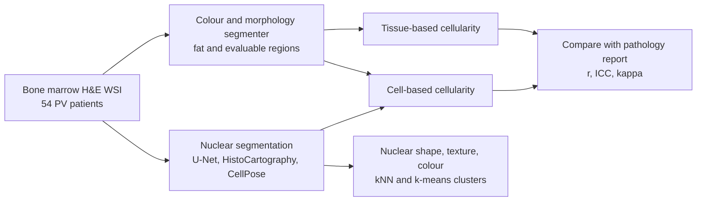

# A Deep Learning-Based Pathomics Methodology for Quantifying and Characterizing Nucleated Cells in the Bone Marrow Microenvironment

> **Bibkey** `Krichevsky_2023` · **Venue** Blood 142 (Supplement 1): 2294 (conference abstract) (2023) · **Category** pathology · **Relevance** medium · **Access** abstract-only
> **Link** <https://ashpublications.org/blood/article/142/Supplement%201/2294/499845> · `status: abstract-only`

---

## One-liner
On H&E whole-slide images of bone-marrow biopsies from 54 polycythemia vera (PV) patients, the authors segment nucleated cells with deep learning and fat / evaluable regions with classical image analysis to estimate marrow cellularity automatically, comparing with pathology reports; a cell-based estimator agrees far better with the reports than a tissue-area-based one.

## Takeaways
- Marrow cellularity (haematopoietic cells vs fat) is a WHO criterion for myeloproliferative neoplasms (MPNs), but manual assessment is subjective, unscalable and gives one global number (Abstract, Introduction).
- Data: 54 manually confirmed PV patients (Weill Cornell); 17% newly diagnosed, 61% treated, 17% progressing (Abstract, Methods).
- The tissue-area estimator barely agrees with reports (r = 0.2, ICC = 0.0, κ = 0.2); the cell-based estimator with the authors' U-Net reaches r = 0.7, ICC = 0.6, κ = 0.7 (Abstract, Results).
- Segmenter choice matters: within the cell-based approach, HistoCartography gets r = 0.7 / ICC 0.5, CellPose only r = 0.2 / ICC 0.2 (Abstract, Results).
- K-means clustering of nuclear features (shape, texture, colour) separated new from progressing PV (Abstract, Results; Figure 2 not seen, no quantitative metric).

## Problem
Overall bone-marrow cellularity is a WHO criterion for distinguishing BCR-ABL-negative MPNs such as polycythemia vera (PV) and myelofibrosis (MF). Manual assessment is subjective, not scalable, and records a single global value, ignoring regional differences. The authors argue that slide scanners and deep learning can address this, and that computational pathology is understudied here (Abstract, Introduction).

## Method
(All from the abstract; details are limited.)
1. **Data**: bone-marrow biopsy H&E WSIs of 54 PV patients with labs, molecular studies and pathology reports; reported core size and cellularity are the reference standard.
2. **Definition**: numeric cellularity = haematopoietic cells vs fat cells, excluding inevaluable trabecular bone; normal ≈ (100 − age) ± 20%; PV is hypercellular.
3. **Nuclear segmentation (3 models compared)**: (1) the group's U-Net (abstract: trained on "5B" nuclei from 10 cancer types); (2) HistoCartography (graph neural network, 235K nuclei from PanNuke / MoNuSAC); (3) CellPose (gradient-driven U-Net, 1K nuclei of varied modalities).
4. **Fat and evaluable regions**: a colour/morphology segmenter finds fat cells and evaluable marrow, excluding vessels and tissue tears.
5. **Two cellularity estimators**: tissue-based = non-fat tissue / evaluable area; cell-based = nucleated-cell area vs fat-cell area.
6. **Evaluation**: mean difference of core-size estimates; r and ICC for numeric cellularity; Cohen's κ for categorical cellularity.
7. **Exploration**: shape, texture and colour features per cell, clustered with kNN and K-means to compare PV stages; overall and cell-size-stratified cellularity heatmaps.

## Method diagram


## Data
Single centre (Weill Cornell Medicine, with Stony Brook University review): 54 manually confirmed PV patients — 17% newly diagnosed, 61% treated, 17% progressing; H&E bone-marrow biopsy WSIs plus labs, molecular studies and pathology reports (Abstract, Methods). Scanner, magnification and slide counts are not given.

## Key results
- Estimated vs measured core size differ by 3 ± 4 mm, which the authors deem acceptable (Abstract, Results).
- Tissue-based cellularity: r = 0.2, ICC = 0.0, κ = 0.2 (Abstract, Results).
- Cell-based cellularity: authors' U-Net r = 0.7, ICC = 0.6, κ = 0.7; HistoCartography r = 0.7, ICC = 0.5, κ = 0.6; CellPose r = 0.2, ICC = 0.2, κ = 0.7 (Abstract, Results).
- Cell-size clusters match known PV distributions; the prominent Int1 class (5.1–9 µm) likely contains erythrocytes and myeloid progenitors (Abstract, Results).
- Overall and cell-size cellularity heatmaps show regional differences (Figure 1); K-means separated new from progressing PV (Figure 2) — no quantitative metric given (Abstract, Results).

## Contributions
- Turns marrow cellularity from one manual global number into an automatic, region-resolved measure with heatmaps.
- Compares three nuclear segmenters and two cellularity definitions side by side, showing that "cell-based + a suitable segmenter" is clearly better.
- Proposes nuclear-feature extraction + clustering as an interpretable pathomics pipeline for hypothesis-driven research (a pilot / proof of concept, per the authors).

## Limitations
- (Authors) A pilot study; future work is to apply these insights to a large cohort of diagnostic WSIs from other MPN subtypes and to correlate findings with tools such as immune-cell detection models.
- Our reading: only 54 PV patients from one centre and no MF or other subtypes; agreement is measured against pathology reports, which are themselves the subjective estimates the authors criticise.
- Our reading: the best r = 0.7 / ICC = 0.6 is only moderate agreement, and "K-means separated new and progressing PV" comes with no number or statistical test.
- Our reading: a conference abstract with no full paper or code; Figures 1–2 are not visible and method details (magnification, feature dimensions, number of clusters) are missing.

## Relation to our direction
Indirectly related to detect → model → revert; its value is in the tissue-representation step.
- Our reading: "segment nuclei → per-cell morphology features → regional statistics / heatmaps" is the same kind of cell-level description we need on kidney H&E; it also shows that swapping the segmenter (CellPose vs the authors' U-Net) can change results a lot, so a kidney benchmark should report and compare segmenters as a variable.
- Our reading: "tissue-area method fails, cell-based works" shows that the metric definition drives the conclusion; and the reference standard (here, pathology reports) may itself be unreliable — a reason for multi-modal cross-evidence, in line with Topic 1's design.
- Relevance medium: haematopathology / bone marrow; no kidney, no omics, no anomaly detection or perturbation modelling.

## Reusable assets
- No code, weights or data are given. Public tools mentioned: HistoCartography and CellPose; the authors' U-Net training data come from ref. [4] (Hou L, Sci Data 2020).
- Evaluation recipe: r + ICC for numeric and Cohen's κ for categorical cellularity against pathology reports.

## Follow-ups
- Check whether the group has published a full paper (large cohort of other MPN subtypes, quantified clustering).
- Abstract refs [4] Hou L, Sci Data 2020 (large-scale nucleus segmentation) and [5] HistoCartography (Jaume G, PMLR 2021) as candidate tools for kidney nucleus segmentation.

## Figures & tables

This entry is a conference abstract in *Blood* 142, Supplement 1 (published by ASH) (Abstract 2294; DOI 10.1182/blood-2023-191272); Figure 1 (cellularity heatmaps) and Figure 2 (K-means clustering) referenced in the abstract are not visible in the public metadata; the numeric results (r, ICC, κ) are listed under Key results above. Abstract: <https://ashpublications.org/blood/article/142/Supplement%201/2294/499845>

## Cite
```bibtex
@article{Krichevsky_2023, title={A Deep Learning-Based Pathomics Methodology for Quantifying and Characterizing Nucleated Cells in the Bone Marrow Microenvironment}, volume={142}, ISSN={1528-0020}, url={http://dx.doi.org/10.1182/blood-2023-191272}, DOI={10.1182/blood-2023-191272}, number={Supplement 1}, journal={Blood}, publisher={American Society of Hematology}, author={Krichevsky, Spencer and Ouseph, Madhu M and Zhang, Yuwei and Abu-Zeinah, Ghaith and Scandura, Joseph M. and Gupta, Rajarsi}, year={2023}, month=Nov, pages={2294–2294} }
```


---

📄 **[AI-ready full-text extract →](ai-ready.md)**
