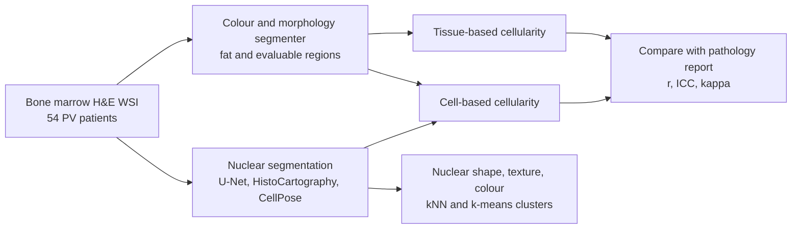

# A Deep Learning-Based Pathomics Methodology for Quantifying and Characterizing Nucleated Cells in the Bone Marrow Microenvironment

> **文献键** `Krichevsky_2023` · **来源** Blood (65th ASH Annual Meeting, Abstract 2294)(2023) · **类别** pathology · **相关度** medium · **获取** abstract-only
> **链接** <https://ashpublications.org/blood/article/142/Supplement%201/2294/499845> · `status: abstract-only`

---

## 一句话
在 54 例真性红细胞增多症(PV)患者的骨髓活检 H&E 全切片上,作者用深度学习分割有核细胞、配合经典图像分析分割脂肪和可评估区域,自动估计骨髓"细胞密度"(cellularity),并与病理报告对比;基于细胞计数的方法与报告的一致性明显好于基于组织面积的方法。

## 要点
- 骨髓细胞密度(造血细胞相对脂肪的比例)是 WHO 区分骨髓增殖性肿瘤(MPN)的标准之一,但人工评估主观、不可扩展,而且只给一个全局数(Abstract, Introduction)。
- 数据:54 例经人工确认的 PV 患者(Weill Cornell),其中 17% 新诊断、61% 已治疗、17% 疾病进展(Abstract, Methods)。
- 基于组织面积的估计几乎与报告无关(r = 0.2,ICC = 0.0,κ = 0.2);基于细胞的估计用作者自己的 U-Net 达到 r = 0.7、ICC = 0.6、κ = 0.7(Abstract, Results)。
- 分割模型的选择很关键:同为细胞法,HistoCartography r = 0.7 / ICC 0.5,CellPose 只有 r = 0.2 / ICC 0.2(Abstract, Results)。
- 核特征(形状、纹理、颜色)的 K-means 聚类能把新诊断和进展期 PV 分开(Abstract, Results;Figure 2 未见,无定量指标)。

## 研究问题
骨髓整体细胞密度是 WHO 区分 BCR-ABL 阴性骨髓增殖性肿瘤(MPN,如真性红细胞增多症 PV、骨髓纤维化 MF)的标准之一。人工评估主观、不可扩展,而且只记录一个全局数值,忽略骨髓内的区域差异。作者认为用切片扫描仪和深度学习可以解决这些问题,而计算病理在这一领域研究还很少(Abstract, Introduction)。

## 方法
(以下均来自摘要,细节有限)
1. **数据**:54 例 PV 患者的骨髓活检 H&E WSI,配有化验、分子检测和病理报告;报告中的活检长度和细胞密度作为参考标准。
2. **定义**:数值型细胞密度 = 造血细胞与脂肪细胞的比例,排除无法评估的骨小梁;正常范围约为 (100 − 年龄)± 20%,PV 表现为细胞密度过高。
3. **核分割(比较 3 个模型)**:(1)作者团队的 U-Net(摘要原文:在 10 种癌的 "5B" 个核上训练);(2)HistoCartography(图神经网络,在 PanNuke / MoNuSAC 的 23.5 万个核上训练);(3)CellPose(梯度驱动 U-Net,在 1K 个多模态核上训练)。
4. **脂肪与可评估区域**:基于颜色和形态的分割器找出脂肪细胞和可评估骨髓区域,排除血管和组织撕裂。
5. **两种细胞密度估计**:组织法 = 非脂肪组织面积 / 可评估区域面积;细胞法 = 有核细胞面积与脂肪细胞面积的比例。
6. **评估**:活检长度估计与测量值的平均差;数值细胞密度用相关系数 r 和组内相关系数 ICC;分类细胞密度用 Cohen's κ。
7. **探索分析**:计算细胞的形状、纹理、颜色特征,用 kNN 和 K-means 聚类,比较 PV 不同阶段;画整体和按细胞大小分组的细胞密度热图。

## 方法图


## 数据
单中心(Weill Cornell Medicine;Stony Brook University 参与审查):54 例人工确认诊断的 PV 患者,17% 新诊断、61% 已治疗、17% 疾病进展;H&E 骨髓活检 WSI + 化验 + 分子检测 + 病理报告(Abstract, Methods)。摘要未给扫描仪、放大倍数、切片数等细节。

## 主要结果
- 估计的活检长度与实测相差 3 ± 4 mm,作者认为可接受(Abstract, Results)。
- 组织法细胞密度:r = 0.2、ICC = 0.0、κ = 0.2(Abstract, Results)。
- 细胞法细胞密度:作者 U-Net r = 0.7、ICC = 0.6、κ = 0.7;HistoCartography r = 0.7、ICC = 0.5、κ = 0.6;CellPose r = 0.2、ICC = 0.2、κ = 0.7(Abstract, Results)。
- 细胞大小聚类与 PV 的已知分布一致,其中占多数的 Int1 类(5.1–9 μm)可能包含红细胞和髓系祖细胞(Abstract, Results)。
- 整体和按细胞大小的细胞密度热图显示区域差异(Figure 1);K-means 聚类分开了新诊断与进展期 PV(Figure 2)——摘要未给定量指标(Abstract, Results)。

## 创新点
- 把骨髓细胞密度从"一个人工全局数"变成可自动计算、可画热图的区域化指标。
- 在同一任务上并排比较三种核分割模型和两种细胞密度定义,显示"细胞法 + 合适的分割器"明显更好。
- 提出核形态特征 + 聚类作为假设驱动研究的可解释 pathomics 流程(作者称为 pilot / proof of concept)。

## 局限
- (作者)这是 pilot 研究;未来需要更大的诊断期 WSI 队列和其他 MPN 亚型,并与免疫细胞检测等工具关联。
- 我们的理解:只有 54 例 PV、单中心,没有 MF 等其他亚型;一致性只与病理报告比较,而报告本身就是作者批评的主观估计。
- 我们的理解:最好的 r = 0.7 / ICC = 0.6 只是中等一致;"K-means 分开新诊断和进展期 PV"没有给出任何数值或统计检验。
- 我们的理解:会议摘要,无全文、无代码,图 1–2 不可见,方法细节(放大倍数、特征维数、聚类数)都缺失。

## 与本研究方向的关系
与 detect → model → revert 的关系较间接,主要价值在"组织表征"这一步。
- 我们的理解:用"核分割 → 每个细胞的形态特征 → 区域化统计/热图"的方式把组织变成可计算的特征,这和肾脏 H&E 上要做的细胞级描述是同一类工作;它提醒我们,同一任务里换一个分割模型(CellPose vs 作者 U-Net)结果可以差很多,所以肾脏基准里应把分割器当成需要报告和比较的变量。
- 我们的理解:"组织面积法几乎无效、细胞法有效"说明定义指标的方式本身会决定结论;做异常检测时,"异常"的参照标准(这里是病理报告)本身也可能不可靠,需要多模态交叉证据——这与 Topic 1 的设计一致。
- 相关性 medium:血液病理、骨髓,不涉及肾脏和组学,也没有异常检测或扰动建模。

## 可复用资产
- 摘要未提供代码、权重或数据。提到的公开工具:HistoCartography、CellPose;作者 U-Net 的训练数据出自参考文献 [4]（Hou L, Sci Data 2020）。
- 评测思路:数值指标用 r + ICC、分类指标用 Cohen's κ,与病理报告对照。

## 待读
- 查该组是否发表了全文(更大队列、其他 MPN 亚型、定量的聚类结果)。
- 摘要参考文献 [4] Hou L. Sci Data 2020(大规模核分割数据)与 [5] HistoCartography(Jaume G, PMLR 2021),可作为肾脏核分割工具的候选。

## 图表

本条目为 ASH 2023《Blood》会议摘要(Abstract 2294;DOI 10.1182/blood-2023-191272),摘要中提到的 Figure 1(细胞密度热图)和 Figure 2(K-means 聚类)在公开元数据中不可见;数值结果见上文"主要结果"(r、ICC、κ)。原文见:<https://ashpublications.org/blood/article/142/Supplement%201/2294/499845>

## 引用
```bibtex
@article{Krichevsky_2023, title={A Deep Learning-Based Pathomics Methodology for Quantifying and Characterizing Nucleated Cells in the Bone Marrow Microenvironment}, volume={142}, ISSN={1528-0020}, url={http://dx.doi.org/10.1182/blood-2023-191272}, DOI={10.1182/blood-2023-191272}, number={Supplement 1}, journal={Blood}, publisher={American Society of Hematology}, author={Krichevsky, Spencer and Ouseph, Madhu M and Zhang, Yuwei and Abu-Zeinah, Ghaith and Scandura, Joseph M. and Gupta, Rajarsi}, year={2023}, month=Nov, pages={2294–2294} }
```


---

📄 **[AI-ready 全文提取 →](ai-ready.md)**
