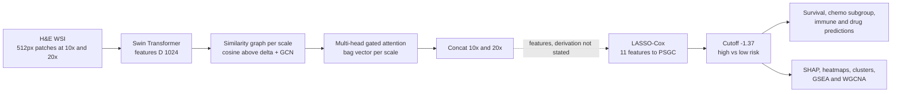

# Deep learning-based pathomics signature predicts prognosis and treatment response in gastric cancer: a multicenter retrospective study

> **Bibkey** `Wang_2026` · **Venue** npj Precision Oncology (2026) · **Category** pathology · **Relevance** medium · **Access** open
> **Link** <https://doi.org/10.1038/s41698-026-01381-6> · `status: complete`

---

## One-liner
The authors extract features from gastric-cancer H&E whole-slide images with a multi-scale graph neural network plus gated-attention MIL (MS-GMIL), then use LASSO-Cox to pick 11 features into a weighted sum — the pathomics signature PSGC; it is an independent prognostic factor for overall survival in one training and four validation cohorts (3,138 patients), and is used to stratify adjuvant-chemotherapy benefit and infer immunotherapy response.

## Takeaways
- Scale: 3,138 patients in 5 cohorts (training HMUCH 1,257; validation HMUSH 752, QMUSH 540, YKPH 319, TCGA-STAD 270) (Methods "Study design").
- The final signature is a linear formula: PSGC = weighted sum of 11 numbered features (feature3, feature17, …), cut at −1.37 into high/low risk; log-rank p < 0.0001 in all 5 cohorts (Results; Fig. 2A).
- Large effect: in the training cohort, high-PSGC patients have 21.0 months less restricted mean survival time at 60 months and 49.0 months less at 108 months (Table 2).
- Our reading: treatment claims are weak: chemotherapy benefit comes from a small subgroup analysis without key confounders (authors' own words); immunotherapy response is predicted by algorithms (TIDE, ImmuCellAI, submap), not observed in a treated cohort (Results; Discussion).
- Interpretation: high-risk regions show nuclear pleomorphism, high cellularity and tumour–stroma fibrosis; low-risk regions show intraepithelial neoplasia and intestinal metaplasia (Figs. 4–5); high PSGC is enriched for EMT, angiogenesis and myogenesis pathways (Fig. 6A).

## Problem
Gastric-cancer (GC) prognosis and treatment decisions rely mainly on TNM staging (tumour depth, nodes, metastasis), yet patients with the same stage and treatment have very different outcomes (Introduction). Molecular markers (MSI, tumour mutation burden, PD-L1, EBV) are limited by sample, technical, time and cost constraints. The authors want a fast, cheap, interpretable pathomics signature from routine H&E slides that predicts overall survival (OS) and indicates who benefits from adjuvant chemotherapy or immunotherapy.

## Method
1. **Slides and preprocessing**: slides from the four non-TCGA cohorts scanned on Aperio AT2 at 20× (0.5 µm/px); TCGA slides downloaded. WSIs are tiled into non-overlapping 512×512 patches, background removed by Canny edge count, Macenko stain normalization, RGB z-scoring, and flip/blur/colour augmentation (Methods).
2. **Multi-scale bags**: each WSI is a bag with patch instances at 10× and 20×; a pretrained Swin Transformer gives D = 1024 features (Methods "Pathomics feature extraction").
3. **Graph + GCN**: within each scale, patches are nodes and an edge is added when feature cosine similarity > δ (feature similarity, not spatial adjacency); a GCN updates node features (δ not reported in the main text).
4. **Gated-attention MIL**: node features are pooled with gated attention a_i ∝ exp(wᵀ(tanh(Vx_i) ⊙ σ(Ux_i))) into a bag vector z; multi-head gated attention with concatenated heads.
5. **Multi-scale fusion**: z_all = Concat(z_10×, z_20×) ∈ R^{2D} (Fig. 1C labels the model "for classification"). The main text states neither the training target/loss nor how the final "feature3 … feature46" are derived from the network output.
6. **Signature**: LASSO-Cox with 10-fold CV on the training cohort selects 11 features into the PSGC formula; cutoff −1.37 from maximally selected rank statistics, applied unchanged to validation cohorts.
7. **Evaluation**: KM, RMST, uni-/multivariable Cox, E-values, time-dependent ROC, calibration, decision curves, and C-index / NRI / IDI gains over TNM.
8. **Treatment and interpretation**: stage II/III patients compared by adjuvant chemotherapy (XELOX or SOX); oncoPredict (GDSC, CTRP) predicts IC50; TIDE, ImmuCellAI and submap (PRJEB25780 anti-PD-1 cohort, 45 patients) infer immunotherapy response; SHAP for feature contributions; prediction heatmaps, top/bottom-10 patches per patient clustered with K-means (10 clusters) and reviewed blind by two pathologists; Grad-CAM; 193 training-cohort mRNA-seq + 225 TCGA samples (ComBat) for GSEA, WGCNA and xCell.

## Method diagram


## Data
Retrospective multicentre study, 3,138 H&E slides / patients: training HMUCH (the paper's "our Hospital"; by the authors' affiliation, inferred to be Harbin Medical University Cancer Hospital; 1,257, 2014–2016), validation 1 HMUSH (752), validation 2 QMUSH (540), validation 3 YKPH (319), validation 4 TCGA-STAD (270) (Methods "Study design"). Inclusion: ≥ 18 years, R0 resection, ≥ 90-day survival, no other tumours, complete data; neoadjuvant therapy excluded. Median age 60, 71.64% male, 69.50% advanced disease (Results; Table 1). Follow-up: HMUCH median 92.33 months, 5-year OS 72.79%; TCGA-STAD median 19.9 months, 5-year OS 45.66%. Transcriptomes: 193 training-cohort mRNA-seq (GEO GSE184336, GSE179252) and 225 TCGA samples (Methods).

## Key results
- **Signature**: LASSO-Cox selects 11 features (Supplementary Fig. 1A–B); SHAP ranks feature17 first, then feature8, feature3, feature34; feature10 contributes least (Results; Fig. 4A).
- **Prognosis**: cutoff −1.37; log-rank p < 0.0001 in all 5 cohorts (Fig. 2A); PSGC is independent in multivariable Cox in training and validation (Results; HRs are in Supplementary Table 2, not read).
- **RMST**: high minus low PSGC RMST at 60 months: HMUCH −21.0, HMUSH −20.0, QMUSH −17.4, YKPH −21.9, TCGA-STAD −18.4 months, all p < 0.0001 (Table 2).
- **Gain over TNM**: PSGC + TNM has higher C-index than TNM alone (Supplementary Table 5, not read), higher time-dependent AUROC (Fig. 2B), lower prediction error (Fig. 2C) and positive NRI/IDI at several time points (Table 3).
- **Adjuvant chemotherapy**: overall no significant survival gain in stage II/III (Supplementary Fig. 4); high-PSGC patients who received chemotherapy did better, low-PSGC patients did not (Fig. 3A–B). Yet drug-sensitivity prediction labels the high-PSGC group as more resistant (Fig. 3D–E).
- **Immunotherapy (predicted)**: TIDE 149/246 vs 48/172 (OR 0.253, 95% CI 0.162–0.391), ImmuCellAI 144/246 vs 31/172 (OR 0.157); submap suggests high PSGC is more likely to respond to anti-PD-1 (Results; Supplementary Fig. 6).
- **Morphology and molecules**: high-risk clusters (6, 7) are poorly differentiated adenocarcinoma with tumour–stroma fibrosis; low-risk clusters (0, 2) are moderately differentiated with intraepithelial neoplasia and intestinal metaplasia (Figs. 4C–D, 5A); low PSGC is enriched for DNA repair, proliferation and metabolism, high PSGC for myogenesis, angiogenesis and EMT (Fig. 6A); the yellow WGCNA module correlates strongly with PSGC (Fig. 6D).

## Contributions
- MS-GMIL: a two-scale (10×/20×) feature-similarity-graph + GCN + multi-head gated-attention MIL architecture for prognostic WSI representations.
- Deep features + LASSO-Cox give an 11-term linear signature that SHAP can explain.
- The authors describe it as the largest study of its kind (3,138 patients, 4 external validation sets).
- Links the signature to transcriptomics (GSEA, WGCNA, xCell) and drug/immune predictions.

## Limitations
- (Authors) Retrospective with hidden confounders; short TCGA follow-up; chemotherapy benefit from a small subgroup analysis not controlling ECOG, lymph-node yield, margins or peritoneal involvement.
- (Authors) GDSC/TIDE predictions are "largely hypothetical" without real treatment data; PD-L1, MSI and MMR not analysed; no direct comparison with tumour grade or Lauren classification.
- Our reading: the high-PSGC group is both "more likely to benefit from chemotherapy" and predicted "more resistant to chemotherapy drugs"; the paper does not reconcile these.
- Our reading: the main text does not say how the 11 "featureN" are obtained from the network, nor give δ or training-loss details, so reproduction is hard; data are "available on request" with no code link. The text links the yellow module to PSGC while the Fig. 6E caption describes the blue and midnightblue modules — an inconsistency.
- Our reading: key discrimination metrics (C-index, HR) sit in the supplement; the main text gives only log-rank p values and RMST.

## Relation to our direction
A typical supervised "WSI → prognostic signature" paper; its link to detect → model → revert is indirect.
- Our reading (detect): gated-attention weights and Grad-CAM highlight regions tied to poor prognosis (e.g. tumour–stroma fibrosis), but these are supervised "risk regions", not unsupervised anomalies; in the kidney project the same approach would need outcome labels (e.g. eGFR decline), whereas Topic 1 focuses on label-free anomaly detection.
- Our reading (model / revert): the signature is linked to transcriptomic pathways (EMT, angiogenesis, E2F/MYC/G2M) and predicted drug sensitivity only by correlation or algorithmic inference, with no intervention, so it cannot directly say which genes would revert an anomaly.
- Our reading (method reuse): multi-scale (10×/20×) + graph + gated-attention MIL is a common WSI encoder; the two-step "deep features → LASSO-Cox linear signature → SHAP" is a reasonable template for a kidney H&E prognostic baseline; note that its graph links patches by feature similarity, unlike PathPrism-style tissue graphs that link by spatial adjacency.
- Relevance medium: gastric cancer; no kidney, no spatial omics.

## Reusable assets
- **Code / models**: no code or model link in the paper.
- **Data**: clinical and image data "available on request"; 193 training-cohort mRNA-seq in GEO (GSE184336, GSE179252); TCGA-STAD public; immunotherapy reference cohort PRJEB25780.
<https://www.ncbi.nlm.nih.gov/geo/query/acc.cgi?acc=GSE184336> · <https://www.ncbi.nlm.nih.gov/geo/query/acc.cgi?acc=GSE179252>
- **Eval protocol**: KM + RMST + E-value + time-dependent ROC + calibration + DCA + NRI/IDI — a complete prognostic-reporting checklist (the authors follow REMARK and TRIPOD).

## Follow-ups
- Read the supplement: Supplementary Table 2 (Cox HRs), Table 5 (C-index), Figs. 4–6 (chemotherapy and immune analyses).
- Compare with Chen et al., "Prognostic and predictive value of a pathomics signature in gastric cancer", Nat. Commun. 13, 6903 (2022) (cited by this paper).

## Figures & tables

**Note:** The article is open access (CC BY-NC-ND 4.0), which does not allow sharing adapted material, so figures are linked rather than embedded.

· Full article: <https://www.nature.com/articles/s41698-026-01381-6>
· Figures gallery (all figures): <https://www.nature.com/articles/s41698-026-01381-6/figures>
· Per-figure anchors (Nature convention): `…s41698-026-01381-6#Fig1`, `#Fig2`, …

### Results

**Table 1.** 60-month restricted mean survival time (RMST, months) for high vs low PSGC, from the paper's Table 2.

| Cohort | n | High PSGC | Low PSGC | Difference | P |
|---|---|---|---|---|---|
| HMUCH (training) | 1,257 | 35.503 | 56.526 | −21.023 | <0.0001 |
| HMUSH | 752 | 36.547 | 56.559 | −20.012 | <0.0001 |
| QMUSH | 540 | 39.243 | 56.688 | −17.445 | <0.0001 |
| YKPH | 319 | 35.224 | 57.171 | −21.947 | <0.0001 |
| TCGA-STAD | 270 | 35.11 | 53.503 | −18.392 | <0.0001 |

_Source: Wang et al., npj Precis. Oncol. 10:206 (2026), Table 2 · CC BY-NC-ND 4.0_

## Cite
```bibtex
@article{Wang_2026, title={Deep learning-based pathomics signature predicts prognosis and treatment response in gastric cancer: a multicenter retrospective study}, volume={10}, ISSN={2397-768X}, url={http://dx.doi.org/10.1038/s41698-026-01381-6}, DOI={10.1038/s41698-026-01381-6}, number={1}, pages={206}, journal={npj Precision Oncology}, publisher={Springer Science and Business Media LLC}, author={Wang, Hao and Li, Hao and Ma, Keru and Mo, Genshen and Yan, Meihong and Zhang, Xinyue and Xie, Haonan and Huang, Yuze and Li, Huiying and Xue, Yingwei and Han, Peng and Lou, Shenghan}, year={2026}, month=Apr }
```


---

📄 **[AI-ready full-text extract →](ai-ready.md)**
