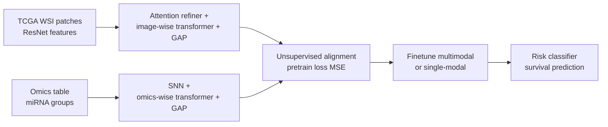

# Cassie07/PathOmics

> **Bibkey** `Ding2023_PathOmics` · **Venue** GitHub (2023) · **Category** pathology · **Relevance** medium · **Access** open
> **Link** <https://github.com/Cassie07/PathOmics> · `status: complete`

---

## One-liner
PathOmics is the official code of the MICCAI 2023 paper (Oral; "top 9%" per the README) "Pathology-and-genomics Multimodal Transformer for Survival Outcome Prediction": unsupervised pretraining fuses pathology-slide and genomics (miRNA in the example) embeddings, then supervised finetuning predicts cancer survival with either both modalities or a single one.

## Takeaways
- Two stages: (a) unsupervised multimodal pretraining yields image and omics embeddings; (b) multimodal or (c) single-modal finetuning with a risk classifier for survival (README Figure 1).
- Data: TCGA-COAD and TCGA-READ only; omics from cBioPortal `coadread_tcga_pan_can_atlas_2018`, with `--omic_modal 'miRNA'` in the example commands (README "Usage").
- Image features are extracted by the user: foreground patches, ImageNet-pretrained ResNet50/101 etc., one .npz per slide (README "Data preprocessing").
- The README has no numeric results and no released weights; numbers are in the paper (https://rdcu.be/dnwKf).
- Extra value: the README keeps a table of pathology–genomics multimodal methods (48 entries, 2019–2025.12 at reading time) with paper and code links.

## Problem
The README states briefly that the goal is to fuse pathology images and genomics for prognostic (survival) prediction, with a finetuning scheme that "flexibly handles multiple types of data": given the multimodal pretrained backbones, either multi- or single-modal data can be used for finetuning (README "Workflow overview"). Our reading: the latter addresses the common missing-modality case (slides without sequencing).

## Method
(From README text, command-line flags and Figure 1; the paper itself was not read.)
1. **Image preprocessing**: download TCGA WSIs, tile into foreground patches, extract features with ImageNet-pretrained ResNet50 / ResNet101 etc., one .npz per slide (README; see Issue 1 and `split_tiles_utils/helper.py`).
2. **Omics**: download `coadread_tcga_pan_can_atlas_2018` from cBioPortal; miRNA in the example.
3. **Pretraining (Figure 1a)**: N patch groups → Feature Extractor → Attention Refiner → Image-wise Transformer → Image-wise GAP → image embedding; N groups of omics tabular data → SNN → Omics-wise Transformer → Omics-wise GAP → omics embedding; the two embeddings are aligned/fused. GAP = Global attention pooling in the figure. Example flags: `--pretrain_loss 'MSE'`, fusion `concat`.
4. **Finetuning (Figure 1b–c)**: multimodal — image + omics embeddings → Multimodal Embedding Fusion → Risk Classifier → survival; single-modal — one embedding → Risk Classifier → survival.
5. **Settings**: TCGA-COAD with 4-fold CV and evaluation on a COAD hold-out set; or pretrain on COAD (5-fold) and finetune/validate/evaluate on TCGA-READ; `--less_data` + `--finetune_test_ratio` for data-efficient finetuning; 25 pretraining and 25 finetuning epochs in the examples.

## Method diagram


## Data
TCGA-COAD and TCGA-READ WSIs (downloaded by the user); omics from cBioPortal `coadread_tcga_pan_can_atlas_2018`, miRNA in the example. No raw data or features are shipped, and the README gives no case counts.

## Key results
The README lists no numeric results (no C-index, no comparison table). It only states that the paper was accepted to MICCAI 2023 as an Oral, "top 9%" (repo description and README header). Metrics are in the paper (https://rdcu.be/dnwKf, MICCAI 2023, pp. 622–631).

## Contributions
- (Per README) Unsupervised pretraining fuses pathology and genomics embeddings into a reusable multimodal backbone.
- (Per README) Finetuning works with multi- or single-modal data, supporting missing modalities.
- (Per README) Cross-dataset (COAD pretrain → READ finetune) and data-efficient finetuning options.
- A maintained literature table of pathology–genomics multimodal methods (48 entries).

## Limitations
- Our reading: the README covers only TCGA colorectal cancer + miRNA, with no other cancers or omics.
- Our reading: it suggests ImageNet-pretrained ResNets rather than pathology foundation models (e.g. UNI, CONCH); stronger encoders might help but this is untested.
- Our reading: no numeric results and no released weights (`--load_model_finetune` assumes your own saved weights), so reproduction starts from downloading TCGA, tiling and feature extraction.
- Our reading: the task is slide/patient-level survival prediction, with no spatial localisation, anomaly detection or perturbation.

## Relation to our direction
It sits at the tissue-representation / multimodal-modelling stage, with little bearing on detect or revert.
- Our reading: it gives an engineering template for pretraining-time alignment of pathology and omics embeddings that still allows single-modal inference. Kidney Topic 1 has H&E, snRNA, snATAC and Xenium, but not every sample has every modality; "multimodal pretraining, single-modal use" could let H&E-only samples benefit from multimodal representations.
- Our reading: to support "cross-modal disagreement = anomaly", it would have to move from slide-level survival to spatially resolved (spot / cell-level) alignment with a disagreement score — none of which the repo provides.
- Our reading: the README literature table is a quick entry point to pathology–genomics fusion methods (PORPOISE, MCAT, SurvPath, TANGLE, POMP, …).
- Relevance medium: TCGA colorectal cancer; no kidney, no spatial omics.

## Reusable assets
- **Code**: `bash_main.py` (TCGA-COAD), `bash_main_read.py` (COAD → READ), `split_tiles_utils/helper.py` (tiling and features); Python 3.8.18, PyTorch 2.0.1, scikit-survival 0.21.0, etc.
<https://github.com/Cassie07/PathOmics>
- **Data**: TCGA-COAD / READ WSIs; cBioPortal `coadread_tcga_pan_can_atlas_2018`.
<https://www.cbioportal.org/>
- **Weights**: none provided in the README.
- **Literature table**: 48 pathology–genomics multimodal methods at the end of the README, with paper and code links.

## Follow-ups
- Read the MICCAI 2023 paper for C-index and ablations (single vs multimodal, fusion type, data-efficient).
- From the table, compare SurvPath and TANGLE (both CVPR 2024, mahmoodlab) to see whether pathway/transcriptome-guided representations suit spatial omics better.

## Figures & tables


**Fig 1.** Overview of the two-stage PathOmics pipeline. (a) Unsupervised multimodal pretraining: WSIs are tiled into N groups of patches → Feature Extractor → Attention Refiner + Image-wise Transformer + GAP yields the image embedding (blue triangle); grouped omics tabular data pass through SNN + Omics-wise Transformer + GAP to yield the omics embedding (green circle); the two are aligned/fused during pretraining (GAP = Global attention pooling). (b) Supervised multimodal finetuning: fused image+omics embeddings → Multimodal Embedding Fusion → Risk Classifier → survival prediction. (c) Supervised single-modal finetuning: image-only or omics-only embedding → Risk Classifier → survival prediction, enabling missing-modality inference.
_Source: https://github.com/Cassie07/PathOmics/raw/main/Figures/Figure1.png  ·  License: GitHub README figure (MICCAI 2023, Ding et al.)_

### Results

**Table 1.** The README contains no numeric results table (no C-index / AUC figures). The actual survival-prediction metrics (TCGA-COAD 4-fold CV + hold-out, COAD→READ transfer, single- vs multimodal, data-efficient ablations) live in the MICCAI 2023 paper, not in this repo — numbers are not invented here.

_C-index results: see the paper → https://rdcu.be/dnwKf (Ding et al., MICCAI 2023, pp. 622–631)._

## Cite
```bibtex
@inproceedings{ding2023pathology,
  title={Pathology-and-genomics multimodal transformer for survival outcome prediction},
  author={Ding, Kexin and Zhou, Mu and Metaxas, Dimitris N and Zhang, Shaoting},
  booktitle={International Conference on Medical Image Computing and Computer-Assisted Intervention},
  pages={622--631},
  year={2023},
  organization={Springer}
}
```


---

📄 **[AI-ready full-text extract →](ai-ready.md)**
