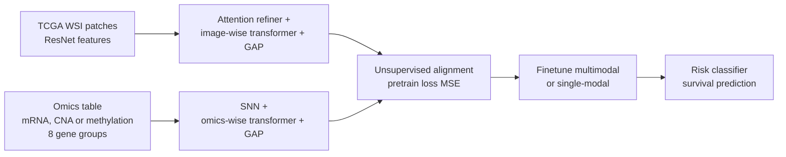

# Cassie07/PathOmics

> **Bibkey** `Ding2023_PathOmics` · **Venue** GitHub (2023) · **Category** pathology · **Relevance** medium · **Access** open
> **Link** <https://github.com/Cassie07/PathOmics> · `status: complete`

---

## One-liner
PathOmics is the official code of the MICCAI 2023 paper (Oral; "top 9%" per the README) "Pathology-and-genomics Multimodal Transformer for Survival Outcome Prediction": unsupervised pretraining fuses pathology-slide and genomics (mRNA expression, copy-number alteration (CNA) or methylation) embeddings, then supervised finetuning predicts cancer survival with either both modalities or a single one.

## Takeaways
- Two stages: (a) unsupervised multimodal pretraining yields image and omics embeddings; (b) multimodal or (c) single-modal finetuning with a risk classifier for survival (README Figure 1).
- Data: TCGA-COAD and TCGA-READ only; omics from cBioPortal `coadread_tcga_pan_can_atlas_2018`. The example commands use `--omic_modal 'miRNA'` (README "Usage"), but the name is misleading: in the code this option loads the mRNA-expression z-score file `data_mrna_seq_v2_rsem_zscores_ref_all_samples.txt` (`bash_main.py`); the other options are `CNA` and `Methylation`. The paper also uses mRNA, CNA and methylation, not miRNA (paper abstract, Sec. 3).
- Image features are extracted by the user: foreground patches, ImageNet-pretrained ResNet50/101 etc., one .npz per slide (README "Data preprocessing").
- The README has no numeric results and no released weights; numbers are in the paper's Table 1 (see Key results below).
- Extra value: the README keeps a table of pathology–genomics multimodal methods (48 entries, 2019–2025.12 at reading time) with paper and code links.

## Problem
The README states briefly that the goal is to fuse pathology images and genomics for prognostic (survival) prediction, with a finetuning scheme that "flexibly handles multiple types of data": given the multimodal pretrained backbones, either multi- or single-modal data can be used for finetuning (README "Workflow overview"). Our reading: the latter addresses the common missing-modality case (slides without sequencing).

## Method
(From README text, command-line flags, Figure 1, the code and the paper arXiv:2307.11952.)
1. **Image preprocessing**: download TCGA WSIs, tile into foreground patches, extract features with ImageNet-pretrained ResNet50 / ResNet101 etc., one .npz per slide (README; see Issue 1 and `split_tiles_utils/helper.py`).
2. **Omics**: download `coadread_tcga_pan_can_atlas_2018` from cBioPortal; mRNA expression in the example (option named `miRNA`), or CNA or methylation. Genes are grouped into N = 8 functional families taken from the paper's reference (e.g. transcription factors, tumour suppressors, protein kinases; paper Sec. 2; repo `PathOmics/gene_family/`).
3. **Pretraining (Figure 1a)**: N patch groups → Feature Extractor → Attention Refiner → Image-wise Transformer → Image-wise GAP → image embedding; N groups of omics tabular data → SNN → Omics-wise Transformer → Omics-wise GAP → omics embedding; the two embeddings are aligned/fused. GAP = Global attention pooling in the figure. The pretraining loss is MSE, pulling the image and omics embeddings of the same patient together (paper Eq. 4; example flag `--pretrain_loss 'MSE'`, the code also offers `Cosine`); fusion `concat`.
4. **Finetuning (Figure 1b–c)**: multimodal — image + omics embeddings → Multimodal Embedding Fusion → Risk Classifier → survival; single-modal — one embedding → Risk Classifier → survival.
5. **Settings**: TCGA-COAD with 4-fold CV and evaluation on a COAD hold-out set; or pretrain on COAD (5-fold) and finetune/validate/evaluate on TCGA-READ; `--less_data` + `--less_data_ratio` (fraction of finetuning data kept) for data-efficient finetuning — the README names `--finetune_test_ratio`, but in the code that is the READ test-split fraction (`bash_main_read.py`); 25 pretraining and 25 finetuning epochs in the examples (same in the paper). Survival is scored with the C-index (scikit-survival `concordance_index_censored` in the code).

## Method diagram


## Data
TCGA-COAD and TCGA-READ WSIs (downloaded by the user); omics from cBioPortal `coadread_tcga_pan_can_atlas_2018`, mRNA expression in the example (option named `miRNA`). No raw data or features are shipped, and the README gives no case counts; the paper keeps 426 TCGA-COAD and 145 TCGA-READ patients after removing samples without genomics or survival labels, and tiles WSIs into 512×512 non-overlapping patches (paper Sec. 3).

## Key results
The README lists no numeric results; it only states that the paper was accepted to MICCAI 2023 as an Oral, "top 9%" (repo description and README header). The numbers below are from Table 1 and the text of the paper arXiv:2307.11952 (C-index %; the paper reports the average of three repeated runs, and the ± spread is as printed — the paper does not say whether it is s.d. or s.e.):
- **Overall**: the paper reports about 2% higher C-index than the best prior methods on TCGA-COAD and about 4% on TCGA-READ; baselines are DeepSets, AB-MIL, TransMIL, MCAT and PORPOISE (paper Sec. 3, Results).
- **TCGA-COAD**: image + mRNA pretraining and finetuning 67.32 ± 1.69 (image-only finetuning 63.78, mRNA-only 60.76); the highest baselines are DeepSets image + methylation 65.61 and PORPOISE image + mRNA 65.31 (Table 1).
- **TCGA-READ**: image + mRNA 74.35 ± 1.15; highest baseline MCAT image + mRNA 70.27 (Table 1). Single-modal finetuning: the text says pretraining on image + methylation and finetuning on image only gives 74.85%, about 4% above the best baseline; but Table 1 lists 74.85 ± 0.37 in the "image + mRNA pretraining, image-only finetuning" row, and image + methylation pretraining with image-only finetuning is 64.42 — the paper's text and table disagree.
- **Less data**: with 50% of the COAD finetuning data the C-index is 64.80%; on READ with 50% or 75% of the finetuning data it stays above the baseline average (e.g. 72.32% vs 64.23%) (paper Ablation Analysis, Fig. 3).
- **Without unsupervised pretraining**: results are 2%–10% lower for both multi- and single-modal data (paper Ablation Analysis).

## Contributions
- (Per README) Unsupervised pretraining fuses pathology and genomics embeddings into a reusable multimodal backbone.
- (Per README) Finetuning works with multi- or single-modal data, supporting missing modalities.
- (Per README) Cross-dataset (COAD pretrain → READ finetune) and data-efficient finetuning options.
- A maintained literature table of pathology–genomics multimodal methods (48 entries).

## Limitations
- The README examples cover only TCGA colorectal cancer + mRNA expression (option named `miRNA`); the code and paper also cover CNA and methylation, but only colorectal cancer (README; `bash_main.py`; paper Sec. 3).
- Our reading: it suggests ImageNet-pretrained ResNets rather than pathology foundation models (e.g. UNI, CONCH); stronger encoders might help but this is untested.
- Our reading: no numeric results and no released weights (`--load_model_finetune` assumes your own saved weights), so reproduction starts from downloading TCGA, tiling and feature extraction.
- Our reading: the task is slide/patient-level survival prediction, with no spatial localisation, anomaly detection or perturbation.

## Relation to our direction
It sits at the tissue-representation / multimodal-modelling stage, with little bearing on detect or revert.
- Our reading: it gives an engineering template for pretraining-time alignment of pathology and omics embeddings that still allows single-modal inference. Kidney multimodal data (e.g. H&E plus single-cell / spatial omics) often lack some modalities for some samples; "multimodal pretraining, single-modal use" could let H&E-only samples benefit from multimodal representations.
- Our reading: to support "cross-modal disagreement = anomaly", it would have to move from slide-level survival to spatially resolved (spot / cell-level) alignment with a disagreement score — none of which the repo provides.
- Our reading: the README literature table is a quick entry point to pathology–genomics fusion methods (PORPOISE, MCAT, SurvPath, TANGLE, POMP, …).
- Relevance medium: TCGA colorectal cancer; no kidney, no spatial omics.

## Reusable assets
- **Code**: `bash_main.py` (TCGA-COAD), `bash_main_read.py` (COAD → READ), `split_tiles_utils/helper.py` (tiling and features); Python 3.8.18, PyTorch 2.0.1, scikit-survival 0.21.0, etc.
<https://github.com/Cassie07/PathOmics>
- **Data**: TCGA-COAD / READ WSIs; cBioPortal `coadread_tcga_pan_can_atlas_2018`.
<https://www.cbioportal.org/>
- **Weights**: none provided in the README.
- **Literature table**: 48 pathology–genomics multimodal methods at the end of the README, with paper and code links.

## Follow-ups
- Read the paper's appendix (arXiv:2307.11952) for the full single-modal results and the gene-grouping ablation details.
- From the table, compare SurvPath and TANGLE (both CVPR 2024, mahmoodlab) to see whether pathway/transcriptome-guided representations suit spatial omics better.

## Figures & tables


**Fig 1.** Overview of the two-stage PathOmics pipeline. (a) Unsupervised multimodal pretraining: WSIs are tiled into N groups of patches → Feature Extractor → Attention Refiner + Image-wise Transformer + GAP yields the image embedding (blue triangle); grouped omics tabular data pass through SNN + Omics-wise Transformer + GAP to yield the omics embedding (green circle); the two are aligned/fused during pretraining (GAP = Global attention pooling). (b) Supervised multimodal finetuning: fused image+omics embeddings → Multimodal Embedding Fusion → Risk Classifier → survival prediction. (c) Supervised single-modal finetuning: image-only or omics-only embedding → Risk Classifier → survival prediction, enabling missing-modality inference.
_Source: https://github.com/Cassie07/PathOmics/raw/main/Figures/Figure1.png  ·  License: GitHub README figure (MICCAI 2023, Ding et al.)_

### Results

**Table 1.** PathOmics C-index (%), from the "Ours" rows of the paper's Table 1 (the README itself has no numbers).

| Pretrain data | Finetune data | TCGA-COAD | TCGA-READ |
|---|---|:---:|:---:|
| image+mRNA | image+mRNA | 67.32 ± 1.69 | 74.35 ± 1.15 |
| image+mRNA | image | 63.78 ± 1.22 | 74.85 ± 0.37 |
| image+mRNA | mRNA | 60.76 ± 0.88 | 59.61 ± 1.37 |
| image+CNA | image+CNA | 61.19 ± 1.03 | 73.95 ± 1.05 |
| image+CNA | image | 58.06 ± 1.54 | 71.18 ± 1.39 |
| image+CNA | CNA | 56.43 ± 1.02 | 63.95 ± 0.55 |
| image+Methy | image+Methy | 67.22 ± 1.67 | 71.80 ± 2.03 |
| image+Methy | image | 60.43 ± 0.72 | 64.42 ± 0.72 |
| image+Methy | Methy | 61.06 ± 1.34 | 65.42 ± 0.91 |

_Source: Ding et al., arXiv:2307.11952v1, Table 1 (MICCAI 2023, pp. 622–631, DOI 10.1007/978-3-031-43987-2_60)._

## Cite
```bibtex
@inproceedings{Ding2023_PathOmics,
  title = {Pathology-and-genomics Multimodal Transformer for Survival Outcome Prediction},
  author = {Ding, Kexin and Zhou, Mu and Metaxas, Dimitris N. and Zhang, Shaoting},
  booktitle = {Medical Image Computing and Computer Assisted Intervention (MICCAI)},
  pages = {622--631},
  year = {2023},
  doi = {10.1007/978-3-031-43987-2_60},
  eprint = {2307.11952},
  archivePrefix = {arXiv},
  note = {Code: https://github.com/Cassie07/PathOmics},
  url = {https://github.com/Cassie07/PathOmics}
}
```


---

📄 **[AI-ready full-text extract →](ai-ready.md)**
