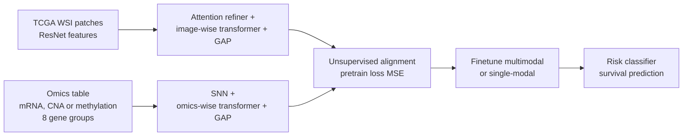

# Cassie07/PathOmics

> **文献键** `Ding2023_PathOmics` · **来源** GitHub(2023) · **类别** pathology · **相关度** medium · **获取** open
> **链接** <https://github.com/Cassie07/PathOmics> · `status: complete`

---

## 一句话
PathOmics 是 MICCAI 2023(Oral,README 称 top 9%)论文 "Pathology-and-genomics Multimodal Transformer for Survival Outcome Prediction" 的官方代码:先用无监督预训练把病理切片和基因组学(mRNA 表达、拷贝数变异 CNA 或甲基化)的嵌入融合对齐,再有监督微调做癌症生存预测,微调时可以用双模态,也可以只用单一模态。

## 要点
- 两阶段:(a) 无监督多模态预训练得到图像嵌入和组学嵌入;(b) 多模态微调或 (c) 单模态微调,接风险分类器做生存预测(README Figure 1)。
- 数据只涉及 TCGA-COAD 和 TCGA-READ(结肠癌、直肠癌);组学来自 cBioPortal 的 `coadread_tcga_pan_can_atlas_2018`。示例命令用 `--omic_modal 'miRNA'`(README "Usage"),但这个选项名有误导性:代码里它读取的是 mRNA 表达 z-score 文件 `data_mrna_seq_v2_rsem_zscores_ref_all_samples.txt`(`bash_main.py`);另两个选项是 `CNA` 和 `Methylation`。论文用的也是 mRNA、CNA、甲基化三种组学,没有 miRNA(论文摘要、Sec. 3)。
- 图像特征由用户自行提取:切前景 patch,用 ImageNet 预训练 ResNet50/101 等提特征,每张切片存一个 .npz(README "Data preprocessing")。
- README 不含任何数值结果,也不提供预训练权重;数值在论文 Table 1(见下文主要结果)。
- 额外价值:README 末尾维护了一张病理–基因组多模态方法文献表(读取时 48 条,2019–2025.12),带论文和代码链接。

## 研究问题
README 只简要说明:要把病理图像和基因组数据融合来做预后(生存)预测,并让微调阶段"灵活处理多种数据",即有多模态预训练 backbone 后,多模态或单模态数据都能用于微调(README "Workflow overview")。我们的理解:后者对应临床上常见的缺模态情况(只有切片、没有测序)。

## 方法
(根据 README 文字、命令行参数、Figure 1、代码和论文 arXiv:2307.11952)
1. **图像预处理**:从 TCGA 下载 WSI,切成 patch 并只保留前景,用 ImageNet 预训练 ResNet50 / ResNet101 等提 patch 特征,每张切片一个 .npz(README;细节见 Issue 1 与 `split_tiles_utils/helper.py`)。
2. **组学数据**:从 cBioPortal 下载 `coadread_tcga_pan_can_atlas_2018` 文件夹;示例用 mRNA 表达(选项名写作 `miRNA`),也可选 CNA 或甲基化。基因按论文引用的 N = 8 个功能类别分组(如转录因子、抑癌基因、蛋白激酶;论文 Sec. 2;仓库 `PathOmics/gene_family/`)。
3. **预训练(Figure 1a)**:patch 分成 N 组,每组经 Feature Extractor → Attention Refiner → Image-wise Transformer → Image-wise GAP 得到图像嵌入;组学表格数据分成 N 组,每组经 SNN → Omics-wise Transformer → Omics-wise GAP 得到组学嵌入;两个嵌入在预训练中对齐融合。图中 GAP 指 Global attention pooling。预训练损失为 MSE,把同一病人的图像嵌入和组学嵌入拉近(论文 Eq. 4;示例命令 `--pretrain_loss 'MSE'`,代码也支持 `Cosine`),融合方式 `concat`。
4. **微调(Figure 1b–c)**:多模态时,图像嵌入 + 组学嵌入 → Multimodal Embedding Fusion → Risk Classifier → 生存预测;单模态时,只用一个嵌入 → Risk Classifier → 生存预测。
5. **实验设置**:TCGA-COAD 上 4 折交叉验证预训练和微调,在 COAD 留出集评估;或在 COAD 上预训练(5 折),在 TCGA-READ 上微调、验证和评估;`--less_data` + `--less_data_ratio`(保留的微调数据比例)做少数据微调——README 写的是 `--finetune_test_ratio`,但代码里它是 READ 测试集的划分比例(`bash_main_read.py`);示例中预训练和微调各 25 epoch(论文同)。生存预测用 C-index 评估(代码用 scikit-survival 的 `concordance_index_censored`)。

## 方法图


## 数据
TCGA-COAD(结肠腺癌)和 TCGA-READ(直肠腺癌)的 WSI(用户自行下载);组学来自 cBioPortal `coadread_tcga_pan_can_atlas_2018`,示例用 mRNA 表达(选项名 `miRNA`)。仓库不含原始数据或提取好的特征。README 没有给出病例数;论文:去掉缺组学或缺生存标签的样本后,纳入 TCGA-COAD 426 人、TCGA-READ 145 人;WSI 切成 512×512 不重叠 patch(论文 Sec. 3)。

## 主要结果
README 没有列出任何数值结果,只说明论文被 MICCAI 2023 接收为 Oral,并标注 "top 9%"(仓库描述与 README 开头)。以下数值来自论文 arXiv:2307.11952 的 Table 1 和正文(C-index %;论文报告 3 次重复实验的平均值,± 为论文所列的离散度,论文未说明是标准差还是标准误):
- **总体**:论文称在 TCGA-COAD 上比最好的已有方法高约 2%,在 TCGA-READ 上高约 4%;基线为 DeepSets、AB-MIL、TransMIL、MCAT、PORPOISE(论文 Sec. 3 Results)。
- **TCGA-COAD**:图像 + mRNA 预训练与微调 67.32 ± 1.69(只用图像微调 63.78,只用 mRNA 微调 60.76);基线中最高为 DeepSets 图像 + 甲基化 65.61 和 PORPOISE 图像 + mRNA 65.31(Table 1)。
- **TCGA-READ**:图像 + mRNA 74.35 ± 1.15;最高基线 MCAT 图像 + mRNA 70.27(Table 1)。单模态微调:正文说"用图像 + 甲基化预训练、只用图像微调"得到 74.85%,比最好的基线高约 4%;但 Table 1 中 74.85 ± 0.37 列在"图像 + mRNA 预训练、只用图像微调"一行,而图像 + 甲基化预训练、只用图像微调为 64.42——论文正文与表格不一致。
- **少数据**:只用 50% 的 COAD 微调数据时 C-index 64.80%;在 READ 上用 50% 或 75% 微调数据时仍高于基线平均(例如 72.32% 对 64.23%)(论文 Ablation Analysis,Fig. 3)。
- **去掉无监督预训练**:多模态和单模态结果都低 2%–10%(论文 Ablation Analysis)。

## 创新点
- (按 README)用无监督预训练融合病理和基因组嵌入,得到可复用的多模态 backbone。
- (按 README)微调阶段可用双模态或单模态,支持缺模态。
- (按 README)提供跨数据集(COAD 预训练 → READ 微调)和少数据微调选项。
- 持续更新的病理–基因组多模态方法文献表(48 条)。

## 局限
- README 的示例只覆盖 TCGA 结直肠癌 + mRNA 表达(选项名 `miRNA`);代码和论文还支持 CNA 和甲基化,但只有结直肠癌这一种癌(README;`bash_main.py`;论文 Sec. 3)。
- 我们的理解:推荐用 ImageNet 预训练的 ResNet 提特征,而不是病理基础模型(如 UNI、CONCH);换成更强的编码器可能有提升,但未经验证。
- 我们的理解:README 无数值结果、无预训练权重(`--load_model_finetune` 需要你自己先训好保存),复现要从下载 TCGA、切片、提特征开始。
- 我们的理解:任务是 slide/患者级生存预测,不做空间定位,也不做异常检测或扰动。

## 与本研究方向的关系
处在"组织表征 / 多模态建模"这一环,与检测和回复环关系不大。
- 我们的理解:它提供了"病理图像嵌入 ⟷ 组学嵌入"预训练对齐、再允许单模态推理的工程范式。肾脏多模态数据(如 H&E 与单细胞 / 空间组学)常常不是每个样本都具备全部模态;这种"多模态预训练 + 单模态可用"的思路可以借来,让只有 H&E 的样本也能用上多模态学到的表示。
- 我们的理解:如果要用于"模态之间不一致即异常"的检测思路,需要把它从 slide 级生存预测改成空间分辨(spot / 细胞级)的对齐,并设计不一致分数——仓库本身不提供这些。
- 我们的理解:README 的文献表是快速了解病理–基因组融合方法(PORPOISE、MCAT、SurvPath、TANGLE、POMP 等)的入口。
- 相关性 medium:结直肠癌 TCGA,不涉及肾脏和空间组学。

## 可复用资产
- **代码**:`bash_main.py`(TCGA-COAD)、`bash_main_read.py`(COAD → READ)、`split_tiles_utils/helper.py`(切 patch 与提特征);环境 Python 3.8.18、PyTorch 2.0.1、scikit-survival 0.21.0 等。
<https://github.com/Cassie07/PathOmics>
- **数据**:TCGA-COAD / READ WSI;cBioPortal `coadread_tcga_pan_can_atlas_2018`。
<https://www.cbioportal.org/>
- **权重**:README 未提供。
- **文献表**:README 末尾 48 条病理–基因组多模态方法,带论文和代码链接。

## 待读
- 读论文附录(arXiv:2307.11952),看单模态结果的完整表和基因分组消融的细节。
- 从文献表挑 SurvPath、TANGLE(均 CVPR 2024,mahmoodlab)对照,看通路/转录组引导的表示是否更适合与空间组学对接。

## 图表


**图1.** PathOmics 两阶段流程总览。(a) 无监督多模态预训练:WSI 切成 N 组 patch → Feature Extractor 提特征 → Attention Refiner + Image-wise Transformer + GAP 得到图像嵌入(蓝色三角);基因组学 omics 表格数据分组经 SNN + Omics-wise Transformer + GAP 得到组学嵌入(绿色圆),两嵌入在预训练中对齐融合(GAP = Global attention pooling)。(b) 有监督多模态微调:图像+组学嵌入经 Multimodal Embedding Fusion → Risk Classifier → 生存预测。(c) 有监督单模态微调:仅图像或仅组学嵌入 → Risk Classifier → 生存预测,支持推断时缺模态。
_Source: https://github.com/Cassie07/PathOmics/raw/main/Figures/Figure1.png  ·  License: GitHub README figure (MICCAI 2023, Ding et al.)_

### 结果表

**表1.** PathOmics 的 C-index(%),摘自论文 Table 1 "Ours" 各行(README 本身没有数值)。

| 预训练数据 | 微调数据 | TCGA-COAD | TCGA-READ |
|---|---|:---:|:---:|
| 图像+mRNA | 图像+mRNA | 67.32 ± 1.69 | 74.35 ± 1.15 |
| 图像+mRNA | 图像 | 63.78 ± 1.22 | 74.85 ± 0.37 |
| 图像+mRNA | mRNA | 60.76 ± 0.88 | 59.61 ± 1.37 |
| 图像+CNA | 图像+CNA | 61.19 ± 1.03 | 73.95 ± 1.05 |
| 图像+CNA | 图像 | 58.06 ± 1.54 | 71.18 ± 1.39 |
| 图像+CNA | CNA | 56.43 ± 1.02 | 63.95 ± 0.55 |
| 图像+甲基化 | 图像+甲基化 | 67.22 ± 1.67 | 71.80 ± 2.03 |
| 图像+甲基化 | 图像 | 60.43 ± 0.72 | 64.42 ± 0.72 |
| 图像+甲基化 | 甲基化 | 61.06 ± 1.34 | 65.42 ± 0.91 |

_Source: Ding et al., arXiv:2307.11952v1, Table 1 (MICCAI 2023, pp. 622–631, DOI 10.1007/978-3-031-43987-2_60)._

## 引用
```bibtex
@inproceedings{Ding2023_PathOmics,
  title = {Pathology-and-genomics Multimodal Transformer for Survival Outcome Prediction},
  author = {Ding, Kexin and Zhou, Mu and Metaxas, Dimitris N. and Zhang, Shaoting},
  booktitle = {Medical Image Computing and Computer Assisted Intervention (MICCAI)},
  pages = {622--631},
  year = {2023},
  doi = {10.1007/978-3-031-43987-2_60},
  eprint = {2307.11952},
  archivePrefix = {arXiv},
  note = {Code: https://github.com/Cassie07/PathOmics},
  url = {https://github.com/Cassie07/PathOmics}
}
```


---

📄 **[AI-ready 全文提取 →](ai-ready.md)**
