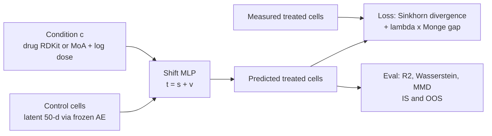

# Conditional Monge Gap enables generalizable single-cell perturbation modelling

> **Bibkey** `Driessen_2026` · **Venue** Nature Machine Intelligence (2026) · **Category** single-cell · **Relevance** medium · **Access** open
> **Link** <https://doi.org/10.1038/s42256-026-01242-8> · `status: complete`

---

## One-liner
CMonge (Conditional Monge Gap) uses **one** neural optimal-transport (OT) model, conditioned on drug, dose or drug combination, to map the distribution of untreated cells onto the distribution of treated cells; it can predict single-cell responses to unseen drugs from their molecular structure alone.

## Takeaways
- Sequencing destroys cells, so the same cell is never seen before and after treatment; perturbation prediction is distribution-to-distribution, which suits OT.
- Loss = Sinkhorn divergence (pushed-forward vs real treated distribution) + λ·Monge gap (keeps the map cost-optimal); the condition vector is concatenated to the input, the network outputs a shift, prediction = cell + shift (Methods Eq. 8).
- With dose as the only condition, nine per-drug CMonge models match 36 per-condition models (Table 1); with drug + dose, a single MoA-embedded model is on par with the 36 (Fig. 2a).
- Unseen drugs (nine held out, 712 training conditions): highest-dose R² 0.900 (MoA) / 0.781 (RDKit) vs chemCPA 0.760; MMD 0.013 / 0.020 vs 0.195 (Table 2).
- Structure-based embeddings (RDKit) need more training drugs and a bigger model to approach effect-based ones (MoA); MoA needs a measured population of treated cells for that drug.
- The model is small (23,000 parameters; 560,000–580,000 for the large version) vs ~1.37M for chemCPA (Methods).

## Problem
We want to predict cellular responses to drugs, but the space of drugs, doses and combinations far exceeds what experiments can cover. Existing neural OT methods (CellOT, scPRAM) are unconditional: one model per condition, so (1) no inference for a new condition, (2) high training cost, (3) no inductive bias from covariates, (4) no cross-task sharing between similar conditions (Introduction). The authors want one global OT model, conditioned on arbitrary covariates, that predicts both seen and unseen conditions.

## Method

Terms: perturbation = treating cells with a drug or gene edit; control = untreated cells; MoA = mode of action.

1. **Input representation**: SciPlex scRNA-seq is reduced to 1,000 highly variable genes and encoded by a plain MLP autoencoder (two hidden layers of 512) into a 50-d latent (100-d for the large model); the autoencoder is pretrained and frozen. OT runs in latent space; metrics are computed in decoded gene space. 4i uses its 48 protein + morphology features directly.
2. **Condition encoding**: log dose; drug embedding is either RDKit (194 structure descriptors from SMILES) or MoA (10-d SMACOF multidimensional scaling of pairwise Wasserstein distances between treated populations, effect-based). One dense drug encoder and one drug–dose encoder; outputs concatenated into c (Methods Eq. 9). Combinations use DeepSets average pooling (Methods "Encoding the condition", the paragraph after Eq. 9).
3. **Transport network**: an MLP (4 × 64, GELU; large model [256, 256, 512, 512]) takes cell + condition and outputs a shift v; prediction t = s + v (Methods "Architecture").
4. **Objective**: Σ over K conditions of Δε(Tθ(c_i)♯μ, ν_i) + λ·Mε(Tθ(c_i)), where Δε is the debiased entropic Sinkhorn divergence and Mε the Monge gap = mean displacement cost − entropic OT cost (Eqs. 5–8); λ = 10⁻². The paper states the cost two ways: Hyperparameters says "Euclidean distance", the Monge-gap paragraph says "squared Euclidean distance c(x,y)=‖x−y‖²". Batches of 256 from one uniformly sampled condition; AdamW, lr 1e-4; built on OTT-JAX.
5. **Evaluation**: IS (condition seen in training; 80/20 split per condition) and OOS (held-out dose, all doses of a held-out drug, or 21-fold CV holding out 9 of 187 drugs). Metrics: R² between predicted and true feature means (on SciPlex: Methods "Datasets" says the top 50 differentially expressed marker genes, the Benchmarking section says the 50 highly variable genes; the paper is inconsistent), Wasserstein distance, MMD; nine random control samples per condition, averaged.
6. **Baselines**: identity (control as prediction, lower bound), within-condition (resampling the true target, upper bound), per-condition Monge (36 models), unconditional Monge, chemCPA.

## Method diagram


## Data
(1) **SciPlex3** (scRNA-seq): three human cancer lines (A549, K562, MCF7), 188 compounds = 187 drugs (4 doses each, 10/100/1,000/10,000 nM) + the control solution; 762,039 cells, 17,565 controls, ~4,032 cells per drug–dose condition on average; 748 drug–dose conditions. Lotfollahi et al. preprocessing. Two scales: 9 drugs (36 conditions) and all 187 drugs (Methods "Datasets"). (2) **4i** (iterative indirect immunofluorescence protein imaging): two melanoma lines, 40 proteins, 97,748 cells (10,995 controls), 35 therapies at ~2,500 cells each; 48 features after preprocessing (marker expression + cell shape). Conditional experiments use 27 single drugs + 6 combinations = 33 treatments (two combinations dropped for lack of single-drug measurements).

## Key results
- **Dose conditioning (SciPlex 9 drugs, R²)**: at 10,000 nM identity 0.227, unconditional Monge-Dose-IS 0.694, CMonge-Dose-IS 0.974, per-condition Monge 0.978 (Table 1); nine CMonge-Dose models match 36 per-condition models with 4× fewer models.
- **Unseen dose**: CMonge-Dose-OOS beats identity and the unconditional model at every dose; the highest dose is hardest (0.527 vs Monge-Dose-OOS 0.322, Table 1).
- **Drug + dose (IS)**: one CMonge-DrugDose-MoA model is on par with 36 per-condition models, while RDKit barely helps at low doses (Fig. 2a, Supp. Table 3); in the aggregated comparison (Supp. Fig. 1), however, this single MoA model has a good but overall lower R² on DEG means than the 36 per-condition models (ICNN and Monge) but captures heterogeneity better (the authors call this an unfair comparison); at 187 drugs (748 conditions) both embeddings reach mean R² >0.8 and >0.6 for every drug (Fig. 2b).
- **Pathways**: for trametinib (a MEK inhibitor), enriched pathways in predictions overlap the ground truth (top-10 Jaccard 0.429, hypergeometric P = 1.0×10⁻⁴⁵ over 653 pathways) (Fig. 2d–e); P < 1e-13 for all nine drugs (Extended Data Fig. 3).
- **Unseen drug (leave one of 9 out)**: CMonge-MoA beats chemCPA widely in all settings and nears the per-condition upper bound; only trametinib (the one non-epigenetic drug of the nine) is worse than drug-specific models (Fig. 4a, Extended Data Fig. 5a).
- **Unseen drugs (187 drugs, 21-fold holding out 9, 712 training conditions, 10,000 nM)**: R² MoA 0.900±0.059, RDKit 0.781±0.187, chemCPA 0.760±0.211; Wasserstein 3.873 / 4.232 / 4.767; MMD 0.013 / 0.020 / 0.195 (Table 2).
- **4i**: in IS, conditioning improves R² (Fig. 3a); in leave-one-out OOS, CMonge struggles on unseen single drugs but clearly beats unconditional Monge on combinations; identity already has mean R² >0.6 (small effects), and by Wasserstein CMonge beats identity for single drugs and combinations (Fig. 3b, Extended Data Fig. 4).
- **Distribution shape**: on UMAPs CMonge predictions cover the spread of the target, while chemCPA predictions often collapse to the average effect (Fig. 4d, Extended Data Fig. 7).

## Contributions
- Extends the Monge-gap regulariser to the conditional case: one global OT map conditioned on arbitrary covariates (dose, drug, combinations) that can infer unseen conditions.
- Systematic comparison of structure-based (RDKit) and effect-based (MoA) drug embeddings, showing the gap narrows as conditions grow.
- Validated on scRNA-seq and protein imaging and scaled to 187 drugs, with far fewer parameters than chemCPA or single-cell foundation models.

## Limitations
- (Authors) Generalisation to new cell types, out-of-distribution conditions, noise and batch effects remains open; sparsely sampled or unseen drug classes and high doses may lie outside the observed support (Discussion).
- (Authors) DeepSets average pooling for combinations is simple and may miss synergy/antagonism; attention pooling gave only marginal gains with careful regularisation (Supp. Table 9).
- (Authors) MoA embeddings need measured treated cells for the drug; RDKit is unstable with few training drugs (Fig. 2c).
- Our reading: all data are in-vitro drug treatments of cancer lines, with no tissue, spatial structure or patient samples; the "control → treated" direction differs from the "disease → normal" direction we need.
- Our reading: R² only measures means (top-50 DEGs), and distributional metrics depend on the frozen autoencoder's decoding quality.

## Relation to our direction
This is a **model / revert** paper, not anomaly detection. Our reading: (1) with a diseased population as source and a normal population as target, a CMonge-style conditional OT could score which condition (drug / genetic perturbation) moves cells back towards normal; but the paper only trains control → treated, so the reverse use needs suitable data and is untested. (2) Its Sinkhorn / Wasserstein distances can serve as a distribution-level revert measure, consistent with treating anomalies as distribution shift in the artifact-injection topic. (3) It has no spatial information and no tissue sections; for kidney data a realistic use is first screening candidate perturbations at the snRNA level and then checking them on spatial data. (4) "More conditions make structure embeddings usable" implies that revert prediction for unmeasured compounds needs large perturbation datasets for training.

## Reusable assets
- **Code:** <https://github.com/AI4SCR/conditional-monge-gap> (the paper's AI4SCR/Conditional-Monge redirects here; MIT), PyPI `cmonge` <https://pypi.org/project/cmonge/>, Zenodo <https://doi.org/10.5281/zenodo.17854338> (Code availability). Repo README: tested on Python 3.10 and 3.11; loading older checkpoints (cmonge-{moa, rdkit}-ood etc.) needs the tag `cmonge_checkpoint_loading`.
- **Data:** preprocessed SciPlex3 and 4i, ETH Research Collection <https://doi.org/10.3929/ethz-b-000609681> (Data availability, ref. 66).
- **Library:** all models are built on OTT-JAX (Methods).
- **Preprint:** arXiv:2504.08328 (source of the figures below).

## Follow-ups
- Uscidda & Cuturi's Monge Gap (ref. 32); CellOT (ref. 30); chemCPA (ref. 11).
- The authors' parallel CAR-T work (ref. 39): protein-language-model embeddings as conditions.
- Our reading: look for kidney-cell perturbation data (e.g. Perturb-seq) to test conditional OT in the disease → normal direction.

## Figures & tables

> The version of record is open access in Nature Machine Intelligence (CC BY-NC-ND 4.0, no derivatives). The images below come from the **preprint** arXiv:2504.08328 v1, which names models ID/OOD; the published version uses IS/OOS (in-sample / out-of-sample). The numbers in the two tables were checked against published Table 1 and Table 2; the Within-condition row exists only in the published version (arXiv v1 Table 1 has no such row). Published Table 1 bolds the per-condition Monge row (although Within condition is higher at 100, 1,000 and 10,000 nM); no bold is used below.


**Fig 1.** Method overview. A) Prior methods (Monge Gap) learn a separate local map T_θ^i per perturbation; B) CMonge uses a single model T_θ(c_i) conditioned on covariate c_i (drug/dose), trained with a Sinkhorn fitting term Δ_ε plus λ·Monge-gap regularizer M_ε, and infers on unseen conditions ν_{n+1}; C) SciPlex, nine drugs, highest dose, seen conditions (labelled I.D. in the preprint): MMD of nine drug-specific Monge models vs nine dose-conditioned CMonge models (lower is better; yellow line = identity, the performance lower bound; purple = 36 per-condition Monge models, the upper bound); D) unseen drugs (O.O.D. in the preprint, n=748): CMonge's MMD is far below chemCPA.
_Source: https://arxiv.org/html/2504.08328v1/x1.png (Fig 1) · License: arXiv preprint (arXiv:2504.08328)_


**Fig 3.** In-distribution R² of conditional vs unconditional Monge methods. A) Nine drugs: a single CMonge-DrugDose-MoA model approaches the 36 per-condition Monge models (upper bound), while the RDKit version barely helps at low doses; B) results per drug; C) all 187 drugs (748 conditions) with larger models: the RDKit version catches up with MoA, and both reach mean R² >0.8.
_Source: https://arxiv.org/html/2504.08328v1/x3.png (Fig 3) · License: arXiv preprint (arXiv:2504.08328)_


**Fig 5.** Out-of-distribution results on SciPlex for unseen dose and drug-dose contexts (R², Wasserstein, MMD). With nine drugs, CMonge-MoA beats the conditional baseline chemCPA at every dose; CMonge-RDKit beats chemCPA only at the hardest, highest dose and is below it at the lower doses, which the authors attribute to few training drugs (eight) and few parameters (published p. 989). RDKit beats chemCPA on all metrics only in the 187-drug setting (Table 2).
_Source: https://arxiv.org/html/2504.08328v1/x5.png (Fig 5) · License: arXiv preprint (arXiv:2504.08328)_

### Results

**Table 1.** SciPlex nine-drug dose experiments, R² between predicted and true feature means (higher is better) by dose; SD in parentheses (published Table 1). Within-condition and per-condition Monge (36 models) are upper bounds, identity the lower bound.

| Model | Cond. seen | 10 nM | 100 nM | 1000 nM | 10000 nM |
|---|---|---|---|---|---|
| Within condition | — | 0.950 (±0.034) | 0.960 (±0.023) | 0.967 (±0.018) | 0.982 (±0.018) |
| Identity | — | 0.748 (±0.127) | 0.655 (±0.261) | 0.504 (±0.332) | 0.227 (±0.212) |
| Monge (per-condition) | 1 | 0.950 (±0.020) | 0.935 (±0.042) | 0.960 (±0.025) | 0.978 (±0.029) |
| Monge-Dose-IS | 4 | 0.750 (±0.254) | 0.767 (±0.231) | 0.885 (±0.099) | 0.694 (±0.272) |
| CMonge-Dose-IS | 4 | 0.882 (±0.185) | 0.905 (±0.124) | 0.905 (±0.093) | 0.974 (±0.026) |
| Monge-Dose-OOS | 3 | 0.614 (±0.349) | 0.726 (±0.219) | 0.856 (±0.112) | 0.322 (±0.348) |
| CMonge-Dose-OOS | 3 | 0.864 (±0.197) | 0.931 (±0.058) | 0.878 (±0.118) | 0.527 (±0.311) |

**Table 2.** SciPlex full drug–dose OOS (highest dose 10,000 nM, 712 training conditions, 21-fold CV holding out 9 drugs; published Table 2). CMonge-MoA beats chemCPA on R², Wasserstein and MMD. ↑ higher is better, ↓ lower is better.

| Model | Cond. seen | R² ↑ | Wasserstein ↓ | MMD ↓ |
|---|---|---|---|---|
| CMonge-DrugDose-MoA-OOS | 712 | **0.900 (±0.059)** | **3.873 (±0.643)** | **0.013 (±0.005)** |
| CMonge-DrugDose-RDKit-OOS | 712 | 0.781 (±0.187) | 4.232 (±0.896) | 0.020 (±0.012) |
| chemCPA-DrugDoseCellLine-OOS | 712 | 0.760 (±0.211) | 4.767 (±0.976) | 0.195 (±0.035) |

_Source: Table 1 and Table 2 of the published article, https://doi.org/10.1038/s42256-026-01242-8 (all other values also appear in arXiv:2504.08328v1; the Within-condition row is published-only) · License: CC BY-NC-ND 4.0_

## Cite
```bibtex
@article{Driessen_2026, title={Conditional Monge Gap enables generalizable single-cell perturbation modelling}, volume={8}, ISSN={2522-5839}, url={http://dx.doi.org/10.1038/s42256-026-01242-8}, DOI={10.1038/s42256-026-01242-8}, number={6}, journal={Nature Machine Intelligence}, publisher={Springer Science and Business Media LLC}, author={Driessen, Alice and Rajwade, Dhruva Abhijit and Harsanyi, Benedek and Rapsomaniki, Marianna and Born, Jannis}, year={2026}, month=jun, pages={984–996} }
```


---

📄 **[AI-ready full-text extract →](ai-ready.md)**
