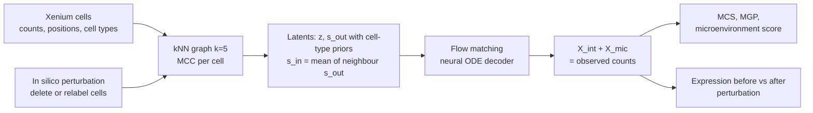

# Mapping and reprogramming human tissue microenvironments with MintFlow

> **Bibkey** `Akbarnejad_2025` · **Venue** bioRxiv (2025) · **Category** spatial · **Relevance** high · **Access** open
> **Link** <https://doi.org/10.1101/2025.06.24.661094> · `status: complete`

---

## One-liner
MintFlow is a flow-matching generative model for single-cell-resolution spatial transcriptomics (Xenium): it splits each cell's expression into an intrinsic part and a microenvironment-induced part, and can delete or replace a cell type in silico to predict how neighbouring cells' expression would change.

## Takeaways
- The core output is two count matrices, X_int (intrinsic) and X_mic (microenvironment-induced), which sum to the observed expression; the microenvironment score is the share of a cell's counts assigned to X_mic (Methods).
- No ligand-receptor priors or predefined domains. The split is designed to be identifiable: iVAE-style conditional priors make [z, s_in] identifiable up to permutation in theory, and an optimal-transport objective (Proposition 1) makes the split unique at its optimum; the authors note that training is not guaranteed to reach that optimum and that separation weakens in cell-type-homogeneous regions (Methods "Notes on identifiability", Supplementary Note 2).
- In silico perturbation = relabel or remove a cell population → rebuild the neighbour graph from positions → regenerate expression and compare before vs after.
- Applied to atopic dermatitis, melanoma and clear-cell renal cell carcinoma (ccRCC); in ccRCC, simulated deletion of tertiary-lymphoid-structure (TLS) macrophages lowers co-inhibition / exhaustion markers in TLS T cells.
- In-silico reprogramming is linked to survival in 606 TCGA ccRCC tumours: high TLS Border T-cell programme expression goes with worse survival (p = 0.0073), high expression of the reprogrammed state with a survival advantage (p = 0.0034) (Fig. 7g).
- Our reading: the closest spatial-omics method to "model → revert" that we have read, with a kidney (ccRCC) application.

## Problem
Tissue microenvironments reprogram local cell states in disease, yet current spatial computational methods remain descriptive and do not simulate tissue perturbation (Abstract). The authors note that existing methods for microenvironment effects either fail to separate intrinsic from microenvironment-induced variation, lack mechanistic interpretability and need post-hoc interpretation of embeddings, are limited by linear assumptions, scale poorly, or require prior knowledge of gene-gene interactions (e.g. ligand-receptor); they also fall short at generating new hypotheses and testing them by in silico perturbation (Introduction). The authors want a generative model that learns how the microenvironment changes cell states, scales to many sections and supports in silico perturbation.

## Method

Terms: Xenium = 10x's single-cell in-situ transcriptomics platform (5k-plex here, ≈5,000-gene panel); microenvironment = a cell's neighbours in the neighbour graph; MCC = cell-type proportions in that microenvironment.

1. **Input**: counts, coordinates and cell-type labels from single-cell-resolution spatial transcriptomics. A k=5 nearest-neighbour graph from coordinates defines each cell's microenvironment and its MCC (Methods "Model overview").
2. **Three latents**: z_n (intrinsic variation, prior conditioned on cell type), s_out (outgoing signal, prior conditioned on cell type), s_in (the average of the neighbours' s_out, so indirectly dependent on MCC) (Fig. 1b, Methods).
3. **Generation**: flow matching in latent space with a neural-ODE decoder yields low-dimensional intrinsic and microenvironment-induced representations, which decoders turn into X_int and X_mic; these sum to the observed counts.
4. **Identifiability**: models with non-linear decoders are generally unidentifiable. The authors mimic iVAE by conditioning z on cell type (CT) and s_in on MCC, with objectives such as "CT predictable from z" and "MCC predictable from s_in"; in theory [z, s_in] is identifiable up to permutation, but in cell-type-homogeneous regions CT and MCC coincide and separation weakens. To make the split X = X_int + X_mic unique they add optimal-transport-related objectives (Proposition 1, proof in Supplementary Note 2); the authors state the method is not guaranteed to find the optimum. Wasserstein distribution-matching terms **encourage** z and x_int to carry no information about neighbours' cell types (Objectives 7–8) (Methods "Notes on identifiability").
5. **Scale**: subgraph training with PyTorch Geometric neighbour sampling; a custom sampler takes random tissue crops as central nodes, allowing several sections with millions of cells (Methods "Scalability").
6. **Downstream**: clustering microenvironment-induced embeddings gives microenvironment-induced cell states (MCS) and microenvironment domains; differential expression on microenvironment-induced expression gives microenvironment-induced gene programmes (MGPs); co-located cells with high microenvironment scores are candidate signalling hotspots.
7. **In silico perturbation**: after training, the model generates expression from cell-type labels and the neighbour graph alone. In the experiments a real tissue crop is taken, cell-type labels are changed or a cell type is removed, the neighbour graph is rebuilt from positions, and generated expression is compared before vs after (Methods "In silico tissue perturbation").
8. **Benchmark**: simulated data with known microenvironment effects from the NicheCompass simulation framework (10,000 cells, 2,000 genes, eight spatial regions), scored by MAE, EMD, MSE; on real data, whether known signalling genes (from combined ligand-receptor databases) get more counts in X_mic; baselines SIMVI, MEFISTO and random; when compared with baselines MintFlow's embedding size is reduced from the default 100 to 10 (Methods "Benchmarking", "Metrics").

## Method diagram


## Data
(1) **Atopic dermatitis**: 10 skin sections from 8 patients (5 lesional, 5 non-lesional; 8 newly generated), Xenium 5k, 197,487 cells after QC, 10 microenvironment domains; external validation includes atopic-dermatitis scRNA-seq from 4 patients, an integrated dataset of 23 diseases across 6 tissues, and week-12 post-dupilumab samples from 10 patients of the same cohort. (2) **Cutaneous melanoma**: public 10x 5000-plex Xenium, 98,749 cells after QC, 8 microenvironment clusters. (3) **ccRCC**: training and main analyses use one patient's nephrectomy (PD43284), three macroscopically distinct tumour-core regions plus the tumour–normal interface, 337,116 cells, 24 cell types; Xenium data from 2 more patients (PD45814, PD45816) are used only for validation (Supplementary Fig. 10). External data: Li et al. 2022 ccRCC scRNA-seq (147,917 tumour-infiltrating cells from 10 patients, including the Xenium donor; ref. 50); Bi et al. 2021 ccRCC scRNA-seq before and after ICB (source of the post-ICB T-cell and macrophage signatures; ref. 58); 606 TCGA ccRCC bulk RNA-seq tumours; a Kaede transgenic mouse model (subcutaneous colorectal tumour epithelial cells, anti-PD-L1 or isotype control; ref. 57). (4) **Simulated data**: NicheCompass framework, with ground truth, for benchmarking. Data availability: simulated data and the public melanoma data can be downloaded; all other data "will be made available soon".

## Key results
- **Benchmark (numbers printed above each box; the Fig. 1g axis is labelled "averaged")**: on simulated data, EMD (log scale, negated, higher is better) is 7.08 for MintFlow vs −0.37 SIMVI, −4.36 MEFISTO, −3.79 random, 2.45 random binary; MAE and MSE follow the same pattern (Fig. 1g). On real data, the share of known-signalling-gene counts assigned to X_mic: eczema single section MintFlow 0.247 vs SIMVI 0.053, MEFISTO 0.001; melanoma 0.62 vs 0.037, 0.001; on all 10 eczema sections only MintFlow ran, 0.66 for known signalling genes vs 0.317 for other genes (Fig. 1h; counts < 20 filtered).
- **Atopic dermatitis**: the T_DC domain (mostly T cells, plus MigDCs and cDC2) is expanded in inflamed skin; its MGP points to CCL19/CCR7 and CCL22/CCL17–CCR4 signalling axes, and the authors call it a T-cell activation hub; drug2cell recovered drugs with known efficacy (upadacitinib, prednisolone) (Fig. 2). A microenvironment-induced CD8A+ ITGAE+ GZMB+ T-cell cluster (increased IL13, IL22, GZMB) located in superficial skin, which the authors read as epidermal type-2 tissue-resident memory T cells (Fig. 2h–i).
- **Atopic-dermatitis in silico perturbation**: simulated Treg depletion makes MigDCs and Tconv cells upregulate inflammatory-response and T-cell-activation pathways, suggesting more inflammation; replacing all Tconv cells with Tregs gives no enrichment of inflammatory pathways in MigDCs and downregulates DC activation / migration genes (CCL17, CCL22, CCR7, LAMP3 and others) (Fig. 3b–g). In the dupilumab cohort, Tregs in responders (>50% improvement) typically increased from baseline to week 12; in the 2 non-responders (<10% improvement) there was no significant change, and baseline Tregs were typically higher (Fig. 3j).
- **Melanoma**: the Stroma domain (mostly CAFs and T cells) has an MGP with CXCL12, collagens (COL4A2, COL5A1, COL5A2, COL11A1) and collagen cross-linking enzymes (LOX, LOXL1, LOXL2), which the authors link to chemotactic and physical exclusion of T cells; in fibroblasts from 23 skin diseases the MGP is highest in cutaneous melanoma and also high in keloid scars (Fig. 4).
- **ccRCC**: the signalling hotspot in core 2 is a dense lymphocytic aggregate that the authors confirm as a TLS with a TLS gene-signature score; T cells fall into six microenvironment-induced states, three in the TLS (TLS Core 1, Core 2, Border), which neither intrinsic embeddings nor fine reclustering of the original data recover (Fig. 5). Ligand-receptor analysis on the Li et al. scRNA-seq gives TLS T cells the most predicted interactions with myeloid populations, particularly macrophages, from which the authors infer macrophages are the main cell type inhibiting TLS T cells; in Xenium, TLS-associated macrophages express high TREM2 and CCR1 (Fig. 6). Simulated deletion of these macrophages lowers co-inhibition / exhaustion molecules in TLS T cells (PD-L2, TIM3, VSIR, CD276, LILRB1, LAIR1) and raises TCR signalling (PLCG1, STIM1, TRAF6) and interleukin receptors (IL4R, IL6ST, IL15RA) (Fig. 7f).
- **Mouse check**: in the Kaede mouse model the TLS Border programme is enriched in memory and exhausted CD8+ T-cell subsets; after anti-PD-L1, Border-high exhausted CD8+ T cells upregulate Il2rb, Stat1 and Ltb (Supplementary Fig. 11).
- **Validity check**: a post-ICB T-cell signature from the Bi et al. 2021 pre/post-ICB scRNA-seq identifies matching T cells in Xenium (top 5% for the signature), which virtually replace the T cells in the TLS; with the macrophage genes upregulated after ICB in that study as "ground truth", 11 of the 12 such genes that are in the Xenium 5K panel and expressed in >10% of macrophages are predicted to go up (including CXCL9 and CXCL10) (Fig. 7a–c).
- **Clinical link**: in 606 TCGA ccRCC tumours split at the median programme score, TLS Core 1, Core 2 and TLS-macrophage programmes are not significantly associated with outcome (Supplementary Fig. 15); high TLS Border T-cell programme expression is associated with worse overall survival (p = 0.0073); high expression of the post-macrophage-removal reprogrammed programme with a survival advantage (p = 0.0034) (Fig. 7g).

## Contributions
- A split of spatial expression into intrinsic and microenvironment-induced count matrices that can be analysed directly, designed for identifiability (conditional priors + optimal-transport objective), without ligand-receptor priors or predefined domains.
- Tissue-level in silico perturbation: delete / replace any cell type and predict the neighbours' response.
- Subgraph-sampled training that scales to many sections and millions of cells.
- Biological findings in three diseases, checked against external scRNA-seq, a treatment cohort, a mouse model and TCGA survival.

## Limitations
- (Authors) Sensitive to low read counts (Supplementary Figs. 2–3); needs consistent gene panels across sections.
- (Authors) Susceptible to segmentation errors; hard to train, with dataset-specific hyperparameter tuning; flow-matching training is compute-intensive (mitigated by neighbour sampling).
- (Authors) Currently limited to multiple tissue sections; future work could extend to multi-tissue atlases.
- (Authors, Methods) The method is not guaranteed to find the optimum of the optimal-transport objective; in cell-type-homogeneous regions the intrinsic / microenvironment parts are hard to separate.
- Our reading: ccRCC training and the main perturbation analyses use one patient (2 more only for validation); in silico perturbations are model predictions, validated by agreement with external signatures, mouse data and TCGA survival associations rather than direct perturbation of the same tissue.
- Our reading: perturbations change cell composition / neighbours, not individual genes; results depend on the quality of input cell-type labels. Apart from the simulated and melanoma data, the data are not yet public.

## Relation to our direction
Mainly a **model → revert** paper, with a kidney (ccRCC) application. Our reading: (1) X_mic / the microenvironment score is not anomaly detection, but "which cells are strongly changed by their neighbours" can be supplementary evidence for detect, e.g. explaining which neighbours drive an anomalous region found against a normal reference; (2) in silico deletion / replacement of cell types is a form of revert — it predicts whether changing tissue composition moves neighbouring cells to another state, closer to the tissue level than CMonge's single-cell drug perturbations; (3) for the kidney samples to be tested, if they are single-cell-resolution spatial data such as Xenium, MintFlow is a candidate for the model layer, but it needs cell-type labels and consistent gene panels; (4) its validation style (agreement with external signatures + survival association) is useful but does not replace wet-lab experiments.

## Reusable assets
- **Code:** <https://github.com/Lotfollahi-lab/mintflow> (Python package; paper's Code availability); docs and tutorials: <https://mintflow.readthedocs.io>.
- **Reproducibility and simulated data:** <https://github.com/Lotfollahi-lab/mintflow-reproducibility> (paper's Code / Data availability: reproduction code, MintFlow CLI configs, simulated-data download).
- **Evaluation designs:** ground-truth simulation benchmark (MAE / EMD / MSE), signalling-gene attribution test, virtual-replacement check against external ICB signatures, sensitivity to the number of perturbed cells (Supplementary Fig. 16), perturbation programme → TCGA survival.

## Follow-ups
- Supplementary Note 2 (proof of Proposition 1), Notes 3–5 (encoder / decoder and ELBO details), Supplementary Fig. 10 (validation in 2 more ccRCC patients).
- The SIMVI and MEFISTO papers (baselines).
- Li et al. 2022 (ccRCC scRNA-seq atlas) and Bi et al. 2021 (ccRCC pre/post-ICB scRNA-seq, ground truth for the virtual replacement).
- Our reading: trial run on kidney Xenium to check cell numbers, panel consistency and the source of cell-type labels.

## Figures & tables


**Fig 1.** Overview and benchmarking of MintFlow: (a) single-cell-resolution spatial transcriptomics input; each cell's microenvironment is derived from spatial coordinates, with cell-type labels and microenvironment cell-type composition (MCC) as supervision; (b) three embedding vectors encode intrinsic (z_n), incoming and outgoing spatial signals, transformed via flow matching into intrinsic and microenvironment-induced embeddings and decoded to reconstruct read counts; (d–f) clustering the microenvironment-induced embeddings yields fine-grained microenvironment-induced cell states (MCS) and gene programs (MGP), and supports in silico microenvironment perturbation; (g) on simulated data MintFlow outperforms alternatives at read-count disentanglement (MAE/EMD/MSE, negated so higher is better); (h) on real data MintFlow assigns a greater fraction of known signaling-gene counts to the microenvironment-induced component.
_Source: https://www.biorxiv.org/content/10.1101/2025.06.24.661094v3.full  ·  License: bioRxiv preprint (CC BY-NC-ND 4.0)_


**Fig 2.** MintFlow identifies a microenvironment-induced T_RM cell state and a T-cell activation hub in atopic dermatitis: (a) tissue colored by microenvironment score with matched H&E histopathology of the same Xenium 5k section; (b) microenvironment domains and a UMAP of the microenvironment-induced embedding; (c) tissue composition per domain in inflamed vs non-inflamed skin; (d) the T_DC-domain MGP and its gene-module scores in a cross-tissue atlas.
_Source: https://www.biorxiv.org/content/10.1101/2025.06.24.661094v3.full  ·  License: bioRxiv preprint (CC BY-NC-ND 4.0)_


**Fig 4.** Deciphering tumor-microenvironment immune-cell segregation in melanoma with MintFlow: (a) microenvironment score; (b) tissue by cell type (melanoma vs other, T cell vs other); (c) UMAP of the microenvironment-induced embedding for cutaneous melanoma; (d) cellular composition of microenvironment domains; (e) microenvironment-induced gene programs (MGPs) per domain; (f) H&E image and matched Xenium section colored by microenvironment domain.
_Source: https://www.biorxiv.org/content/10.1101/2025.06.24.661094v3.full  ·  License: bioRxiv preprint (CC BY-NC-ND 4.0)_

### Results

**Table 1.** Summary of MintFlow benchmarks (from Fig 1g/1h). The paper reports results as box plots with no numeric table; numbers below are those printed above each box (the Fig. 1g axis says "averaged"; the paper does not say what the Fig. 1h numbers are).

| Benchmark | Data | Metric(s) | Result vs alternatives |
|---|---|---|---|
| Read-count disentanglement | Simulated data with known microenvironment-induced effects (ground truth) | MAE, EMD, MSE (negated → higher is better) | MintFlow EMD 7.08 vs SIMVI −0.37, MEFISTO −4.36, random −3.79, random binary 2.45 (printed in Fig 1g; log scale, negated) |
| Signaling-gene attribution | Real Xenium (AD single-sample, melanoma single-sample) | Proportion of known signaling-gene counts assigned to the microenvironment-induced component (counts < 20 filtered) | Known signaling genes: MintFlow 0.247 vs SIMVI 0.053, MEFISTO 0.001 (AD); 0.62 vs 0.037, 0.001 (melanoma) (Fig 1h) |
| Scalability | Multi-sample Xenium (10 atopic-dermatitis sections) | Applicable to all 10 sections | Only MintFlow was scalable enough to run on all 10 tissue sections (0.66 signalling vs 0.317 other genes) |

## Cite
```bibtex
@article{Akbarnejad_2025, title={Mapping and reprogramming human tissue microenvironments with MintFlow}, url={http://dx.doi.org/10.1101/2025.06.24.661094}, DOI={10.1101/2025.06.24.661094}, publisher={openRxiv}, author={Akbarnejad, Amir and Steele, Lloyd and Jafree, Daniyal J. and Birk, Sebastian and Sallese, Marta Rosa and Rademaker, Koen and Boxall, Adam and Rumney, Benjamin and Tudor, Catherine and Patel, Minal and Prete, Martin and Makarchuk, Stanislaw and Lee, Colin Y.C. and Maaskola, Jonas and Li, Tong and Stanley, Heather and Foster, April Rose and Roberts, Kenny and Trinh, Andrew L. and Villa, Carlo Emanuele and Testa, Giuseppe and Mahil, Satveer and Mehrjou, Arash and Smith, Catherine and Vakili, Sattar and Clatworthy, Menna R. and Bayraktar, Omer Ali and Mitchell, Thomas and Haniffa, Muzlifah and Lotfollahi, Mohammad}, year={2025}, month=jun }
```


---

📄 **[AI-ready full-text extract →](ai-ready.md)**
