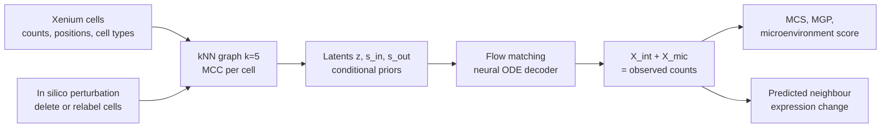

# Mapping and reprogramming human tissue microenvironments with MintFlow

> **Bibkey** `Akbarnejad_2025` · **Venue** bioRxiv (2025) · **Category** spatial · **Relevance** high · **Access** open
> **Link** <https://doi.org/10.1101/2025.06.24.661094> · `status: complete`

---

## One-liner
MintFlow is a flow-matching generative model for single-cell-resolution spatial transcriptomics (Xenium): it splits each cell's expression into an intrinsic part and a microenvironment-induced part, and can delete or replace a cell type in silico to predict how neighbouring cells' expression would change.

## Takeaways
- The core output is two count matrices, X_int (intrinsic) and X_mic (microenvironment-induced), which sum to the observed expression; the microenvironment score is the share of a cell's counts assigned to X_mic.
- No ligand-receptor priors or predefined domains; iVAE-style conditional priors plus optimal-transport conditions make the decomposition identifiable and unique (Methods, Supplementary Note 2).
- In silico perturbation = relabel or remove a cell population → rebuild the neighbour graph → re-predict neighbours' X_mic.
- Applied to atopic dermatitis, melanoma and clear-cell renal cell carcinoma (ccRCC); in ccRCC, simulated deletion of tertiary-lymphoid-structure (TLS) macrophages lowers T-cell co-inhibition / exhaustion markers.
- In-silico reprogramming is linked to survival in 606 TCGA ccRCC tumours: high TLS Border T-cell programme expression goes with worse survival (p = 0.0073), high expression of the reprogrammed state with a survival advantage (p = 0.0034).
- The closest spatial-omics method to "model → revert" that we have read, with a kidney (ccRCC) application.

## Problem
Tissue microenvironments reprogram local cell states in disease, but current spatial methods are mostly descriptive and do not simulate tissue perturbation (Abstract). Methods modelling microenvironment effects either fail to separate intrinsic from microenvironment-induced variation, or rely on linear assumptions or ligand-receptor priors, scale poorly and do not support hypothesis testing. The authors want a generative model that learns how the microenvironment changes cell states, scales to many sections and supports in silico perturbation.

## Method

Terms: Xenium = 10x's single-cell in-situ transcriptomics platform (5k ≈ 5,000-gene panel); microenvironment = a cell's spatial neighbours; MCC = cell-type proportions in that microenvironment.

1. **Input**: counts, coordinates and cell-type labels from single-cell-resolution spatial transcriptomics. A k=5 nearest-neighbour graph from coordinates gives each cell's MCC (Methods).
2. **Three latents**: z_n (intrinsic variation, prior conditioned on cell type), s_out (outgoing signal, prior conditioned on cell type), s_in (incoming signal aggregated from neighbours' s_out, indirectly dependent on MCC) (Fig. 1b, Methods).
3. **Generation**: flow matching in latent space with a neural-ODE decoder yields intrinsic and microenvironment-induced embeddings, decoded to X_int and X_mic, which sum to the observed expression.
4. **Identifiability**: models with non-linear decoders are generally unidentifiable; the authors mimic iVAE with cell-type / MCC-conditioned priors and add optimal-transport conditions to make the split unique (Methods, Supplementary Note 2). Wasserstein distribution-matching terms ensure the intrinsic state carries no information about neighbours' cell types.
5. **Scale**: a custom sampler trains on crops/subgraphs, allowing several sections with millions of cells.
6. **Downstream**: clustering microenvironment-induced embeddings gives microenvironment-induced cell states (MCS) and domains; X_mic gives microenvironment-induced gene programmes (MGPs); the microenvironment score locates signalling hotspots.
7. **In silico perturbation**: change cell-type labels or remove a subpopulation, rebuild the neighbour graph from positions, and predict neighbours' post-perturbation expression.
8. **Benchmark**: simulated data with known microenvironment effects (MAE, EMD, MSE); on real data, whether known signalling genes get more counts in X_mic; compared methods include SIMVI and MEFISTO.

## Method diagram


## Data
(1) **Atopic dermatitis**: 10 skin sections from 8 patients (8 newly generated), Xenium 5k, 197,487 cells after QC, 10 microenvironment domains; external validation includes scRNA-seq from 4 patients, an atlas of 23 diseases across 6 tissues, and 10 patients 12 weeks after dupilumab. (2) **Cutaneous melanoma**: public 5000-plex Xenium, 98,749 cells, 8 microenvironment clusters. (3) **ccRCC**: one patient, three macroscopically distinct tumour-core regions plus the tumour–normal interface, 337,116 cells, 24 cell types; external data include ccRCC scRNA-seq of 147,917 tumour-infiltrating cells from 10 patients (with ICB-treated samples, Bi et al.), 606 TCGA ccRCC bulk RNA-seq tumours, and a Kaede transgenic mouse tumour model treated with anti-PD-L1. Simulated data with ground truth are used for benchmarking.

## Key results
- **Benchmark (means printed in the figure)**: on simulated data, EMD (log scale, negated, higher is better) is 7.08 for MintFlow vs −0.37 SIMVI, −4.36 MEFISTO, −3.79 random, 2.45 random binary; MAE and MSE follow the same pattern (Fig. 1g). On real data, the share of known-signalling-gene counts assigned to X_mic: eczema single section MintFlow 0.247 vs SIMVI 0.053, MEFISTO 0.001; melanoma 0.62 vs 0.037, 0.001; on all 10 eczema sections only MintFlow ran, 0.66 for known signalling genes vs 0.317 for other genes (Fig. 1h).
- **Atopic dermatitis**: a microenvironment-induced epidermal type-2 tissue-resident memory T-cell state (CD8A+ ITGAE+ GZMB+, IL13-expressing) and a T-cell activation hub (T_DC domain) (Figs. 2–3); simulated Treg depletion suggests a more inflammatory state, while Treg augmentation is not associated with pro-inflammatory pathways; in 10 dupilumab-treated patients Tregs typically increased from baseline to week 12.
- **Melanoma**: a CXCL12-expressing stroma with high collagen cross-linking enzymes (LOX, LOXL1, LOXL2), linked to T-cell exclusion; its MGP is high in keloid scars (Fig. 4).
- **ccRCC**: three microenvironment-induced T-cell states in TLS (TLS Core 1, Core 2, Border); TLS-associated macrophages express high TREM2 and CCR1. Simulated deletion of these macrophages lowers T-cell co-inhibition / exhaustion molecules (PD-L2, TIM3, VSIR, CD276, LILRB1) and raises TCR-signalling and interleukin-receptor markers (Figs. 5–7).
- **Validity check**: using macrophage signatures from public ccRCC scRNA-seq with ICB-treated samples as ground truth, virtual replacement of T cells with post-ICB-like states upregulated 11 of the 12 ground-truth genes in the Xenium 5K panel.
- **Clinical link**: in 606 TCGA ccRCC tumours, high TLS Border T-cell programme expression is associated with worse overall survival (p = 0.0073); high expression of the reprogrammed state with a survival advantage (p = 0.0034).

## Contributions
- An identifiable split of spatial expression into intrinsic and microenvironment-induced count matrices, without ligand-receptor priors or predefined domains.
- Tissue-level in silico perturbation: delete / replace any cell type and predict the neighbours' response.
- Subgraph-sampled training that scales to many sections and millions of cells.
- Biological findings in three diseases, checked against external scRNA-seq, a treatment cohort and TCGA survival.

## Limitations
- (Authors) Sensitive to low read counts; needs consistent gene panels across sections.
- (Authors) Susceptible to segmentation errors; hard to train with dataset-specific hyperparameter tuning; flow-matching training is compute-intensive.
- (Authors) Currently limited to multiple tissue sections; future work could go beyond that (e.g. atlas scale).
- Our reading: the ccRCC spatial data come from one patient; in silico perturbations are model predictions, validated by agreement with external signatures and TCGA survival associations rather than direct perturbation experiments.
- Our reading: perturbations change cell composition / neighbours, not individual genes; results depend on the quality of input cell-type labels.

## Relation to our direction
Mainly a **model → revert** paper, with a kidney (ccRCC) application. Our reading: (1) X_mic / the microenvironment score is not anomaly detection, but "which cells are strongly changed by their neighbours" can be supplementary evidence for detect, e.g. explaining which neighbours drive an anomalous region found against a normal reference; (2) in silico deletion / replacement of cell types is a form of revert — it predicts whether changing tissue composition moves neighbouring cells to another state, closer to the tissue level than CMonge's single-cell drug perturbations; (3) for kidney Xenium data in Topic 1, MintFlow is a direct candidate for the model layer, but it needs cell-type labels and consistent gene panels; (4) its validation style (agreement with external signatures + survival association) is useful but does not replace wet-lab experiments.

## Reusable assets
- **Code:** <https://github.com/Lotfollahi-lab/mintflow> (Python package; paper's Code availability).
- **Reproducibility and simulated data:** <https://github.com/Lotfollahi-lab/mintflow-reproducibility> (paper's Data availability: simulated-data download).
- **Evaluation designs:** ground-truth simulation benchmark (MAE / EMD / MSE), signalling-gene attribution test, virtual-replacement check against external ICB signatures, perturbation programme → TCGA survival.

## Follow-ups
- Supplementary Note 2 (identifiability proof) and the objective details in Methods.
- The SIMVI and MEFISTO papers (baselines).
- Bi et al. ccRCC ICB scRNA-seq (ground truth for the virtual replacement).
- Our reading: trial run on kidney Xenium to check cell numbers, panel consistency and the source of cell-type labels.

## Figures & tables


**Fig 1.** Overview and benchmarking of MintFlow: (a) single-cell-resolution spatial transcriptomics input; each cell's microenvironment is derived from spatial coordinates, with cell-type labels and microenvironment cell-type composition (MCC) as supervision; (b) three embedding vectors encode intrinsic (z_n), incoming and outgoing spatial signals, transformed via flow matching into intrinsic and microenvironment-induced embeddings and decoded to reconstruct read counts; (d–f) clustering the microenvironment-induced embeddings yields fine-grained microenvironment-induced cell states (MCS) and gene programs (MGP), and supports in silico microenvironment perturbation; (g) on simulated data MintFlow outperforms alternatives at read-count disentanglement (MAE/EMD/MSE, negated so higher is better); (h) on real data MintFlow assigns a greater fraction of known signaling-gene counts to the microenvironment-induced component.
_Source: https://www.biorxiv.org/content/10.1101/2025.06.24.661094v3.full  ·  License: bioRxiv preprint (CC BY-NC-ND 4.0)_


**Fig 2.** MintFlow identifies a microenvironment-induced T_RM cell state and a T-cell activation hub in atopic dermatitis: (a) tissue colored by microenvironment score with matched H&E histopathology (Xenium 5k); (b) microenvironment domains and a UMAP of the microenvironment-induced embedding; (c) tissue composition per domain in inflamed vs non-inflamed skin; (d) the T_DC-domain MGP and its gene-module scores in a cross-tissue atlas.
_Source: https://www.biorxiv.org/content/10.1101/2025.06.24.661094v3.full  ·  License: bioRxiv preprint (CC BY-NC-ND 4.0)_


**Fig 4.** Deciphering tumor-microenvironment immune-cell segregation in melanoma with MintFlow: (a) microenvironment score; (b) tissue by cell type (melanoma vs other, T cell vs other); (c) UMAP of the microenvironment-induced embedding for cutaneous melanoma; (d) cellular composition of microenvironment domains; (e) microenvironment-induced gene programs (MGPs) per domain; (f) H&E image and matched Xenium section colored by microenvironment domain.
_Source: https://www.biorxiv.org/content/10.1101/2025.06.24.661094v3.full  ·  License: bioRxiv preprint (CC BY-NC-ND 4.0)_

### Results

**Table 1.** Summary of MintFlow benchmarks (from Fig 1g/1h). The paper reports results as box plots with no numeric table; numbers below are the means printed in the figure.

| Benchmark | Data | Metric(s) | Result vs alternatives |
|---|---|---|---|
| Read-count disentanglement | Simulated data with known microenvironment-induced effects (ground truth) | MAE, EMD, MSE (negated → higher is better) | MintFlow EMD 7.08 vs SIMVI −0.37, MEFISTO −4.36, random −3.79, random binary 2.45 (means printed in Fig 1g; log scale, negated) |
| Signaling-gene attribution | Real Xenium (AD single-sample, melanoma single-sample) | Proportion of known signaling-gene counts assigned to the microenvironment-induced component (counts < 20 filtered) | Known signaling genes: MintFlow 0.247 vs SIMVI 0.053, MEFISTO 0.001 (AD); 0.62 vs 0.037, 0.001 (melanoma) (Fig 1h) |
| Scalability | Multi-sample Xenium (10 atopic-dermatitis sections) | Applicable to all 10 sections | Only MintFlow was scalable enough to run on all 10 tissue sections |

## Cite
```bibtex
@article{Akbarnejad_2025, title={Mapping and reprogramming human tissue microenvironments with MintFlow}, url={http://dx.doi.org/10.1101/2025.06.24.661094}, DOI={10.1101/2025.06.24.661094}, publisher={openRxiv}, author={Akbarnejad, Amir and Steele, Lloyd and Jafree, Daniyal J. and Birk, Sebastian and Sallese, Marta Rosa and Rademaker, Koen and Boxall, Adam and Rumney, Benjamin and Tudor, Catherine and Patel, Minal and Prete, Martin and Makarchuk, Stanislaw and Lee, Colin Y.C. and Maaskola, Jonas and Li, Tong and Stanley, Heather and Foster, April Rose and Roberts, Kenny and Trinh, Andrew L. and Villa, Carlo Emanuele and Testa, Giuseppe and Mahil, Satveer and Mehrjou, Arash and Smith, Catherine and Vakili, Sattar and Clatworthy, Menna R. and Bayraktar, Omer Ali and Mitchell, Thomas and Haniffa, Muzlifah and Lotfollahi, Mohammad}, year={2025}, month=June }
```


---

📄 **[AI-ready full-text extract →](ai-ready.md)**
