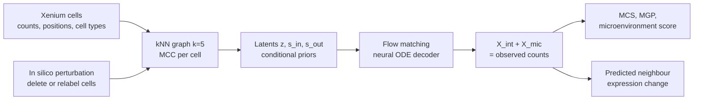
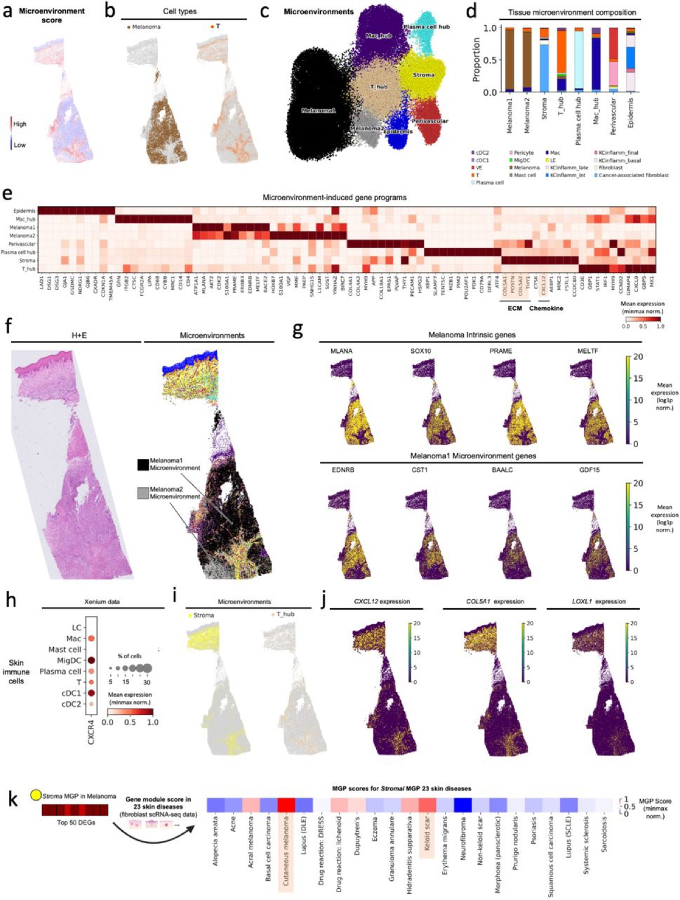

# Mapping and reprogramming human tissue microenvironments with MintFlow

> **文献键** `Akbarnejad_2025` · **来源** bioRxiv(2025) · **类别** spatial · **相关度** high · **获取** open
> **链接** <https://doi.org/10.1101/2025.06.24.661094> · `status: complete`

---

## 一句话
MintFlow 是一个基于 flow matching 的生成模型:在单细胞分辨率空间转录组(Xenium)上,把每个细胞的表达拆成"细胞本身(intrinsic)"和"由周围微环境诱导(microenvironment-induced)"两部分,并能在电脑里删除或替换某类细胞,预测邻近细胞表达如何变化。

## 要点
- 核心输出是两个计数矩阵:X_int(本征)和 X_mic(微环境诱导),两者相加重建原始表达;"微环境评分"= 细胞总计数中被归为微环境诱导的比例。
- 不需要配体-受体先验或预定义空间域;用 iVAE 式条件先验 + 最优传输条件让分解可识别、唯一(Methods、Supplementary Note 2)。
- in silico 扰动 = 改细胞类型标签或删除一群细胞 → 重建邻接图 → 重新预测邻居的 X_mic。
- 应用于特应性皮炎、黑色素瘤和透明细胞肾癌(ccRCC);ccRCC 中模拟删除三级淋巴结构(TLS)相关巨噬细胞,使 T 细胞的共抑制 / 耗竭标记下调。
- 把 in silico 重编程结果连到 TCGA 606 例 ccRCC 生存:TLS Border T 细胞程序高表达与更差生存相关(p = 0.0073),重编程后的状态高表达与生存获益相关(p = 0.0034)。
- 这是我们读到的最接近"model → revert"的空间组学方法,而且有肾脏(ccRCC)应用。

## 研究问题
组织微环境会在疾病中重编程局部细胞状态,但现有空间计算方法大多是描述性的,不能模拟组织扰动(Abstract)。已有对微环境效应建模的方法要么不能把本征与微环境诱导的变化分开,要么依赖线性假设或配体-受体等先验,扩展性差,也难以做假设检验。作者想要一个能学习"微环境如何改变细胞状态"、可扩展到多张切片、并能做 in silico 扰动的生成模型。

## 方法
术语:Xenium = 10x 的单细胞分辨率原位转录组平台(5k = 约 5000 基因 panel);微环境 = 一个细胞的空间近邻;MCC = 微环境中各细胞类型的比例。

1. **输入**:单细胞分辨率空间转录组的计数、坐标和细胞类型标签。按坐标建 k=5 的近邻图,算每个细胞的 MCC(Methods)。
2. **三个隐变量**:z_n(本征变化,先验以细胞类型为条件)、s_out(细胞向外发出的信号,先验以细胞类型为条件)、s_in(由邻居的 s_out 聚合得到的传入信号,间接依赖 MCC)(Fig. 1b、Methods)。
3. **生成过程**:在隐空间做 flow matching,用神经 ODE 作解码器,得到本征嵌入与微环境诱导嵌入,再解码成 X_int 和 X_mic,两者相加重建观测表达。
4. **可识别性**:非线性解码器的模型一般不可识别;作者模仿 iVAE,用细胞类型 / MCC 条件先验,再加上与最优传输相关的条件使分解唯一(Methods、Supplementary Note 2)。另用 Wasserstein 分布匹配项保证"本征状态不含邻居细胞类型信息"。
5. **扩展性**:自定义采样器按块取子图训练,可以在多张、合计数百万细胞的切片上训练。
6. **下游**:聚类微环境诱导嵌入得到微环境诱导细胞状态(MCS)和空间域;从 X_mic 得到微环境诱导基因程序(MGP);微环境评分定位信号热点。
7. **in silico 扰动**:修改细胞类型标签或删除某一亚群,按空间位置重建邻接图,再预测扰动后邻居的表达。
8. **基准**:带已知微环境效应的模拟数据(MAE、EMD、MSE);真实数据上看已知信号基因的计数是否更多被归入 X_mic;对比方法包括 SIMVI 和 MEFISTO 等。

## 方法图


## 数据
(1) **特应性皮炎**:8 名患者的 10 张皮肤切片(其中 8 张为新生成),Xenium 5k,QC 后 197,487 个细胞,识别 10 个微环境域;外部验证包括 4 名患者的 scRNA-seq、一个覆盖 6 种组织 23 种疾病的图谱、10 名 dupilumab 治疗 12 周的患者。(2) **皮肤黑色素瘤**:公开的 5000-plex Xenium 数据,98,749 个细胞,8 个微环境簇。(3) **ccRCC**:1 名患者,肿瘤核心 3 个肉眼可区分的区域 + 肿瘤-正常交界,337,116 个细胞,24 种细胞类型;外部数据包括 10 名患者 147,917 个肿瘤浸润细胞的 ccRCC scRNA-seq(含 ICB 治疗样本,Bi et al.)、TCGA 606 例 ccRCC bulk RNA-seq,以及一个 Kaede 转基因小鼠抗 PD-L1 肿瘤模型。另有带真值的模拟数据用于基准。

## 主要结果
- **基准(图中标注的均值)**:模拟数据上,EMD(log 尺度、取负,越高越好)MintFlow 7.08,SIMVI −0.37,MEFISTO −4.36,random −3.79,random binary 2.45;MAE、MSE 趋势相同(Fig. 1g)。真实数据上,已知信号基因的计数被归入 X_mic 的比例:皮炎单切片 MintFlow 0.247 vs SIMVI 0.053、MEFISTO 0.001;黑色素瘤 0.62 vs 0.037、0.001;皮炎 10 张切片上只有 MintFlow 能运行,已知信号基因 0.66 vs 非信号基因 0.317(Fig. 1h)。
- **特应性皮炎**:发现微环境诱导的表皮 2 型组织驻留记忆 T 细胞(CD8A+ ITGAE+ GZMB+,表达 IL13)和一个 T 细胞活化枢纽(T_DC 域)(Figs. 2–3);模拟删除 Treg 提示炎症状态增强,而增补 Treg 与促炎通路无关;在 10 名 dupilumab 治疗患者中,Treg 通常从基线到第 12 周增加。
- **黑色素瘤**:找到表达 CXCL12、胶原交联酶(LOX、LOXL1、LOXL2)高的基质,与 T 细胞排除相关;该基质 MGP 在瘢痕疙瘩中高表达(Fig. 4)。
- **ccRCC**:TLS 内有三种微环境诱导 T 细胞状态(TLS Core 1、Core 2、Border);TLS 相关巨噬细胞高表达 TREM2 和 CCR1。模拟删除这些巨噬细胞后,T 细胞共抑制 / 耗竭分子(PD-L2、TIM3、VSIR、CD276、LILRB1)下调,TCR 信号和白介素受体相关标记上调(Figs. 5–7)。
- **有效性检查**:用公开 ccRCC scRNA-seq(含 ICB 治疗)给出的巨噬细胞基因签名作"真值",模拟把 T 细胞替换为 ICB 后状态,12 个在 Xenium 5K panel 内的真值基因中 11 个被上调。
- **临床关联**:TCGA 606 例 ccRCC 中,TLS Border T 细胞程序高表达与更差总生存相关(p = 0.0073);重编程状态高表达与生存优势相关(p = 0.0034)。

## 创新点
- 把空间转录组表达可识别地分解为本征与微环境诱导两个可解释的计数矩阵,不依赖配体-受体先验或预定义空间域。
- 组织层面的 in silico 扰动:删除 / 替换任意细胞类型并预测邻居反应。
- 子图采样训练,可扩展到多张切片、数百万细胞。
- 在三种疾病上给出生物学发现,并用外部 scRNA-seq、治疗队列和 TCGA 生存做验证。

## 局限
- (作者)对低读数敏感;需要各切片基因 panel 一致。
- (作者)受当前细胞分割误差影响;训练困难、需针对数据集调超参;flow matching 训练计算量大。
- (作者)目前限于多张切片,未来可扩展到更大框架(例如图谱级)。
- 我们的理解:ccRCC 空间数据只来自 1 名患者;in silico 扰动是模型预测,验证主要是与外部签名的一致性和 TCGA 生存关联,不是直接的扰动实验。
- 我们的理解:扰动只能改变"细胞组成 / 邻居",不能直接模拟"敲低某个基因";依赖输入的细胞类型标签质量。

## 与本研究方向的关系
主要对应 **model → revert** 环节,并且有肾脏(ccRCC)应用。我们的理解:(1) X_mic / 微环境评分本身不是异常检测,但"哪些细胞的表达被微环境显著改变"可作为 detect 环节的一种补充证据,例如与正常参考对比后的异常区域再用 MintFlow 解释是哪类邻居造成的;(2) in silico 删除 / 替换细胞类型是"revert"的一种形式——它预测的是"改变组织组成能否让邻近细胞回到另一种状态",比 CMonge 的单细胞药物扰动更接近组织层面;(3) 对 Topic 1 的肾脏 Xenium 数据,MintFlow 可直接作为模型层候选,但要注意它需要细胞类型标签和一致的基因 panel;(4) 它的验证方式(外部签名一致性 + 生存关联)可借鉴,但不能代替湿实验。

## 可复用资产
- **代码:** <https://github.com/Lotfollahi-lab/mintflow>(Python 包;论文 Code availability)。
- **复现与模拟数据:** <https://github.com/Lotfollahi-lab/mintflow-reproducibility>(论文 Data availability:模拟数据下载说明)。
- **评测设计:** 带真值的模拟基准(MAE / EMD / MSE)、信号基因计数归属检验、用外部 ICB 签名检验虚拟替换、扰动程序 → TCGA 生存。

## 待读
- Supplementary Note 2(可识别性证明)和 Methods 中的目标函数细节。
- 对照方法 SIMVI、MEFISTO 原文。
- Bi et al. ccRCC ICB scRNA-seq(虚拟替换的真值来源)。
- 我们的理解:在肾脏 Xenium 上试跑,检查需要多少细胞、panel 是否一致、细胞类型标签如何来。

## 图表


**图1.** MintFlow 总览与基准评测:(a) 以单细胞分辨率空间转录组为输入,依空间坐标确定每个细胞的微环境,细胞类型标签与微环境细胞类型组成(MCC)作为监督信号;(b) 模型推断内在信号(z_n)、传入/传出空间信号三类嵌入向量,经 flow matching 变换为内在与微环境诱导嵌入,再解码重建读数;(d–f) 聚类微环境诱导嵌入识别细粒度微环境诱导细胞态(MCS)、微环境诱导基因程序(MGP),并支持微环境的 in silico 扰动;(g) 在模拟数据上 MintFlow 在读数解耦上优于其它方法(MAE/EMD/MSE,指标取负使越高越好);(h) 在真实数据上,MintFlow 将更高比例的已知信号基因读数归入微环境诱导成分。
_Source: https://www.biorxiv.org/content/10.1101/2025.06.24.661094v3.full  ·  License: bioRxiv preprint (CC BY-NC-ND 4.0)_


**图2.** MintFlow 在特应性皮炎(AD)中识别出微环境诱导的 T_RM 细胞态与 T 细胞活化枢纽:(a) 微环境评分与对应 H&E 组织病理注释;(b) 微环境域与微环境诱导嵌入的 UMAP;(c) 炎症与非炎症皮肤中各微环境域的组织组成;(d) T_DC 域的微环境诱导基因程序(MGP)及其在跨组织图谱中的模块评分。
_Source: https://www.biorxiv.org/content/10.1101/2025.06.24.661094v3.full  ·  License: bioRxiv preprint (CC BY-NC-ND 4.0)_


**图4.** 用 MintFlow 解析黑色素瘤肿瘤微环境的免疫细胞分隔:(a) 微环境评分;(b) 按细胞类型着色(黑色素瘤 vs 其它、T 细胞 vs 其它);(c) 皮肤黑色素瘤微环境诱导嵌入的 UMAP;(d) 各微环境域的细胞组成;(e) 各域的微环境诱导基因程序(MGP);(f) H&E 图像与对应按微环境域着色的 Xenium 切片。
_Source: https://www.biorxiv.org/content/10.1101/2025.06.24.661094v3.full  ·  License: bioRxiv preprint (CC BY-NC-ND 4.0)_

### 结果表

**表1.** MintFlow 基准评测总结(源自图 1g/1h)。论文以箱线图报告结果、未给出数值表;下表数值为图中印出的均值。

| Benchmark | Data | Metric(s) | Result vs alternatives |
|---|---|---|---|
| Read-count disentanglement | Simulated data with known microenvironment-induced effects (ground truth) | MAE, EMD, MSE (negated → higher is better) | MintFlow EMD 7.08 vs SIMVI −0.37, MEFISTO −4.36, random −3.79, random binary 2.45 (means printed in Fig 1g; log scale, negated) |
| Signaling-gene attribution | Real Xenium (AD single-sample, melanoma single-sample) | Proportion of known signaling-gene counts assigned to the microenvironment-induced component (counts < 20 filtered) | Known signaling genes: MintFlow 0.247 vs SIMVI 0.053, MEFISTO 0.001 (AD); 0.62 vs 0.037, 0.001 (melanoma) (Fig 1h) |
| Scalability | Multi-sample Xenium (10 atopic-dermatitis sections) | Applicable to all 10 sections | Only MintFlow was scalable enough to run on all 10 tissue sections |

## 引用
```bibtex
@article{Akbarnejad_2025, title={Mapping and reprogramming human tissue microenvironments with MintFlow}, url={http://dx.doi.org/10.1101/2025.06.24.661094}, DOI={10.1101/2025.06.24.661094}, publisher={openRxiv}, author={Akbarnejad, Amir and Steele, Lloyd and Jafree, Daniyal J. and Birk, Sebastian and Sallese, Marta Rosa and Rademaker, Koen and Boxall, Adam and Rumney, Benjamin and Tudor, Catherine and Patel, Minal and Prete, Martin and Makarchuk, Stanislaw and Lee, Colin Y.C. and Maaskola, Jonas and Li, Tong and Stanley, Heather and Foster, April Rose and Roberts, Kenny and Trinh, Andrew L. and Villa, Carlo Emanuele and Testa, Giuseppe and Mahil, Satveer and Mehrjou, Arash and Smith, Catherine and Vakili, Sattar and Clatworthy, Menna R. and Bayraktar, Omer Ali and Mitchell, Thomas and Haniffa, Muzlifah and Lotfollahi, Mohammad}, year={2025}, month=June }
```


---

📄 **[AI-ready 全文提取 →](ai-ready.md)**
