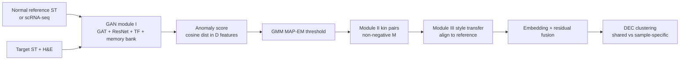

# Detecting anomalous anatomic regions in spatial transcriptomics with STANDS

> **Bibkey** `Xu_2024` · **Venue** Nature Communications (2024) · **Category** spatial · **Relevance** medium · **Access** open
> **Link** <https://doi.org/10.1038/s41467-024-52445-9> · `status: complete`

---

## One-liner
STANDS is a GAN-based multi-sample spatial-transcriptomics (ST) framework: it learns to reconstruct normal spots from a "normal" reference section, flags poorly reconstructed spots in target sections as anomalous tissue domains (ATDs), aligns several samples into the reference space, and clusters the anomalies into subtypes that are shared across samples or sample-specific — without any predefined anomaly marker genes.

## Takeaways
- Detection = a reconstruction GAN trained only on a normal reference; the anomaly score is the cosine distance between discriminator features of the real and reconstructed spot (Methods Eq. 8), thresholded automatically by a two-component GMM with priors.
- Each spot uses both gene expression (GAT graph encoder) and its H&E patch (ResNet-34 + GAT), fused by a transformer block; removing histology lowers detection accuracy and adds false positives (Supp. Fig. 16).
- When no normal ST exists, normal scRNA-seq can serve as reference (MLP encoder, spots treated as cells); on pancreatic-cancer Visium it still gets the lowest SGD (0.97, 0.53; Fig. 2g).
- Reference size and diversity drive false positives: a normal tissue type missing from the reference gets flagged in the target (breast glands ~3.30-fold, Fig. 9f).
- Some "false positives" sit next to tumour, look normal on H&E but have raised cancer-marker expression; the authors read them as emerging cancer (Fig. 2c–e) — the score may flag change before the annotation does.
- Many benchmark "anomalies" are curated domain labels (e.g. a domain type held out of the reference and designated anomalous in the target), not always disease per se.

## Problem
The authors call this task DDATD (Detection and Dissection of Anomalous Tissue Domains) with three steps: detect ATDs, align them across samples (remove batch effects), and split them into shared vs sample-specific subtypes (Fig. 1a). Spatial clustering methods (SpaGCN, GraphST) do not separate anomalous clusters; iStar, TESLA and cell2location need expert-defined anomaly markers; the only marker-free method, Spatial-ID, needs an annotated scRNA-seq reference of the target tissue, has a high false-positive rate, and cannot handle several targets (Introduction). Further obstacles: batch effects hurt detection, anomalies hurt alignment, normal reference ST is scarce, and histology images are under-used.

## Method

Terms: a spot is one ST measurement location (a 10x Visium spot covers several cells) with an expression vector and coordinates; H&E is the standard stained tissue image.

1. **Preprocessing**: drop mitochondrial and ERCC spike-in genes and genes seen in <10 spots; library-size normalise + log; keep 3,000 spatially variable genes from SpatialDE (Methods "Data preprocessing"). Each spot gets a 112×112-pixel H&E patch, embedded to 256-d by a pretrained ResNet-34. Spot coordinates form a k=6 neighbour graph.
2. **C1 detection (GAN module I)**: generator = encoder + memory bank + decoder. Expression goes through a two-layer GATv2 (3000-512-256); image features through a second GAT of the same shape; the two 256-d embeddings are fused by a 3-layer transformer into 512-d. The memory bank is a 512×512 embedding queue; the current embedding is re-expressed as an attention-weighted mix of memory items (Eq. 4), which counters mode collapse. Decoders: MLP (256-512-3000) for expression, a mirrored ResNet-34 deconvolution for the patch. Loss = L1 reconstruction (expression and image weighted by γ) + adversarial loss with a gradient-penalty discriminator (Eqs. 5–7). **Trained on the normal reference only** (batch 128, Adam, lr 3e-4).
3. **Score and threshold**: for a target spot, d = 1 − cos(D(x), D(x̂)), the cosine distance between real and reconstructed spot in the discriminator's 16-d output space (Eq. 8). A two-component 1-D GMM on d (Beta(1,10) prior on the anomaly fraction, NIX priors on means/variances, set from reference scores) is fitted by MAP-EM and spots are assigned by posterior (Eqs. 9–14).
4. **Cross-modal reference**: with no normal ST, train on normal scRNA-seq with a two-layer MLP encoder and score target spots as if they were cells.
5. **C2 alignment (modules II + III)**: first remove C1 anomalies. Module II learns a non-negative N_T×N_R matrix M that reconstructs target embeddings from reference embeddings (Eqs. 22–25); the arg-max of each row gives the target spot's "kin" reference spot. Module III learns a style matrix S (batches × 256); each target embedding minus its batch's style vector is decoded to reconstruct its kin reference spot (Eqs. 26–29). At test time all target spots, anomalies included, pass through it and land in the reference space at the original data scale.
6. **C3 subtyping**: for aligned anomalous spots, the frozen module I gives embedding z and residual r = x − x̂; r is encoded to ζ, z and ζ are fused by a transformer into 128-d and clustered with DEC (Student-t soft assignment + KL self-training, Eqs. 34–36) until assignment change <0.001 or 2e4 iterations. The cluster number is given or inferred (Supp. Note 1.5).
7. **Evaluation**: detection by accuracy, F1, PR curve and the new SGD (anomalous spots form a kNN graph; compare degree and clustering-coefficient distributions of prediction vs truth, lower is better); alignment by iLISI, BatchKL, ASW_batch, ASW_type and ARI of joint GraphST clustering; subtyping by Macro-F1, NMI and multi-SGD.

## Method diagram


## Data
26 experiments (Table 1) over three platforms (10x Visium, Slide-seqV2, Stereo-seq), human and mouse. Main data: healthy human breast 10x-hNB-v05/v06/v07 (GSE195665) as reference; human breast cancer 10x-hBC-G2, H1 and vertical slices A1–A6 (her2st GitHub repo); a healthy pancreatic-duct scRNA-seq set (sc-hPD) as cross-modal reference for pancreatic ductal adenocarcinoma 10x-hPDAC (GSE111672); healthy liver 10x-hLCL-C73-C1 as reference for primary sclerosing cholangitis 10x-hPSC-A1/C1/D1 (GSE243977); human renal cell carcinoma 10x-hRCC-C2/C3/C4 (GSE175540), whose anomaly types are five tertiary-lymphoid-structure (TLS) cell types; mouse embryo Slide-seqV2 (ssq-mEmb-32/33/34, GSE197353) and Stereo-seq (Stereo-mEmb-S1/S2/S3, CNP0001543). Ground truth is the original domain annotation; in several experiments a domain is curated to be anomalous (e.g. in mouse embryo, cardiac-valve and neuroectodermal domains are removed from the reference and treated as anomalies in the target).

## Key results
- **Single-target detection (breast cancer 10x-hBC-G2, reference 10x-hNB-v05)**: better accuracy, F1, PR curve and SGD than Spatial-ID, CAMLU, scPred, CHETAH, scmap; STANDS SGD (0.78, 0.21) vs ≥ (1.31, 0.95) for the others (Fig. 2b labels).
- **"False positives" as emerging cancer**: normal spots closer to cancer score higher; flagged neighbours look normal on H&E but their ACTB and TMSB10 levels sit between normal (n=238) and known cancer (n=160) (emerging, n=69) (Fig. 2c–e).
- **Cross-modal detection (scRNA-seq reference → 10x-hPDAC)**: highest accuracy and F1, lowest SGD (0.97, 0.53); baselines also include the unsupervised tumour-cell callers SCEVAN and CopyKAT (Fig. 2f–g).
- **Multi-target detection (10x-hBC-G2 + H1)**: only STANDS delineates ATDs on both sections; SGD (1.24, 1.04) vs next-best Spatial-ID (1.57, 1.49) (Fig. 3b). Same conclusion on Slide-seqV2, Stereo-seq, PSC and RCC data (Supp. Figs 1–5).
- **Alignment**: on PSC vertical slices and non-adjacent breast sections, STANDS leads Harmony, ComBat, GraphST and STAligner on iLISI/BatchKL/ASW and joint-GraphST ARI (Fig. 4, Supp. Fig. 6); on breast-cancer vertical slices ASW_type is 0.52 vs Harmony 0.50 and ARI 0.24 vs 0.23 (Supp. Fig. 7) — a small margin. With sample-specific domains present, STANDS is the only method whose performance holds (Fig. 5b).
- **Subtyping**: best Macro-F1, NMI and multi-SGD in single- and multi-target settings (shared CIS plus sample-specific IC / AT) (Supp. Figs 10–12, Fig. 7) and on Stereo-seq embryo (Fig. 8).
- **Reference size and diversity**: removing 1/3 and 2/3 of connective-tissue spots (~415 each) from the reference raises target connective-tissue false positives 14 → 20 → 35, and lowers AUC and F1 (Fig. 9a–c); removing breast glands raises their false positives ~3.30-fold vs ~2.94-fold for immune infiltrates (Fig. 9f).
- **Ablation**: removing the memory bank, histology, or TF blocks, or swapping the non-negative mapping for MNN, each lowers the matching task's metrics; without the memory bank the loss curves show signs of mode collapse (Supp. Fig. 16).

## Contributions
- Claimed as the first method for de novo (no annotated reference, no markers) multi-sample ATD detection from ST (Discussion).
- Detection, alignment and subtyping unified in one set of GAN modules that share encoders and reconstruction residuals.
- Multimodal reconstruction of expression + H&E (GAT + ResNet + transformer fusion), with scRNA-seq usable in place of a normal ST reference.
- Alignment via kin pairs + subtraction of a per-batch style vector: keeps the original data scale and is robust to sample-specific domains.
- New SGD / multi-SGD metrics that bring spatial neighbourhood structure into detection and clustering evaluation.

## Limitations
- (Authors) The GAN could be replaced by a denoising diffusion model to reconstruct normal data more accurately and cut false positives (Discussion).
- (Authors' experiments) Sensitive to reference size and diversity: normal tissue types missing from the reference get flagged (Fig. 9).
- Our reading: many "anomalies" are curated by removing a known domain from the reference, closer to novel-class detection; graded disease change (e.g. fibrosis severity) is not tested directly.
- Our reading: accuracy / F1 are computed after thresholding (mean ± SD over 5 runs); AUC appears only in Fig. 9, so there is no consistent threshold-free comparison table.
- Our reading: the cluster number is assumed known or inferred separately; with three GANs plus DEC the pipeline is heavy to tune and train.

## Relation to our direction
It covers the **detect** step of detect → model → revert, using exactly the "normal reference → reconstruct → anomaly score" recipe on spatial transcriptomics, which is directly relevant to the kidney-omics anomaly benchmark (Topic 1). Our reading: (1) STANDS is a natural reconstruction baseline for spatial detection, and its data already include a kidney setting (10x-hRCC, GSE175540) where we could reproduce it first; (2) the reference size/diversity study (Fig. 9) says our benchmark should report which normal tissue types the reference covers, or false positives cannot be interpreted; (3) "false positive = emerging lesion" (Fig. 2c–e) is an argument for expert review of flags, as in our expert-validated design; (4) the cross-modal reference (scRNA-seq → ST) matches our idea of snRNA and Xenium as orthogonal evidence; (5) there is no revert step: the residual r = x − x̂ says where and in which genes a spot deviates, but it is not a causal perturbation prediction; a perturbation model is still needed for revert.

## Reusable assets
- **Code:** <https://github.com/Catchxu/STANDS>; Zenodo archive <https://doi.org/10.5281/zenodo.13375297> (Code availability).
- **Data accessions (Data availability):** GSE195665 (healthy breast), her2st GitHub <https://github.com/almaan/her2st> (breast cancer), GSE243977 (PSC), GSE175540 (renal cell carcinoma), GSE111672 (PDAC), GSE197353 (Slide-seqV2 embryo), CNP0001543 (Stereo-seq embryo).
- **Evaluation:** SGD / multi-SGD definitions in Methods "Evaluation metrics"; the 26-experiment design in Table 1.

## Follow-ups
- Supp. Note 1.1 / Fig. 5: setup and results of the renal-cell-carcinoma TLS experiment.
- Supp. Notes 1.4–1.5: GMM inference and automatic cluster-number choice.
- The Spatial-ID and CAMLU papers (main baselines).
- Our reading: compare STANDS with feature-based baselines (e.g. kNN on foundation-model embeddings) on kidney Visium / Xenium.

## Figures & tables


**Fig 1.** Overview of STANDS and multi-sample DDATD. (a) End-to-end workflow from affected samples through anomaly identification → alignment for batch correction → dissection into shared vs. sample-specific subtypes; (b) the three-component framework (C1 detection, C2 alignment, C3 subtyping) with GAT networks, GAN modules and a Transformer Fusion block.
_Source: https://pmc.ncbi.nlm.nih.gov/articles/PMC11413068/  ·  License: CC BY 4.0_


**Fig 2.** Intra- and cross-modality ATD detection in single 10x Visium datasets. Spatial maps, accuracy / F1 / PR curves / SGD scatter, anomaly-score distributions (threshold 0.81), marker genes (ACTB, TMSB10), and cross-modality detection using an scRNA-seq reference, for human breast (10x-hBC-G2) and pancreatic (10x-hPDAC) cancer. STANDS has the lowest (best) SGD among all baselines.
_Source: https://pmc.ncbi.nlm.nih.gov/articles/PMC11413068/  ·  License: CC BY 4.0_


**Fig 3.** ATD detection across multiple human breast-cancer 10x Visium datasets (10x-hBC-G2, 10x-hBC-H1) containing both shared (invasive cancer, IC) and dataset-unique (cancer in situ CIS, adipose) domains. STANDS leads five baselines (CAMLU, scPred, CHETAH, scmap, Spatial-ID) on accuracy, F1, PR curves and SGD.
_Source: https://pmc.ncbi.nlm.nih.gov/articles/PMC11413068/  ·  License: CC BY 4.0_


**Fig 7.** Subtyping ATDs across two breast-cancer datasets with overlapping (CIS) and dataset-specific (IC, adipose) subtypes: spatial maps, Sankey label-correspondence diagrams, Macro-F1 vs NMI and multi-SGD scatterplots, and heatmaps of optimal spatial matching.
_Source: https://pmc.ncbi.nlm.nih.gov/articles/PMC11413068/  ·  License: CC BY 4.0_

### Results

**Table 1.** Spatial Grouping Discrepancy for multi-sample breast-cancer detection (values read from the Fig 3b scatter labels; lower SGD_degree / SGD_cc = better, i.e. higher spatial agreement with ground truth). STANDS is lowest on both.

| Method | SGD_degree ↓ | SGD_cc ↓ |
|---|---|---|
| **STANDS** | **1.24** | **1.04** |
| CHETAH | 1.73 | 1.42 |
| scmap | 1.69 | 1.45 |
| Spatial-ID | 1.57 | 1.49 |
| scPred | 1.79 | 1.63 |
| CAMLU | 1.89 | 1.77 |

**Table 2.** SGD for cross-modality detection (scRNA-seq reference → 10x-hPDAC pancreatic-cancer target; values from the Fig 2g scatter labels, lower is better). STANDS is lowest on both.

| Method | SGD_degree ↓ | SGD_cc ↓ |
|---|---|---|
| **STANDS** | **0.97** | **0.53** |
| SCEVAN | 1.32 | 0.99 |
| CAMLU | 1.37 | 1.08 |
| scPred | 1.52 | 1.31 |
| scmap | 1.52 | 1.31 |
| Spatial-ID | 1.55 | 1.35 |
| CopyKAT | 1.73 | 1.47 |
| CHETAH | 1.99 | 1.65 |

_Source: https://pmc.ncbi.nlm.nih.gov/articles/PMC11413068/  ·  License: CC BY 4.0. accuracy / F1 / ARI and similar metrics are presented as bar charts in the original Figs 2, 3 and 4; no text value tables are provided._

## Cite
```bibtex
@article{Xu_2024, title={Detecting anomalous anatomic regions in spatial transcriptomics with STANDS}, volume={15}, ISSN={2041-1723}, url={http://dx.doi.org/10.1038/s41467-024-52445-9}, DOI={10.1038/s41467-024-52445-9}, number={1}, journal={Nature Communications}, publisher={Springer Science and Business Media LLC}, author={Xu, Kaichen and Lu, Yan and Hou, Suyang and Liu, Kainan and Du, Yihang and Huang, Mengqian and Feng, Hao and Wu, Hao and Sun, Xiaobo}, year={2024}, month=Sept }
```


---

📄 **[AI-ready full-text extract →](ai-ready.md)**
