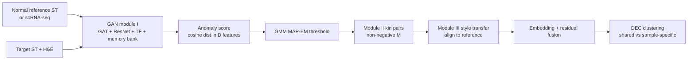
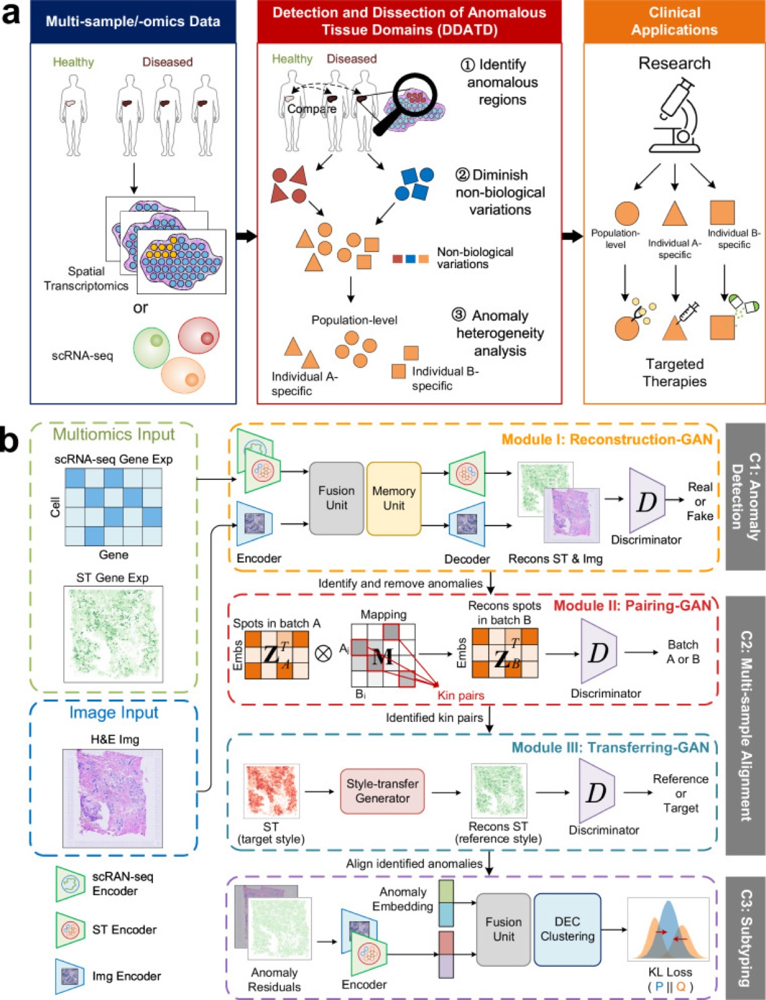
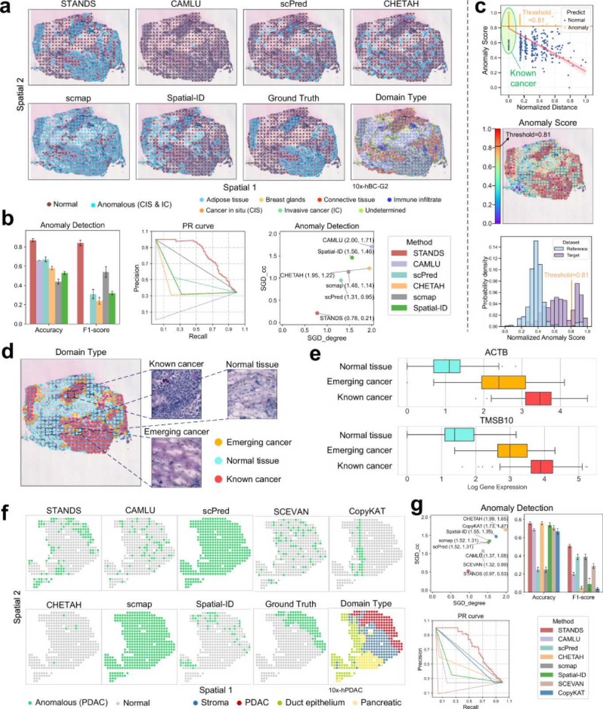
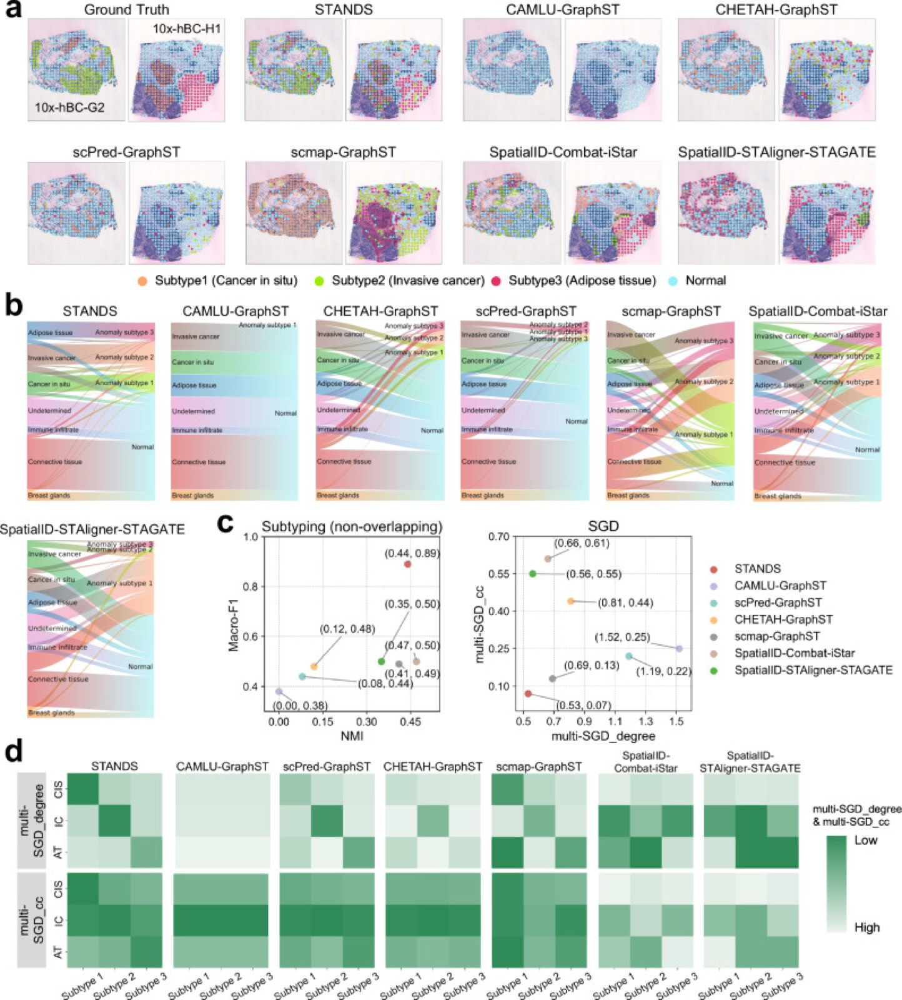

# Detecting anomalous anatomic regions in spatial transcriptomics with STANDS

> **文献键** `Xu_2024` · **来源** Nature Communications(2024) · **类别** spatial · **相关度** medium · **获取** open
> **链接** <https://doi.org/10.1038/s41467-024-52445-9> · `status: complete`

---

## 一句话
STANDS 是一套基于 GAN 的多样本空间转录组(ST)框架:先在"正常"参考切片上学会重建正常 spot,把重建得差的 spot 标为异常组织域(ATD);再把多个样本对齐到参考空间;最后把异常聚成"跨样本共享 / 样本特有"的亚型——全程不需要预先给出异常 marker 基因。

## 要点
- 异常检测 = "只在正常参考上训练的重建 GAN" + 异常分数;分数是判别器特征空间里原 spot 与重建 spot 的余弦距离(Methods 式 8),再用带先验的两分量 GMM 自动定阈值。
- 每个 spot 同时用基因表达(GAT 图编码)和 H&E 图块(ResNet-34 + GAT)两种模态,用 Transformer fusion 融合;消融显示去掉组织学图像会降低检测精度并增加假阳性(Supp. Fig. 16)。
- 没有正常 ST 时可以用正常 scRNA-seq 当参考(编码器换成 MLP,把 spot 当单细胞);在胰腺癌 Visium 上仍取得最低 SGD(0.97, 0.53;Fig. 2g)。
- 参考集的"量"和"多样性"直接决定假阳性:缺少某类正常组织,该类组织在目标里就会被误报(乳腺腺体约 3.30 倍,Fig. 9f)。
- 一些"假阳性"贴着肿瘤边缘、H&E 上看不出、但癌 marker 升高,作者解读为正在形成的癌区(Fig. 2c–e)——异常分数可能比人工标注更早报警。
- 评测中的"异常"多数是人为指定的组织域(例如从参考里剔除某类域、在目标里把它当异常),不全是疾病本身。

## 研究问题
作者把"从多样本 ST 中检测并拆解异常组织域"称为 DDATD,分三步:检测 ATD、跨样本对齐(去批次效应)、把 ATD 分成共享或样本特有的亚型(Fig. 1a)。现有空间聚类方法(SpaGCN、GraphST)不区分异常簇;iStar、TESLA、cell2location 依赖专家给的异常 marker;唯一无 marker 的 Spatial-ID 又需要目标组织的带注释 scRNA-seq 参考、假阳性高,且因缺少跨样本对齐机制而难以处理多个目标样本(Introduction)。作者还列出六个难点:批次效应干扰检测、异常本身干扰对齐、现有对齐方法不能保持数据原始尺度与语义、正常参考 ST 稀缺、组织学图像没被充分利用、三个任务需要统一框架而不是简单拼接各自的方法(Introduction)。

## 方法
术语:spot = ST 的一个测量点(10x Visium 一个 spot 覆盖若干细胞),带一条基因表达向量和一个坐标;H&E = 常规染色的组织切片图像。

1. **预处理**:去线粒体和 ERCC spike-in 基因,去掉在 <10 个 spot 中检出的基因,按文库大小归一化 + log,用 SpatialDE 选 3000 个空间可变基因作输入(Methods "Data preprocessing")。每个 spot 截取 112×112 像素 H&E 图块,用预训练 ResNet-34 得到 256 维特征。spot 坐标建 k=6 的近邻图。
2. **C1 检测(GAN module I)**:生成器 = 编码器 + memory bank + 解码器。表达用两层 GATv2(3000-512-256),图像特征用同结构的另一个 GAT,两个 256 维嵌入经 3 层 Transformer fusion 得到 512 维嵌入。memory bank 是 512×512 的嵌入队列,用注意力从记忆里"拼回"当前嵌入(式 4),用于防止 mode collapse。解码器:表达用 MLP(256-512-3000),图像用对称的 ResNet-34 反卷积。损失 = L1 重建(表达与图像按 γ 加权)+ 对抗损失,判别器带梯度惩罚项以保证 Lipschitz 连续(式 5–6)。**只在正常参考上训练**(batch 128,Adam,lr 3e-4)。
3. **异常分数与阈值**:目标 spot 的分数 d = 1 − cos(D(x), D(x̂)),即判别器 16 维输出空间中原始与重建的余弦距离(式 8)。对 d 拟合两分量一维 GMM(异常比例 π 加 Beta(1,10) 先验,均值方差加 NIX 先验,先验参数由参考集分数估计),MAP-EM 推断后按后验归类(式 9–14)。
4. **跨模态参考**:没有正常 ST 时,用正常 scRNA-seq 训练,编码器换成两层 MLP,把目标 spot 当成单细胞来打分。
5. **C2 对齐(module II + III)**:先剔除 C1 判出的异常。module II 学一个非负映射矩阵 M(N_T×N_R),用参考嵌入重建目标嵌入(式 22–25);M 每行最大值给出与该目标 spot "同类"(kin)的参考 spot。module III 学一个"风格差异"矩阵 S(批次数 × 256),把目标 spot 的嵌入减去其批次的风格向量,再解码去重建其 kin 参考 spot(式 26–29)。训练好后把所有目标 spot(包括异常)送进去,得到对齐到参考空间、保持原始尺度的表达。
6. **C3 亚型**:对齐后的异常 spot,用冻结的 module I 得到嵌入 z 和重建残差 r = x − x̂;r 再编码成 ζ,z 与 ζ 用 Transformer 融合为 128 维,然后用 DEC(Student-t 软分配 + KL 自训练,式 34–36)聚类,直到分配变化 <0.001 或 2e4 次迭代。簇数假设已知或按 Supp. Note 1.5 自动推断。
7. **评测**:检测用 accuracy、F1、PR 曲线和作者新提出的 SGD(把异常 spot 连成 kNN 图,比较预测与真值在度和聚类系数上的分布差异,越低越好);对齐用 iLISI、BatchKL、ASW_batch、ASW_type 和 GraphST 联合聚类的 ARI;亚型用 Macro-F1、NMI、multi-SGD。

## 方法图


## 数据
26 组实验(Table 1),跨 10x Visium、Slide-seqV2、Stereo-seq 三个平台,人和小鼠。主要数据:健康人乳腺 10x-hNB-v05/v06/v07(GSE195665)作参考;人乳腺癌 10x-hBC-G2、H1 及纵向切片 A1–A6(her2st GitHub 仓库);健康胰腺导管 scRNA-seq(sc-hPD)作跨模态参考,目标为胰腺导管腺癌 10x-hPDAC(GSE111672);人肝尾状叶 10x-hLCL-C73-C1 作参考(正文未说明是否健康)、原发性硬化性胆管炎 10x-hPSC-A1/C1/D1(GSE243977);人肾细胞癌 10x-hRCC-C2/C3/C4(GSE175540):参考是同为肾癌切片的 C2,目标是 C3、C4,异常类型是 5 种三级淋巴结构(TLS)相关细胞域(TLS T 细胞、树突细胞、上皮细胞、肥大细胞、系膜细胞;Table 1 Exp 8)——不是正常肾 vs 疾病的比较;小鼠胚胎 Slide-seqV2(ssq-mEmb-32/33/34,GSE197353)和 Stereo-seq(Stereo-mEmb-S1/S2/S3,CNP0001543)。评测用各数据集的真值组织域注释(ground truth domain annotations;正文未说明注释来源);在部分实验中某个域被"策划"为异常(例如小鼠胚胎中把心瓣膜细胞、神经外胚层细胞域从参考中排除,在目标中当异常)。

## 主要结果
- **单样本检测(乳腺癌 10x-hBC-G2,参考 10x-hNB-v05)**:accuracy、F1、PR 曲线和 SGD 均优于 Spatial-ID、CAMLU、scPred、CHETAH、scmap;STANDS 的 SGD 为 (0.78, 0.21),其余方法均 ≥ (1.31, 0.95)(Fig. 2b 图中标注)。
- **"假阳性"即早期癌**:离癌区越近的正常 spot 分数越高;被误报的相邻 spot 在 H&E 上看不出异常,但 ACTB、TMSB10 表达介于正常(n=238)与已知癌(n=160)之间(emerging cancer n=69)(Fig. 2c–e)。
- **跨模态检测(scRNA-seq 参考 → 10x-hPDAC)**:accuracy 和 F1 最高、SGD 最低 (0.97, 0.53);对照还包括无监督肿瘤细胞检测方法 SCEVAN、CopyKAT(Fig. 2f–g)。
- **多样本检测(10x-hBC-G2 + H1)**:只有 STANDS 在两张切片上都勾勒出 ATD;SGD (1.24, 1.04);SGD_degree 上次优为 Spatial-ID 1.57,SGD_cc 上次优为 CHETAH 1.42(Fig. 3b)。在 Slide-seqV2、Stereo-seq、PSC、RCC 数据上结论一致(Supp. Figs 1–5)。
- **对齐**:在 PSC 纵向切片和非相邻乳腺切片上,iLISI/BatchKL/ASW 及 GraphST 联合聚类 ARI 综合领先 Harmony、ComBat、GraphST、STAligner(Fig. 4、Supp. Fig. 6);在乳腺癌纵向切片上 STANDS ASW_type 0.52 vs Harmony 0.50,ARI 0.24 vs 0.23(Supp. Fig. 7)——优势很小。存在样本特有域时,STANDS 是唯一性能不受影响的方法(Fig. 5b)。
- **亚型**:单样本和多样本(共享 CIS + 各自特有 IC / AT)场景下 Macro-F1、NMI、multi-SGD 均最好(Supp. Figs 10–12、Fig. 7);Stereo-seq 胚胎上同样(Fig. 8)。
- **参考集规模与多样性**:逐步从参考中去掉 1/3、2/3 结缔组织 spot(每次约 415 个),正文称目标中结缔组织的假阳性从 14 → 20 → 35 个,但 Fig. 9c 最右一组柱子标的是 32 → 35 → 39(图注称其为假阳性总数),论文正文与图不一致;AUC 0.83 → 0.81 → 0.79,F1 0.80 → 0.77 → 0.75(Fig. 9c);从参考中去掉乳腺腺体使该类假阳性约增 3.30 倍,去掉免疫浸润约增 2.94 倍(Fig. 9f)。
- **消融**:去掉 memory bank、组织学图像、TF 融合块,或把非负映射换成 MNN,各自都会降低相应任务的指标;去掉 memory bank 时损失曲线呈 mode collapse 迹象(Supp. Fig. 16)。

## 创新点
- 作者称 STANDS 是"第一个专门从 ST 数据检测 ATD 的方法"(Discussion);Introduction 指出此前没有方法能从 ST 数据做 de novo、无需注释参考的 DDATD,多样本场景尤其如此。
- 检测、对齐、亚型三步统一在一组 GAN 模块中:后续模块沿用 module I 的结构和权重(作初始化或冻结使用),C3 用 module I 的嵌入和重建残差。
- 表达 + H&E 的多模态重建(GAT + ResNet + Transformer fusion),并可用 scRNA-seq 替代正常 ST 参考。
- 基于 kin 配对 + 风格向量相减的对齐:保留原始数据尺度,对样本特有域稳健。
- 新指标 SGD / multi-SGD,把空间邻接结构纳入检测与聚类评测。

## 局限
- (作者)GAN 可换成去噪扩散模型,以更准地重建正常样本、减少假阳性(Discussion)。
- (作者实验)对参考集的规模和多样性敏感:参考里缺的正常组织类型会被误报(Fig. 9)。
- 我们的理解:很多"异常"是从参考里剔除某个已知域后人为指定的,更像"新类别检测";对真实疾病变化(如纤维化程度渐变)的效果没有直接检验。
- 我们的理解:accuracy / F1 在阈值化后计算,且 5 次重复只报均值±SD;阈值无关的结果只以 PR 曲线给出(没有 AUPRC 数值),AUC 数值只在 Fig. 9 出现。
- 我们的理解:簇数假设已知或另行推断;组件多(3 个 GAN + DEC),调参与训练成本较高。

## 与本研究方向的关系
它对应 detect → model → revert 的 **detect** 一环,而且就是空间转录组上的"正常参考 → 重建 → 异常分数"范式,和肾脏组学异常检测基准(伪影注入课题)直接相关。我们的理解:(1) STANDS 可作为空间组学检测的重建类基线,论文含一个肾细胞癌 Visium 实验(GSE175540),但参考本身是癌切片 C2,"异常"是 C3/C4 中 5 种 TLS 相关域,不是正常肾 → 疾病的比较,只能用来跑通流程,不能直接当肾脏正常 vs 疾病基准;(2) 它的"参考规模/多样性"实验(Fig. 9)提示我们的基准应显式报告参考集覆盖了哪些正常组织类型,否则假阳性无法解释;(3) "假阳性=早期病变"(Fig. 2c–e)正说明需要专家复核的标注流程——这与我们"专家验证标记"的设计一致;(4) 跨模态参考(scRNA-seq → ST)对应「snRNA 与 Xenium 互为证据」的思路;(5) 它没有 revert 环节:重建残差 r = x − x̂ 只告诉"哪里、哪些基因偏离",但不是因果扰动预测,要接到 revert 还需要扰动模型。

## 可复用资产
- **代码:** <https://github.com/Catchxu/STANDS>;Zenodo 存档 <https://doi.org/10.5281/zenodo.13375297>(Code availability)。据 GitHub 仓库:许可证 GPL-3.0,README 推荐 Python 3.9,提供 6 个教程,并建议先在大规模公开 ST 数据上预训练;README 未提到发布预训练权重。
- **数据登录号(Data availability):** GSE195665(健康乳腺)、her2st GitHub <https://github.com/almaan/her2st>(乳腺癌)、GSE243977(PSC)、GSE175540(肾细胞癌)、GSE111672(PDAC)、GSE197353(Slide-seqV2 胚胎)、CNP0001543(Stereo-seq 胚胎)。
- **评测:** SGD / multi-SGD 定义见 Methods "Evaluation metrics";26 组实验设计见 Table 1。

## 待读
- Supp. Note 1.1–1.2 / Supp. Fig. 5、Supp. Fig. 15:肾细胞癌 TLS 实验(Table 1 Exp 8、24)的具体设置与结果。
- Supp. Note 1.4–1.5:GMM 推断细节与簇数自动推断。
- Spatial-ID 和 CAMLU 原文(主要对照方法)。
- 我们的理解:可在肾脏 Visium / Xenium 上把 STANDS 与特征类(如 kNN on foundation embeddings)基线对比。

## 图表


**图1.** STANDS 与多样本 DDATD 总览。(a) 从患病样本出发:异常识别 → 对齐做批次校正 → 拆成"共享 / 样本特异"亚型的整体工作流;(b) STANDS 三组件框架(C1 检测、C2 对齐、C3 亚型),含 GAT 网络、GAN 模块与 Transformer Fusion 融合块。
_Source: https://pmc.ncbi.nlm.nih.gov/articles/PMC11413068/  ·  License: CC BY 4.0_


**图2.** 单 10x Visium 数据集的同模态 / 跨模态 ATD 检测。人乳腺癌(10x-hBC-G2)与胰腺癌(10x-hPDAC)的检测空间图、accuracy / F1 / PR 曲线 / SGD 散点、异常分数分布(阈值 0.81)、marker 基因(ACTB、TMSB10)表达,以及用 scRNA-seq 作参考的跨模态检测。STANDS 的 SGD 在所有基线中最低(最好)。
_Source: https://pmc.ncbi.nlm.nih.gov/articles/PMC11413068/  ·  License: CC BY 4.0_


**图3.** 跨多个人乳腺癌 10x Visium 数据集(10x-hBC-G2、10x-hBC-H1)的 ATD 检测,同时含共享域(浸润性癌 IC)与各自特有域(原位癌 CIS、脂肪组织)。STANDS 对比五个基线(CAMLU、scPred、CHETAH、scmap、Spatial-ID)在 accuracy、F1、PR 曲线、SGD 上全面领先。
_Source: https://pmc.ncbi.nlm.nih.gov/articles/PMC11413068/  ·  License: CC BY 4.0_


**图7.** 跨两个人乳腺癌数据集的异常亚型划分,含重叠亚型(CIS)与各自特有亚型(IC、脂肪组织):空间图、Sankey 标签对应图、Macro-F1 vs NMI 与 multi-SGD 散点,以及指示最优空间匹配的热图。
_Source: https://pmc.ncbi.nlm.nih.gov/articles/PMC11413068/  ·  License: CC BY 4.0_

### 结果表

**表1.** 多样本乳腺癌检测的 Spatial Grouping Discrepancy(数值取自图3b 散点标注;SGD_degree、SGD_cc 越低越好,即与真值的空间一致性越高)。STANDS 在两项上均最低。

| Method | SGD_degree ↓ | SGD_cc ↓ |
|---|---|---|
| **STANDS** | **1.24** | **1.04** |
| CHETAH | 1.73 | 1.42 |
| scmap | 1.69 | 1.45 |
| Spatial-ID | 1.57 | 1.49 |
| scPred | 1.79 | 1.63 |
| CAMLU | 1.89 | 1.77 |

**表2.** 跨模态检测(scRNA-seq 参考 → 10x-hPDAC 胰腺癌目标)的 SGD(数值取自图2g 散点标注;越低越好)。STANDS 在两项上均最低。

| Method | SGD_degree ↓ | SGD_cc ↓ |
|---|---|---|
| **STANDS** | **0.97** | **0.53** |
| SCEVAN | 1.32 | 0.99 |
| CAMLU | 1.37 | 1.08 |
| scPred | 1.52 | 1.31 |
| scmap | 1.52 | 1.31 |
| Spatial-ID | 1.55 | 1.35 |
| CopyKAT | 1.73 | 1.47 |
| CHETAH | 1.99 | 1.65 |

_Source: https://pmc.ncbi.nlm.nih.gov/articles/PMC11413068/  ·  License: CC BY 4.0. accuracy / F1 / ARI 等以柱状图形式呈现于原文图2、图3、图4,未提供文本数值表。_

## 引用
```bibtex
@article{Xu_2024, title={Detecting anomalous anatomic regions in spatial transcriptomics with STANDS}, volume={15}, ISSN={2041-1723}, url={http://dx.doi.org/10.1038/s41467-024-52445-9}, DOI={10.1038/s41467-024-52445-9}, number={1}, journal={Nature Communications}, publisher={Springer Science and Business Media LLC}, author={Xu, Kaichen and Lu, Yan and Hou, Suyang and Liu, Kainan and Du, Yihang and Huang, Mengqian and Feng, Hao and Wu, Hao and Sun, Xiaobo}, year={2024}, month=sep }
```


---

📄 **[AI-ready 全文提取 →](ai-ready.md)**
