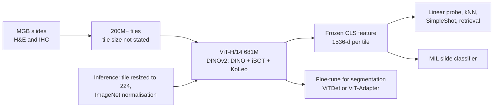

# MahmoodLab/UNI2-h

> **Bibkey** `MahmoodLab_UNI2h` · **Venue** Hugging Face (2025) · **Category** foundation · **Relevance** medium · **Access** open
> **Link** <https://huggingface.co/MahmoodLab/UNI2-h> · `status: complete`

---

## One-liner
UNI2-h is a pathology vision foundation model from the Mahmood Lab (Harvard / BWH): a 681M-parameter custom ViT-H/14 trained with the DINOv2 recipe on 200M+ H&E and IHC tiles from Mass General Brigham, mapping a 224×224 tissue tile to a 1,536-dim feature for frozen downstream use (model card §"Model Description", §"Training Details").

## Takeaways
- This is a model card, not a paper: the Hugging Face card has no benchmark numbers, but the GitHub repository it links (mahmoodlab/UNI) has a README section "Benchmarking UNI 2" with lab-reported ROI and slide benchmark tables comparing UNI2-h with UNI, Virchow 2, h-optimus, Prov-GigaPath and others. The card asks users to cite the UNI paper (Chen et al., Nature Medicine 2024), which describes the earlier UNI (GitHub README model table: UNI released 03/2024, UNI2-h 01/2025).
- Training data: "over 200 million tiles from over 300k H&E and IHC slides" (Training Details); the same card says "over 350k" in Model Description — an internal inconsistency.
- Architecture: depth 24, 24 heads, embed_dim 1,536, SwiGLU FFN, 8 register tokens, 681M params; objective = DINO self-distillation (multi-crop) + iBOT masked image modelling + KoLeo regularisation (Training Details; timm_kwargs).
- Usage: frozen CLS features for linear-probe / kNN / SimpleShot classification, nearest-neighbour retrieval and MIL slide classification; fine-tuning recommended for segmentation (ViTDet or ViT-Adapter) (Direct / Downstream Use). Pre-extracted features are provided for TCGA, CPTAC and PANDA.
- Strict licence: CC-BY-NC-ND 4.0, non-commercial academic research only; no distributing, publishing or reproducing a copy of the model; personal e-mail (@gmail etc.) requests are denied, an institutional e-mail is required (License; Requesting Access).
- Independent evaluation (PathBench, `pathbench-natcommun-2026` in this library): UNI2 has mean TCGA AUROC 0.824 (Fig. 1b); across all TCGA tasks, Wald tests found no statistical differences in AUROC, AUPRC, sensitivity or specificity among UNI, UNI2, Virchow2, Prov-GigaPath and H-optimus-0 (Supplementary Fig. 4a/c/e/g). Pooled over the 22 non-TCGA tasks, differences were also largely non-significant, the only significant one being Virchow2 vs UNI2 for sensitivity (Supplementary Fig. 4f); restricted to the 8 non-TCGA patch-level tasks, however, Virchow2 vs UNI2 differed significantly in AUROC (FDR-adjusted p < 0.001) (Fig. 2b; Results).

## Problem
The card states no research question; it positions the model as a "pretrained vision backbone for multi-purpose evaluation on histopathology images" (Model Description). Our reading: the target problem is that each pathology task is otherwise trained from scratch with costly labels — a general tile-level encoder lets downstream work use only light linear or MIL heads.

## Method
1) **Input**: histopathology ROIs / tiles, resized to 224 and normalised with ImageNet mean and std (How To Use).
2) **Architecture**: custom ViT-H/14 — patch 14, img 224, depth 24, num_heads 24, embed_dim 1,536, SwiGLUPacked FFN with mlp_ratio 2.66667×2 and SiLU, init_values 1e-5, reg_tokens 8 (8 register tokens), no_embed_class, dynamic_img_size; 681M parameters (timm_kwargs; Training Details). The local-loading code uses the timm base name `vit_giant_patch14_224`.
3) **Self-supervised objective**: the DINOv2 recipe — DINO self-distillation loss with multi-crop + iBOT masked image modelling loss + KoLeo regularisation on [CLS] tokens (Training Details). The card only names these three losses and does not explain them; see the DINOv2 paper for details.
4) **Training setup**: bf16 with PyTorch-FSDP mixed precision; "lots of Nvidia A100 80GB for lots of GPU hours"; MGB ERIS research computing (Training Details). No batch size, steps, magnification or organ mix is given.
5) **Output and downstream**: a [1, 1536] feature per tile, used for linear probing, kNN, SimpleShot (nearest centroid), nearest-neighbour retrieval, and MIL classifiers on a bag of CLS tokens per WSI; fine-tuning is recommended for segmentation (Direct / Downstream Use).

## Method diagram


## Data
**Pretraining**: 200M+ tiles sampled from Mass General Brigham H&E and IHC slides — "over 300k" in Training Details, "over 350k diverse" in Model Description (inconsistent within the card; PathBench Table 2 lists 0.35M WSIs and 200M patches; that table gives ~632M parameters, unlike the card's 681M). No stain ratio, magnification, organ or disease breakdown is given. **Pre-extracted features**: UNI2-h embeddings for TCGA, CPTAC and PANDA at `MahmoodLab/UNI2-h-features` (Pre-Extracted Embeddings).

## Key results
- Hugging Face model card: **no quantitative results**; it only says frozen features give "competitive results" on ROI classification, retrieval and slide classification (Direct Use).
- GitHub README §"Benchmarking UNI 2" (lab-reported; the README does not name the metric): ROI benchmarks UNI → UNI2-h: HEST 0.386 → 0.414, CRC-100K-Raw 0.925 → 0.957, TCGA Uniform Tumor 0.595 → 0.675, C17-WILDS 0.972 → 0.977, Kather MSI 0.679 → 0.722; slide benchmarks: EBRAINS 0.682 → 0.711, PANDA 0.944 → 0.946, IHC ER/PR (internal) 0.776 → 0.794. The tables also list Virchow 2, Virchow, UNI2-g-preview, h-optimus, Prov-GigaPath, CONCH and MUSK. Protocol: for each task, a sweep over 3 learning rates (1e-5, 5e-5, 1e-4), reporting test performance of the best model on validation; all models use the global representation (e.g. CLS token) without test-time augmentation.
- PathBench (independent, linear probe + mean pooling): mean AUROC 0.824 (95% CI 0.779–0.868) on 19 TCGA tasks, in the top five; 0.824 (95% CI 0.751–0.897) on 22 non-TCGA tasks (PathBench Fig. 1b–c).
- PathBench: mean AUROC 0.953 on non-TCGA patch-level tasks (second to Virchow2 at 0.962); by cumulative balanced accuracy UNI2 drops from 6th on TCGA to 9th on non-TCGA tasks (PathBench Fig. 2b; Fig. 5a–b).

## Contributions
- Compared with the earlier UNI: UNI is a ViT-L/16 (GitHub README model table) trained on Mass-100K — over 100 million tissue patches from 100,426 diagnostic H&E WSIs (UNI paper); UNI2-h moves to a larger ViT-H/14-reg8 (681M, SwiGLU, 8 register tokens) and 200M+ tiles including IHC (model card; GitHub README). In the README benchmark tables UNI2-h scores above UNI on all 8 tasks (see above).
- Plug-and-play engineering: one-line timm loading, pre-extracted TCGA / CPTAC / PANDA features, companion repos such as CLAM and LGSSL (Software Dependencies).

## Limitations
- On the card: CC-BY-NC-ND 4.0, non-commercial academic research only; any commercial use, sale or monetization of the model and its derivatives (including models trained on UNI 2 outputs and datasets created from UNI 2) is prohibited; by downloading you agree not to distribute, publish or reproduce a copy of the model (License).
- Our reading: there is no UNI2-h paper or technical report (the GitHub README has only benchmark tables and a short protocol), so data composition, preprocessing and magnification are opaque; the slide count is inconsistent within the card (300k+ vs 350k+).
- Our reading: single-institution (MGB) data, so scanner/stain shift must be checked on our data; its drop in PathBench's non-TCGA ranking suggests some domain dependence.
- Our reading: tile-level morphology only, no transcriptomics or spatial omics; not designed for anomaly detection.

## Relation to our direction
Our reading: UNI2-h is a candidate frozen encoder for the H&E modality in the **detect** stage. Concretely: tile kidney-biopsy WSIs at 224 px → extract 1,536-dim CLS features → fit kNN / density / one-class models on healthy reference tiles → use the distance to the nearest healthy features as a tile-level anomaly score, aggregated to region or biopsy level. It can also be the H&E-side embedding for cross-modal alignment with Xenium / snRNA features (does H&E agree with the molecular modality?). PathBench finds no significant difference from Virchow2 and others on TCGA tasks (Virchow2 is significantly higher on non-TCGA patch-level tasks), so extracting both feature sets for comparison is sensible. The licence explicitly bans commercial use of datasets created from UNI 2 and distribution of a copy of the model; whether a non-commercial release of extracted features is allowed is not stated on the card — check with the licensor before publishing a benchmark.

## Reusable assets
- Weights (gated, institutional e-mail): `hf-hub:MahmoodLab/UNI2-h`; loading code and timm_kwargs in `ai-ready.md`.
<https://huggingface.co/MahmoodLab/UNI2-h>
- Pre-extracted features (TCGA, CPTAC, PANDA):
<https://huggingface.co/datasets/MahmoodLab/UNI2-h-features>
- Code repository (the card's Repository link):
<https://github.com/mahmoodlab/UNI>
- Companion tools listed on the card: CLAM (slide classification), LGSSL (linear-probe and few-shot evaluation), ViT-Adapter / Mask2Former (segmentation).

## Follow-ups
- The UNI paper, Chen et al., Nature Medicine 2024 (doi:10.1038/s41591-024-02857-3) — method and benchmarks of the earlier UNI (the card asks to cite it); this note checked only the Mass-100K scale from it.
- PathBench Supplementary Tables 3–8: tissue composition of each model's pretraining data (not disclosed for UNI2).
- Experiment: compare kNN anomaly scores from UNI2-h vs Virchow2 features on kidney-biopsy tiles.

## Figures & tables
This is a **Hugging Face model card**, dominated by descriptive text and code, with **no method/result figures and no quantitative benchmark table** (the benchmark tables are in the GitHub README, see above). The only image on the page is an access-request screenshot (`requesting_access.png`), which is not a reusable method/result figure and is therefore omitted. For loading/usage see the `timm.create_model(...)` snippet in `ai-ready.md`; for quantitative benchmarks see the GitHub README section "Benchmarking UNI 2" (lab-reported) and this library's PathBench entry (independent); the UNI paper (Chen et al., Nature Medicine 2024, doi:10.1038/s41591-024-02857-3) covers only the earlier UNI. Model card: <https://huggingface.co/MahmoodLab/UNI2-h>.

## Cite
```bibtex
@misc{MahmoodLab_UNI2h,
  title = {{MahmoodLab/UNI2-h}},
  author = {{Mahmood Lab}},
  howpublished = {Hugging Face model card},
  year = {2025},
  note = {ViT-H/14 pathology foundation model (released 01/2025). The card asks users to cite Chen et al., "Towards a general-purpose foundation model for computational pathology", Nature Medicine 2024, doi:10.1038/s41591-024-02857-3},
  url = {https://huggingface.co/MahmoodLab/UNI2-h}
}
```


---

📄 **[AI-ready full-text extract →](ai-ready.md)**
