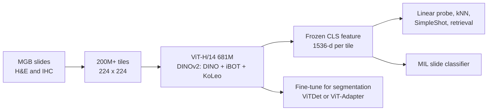

# MahmoodLab/UNI2-h

> **Bibkey** `MahmoodLab_UNI2h` · **Venue** Hugging Face () · **Category** foundation · **Relevance** medium · **Access** open
> **Link** <https://huggingface.co/MahmoodLab/UNI2-h> · `status: complete`

---

## One-liner
UNI2-h is a pathology vision foundation model from the Mahmood Lab (Harvard / BWH): a 681M-parameter custom ViT-H/14 trained with the DINOv2 recipe on 200M+ H&E and IHC tiles from Mass General Brigham, mapping a 224×224 tissue tile to a 1,536-dim feature for frozen downstream use (model card §"Model Description", §"Training Details").

## Takeaways
- This is a model card, not a paper: it contains no benchmark numbers and points to the UNI paper (Chen et al., Nature Medicine 2024), which describes the earlier UNI, not UNI2-h (README §"BibTeX"). We did not read the UNI paper.
- Training data: "over 200 million tiles from over 300k H&E and IHC slides" (Training Details); the same card says "over 350k" in Model Description — an internal inconsistency.
- Architecture: depth 24, 24 heads, embed_dim 1,536, SwiGLU FFN, 8 register tokens, 681M params; objective = DINO self-distillation (multi-crop) + iBOT masked image modelling + KoLeo regularisation (Training Details; timm_kwargs).
- Usage: frozen CLS features for linear-probe / kNN / SimpleShot classification, nearest-neighbour retrieval and MIL slide classification; fine-tuning recommended for segmentation (ViTDet or ViT-Adapter) (Direct / Downstream Use). Pre-extracted features are provided for TCGA, CPTAC and PANDA.
- Strict licence: CC-BY-NC-ND 4.0, non-commercial academic research only; no redistribution; personal e-mail (@gmail etc.) requests are denied, an institutional e-mail is required (License; Requesting Access).
- Independent evaluation (PathBench, `pathbench-natcommun-2026` in this library): UNI2 has mean TCGA AUROC 0.824, not significantly different from Virchow2, Prov-GigaPath, H-optimus-0 and UNI (PathBench Fig. 1b; Results).

## Problem
The card states no research question; it positions the model as a "pretrained vision backbone for multi-purpose evaluation on histopathology images" (Model Description). Our reading: the target problem is that each pathology task is otherwise trained from scratch with costly labels — a general tile-level encoder lets downstream work use only light linear or MIL heads.

## Method
1) **Input**: histopathology ROIs / tiles, resized to 224 and normalised with ImageNet mean and std (How To Use).
2) **Architecture**: custom ViT-H/14 — patch 14, img 224, depth 24, num_heads 24, embed_dim 1,536, SwiGLUPacked FFN with mlp_ratio 2.66667×2 and SiLU, init_values 1e-5 (LayerScale), 8 register tokens (extra learnable tokens not tied to image patches), no_embed_class, dynamic_img_size; 681M parameters (timm_kwargs; Training Details). The local-loading code uses the timm base name `vit_giant_patch14_224`.
3) **Self-supervised objective**: the DINOv2 recipe — DINO self-distillation with multi-crop (the student sees small crops and matches the teacher on large crops) + iBOT masked image modelling (the student predicts the teacher's features of masked patches) + KoLeo regularisation on [CLS] (spreads features evenly) (Training Details).
4) **Training setup**: bf16 with PyTorch-FSDP mixed precision; "lots of Nvidia A100 80GB for lots of GPU hours"; MGB ERIS research computing (Training Details). No batch size, steps, magnification or organ mix is given.
5) **Output and downstream**: a [1, 1536] feature per tile, used for linear probing, kNN, SimpleShot (nearest centroid), nearest-neighbour retrieval, and MIL classifiers on a bag of CLS tokens per WSI; fine-tuning is recommended for segmentation (Direct / Downstream Use).

## Method diagram


## Data
**Pretraining**: 200M+ tiles sampled from Mass General Brigham H&E and IHC slides — "over 300k" in Training Details, "over 350k diverse" in Model Description (inconsistent within the card; PathBench Table 2 lists 0.35M WSIs and 200M patches). No stain ratio, magnification, organ or disease breakdown is given. **Pre-extracted features**: UNI2-h embeddings for TCGA, CPTAC and PANDA at `MahmoodLab/UNI2-h-features` (Pre-Extracted Embeddings).

## Key results
- Model card: **no quantitative results**; it only says frozen features give "competitive results" on ROI classification, retrieval and slide classification (Direct Use).
- PathBench (independent, linear probe + mean pooling): mean AUROC 0.824 (95% CI 0.779–0.868) on 19 TCGA tasks, in the top five; 0.824 (95% CI 0.751–0.897) on 22 non-TCGA tasks (PathBench Fig. 1b–c).
- PathBench: mean AUROC 0.953 on non-TCGA patch-level tasks (second to Virchow2 at 0.962); by cumulative balanced accuracy UNI2 drops from 6th on TCGA to 9th on non-TCGA tasks (PathBench Fig. 2b; Fig. 5a–b).

## Contributions
- Compared with the earlier UNI (not quantified on the card): a larger ViT-H (681M, SwiGLU, 8 register tokens) and IHC in the training data (model card). We did not read the UNI paper, so UNI's own scale is not verified here.
- Plug-and-play engineering: one-line timm loading, pre-extracted TCGA / CPTAC / PANDA features, companion repos such as CLAM and LGSSL (Software Dependencies).

## Limitations
- On the card: CC-BY-NC-ND 4.0, no commercial use, no redistribution; models trained on UNI2 outputs and datasets built from it count as derivatives (License).
- Our reading: there is no technical report or paper, so data composition, preprocessing and magnification are opaque; the slide count is inconsistent within the card (300k+ vs 350k+).
- Our reading: single-institution (MGB) data, so scanner/stain shift must be checked on our data; its drop in PathBench's non-TCGA ranking suggests some domain dependence.
- Our reading: tile-level morphology only, no transcriptomics or spatial omics; not designed for anomaly detection.

## Relation to our direction
Our reading: UNI2-h is a candidate frozen encoder for the H&E modality in the **detect** stage. Concretely: tile kidney-biopsy WSIs at 224 px → extract 1,536-dim CLS features → fit kNN / density / one-class models on healthy reference tiles → use the distance to the nearest healthy features as a tile-level anomaly score, aggregated to region or biopsy level. It can also be the H&E-side embedding for cross-modal alignment with Xenium / snRNA features (does H&E agree with the molecular modality?). PathBench places it in the same tier as Virchow2 with mostly non-significant differences, so extracting both feature sets for comparison is sensible. The NC-ND licence means derived feature datasets cannot be redistributed — relevant when releasing a benchmark.

## Reusable assets
- Weights (gated, institutional e-mail): `hf-hub:MahmoodLab/UNI2-h`; loading code and timm_kwargs in `ai-ready.md`.
<https://huggingface.co/MahmoodLab/UNI2-h>
- Pre-extracted features (TCGA, CPTAC, PANDA):
<https://huggingface.co/datasets/MahmoodLab/UNI2-h-features>
- Code repository (the card's Repository link):
<https://github.com/mahmoodlab/UNI>
- Companion tools listed on the card: CLAM (slide classification), LGSSL (linear-probe and few-shot evaluation), ViT-Adapter / Mask2Former (segmentation).

## Follow-ups
- The UNI paper, Chen et al., Nature Medicine 2024 (doi:10.1038/s41591-024-02857-3) — method and benchmarks of the earlier UNI (the card asks to cite it).
- PathBench Supplementary Tables 3–8: tissue composition of each model's pretraining data (not disclosed for UNI2).
- Experiment: compare kNN anomaly scores from UNI2-h vs Virchow2 features on kidney-biopsy tiles.

## Figures & tables
This is a **Hugging Face model card**, dominated by descriptive text and code, with **no method/result figures and no quantitative benchmark table**. The only image on the page is an access-request screenshot (`requesting_access.png`), which is not a reusable method/result figure and is therefore omitted. For loading/usage see the `timm.create_model(...)` snippet in `ai-ready.md`; for quantitative benchmarks see the UNI paper (Chen et al., Nature Medicine 2024, doi:10.1038/s41591-024-02857-3, which describes the earlier UNI) and this library's PathBench entry. Model card: <https://huggingface.co/MahmoodLab/UNI2-h>.

## Cite
```bibtex
% no BibTeX fetched
```


---

📄 **[AI-ready full-text extract →](ai-ready.md)**
