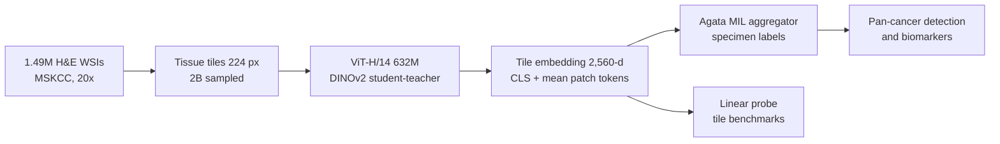

# A foundation model for clinical-grade computational pathology and rare cancers detection

> **Bibkey** `Vorontsov_2024` · **Venue** Nature Medicine (2024) · **Category** foundation · **Relevance** medium · **Access** open
> **Link** <https://doi.org/10.1038/s41591-024-03141-0> · `status: complete`

---

## One-liner
Virchow is a 632M-parameter ViT-H/14 pathology foundation model trained by Paige and Microsoft Research with DINOv2 self-supervision on ~1.5M H&E whole-slide images (WSIs) from MSKCC; an aggregator trained on its frozen tile embeddings performs pan-cancer detection across 16 cancer types with specimen-level AUC 0.950, and 0.937 on the 7 rare cancers (Abstract; Fig. 2b–c).

## Takeaways
- Training data: 1,488,550 H&E WSIs from 119,629 patients, 17 tissue groups, all from MSKCC on Leica scanners at 20× (0.5 µm/px); 2 billion tiles sampled with replacement from ~13 billion (Fig. 1a; Methods §"Million-scale training dataset").
- Pan-cancer detection: Virchow 0.950 > UNI 0.940 > Phikon 0.932 > CTransPath 0.907 (all pairwise P < 0.0001); specificity at 95% sensitivity 72.5% vs 68.9% / 62.9% / 52.3% (Fig. 2b).
- Versus commercial specialist models: with fewer training specimens the pan-cancer model is slightly behind. In Fig. 3b (Overall): prostate 0.980 vs Paige Prostate 0.985, breast 0.985 vs 0.992, lymph node 0.971 vs 0.972, gaps of 0.001–0.007, as the Discussion says; but the Results text gives prostate as "0.980 versus 0.995", which does not match Fig. 3b. It is better on lymph-node macrometastases (0.999 vs 0.994) and on some rare variants (Fig. 3).
- Failure analysis (our reading: directly useful for anomaly detection): 53.2% of false positives are precursor lesions and 17.0% tissue artefacts (crush, folds, out-of-focus); 45.2% of false negatives contain only small tumour foci (Results §"Toward clinical-grade performance"; Fig. 3d).
- Performance grows roughly log-linearly with model parameters; it also grows with training tiles, but sub-log-linearly (diminishing returns) (Fig. 2g; Discussion).
- Our reading: Virchow is a strong disease-vs-normal feature extractor, but it is evaluated with supervised cancer labels; for non-tumour kidney anomaly detection we would need to build a normal reference distribution on its embeddings and validate it ourselves.

## Problem
Clinical computational pathology depends on modelling very diverse tissue morphology; diagnosis-specific models see only a subset of images, generalise poorly, and struggle on data-poor tasks such as rare cancers or uncommon genomic alterations (Introduction). Earlier pathology foundation models used 30,000–400,000 WSIs and 28M–307M parameters (Introduction). The question: with a million-WSI dataset and a ~600M-parameter model, can one general embedding support pan-cancer detection (including rare cancers) and biomarker prediction, and approach commercial clinical-grade models with fewer labels?

## Method
1) **Tiling**: WSIs are downsampled 16×, tissue foreground is found with HSV thresholds, and all non-overlapping 224 px tiles with ≥25% tissue are collected (Methods).
2) **Self-supervised pretraining**: a ViT-H/14 (632M params) trained with DINOv2 — student and teacher share the architecture, the teacher is an EMA of the student; each tile yields 2 global and 8 local crops. Global crops are randomly masked for the student and left unmasked for the teacher: the student matches the teacher's class token and also predicts representations of the masked patch tokens (iBOT-style masked image modelling); local crops go only to the student, whose class token must match the teacher's representation of the global crops (Methods; Extended Data Fig. 2). Changed hyperparameters: teacher temperature 0.04–0.07, 495,000-iteration warmup, 131,072 prototypes; AdamW, fp16; each GPU batch = 256 tiles from one WSI.
3) **Embedding**: for each 224×224 tile, the class token concatenated with the mean of the other 256 tokens gives a 2,560-dim vector (1,280 × 2) (Methods §"Embedding generation"). The model card adds: 32 layers, embedding 1,280, 16 heads, SwiGLU, LayerScale, output 257 × 1,280 tokens.
4) **Specimen-level aggregation**: the Agata aggregator (weakly supervised multiple-instance learning, MIL: a bag of tiles with one specimen label). A learned query cross-attends over all tiles with memory linear in tile count; during training only the slide with the highest predicted cancer probability per specimen is back-propagated (Methods; Extended Data Fig. 1). Cross-entropy, AdamW, lr 3e-4, 25 epochs, same protocol for all baseline embeddings.
5) **Labels**: a rule-based NLP system extracts specimen-level cancer labels from pathology reports; biomarker labels mostly come from MSK-IMPACT sequencing; Colon-MSI uses both IHC and MSK-IMPACT (IHC prioritised when both exist) and Gastric-HER2 uses IHC (3+, or 2+ confirmed by FISH) (Methods §"Biomarker detection").
6) **Evaluation**: pan-cancer detection (AUC, specificity at 95% sensitivity; DeLong + Holm); comparison with commercial Paige Prostate / Breast / BLN models; 9 biomarkers; 8 tile-level linear-probe benchmarks (SGD, 12,500 iterations, weighted F1). The abstract also mentions "the evaluation of biomarker prediction and cell identification" (Abstract).

## Method diagram


## Data
**Pretraining**: de-identified MSKCC data: 119,629 patients, 208,815 cases, 392,268 specimens, 1,207,837 blocks, 1,488,550 H&E slides; 63% biopsy, 37% resection; 17 tissue groups (Fig. 1a–d). **Pan-cancer test set**: 22,932 slides from 6,142 specimens over 16 cancer types; common cancers 3,547 specimens (breast, prostate, lung, colon, skin, bladder, uterus, pancreas, head and neck), rare cancers 2,595 specimens (liver, stomach, brain, ovary, cervix, testis, bone; rare = US incidence < 15 per 100,000 per year); 3,033 internal MSKCC and 3,109 external specimens (Methods §"Testing dataset"). Aggregator train + validation: 89,417 slides from 40,402 specimens. **Biomarkers**: 9 MSK-IMPACT tasks (e.g. Colon-MSI 2,698 samples, Breast-CDH1 1,077, Bladder-FGFR 1,038) (Fig. 4b; Methods). **Tile benchmarks** (the 8 tasks in Fig. 5): PanMSK, CRC (NCT-CRC-HE-100K), CRC (no norm) (the same data without stain normalisation), Camelyon17-WILDS, PCam, MHIST, TCGA TIL, MIDOG (Fig. 5a–b; Methods). TCGA CRC-MSI appears only in Methods and Data availability, not among the 8 tasks of Fig. 5.

## Key results
- **Pan-cancer detection**: specimen-level AUC Virchow 0.950, UNI 0.940, Phikon 0.932, CTransPath 0.907 (pairwise P < 0.0001); specificity at 95% sensitivity 72.5% / 68.9% / 62.9% / 52.3% (Fig. 2b).
- **Rare cancers**: AUC 0.937 (UNI 0.925); cervix 0.875 (UNI 0.830) and bone 0.841 (UNI 0.813) remain hardest (Fig. 2a,c). Virchow is best or tied-best on all 16 cancer types (Fig. 2a).
- **External sites**: internal AUC 0.938, external 0.934 (UNI 0.927 / 0.925) (Fig. 2e); ~19.5% of test specimens contain tissues unseen in training (e.g. cervix, testis, head and neck), and Virchow still leads (Fig. 2f).
- **Versus commercial models**: the pan-cancer model used 35,387 training groups (2,829 prostate, 1,626 breast, 1,441 lymph node) vs 66,713 blocks for Paige Prostate, 44,588 specimens for Paige Breast and 8,150 for BLN; AUC (Fig. 3b, Overall) prostate 0.980 vs 0.985, breast 0.985 vs 0.992, lymph node 0.971 vs 0.972, and lymph-node macrometastases 0.999 vs 0.994 (P < 0.05). The Results text gives prostate 0.980 vs 0.995 (P < 0.05) and breast 0.985 vs 0.992 (P < 0.01); the prostate 0.995 does not match Fig. 3b (Results §"Toward clinical-grade performance"; Fig. 3).
- **Failure modes** (pathologist review): false negatives — 45.2% small tumour foci, 11.9% borderline malignancy, 9.5% very subtle malignant features, 26.2% (11 cases) unexplained; false positives — 53.2% precursor lesions, 17.0% tissue artefacts, 14.9% reactive stromal/lymphoid changes, 11.7% reactive epithelial changes, 3.2% benign neoplasms (Results). Note: the Fig. 3d counts are "Reactive epithelial changes 14" and "Reactive stromal/lymphoid changes 11" (of 94 false positives), the reverse of the two percentages in the text.
- **Biomarkers**: Virchow has the top AUC on 7 of 9 tasks (Fig. 4c); where it is not first, Prostate-AR 0.849 and Ovarian-FGA 0.847. The authors note insufficient power for significance tests and report the best test AUC over learning rates (Methods).
- **Tile-level linear probe**: best or tied-best on 7 of 8 tasks (Fig. 5b); on CRC without stain normalisation weighted F1 drops by only 0.005 (Results §"Tile-level benchmarks").
- **Scaling**: detection improves roughly log-linearly with model parameters; it also improves with training tiles, but sub-log-linearly (diminishing returns) (Fig. 2g; Discussion).

## Contributions
- The largest pathology foundation model at the time: 1.5M WSIs (4–10× prior datasets, per the authors) and 632M parameters (Introduction).
- Shows that a pan-cancer detector on foundation-model embeddings approaches commercial specialist models with fewer training specimens, and generalises to rare cancers and unseen tissues (Figs. 2–3).
- A systematic failure-mode analysis (precursors, artefacts, reactive changes) showing typical sources of clinical-AI errors (Fig. 3d).
- Note: the Agata aggregator used for specimen-level aggregation (memory linear in tile count) is prior work (ref. 10, Raciti et al. 2022), not a contribution of this paper (Methods; Extended Data Fig. 1).

## Limitations
- Authors: training data come from one centre with limited scanner types (Discussion).
- Authors: embeddings are tile-level at 20×, so an aggregator must be trained; low-data tasks such as biomarkers or treatment response may need slide-level models (Discussion).
- Authors: model size needs deployment hardware and may call for distillation; data balancing and distillation were not fully explored (Discussion).
- Authors: biomarker results lack statistical power, and the reported AUC is the best over learning rates on the test set, i.e. an upper estimate (Methods).
- Our reading: most authors are Paige employees and equity holders, and MSK has financial interests in Paige (Competing interests); the commercial comparators are also Paige products. Training data are not public.
- Our reading: evaluation is cancer-only; kidney is just 0.1% of the "unobserved tissue" test specimens (Fig. 2f), and there is no non-tumour kidney task.

## Relation to our direction
Our reading: Virchow is an upstream feature extractor for the **detect** stage (H&E modality). (1) As a frozen encoder, tile kidney H&E into 224 px tiles, extract 2,560-dim embeddings, and score tiles by kNN / density / one-class models fitted on healthy reference tissue (the feature row of the matrix); the paper itself does no unsupervised anomaly detection, only supervised cancer-vs-benign classification. (2) The failure analysis matters: most false positives are precursors, artefacts and reactive changes — exactly the "abnormal but not the target disease" confounders that an anomaly benchmark must label and separate (e.g. artefacts as their own class or removed by QC). (3) Training is single-centre Leica data, so scanner/stain shift must be checked before using it on kidney biopsies from other centres and scanners. (4) In PathBench (`pathbench-natcommun-2026` in this library), the successor Virchow2 has the highest mean AUROC (0.830, Fig. 1b), but it is first on only 5 of 19 TCGA tasks and 6 of 22 non-TCGA tasks, with no statistical difference from UNI, UNI2, Prov-GigaPath and H-optimus-0 on TCGA tasks; PathBench does not compare Virchow and Virchow2 task by task. Virchow itself is 7th on TCGA (0.677 ± 0.117) and 10th on non-TCGA tasks (0.678 ± 0.197) by cumulative balanced accuracy (PathBench Fig. 5a–b).

## Reusable assets
- Weights: Hugging Face `paige-ai/Virchow` (login, terms, institutional email). The paper's Code availability says "for non-commercial research"; the HF model card lists Apache 2.0 with additional terms (e.g. not for clinical diagnosis) — the two differ, so check the HF page before use.
<https://huggingface.co/paige-ai/Virchow>
- Downstream SDK (building WSI applications on embeddings):
<https://github.com/Paige-AI/paige-ml-sdk>
- Loading (model card): `timm.create_model("hf-hub:paige-ai/Virchow", pretrained=True, mlp_layer=SwiGLUPacked, act_layer=torch.nn.SiLU)`; output 1 × 257 × 1,280, concatenated to a 2,560-dim embedding.
- Public tile benchmarks (Data availability): NCT-CRC-HE-100K, Camelyon17-WILDS, PCam, MHIST, TCGA TIL, MIDOG, TCGA CRC-MSI. MSKCC training data are proprietary (requests to Paige).
- Reusable protocols: linear probe (SGD, batch 4,096, cosine lr 0.01→0, 12,500 iterations, z-scored embeddings); the failure-mode taxonomy.

## Follow-ups
- Virchow2 (Zimmermann et al. 2024, arXiv:2408.00738; mixed magnification, 3.1M WSIs) — highest mean AUROC in PathBench (0.830).
- UNI (Chen et al., Nat Med 2024) — the strongest baseline here; UNI2-h (`uni2-h-model`) is its later successor and is not described in that paper.
- Extended Data Figs. 3–4 and Supplementary Tables: per-cancer specificity and test-set composition.
- Experiment: kNN anomaly scores on frozen Virchow / Virchow2 embeddings of kidney-biopsy tiles, checking false positives from artefacts and reactive changes.

## Figures & tables

_Note: the paper is open access under CC BY 4.0; figures are not embedded here, only linked to the publisher's figure pages._

**Fig 1**: The training dataset, training algorithm and application of Virchow (patient/case/specimen/block/slide counts and distribution by cancer status, surgery and tissue type; DINOv2 data flow; aggregator trained on tile embeddings for downstream tasks) — see <https://www.nature.com/articles/s41591-024-03141-0/figures/1>

**Fig 2**: Pan-cancer detection results (AUC per cancer type, all vs rare cancers, sensitivity at 95% specificity for rare cancers, internal vs external generalisation, unobserved tissues, scaling with model and data size) — see <https://www.nature.com/articles/s41591-024-03141-0/figures/2>

**Fig 3**: Pan-cancer model vs three Paige clinical products (rare variants, product test sets, training-set sizes) and failure-mode categories — see <https://www.nature.com/articles/s41591-024-03141-0/figures/3>

### Results

**Table 1.** Headline numbers from the paper (published full text).

| Item | Value | Source |
|---|---|---|
| Pan-cancer detection, specimen-level AUC (16 cancers) | 0.950 (UNI 0.940, Phikon 0.932, CTransPath 0.907) | Fig. 2b |
| Rare-cancer AUC (7 cancers) | 0.937 (UNI 0.925) | Fig. 2c |
| Specificity at 95% sensitivity | 72.5% (UNI 68.9%) | Fig. 2b |
| Internal / external AUC | 0.938 / 0.934 | Fig. 2e |
| Prostate / breast / BLN AUC (pan-cancer vs Paige product) | 0.980 vs 0.985; 0.985 vs 0.992; 0.971 vs 0.972 (Fig. 3b); macrometastases 0.999 vs 0.994. Results text gives prostate as 0.980 vs 0.995 | Fig. 3b; Results |
| Biomarker tasks where Virchow is top-1 | 7 / 9 | Fig. 4c |
| Tile benchmarks where Virchow is top-1 (incl. ties) | 7 / 8 | Fig. 5b |
| Pretraining WSIs / patients | 1,488,550 / 119,629 | Methods; Fig. 1a |
| Backbone / parameters | ViT-H/14 / 632M | Methods |
| Tile embedding dimension | 2,560 (CLS + mean of 256 patch tokens) | Methods |

_Source: Vorontsov et al., Nat Med 30, 2924–2935 (2024), CC BY 4.0 — <https://doi.org/10.1038/s41591-024-03141-0>; model card <https://huggingface.co/paige-ai/Virchow>._

## Cite
```bibtex
@article{Vorontsov_2024, title={A foundation model for clinical-grade computational pathology and rare cancers detection}, volume={30}, ISSN={1546-170X}, url={http://dx.doi.org/10.1038/s41591-024-03141-0}, DOI={10.1038/s41591-024-03141-0}, number={10}, journal={Nature Medicine}, publisher={Springer Science and Business Media LLC}, author={Vorontsov, Eugene and Bozkurt, Alican and Casson, Adam and Shaikovski, George and Zelechowski, Michal and Severson, Kristen and Zimmermann, Eric and Hall, James and Tenenholtz, Neil and Fusi, Nicolo and Yang, Ellen and Mathieu, Philippe and van Eck, Alexander and Lee, Donghun and Viret, Julian and Robert, Eric and Wang, Yi Kan and Kunz, Jeremy D. and Lee, Matthew C. H. and Bernhard, Jan H. and Godrich, Ran A. and Oakley, Gerard and Millar, Ewan and Hanna, Matthew and Wen, Hannah and Retamero, Juan A. and Moye, William A. and Yousfi, Razik and Kanan, Christopher and Klimstra, David S. and Rothrock, Brandon and Liu, Siqi and Fuchs, Thomas J.}, year={2024}, month=jul, pages={2924–2935} }
```


---

📄 **[AI-ready full-text extract →](ai-ready.md)**
