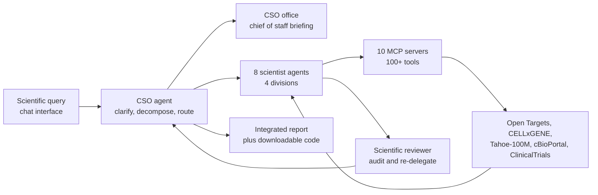

# The Virtual Biotech: A Multi-Agent AI Framework for Therapeutic Discovery and Development

> **Bibkey** `Zhang_2026` · **Venue** bioRxiv (2026) · **Category** agents · **Relevance** medium · **Access** open
> **Link** <https://doi.org/10.64898/2026.02.23.707551> · `status: complete`

---

## One-liner
A biotech company's org chart rebuilt as a team of LLM agents: a Chief Scientific Officer agent takes a scientific question, decomposes it and delegates to eight specialist scientist agents across four research divisions, which call 100-plus tools and public databases through MCP servers to run real computation, with the CSO integrating the results; the authors demonstrate it on three translational case studies — large-scale annotation of 55,984 clinical trials, a B7-H3 lung-cancer target assessment, and a post-mortem of a failed ulcerative-colitis trial.

## Takeaways
- The contribution is organisational rather than a stronger model: four divisions (Target Identification and Prioritization, Target Safety, Modality Selection, Clinical Officers) plus a CSO office (a Chief of Staff producing field briefings and a Scientific Reviewer that audits outputs and can force re-delegation); the Introduction states "four scientific divisions, eleven total agents, and over 100 tools".
- The agents are not just chatting: data access runs through ten MCP servers onto Open Targets (v25.09), CELLxGENE Census, Tabula Sapiens v2, Tahoe-100M, cBioPortal, ClinicalTrials.gov, PubMed, OpenFDA and ChEMBL, and they actually run Scanpy, Harmony, PyDESeq2, LIANA, Cell2Location, PROGENy and similar analyses.
- The parallelism is a real engineering result: 37,075 clinical-trialist agents, one per Phase II/III trial, finish in about 6 hours versus an estimated 1,839 hours for a single sequential agent (~184x); Phase I success is not agent-annotated but defined by rule as progression to Phase II (Results; Extended Methods).
- Extraction quality is validated: manual review of 100 randomly sampled trials gives 89.7% agreement on primary endpoints (78/87), 83.9% on secondary (73/87) and 92.4% on adverse-event rates (61/66), plus 85.3% agreement with TDC across 7,278 trials.
- The science: drugs against cell-type-specific genes progress more often (abstract: 40% more likely Phase I→II, 48% more likely to reach Phase IV, 32% lower adverse-event rates). The Results' Phase I→II odds ratio of 1.27 (95% CI 1.22–1.33) is for the standardised continuous tau feature, while the 48% sentence is explicitly prefaced by "following binarization of targets based on their tau metric into cell-type-specific versus broadly expressed classes"; the 40% and 32% sentences use the same binarised class label but the paper does not repeat that attribution (Results; Extended Methods). Our reading: all three percentages come from the binarised comparison, so they are not directly comparable with the continuous-feature OR; the paper gives no CI or test for the percentages either.
- Both case studies report their cost: $46.00 for B7-H3 and $54.00 for OSMRβ — a rare concrete number for whether an agent run can cheaply replace a literature-plus-data analysis.
- Reproducibility is the clear weak point: there is no code-availability statement or project repository link anywhere in the text (Data availability lists only public sources), and although the interface is said to let users download "reproducible code", no location is given.

## Problem
Drug discovery requires integrating evidence across biological scales and modalities — population genetics, functional genomics, single-cell and spatial atlases, pathways and protein interactions, chemoinformatics, clinical data — yet the data, tools and expertise are fragmented across teams and organisations, making integration itself the bottleneck (Abstract). A single LLM agent hits limits of context length, tool count and domain depth. The question is whether a multi-agent division of labour that mirrors a human therapeutics organisation can support end-to-end computational discovery while keeping human scientists in the loop.

## Method
**1. The org chart is the architecture.** The user asks the CSO agent in a chat interface (Fig. S1). The CSO clarifies intent, decomposes the query, routes sub-tasks and synthesises results; it runs no analysis itself. Its office also holds a Chief of Staff (field briefings that give downstream agents background) and a Scientific Reviewer (audits scientist outputs and can trigger re-delegation).

**2. Eight specialist scientist agents in four divisions** (Extended Methods, "AI Scientist Agents"): Target Identification and Prioritization — statistical genetics, functional genomics and perturbation, single-cell atlas; Target Safety — bio-pathways and protein–protein interaction, FDA safety officer (the single-cell atlas agent is listed here too); Modality Selection — target biologist, pharmacologist; Clinical Officers — clinical trialist.

**3. The tool layer.** The Results (Overview) say the authors "developed more than 100 customized MCPs and analytical tools"; the Extended Methods ("Data and Virtual Biotech Tool Infrastructure") say each agent's data access is "mediated through ten MCP servers". Sources include Open Targets v25.09, CELLxGENE Census, Tabula Sapiens v2, Tahoe-100M (large-scale perturbation transcriptomics), cBioPortal, ClinicalTrials.gov, PubMed, OpenFDA and ChEMBL.

**4. Models and implementation.** All agents run on Claude Sonnet 4.5, with the Chief of Staff and Scientific Reviewer on Claude Haiku 4.5 (a cheaper small model for review and briefings); the system is built on the Claude Agent SDK (Extended Methods, "Implementation and Language Model Configuration"). The model knowledge cutoff is January 2025, and the authors deliberately pick case studies whose readouts fall after that cutoff to limit pretraining leakage.

**5. Application 1: massively parallel annotation of clinical trials.** The starting point is the Open Targets clinical-trial dataset of 55,984 trials (Phase I 14,237, II 22,164, III 14,911, IV 4,672). Its 37,075 Phase II and III trials each go to their own clinical-trialist agent; the 37,075 agents run in parallel and finish in about 6 hours versus an estimated 1,839 hours (76.6 days) sequentially. Each agent follows a three-tier evidence cascade (ClinicalTrials.gov → PubMed → press releases and regulatory announcements) to produce structured endpoint outcomes and adverse-event rates with recorded sources. Phase I trials are not agent-annotated: success is defined as having a Phase 2 trial of the same drugs for the same indication. The cell-type-specificity (tau) and bimodality features are computed by the single-cell agent from Tabula Sapiens v2 and then linked to the trials (Results; Extended Methods).

**6. Extraction validation and statistics.** 100 trials are manually reviewed (50 random Phase II and 50 random Phase III from the Open Targets dataset; Phase I was not sampled), and the output is compared with TDC (Therapeutics Data Commons) across 7,278 trials. Statistically: univariate logistic and beta regressions on z-scored single-cell features, with 1,000-iteration permutation tests, mixed-effects models with crossed random intercepts for drug type and therapeutic area, bivariate models adjusting for genetic evidence, and a subset (74.6%) of trials with no genetic evidence; FDR is controlled at 5% by Benjamini–Hochberg.

**7. Application 2: B7-H3 as a lung-cancer target (one end-to-end query).** Agents report in turn: population genetics (no significant GWAS signal, but the agent judges regulatory activity in lung tissue relevant); single cell (upregulated in fibroblasts, SCLC log2FC 1.94, LUAD 1.46; LIANA ligand–receptor analysis suggesting immunosuppressive signalling); spatial (12 LUAD Visium samples, Cell2Location deconvolution plus a k-nearest-neighbour immune-neighbourhood model, showing depletion of neighbouring immune cells around B7-H3-high spots); clinicogenomics (Cox models on 566 TCGA LUAD patients: higher B7-H3 means worse overall survival, HR 1.62, and disease-specific survival, HR 1.82). On modality, small molecules and PROTACs are deprioritised for lack of druggable pockets and an antibody–drug conjugate is proposed.

**8. Application 3: post-mortem of a failed trial (OSMRβ in ulcerative colitis).** The subject is MOONGLOW (NCT06137183), the Phase II vixarelimab trial terminated for futility after 79 participants. The agents integrate: genetic support for the target (rs395157, OR 1.06, p = 2.68 × 10⁻¹⁰; OSMR locus-to-gene score 0.970); no significant OSMR difference between UC and healthy tissue in the atlas analysed; higher baseline OSMR in non-responders than responders across five biologic trial cohorts; and TAURUS longitudinal data (22 patients, 485,868 cells) where OSMR rises in non-responder fibroblasts after anti-TNF therapy with elevated JAK-STAT activity (PROGENy with decoupler and lme4). The protocol critique follows: no OSMR-based enrichment, and a primary endpoint possibly insensitive to pathway engagement; the proposed redesign is biomarker-guided enrolment of OSMR-high patients plus a prespecified target-engagement endpoint.

## Method diagram


## Data
**Clinical trials:** the 55,984 trials of the Open Targets clinical-trial dataset (Phase I 14,237 / II 22,164 / III 14,911 / IV 4,672), of which the 37,075 Phase II/III trials are agent-annotated; cross-checked against TDC on 7,278. **Omics:** Open Targets v25.09, CELLxGENE Census, Tabula Sapiens v2, Tahoe-100M perturbation transcriptomics, cBioPortal/TCGA. **Case-specific:** 12 LUAD Visium spatial samples (Data availability cites PubMed 38782901), 566 TCGA LUAD patients, five UC biologic cohorts GEO GSE12251 / GSE16879 / GSE92415 / GSE206285 / GSE73661, and TAURUS longitudinal single cell with 22 patients and 485,868 cells (PubMed 39438660). **Knowledge sources:** PubMed, OpenFDA, ChEMBL.

## Key results
- Throughput: 37,075 clinical-trialist agents process the 37,075 Phase II/III trials in about 6 hours against an estimated 1,839 hours sequentially, roughly a 184-fold speedup (Extended Methods, "Benefits of multi-agent architecture").
- Extraction accuracy on 100 manually reviewed random trials: 89.7% (78/87) for primary endpoints, 83.9% (73/87) for secondary, 92.4% (61/66) for adverse-event rates; 85.3% agreement with TDC across 7,278 trials (Results, "Massively parallel extraction"; Methods, "Clinical trial manual validation").
- Headline finding (Abstract): drugs targeting cell-type-specific genes are 40% more likely to progress from Phase I to Phase II, 48% more likely to reach Phase IV (market), and show 32% lower adverse-event rates (Fig. 3A–B).
- The same Results paragraph gives an odds ratio of 1.27 (95% CI 1.22–1.33) for Phase I→II; that OR is for the standardised continuous feature (Fig. 3A legend: standardized odds ratio), whereas the "40%" uses the binarised class label — the paper states the K-means (k = 2) binarisation before the 48% sentence and does not repeat it for the 40% one (our reading: same source), and gives no CI or test for the percentage (Results; Extended Methods). The Fig. 3B legend states it shows beta-regression coefficients with 95% CIs.
- Robustness: 1,000-iteration permutations, mixed-effects models with crossed random intercepts for drug type and therapeutic area, adjustment for genetic evidence, and repetition in the 74.6% subset without genetic evidence all preserve the conclusion (Figs. S2–S4).
- Tahoe-100M hallmark perturbation scores are also associated with endpoint success, for example DNA damage response with Phase I→II progression (Results).
- B7-H3 case: upregulated in fibroblasts (SCLC log2FC 1.94, LUAD 1.46); immune cells depleted around B7-H3-high spots in 12 LUAD Visium samples; in 566 TCGA LUAD patients high expression gives HR 1.62 for overall and 1.82 for disease-specific survival; the recommendation is an ADC, with liabilities and differentiation opportunities flagged. Cost of the query: $46.00 (Results, B7-H3; Fig. 4C, 4E, 4F).
- External support for that case: the paper notes that ifinatamab deruxtecan, a B7-H3 ADC, received Breakthrough Therapy Designation in August 2025 — after the model's January 2025 knowledge cutoff — which the authors offer as evidence the conclusion was not recalled (Results/Discussion).
- OSMRβ case: genetics support the target (rs395157 OR 1.06, p = 2.68 × 10⁻¹⁰; locus-to-gene 0.970) yet the atlas shows no significant UC-versus-healthy OSMR difference; non-responders have higher baseline OSMR across five cohorts; in TAURUS (22 patients, 485,868 cells) OSMR and JAK-STAT activity rise in non-responder fibroblasts after anti-TNF. The agents note that MOONGLOW (NCT06137183, terminated for futility after 79 participants) used no OSMR enrichment, and propose biomarker-guided enrolment plus a prespecified target-engagement endpoint. Cost: $54.00.

## Contributions
- It treats the division of labour in a human R&D organisation — divisions, delegation, review, briefings — as the design primitive of the agent system, rather than piling on tools or lengthening prompts; the Scientific Reviewer's ability to force re-delegation is an explicit quality loop.
- It shows agents can produce structured data at scale: 37,075 parallel agents convert the free-text results of 37,075 Phase II/III trials into source-tracked structured records, with agreement rates against both human review and TDC reported.
- It puts single-cell-level cell-type specificity forward as a predictor of drug-target success, tested by permutation, mixed-effects models and adjustment for genetic evidence — a citable scientific claim, not only a system demo.
- The three applications cover three task shapes — large-scale annotation (data production), prospective target assessment (hypothesis generation) and failed-trial post-mortem (counterfactual diagnosis) — each with a dollar cost per query.
- Choosing case studies whose readouts postdate the model's knowledge cutoff is a leakage-control design worth borrowing for agent evaluation.

## Limitations
- Authors' own: analysis or interpretation errors made by the AI can propagate down the chain, so human experts must stay in the loop.
- Authors' own: the trial-level analyses are observational, with possible confounding by indication, endpoint definitions and sponsor effects.
- Authors' own: only trials registered on ClinicalTrials.gov with mappable targets are included.
- Authors' own: pretraining leakage is possible, mitigated by choosing case studies with readouts after the cutoff and checking for prior reports.
- Authors' own: the case-study outputs are hypotheses requiring experimental and clinical validation.
- Our reading: there is no code-availability statement and no repository link (Data availability lists only public sources), and the "reproducible code" the interface is said to offer has no stated location; for a paper whose contribution is a system, this makes independent reproduction essentially impossible and leaves "the agents really ran these analyses" a matter of trust rather than audit.
- Our reading: a few numbers need care — (i) the abstract's 40% / 48% / 32% come from binarised tau, while the Results' OR 1.27 (1.22–1.33) is for the continuous feature, so they are not directly comparable; the paper describes the binarisation but gives no CI or test for the percentages; (ii) the tool count varies from "over 100 tools" (Introduction) and "more than 100 customized MCPs and analytical tools" (Results) to "on the scale of hundreds of tools" (Extended Methods) (the "ten MCP servers" count servers, each exposing several tools, and is not itself a conflict).
- Our reading: there is no non-agent baseline. Without a single-agent, a flat agent-pool, or a plain scripted-pipeline control, the benefit of the organisational structure cannot be quantified; the agreement rates (89.7%, 85.3%) measure LLM extraction ability, not the multi-agent architecture.
- Our reading: validation covers extraction, not reasoning. The three case studies' correctness rests on one post-hoc regulatory milestone (ifinatamab deruxtecan) and one plausible but untested trial redesign — anecdotal, n = 1 evidence; no catch rate or miss rate is reported for the Scientific Reviewer.
- Our reading: the CC-BY-ND licence forbids distributing adapted versions, a practical obstacle for follow-up work wanting to modify the architecture.

## Relation to our direction
This paper is squarely the agent-trustworthiness topic material (verifying the claims of biomedical analysis agents) and is also the maximum-autonomy version of the revert end's target-picking: where the GPNMB paper cages the LLM into weighting 7 features and choosing from 100 genes, here the agents decide for themselves which databases to query, which analyses to run and how to integrate.

Our reading: it hands the agent-trustworthiness topic a ready-made list of claims to verify, stratified by how checkable they are. (1) Mechanically checkable: the trial extractions, which have a gold standard (human review, TDC) — the easiest place to benchmark agent hallucination. (2) Statistically re-checkable: the association between cell-type specificity and trial success — though one must keep the binarised 40% / 48% / 32% (no CI given) apart from the continuous-feature OR 1.27, and that two-scale reporting is itself a good test case for checking a paper's internal numbers. (3) Only qualitatively assessable: the reasoning chains of the two case studies. Those three layers map onto three difficulty tiers of an evaluation suite.

Our reading: two things transfer directly to the artifact-injection topic. (1) The cell-type-specificity-implies-tractability prior is worth porting to kidney: if our detector flags regions and genes in kidney single-cell or spatial-omics data, how cell-type-specific each is serves both as an orthogonal evidence dimension for the anomaly score and as a prior for ranking revert candidates. (2) The engineering pattern of agent-driven large-scale structured annotation — one instance per unit, run in parallel, then a human-reviewed sample with a reported agreement rate — fits our expert-validated flags: let agents mass-produce candidate flags with reasons, then sample-review them exactly as here, turning annotation cost and quality into reportable numbers.

Our reading: the two architectural details most worth copying are using a cheap small model (Haiku 4.5) for review and briefing, and giving the reviewer authority to force re-delegation. If we build an automatic re-check agent for anomaly-detection output, that is a low-cost quality loop — and the fact that this paper never reports the reviewer's catch rate is exactly the gap we could fill.

## Reusable assets
- **Code:** none found. The full text, including Data availability, carries no code-availability statement or repository link; the interface is said to offer downloadable "reproducible code" but no location is given. The architecture is built on the publicly available Claude Agent SDK.
- **Data:** the authors say they "release the resulting dataset" (structured annotations for ~56k trials) but give no link in the text — it needs a request to the authors or the journal version. Public sources used: Open Targets v25.09, CELLxGENE Census, Tabula Sapiens v2, Tahoe-100M, cBioPortal/TCGA, ClinicalTrials.gov, PubMed, OpenFDA, ChEMBL; case data at GEO GSE12251 / GSE16879 / GSE92415 / GSE206285 / GSE73661, LUAD Visium via PubMed 38782901, TAURUS via PubMed 39438660.
- **Prompts / design:** Supplementary Note I prints the clinical trialist agent's system prompt and Note II a sample of Scientific Reviewer feedback — the most directly reusable assets, both printed at the end of the bioRxiv full-text PDF (Supplementary Notes).
- **Licence:** CC-BY-ND — citable and redistributable as-is, but adapted versions may not be distributed.

## Follow-ups
- Read Supplementary Note I (the clinical trialist agent's full system prompt) and Note II (sample Scientific Reviewer feedback, verdict "CONDITIONAL APPROVAL – Revisions Required") at the end of the PDF.
- Before citing 40% / 48% / 32%, pin down how they are computed: the paper states the K-means binarisation before the 48% sentence, and the 40% and 32% use the same class label (our reading: all from binarised tau; the continuous-feature OR is 1.27, 1.22–1.33), but it does not state whether "more likely" is a relative risk or another measure, and gives no CI.
- Read the Tahoe-100M paper (large-scale perturbation transcriptomics) — used here as the perturbation-response evidence source, exactly the data type our revert end needs.
- Compare architecturally with `biomni-biorxiv-2025` (tool count, divisions or not, reviewer or not, how validated) and add the most-constrained `gpnmb-cart-cell-2026` to form the agent-trustworthiness topic's autonomy spectrum.
- Track whether the published version adds code and data links; and follow ifinatamab deruxtecan's B7-H3 ADC progress as continuing external validation of the case study.

## Cite
```bibtex
@article{Zhang_2026, title={The Virtual Biotech: A Multi-Agent AI Framework for Therapeutic Discovery and Development}, url={http://dx.doi.org/10.64898/2026.02.23.707551}, DOI={10.64898/2026.02.23.707551}, publisher={openRxiv}, author={Zhang, Harrison G. and Eckmann, Peter and Miao, Jiacheng and Mahon, Andrew B. and Zou, James}, year={2026}, month=Feb }
```


---

📄 **[AI-ready full-text extract →](ai-ready.md)**
