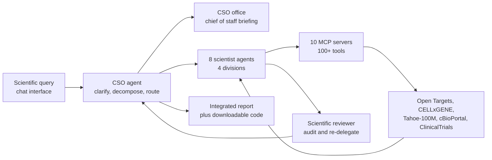

# The Virtual Biotech: A Multi-Agent AI Framework for Therapeutic Discovery and Development

> **文献键** `Zhang_2026` · **来源** bioRxiv(2026) · **类别** agents · **相关度** medium · **获取** open
> **链接** <https://doi.org/10.64898/2026.02.23.707551> · `status: complete`

---

## 一句话
把一家生物技术公司的组织架构照搬成 LLM agent 团队:一个"首席科学官"(CSO)agent 接收科学问题、拆解并分派给四个科研部门下的八个专科 scientist agent,后者通过 MCP server 调用 100 多个工具与公共数据库做真实计算,再由 CSO 汇总;作者用它做了三个转化医学案例(5.6 万条临床试验的大规模标注分析、B7-H3 肺癌靶点评估、一个失败的溃疡性结肠炎试验的复盘)。

## 要点
- 架构的核心不是"更强的模型",而是**组织结构**:四个部门(Target Identification and Prioritization、Target Safety、Modality Selection、Clinical Officers)+ CSO 办公室(Chief of Staff 做领域简报、Scientific Reviewer 审查并可要求重新分派);Introduction 自述"四个科研部门、十一个 agent、100 多个工具"。
- agent 不是只会聊天:数据访问经 10 个 MCP server 接到 Open Targets (v25.09)、CELLxGENE Census、Tabula Sapiens v2、Tahoe-100M、cBioPortal、ClinicalTrials.gov、PubMed、OpenFDA、ChEMBL,实际跑 Scanpy / Harmony / PyDESeq2 / LIANA / Cell2Location / PROGENy 等真实分析。
- 并行化是实打实的工程结果:37,075 个 clinical-trialist agent 实例并行约 6 小时完成标注,单 agent 顺序执行估计需 1,839 小时(约 184 倍)。
- 作者**做了抽取质量验证**:人工复核 100 条随机试验,主要终点一致 89.7%(78/87)、次要终点 83.9%(73/87)、不良事件率 92.4%(61/66);与 TDC 在 7,278 条试验上一致率 85.3%。
- 科学结论:靶向**细胞类型特异**基因的药物更可能推进(摘要:Phase I→II 概率高 40%、到 Phase IV 高 48%、不良事件率低 32%);但正文给出的 Phase I→II odds ratio 是 1.27 (95% CI 1.22–1.33),与"40%"并不对应,论文未加解释。
- 两个 case study 的成本被明确报出:B7-H3 案例 $46.00、OSMRβ 案例 $54.00 —— 对"agent 能不能便宜地替代一次文献+数据分析"这个问题,这是难得的具体数字。
- 可复现性是明显短板:正文与附录里**没有**代码可用性声明或项目仓库链接(Data availability 只列公共数据源),界面虽声称可下载"reproducible code",但未给出获取位置。

## 研究问题
药物发现需要把跨尺度、跨模态的证据(人群遗传学、功能基因组学、单细胞/空间图谱、通路与蛋白互作、化学信息学、临床数据)整合起来,但数据、工具和专业知识分散在不同团队与机构之间,整合本身就是瓶颈(Abstract)。单个 LLM agent 面对这种任务会受上下文长度、工具数量和专业深度的限制。作者的问题是:能否用**模仿人类研发组织的多 agent 分工**来做端到端的计算发现,同时保持人类科学家在环?

## 方法
**1. 组织结构即架构。** 用户在 chat 界面向 CSO agent 提问(Fig. S1)。CSO 负责:澄清意图 → 拆解问题 → 路由子任务 → 综合结果;它**自己不跑分析**。CSO 办公室里还有 Chief of Staff(生成领域简报,给下游 agent 提供背景)与 Scientific Reviewer(审查 scientist agent 的输出,可触发重新分派)。

**2. 八个专科 scientist agent,分在四个部门**(Extended Methods: AI Scientist Agents):Target Identification and Prioritization —— statistical genetics agent、functional genomics and perturbation agent、single cell atlas agent;Target Safety —— bio-pathways and protein-protein interaction agent、FDA safety officer agent(single cell atlas agent 也在此部门列出);Modality Selection —— target biologist agent、pharmacologist agent;Clinical Officers —— clinical trialist agent。

**3. 工具层。** Results(Overview)称开发了"100 多个定制 MCP 与分析工具";Extended Methods(Data and Virtual Biotech Tool Infrastructure)称每个 agent 的数据访问经由**10 个 MCP server** 中介。数据源包括 Open Targets v25.09、CELLxGENE Census、Tabula Sapiens v2、Tahoe-100M(大规模扰动转录组)、cBioPortal、ClinicalTrials.gov、PubMed、OpenFDA、ChEMBL。

**4. 模型与实现。** 所有 agent 用 Claude Sonnet 4.5,Chief of Staff 与 Scientific Reviewer 用 Claude Haiku 4.5(更便宜的小模型做审查与简报);系统建在 Claude Agent SDK 上(Extended Methods: Implementation and Language Model Configuration)。模型知识截止为 2025 年 1 月,作者据此挑选 readout 在截止之后的案例以降低预训练泄漏风险。

**5. 应用一:大规模并行标注(临床试验)。** 对 ClinicalTrials.gov 上 **55,984** 条可映射到靶点的试验,把每条试验交给一个 clinical-trialist agent 实例:**37,075** 个实例并行,约 **6 小时**完成,顺序执行估计需 **1,839 小时**。每个 agent 把自由文本的试验结果整理成结构化的终点成败与不良事件率,并把靶点链接到多组学注释,其中包括 agent 自己从单细胞 RNA-seq 图谱里算出的**细胞类型特异性**特征。相位分布:I 期 14,237、II 期 22,164、III 期 14,911、IV 期 4,672。

**6. 抽取质量验证与统计。** 人工抽样 100 条试验(Open Targets 数据集中 Phase II、Phase III 各随机 50 条;未抽 Phase I)做复核;另与 TDC(Therapeutics Data Commons)在 7,278 条试验上比对。统计端:对 z-score 化的单细胞特征做单变量 logistic 与 beta 回归,配 1,000 次置换检验、以药物类型与治疗领域为交叉随机截距的混合效应模型、以遗传证据为协变量的双变量模型,以及一个"无任何遗传证据"的子集(占 74.6%),FDR 用 Benjamini–Hochberg 控制在 5%。

**7. 应用二:B7-H3 肺癌靶点评估(一次端到端查询)。** 多个 agent 依次给出:人群遗传学(无显著 GWAS 信号,但 agent 认为肺组织中的调控活性相关)、单细胞(成纤维细胞中上调,SCLC log2FC 1.94、LUAD 1.46;LIANA 配体–受体分析提示免疫抑制信号)、空间(12 个 LUAD Visium 样本,用 Cell2Location 解卷积 + kNN 免疫邻域模型,发现 B7-H3 高表达 spot 周围邻近免疫细胞被耗竭)、临床基因组(TCGA LUAD 566 例 Cox 模型,高 B7-H3 对应更差总生存 HR 1.62、疾病特异生存 HR 1.82),最后由 modality 侧判断:小分子与 PROTAC 因缺乏可成药口袋被降级,建议走**抗体偶联药物(ADC)**路线。

**8. 应用三:失败试验复盘(OSMRβ / 溃疡性结肠炎)。** 对象是 MOONGLOW(NCT06137183),vixarelimab 的 II 期试验,入组 79 人后因无效(futility)终止。agent 整合:遗传学支持靶点(rs395157,OR 1.06,p = 2.68 × 10⁻¹⁰;OSMR 的 L2G score 0.970);但所分析图谱中 UC 与健康组织的 OSMR 无显著差异;五个生物制剂队列里**无应答者**的基线 OSMR 高于应答者;TAURUS 纵向数据(22 位患者、485,868 个细胞)显示抗 TNF 治疗后无应答者的成纤维细胞 OSMR 升高且 JAK-STAT 活性升高(PROGENy + decoupler + lme4)。由此批评试验方案:未做 OSMR 富集入组,且主要终点可能对通路参与不敏感;建议改为**生物标志物指导入组**(选 OSMR 高的患者)并预设 target-engagement 终点。

## 方法图


## 数据
**临床试验:** ClinicalTrials.gov 上 55,984 条可映射到靶点的试验(Phase I 14,237 / II 22,164 / III 14,911 / IV 4,672),经 Open Targets 映射;与 TDC 在 7,278 条上交叉比对。**组学:** Open Targets v25.09、CELLxGENE Census、Tabula Sapiens v2、Tahoe-100M 扰动转录组、cBioPortal/TCGA。**案例专用:** 12 个 LUAD Visium 空间样本(Data availability 引 PubMed 38782901)、TCGA LUAD 566 例、五个 UC 生物制剂队列 GEO GSE12251 / GSE16879 / GSE92415 / GSE206285 / GSE73661、TAURUS 纵向单细胞 22 位患者 485,868 细胞(PubMed 39438660)。**知识源:** PubMed、OpenFDA、ChEMBL。

## 主要结果
- 并行吞吐:37,075 个 clinical-trialist agent 实例约 6 小时完成 55,984 条试验的标注,顺序执行估计 1,839 小时,约 184 倍加速(Results §"Massively parallel extraction")。
- 抽取准确性(人工复核 100 条随机试验):主要终点 89.7%(78/87)、次要终点 83.9%(73/87)、不良事件率 92.4%(61/66);与 TDC 在 7,278 条试验上的一致率 85.3%(Results §"Massively parallel extraction";Methods §"Clinical trial manual validation")。
- 主要科学发现(摘要):靶向细胞类型特异基因的药物,Phase I→II 推进概率高 **40%**、达到 Phase IV(上市)概率高 **48%**、不良事件率低 **32%**(Fig. 3A–B)。
- 同一段 Results 给出的 Phase I→II odds ratio 为 **1.27 (95% CI 1.22–1.33)**;这是针对 z-score 化连续特征的 OR,与摘要里基于二分类比较的 "40%" 不是同一量,论文未说明两者关系(Results;Fig. 3A)。Fig. 3B 图注说明展示的是 beta 回归系数与 95% CI。
- 稳健性:1,000 次置换检验、混合效应模型(药物类型与治疗领域作交叉随机截距)、以遗传证据为协变量的调整,以及在"无遗传证据"的 74.6% 子集中重复,结论保持(Fig. S2–S4)。
- Tahoe-100M 的 hallmark 扰动评分也与终点成败相关,例如 DNA damage response 与 Phase I→II 推进相关(Results)。
- B7-H3 案例:成纤维细胞中上调(SCLC log2FC 1.94、LUAD 1.46);12 个 LUAD Visium 样本中 B7-H3 高 spot 周围免疫细胞被耗竭;TCGA LUAD 566 例中高表达对应总生存 HR 1.62、疾病特异生存 HR 1.82;结论建议 ADC 路线,并指出 liabilities 与差异化机会。单次查询成本 $46.00。
- B7-H3 案例的外部印证:论文指出 ifinatamab deruxtecan(一个 B7-H3 ADC)于 2025 年 8 月获得突破性疗法认定,晚于模型 2025 年 1 月的知识截止,作者以此作为"结论并非来自记忆"的证据(Results/Discussion)。
- OSMRβ 案例:遗传学支持靶点(rs395157 OR 1.06,p = 2.68 × 10⁻¹⁰;L2G 0.970),但图谱中 UC 与健康的 OSMR 无显著差异;五个队列中无应答者基线 OSMR 更高;TAURUS(22 患者、485,868 细胞)中抗 TNF 后无应答者成纤维细胞 OSMR 与 JAK-STAT 活性升高。agent 指出 MOONGLOW(NCT06137183,入组 79 人后因无效终止)未做 OSMR 富集入组,建议生物标志物指导入组 + 预设 target-engagement 终点。成本 $54.00。

## 创新点
- 把**人类研发组织的分工**(部门、委派、审查、简报)当作 agent 系统的设计原语,而不是只堆工具或加长 prompt;Scientific Reviewer 可以要求重新分派,是一个显式的质量闭环。
- 证明 agent 可以**规模化地**做结构化数据生产:37,075 个实例并行把 55,984 条自由文本试验结果转成结构化记录,并给出与人工及 TDC 的一致率。
- 把"单细胞层面的细胞类型特异性"作为药物靶点成功的预测因子,并用置换、混合效应、遗传证据调整做稳健性检验 —— 这是一条可独立引用的科学结论,不只是系统演示。
- 三个案例覆盖三种不同任务形态:大规模标注(数据生产)、前瞻靶点评估(假设生成)、失败试验复盘(反事实诊断),并给出每次查询的美元成本。
- 用"readout 晚于模型知识截止"的案例选择策略来对抗预训练泄漏,这是 agent 评测里值得学的设计。

## 局限
- 作者自述:AI 的分析或解释错误会沿链条传播,因此人类专家必须留在环中。
- 作者自述:试验层面的分析是观察性的,可能被适应证混杂、终点定义差异与申办方效应干扰。
- 作者自述:只纳入在 ClinicalTrials.gov 注册且靶点可映射的试验。
- 作者自述:存在预训练泄漏的可能,作者以"挑选 readout 在知识截止之后的案例 + 检索是否已有先前报道"来缓解。
- 作者自述:案例输出是**假设**,需要实验与临床验证。
- 我们的理解:**没有代码可用性声明、没有仓库链接**(Data availability 只列公共数据源),界面所称可下载的 "reproducible code" 未给出位置;对一篇以系统为贡献的论文,这使独立复现几乎不可能,也使"agent 真的跑了这些分析"只能被信任而非被核查。
- 我们的理解:数字不自洽之处需要自己小心 —— ① 摘要的 40% / 48% / 32% 与正文 OR 1.27 (1.22–1.33) 对不上且未解释;② 工具数在 Introduction("over 100 tools")、Results("more than 100 customized MCPs and analytical tools")、Extended Methods("hundreds of tools")与"10 个 MCP server"之间口径不一;③ "37,075 个 clinical-trialist agent"是并行**实例**数,不是不同 agent,而试验总数是 55,984,两数的关系论文未解释。
- 我们的理解:**没有与非 agent 基线的对比**。没有"单 agent"、"无部门结构的 agent 池"、或"纯脚本 + 固定 pipeline"的对照,所以"组织结构带来了什么"无法量化;抽取一致率(89.7% / 85.3%)衡量的是 LLM 抽取能力,与多 agent 架构无关。
- 我们的理解:验证只覆盖**抽取**,不覆盖**推理**。三个案例的"正确性"分别靠一个事后的监管里程碑(ifinatamab deruxtecan)和一个合理但未检验的试验重设计方案来支撑,都是 n=1 的轶事性证据;Scientific Reviewer 的拦截率/漏报率没有报告。
- 我们的理解:CC-BY-**ND** 许可意味着不能发布改编版本,对想在其基础上改造架构的后续工作是实际障碍。

## 与本研究方向的关系
这篇正对 Topic 2(验证生物医学分析 agent 的声明),同时也是 detect → model → **revert** 里 revert 端"选靶点"的一个最大自由度版本:GPNMB 那篇把 LLM 关在"给 7 个特征配权重 + 从 100 个基因里选"的笼子里,这篇则让 agent 自己决定调用哪些数据库、跑哪些分析、如何综合。

我们的理解:它给 Topic 2 送上了一份现成的"待验证声明清单"。按证据强度分层:① **可机械核查的**——试验抽取结果(有金标准:人工复核与 TDC),这是 agent 幻觉检测最容易做基准的部分;② **可统计复核的**——细胞类型特异性与试验成功的关联(但要先解决 40% 与 OR 1.27 的口径问题,这本身就是一个很好的"论文内部数字不一致检测"案例);③ **只能定性评估的**——两个 case study 的推理链。我们的 Topic 2 可以直接把这三层做成三个难度梯度的评测任务。

我们的理解:对 Topic 1(肾脏组学异常检测基准)有两点直接可借:① **"细胞类型特异性 → 可干预性"这个先验**值得搬到肾脏:如果我们的异常检测在 snRNA/Xenium 上标出一批变化区域与基因,那么"它在细胞类型层面有多特异"既是异常分数的一个正交证据维度,也是下游 revert 候选排序的一个先验;② **用 agent 做大规模结构化标注**的工程模式(每个单元一个实例、并行、再用人工抽样复核一致率)正好适用于我们要做的"专家验证 flag":可以让 agent 先批量产生候选 flag 与理由,再按这篇的做法抽样人工复核并报一致率,把标注成本与质量都变成可报告的数字。

我们的理解:架构层面最值得抄的两个细节是**用便宜小模型(Haiku 4.5)做审查与简报**、以及**让 reviewer 有权要求重新分派**。我们如果要做"异常检测结果的自动复核 agent",这是一个低成本的质量闭环范式;而本文没报 reviewer 的拦截率,正好是我们可以补的空白。

## 可复用资产
- **代码:** 未找到。全文(含 Data availability)没有代码可用性声明或仓库链接;界面声称可下载 "reproducible code",但未给出获取位置。架构建在公开的 Claude Agent SDK 上。
- **数据:** 作者称"release the resulting dataset"(5.6 万条试验的结构化标注),但正文未给链接 —— 需要联系作者或等正式发表。所用公共源:Open Targets v25.09、CELLxGENE Census、Tabula Sapiens v2、Tahoe-100M、cBioPortal/TCGA、ClinicalTrials.gov、PubMed、OpenFDA、ChEMBL;案例数据 GEO GSE12251 / GSE16879 / GSE92415 / GSE206285 / GSE73661,LUAD Visium 见 PubMed 38782901,TAURUS 见 PubMed 39438660。
- **提示 / 设计:** Supplementary Note I 给出 clinical trialist agent 的 system prompt,Note II 给出 Scientific Reviewer 的样例反馈 —— 这两份是最直接可复用的资产(需从 PDF 附件获取)。
- **许可:** CC-BY-ND —— 可引用、可重分发原文,但不可发布改编版本。

## 待读
- 取附件 PDF 读 Supplementary Note I(clinical trialist agent 的完整 system prompt)与 Note II(Scientific Reviewer 反馈样例),以及 Supplementary Tables 的内容。
- 自查 40% / 48% / 32% 与 OR 1.27 (1.22–1.33) 的关系:是二分类 vs 连续特征的不同模型,还是不同的参照组?这是本文唯一需要先解决才能引用的数字问题。
- 查 Tahoe-100M(大规模扰动转录组)原文 —— 它在本文里作为"扰动响应"证据来源,正好是我们 revert 端需要的数据类型。
- 与 `biomni-biorxiv-2025` 做架构级对比(工具数、是否分部门、是否有 reviewer、如何验证),再加上 `gpnmb-cart-cell-2026` 的最受约束版本,构成 Topic 2 的"自主度谱"。
- 跟踪:正式发表版本是否补上代码与数据链接;另查 ifinatamab deruxtecan 的 B7-H3 ADC 进展,作为对 case study 的持续外部检验。

## 引用
```bibtex
@article{Zhang_2026, title={The Virtual Biotech: A Multi-Agent AI Framework for Therapeutic Discovery and Development}, url={http://dx.doi.org/10.64898/2026.02.23.707551}, DOI={10.64898/2026.02.23.707551}, publisher={openRxiv}, author={Zhang, Harrison G. and Eckmann, Peter and Miao, Jiacheng and Mahon, Andrew B. and Zou, James}, year={2026}, month=Feb }
```


---

📄 **[AI-ready 全文提取 →](ai-ready.md)**
