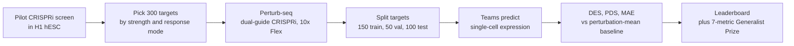

# Virtual Cell Challenge

> **Bibkey** `Roohani_2025` · **Venue** Arc Institute (competition; companion paper in Cell) (2025) · **Category** competition · **Relevance** medium · **Access** open
> **Link** <https://virtualcellchallenge.org/> · `status: abstract-only`

---

## One-liner
An annual open competition by the Arc Institute: given single-cell expression after CRISPRi knockdown of some genes in a new cell type (H1 human embryonic stem cells in 2025), predict how unseen knockdowns change single-cell expression; framed as "a Turing test for the virtual cell" (*Cell* title, Arc launch page).

## Takeaways
- The task is a **forward simulator**: input "which gene is knocked down", output "what the cells' expression becomes" — the forward model a reversion search (which gene to perturb) would need (Arc launch page).
- 2025 data: ~300,000 H1 cells, 300 target genes (150 train / 50 validation / 100 test), ~1,000 cells per perturbation, median >50,000 UMIs per cell ("Behind the data").
- Score = DES, PDS and MAE, each normalised against a perturbation-mean baseline and averaged ("Behind the data"). Almost all models were **worse** than the baseline on MAE; top teams scored mainly via PDS and DES (wrap-up).
- Organisers' conclusions: models did not consistently beat naive baselines across all metrics; hybrids of deep learning and statistical features beat purely neural models; loss design mattered as much as architecture; optimising one metric often hurt others (wrap-up).
- Scale: 5,000+ registrants from 114 countries; 1,200+ teams submitted results, 300+ made final submissions (wrap-up).
- The 2026 edition is **zero-shot**: six cell lines (3 for validation, 3 for final testing), no challenge-specific training set, final ranking on an aggregate of six metrics (2026 announcement).

## Problem
A key goal of "virtual cell" (cell-state) models is predicting cellular responses to perturbations, but the field lacks a shared evaluation framework and purpose-built datasets (*Cell* abstract). The organisers set up a recurring open benchmark competition to provide the framework, the data and a venue (*Cell* abstract), testing whether models generalise to a new cell context (Dave Burke, Arc launch page). Arc's wrap-up phrases the question as: can a computational model stand in for a Perturb-seq experiment (wrap-up)?

## Method
1. **Experiment**: dual-guide CRISPRi knockdown in H1 human embryonic stem cells (catalytically dead Cas9 fused to a KRAB repressor, which silences transcription of the target gene instead of cutting DNA), read out by single-cell RNA-seq with 10x Genomics Flex (a fixation-based, probe-based chemistry) ("Behind the data"). Pooled perturbation with a single-cell readout is called Perturb-seq.
2. **Cell type**: H1 was chosen because it is well characterised (part of ENCODE) and unlike the immortalised lines (K562, A375) that dominate existing Perturb-seq data ("Behind the data").
3. **Target genes**: a large CRISPRi pilot screen in H1 counted differentially expressed (DE) genes per perturbation; perturbations were binned by strength and sampled per bin for diversity; ContrastiveVI+ clustered responses in latent space to cover different response modes; guides also had to assign cleanly, targets needed enough basal expression, and repression had to be visible with Flex ("Behind the data").
4. **Splits**: each target got a stratification score from its DE-gene count and number of high-quality cells; genes were binned and randomly assigned to 150 train / 50 validation / 100 test so the splits are balanced ("Behind the data"). Training data come at sign-up; mid-competition validation submissions feed a live leaderboard; the final test set is released about a week before the deadline; ranking uses only the final test set (Arc launch page).
5. **Metrics**: DES = overlap of predicted and true DE gene sets; PDS = whether each prediction is closest to its own perturbation's true profile; MAE = mean absolute error over all genes. Each is normalised against a perturbation-mean baseline and averaged into the leaderboard score ("Behind the data").
6. **Generalist Prize (added mid-competition)**: since MAE no longer moved the leaderboard, the top 50 final entries were ranked on 7 metrics (DES, PDS, MAE, Pearson delta correlation, Spearman correlation of log fold change, AUPRC, Spearman correlation of effect size; the last four from the State model's evaluation) and the best average rank won (wrap-up).
7. **External data**: training on the Arc Virtual Cell Atlas (over half a billion cells) and other public data is allowed (Arc launch page).

## Method diagram


## Data
~300,000 H1 human embryonic stem cells, 300 CRISPRi targets (150 / 50 / 100); median/mean ~1,000 cells per perturbation; median/mean >50,000 UMIs per cell; 63% of cells with both correct guides detected; 83% of cells with >80% knockdown ("Behind the data", wrap-up). At ~1,000 cells per perturbation the training set is roughly 150,000 cells (our arithmetic; not stated on the pages). The 2025 dataset can now be downloaded through the Arc Virtual Cell Atlas (2026 announcement).

## Key results

- **Participation**: 5,000+ registrants (114 countries), 1,200+ teams submitting, 300+ final submissions (wrap-up).
- **Versus baselines**: models did not consistently beat naive baselines on all metrics, though they improved on perturbation discrimination and DE-gene identification; almost all were worse than baseline on MAE (wrap-up).
- **Metric loophole**: a participant showed that L1-based PDS rises as prediction magnitude grows, approaching sign-based cosine similarity (wrap-up); norm-matched PDS variants are mentioned as future work (wrap-up).
- **1st ($100,000)**: BM_xTVC (BioMap Research), xTrimoSCPerturb: improved scFoundation-based pretrained model + protein embeddings + training-set DE-gene frequency and mean expression as features; fused loss (PDS + DES + small-weight MAE); trained on pseudo-bulk (cells averaged per perturbation) (wrap-up).
- **2nd ($50,000)**: XLearning Lab (Sichuan University / Tianfu Jincheng Lab): fully connected network on pseudo-bulk + ESM-2 protein embeddings + residual learning, MSE loss; trained only on public Perturb-seq data (wrap-up).
- **3rd ($25,000)**: Outlier (U Chicago, Dartmouth, HKU), TransPert: a statistical framework on summary-level data — similarity-aware aggregation of reference cell-line data, then a global linear scaling tuned for PDS (wrap-up).
- **Generalist Prize ($100,000)**: Altos Labs, go-with-the-flow: a flow-matching generative model with a U-Net, pretrained on ~7 million single cells and fine-tuned on H1; best average rank over the 7 metrics (wrap-up).

## Contributions
- A purpose-built, high-quality Perturb-seq dataset (H1, dual-guide CRISPRi, deep sequencing) with splits balanced by response strength and mode ("Behind the data").
- A public, repeatable evaluation framework (DES / PDS / MAE, baseline-normalised), iterated yearly (*Cell* abstract, wrap-up).
- Large-scale participation yields empirical evidence on where methods stand, including the lesson that metrics can be gamed (wrap-up).

## Limitations
- Organisers: no single metric captures model quality; a narrow scoring function invites optimising the metric rather than the biology, hence a six-metric aggregate in 2026 (wrap-up, 2026 announcement).
- Organisers: model accuracy, metric design and biological generalisation still need work (2026 announcement).
- Our reading: the 2025 edition has one cell type, single-gene knockdowns and transcriptome only; no tissue, spatial or cell–cell context.
- Our reading: top teams relied heavily on pseudo-bulk (cell averages), so the scoring mainly rewards the average response rather than single-cell heterogeneity.
- Our reading: we did not read the full *Cell* commentary; exact metric formulas (DES thresholds, PDS distance) must be checked in the paper or evaluation code.

## Relation to our direction
Our reading: the challenge maps to **model → revert** in detect → model → revert: it scores the forward model "given a perturbation, predict the cell state"; reversion is the inverse — given an abnormal state and a normal target, find perturbations that move one to the other. Three lessons. (1) **Evaluation design**: splits balanced by response strength and mode and scores normalised against a naive baseline transfer directly to Topic 1's anomaly benchmark — anomaly scores should also be reported relative to a naive baseline such as per-cell-type means. (2) **Metrics get gamed**: PDS inflating with prediction magnitude and MAE being abandoned warn us not to rank KidneyAnomalyBench on a single metric; use several complementary metrics plus expert review. (3) **Limited direct value for kidney reversion**: H1 stem cells are far from tubule or podocyte cells, and the setting is single-cell, not tissue; kidney reversion would need perturbation data in kidney cell types. The 2026 zero-shot, multi-cell-line setting is closer to predicting in a cell type never perturbed — the situation we would face in kidney.

## Reusable assets
- **Challenge site** (JavaScript app, open in a browser):
<https://virtualcellchallenge.org/>
- **2025 dataset**: downloadable through the Arc Virtual Cell Atlas (2026 announcement).
<https://arcinstitute.org/virtual-cell-initiative>
- **Data description and metrics**:
<https://arcinstitute.org/news/behind-the-data-virtual-cell-challenge>
- **Wrap-up and winning solutions**:
<https://arcinstitute.org/news/virtual-cell-challenge-2025-wrap-up>
- **State model** (Arc's virtual-cell model with State Embedding + State Transition modules; trained on nearly 170 million observational cells and over 100 million perturbed cells across 70 cell lines) (State news page).
<https://arcinstitute.org/news/virtual-cell-model-state>

## Follow-ups
- Full *Cell* commentary (DOI 10.1016/j.cell.2025.06.008) for exact DES / PDS / MAE definitions.
- The 2026 *Cell* article "Virtual Cell Challenge 2026: Benchmarking zero-shot generalization across cellular contexts" and its six metrics.
<https://arcinstitute.org/news/virtual-cell-challenge-2026>
- Altos Labs' flow-matching preprint (mentioned as posted in the 2026 announcement).
- The State model paper and the cell-eval evaluation tool.

## Figures & tables

Competition resource card; no images are embedded. The two tables below are compiled from the Arc pages listed above.

### Results

**Table 1.** 2025 dataset split ("Behind the data").

| Split | Target genes | Role |
|---|---|---|
| Training | 150 | Given at sign-up |
| Validation | 50 | Live leaderboard during the competition |
| Final test | 100 | Released ~1 week before the deadline; sole basis for ranking |
| **Total** | **300** | ~300,000 H1 cells, ~1,000 cells per target |

**Table 2.** 2025 winners (wrap-up).

| Place | Team | Approach |
|---|---|---|
| 1st ($100,000) | BM_xTVC (BioMap Research) | xTrimoSCPerturb: scFoundation-based + protein embeddings + statistical features; fused PDS+DES+MAE loss; pseudo-bulk |
| 2nd ($50,000) | XLearning Lab | Fully connected net, ESM-2 embeddings, residual learning, MSE; public Perturb-seq only |
| 3rd ($25,000) | Outlier | TransPert: similarity-weighted aggregation of reference cell lines + linear scaling tuned for PDS |
| Generalist ($100,000) | Altos Labs | go-with-the-flow: U-Net flow matching, pretrained on ~7M cells |

## Cite
```bibtex
@article{Roohani_2025, title={Virtual Cell Challenge: Toward a Turing test for the virtual cell}, volume={188}, ISSN={0092-8674}, url={http://dx.doi.org/10.1016/j.cell.2025.06.008}, DOI={10.1016/j.cell.2025.06.008}, number={13}, journal={Cell}, publisher={Elsevier BV}, author={Roohani, Yusuf H. and Hua, Tony J. and Tung, Po-Yuan and Bounds, Lexi R. and Yu, Feiqiao B. and Dobin, Alexander and Teyssier, Noam and Adduri, Abhinav and Woodrow, Alden and Plosky, Brian S. and Mehta, Reshma and Hsu, Benjamin and Sullivan, Jeremy and Ricci-Tam, Chiara and Li, Nianzhen and Kazaks, Julia and Gilbert, Luke A. and Konermann, Silvana and Hsu, Patrick D. and Goodarzi, Hani and Burke, Dave P.}, year={2025}, month=jun, pages={3370–3374} }
```


---

📄 **[AI-ready full-text extract →](ai-ready.md)**
