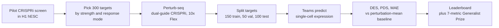

# Virtual Cell Challenge

> **文献键** `Roohani_2025` · **来源** Arc Institute (competition; companion paper in Cell)(2025) · **类别** competition · **相关度** medium · **获取** open
> **链接** <https://virtualcellchallenge.org/> · `status: abstract-only`

---

## 一句话
Arc Institute 每年举办的公开竞赛:给定一个新细胞类型(2025 届是 H1 人胚胎干细胞)里部分基因被 CRISPRi 敲低后的单细胞表达,预测其余未见过的敲低会让单细胞表达怎样变化;官方把它定位为"virtual cell 的图灵测试"(*Cell* 标题;wrap-up 的小标题 "The Turing Test for Virtual Cells")。

## 要点
- 任务本质是**正向模拟器**:输入"敲低哪个基因",输出"细胞表达会变成什么样"(Arc 发布公告:模型要"predict effects of single gene perturbations")。主办方说长远目标是在计算机里找到能把细胞从"diseased"推向"healthy"状态的药物(wrap-up 第 2 节)。我们的理解:这正是 revert 问题(反过来找该敲哪个基因)所需的前向模型。
- 2025 数据:约 30 万个 H1 细胞、300 个靶基因(150 训练 / 50 验证 / 100 测试),每个扰动约 1,000 个细胞,每个细胞中位数 >50,000 UMI("Behind the data")。
- 评分 = DES、PDS、MAE 三个指标相对"扰动均值基线"归一化后取平均,并对每个指标设最低门槛("Behind the data";该页 2025-10-01 更新为与 STATE 预印本一致的评分方法)。几乎所有模型在 MAE 上都**不如**基线;由于比基线差的提交不会被扣分,MAE 实际上不再影响排行榜,前几名主要靠 PDS 和 DES 拿分(wrap-up)。
- 主办方的结论:模型没有在所有指标上稳定胜过朴素基线;混合"深度学习 + 统计特征"的方案好于纯神经网络;损失函数设计和架构同样重要;优化一个指标有时会以牺牲其他指标为代价(wrap-up)。
- 规模:5,000+ 人注册、来自 114 国;1,200+ 队提交结果,300+ 队最终提交(wrap-up)。
- 2026 届改为**零样本**:六个细胞系(3 个验证、3 个最终测试),不发专门训练集,终评用六个指标的综合分(2026 公告)。

## 研究问题
"virtual cell"(细胞状态模型)的一个核心目标是预测细胞对扰动的反应,但研究者一直难以比较不同方法,因为评测方法不一致、数据质量参差(Arc 发布公告)。主办方想用一个反复举办的开放基准竞赛提供评测框架、专门数据和交流场所(*Cell* 摘要),并检验模型能否泛化到一个新的细胞语境;因为这很难,第一届被设计成 few-shot 任务,发放一部分 H1 训练数据(Arc 发布公告中 Dave Burke 的说法)。Arc 在总结中把问题表述为:计算模型能否替代一次 Perturb-seq 实验(wrap-up)。

## 方法
1. **实验设计**:在 H1 人胚胎干细胞中做双 guide 的 CRISPRi 敲低(催化失活的 Cas9 融合 KRAB 抑制结构域,压低靶基因转录,而不是切断 DNA),再用单细胞 RNA 测序(10x Genomics Flex,一种固定后、基于探针的化学)读出每个细胞的表达("Behind the data")。这种"批量扰动 + 单细胞读出"的实验叫 Perturb-seq。
2. **选细胞类型**:选 H1 是因为它被充分表征(属于 ENCODE),且不同于现有 Perturb-seq 数据中占主导的永生化细胞系(K562、A375)("Behind the data")。
3. **选靶基因**:先在 H1 中做大规模 CRISPRi 预筛,按每个扰动引起的差异表达基因数分档,每档抽样以保证多样性;用 ContrastiveVI+ 在隐空间聚类扰动反应,保证覆盖不同反应模式;同时要求 guide 分配干净、靶基因本底表达足够、Flex 能测到明显抑制("Behind the data")。
4. **划分**:每个靶基因按差异表达基因数和高质量细胞数打分,分档后随机分到训练 150 / 验证 50 / 测试 100,使三组构成平衡("Behind the data")。报名即可拿到训练数据;比赛中段用验证集提交,结果上实时排行榜;最终测试集在截止前约一周放出;只按最终测试集排名(Arc 发布公告)。
5. **指标**(公式见 "Behind the data" 的 "Evaluation metrics" 部分,<https://arcinstitute.org/news/behind-the-data-virtual-cell-challenge>,2025-10-01 更新版):
   - **DES**(差异表达分):对每个扰动 k,在预测数据和真实数据上分别用 Wilcoxon 秩和检验比较扰动细胞与对照细胞,Benjamini-Hochberg 校正后 FDR ≤ 0.05 的基因记为差异表达基因。若预测集合比真实集合大,只取按 |logFC| 排前 n 个(n = 真实集合大小)。DES_k = |G_true ∩ G_pred| / |G_true|,再对所有扰动求平均;范围 0–1,越高越好。
   - **PDS**(扰动区分分):先对每个预测和真实扰动做 pseudobulk(细胞平均),减去 non-targeting 对照得到扰动 delta δ_p;计算预测 delta 与所有真实 delta 的 L1(曼哈顿)距离,按距离升序排名,r_p 为真实匹配的名次;PDS_p = 1 − (r_p − 1)/N,再求平均。1 表示完全匹配,随机猜约 0.5。
   - **MAE**:预测与真实 pseudobulk 表达在全部 G 个基因上的平均绝对误差,再对扰动求平均;越低越好。
   - **总分**:三个指标各自相对扰动均值基线归一化,取平均;每个指标设最低门槛,防止只优化一个指标("Behind the data")。
6. **Generalist Prize(赛中追加)**:因为 MAE 已不再影响排行榜,主办方追加一个奖项:对前 50 个最终提交用 7 个指标排名(DES、PDS、MAE、Pearson delta 相关、log fold change 的 Spearman 相关、AUPRC、效应量的 Spearman 相关;后四个来自 State 模型的评测),取平均名次最高者(wrap-up)。
7. **外部数据**:允许用 Arc Virtual Cell Atlas(超过 5 亿个细胞)和其他公开数据训练(Arc 发布公告)。

## 方法图


## 数据
约 300,000 个 H1 人胚胎干细胞,300 个 CRISPRi 靶基因(150 / 50 / 100);每个扰动的细胞数中位数/均值约 1,000;每个细胞 UMI 中位数/均值 >50,000;63% 的细胞两个 guide 都被正确检出;83% 的细胞靶基因被敲低 >80%("Behind the data", wrap-up)。按每扰动约 1,000 个细胞推算,训练集约 15 万个细胞(这是我们的推算,网页未直接给出)。2025 数据集现已可从 Arc Virtual Cell Atlas 下载(2026 公告)。

## 主要结果

- **参与**:5,000+ 注册(114 国),1,200+ 队提交,300+ 队最终提交(wrap-up)。
- **对基线**:模型总体没有在所有指标上稳定胜过朴素基线,但在扰动区分和差异表达基因识别上有进步;几乎所有模型 MAE 比基线差(wrap-up)。
- **PDS 对尺度敏感**:一支参赛队的分析发现,基于 L1 的 PDS 会随预测幅度变大而上升,趋近于只看符号的余弦相似度;主办方说这"本身不算 bug",反映的是高维几何,而且队伍仍需抓住真实生物信号才能在 DES 上得分(wrap-up)。主办方提到未来可能用"范数匹配"的 PDS 变体(wrap-up)。
- **第 1 名(10 万美元)**:BM_xTVC(BioMap Research),xTrimoSCPerturb:改进的 scFoundation 预训练模型 + 蛋白质 embedding + 训练集中差异表达基因频率与平均表达作特征;融合损失(PDS + DES + 小权重 MAE);在 pseudo-bulk(把同一扰动的细胞求平均)上训练(wrap-up)。
- **第 2 名(5 万美元)**:XLearning Lab(四川大学 / 天府锦城实验室):全连接网络 + pseudo-bulk + ESM-2 蛋白 embedding + 残差学习,MSE 损失;只用公开 Perturb-seq 数据训练(wrap-up)。
- **第 3 名(2.5 万美元)**:Outlier(芝加哥大学、达特茅斯、香港大学),TransPert:基于汇总数据的统计框架,把参考细胞系数据按相似度加权聚合,再做针对 PDS 调好的全局线性缩放(wrap-up)。
- **Generalist Prize(10 万美元)**:Altos Labs,go-with-the-flow:U-Net 结构的 flow matching 生成模型,先在约 700 万个单细胞上预训练再在 H1 上微调,7 个指标平均名次最高(wrap-up)。

## 创新点
- 专门为评测生成的高质量 Perturb-seq 数据集(H1、双 guide CRISPRi、深测序):靶基因按反应强度和反应模式挑选,再按差异表达基因数和高质量细胞数平衡地划分(“Behind the data”)。
- 公开、可重复的评测框架(DES / PDS / MAE,相对基线归一化),每年迭代(*Cell* 摘要, wrap-up)。
- 用大规模参赛得到关于"当前方法到底行不行"的经验证据,包括指标设计的教训:PDS 对尺度敏感(wrap-up),窄的评分函数会诱导针对指标而非生物学的优化(2026 公告)。

## 局限
- 主办方:单个指标抓不住模型质量;窄的评分函数会诱导优化指标而非生物学,因此 2026 年改用六指标综合分(wrap-up, 2026 公告)。
- 主办方:模型准确度、指标设计和生物学泛化仍有很大提升空间(2026 公告)。
- 我们的理解:2025 届只有一个细胞类型、单基因敲低、只有转录组;没有组织、空间或多细胞相互作用。
- 我们的理解:前几名大量依赖 pseudo-bulk(细胞平均),说明当前评分主要奖励"平均反应"而非单细胞异质性。
- 来源说明:本卡没有读到 *Cell* 评论全文。上面的指标公式来自 "Behind the data" 2025-10-01 更新版(该页说更新是为了与 STATE 预印本的评分方法一致),所以比赛开始时实际用的公式可能与此不同;最低门槛的具体数值页面没有给出。

## 与本研究方向的关系
我们的理解:这个竞赛对应 detect → model → revert 里的 **model → revert**:它评测的是"给定扰动,预测细胞状态"的前向模型;revert 则是反问题——给定异常状态和目标正常状态,找出能把前者推向后者的扰动。可借鉴的有三点。(1) **评测设计**:靶基因覆盖不同反应强度和反应模式、按差异表达基因数和高质量细胞数平衡划分、相对朴素基线归一化,这套做法可以搬到伪影注入课题的异常检测基准上——例如异常分也应相对"按细胞类型取均值"这类朴素基线报告。(2) **单一指标不够**:PDS 随预测幅度上升、MAE 实际上不再影响排行榜,这提醒我们在 KidneyAnomalyBench 里不要只用一个指标排名,要配多个互补指标和专家复核。(3) **对 revert 的直接价值有限**:H1 干细胞与肾小管/足细胞等肾脏细胞差别很大,单细胞而非组织尺度;要做肾脏 revert,还需要肾脏细胞类型的扰动数据。2026 届的零样本、多细胞系设置更接近"在没见过扰动的细胞类型里预测"——这正是我们在肾脏里会遇到的情况。

## 可复用资产
- **竞赛网站**(JavaScript 页面,需浏览器打开):
<https://virtualcellchallenge.org/>
- **2025 数据集**:已可从 Arc Virtual Cell Atlas 下载(2026 公告)。
<https://arcinstitute.org/tools/virtualcellatlas>
- **数据说明与指标**:
<https://arcinstitute.org/news/behind-the-data-virtual-cell-challenge>
- **赛后总结与获奖方案**:
<https://arcinstitute.org/news/virtual-cell-challenge-2025-wrap-up>
- **State 模型**(Arc 的 virtual cell 模型,State Embedding + State Transition 两个模块;用近 1.7 亿个观测细胞和 70 个细胞系中超过 1 亿个扰动细胞训练)(State 新闻页)。
<https://arcinstitute.org/news/virtual-cell-model-state>

## 待读
- *Cell* 评论全文(DOI 10.1016/j.cell.2025.06.008),看比赛开始时的 DES / PDS / MAE 定义是否与 "Behind the data" 更新版一致。
- 2026 届 *Cell* 文章 "Virtual Cell Challenge 2026: Benchmarking zero-shot generalization across cellular contexts" 与六指标方案。
<https://arcinstitute.org/news/virtual-cell-challenge-2026>
- Altos Labs 的 flow-matching 预印本(2026 公告提到已发布)。
- State 模型论文与 cell-eval 评测工具。

## 图表

本条目是竞赛资源卡,不嵌入图片。下面两张表按上述 Arc 官方网页整理。

### 结果表

**表1.** 2025 数据集划分(“Behind the data”)。

| Split | Target genes | Role |
|---|---|---|
| Training | 150 | Given at sign-up |
| Validation | 50 | Live leaderboard during the competition |
| Final test | 100 | Released ~1 week before the deadline; sole basis for ranking |
| **Total** | **300** | ~300,000 H1 cells, ~1,000 cells per target |

**表2.** 2025 获奖方案(wrap-up)。

| Place | Team | Approach |
|---|---|---|
| 1st ($100,000) | BM_xTVC (BioMap Research) | xTrimoSCPerturb: scFoundation-based + protein embeddings + statistical features; fused PDS+DES+MAE loss; pseudo-bulk |
| 2nd ($50,000) | XLearning Lab | Fully connected net, ESM-2 embeddings, residual learning, MSE; public Perturb-seq only |
| 3rd ($25,000) | Outlier | TransPert: similarity-weighted aggregation of reference cell lines + linear scaling tuned for PDS |
| Generalist ($100,000) | Altos Labs | go-with-the-flow: U-Net flow matching, pretrained on ~7M cells |

## 引用
```bibtex
@article{Roohani_2025, title={Virtual Cell Challenge: Toward a Turing test for the virtual cell}, volume={188}, ISSN={0092-8674}, url={http://dx.doi.org/10.1016/j.cell.2025.06.008}, DOI={10.1016/j.cell.2025.06.008}, number={13}, journal={Cell}, publisher={Elsevier BV}, author={Roohani, Yusuf H. and Hua, Tony J. and Tung, Po-Yuan and Bounds, Lexi R. and Yu, Feiqiao B. and Dobin, Alexander and Teyssier, Noam and Adduri, Abhinav and Woodrow, Alden and Plosky, Brian S. and Mehta, Reshma and Hsu, Benjamin and Sullivan, Jeremy and Ricci-Tam, Chiara and Li, Nianzhen and Kazaks, Julia and Gilbert, Luke A. and Konermann, Silvana and Hsu, Patrick D. and Goodarzi, Hani and Burke, Dave P.}, year={2025}, month=jun, pages={3370–3374} }
```


---

📄 **[AI-ready 全文提取 →](ai-ready.md)**
