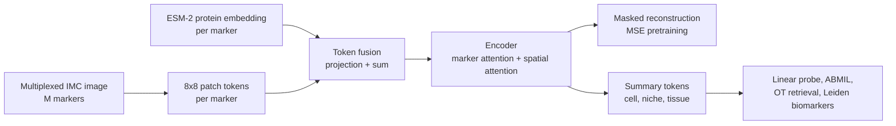

# AI-powered virtual tissues from spatial proteomics for clinical diagnostics and biomedical discovery

> **Bibkey** `Wenckstern2025_250106039` · **Venue** arXiv preprint (2025) · **Category** virtual-tissue · **Relevance** high · **Access** open
> **Link** <https://arxiv.org/abs/2501.06039> · `status: complete`

---

## Version note
**Note: this note and every number below describe arXiv 2501.06039 v2 (9 Dec 2025).** The paper is now published in Nature as "The Virtual Tissues foundation model resolves spatial proteomics across scales", *Nature* 657:744–754 (online 5 Aug 2026), doi:[10.1038/s41586-026-10884-y](https://doi.org/10.1038/s41586-026-10884-y), CC BY 4.0. In the published version authors 3 and 4 swap (von Querfurth 3rd, Cheng 4th); the core IMC corpus has 146 markers (v2: 147) and is extended to a 32-cohort IMC + CODEX + Orion + MIBI corpus with more than 5,100 patients and 239 markers; zero-shot cell segmentation and cross-technology cell typing are new; the Cords → Rigamonti cross-cohort label transfer moves to Supplementary Fig. 16, and its F1 values (0.615 etc.) are no longer in the main text. Check the numbers below against this table before citing the published version.

| Number | arXiv v2 | Nature 2026 |
|---|---|---|
| Combined TNBC response AUROC | 0.817 | 0.823 |
| Gain over Wang et al. predictor | +4.53% (P < 0.001) | +5.14% (P = 2.43×10⁻⁴) |
| Gain over immune-ratio baselines | +23–30% | +26–32% |
| Cell typing vs KRONOS | +6.31% | +5.81% |
| Fig. 3c gains B | +27.9 / +35.2 / +95.6 / +30.4% | +26.4 / +34.3 / +109.7 / +30.2% |
| Markers in IMC corpus | 147 | 146 |
| Reconstruction r | 0.723±0.157 (mean of 3 schemes | per scheme only: independent 0.800±0.130, marker 0.700±0.173, niche 0.668±0.132 |
| Unchanged | METABRIC, ABMIL macro-F1, retrieval, Meyer C-index, architecture and training settings | same |

## One-liner
VirTues (Virtual Tissues) is a foundation model for spatial proteomics: each marker channel of a multiplexed image is tokenised and tagged with a protein-language-model (ESM-2) embedding of that protein, and a ViT with factorised spatial / marker attention is pretrained as a masked autoencoder; one backbone then supports marker reconstruction, cell typing, tissue-level clinical prediction, case retrieval and cross-cohort biomarker discovery.

## Takeaways
- Handles "every study has a different antibody panel": marker identity comes from ESM-2 protein embeddings, so markers unseen in training can still be fed in (zero-shot).
- Attention is factorised into channel-only (marker) and position-only (spatial) interactions, avoiding the spatial × channel quadratic cost; performance keeps rising with marker count, especially the first 20 (Fig. 1e).
- Reconstruction averages Pearson r = 0.723±0.157 across three masking schemes; zero-shot on an external lung cohort gives r = 0.667 for known markers (0.797 in-domain; per the Fig. 2h caption these averages are under whole-marker masking) (Fig. 2d, 2h).
- Linear-probe cell typing beats KRONOS by 6.31% and CA-MAE by 65.79% in macro-F1 on average; cross-cohort label transfer F1 0.615 vs KRONOS 0.383 (Fig. 3).
- Triple-negative breast cancer: four "virtual biomarkers" clustered from pre-treatment cell embeddings predict anti-PD-L1 chemo-immunotherapy response with AUROC 0.817 and transfer to an independent cohort for disease-free-survival stratification with C-index 0.628 (Fig. 5).
- Kidney is in the pretraining corpus (the IMMUcan panel 1 dataset, Methods), but all downstream evaluations are in lung cancer, breast cancer and melanoma.

## Problem
Multiplexed imaging (IMC, multiplexed immunofluorescence, etc.) measures dozens to hundreds of proteins per section, but every study uses its own antibody panel, protocol and platform, so marker number, identity, dynamic range and noise differ; most pipelines are built for one cohort / one panel, which blocks knowledge transfer, reuse of annotated references, and spatial biomarkers that generalise beyond the original study (Introduction). Existing encoders need fixed panels, scale poorly with channel count, or are tested on narrow tasks, and rarely use prior knowledge about the proteins.

## Method

Terms: IMC (imaging mass cytometry) images dozens of proteins on tissue with metal-tagged antibodies; a marker is one measured protein (or mRNA) channel; a niche is a small tissue neighbourhood.

1. **Input and cropping**: 256×256 sub-images are sampled (dropping those with <30% tissue), then random 128×128 crops during training; each channel is cut into 8×8-pixel patches (about one cell), giving an M×16×16 token grid (M = number of markers).
2. **Marker-aware tokenisation**: each marker's amino-acid sequence is embedded by ESM-2 (640-d; mRNA markers use the encoded protein); image tokens and marker tokens are linearly projected and summed. Each spatial position also gets a learnable patch summary token.
3. **Factorised-attention encoder**: one kind of layer lets tokens at the same position attend across markers (marker attention), the other lets tokens of the same marker attend across positions (spatial attention); the two alternate over 16 transformer blocks; implemented with FlashAttention-2.
4. **Masked-autoencoder pretraining**: channel-wise masking with a random 60–100% ratio per channel, plus random dropout of 0–25% of channels for panel robustness. The decoder reconstructs channel-wise; loss is MSE over all pixels; AdamW, 150 epochs, effective batch 512, lr 2e-4 (Methods "VirTues pretraining"). Evaluation uses three schemes: independent, whole-marker and whole-niche masking.
5. **Multi-scale representations**: at inference, patch summary tokens are convolved with the cell segmentation mask into cell summary tokens, or aggregated into niche / tissue summary tokens.
6. **Downstream use**: logistic-regression linear probes on cells (random forests for cross-cohort label transfer); ABMIL (attention-based multiple-instance learning) over all patch tokens for tissue-level labels; case retrieval by Wasserstein (optimal-transport) distance between niche tokens; biomarker discovery = pre-treatment cell embeddings → multi-resolution Leiden clustering → per-patient cluster frequencies → cross-validated patient-level models rank clusters by AUROC → four signatures combined in a logistic model.
7. **Splits**: each of the 14 pretraining datasets is split randomly 80/20 into train / test, keeping each patient on one side; the split is used for pretraining and downstream parametric models (Methods "Dataset curation").

## Method diagram


## Data
15 IMC datasets from 8 organ sites, 147 markers in total (proteins, protein modifications, mRNAs); 3,102 patients, 8,887 tissue images, >259,000 crops of 256×256, >14.5 million segmented cells in nine datasets (Fig. 1b–c, Suppl. Table 1). Fourteen were used for pretraining: lung cancer, breast cancer, colon, kidney, head and neck (IMMUcan panel 1), primary and metastatic melanoma, plus non-cancer tonsil, endometrium, and healthy and diabetic pancreas; the 15th (Meyer et al. 2025 breast cancer, 163 patients, Fig. 5h) was added after pretraining and the main analysis to test signature transfer. Key downstream cohorts: Cords et al. lung cancer (the authors re-labelled many mislabelled cells with a random forest), Danenberg et al. / METABRIC breast cancer (ER+ n=541), Wang et al. NeoTRIP triple-negative breast cancer (138 patients on chemotherapy + atezolizumab, 67 with pathological complete response, samples before / during / after treatment), Rigamonti et al. lung cancer (contains markers unseen in training, for zero-shot), Hoch et al. melanoma.

## Key results
- **Reconstruction**: mean Pearson r = 0.723±0.157 over three masking schemes, above "mean of visible pixels" and "most correlated marker" baselines (Fig. 2d). Zero-shot (Rigamonti lung): known markers r = 0.667 vs 0.797 in-domain (caption: dashed lines are marker averages under whole-marker masking); the drop occurs almost only under whole-marker masking (Δr = 0.016 and −0.002 for independent and niche masking); new markers drop more under whole-marker masking (Fig. 2h).
- **Cell typing**: linear-probe macro-F1 is on average 6.31% above KRONOS and 65.79% above CA-MAE on four datasets (Fig. 3b); full-corpus vs Danenberg-only training: B cells +27.9%, myeloid +35.2%, NK +95.6%, T cells +30.4% (Fig. 3c); zero-shot within ≤ 0.03 macro-F1 of in-domain (Fig. 3d); Cords → Rigamonti label transfer F1 0.615 vs KRONOS 0.383 and mean intensities 0.490 (Fig. 3g).
- **Survival (METABRIC ER+, n=541)**: cell embeddings → 120 k-means phenotype states → per-patient composition fingerprints → k-means into 4 groups, merged into high- and low-risk (two each) by their survival curves (Methods "Tissue structure-based risk stratification"; so survival data were used to form the groups); high-risk (n=265) had 99 deaths over 21 years vs 58 in low-risk, log-rank P < 0.001; known adverse structures are enriched in high-risk (suppressed expansion risk ratio 4.464, APC-enriched 5.636) and vascular stroma depleted (0.399) (Fig. 4a–d).
- **Tissue-level prediction (ABMIL, macro-F1)**: lung subtype 0.856 (+8.9% over KRONOS), lung grade 0.530 (+21.8%); breast ER status 0.806 (+14.2%), ERBB2 0.648, grade 0.490, PAM50 0.385; NeoTRIP response: pre-treatment 0.676 (on par with CA-MAE 0.685), on-treatment 0.714 (+30.2% / +31.4% / +19.5% over KRONOS / CA-MAE / ResNet), post-treatment 0.678 (Fig. 4f).
- **Case retrieval (Cords lung)**: Wasserstein retrieval on niche tokens matches clinical labels significantly above random, with the best top-3 precision for cancer subtype; lowest cell-type-composition distance; second on molecular similarity (behind KRONOS) (Fig. 4h–j).
- **Response signatures (NeoTRIP, pre-treatment)**: responders' cell-state distributions shift more over treatment than non-responders', and the shift is weaker in raw mean intensities (Fig. 5b); the four signatures alone give AUROC 0.783, 0.707, 0.599, 0.577 and combined 0.817, +4.53% over the Wang et al. spatial predictor (P < 0.001) and +23–30% over tumour / immune-cell ratio baselines (Fig. 5e). RS1 is enriched in apoptotic cells, RS2 in CD4+ T cells (+409.96%) and PD-L1+ GZMB+ cells (+275.25%); both non-response signatures are tumour-dominated (Fig. 5f).
- **Transfer to an independent cohort (Meyer et al.; no response labels, so disease-free survival)**: signatures transferred by random forest; of three risk strata, low risk had 3 events in 33 patients and high risk 21 in 45, log-rank P = 3.66×10⁻³; C-index 0.628 vs Meyer stratification 0.606 and tumour/CD8 0.602, tumour/CD4 0.608, tumour/B 0.569 (Fig. 5j–k).

## Contributions
- Protein-language-model embeddings as marker tokens, so the model accepts arbitrary panels and generalises zero-shot to unseen markers.
- Factorised spatial / marker attention, letting a ViT scale to high-channel multiplexed images, with attention readouts for explanation (Suppl. Fig. 20).
- Patch / cell / niche / tissue summary tokens: one backbone for tasks from molecules to clinic.
- A hypothesis-free "unsupervised clustering, then supervised scoring" biomarker pipeline, with transfer tested on an independent cohort.

## Limitations
- (Authors) Zero-shot reconstruction and prediction degrade for markers weakly related to the training set; virtual panel augmentation needs calibration and uncertainty reporting.
- (Authors) Rare cell states and uncommon architectures remain hard, mainly from data scarcity.
- (Authors) Survival analyses are mostly unadjusted demonstrations; clinical use needs covariate adjustment, proportional-hazards checks, several cohorts and prospective validation.
- (Authors) Attention maps are partial explanations and need causal or perturbational analysis; broader validation across diseases, processing protocols and platforms is needed; fusion with H&E and other modalities is next.
- Our reading: all downstream tasks are tumours; signatures were selected by cross-validation on the same cohort, so the combined AUROC 0.817 may still be optimistic, and the external cohort tests prognosis, not response.

## Relation to our direction
This is a **model (virtual-tissue representation)** paper; it does neither anomaly detection nor perturbation prediction. Our reading: (1) its masked-reconstruction objective has the same shape as STANDS-style "reconstruction error = anomaly score": pretrained or fitted on normal tissue only, niche-masked reconstruction error is a candidate anomaly score for spatial proteomics, but the paper does not test this; (2) its cell / niche tokens can feed feature-based anomaly detection (e.g. kNN / density on a normal reference), relevant for kidney spatial-omics / multiplexed-imaging data; (3) Fig. 5b shows treatment-induced shifts are clearer in its embedding than in raw intensities — good representations can amplify perturbation signal, which helps detect drug- or disease-altered regions; (4) its OT case retrieval and cross-cohort signature transfer are reusable templates for "find similar patients / transferable programmes" before revert; (5) kidney appears only in pretraining (IMMUcan); use on kidney biopsies needs validation.

## Reusable assets
- **Code:** <https://github.com/bunnelab/virtues> (URL in the paper's Code availability; MIT licence per the README). Setup: `setup.sh` creates a Python 3.12 conda env `virtues`; set `configs/base_config` before running; `notebooks/` holds 3 demos (reconstruction, cell phenotyping, segmentation) (README). The README also lists Hugging Face weights <https://huggingface.co/bunnelab/virtues>: `virtues-sp32` (32 datasets, CC BY-NC 4.0), `virtues-sp31` (31, MIT), `virtues-imc14` (14 IMC datasets, CC BY-NC 4.0).
- **Data and benchmark (README):** the spora collection <https://spora.epfl.ch/> (over 31 harmonised spatial-proteomics datasets), the spora-io loader, and spora-bench <https://github.com/bunnelab/spora-bench> (cell probing, segmentation, cross-cohort annotation, ABMIL, virtual staining).
- **Raw data:** per the paper's Data availability, most datasets are on Zenodo, Damond et al. and Schulz et al. on Mendeley Data, Zhu et al. on Synapse, and Rigamonti et al. on request from the authors.

## Follow-ups
- Nature version (see "Version note" above): the README's sp32 model matches the published 32-cohort multi-technology corpus; citing the published version means rewriting this note's numbers from it.
- Version history: arXiv v1 (Jan 2025) had only 4 IMC datasets (lung, melanoma, breast), 96 markers and 2,062 patients and no NeoTRIP; v2 expands to 15 datasets, 147 markers and 3,102 patients and adds NeoTRIP (v1 Fig. 1b caption and text).
- KRONOS and CA-MAE (main baselines).
- Kidney samples in IMMUcan panel 1: size, panel, and whether they could serve as a normal reference for kidney multiplexed imaging.
- Our reading: test whether niche-masked reconstruction error, fitted on normal tissue only, works as an anomaly score.

## Figures & tables


**Fig 1.** Platform overview and architecture: (a) two paths — Virtual Tissues Representation and Database — feeding clinical diagnostics, biological discovery and information retrieval; (b) training corpus of 15 datasets, 8 organ sites, 147 distinct markers; (c) 3,102 patients / 8,887 samples / ~259k crops; (d) marker-aware tokenization plus molecular/cell/niche/tissue summary tokens and factorized spatial/marker attention; (e) scaling laws — accuracy keeps rising with marker depth (blue VirTues vs grey full-attention CA-MAE).
_Source: https://arxiv.org/html/2501.06039v2 (x1.png)  ·  License: CC BY-NC-ND 4.0 (arXiv v2), © the authors_


**Fig 3.** Cell-level representation evaluation: (b) linear-probing cell-typing F1 across datasets, VirTues (blue) beating KRONOS and CA-MAE; (c) full-corpus vs single-dataset training gains on rare immune populations; (d) zero-shot (light) close to in-domain (blue); (e–g) Random-Forest transfer of cell annotations to an unseen cohort (Rigamonti lung).
_Source: https://arxiv.org/html/2501.06039v2 (x3.png)  ·  License: CC BY-NC-ND 4.0 (arXiv v2), © the authors_


**Fig 5.** FM-based signatures for treatment response and survival (headline): (a) pre/on/post timeline of the NeoTRIP TNBC cohort; (b) responders shift more in Virtual Tissues space than non-responders under treatment; (c–e) Leiden clustering yields 4 signatures (RS1/RS2/NRS1/NRS2), pre-treatment combined model AUROC 0.817, beating the Wang et al. spatial predictor and immune-ratio baselines; (h–k) transfer to an independent Meyer et al. cohort (163 patients) for disease-free-survival stratification (log-rank P=3.66e-03, concordance index 0.628).
_Source: https://arxiv.org/html/2501.06039v2 (x5.png)  ·  License: CC BY-NC-ND 4.0 (arXiv v2), © the authors_

### Results

**Table 1.** Tissue-level ABMIL clinical prediction (macro-F1) and biomarker / survival results, VirTues vs main baselines.

| Task / Metric | VirTues | Baseline (KRONOS / other) | Δ |
|---|---|---|---|
| Lung cancer subtyping (macro-F1) | 0.856 | KRONOS | +8.9% |
| Breast cancer ER status (macro-F1) | 0.806 | KRONOS | +14.2% |
| TNBC treatment response (macro-F1) | 0.714 (on-treatment) / 0.676 (pre-treatment) | KRONOS; CA-MAE 0.685 (pre-treatment) | on-treatment +30.2% vs KRONOS; pre-treatment on par with CA-MAE |
| Cell typing (macro-F1, avg rel.) | best | KRONOS / CA-MAE | +6.31% / +65.79% |
| TNBC response prediction (cross-val AUROC) | 0.817 | Wang et al. 2023 spatial predictor | +4.53% (P<0.001); +23–30% vs immune-ratio |
| Disease-free survival (concordance index) | 0.628 | Meyer et al. 2025 | +0.022 (0.606) |

**Table 2.** Marker-reconstruction Pearson correlation (masked-autoencoder pretraining objective).

| Setting | Pearson r |
|---|---|
| Mean over 3 masking strategies | 0.723 ± 0.157 |
| In-domain (known markers; Fig. 2h average, whole-marker masking per caption) | 0.797 |
| Zero-shot (unseen dataset, known markers; Fig. 2h average, whole-marker masking per caption) | 0.667 |
| Δr under independent masking | +0.016 |
| Δr under niche masking | −0.002 |

## Cite
```bibtex
@misc{Wenckstern2025_250106039,
  title = {AI-powered virtual tissues from spatial proteomics for clinical diagnostics and biomedical discovery},
  author = {Johann Wenckstern and Eeshaan Jain and Yexiang Cheng and Benedikt von Querfurth and Kiril Vasilev and Matteo Pariset and Phil F. Cheng and Petros Liakopoulos and Olivier Michielin and Andreas Wicki and Gabriele Gut and Charlotte Bunne},
  year = {2025},
  eprint = {2501.06039},
  archivePrefix = {arXiv},
  url = {https://arxiv.org/abs/2501.06039}
}
```


---

📄 **[AI-ready full-text extract →](ai-ready.md)**
