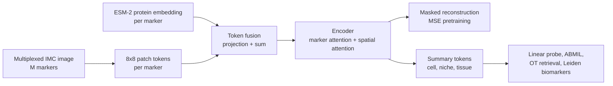
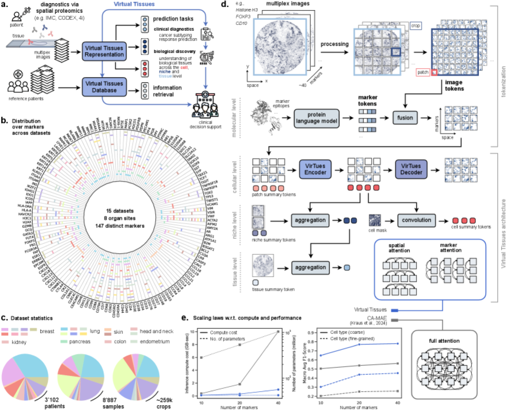
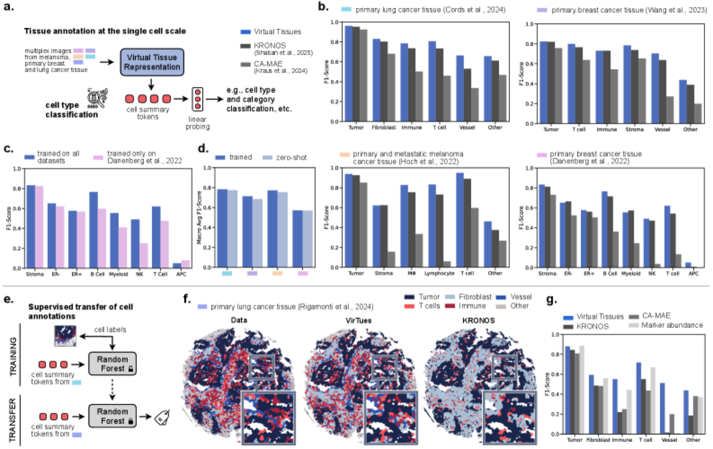
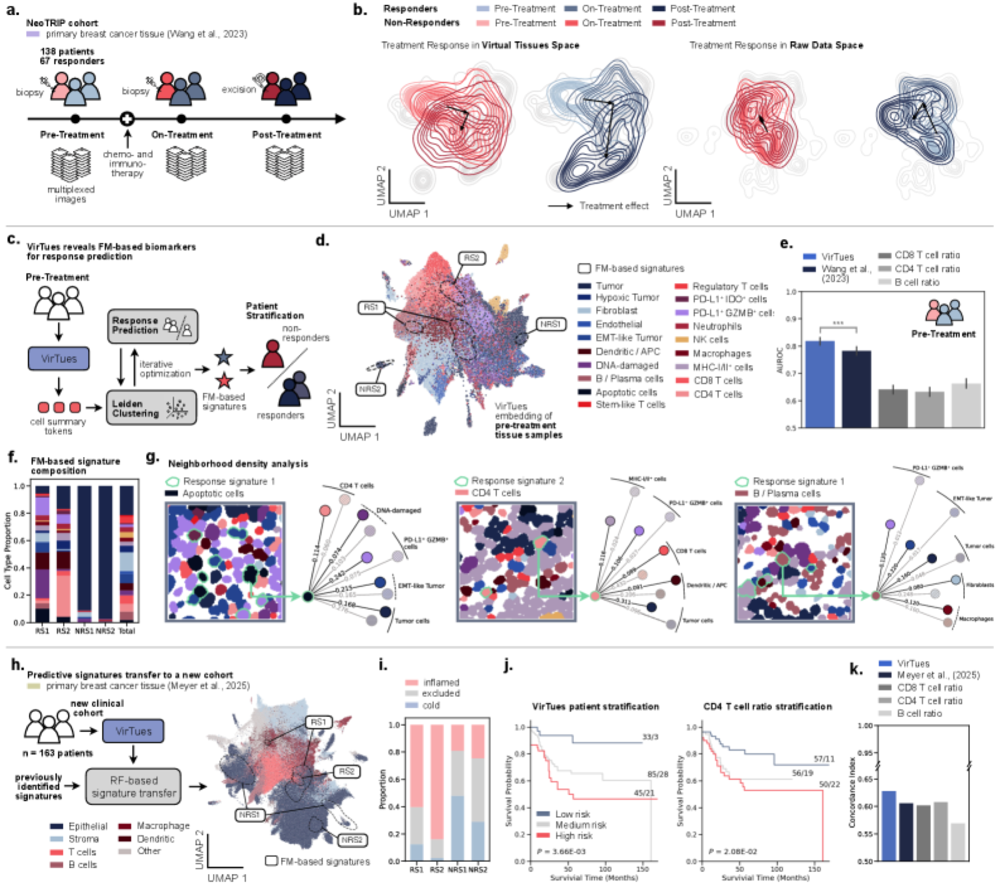

# AI-powered virtual tissues from spatial proteomics for clinical diagnostics and biomedical discovery

> **文献键** `Wenckstern2025_250106039` · **来源** arXiv preprint(2025) · **类别** virtual-tissue · **相关度** high · **获取** open
> **链接** <https://arxiv.org/abs/2501.06039> · `status: complete`

---

## 版本说明
**注意:本笔记和下面所有数字描述的是 arXiv 2501.06039 v2(2025-12-09)。** 该文已在 Nature 正式发表:"The Virtual Tissues foundation model resolves spatial proteomics across scales",*Nature* 657:744–754(2026-08-05 在线),doi:[10.1038/s41586-026-10884-y](https://doi.org/10.1038/s41586-026-10884-y),CC BY 4.0。正式版作者第 3、4 位互换(von Querfurth 第 3,Cheng 第 4);核心 IMC 语料 146 个 marker(v2:147),另扩展为 IMC + CODEX + Orion + MIBI 共 32 个队列、超过 5,100 个病人、239 个 marker;新增 zero-shot 细胞分割与跨技术细胞分型;Cords → Rigamonti 跨队列标签迁移移到 Supplementary Fig. 16,正文不再给 F1 0.615 等数字。若要引用正式版,下面这些数字需要按下表核对。

| 数字 | arXiv v2 | Nature 2026 |
|---|---|---|
| 组合应答 AUROC | 0.817 | 0.823 |
| 比 Wang et al. 预测器 | +4.53% (P < 0.001) | +5.14% (P = 2.43×10⁻⁴) |
| 比免疫比值基线 | +23–30% | +26–32% |
| 细胞分型比 KRONOS | +6.31% | +5.81% |
| myeloid / NK / T / Fig. 3c 增益 B / 髓系 / NK / T | +27.9 / +35.2 / +95.6 / +30.4% | +26.4 / +34.3 / +109.7 / +30.2% |
| IMC 语料 marker 数 | 147 | 146 |
| 重建 r | 三种掩码平均) | 只按方案报告 |
| 未变 | METABRIC、ABMIL、检索、Meyer C-index、架构与训练设置 | 相同 |

## 一句话
VirTues(Virtual Tissues)是空间蛋白质组学的基础模型:把多重成像的每个 marker 通道切成 token,并用蛋白质语言模型(ESM-2)的嵌入告诉模型"这是哪个蛋白",用"空间注意力 / marker 注意力"分解的 ViT 做掩码自编码预训练;一个预训练骨干即可做 marker 重建、细胞分型、组织级临床预测、病例检索和跨队列生物标志物发现。

## 要点
- 解决"每个研究的抗体 panel 都不同"的问题:marker 身份由 ESM-2 蛋白嵌入编码,所以训练时没见过的 marker 也能输入(zero-shot)。
- 注意力分解为只在通道间(marker attention)和只在位置间(spatial attention)交互,避免空间 × 通道的平方复杂度;性能随 marker 数增加持续上升,尤其是前 20 个(Fig. 1e)。
- 三种掩码下重建平均 Pearson r = 0.723±0.157;对外部肺癌队列 zero-shot 时已知 marker r = 0.667(域内 0.797;按 Fig. 2h 图注,这两个平均值是整通道掩码下的)(Fig. 2d、2h)。
- 细胞分型线性探针的 macro-F1 平均比 KRONOS 高 6.31%、比 CA-MAE 高 65.79%;跨队列标签迁移 F1 0.615 vs KRONOS 0.383(Fig. 3)。
- 三阴乳腺癌:从治疗前活检的细胞嵌入聚类出 4 个"虚拟生物标志物",预测抗 PD-L1 化疗免疫应答 AUROC 0.817;迁移到独立队列做无病生存分层,C-index 0.628(Fig. 5)。
- 预训练语料里有肾脏(IMMUcan panel 1 数据集,Methods),但论文的下游评测全部在肺癌、乳腺癌和黑色素瘤上。

## 研究问题
多重成像(IMC、多重免疫荧光等)能在一张切片上测几十到上百个蛋白,但每个研究使用不同的抗体 panel、染色流程和平台,marker 的数量、身份、动态范围和噪声都不同;现有流程大多为单一队列 / 单一 panel 定制,难以跨队列迁移知识、复用标注好的参考数据,也难以发现能在原研究之外推广的空间生物标志物(Introduction)。现有编码器要么要求固定 panel,要么对高通道数扩展差,要么只在窄任务上评测,且很少利用蛋白本身的先验知识。

## 方法
术语:IMC(imaging mass cytometry,成像质谱流式)= 用金属标记抗体在组织上同时测几十种蛋白的成像技术;marker = 一个被测蛋白(或 mRNA)通道;niche = 一小片组织邻域。

1. **输入与切块**:多重图像先取 256×256 子图(组织覆盖 <30% 的丢弃),训练时再随机裁 128×128 的 crop;每个通道切成 8×8 像素 patch(约一个细胞),得到 M×16×16 的三维 token 网格(M = marker 数)。
2. **marker 感知的 token 化**:每个 marker 的氨基酸序列经 ESM-2 得到 640 维嵌入(mRNA 用其编码蛋白的序列);image token 与 marker token 各经线性投影后相加。每个空间位置另加一个可学习的 patch summary token。
3. **分解注意力的编码器**:一层只让同一位置的不同 marker 互相注意(marker attention),另一层只让同一 marker 的不同位置互相注意(spatial attention),两类 block 交替,共 16 个 Transformer block;用 FlashAttention-2 实现。
4. **掩码自编码预训练**:按通道独立掩码,每个通道掩码比例在 60–100% 间随机;另随机丢弃 0–25% 的通道,增强对不同 panel 的鲁棒性。解码器按通道重建,损失为所有像素的 MSE;AdamW,150 个 epoch,有效 batch 512,lr 2e-4(Methods "VirTues pretraining")。评测时用三种掩码:独立掩码、整通道掩码、整片 niche 掩码。
5. **多尺度表征**:推理时 patch summary token 与细胞分割 mask 卷积得到 cell summary token,或聚合成 niche / tissue summary token。
6. **下游用法**:细胞级用逻辑回归线性探针(或随机森林做跨队列标签迁移);组织级用 ABMIL(注意力多示例学习)从全部 patch token 预测临床标签;病例检索用 niche token 之间的 Wasserstein 距离(最优传输);生物标志物发现 = 治疗前细胞嵌入 → 多分辨率 Leiden 聚类 → 每个病人的簇频率 → 交叉验证的病人级模型按 AUROC 挑簇 → 4 个签名组合成逻辑回归。
7. **数据划分**:14 个预训练数据集各自按病人随机 80/20 划分训练 / 测试(同一病人的样本只在一边),用于预训练和下游有参数模型(Methods "Dataset curation")。

## 方法图


## 数据
15 个 IMC 数据集,8 个器官部位,共 147 种 marker(蛋白、蛋白修饰、mRNA);3,102 个病人、8,887 张组织图像、超过 259,000 个 256×256 crop、9 个数据集中超过 1,450 万个分割细胞(Fig. 1b–c、Suppl. Table 1)。其中 14 个用于预训练:肺癌、乳腺癌、结肠、肾、头颈(IMMUcan panel 1)、原发与转移黑色素瘤,以及扁桃体、子宫内膜、健康与糖尿病胰腺等非癌组织;第 15 个(Meyer et al. 2025 乳腺癌,163 个病人,Fig. 5h)在预训练和主分析之后才加入,专门检验签名迁移。关键下游队列:Cords et al. 肺癌(作者用随机森林重新标注了大量误标细胞)、Danenberg et al. / METABRIC 乳腺癌(ER+ n=541)、Wang et al. NeoTRIP 三阴乳腺癌(138 名接受化疗 + atezolizumab 的病人,67 名病理完全缓解,治疗前 / 中 / 后三个时间点)、Rigamonti et al. 肺癌(含训练中没见过的 marker,用于 zero-shot)、Hoch et al. 黑色素瘤。

## 主要结果
- **重建**:三种掩码平均 Pearson r = 0.723±0.157,优于"可见像素均值"和"最相关 marker"基线(Fig. 2d)。zero-shot(Rigamonti 肺癌):已知 marker r = 0.667 vs 域内 0.797(图注:虚线为整通道掩码下各 marker 的平均);下降几乎只发生在整通道掩码,独立掩码和 niche 掩码只差 Δr = 0.016 和 −0.002;新 marker 在整通道掩码下下降更大(Fig. 2h)。
- **细胞分型**:4 个数据集上线性探针 macro-F1 平均比 KRONOS 高 6.31%、比 CA-MAE 高 65.79%(Fig. 3b);全语料训练比只用 Danenberg 训练,B 细胞 +27.9%、髓系 +35.2%、NK +95.6%、T 细胞 +30.4%(Fig. 3c);zero-shot 与域内的 macro-F1 差 ≤ 0.03(Fig. 3d);Cords → Rigamonti 标签迁移 F1 0.615 vs KRONOS 0.383、平均强度 0.490(Fig. 3g)。
- **生存分层(METABRIC ER+,n=541)**:细胞嵌入 k-means 成 120 个表型状态,按病人组成指纹再用 k-means 分成 4 组,并按生存曲线把其中两组并为高危、两组并为低危(Methods "Tissue structure-based risk stratification";即分组用到了生存数据);高危组(n=265)21 年内 99 例死亡,低危组 58 例,log-rank P < 0.001;高危组中已知不良结构富集(suppressed expansion 风险比 4.464、APC-enriched 5.636),血管基质减少(0.399)(Fig. 4a–d)。
- **组织级预测(ABMIL,macro-F1)**:肺癌亚型 0.856(比 KRONOS +8.9%)、肺癌分级 0.530(+21.8%);乳腺 ER 状态 0.806(+14.2%)、ERBB2 0.648、分级 0.490、PAM50 0.385;NeoTRIP 应答:治疗前 0.676(与 CA-MAE 0.685 持平)、治疗中 0.714(比 KRONOS / CA-MAE / ResNet 分别 +30.2% / +31.4% / +19.5%)、治疗后 0.678(Fig. 4f)。
- **病例检索(Cords 肺癌)**:按 niche token 的 Wasserstein 距离检索,临床标签匹配显著高于随机,癌症亚型的 top-3 精度超过所有基线;细胞类型组成距离最低;分子组成相似度排第二(KRONOS 第一)(Fig. 4h–j)。
- **治疗应答签名(NeoTRIP,治疗前)**:应答者在治疗过程中的细胞状态分布位移大于非应答者,用原始平均强度时位移减弱(Fig. 5b);4 个签名单独 AUROC 为 0.783、0.707、0.599、0.577,组合 AUROC 0.817,比 Wang et al. 空间预测器高 4.53%(P < 0.001),比肿瘤 / 免疫细胞比值基线高 23–30%(Fig. 5e)。RS1 富集凋亡细胞,RS2 富集 CD4+ T 细胞(+409.96%)和 PD-L1+ GZMB+ 细胞(+275.25%);两个非应答签名以肿瘤细胞为主(Fig. 5f)。
- **迁移到独立队列(Meyer et al.,无应答标签,改看无病生存)**:用随机森林迁移签名,三档风险中低危 33 人 3 个事件、高危 45 人 21 个事件,log-rank P = 3.66×10⁻³;C-index 0.628,高于 Meyer 分层 0.606 及肿瘤/CD8 0.602、肿瘤/CD4 0.608、肿瘤/B 0.569(Fig. 5j–k)。

## 创新点
- 用蛋白质语言模型嵌入做 marker token,使模型能处理任意 panel 并对未见 marker zero-shot。
- 空间 / marker 分解注意力,使 ViT 能扩展到高通道数多重图像,注意力本身也可读出解释(Suppl. Fig. 20)。
- patch / cell / niche / tissue 四级 summary token,一个骨干覆盖从分子到临床的任务。
- 无先验假设的"先无监督聚类、再有监督打分"生物标志物发现流程,并在独立队列验证迁移。

## 局限
- (作者)对与训练集生化关系弱的新 marker,zero-shot 重建与预测会变差;虚拟 panel 扩充需要校准和不确定度报告。
- (作者)稀有细胞状态和少见结构仍困难,主要是数据稀缺。
- (作者)生存分析多为未校正协变量的示范,临床使用前需协变量校正、比例风险检验、多队列与前瞻验证。
- (作者)注意力图只是部分解释,需要因果或扰动分析补充;需在更多疾病、组织处理流程和成像平台上验证;与 H&E 等模态的融合是下一步。
- 我们的理解:下游任务全是肿瘤;生物标志物挑选在同一队列上用交叉验证完成,组合 AUROC 0.817 仍可能偏乐观,外部队列只验证了预后而非应答。

## 与本研究方向的关系
属于 **model(虚拟组织表征)** 环节,本身不做异常检测,也不做扰动预测。我们的理解:(1) 它的掩码重建目标与 STANDS 类的"重建误差 = 异常分数"同构:如果只在正常组织上预训练或拟合,niche 掩码下的重建误差可以作为空间蛋白组的异常分数候选,但论文没有做这个实验;(2) 它的 cell / niche token 可作为特征类异常检测(例如对正常参考做 kNN / 密度估计)的输入,这对肾脏空间组学 / 多重成像数据有参考意义;(3) Fig. 5b 显示"治疗引起的细胞状态分布位移"在其嵌入空间里比原始强度更明显——这说明好的表征能放大扰动信号,对"检测因药物 / 疾病改变的区域"有利;(4) 它的 OT 病例检索和跨队列签名迁移是 revert 之前"找相似病人 / 找可迁移程序"的可复用模板;(5) 肾脏只出现在预训练语料(IMMUcan),要用于肾活检还需要验证。

## 可复用资产
- **代码:** <https://github.com/bunnelab/virtues>(网址见论文 Code availability;MIT 许可来自 README)。安装:`setup.sh` 建立 Python 3.12 的 conda 环境 `virtues`;运行前配置 `configs/base_config`;`notebooks/` 有 3 个演示(重建、细胞表型、分割)(README)。README 另列出 Hugging Face 权重 <https://huggingface.co/bunnelab/virtues>:`virtues-sp32`(32 个数据集,CC BY-NC 4.0)、`virtues-sp31`(31 个,MIT)、`virtues-imc14`(14 个 IMC 数据集,CC BY-NC 4.0)。
- **数据与基准(README):** spora 数据集合 <https://spora.epfl.ch/>(超过 31 个统一格式的空间蛋白组数据集)、spora-io 加载器、spora-bench 基准 <https://github.com/bunnelab/spora-bench>(细胞探针、分割、跨队列注释、ABMIL、虚拟染色等任务)。
- **原始数据:** 论文 Data availability:多数数据集在 Zenodo,Damond et al. 与 Schulz et al. 在 Mendeley Data,Zhu et al. 在 Synapse,Rigamonti et al. 需向作者申请。

## 待读
- Nature 正式版(见上方"版本说明"):README 的 sp32 模型对应正式版的 32 队列多技术语料;若改为引用正式版,需按正式版重写本笔记的数字。
- 版本差异:arXiv v1(2025-01)只有 4 个 IMC 数据集(肺癌、黑色素瘤、乳腺癌)、96 个 marker、2,062 个病人,没有 NeoTRIP;v2 扩展到 15 个数据集、147 个 marker、3,102 个病人并加入 NeoTRIP(v1 Fig. 1b 图注与正文)。
- KRONOS 与 CA-MAE(主要对照基线)。
- IMMUcan panel 1 数据集中的肾脏样本:规模、panel、能否作为肾脏多重成像的正常参考。
- 我们的理解:测试"只在正常组织上拟合、用 niche 掩码重建误差做异常分数"是否可行。

## 图表


**图1.** 平台总览与架构:(a) 从 multiplex 影像学到「Virtual Tissues 表征 / 数据库」两条路径,支撑临床诊断、生物学发现与信息检索;(b) 训练语料覆盖 15 数据集、8 器官部位、147 个不同 marker;(c) 规模 3,102 病人 / 8,887 样本 / ~259k crops;(d) marker-aware tokenization + 分子/细胞/niche/组织多尺度 summary token + 分解式 spatial/marker 注意力;(e) 随 marker 数增多性能持续提升(蓝线 VirTues vs 灰线 CA-MAE full-attention)。
_Source: https://arxiv.org/html/2501.06039v2 (x1.png)  ·  License: CC BY-NC-ND 4.0 (arXiv v2), © the authors_


**图3.** 细胞级表征评测:(b) 跨数据集 linear-probing cell typing 的 F1,VirTues(蓝)优于 KRONOS 与 CA-MAE;(c) 全语料训练 vs 单数据集训练在稀有免疫群上的增益;(d) zero-shot(浅色)接近 in-domain(蓝);(e–g) 细胞注释向未见 cohort(Rigamonti 肺癌)的 Random-Forest 迁移。
_Source: https://arxiv.org/html/2501.06039v2 (x3.png)  ·  License: CC BY-NC-ND 4.0 (arXiv v2), © the authors_


**图5.** 治疗应答与生存的 FM 签名(核心结果):(a) NeoTRIP TNBC 队列的 pre/on/post 治疗时间线;(b) responder 在 Virtual Tissues 空间中的治疗诱导位移大于 non-responder;(c–e) Leiden 聚类得 4 个签名(RS1/RS2/NRS1/NRS2),pre-treatment 组合模型 AUROC 0.817,优于 Wang et al. 空间预测器与免疫比值基线;(h–k) 迁移到独立 Meyer et al. 队列(163 个病人)做无病生存分层(log-rank P=3.66e-03,concordance index 0.628)。
_Source: https://arxiv.org/html/2501.06039v2 (x5.png)  ·  License: CC BY-NC-ND 4.0 (arXiv v2), © the authors_

### 结果表

**表1.** 组织级 ABMIL 临床预测(macro-F1)与生物标志物 / 生存结果,VirTues vs 主要基线。

| Task / Metric | VirTues | Baseline (KRONOS / other) | Δ |
|---|---|---|---|
| Lung cancer subtyping (macro-F1) | 0.856 | KRONOS | +8.9% |
| Breast cancer ER status (macro-F1) | 0.806 | KRONOS | +14.2% |
| TNBC treatment response (macro-F1) | 0.714 (on-treatment) / 0.676 (pre-treatment) | KRONOS; CA-MAE 0.685 (pre-treatment) | on-treatment +30.2% vs KRONOS; pre-treatment on par with CA-MAE |
| Cell typing (macro-F1, avg rel.) | best | KRONOS / CA-MAE | +6.31% / +65.79% |
| TNBC response prediction (cross-val AUROC) | 0.817 | Wang et al. 2023 spatial predictor | +4.53% (P<0.001); +23–30% vs immune-ratio |
| Disease-free survival (concordance index) | 0.628 | Meyer et al. 2025 | +0.022 (0.606) |

**表2.** Marker 重建 Pearson 相关(masked-autoencoder 预训练目标)。

| Setting | Pearson r |
|---|---|
| Mean over 3 masking strategies | 0.723 ± 0.157 |
| In-domain (known markers; Fig. 2h average, whole-marker masking per caption) | 0.797 |
| Zero-shot (unseen dataset, known markers; Fig. 2h average, whole-marker masking per caption) | 0.667 |
| Δr under independent masking | +0.016 |
| Δr under niche masking | −0.002 |

## 引用
```bibtex
@misc{Wenckstern2025_250106039,
  title = {AI-powered virtual tissues from spatial proteomics for clinical diagnostics and biomedical discovery},
  author = {Johann Wenckstern and Eeshaan Jain and Yexiang Cheng and Benedikt von Querfurth and Kiril Vasilev and Matteo Pariset and Phil F. Cheng and Petros Liakopoulos and Olivier Michielin and Andreas Wicki and Gabriele Gut and Charlotte Bunne},
  year = {2025},
  eprint = {2501.06039},
  archivePrefix = {arXiv},
  url = {https://arxiv.org/abs/2501.06039}
}
```


---

📄 **[AI-ready 全文提取 →](ai-ready.md)**
