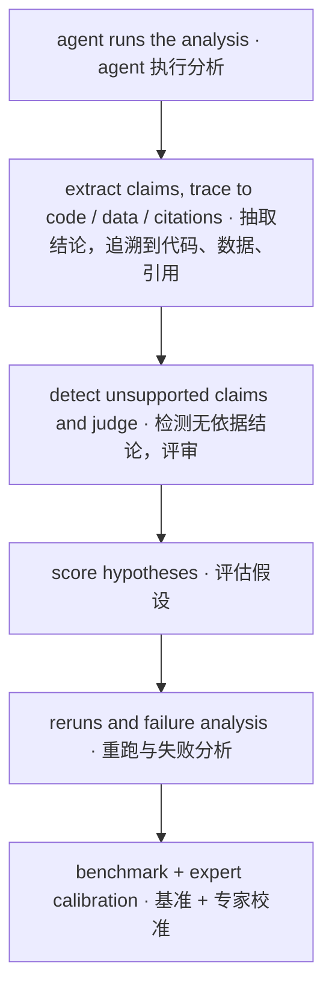

# Verifying the Claims of Biomedical Analysis Agents

> Topic 2 · Status: direction decided; detailed design not started. This page gives the direction and a reading path; tasks and metrics will be set after discussion.

## The question

**Which conclusions an AI agent reports after analysing biological data are actually backed by evidence?**

Agents now write their own code, run single-cell analyses, read the literature and report conclusions. Their reports read well, but a given claim may come from a result the agent actually computed, from textbook knowledge, or from nothing at all, and the final report alone does not show which. We want to **trace every claim back to the agent's own code, data or cited papers**, decide whether it is supported, and calibrate that decision against expert labels.

## How it connects to Topic 1

This topic uses the same kind of data as [Topic 1](anomaly-benchmark.md). The known answers built in Topic 1 (which cells are diseased, which are artifacts) can be used to check agents: if an agent analyses a kidney dataset and reports "a new injured cell population", we can check whether it is describing doublets or low-quality cells as disease. The background for this data is in [Onboarding](../onboarding/index.md).

## Rough pipeline

This is the pipeline in the knowledge map; how far each step goes is not decided yet:

## Open questions

- Which agents and which analysis tasks (single-cell analysis, literature questions, or both)?
- How to define "supported": a number the code produced, a result reproducible from the data, a statement the cited paper really makes — and how to grade them?
- How to organise expert labelling, and how many labels are needed?
- How to connect to Topic 1's known answers: which checks can be automatic?

## Reading path

Finish [Onboarding](../onboarding/index.md) first, then:

1. [BixBench](../papers/bixbench-arxiv-2025/index.md): a benchmark for bioinformatics agents
2. [CellVoyager](../papers/cellvoyager-natmethods-2026/index.md): an agent that analyses single-cell data on its own
3. [PaperQA2](../papers/paperqa2-arxiv-2024/index.md): answering questions from the literature with citations
4. [Citation faithfulness](../papers/citation-faithfulness-arxiv-2026/index.md): how reliable automatic checks of citation support are
5. [Clinical agent reruns](../papers/clinical-agent-reruns-arxiv-2026/index.md): how stable results are when the same task is rerun

After that, see the must-reads in the "Topic 2" view of the [knowledge map](../knowledge-map.md), and the "Bridge" view for papers shared with other topics.
