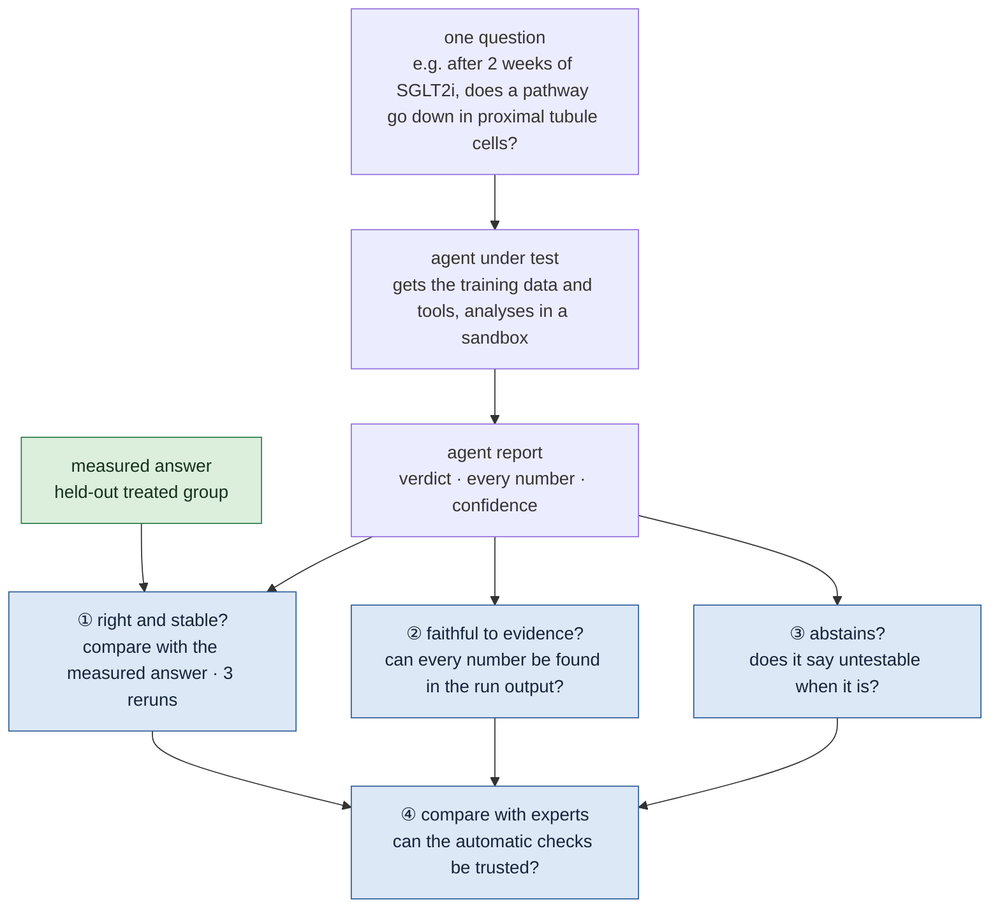

# Trustworthiness of Agent Analyses on Kidney Perturbation Data

## At a glance

!!! abstract "What this topic does"
    **Ask agents questions about kidney perturbations whose answers were already measured; check whether their analyses are right and stable, and whether their reports are faithful to what they computed.**

    - **Question:** agents can already write their own analysis code and produce a respectable report. Most evaluations look only at whether the final answer is right, but a good-looking report can rest on a flawed analysis: invented numbers, conclusions that change with the method, or no real use of the data, just the literature.
    - **Idea:** the questions come from the data of the [perturbation-benchmark topic](perturbation-benchmark.md). For example, "after 2 weeks of an SGLT2 inhibitor, does a given pathway go down in proximal tubule cells?"; the answer is the held-out, measured treated group. No paper is being checked, and the main items need no constructed answers.
    - **Four checks:** whether the verdict is right and stable; whether every number in the report can be found in the agent's own run output; whether it says "cannot be tested" when the data cannot answer; whether these automatic checks agree with expert judgement.
    - **Constraint:** public data only; no wet lab; sized as one master's thesis.
    - **Status:** direction reset on 2026-10-31, from "testing CKD hypotheses" to "questions with measured perturbation answers"; no code yet.

## The question

**When an agent analyses kidney perturbation data, how many of its verdicts are right and stable, how much of its report is faithful to what it computed, and can this be checked automatically?**

An analogy: current evaluation is like marking only the final line of a maths exam. The student may have copied or guessed, or got the right result by a wrong route. This topic checks the **process**: the analysis step and the report step.

## Why it matters

These failures have already been seen elsewhere:

| Failure | Evidence | Setting |
|---|---|---|
| fabrication when data is missing | all 7 models synthesised data ([SciIntegrity-Bench](https://arxiv.org/abs/2605.10246)) | general |
| verdict follows the prompt | "supported" 10% → 90%, estimates unchanged ([Alizadeh et al. 2026](https://malizad.github.io/AICodingAgents_Method.pdf), working paper) | social science |
| analyses follow a stance | "believer" and "sceptic" agents reach opposite conclusions ([Miao, Pritchard, Zou 2026](https://arxiv.org/abs/2607.01507)) | several |
| ignoring the data | permuted outcomes do not change performance ([Gupta et al. 2025](https://aclanthology.org/2025.findings-emnlp.838/)) | genetic-perturbation design |
| no abstention | abstain on only 57–92% of untestable hypotheses ([BioDSA-1K](https://arxiv.org/abs/2505.16100)) | processed tables |
| side effects as findings | 52.4% of runs ([AutoResearch failures](../papers/autoresearch-failures-arxiv-2026/index.md)) | several |
| pseudo-replication | cell-level test redone by donor only on request ([CellVoyager](../papers/cellvoyager-natmethods-2026/index.md)) | single-cell |

**What is missing (our reading):** nobody has systematically tested the analysis and report steps on **single-cell perturbation data** with **measured perturbation outcomes** as answers, and nobody in kidney.

## Where the questions come from

| Item type | How it is made | Correct answer | What it tests |
|---|---|---|---|
| **Measured** | the effect (direction, size) of a treatment on a cell type, from data such as [Wu 2022 · DKD under five treatments](../datasets/wu-dkd-2022.md) | the held-out, measured treated group | is the verdict right |
| **Permuted labels** | the same question with treatment labels shuffled within a time point | no effect / inconclusive | does it use the data or repeat the literature |
| **Untestable** | asks for something the data lacks: an unsampled time point, an unused drug, a human dose, kidney function | cannot be tested | does it abstain |
| Artifact (optional) | known artifacts injected into one treated group, with code from the [artifact-injection topic](anomaly-benchmark.md) | possibly an artifact | does it take an artifact for a drug effect |

Each measured item yields a permuted-label item, so 8–10 treatment effects plus the untestable items give about 20–30 questions.

**Dropped:** the earlier version took claims from papers as questions, which drifts into checking whether papers are right; it has been abandoned.

## What we check

| Check | How | Metric | Auto / human |
|---|---|---|---|
| ① right | compare with the measured answer | accuracy; false "effect" rate on permuted items | auto |
| ① stable | 3 reruns per item, rephrased | share of consistent verdicts | auto |
| ① better than baselines | two baselines: an LLM answering from the literature without running anything; the linear baseline of the [perturbation-benchmark topic](perturbation-benchmark.md) | accuracy difference | auto |
| ② faithful report | look up every reported number in the run output | share of numbers not found; inconsistent numbers | auto |
| ② unit of analysis | cell-level p-values used where the test should be per animal | pseudo-replication rate | auto |
| ③ abstains | untestable items | abstention recall and precision (comparable with BioDSA-1K) | auto |
| ④ can the checks be trusted | 1–2 experts judge a subset | agreement between automatic checks and experts | human, small |

## Compared with existing work

| | [BioDSA-1K](https://arxiv.org/abs/2505.16100) | [POPPER](https://arxiv.org/abs/2502.09858) | [BiomniBench](../papers/biomnibench-biorxiv-2026/index.md) | This topic |
|---|---|---|---|---|
| Data | processed cancer tables | processed gene tables | various biomedical tasks | kidney single-cell perturbation data |
| Answer | the source paper's claim | constructed negatives | expert workflow and rubric | **measured perturbation outcome** |
| Grading | auto | auto | LLM judge | auto, validated by experts |
| Report faithfulness | no | no | partly | yes |
| Rerun stability | no | no | no | yes |

The table is our reading of the papers; "partly" for BiomniBench refers to the "source reliability" item in its rubrics.

## A worked example

**Question:** "After 2 weeks of an SGLT2 inhibitor, does a given pathway go down in proximal tubule cells?"

1. The agent gets the training data (without the 2-week SGLT2i group), analyses it with tools and reports: "yes, down 30%, p < 0.01."
2. **① Right?** Compare with the held-out, measured 2-week SGLT2i group: does it go down, and how far is the measured drop from the reported 30%?
3. **① Stable?** Rerun 3 times with a rephrased question: does the verdict change?
4. **② Faithful?** Can "30%" and "p < 0.01" be found in its own run output, and was the p-value computed per animal or per cell?
5. **Permuted version:** the same question with treatment labels shuffled. If the agent still says "goes down", it is repeating the literature, not reading the data.
6. **Untestable version:** "What happens in humans at 10 mg?" There are no humans in the data; the correct answer is "cannot be tested".

## Plan

About six months:

| Month | Work | Checkpoint |
|---|---|---|
| 1 | read Onboarding; load the Wu 2022 data; split train / held-out by animal | the main treatment effects the paper reports can be reproduced |
| 2 | make items: 8–10 treatment effects → measured and permuted items; add untestable items | answers for 20–30 items fixed |
| 3 | agent harness: sandbox, logging, report parsing; run both baselines | the agent produces parseable reports reliably |
| 4 | run all items, 3 times each; number tracing and unit-of-analysis checks | |
| 5 | small expert study; analysis; buffer | |
| 6 | write up | |

Start with one agent on two base models, one strong and one weak; add [Biomni](../papers/biomni-biorxiv-2025/index.md) or POPPER if time allows.

## Open questions

- What granularity an "effect" has: a pathway, a marker set, or the share of a cell state? Pick effects that are clear in the source paper.
- Should the second dataset ([Wu 2022 · SGLT2i and ARB](../datasets/wu-sglt2-arb-2022.md)) supply cross-lab items?
- Whether to include artifact items depends on when the artifact-injection code is usable.
- Who the experts are and how much time they need.

## Reading path

1. [AutoResearch failures](../papers/autoresearch-failures-arxiv-2026/index.md): how agents fail at research, a taxonomy of 45 failure modes
2. [BioDSA-1K](https://arxiv.org/abs/2505.16100) (not in the library): a benchmark for validating hypotheses on data, with a "non-verifiable" option
3. [BiomniBench](../papers/biomnibench-biorxiv-2026/index.md): grading the analysis process with expert rubrics
4. [Biomni](../papers/biomni-biorxiv-2025/index.md): a typical agent under test
5. [CellVoyager](../papers/cellvoyager-natmethods-2026/index.md): automated single-cell analysis, where people found the pseudo-replication
6. [Ahlmann-Eltze et al. 2025](../papers/linear-baselines-natmethods-2025/index.md): the linear baseline, also one of the baselines here
