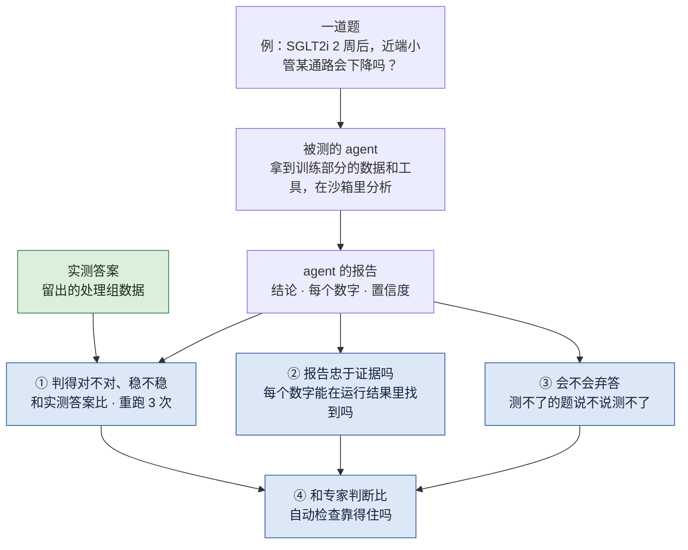

# 肾脏扰动数据上 agent 分析的可信度

## 一页看懂

!!! abstract "这个课题要做什么"
    **问 agent 一些肾脏扰动问题，这些问题的答案已经实测过；检查它做的分析对不对、稳不稳，写的报告是不是忠于它自己算出的结果。**

    - **问题：**agent 已经能自己写代码分析数据、写出一份像样的报告。现在的评测大多只看最后的答案对不对，但一份漂亮的报告背后，可能是一次有问题的分析：数字是编的，换个方法结论就变了，或者根本没看数据、只是复述文献。
    - **思路：**题目来自[扰动基准课题](perturbation-benchmark.md)的数据。比如"SGLT2 抑制剂用了 2 周，近端小管里的某条通路会下降吗？"，答案就是留出的、实际测到的处理组数据。不用检验任何论文的对错，主要题目的答案也不用我们构造。
    - **检查四件事：**判得对不对、稳不稳；报告里的每个数字能不能在它自己的运行结果里找到；数据回答不了时会不会说"测不了"；这些自动检查和专家的判断是否一致。
    - **约束：**只用公开数据；不做湿实验；规模按一篇硕士论文定。
    - **现状：**2026-10-31 重新定了方向，从"检验 CKD 假设"改成"用实测的扰动结果出题"；代码还没开始。

## 研究问题

**agent 分析肾脏扰动数据时，它的结论有多少是对的、稳定的？它的报告有多少是忠于它自己算出的结果的？这些能不能自动检查？**

打个比方：现在的评测像只看数学卷子最后的结果。学生可能抄了答案、蒙对了，或者过程全错、碰巧结果对。这个课题检查的是**过程**：分析那一步和写报告那一步。

## 为什么重要

这些失败在别的领域已经出现过：

| 失败 | 证据 | 场景 |
|---|---|---|
| 缺数据时编数据 | 7 个模型全都合成了数据（[SciIntegrity-Bench](https://arxiv.org/abs/2605.10246)） | 通用 |
| 结论跟着提问方式走 | "支持"从 10% 变成 90%，估计值基本不变（[Alizadeh et al. 2026](https://malizad.github.io/AICodingAgents_Method.pdf)，工作论文） | 社会科学 |
| 分析跟着立场走 | "相信者"和"怀疑者"得出相反结论（[Miao, Pritchard, Zou 2026](https://arxiv.org/abs/2607.01507)） | 多领域 |
| 不看数据 | 结果换成打乱的标签，表现不变（[Gupta et al. 2025](https://aclanthology.org/2025.findings-emnlp.838/)） | 基因扰动实验设计 |
| 不弃答 | 测不了的假设只有 57–92% 弃答（[BioDSA-1K](https://arxiv.org/abs/2505.16100)） | 处理好的数据表 |
| 把副作用当发现 | 52.4% 的运行（[AutoResearch 失败分析](../papers/autoresearch-failures-arxiv-2026/index.md)） | 多领域 |
| 伪重复 | 按细胞检验，原作者要求后才改成按供体（[CellVoyager](../papers/cellvoyager-natmethods-2026/index.md)） | 单细胞 |

**还没有的（我们的理解）：**没有人在**单细胞扰动数据**上、用**实测的扰动结果**当答案，系统地测过分析和报告这两步；在肾脏上更没有。

## 题目从哪来

| 题型 | 怎么出 | 正确答案 | 测什么 |
|---|---|---|---|
| **实测题** | 某种处理对某类细胞的效应（方向、大小），数据来自 [Wu 2022 · DKD 五种治疗](../datasets/wu-dkd-2022.md) 等 | 留出的、实际测到的处理组 | 判得对不对 |
| **打乱标签题** | 同一道题，但在同一时间点内把处理标签打乱 | 没有效应 / 不确定 | 是看了数据，还是在复述文献 |
| **测不了题** | 问数据里没有的东西：没测的时间点、没用过的药、人的剂量、肾功能 | 测不了 | 会不会弃答 |
| 伪影题（可选） | 只往一个处理组里注入已知伪影，代码来自[伪影注入课题](anomaly-benchmark.md) | 可能是伪影 | 会不会把伪影当成药效 |

一条实测题可以衍生出打乱标签题，所以 8–10 个处理效应，加上测不了题，大约能出 20–30 道题。

**不用的：**之前的版本从论文里摘结论出题，容易变成"检验论文对不对"，已经放弃。

## 检查什么

| 检查 | 怎么测 | 指标 | 自动 / 人工 |
|---|---|---|---|
| ① 判得对不对 | 和实测答案比 | 正确率；打乱标签题上的假"有效应"率 | 自动 |
| ① 稳不稳 | 每题重跑 3 次，换个问法 | 结论一致的比例 | 自动 |
| ① 比基线好吗 | 和两个基线比：只看文献不跑数据的 LLM；[扰动基准课题](perturbation-benchmark.md)的线性 baseline | 正确率差 | 自动 |
| ② 报告忠于证据吗 | 报告里每个数字去运行输出里找 | 找不到的数字占比；前后不一致的数字 | 自动 |
| ② 分析单位对吗 | 该按动物检验的地方，是不是用了按细胞的 p 值 | 伪重复的比例 | 自动 |
| ③ 会不会弃答 | 测不了题 | 弃答的召回率和精确率（和 BioDSA-1K 可比） | 自动 |
| ④ 自动检查靠得住吗 | 抽一部分题请 1–2 位专家判 | 自动结果和专家判断的一致性 | 人工，小规模 |

## 和已有工作的区别

| | [BioDSA-1K](https://arxiv.org/abs/2505.16100) | [POPPER](https://arxiv.org/abs/2502.09858) | [BiomniBench](../papers/biomnibench-biorxiv-2026/index.md) | 本课题 |
|---|---|---|---|---|
| 数据 | 处理好的癌症表 | 处理好的基因表 | 多种生物医学任务 | 肾脏单细胞扰动数据 |
| 答案 | 原论文结论 | 构造的阴性 | 专家写的流程和评分细则 | **实测的扰动结果** |
| 怎么打分 | 自动 | 自动 | LLM 当评委 | 自动，经专家验证 |
| 报告忠于证据 | 否 | 否 | 部分 | 是 |
| 重跑稳定性 | 否 | 否 | 否 | 是 |

上表是我们读过论文后的理解；BiomniBench 的"部分"指它的评分细则里有"来源可靠性"一项。

## 用一个例子走一遍

**题目：**"SGLT2 抑制剂用了 2 周后，近端小管里的某条通路会下降吗？"

1. agent 拿到训练部分的数据（不含 2 周的 SGLT2i 组），用工具分析，写报告："会，下降 30%，p < 0.01。"
2. **① 对不对：**拿留出的、实测的 2 周 SGLT2i 组来比。实测也下降，方向对；实际下降多少，和它报的 30% 差多远。
3. **① 稳不稳：**重跑 3 次、换个问法，结论变不变。
4. **② 忠于证据吗：**"30%"和"p < 0.01"能不能在它自己的运行输出里找到；p 值是按动物算的还是按细胞算的。
5. **打乱标签版：**同一道题，处理标签打乱。如果 agent 依然说"会下降"，说明它在复述文献，没有看数据。
6. **测不了版：**"人用 10 mg 时会怎样？"数据里没有人，正确答案是"测不了"。

## 计划

按 6 个月左右排：

| 月 | 工作 | 检查点 |
|---|---|---|
| 1 | 读入门；读入 Wu 2022 数据，按动物划分训练 / 留出 | 能复现原论文报告的主要处理效应 |
| 2 | 出题：8–10 个处理效应 → 实测题、打乱标签题；再加测不了题 | 20–30 道题的答案定稿 |
| 3 | agent 运行框架：沙箱、日志、报告解析；跑两个基线 | agent 能稳定输出可解析的报告 |
| 4 | 跑全部题，每题 3 次；数字溯源和分析单位检查 | |
| 5 | 专家小规模判读；分析结果；留缓冲 | |
| 6 | 写论文 | |

被测的 agent 先选一个，用一强一弱两个底层模型；时间够再加 [Biomni](../papers/biomni-biorxiv-2025/index.md) 或 POPPER。

## 还没定的

- 题目的"效应"用什么粒度：一个通路、一组标记基因，还是某个细胞状态的比例？要选原论文里效应清楚的。
- 第二份数据（[Wu 2022 · SGLT2i 和 ARB](../datasets/wu-sglt2-arb-2022.md)）要不要用来出跨实验室的题？
- 伪影题做不做，取决于伪影注入课题的代码什么时候能用。
- 专家判读请谁、要多少时间。

## 阅读路线

1. [AutoResearch 失败分析](../papers/autoresearch-failures-arxiv-2026/index.md)：agent 做研究时会怎么失败，45 种失败模式的分类
2. [BioDSA-1K](https://arxiv.org/abs/2505.16100)（不在库里）：用数据验证假设、带"无法验证"选项的基准
3. [BiomniBench](../papers/biomnibench-biorxiv-2026/index.md)：按专家评分细则给分析过程打分
4. [Biomni](../papers/biomni-biorxiv-2025/index.md)：典型的被测 agent
5. [CellVoyager](../papers/cellvoyager-natmethods-2026/index.md)：自动分析单细胞数据，伪重复是人发现的
6. [Ahlmann-Eltze et al. 2025](../papers/linear-baselines-natmethods-2025/index.md)：线性 baseline，也是这里的一个基线
