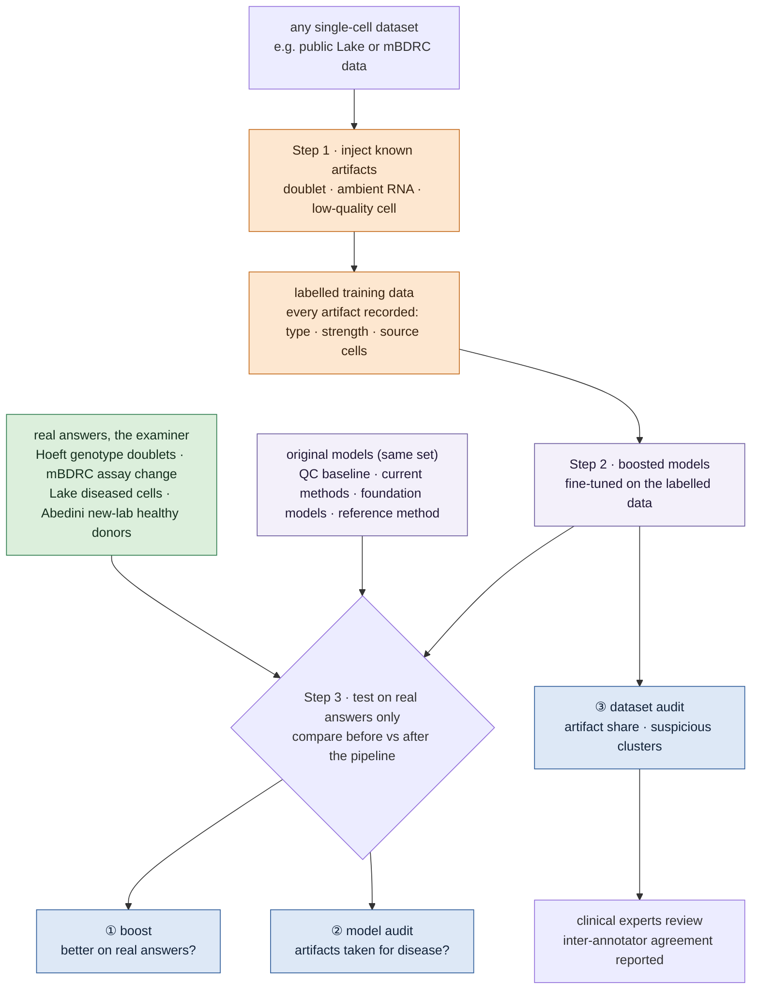

# Artifact Injection to Boost Anomaly Detection in Kidney Single-Cell Omics

## At a glance

!!! abstract "What this topic does"
    **Build a pipeline that turns any single-cell dataset into a labelled anomaly-detection dataset by injecting known artifacts, then use it to boost current models and to check the quality of models and datasets.**

    - **Question:** is an abnormal-looking cell diseased, or caused by measurement? Current methods cannot tell, and nobody has tested this systematically.
    - **Idea:** in image anomaly detection, training on fake defects pasted onto normal images works well (e.g. DRAEM). We carry the idea over to single cells and create doublets, ambient RNA and low-quality cells following how they really arise.
    - **Three uses:** ① boost models (the main line); ② check whether a model mistakes artifacts for disease; ③ estimate how many artifacts a dataset contains.
    - **How we show it works:** injected artifacts are for training only; testing uses **real answers** only (genotype doublets from pooled donors, the same donor across assays, expert-labelled diseased cells, healthy donors from another lab).
    - **Constraint:** no wet lab, public data only; clinical experts (nephrologists, renal pathologists) can annotate.

## The question

**Is an abnormal-looking cell caused by disease, or by measurement?**

In kidney single-cell and single-nucleus data, some cells do not match healthy tissue. They may be diseased, or their abnormality may come from how they were measured (doublets, ambient RNA, low-quality cells, stress during procurement or dissociation), and the two look alike. Our reading (as of 2026-10): current methods flag both as "anomalous", and we found no dataset with known answers to test whether they can tell the two apart, or how many false alarms they raise. So we cannot say how far findings built on these anomalous cells can be trusted.

This topic goes one step further: **can artifacts we create teach models to tell the two apart?**

## Why it matters

- **Measurement effects have produced false biology.** In human brain single-nucleus data, nuclei previously annotated as "immature oligodendrocytes" turned out to be glia contaminated with neuronal ambient RNA ([Caglayan et al., Neuron 2022](https://doi.org/10.1016/j.neuron.2022.09.010)).
- **Background contamination in kidney single-nucleus data can be high.** In mixed-strain mouse kidney, single-nucleus samples made from frozen tissue had clearly more background contamination than single-cell samples from the same material ([Janssen 2023](../papers/janssen-ambient-noise-genomebiol-2023/index.md): 35% vs 11%, 17% vs 3%). Frozen kidney biopsies can only be profiled by single-nucleus ([Hoeft 2024](../papers/hoeft-genotype-multiplexing-natcommun-2024/index.md): "snRNA, but not scRNA, can be performed from frozen tissue").
- **Disease and measurement signals overlap.** Lake 2023 picked candidate injury states partly by few genes detected and many mitochondrial transcripts, which are also the usual signs of a low-quality cell (our reading); altered states also occur in healthy reference tissue, which the authors attribute possibly to ischaemia during acquisition or normal ageing ([Lake 2023](../papers/lake-kidney-atlas-nature-2023/index.md)). From the GEO label table we counted that 26% of nuclei from healthy donors are altered (22,774 of 88,460).

## Why it is unsolved

- **Artifact benchmarks have no disease axis.** Our reading (as of 2026-10): doublets and ambient RNA have their own benchmarks, and each one we found covers one artifact and no disease states. For example, the [ambient-removal benchmark](../papers/ambient-rna-bench-biorxiv-2026/index.md) uses simulated data, species-mixing and genotype-mixing experiments.
- **Disease-state detection does not separate artifacts.** Methods that find altered cell states against a healthy reference (for example [Dann 2023](../papers/healthy-ref-natgenet-2023/index.md)) aim at disease states. Our reading: the method itself does not judge whether a flagged cell is an artifact. Doublets and low-quality cells are only removed in preprocessing (one suspected doublet cluster dropped, only cells with at least 1,000 molecules kept), with no ambient-RNA step; the technical source of false positives the authors warn about is residual batch effects (Extended Data Fig. 7b,c).
- **There is no error control.** Annotation pipelines that offer a reject option usually rely on arbitrary assumptions and give no statistical guarantee ([conformal for single-cell](../papers/conformal-scrna-bioinformatics-2025/index.md): they "do not provide statistical guarantees"). Conformal methods can bound the false-alarm rate ([Bates 2023](../papers/conformal-outliers-annstat-2023/index.md)), but only when reference and query are exchangeable: in the single-cell conformal paper, the false-alarm guarantee failed when the query came from lung-tumour patients. Our reading (as of 2026-10): this has not been tested systematically on kidney data.
- **There is no test bed.** Our reading (as of 2026-10): the general anomaly-detection benchmarks we looked at contain no single-cell expression data, and we found no anomaly-detection benchmark for kidney omics.

### Has our direction been done?

Search up to October 2026; it cannot be exhaustive, so the paper will say "to our knowledge".

- **The parts exist, each for one artifact.** Simulating doublets and training a detector on them is standard ([Scrublet](https://doi.org/10.1016/j.cels.2018.11.005), [DoubletFinder](https://doi.org/10.1016/j.cels.2019.03.003), [scDblFinder](https://doi.org/10.12688/f1000research.73600.2)); an R package simulates damaged cells ([DamageDetective](https://doi.org/10.32614/CRAN.package.DamageDetective), no accompanying paper); ambisim simulates ambient molecules at read level ([Li 2025](https://doi.org/10.1101/2025.02.06.636969), built to benchmark demultiplexing).
- **The problem has been named, not solved by injection.** mapQC warns that a poor mapping can result in "falsely reporting technical artifacts as disease" ([Sikkema 2025](https://doi.org/10.1101/2025.05.23.655749)), but it deals with batch and mapping quality.
- **Foundation models have not been tested against artifacts.** A zero-shot evaluation found scGPT and Geneformer embeddings often behind simpler methods ([Kedzierska 2025](../papers/scfm-zeroshot-genomebiol-2025/index.md)), but on batch effects; we found no study testing foundation models against doublets, ambient RNA or low-quality cells.
- **Not found:** a tool that injects several artifact types into any real dataset with recorded answers, then trains models to tell artifact from disease. That is what is new here.

**Evidence and warnings from images:** DRAEM, trained on synthetic defects, raised image-level AUROC on MVTec AD from the previous best of 95.5 to 98.0, and its authors say the defects need not look realistic ([Zavrtanik 2021](https://arxiv.org/abs/2108.07610)). But a study across 420 tasks found that when the augmentation does not match how real anomalies arise, self-supervised training can even hurt ([Yoo 2022](https://arxiv.org/abs/2208.07734)); in single cells, detectors trained on simulated doublets reach a best mean AUPRC of only 0.537 on 16 datasets with real labels ([Xi & Li 2021](https://doi.org/10.1016/j.cels.2020.11.008)). Hence two hard rules here: **inject artifacts by their cause, and test on real answers.**

## What we will produce

| # | Deliverable | What it is | How we show it is useful |
|---|---|---|---|
| 1 | artifact-injection pipeline (open source) | takes any single-cell dataset (AnnData), injects doublets, ambient RNA and low-quality cells, and records for every cell the artifact type, strength and source cells | injected artifacts compared with real ones: calibrated on Janssen, checked against Hoeft |
| 2 | boost method | a recipe to fine-tune models on injected artifacts so they separate healthy, diseased and artifact cells | before-and-after comparison on real answers |
| 3 | real-answer test set, the examiner | Hoeft genotype doublets, mBDRC assay changes, Lake diseased cells, Abedini healthy donors, with fixed tasks, metrics and donor splits | released for reuse |
| 4 | results table for four model groups | each model with and without the pipeline, reported per artifact type, plus leave-one-artifact-out | the main result of the paper |
| 5 | dataset audit | the trained detector run over Lake and Abedini: estimated artifact share and suspicious altered clusters | suspicious clusters reviewed by clinical experts, with inter-annotator agreement |
| 6 | stage 2: ATAC | the pipeline extended to RNA + ATAC | depends on stage 1 |

Raw data are not redistributed; we release code, split files, injection records and derived labels (Abedini's derived labels only once its licence is confirmed).

## The artifact-injection pipeline

### Which artifacts

Three artifacts in the main line, **doublets first**: they have the strongest precedent and a ready real answer, so they are the best way to run the whole loop (inject, train, test on real answers, report) end to end; adding ambient RNA and low-quality cells then only swaps the injection module. All three are needed because each one imitates a different "disease" (the second column is our inference):

| Artifact | Could be taken for | Why | Plan |
|---|---|---|---|
| low-quality cell | the degenerative state: few genes, high mitochondrial share | Lake used these two signs when flagging altered states (Methods) | main line, third; the closest to the core question |
| doublet | an intermediate state expressing two cell types' genes | Scrublet: doublets "suggest the existence of intermediate cell states" ([Wolock 2019](https://doi.org/10.1016/j.cels.2018.11.005)) | main line, first |
| ambient RNA | marker genes in the wrong cell, e.g. PT genes elsewhere | empty droplets carry slightly more PT profile ([Janssen 2023](../papers/janssen-ambient-noise-genomebiol-2023/index.md)) | main line, second |
| dissociation stress | injury: FOS, JUN up | [Denisenko 2020](../datasets/denisenko-2020.md) (mouse) | not injected: no precedent, and the main data are single-nucleus |
| batch or assay change | — | not a per-cell artifact, cannot be injected | tested on real data instead (T2b, T4) |

### How each is injected, and the precedent

| Artifact | How | Precedent | Feasible? | Limits |
|---|---|---|---|---|
| doublet | add the raw counts of two random cells | Scrublet ([Wolock 2019](https://doi.org/10.1016/j.cels.2018.11.005)): "Doublets are simulated by adding the unnormalized counts"; DoubletFinder ([McGinnis 2019](https://doi.org/10.1016/j.cels.2019.03.003)) averages pairs and, trained this way, found 73% and 64% of the doublets labelled by demuxlet and Cell Hashing | yes, compute only | same-type doublets are nearly invisible; a real doublet has fewer counts than the sum of its two cells ([Germain 2022](https://doi.org/10.12688/f1000research.73600.2)); methods score higher on simulated than on real doublets ([Xi & Li 2021](https://doi.org/10.1016/j.cels.2020.11.008)) |
| ambient RNA | mix in a background profile estimated from empty droplets, at fractions calibrated on Janssen | SoupX ([Young & Behjati 2020](https://doi.org/10.1093/gigascience/giaa151)) estimates the profile from empty droplets; [Janssen 2023](../papers/janssen-ambient-noise-genomebiol-2023/index.md) measured 3–35% background per cell in mouse kidney by genotype | yes, but Lake and mBDRC have no empty droplets, so the profile comes from Janssen (mouse) or a Hoeft rerun (human kidney) | Janssen is mouse; human calibration rests on it unless Hoeft is rerun |
| low-quality cell | remove part of the cytoplasmic RNA, so the mitochondrial share rises | real broken cells lose cytoplasmic transcripts while mitochondrial ones rise slightly ([Ilicic 2016](https://doi.org/10.1186/s13059-016-0888-1), microscopy-labelled); an R package simulates this ([DamageDetective](https://doi.org/10.32614/CRAN.package.DamageDetective), not peer-reviewed) | yes, but the precedent is weak; the paper must argue for it, e.g. compare injected cells with Lake's real low-QC cells | high mitochondrial share is normal for kidney PT: a fixed 10% cut-off removes real PT cells ([Subramanian 2022](https://doi.org/10.1186/s13059-022-02820-w)) |

### Design rules

These follow from the evidence above (our synthesis):

1. **Inject by cause, not for realism.** Each artifact follows how it really arises: two cells in one droplet, background RNA mixed in, cytoplasmic RNA lost.
2. **Keep training and testing apart.** Injected artifacts are for training; testing uses real answers, or at least a different injection recipe.
3. **Leave one artifact out.** For example, train on doublets and ambient RNA and test on low-quality cells, to see whether a model learned what artifacts share or only memorised the recipe.
4. **Report per artifact type**, expecting method rankings to change between types (on tabular data, ADBench found no unsupervised method statistically better than the others overall; performance depends on whether a method's assumptions match the anomaly type, [Han 2022](https://arxiv.org/abs/2206.09426)).
5. **Vary the amount and the recipe:** the ratio of synthetic to normal cells, one recipe or a mix.

### Stage 2: ATAC

RNA first; ATAC is added once stage 1 works (suggested, not decided). ATAC has injection precedents too: ArchR generates "synthetic doublets" and finds their neighbours ([Granja 2021](https://doi.org/10.1038/s41588-021-00790-6)); AMULET simulates doublets by adding two nuclei's read counts ([Thibodeau 2021](https://doi.org/10.1186/s13059-021-02469-x)); ambisim controls ambient molecule proportions in joint snRNA/snATAC data ([Li 2025](https://doi.org/10.1101/2025.02.06.636969)); low-quality nuclei are judged by TSS enrichment, fragment counts and similar metrics, with thresholds tuned per dataset. The scDblFinder documentation also warns that with default parameters it "performs very poorly" on scATAC.

## Models

The models themselves may not be good enough, so four groups run side by side, and **every model runs twice, without and with the pipeline**, compared on real answers. If all improve, the pipeline works; if only some do, it depends on the model; if none do, the injected artifacts are too far from real ones and the injection must be revised.

| Group | Models | Answers |
|---|---|---|
| 1 · QC baseline | gene count, mitochondrial share | does a high score only come from "few genes"? |
| 2 · existing methods | kNN, Isolation Forest, autoencoder, scVI; scDblFinder, SoupX | where current methods stand, and whether the pipeline helps them |
| 3 · foundation models | open models, fine-tuned (candidates below) | does the pipeline help large models, and do they mistake artifacts for disease? |
| 4 · our reference method | healthy reference, nearest-neighbour score, false-alarm control, disease-or-artifact call | a controllable starting point if current methods all fail |

### Foundation models: fine-tune, do not pretrain

We suggest fine-tuning existing open models only (not decided). Pretraining from scratch is unrealistic: the first kidney-specific multimodal foundation model, [Nephrobase Cell+](../papers/nephrobase-biorxiv-2025/index.md), used about 39.5 million cells, four species and five assays, with up to 1 billion parameters; as of 2026-10-28 we found no public code or weights. Candidates checked on 2026-10-28:

| Model | Weights and licence | Modality | Use here |
|---|---|---|---|
| [Geneformer V2](https://huggingface.co/ctheodoris/Geneformer) | Hugging Face, Apache-2.0; 104M and 316M parameters | RNA | fine-tuning, first choice |
| [scGPT](https://github.com/bowang-lab/scGPT) | code MIT, weights on Google Drive (no separate weight licence stated); includes a checkpoint pretrained on 814 thousand kidney cells | RNA (its multi-omic recipe trains the non-RNA parts from scratch) | fine-tuning, second |
| scFoundation | weights for non-commercial research only | RNA | optional |
| UCE, CellPLM, scMulan | public weights; no fine-tuning code found for UCE | RNA | frozen embeddings for the model audit only |
| EpiAgent | MIT, with fine-tuning code | scATAC only | stage 2 candidate |

We found no model pretrained on RNA and ATAC together with public weights, so stage 2 may pair an RNA model with an ATAC model. Foundation models must be compared with simple methods: in a zero-shot evaluation scGPT and Geneformer were often behind HVG selection, Harmony and scVI ([Kedzierska 2025](../papers/scfm-zeroshot-genomebiol-2025/index.md)).

## How we test: real answers

Injected artifacts (tier 1) are for training only. Testing uses two kinds of real answers: **tier 2**, fixed by experimental design (Hoeft's genotype doublets from pooled donors, mBDRC's same donor across assays, Janssen's mixed mouse strains), and **tier 3**, expert judgement (Lake's altered states, and the labels clinical experts add).

| Task | Question | Real answer | Metric |
|---|---|---|---|
| T1 | find diseased cells | Lake altered states, tier 3 | AUROC, AUPRC; against the QC baseline |
| T2 | find real measurement artifacts | Hoeft genotype doublets, tier 2 (a lower bound); held-out injected types as a secondary check | AUROC, AUPRC |
| T2b | is an assay change flagged as anomalous? | mBDRC same donor, tier 2 | false-alarm rate ≤ α |
| T3 | separate disease from artifact | T1 and T2 together | macro-F1, confusion matrix |
| T4 | do false alarms stay controlled in a new lab? | every call on an Abedini healthy donor counts as a false alarm (our design choice; healthy tissue also carries altered cells) | observed rate vs α |

Every task reports two numbers, without and with the pipeline, plus the leave-one-artifact-out results.

!!! warning "A known trap"
    Our reading: using Lake's altered labels directly as disease ground truth is partly circular (the authors also used injury markers and AKI / CKD enrichment, not only QC features): in the single-nucleus data the largest altered group (degenerative) has less than half the genes of normal nuclei and about five times the mitochondrial fraction, so a scorer that looks only at QC metrics could score well. The benchmark therefore needs a QC-only baseline and reports results per state (degenerative / adaptive). The teaching pipeline in [onboarding module 9](../onboarding/09-hands-on.md) already shows a first sign of this: on degenerative nuclei kNN reaches AUROC 0.76–0.81 and the gene-count baseline 0.76–0.85, with kNN worse in 4 of 5 splits (a teaching result, not a benchmark result).

### Making tier 3 solid: clinical experts

Tier 3 is the weakest link. Lake flagged altered states partly by "low genes detected, a high number of mitochondrial transcripts" ([Lake 2023](../papers/lake-kidney-atlas-nature-2023/index.md) Methods), which are also the signs of a low-quality cell, so using these labels as disease ground truth is partly circular (see "A known trap" above). Lake's labels come from a consortium of pathologists, biologists and nephrologists, with no inter-annotator agreement reported. Clinical experts can strengthen this in two ways:

| | A · re-annotate clusters | B · annotate histology |
|---|---|---|
| How | experts see each altered cluster's marker genes (e.g. HAVCR1, LCN2), QC distributions and donor conditions, and call it likely injury, likely low quality or unsure; 2–3 independent annotators, agreement reported | pathologists outline injured regions (e.g. acute tubular injury, fibrosis) on H&E slides paired with spatial transcriptomics; anomaly scores are then checked spot by spot |
| Precedent | the Human Lung Cell Atlas re-annotated per cluster with six experts; most agreed or differed only in granularity, with no κ reported ([Sikkema 2023](https://doi.org/10.1038/s41591-023-02327-2)); kidney injury states have independent anchors, e.g. Havcr1 checked by immunofluorescence ([Kirita 2020](https://doi.org/10.1073/pnas.2005477117)) and genetically labelled injured PT cells ([Gerhardt 2021](https://doi.org/10.1073/pnas.2026684118)), both mouse | Lake 2023 Visium on GEO ([GSE183456](https://www.ncbi.nlm.nih.gov/geo/query/acc.cgi?acc=GSE183456)): 23 sections (6 reference, 11 DKD, 6 AKI), each with a full-resolution H&E image; Abedini 2024: 13 H&E images (DKD, hypertension and controls, no AKI) |
| Feasible? | yes: a few hundred clusters, not hundreds of thousands of cells | images yes; we found no public pathologist region annotation, so it must be made (which is itself a new resource) |
| Limits | clinicians do not usually read expression data and may need a short calibration set; one single-cell analyst should be among the annotators | a Visium spot is 55 µm wide and holds several cells, so labels are per spot, not per cell; only 3 Visium participants also appear in Lake's single-nucleus data (our count), so this is a separate spatial task, not a check on T1 |

Our reading: we found no single-cell study that reports κ between human annotators, so the agreement measured in A is itself a result. KPMP holds biopsy-level descriptor scores read by two pathologists, but only per biopsy, not per region; their access terms are not yet checked.

## Data

Public kidney data only: human first, mouse only for calibration. Full facts about each dataset (what was measured, how many people, how to download) are under [Datasets](../datasets/index.md); this section says **what each one does in this topic, which part we use, and what to watch for**.

### Which side each dataset answers

| Dataset | Side | Role | Tasks | Status |
|---|---|---|---|---|
| [Lake 2023](../datasets/lake-2023.md) | disease | healthy reference, disease labels, base for injection | T1, T3; injection base | main line |
| [mBDRC 2026](../datasets/mbdrc-2026.md) | measurement | same donor, several assays | T2b; also injection base | main line |
| [Abedini 2024](../datasets/abedini-2024.md) | disease | second lab, false-alarm test | T4 | main line |
| [Janssen 2023](../datasets/janssen-2023.md), mouse | measurement | calibrates injected ambient RNA | — (not a test set) | main line |
| [Hoeft 2024](../datasets/hoeft-2024.md) | measurement | real human doublets and ambient RNA, the examiner for T2 | T2 | main line |
| [Lake 2019](../datasets/lake-2019.md) | measurement | same person, different storage and processing | like T2b | under discussion |

The table below is generated from the [Datasets](../datasets/index.md) records and puts the basics of the first five side by side:

| | [Lake 2023](../datasets/lake-2023.md) | [mBDRC 2026](../datasets/mbdrc-2026.md) | [Abedini 2024](../datasets/abedini-2024.md) | [Janssen 2023 (mouse)](../datasets/janssen-2023.md) | [Hoeft 2024](../datasets/hoeft-2024.md) |
|---|---|---|---|---|---|
| **1 · Measured** | scRNA, snRNA, multiome, spatial | scRNA, multiome | scRNA, snRNA, ATAC, spatial | scRNA, snRNA, genotype | snRNA, genotype |
| **2 · People** | 71 people in the three single-cell parts (35 healthy, 19 CKD, 17 AKI) | 19 healthy donors, 33 samples of normal cortex | 58 people in the paper (81 samples: 36 control, 45 CKD of which 20 DKD, 25 HKD); the GEO single-cell data hold 44 of them (21 controls) | mice of 3 strains (CAST, BL6, SvImJ) pooled per run | 4 patients (frozen kidney biopsies) |
| **3 · Tissue** | patients: mostly KPMP biopsies (3 CKD nephrectomies in snCv3); healthy: nephrectomy, deceased donor, living-donor biopsy; cortex, medulla, papilla | normal cortex at nephrectomy; cortex only | left-over (de-identified) kidney tissue; cortex and outer medulla | healthy mouse kidney, 3 strains pooled per run | frozen kidney biopsies; diagnoses not reported |
| **4 · Labels** | cell type + reference / altered state for every cell except 3,364 single-nucleus nuclei | cell types; assay and donor per cell | cell types; disease group per sample | contamination fraction per cell (with 95% CI) | donor by SNP; 250 genotype doublets (2.2%) |
| **5 · Processing** | filtered counts; raw FASTQ controlled, so no empty droplets | processed matrices (cellxgene, Zenodo); raw at dbGaP, on application | low-quality cells removed; ambient RNA corrected with SoupX and doublets removed with DoubletFinder (Supplementary Information); no raw data | raw (with empty droplets) + filtered matrices | GEO "raw" matrix is in fact filtered; FASTQ open, donor labels must be recomputed |
| **6 · Licence** | CC BY 4.0 (cellxgene); GEO: not stated | CC BY 4.0 (data); paper CC BY-NC-ND 4.0 | not stated | CC BY 4.0 | CC BY 4.0 (paper) |

### Lake 2023 · Healthy reference and the disease answer

- **Which part:** the main line starts with the single-nucleus data (snCv3). Download the count matrix and label table from GEO, because `state.l1/l2` (reference or altered) and `percent.mt` exist only in the GEO label table; the cellxgene files have neither (mitochondrial genes were removed). How to use the single-cell data (scCv3) is not decided.
- **What it provides:**
    - **Healthy reference:** `reference`-state cells from healthy donors, the "normal" training data.
    - **Disease answer (tier 3):** `altered`-state cells from patients, for T1.
    - **Base for injection:** doublets, ambient RNA and low-quality cells made from healthy cells, for training.
- **Watch for:**
    - The degenerative state looks like low-quality cells (see "A known trap" above), so a QC-only baseline is required and results are reported per state.
    - Healthy donors carry altered cells too (26% of their nuclei in the single-nucleus data, our count); they cannot serve as normal negatives and are reported separately.
    - Raw sequencing is controlled, so **there are no empty droplets**; the background profile for injected ambient RNA must come from elsewhere (Janssen or Hoeft, see "The artifact-injection pipeline").
    - It also has 23 Visium sections with H&E images, a candidate for the tier-3 histology annotation (see "Making tier 3 solid" above).

### mBDRC 2026 · One donor, several assays

- **Which part:** the integrated RNA file on cellxgene. 11 of its 18 donors were measured with two or three assays; they are the core of T2b.
- **What it provides:**
    - **A real answer on the measurement side (tier 2):** tissue from the same person flagged as anomalous only because the assay changed is counted as a false alarm (our design choice).
    - More healthy reference, and a base for injection.
- **Watch for:**
    - A donor cannot be in the reference and in the T2b test at once, so splits are by donor.
    - Assay is confounded with the tissue core and preservation medium: changing assay also changes the piece of tissue and how it was stored, so not every false alarm is due to the assay alone.
    - Healthy donors and cortex only; raw data are at dbGaP on application, so no empty droplets either.

### Abedini 2024 · A second lab

- **Which part:** the processed data on GEO, healthy controls only (21 people in the GEO single-cell data).
- **What it provides:** the test ground for T4: does a threshold set in one lab keep its false-alarm rate on another lab's healthy donors? Every anomaly called on a healthy donor counts as a false alarm (our design choice).
- **Watch for:**
    - Ambient RNA was corrected with SoupX and doublets removed with DoubletFinder before release, so **it cannot test the measurement side**; it is used for false alarms only.
    - Our reading: these data are "cleaner" than Lake's, which is itself a distribution shift and must be stated when reading results.
    - The single-cell part used 37 °C enzymatic digestion, so it carries dissociation stress.
    - The data licence is not stated; it must be confirmed before releasing derived labels.
    - Its 13 H&E images (DKD, hypertension and controls, no AKI) are also a candidate for tier-3 histology annotation.

### Janssen 2023 · Calibrating injected ambient RNA

- **Which part:** mouse kidney, three strains pooled in one 10x channel, both single-cell and single-nucleus; the public files **include empty droplets**.
- **What it provides:** the real foreign-RNA fraction per cell (3–35%), computed from genotypes, and the background profile. We use it to set how strong injected ambient RNA should be and what it looks like.
- **Watch for:** it is mouse, not human, and has no patients, so it is not a test set; calibrating human data on it is an assumption the paper must state.

### Hoeft 2024 · Real human-kidney doublets and ambient RNA

- **Which part:** frozen kidney biopsies from 4 patients pooled in one single-nucleus channel. The GEO matrix is filtered, so CellRanger and souporcell must be rerun on the public FASTQ with the genotype files.
- **What it provides:** **real** human-kidney doublet (by genotype) and ambient answers. Under the new direction it is main line: the examiner for T2, and a check on whether our injected artifacts look real. Our reading: the rerun also yields empty droplets, giving a background profile from human kidney itself.
- **Watch for:**
    - Only 4 people: enough for validation, not for main results.
    - Genotypes reveal only cross-donor doublets; two nuclei from the same person stay hidden, so the 250 genotype doublets are a lower bound.
    - A useful finding: the expression cluster "Mixed/Doublets" holds 4,488 nuclei, but only 123 are genotype doublets (our count from the Source Data). Judging the cause of an anomaly from expression alone is unreliable, which is exactly where this topic starts.

### Lake 2019 · One person, different storage and processing (under discussion)

The same person's tissue stored and processed in different ways, then measured: a small real answer to "is a change in storage or processing flagged as anomalous?", similar in spirit to T2b. It uses snDrop-seq rather than 10x and is small, so whether it joins the main line is open.

### Not used for now

- [Malone 2020](../datasets/malone-2020.md): also has genotypes, but its raw data are large; real human-kidney artifact answers rely on Hoeft for now.
- [Denisenko 2020](../datasets/denisenko-2020.md): mouse, shows dissociation stress can look like injury; stress is not injected for now, so later.
- [KPMP](../datasets/kpmp.md), [cellxgene](../datasets/cellxgene.md): data sources and download routes, not datasets of their own.

### Splits

Splits are by donor, not by cell, so no person appears in both training and testing. Healthy donors in Lake and mBDRC are split three ways: **reference, calibration and test** (the reference for scoring, calibration for setting thresholds, test for measuring false alarms); Abedini is test only. Random seeds are fixed and the split files ship with the dataset.

## Open questions

**Direction (suggestions written above, awaiting confirmation):**

- Fine-tune foundation models only, without pretraining? Geneformer V2 and scGPT first?
- RNA first, ATAC as stage 2?
- Does "boost" mean training models on injected artifacts only, or also a tool for each lab to evaluate its own data (uses ② and ③)?

**Data and answers:**

- Should the ambient background profile come from Janssen (mouse, ready to use) or a Hoeft rerun (human kidney, from FASTQ)? Lake and mBDRC have no empty droplets.
- Tier 3: start with A (clusters), B (histology) or both? Should B become a separate spatial task? Will the annotators be nephrologists, pathologists or both?
- How to use Lake's single-cell data (scCv3): as a second assay, or not for now?
- How to split Lake's altered cells: those with independent evidence, those called only from QC-like features, and those in healthy donors.
- Should T2b be its own task or part of T4? Should Lake 2019 join the main line?
- The licence of Abedini 2024 (we found no stated licence; it decides whether derived labels can be released). The number of healthy donors is checked: 21 controls on GEO.

**Other:**

- Whether to treat the [NIH Kidney AI challenge](../papers/nih-kidney-ai-challenge-2026/index.md) as a related opportunity: it asks for new anomalies in KPMP kidney-biopsy whole-slide images, with submissions open 2026-11-05 to 2027-04-29. It tests images, not this topic's single-cell omics, so it would be an extension towards images; cash prizes go only to US citizens, permanent residents or US entities.

## Reading path

Finish [Onboarding](../onboarding/index.md) first, then read in this order:

1. [Lake 2023](../papers/lake-kidney-atlas-nature-2023/index.md): the kidney atlas and its altered states
2. [Janssen 2023](../papers/janssen-ambient-noise-genomebiol-2023/index.md): how large real ambient contamination is
3. [Dann 2023](../papers/healthy-ref-natgenet-2023/index.md): finding altered states against a healthy reference
4. [Bates 2023](../papers/conformal-outliers-annstat-2023/index.md): conformal p-values and false-alarm control
5. [PatchCore](../papers/patchcore-cvpr-2022/index.md): the nearest-neighbour idea from image anomaly detection
6. [Kedzierska 2025](../papers/scfm-zeroshot-genomebiol-2025/index.md): foundation models zero-shot are often behind simple methods
7. [Nephrobase Cell+](../papers/nephrobase-biorxiv-2025/index.md): the first kidney-specific multimodal foundation model
8. [DRAEM](https://arxiv.org/abs/2108.07610): anomaly detection trained on synthetic defects (not in the library)

After that, see the must-reads in the "Topic 1" view of the [knowledge map](../knowledge-map.md) and the [method × data matrix](../knowledge-map.md), whose dashed cells mark what Topic 1 plans to add (some already hold papers; the note in each cell says what is still missing).
