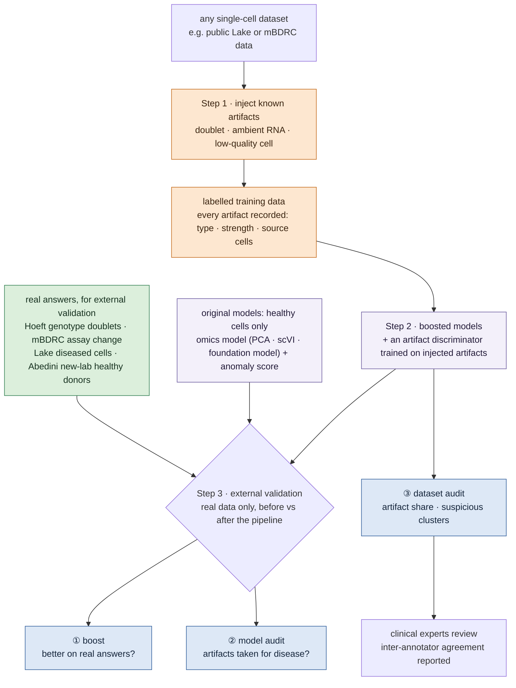
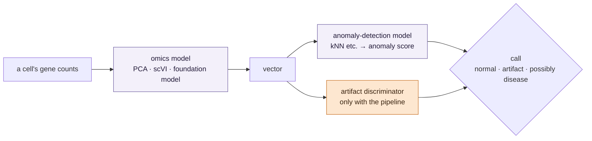

# Artifact Injection to Boost Anomaly Detection in Kidney Single-Cell Omics

## At a glance {#glance}

!!! abstract "What this topic does"
    **Build a pipeline that injects known artifacts into any single-cell dataset, turning it into a labelled anomaly-detection dataset, and use it to boost current models.**

    - **Why:** an abnormal-looking cell may be diseased, or may only be a measurement effect; current methods do not set out to separate the two.
    - **Three steps:**
        1. **Inject**: create doublets, ambient RNA and low-quality cells by how they really arise, recording every answer;
        2. **Boost**: fine-tune current models on these labelled data so they separate healthy, diseased and artifact cells;
        3. **External validation**: test only on cells from real data whose truth is known (genotype doublets, the same donor across assays, expert-labelled diseased cells, healthy donors from a new lab), before vs after boosting.
    - **Three uses:** ① boost models (the main line); ② model audit: are artifacts taken for disease? ③ dataset audit: how many artifacts does a dataset contain?
    - **Constraint:** no wet lab, public data only; clinical experts (nephrologists, renal pathologists) annotate.

## Contents {#contents}

| # | Part | What it answers |
|---|---|---|
| 1 | [The question](#question) | why: an abnormal cell may be diseased or an artifact, and today we cannot tell |
| 2 | [Method overview](#method) | how: three steps in one figure |
| 3 | [Step 1 · Inject](#inject) | how the three artifacts are made |
| 4 | [Step 2 · Boost](#boost) | how the injected artifacts train models |
| 5 | [Step 3 · External validation](#validation) | how we show it really works |
| 6 | [Data](#data) | what each public dataset does in the three steps |
| 7 | [What we will produce](#deliverables) | what is delivered |
| 8 | [How it connects to the perturbation benchmark](#connect) | how the two topics share code |
| 9 | [Open questions](#open) | decisions still to discuss |
| 10 | [Reading path](#reading) | which papers to read first |

Each part starts with the key points; folded blocks (▶) hold details and sources.

## The question {#question}

This part answers why this topic is needed.

**Is an abnormal-looking cell caused by disease, or by measurement?**

In kidney single-cell and single-nucleus data, some cells do not match healthy tissue. They may be diseased, or their abnormality may come from how they were measured (doublets, ambient RNA, low-quality cells, stress during procurement or dissociation), and the two look alike. Our reading (as of 2026-10): current methods do not set out to separate the two and often flag both as "anomalous", and we found no dataset with known answers to test whether they can tell the two apart, or how many false alarms they raise. So we cannot say how far findings built on these anomalous cells can be trusted.

This topic goes one step further: **can artifacts we create teach models to tell the two apart?**

### Why it matters

- **Measurement effects have produced false biology.** In human brain single-nucleus data, nuclei previously annotated as "immature oligodendrocytes" turned out to be glia contaminated with neuronal ambient RNA ([Caglayan et al., Neuron 2022](https://doi.org/10.1016/j.neuron.2022.09.010)).
- **Background contamination in kidney single-nucleus data can be high.** In mixed-strain mouse kidney, single-nucleus samples made from frozen tissue had clearly more background contamination than single-cell samples from the same material ([Janssen 2023](../papers/janssen-ambient-noise-genomebiol-2023/index.md): 35% vs 11%, 17% vs 3%). Frozen kidney biopsies can only be profiled by single-nucleus ([Hoeft 2024](../papers/hoeft-genotype-multiplexing-natcommun-2024/index.md): "snRNA, but not scRNA, can be performed from frozen tissue").
- **Disease and measurement signals overlap.** Lake 2023 picked candidate injury states partly by few genes detected and many mitochondrial transcripts, which are also the usual signs of a low-quality cell (our reading); altered states also occur in healthy reference tissue, which the authors attribute possibly to ischaemia during acquisition or normal ageing ([Lake 2023](../papers/lake-kidney-atlas-nature-2023/index.md)). From the GEO label table we counted that 26% of nuclei from healthy donors are altered (22,774 of 88,460).

### Why it is unsolved

- **Artifact benchmarks have no disease axis.** Our reading (as of 2026-10): doublets and ambient RNA have their own benchmarks, and each one we found covers one artifact and no disease states. For example, the [ambient-removal benchmark](../papers/ambient-rna-bench-biorxiv-2026/index.md) uses simulated data, species-mixing and genotype-mixing experiments.
- **Disease-state detection does not separate artifacts.** Methods that find altered cell states against a healthy reference (for example [Dann 2023](../papers/healthy-ref-natgenet-2023/index.md)) aim at disease states. Our reading: the method itself does not judge whether a flagged cell is an artifact. Doublets and low-quality cells are only removed in preprocessing (one suspected doublet cluster dropped, only cells with at least 1,000 molecules kept), with no ambient-RNA step; the technical source of false positives the authors warn about is residual batch effects (Extended Data Fig. 7b,c).
- **There is no error control.** Annotation pipelines that offer a reject option usually rely on arbitrary assumptions and give no statistical guarantee ([conformal for single-cell](../papers/conformal-scrna-bioinformatics-2025/index.md): they "do not provide statistical guarantees"). Conformal methods can bound the false-alarm rate ([Bates 2023](../papers/conformal-outliers-annstat-2023/index.md)), but only when reference and query are exchangeable: in the single-cell conformal paper, the false-alarm guarantee failed when the query came from lung-tumour patients. Our reading (as of 2026-10): this has not been tested systematically on kidney data.
- **There is no test bed.** Our reading (as of 2026-10): the general anomaly-detection benchmarks we looked at contain no single-cell expression data, and we found no anomaly-detection benchmark for kidney omics.

??? note "Details: has our direction been done; evidence and warnings from images"

    
    Search up to October 2026; it cannot be exhaustive, so the paper will say "to our knowledge".

    - **The parts exist, each for one artifact.** Simulating doublets and training a detector on them is standard ([Scrublet](https://doi.org/10.1016/j.cels.2018.11.005), [DoubletFinder](https://doi.org/10.1016/j.cels.2019.03.003), [scDblFinder](https://doi.org/10.12688/f1000research.73600.2)); an R package simulates damaged cells ([DamageDetective](https://doi.org/10.32614/CRAN.package.DamageDetective), no accompanying paper); ambisim simulates ambient molecules at read level ([Li 2025](https://doi.org/10.1101/2025.02.06.636969), built to benchmark demultiplexing).
    - **The problem has been named, not solved by injection.** mapQC warns that a poor mapping can result in "falsely reporting technical artifacts as disease" ([Sikkema 2025](https://doi.org/10.1101/2025.05.23.655749)), but it deals with batch and mapping quality.
    - **Foundation models have not been tested against artifacts.** A zero-shot evaluation found scGPT and Geneformer embeddings often behind simpler methods ([Kedzierska 2025](../papers/scfm-zeroshot-genomebiol-2025/index.md)), but on batch effects; we found no study testing foundation models against doublets, ambient RNA or low-quality cells.
    - **Not found:** a tool that injects several artifact types into any real dataset with recorded answers, then trains models to tell artifact from disease. That is what is new here.

    **Evidence and warnings from images:** DRAEM, trained on synthetic defects, raised image-level AUROC on MVTec AD from the previous best of 95.5 to 98.0, and its authors say the defects need not look realistic ([Zavrtanik 2021](https://arxiv.org/abs/2108.07610)). But a study across 420 tasks found that when the augmentation does not match how real anomalies arise, self-supervised training can even hurt ([Yoo 2022](https://arxiv.org/abs/2208.07734)); in single cells, detectors trained on simulated doublets reach a best mean AUPRC of only 0.537 on 16 datasets with real labels ([Xi & Li 2021](https://doi.org/10.1016/j.cels.2020.11.008)). Hence two hard rules here: **inject artifacts by their cause, and validate externally on real data only.**

## Method overview {#method}

This part answers how the whole method works. In one sentence: **create artifacts with known answers (inject), train models on them (boost), and check them only on real data (external validation).**

**Idea:** in image anomaly detection, training on synthetic defects pasted onto normal images set a new best on MVTec AD (DRAEM); but when the synthetic defects do not match how real ones arise, training can even hurt (Yoo 2022). We carry the idea over to single cells and create artifacts by their cause: doublets have a mature recipe (sum two cells' counts, shrink some library sizes), ambient RNA is a background profile mixed in at a set fraction, and low-quality cells can only be approximated (lost cytoplasmic RNA in single cells, added cytoplasmic material in single nuclei). So injected artifacts are used for training only.

| Step | What it does | Data | Output |
|---|---|---|---|
| Step 1 · Inject | create doublets, ambient RNA and low-quality cells in real data, recording every answer | healthy cells (Lake, mBDRC) | labelled training data |
| Step 2 · Boost | train models on these answers to separate healthy, diseased and artifact cells | the step-1 training data | boosted models |
| Step 3 · External validation | check only on real cells whose truth is known, before vs after boosting | Hoeft, mBDRC, Lake's diseased cells, Abedini | whether the pipeline works |

### The whole flow

Orange: injected artifacts and the labelled data. Purple: models, each run twice (original and boosted). Green: real answers, used only for external validation. Blue: the three uses.

## Step 1 · Inject: create artifacts with known answers {#inject}

This part answers how each of the three artifacts is made, and which rules the recipes follow.

### Which three artifacts

Three artifacts in the main line, **doublets first**: they have the strongest precedent and a ready real answer, so they are the best way to run the whole loop (inject, boost, validate externally, report) end to end; adding ambient RNA and low-quality cells then only swaps the injection module. All three are needed because each one imitates a different "disease" (the second column is our inference):

| Artifact | Could be taken for | Why | Plan |
|---|---|---|---|
| low-quality cell | the degenerative state: few genes, high mitochondrial share | Lake's criteria for possible altered states include "low genes detected, a high number of mitochondrial transcripts" (Methods) | main line, third; the closest to the core question |
| doublet | an intermediate state expressing two cell types' genes | Scrublet: doublets "suggest the existence of intermediate cell states" ([Wolock 2019](https://doi.org/10.1016/j.cels.2018.11.005)) | main line, first |
| ambient RNA | marker genes in the wrong cell, e.g. PT genes elsewhere | the PT-only gene Slc34a1 is found in a high fraction of other cells ([Janssen 2023](../papers/janssen-ambient-noise-genomebiol-2023/index.md), mouse kidney) | main line, second |
| dissociation stress | injury: FOS, JUN up | [Denisenko 2020](../datasets/denisenko-2020.md) (mouse) | not injected: no precedent, and the main data are single-nucleus |
| batch or assay change | — | not a per-cell artifact, cannot be injected | tested on real data instead (T2b, T4) |

### How each is made

The three artifacts can be simulated to very different degrees: doublets have a mature recipe, ambient RNA can reuse existing models in reverse, and low-quality cells can only be approximated. Each recipe below names its sources (checked against papers and code on 2026-10-31). Parameter ranges, and whether injected artifacts look like real ones, remain assumptions to be tested on real answers.

| Artifact | Recipe | Maturity | Main limit |
|---|---|---|---|
| doublet | sum the raw counts of two cells of different types, shrinking a quarter of the library sizes, as in scDblFinder ([Germain 2022](https://doi.org/10.12688/f1000research.73600.2)) | mature | simulated doublets are easier than real ones ([Xi & Li 2021](https://doi.org/10.1016/j.cels.2020.11.008)); same-type doublets are invisible |
| ambient RNA | mix a background profile into each cell at a Beta-distributed fraction, reusing removal models in reverse (SoupX, DecontX, CellBender); fractions calibrated on Janssen | needs a background profile | Lake and mBDRC have no empty droplets, so the profile is approximate |
| low-quality cell | single cells: remove cytoplasmic RNA; single nuclei: add cytoplasmic material | approximate only | no validated simulator; high mitochondrial share is normal for PT |

??? note "Recipe details · Doublets: mostly summed, some library sizes shrunk"

    
    - **Three tools, three recipes:**
        - Scrublet **sums the raw counts** of two random cells, "Doublets are simulated by adding the unnormalized counts", simulating twice as many doublets as cells ([Wolock 2019](https://doi.org/10.1016/j.cels.2018.11.005)).
        - DoubletFinder **averages** two cells' counts, up to 25% of the merged data; a detector trained this way recovered 73% and 64% of the doublets labelled by demuxlet and Cell Hashing ([McGinnis 2019](https://doi.org/10.1016/j.cels.2019.03.003)).
        - scDblFinder by default **sums** 75% of pairs and, for the other 25%, halves the sum and Poisson-resamples it; it **pairs only across clusters**, in proportion to cluster size, after keeping cells within the 5–95th library-size percentiles ([Germain 2022](https://doi.org/10.12688/f1000research.73600.2)).
    - **Why shrink some library sizes:** in genotype-labelled real data, median doublet library sizes were "systematically smaller than the sum" of their two cell types (Germain 2022, Fig. 1A). The same paper found that summing and size re-weighting were both "clearly superior to averaging".
    - **Our recipe:** follow scDblFinder: raw counts → drop the top and bottom 5% of library sizes → pair across cell types in proportion to expected frequency → sum 75%, halve and Poisson-resample 25% → simulate 0.8–2 times as many doublets as cells.
    - **Limits:** same-type doublets are "virtually unidentifiable" (Germain 2022), so they get their own label and stay out of the main metrics; methods score higher on simulated than on real doublets, with a best mean AUPRC of only 0.537 on real labels ([Xi & Li 2021](https://doi.org/10.1016/j.cels.2020.11.008)). Hoeft's genotype doublets are the test.

??? note "Recipe details · Ambient RNA: a background profile mixed in at a set fraction"

    
    - **Models (removal tools used in reverse):**
        - SoupX: observed counts = the cell's own counts + contamination fraction × background profile; the profile is estimated from **empty droplets**, and SoupX "assumes a constant contamination fraction within a channel" ([Young & Behjati 2020](https://doi.org/10.1093/gigascience/giaa151)).
        - DecontX: each cell's contamination fraction comes "from a global beta distribution", and the contamination profile is by default "a weighted combination of all other cell population distributions", or empty droplets if given ([Yang 2020](https://doi.org/10.1186/s13059-020-1950-6)). Its package celda has a simulation function: total counts fixed, a Beta-distributed fraction per cell, and a binomial draw for how many counts are replaced by contamination. That function builds a fully synthetic matrix, so we reuse its recipe rather than call it on real data.
        - CellBender treats background as noise added to each cell, with the profile learned from cell-free droplets ([Fleming 2023](https://doi.org/10.1038/s41592-023-01943-7)).
        - The [ambient-removal benchmark](../papers/ambient-rna-bench-biorxiv-2026/index.md) also simulates data by drawing a contamination fraction per cell and sampling ambient counts from other cell types.
    - **Calibration:** [Janssen 2023](../papers/janssen-ambient-noise-genomebiol-2023/index.md) measured by genotype an average of 3–35% background per cell in mouse kidney; single nuclei from frozen tissue carry far more than single cells (35% vs 11%, 17% vs 3%); and the nuclear contamination profile resembles empty droplets (Spearman ρ≈0.85) more than the cells themselves (≈0.50).
    - **Our recipe:** one background profile per sample → a contamination fraction per cell (Beta-distributed, mean swept over 3–35%, the upper range for nuclei) → try both injection forms: replacement at fixed total counts (DecontX / celda) and background added on top (CellBender) → store native and injected counts separately as the answer.
    - **Limits:** Lake 2023 and mBDRC have no empty droplets. Without them, the profile can be the other cell populations (DecontX default) or the sum over all cells (as in the SoupX documentation), but Janssen shows that nuclear background resembles empty droplets, so this is an approximation; better profiles come from Janssen (mouse, with empty droplets) or a Hoeft rerun from FASTQ (human kidney).

??? note "Recipe details · Low-quality cells: approximate only, and different for cells and nuclei"

    
    - **Mechanism:** in microscopy-labelled broken cells, "cytoplasmic RNA will be lost, but RNAs enclosed in the mitochondria will be retained"; mtDNA-encoded genes are only "marginally upregulated", while the wider class of mitochondria-related genes falls on average ([Ilicic 2016](https://doi.org/10.1186/s13059-016-0888-1); mouse ES cells on Fluidigm C1, neither droplets nor kidney).
    - **Single cells: remove cytoplasmic RNA.** The only ready simulator is the R package [DamageDetective](https://doi.org/10.32614/CRAN.package.DamageDetective): a Beta-distributed loss fraction per cell (default 0.1–0.8), with cytoplasmic gene counts removed by abundance-weighted sampling without replacement, keeping MT- genes and nuclear lncRNAs such as MALAT1 and NEAT1. It has no paper, no peer review and no validation against experimentally labelled damaged cells. Other QC tools (ddqc, miQC, valiDrops, QClus and others) detect but do not simulate.
    - **Single nuclei: not less, but more.** The main data are single-nucleus, and nuclei have no cytoplasm. In kidney single-nucleus data, mitochondrial transcripts are "not expressed in nuclei", and the mitochondrial reads seen are attributed to mitochondria attached to the nuclear membrane ([Lake 2019](../papers/lake-snrna-pipeline-natcommun-2019/index.md)); when nuclei are contaminated, the mitochondrial share rises and the unspliced share falls, "as mitochondria are only present in the cell cytoplasm" ([Schmauch 2024, QClus](https://doi.org/10.1093/nar/gkae1145)). So low-quality nuclei are made by adding cytoplasmic material: mitochondrial counts and spliced reads. This is close to ambient injection, and the design must draw the line between the two.
    - **Limits:** no simulator has been validated, so all parameter ranges are assumptions; kidney proximal tubule naturally has a high mitochondrial share, and a fixed 10% cut-off removes real kidney parenchymal cells ([Subramanian 2022](https://doi.org/10.1186/s13059-022-02820-w)), so PT is scored separately. The paper must compare injected cells with Lake's real low-QC cells.

### Design rules

These follow from the evidence above (our synthesis):

1. **Inject by cause, not for realism.** Each artifact follows how it really arises: two cells in one droplet, background RNA mixed in, cytoplasmic RNA lost (single cells) or cytoplasmic material added (single nuclei).
2. **Keep training and validation apart.** Injected artifacts are for training; external validation uses real data, or at least a different injection recipe.
3. **Leave one artifact out.** For example, train on doublets and ambient RNA and test on low-quality cells, to see whether a model learned what artifacts share or only memorised the recipe.
4. **Report per artifact type**, expecting method rankings to change between types (on tabular data, ADBench found no unsupervised method statistically better than the others overall; performance depends on whether a method's assumptions match the anomaly type, [Han 2022](https://arxiv.org/abs/2206.09426)).
5. **Vary the amount and the recipe:** the ratio of synthetic to normal cells, one recipe or a mix.
6. **Set recipes per assay and cell type.** Low-quality recipes differ for single cells and single nuclei; the mitochondrial share is judged per cell type, and PT is scored separately.

??? note "Stage 2: ATAC (suggested, not decided)"

    
    RNA first; ATAC is added once stage 1 works (suggested, not decided). ATAC has injection precedents too: ArchR generates "synthetic doublets" and finds their neighbours ([Granja 2021](https://doi.org/10.1038/s41588-021-00790-6)); AMULET simulates doublets by adding two nuclei's read counts ([Thibodeau 2021](https://doi.org/10.1186/s13059-021-02469-x)); ambisim controls ambient molecule proportions in joint snRNA/snATAC data ([Li 2025](https://doi.org/10.1101/2025.02.06.636969)); low-quality nuclei are judged by TSS enrichment, fragment counts and similar metrics, with thresholds tuned per dataset. The scDblFinder documentation also warns that with default parameters it "performs very poorly" on scATAC.

## Step 2 · Boost: train models on the artifacts {#boost}

This part answers how the injected artifacts train models. In one figure:

### Two kinds of models

| | Omics model | Anomaly-detection model |
|---|---|---|
| What it does | describes a cell as a vector: it learns what cells look like | scores a cell: how far it is from normal |
| Input → output | a cell's gene counts → a vector | vectors → one anomaly score per cell |
| Candidates | HVG + PCA (the simplest); scVI; foundation models Geneformer V2 and scGPT | kNN distance, Isolation Forest, autoencoder reconstruction error |
| Can it call anomalies alone? | no | yes, once cells are vectors |

The main line uses RNA models, since the main data are single-nucleus RNA; ATAC (which regions of DNA are open) is stage 2.

### Before and after the pipeline

| | Without the pipeline | With the pipeline |
|---|---|---|
| Training data | healthy cells only | healthy cells + injected artifacts with labels |
| What it learns | what normal looks like | what normal and artifacts look like |
| Output per cell | an anomaly score | anomaly score + artifact-like or not |
| Call | high score = anomalous | low → normal; high and artifact-like → artifact; high, not artifact-like → possibly disease |
| Disease vs artifact? | no | yes |

- **No disease label:** training has only healthy and artifact labels, so disease is found by exclusion; diseased cells appear only in external validation.
- **Fair comparison:** both runs use the same vectors and anomaly score and differ only in the artifact discriminator. Every omics model improves → the pipeline works; only some → it depends on the omics model; none → revise the injection.
- **Where it acts:** first on the anomaly-detection step (cheap); later by fine-tuning the omics model itself on artifacts (costly). Precedents come from images: outlier exposure ([Hendrycks 2019](https://arxiv.org/abs/1812.04606)) and DRAEM ([Zavrtanik 2021](https://arxiv.org/abs/2108.07610)).
- **First round (suggested, not decided):** kNN scores on frozen vectors. The simplest combination, PCA + kNN + conformal thresholds + artifact discriminator, is our **reference method**.

### Floor and reference points

These are not part of the before/after comparison; they give the results a frame: what any method must beat, and how far specialist tools get.

| What | How it works | Role |
|---|---|---|
| **QC floor** | scores a cell only by how many genes it has and its mitochondrial share: fewer genes and more mitochondrial reads mean more "anomalous"; no model, no training, run once | **the base: every model is compared with it, and only a model that clearly beats it counts as effective.** Lake's criteria for disease already include "few genes, many mitochondrial transcripts", so a method that cannot clearly beat this floor has only learned "poor quality", not disease (see "A known trap") |
| **specialist doublet tools** | scDblFinder, scds: already trained on simulated doublets | reference on T2 (finding real doublets): how far a specialist tool gets. They already "use a pipeline", so they are not in the before/after comparison |
| **SoupX, DecontX** | correction tools: SoupX estimates one contamination fraction per sample, DecontX one per cell, and both then correct the counts; neither decides whether a cell is an artifact or diseased | not models here: we borrow their models to inject ambient RNA (Step 1), and DecontX's per-cell estimate is a reference on the ambient task |
| **model audit (use ②)** | a separate experiment without boosting: do injected artifacts sit close to real diseased cells in an omics model's vector space, especially a foundation model's? | if they sit close, that model tends to mistake artifacts for disease |

### More details

??? note "Foundation models: frozen vectors first, no pretraining"

    
    No pretraining from scratch (not decided): pretraining a kidney model needs tens of millions of cells. Geneformer V2 and scGPT come first, as frozen vectors first and fine-tuned later; we found no model pretrained on RNA and ATAC together with public weights. Foundation models must be compared with simple methods, since zero-shot they are often behind them.

    
    We suggest fine-tuning existing open models only (not decided). Pretraining from scratch is unrealistic: the first kidney-specific multimodal foundation model, [Nephrobase Cell+](../papers/nephrobase-biorxiv-2025/index.md), used about 39.5 million cells, four species and five assays, with up to 1 billion parameters; as of 2026-10-28 we found no public code or weights. Candidates checked on 2026-10-28:

    | Model | Weights and licence | Modality | Use here |
    |---|---|---|---|
    | [Geneformer V2](https://huggingface.co/ctheodoris/Geneformer) | Hugging Face, Apache-2.0; 104M and 316M parameters | RNA | fine-tuning, first choice |
    | [scGPT](https://github.com/bowang-lab/scGPT) | code MIT, weights on Google Drive (no separate weight licence stated); includes a checkpoint pretrained on 814 thousand kidney cells | RNA (its multi-omic recipe trains the non-RNA parts from scratch) | fine-tuning, second |
    | scFoundation | weights for non-commercial research only | RNA | optional |
    | UCE, CellPLM, scMulan | public weights; no fine-tuning code found for UCE | RNA | frozen embeddings for the model audit only |
    | EpiAgent | MIT, with fine-tuning code | scATAC only | stage 2 candidate |

    
    We found no model pretrained on RNA and ATAC together with public weights, so stage 2 may pair an RNA model with an ATAC model. Foundation models must be compared with simple methods: in a zero-shot evaluation scGPT and Geneformer were often behind HVG selection, Harmony and scVI ([Kedzierska 2025](../papers/scfm-zeroshot-genomebiol-2025/index.md)).

??? note "Uncertain cells: donor-grouped cross-validation, calibration, conformal thresholds, expert review"

    
    Models can also flag cells they are unsure about. All models follow four steps (suggested, not decided):

    1. donor-grouped K-fold cross-validation, out-of-fold scores only;
    2. calibrate probabilities before setting thresholds;
    3. set thresholds by conformal prediction (the guarantee breaks in a new lab; T4 tests this);
    4. send uncertain cells to experts, but **never use them as labels**: an uncertain cell may be an artifact, a transitional state or early disease.

    
    Models can also flag cells they are unsure about. All models are scored the same way (suggested, not decided; sources checked on 2026-10-31):

    1. **Donor-grouped K-fold cross-validation, out-of-fold scores only.** A model scoring cells it was trained on is overconfident, so each cell's score comes from the fold model that never saw it. Folds are split by **donor**: the same person in training and test is a recognised form of leakage ([Kapoor & Narayanan 2023](https://doi.org/10.1016/j.patter.2023.100804): "train and test samples come from the same people or units"). Among doublet tools, scds scores cells by 5-fold cross-validation by default, but with random cell folds ([Bais & Kostka 2019](https://doi.org/10.1093/bioinformatics/btz698), code `bcds.R`); scDblFinder uses cross-validation only to choose the number of boosting rounds, and its final scores come from a model trained on the same cells ([Germain 2022](https://doi.org/10.12688/f1000research.73600.2), code).
    2. **Calibrate, then threshold.** Neural networks are often overconfident, and single-parameter temperature scaling works well ([Guo 2017](https://arxiv.org/abs/1706.04599)); foundation models can instead be underconfident, and post-hoc calibration becomes less reliable under strong shift ([Hekler 2025](https://arxiv.org/abs/2506.09593), preprint). Single-cell annotation models likewise "lack calibration" ([Engelmann 2022](https://arxiv.org/abs/2211.03793)).
    3. **Set thresholds by conformal prediction.** Cross-validation and conformal prediction connect directly: CV+ extends the jackknife+ to K folds with a coverage guarantee ([Barber 2021](https://doi.org/10.1214/20-AOS1965); stated for regression, so applying it to classification scores is our adaptation). For guarantees per cell type, calibrate within each class ([Angelopoulos & Bates](https://arxiv.org/abs/2107.07511), §4.2), which works poorly when a class has few cells ([Ding 2023](https://arxiv.org/abs/2306.09335)). Cells from one person are not exchangeable ([Dunn 2018](https://arxiv.org/abs/1809.07441): "multiple observations on each patient"), another reason to split by donor. Exchangeability fails in a new lab: single-cell conformal lost its coverage guarantee on disease data ([López-De-Castro 2025](../papers/conformal-scrna-bioinformatics-2025/index.md)), weighted conformal is one possible remedy ([Tibshirani 2019](https://arxiv.org/abs/1904.06019)), and T4 tests exactly this.
    4. **Send uncertain cells to experts, but never use them as labels.** Finding suspect labels from cross-validated scores is what confident learning does ([Northcutt 2021](https://doi.org/10.1613/jair.1.12125)), yet only 51% of its flagged candidates were confirmed as label errors by people ([Northcutt 2021b](https://arxiv.org/abs/2103.14749)). In single cells, popV uses agreement across methods as its uncertainty, to reduce manual inspection ([Ergen 2024](https://doi.org/10.1038/s41588-024-01993-3)).

    **Why "uncertain" is not "artifact":** uncertainty comes in two kinds, noise in the data and what the model has not seen ([Kendall & Gal 2017](https://arxiv.org/abs/1703.04977)); a score alone cannot say whether a cell is an artifact, a real transitional state or early disease. AnnQ puts it directly: such cells are "typically treated as technical artifacts and filtered out", yet in perturbation experiments they may be the meaningful deviations ([Lee 2026](https://doi.org/10.1093/bib/bbag278)). So we report, among the cells sent for review, the shares experts call artifact, disease or unclear, and the trade-off between expert workload and error rate.

    **Not found (search up to October 2026):** donor-grouped out-of-fold scores in single-cell annotation or QC; using cross-validated or conformal uncertainty to separate artifact from disease; a single-cell measurement of expert-review workload against error rate.

??? note "Later: a new model? (future plan)"

    
    The first round uses existing models only (future plan, not decided). Reasons: this topic's main claim is whether the pipeline helps, and changing the model at the same time would blur the credit; the existing models already include deep models (autoencoder, scVI, foundation models); and a new model need not win: on tabular data no unsupervised method was better overall ([Han 2022](https://arxiv.org/abs/2206.09426)), and foundation models zero-shot were often behind simple methods ([Kedzierska 2025](../papers/scfm-zeroshot-genomebiol-2025/index.md)).

    Decide after the first round:

    - the artifact discriminator clearly improves every omics model → no new model needed;
    - the discriminator recognises injected artifacts but fails on real answers → combining a separate score and a separate discriminator is not enough, and a model that learns both together is worth building;
    - only fine-tuned foundation models improve → the new contribution is more likely a way to fine-tune omics models on artifacts.

    **Candidate direction: a single-cell DRAEM.** A reconstruction branch learns healthy cells only (its error is the anomaly score), a discriminative branch is trained on injected artifacts and outputs their type, and both are trained together (the DRAEM design, [Zavrtanik 2021](https://arxiv.org/abs/2108.07610)). Searching up to 2026-10-31, we found no such model in single-cell or spatial omics; the closest is [STANDS](../papers/spatial-natcommun-2024/index.md), which trains a reconstruction GAN on a normal reference in spatial transcriptomics and scores anomalies by reconstruction, but does not train on synthetic anomalies. One idea specific to this topic (literature not yet checked): penalise the model for relying on "few genes, high mitochondrial share", so it does not learn only "poor quality"; this may also suppress real injury signal, so it needs care.

## Step 3 · External validation: check only on real data {#validation}

This part answers how we show that the pipeline really works.

Models are trained on artifacts we create; testing them on created artifacts would only show they memorised the recipe. So this step uses only **cells from real data whose truth is known**, never touched during training or tuning. This is **external validation**. Every check compares two numbers, without and with the pipeline; only a clear gain shows that the pipeline helps.

### Where the truth comes from

With no wet lab, the truth can only come from public data whose **experimental design already carries the answer**, or from expert judgement:

| Data | What is known for sure | Why | How reliable |
|---|---|---|---|
| [Hoeft 2024](../datasets/hoeft-2024.md) | which droplets are real doublets | four people pooled in one run; a droplet carrying two people's DNA must hold two cells | fixed by design (a lower bound: same-person doublets stay hidden) |
| [mBDRC 2026](../datasets/mbdrc-2026.md) | differences that are not disease | the same healthy person measured with several assays | fixed by design |
| [Lake 2023](../datasets/lake-2023.md) | which cells are diseased | the atlas authors labelled altered states | expert judgement, the weakest (see the trap below) |
| [Abedini 2024](../datasets/abedini-2024.md) | cells that should not be flagged | healthy donors from another lab | our design choice (healthy tissue also has some altered cells) |

### What is checked

| Task | Question | Real answer | Metric |
|---|---|---|---|
| T1 | find diseased cells | Lake altered states (expert judgement) | AUROC, AUPRC; against the QC floor |
| T2 | find real measurement artifacts | Hoeft genotype doublets (fixed by design, a lower bound); held-out injected types as a secondary check | AUROC, AUPRC |
| T2b | is an assay change flagged as anomalous? | mBDRC same donor (fixed by design) | false-alarm rate ≤ α |
| T3 | separate disease from artifact | T1 and T2 together | macro-F1, confusion matrix |
| T4 | do false alarms stay controlled in a new lab? | every call on an Abedini healthy donor counts as a false alarm (our design choice; healthy tissue also carries altered cells) | observed rate vs α |

Each check reports two numbers, without and with the pipeline, plus leave-one-artifact-out results (e.g. train on doublets and ambient RNA only, then test on low-quality cells), which show whether a model learned what artifacts share or only memorised one recipe.

!!! warning "A known trap"
    Our reading: using Lake's altered labels directly as disease ground truth is partly circular (the authors also used injury markers and AKI / CKD enrichment, not only QC features): in the single-nucleus data the largest altered group (degenerative) has less than half the genes of normal nuclei and about five times the mitochondrial fraction, so a scorer that looks only at QC metrics could score well. The benchmark therefore needs a QC-only baseline and reports results per state (degenerative / adaptive). The teaching pipeline in [onboarding module 9](../onboarding/09-hands-on.md) already shows a first sign of this: on degenerative nuclei kNN reaches AUROC 0.76–0.81 and the gene-count baseline 0.76–0.85, with kNN worse in 4 of 5 splits (a teaching result, not a benchmark result).

### Making the disease answer more reliable: clinical experts

Lake's disease labels are expert judgement, the weakest link. Clinical experts (nephrologists, renal pathologists) can strengthen it in two ways: **A** re-annotate altered clusters (likely injury / likely low quality / unsure, several independent annotators with agreement reported); **B** outline injured regions on the H&E images paired with the public Visium data and check anomaly scores spot by spot.

??? note "Details: how A and B work, precedent, feasibility and limits"

    
    Lake's disease labels are expert judgement, the weakest link. Lake flagged altered states partly by "low genes detected, a high number of mitochondrial transcripts" ([Lake 2023](../papers/lake-kidney-atlas-nature-2023/index.md) Methods), which are also the signs of a low-quality cell, so using these labels as disease ground truth is partly circular (see "A known trap" above). Lake's labels come from a consortium of pathologists, biologists and nephrologists, with no inter-annotator agreement reported. Clinical experts can strengthen this in two ways:

    | | A · re-annotate clusters | B · annotate histology |
    |---|---|---|
    | How | experts see each altered cluster's marker genes (e.g. HAVCR1, LCN2), QC distributions and donor conditions, and call it likely injury, likely low quality or unsure; 2–3 independent annotators, agreement reported | pathologists outline injured regions (e.g. acute tubular injury, fibrosis) on H&E slides paired with spatial transcriptomics; anomaly scores are then checked spot by spot |
    | Precedent | the Human Lung Cell Atlas re-annotated per cluster with six experts; most agreed or differed only in granularity, with no κ reported ([Sikkema 2023](https://doi.org/10.1038/s41591-023-02327-2)); kidney injury states have independent anchors, e.g. Havcr1 checked by immunofluorescence ([Kirita 2020](https://doi.org/10.1073/pnas.2005477117)) and genetically labelled injured PT cells ([Gerhardt 2021](https://doi.org/10.1073/pnas.2026684118)), both mouse | Lake 2023 Visium on GEO ([GSE183456](https://www.ncbi.nlm.nih.gov/geo/query/acc.cgi?acc=GSE183456)): 23 sections (6 reference, 11 DKD, 6 AKI), each with a full-resolution H&E image; Abedini 2024: 13 H&E images (DKD, hypertension and controls, no AKI) |
    | Feasible? | yes: a few hundred clusters, not hundreds of thousands of cells | images yes; we found no public pathologist region annotation, so it must be made (which is itself a new resource) |
    | Limits | clinicians do not usually read expression data and may need a short calibration set; one single-cell analyst should be among the annotators | a Visium spot is 55 µm wide and holds several cells, so labels are per spot, not per cell; only 3 Visium participants also appear in Lake's single-nucleus data (our count), so this is a separate spatial task, not a check on T1 |

    
    Our reading: we found no single-cell study that reports κ between human annotators, so the agreement measured in A is itself a result. KPMP holds biopsy-level descriptor scores read by two pathologists, but only per biopsy, not per region; their access terms are not yet checked.

## Data {#data}

This part answers what each public dataset does in the three steps. A dataset can serve several steps, but no person's cells appear in both training and validation (see "Splits").

Public kidney data only: human first, mouse only for calibration. Full facts about each dataset (what was measured, how many people, how to download) are under [Datasets](../datasets/index.md); this section says **what each one does in this topic, which part we use, and what to watch for**.

### By step

| Step | Data | What it does | Status |
|---|---|---|---|
| Step 1 · inject | [Lake 2023](../datasets/lake-2023.md), [mBDRC 2026](../datasets/mbdrc-2026.md) | healthy cells as the base for injection, and the healthy reference | main line |
| Step 1 · inject | [Janssen 2023](../datasets/janssen-2023.md) (mouse) | calibrates how much ambient RNA to inject, and checks a synthetic background against real empty droplets | main line |
| Step 3 · validation | [Hoeft 2024](../datasets/hoeft-2024.md) | real human-kidney doublets and ambient RNA (T2) | main line |
| Step 3 · validation | [mBDRC 2026](../datasets/mbdrc-2026.md) | same donor, several assays (T2b) | main line |
| Step 3 · validation | [Lake 2023](../datasets/lake-2023.md) | diseased cells (T1, T3) | main line |
| Step 3 · validation | [Abedini 2024](../datasets/abedini-2024.md) | a second lab's healthy donors (T4) | main line |
| Step 3 · validation | [Lake 2019](../datasets/lake-2019.md) | same person, different storage and processing (like T2b) | under discussion |

The table below is generated from the [Datasets](../datasets/index.md) records and puts the basics of the first five side by side:

| | [Lake 2023](../datasets/lake-2023.md) | [mBDRC 2026](../datasets/mbdrc-2026.md) | [Abedini 2024](../datasets/abedini-2024.md) | [Janssen 2023 (mouse)](../datasets/janssen-2023.md) | [Hoeft 2024](../datasets/hoeft-2024.md) |
|---|---|---|---|---|---|
| **1 · Measured** | scRNA, snRNA, multiome, spatial | scRNA, multiome | scRNA, snRNA, ATAC, spatial | scRNA, snRNA, genotype | snRNA, genotype |
| **2 · People** | 71 people in the three single-cell parts (35 healthy, 19 CKD, 17 AKI) | 19 healthy donors, 33 samples of normal cortex | 58 people in the paper (81 samples: 36 control, 45 CKD of which 20 DKD, 25 HKD); the GEO single-cell data hold 44 of them (21 controls) | mice of 3 strains (CAST, BL6, SvImJ) pooled per run | 4 patients (frozen kidney biopsies) |
| **3 · Tissue** | patients: mostly KPMP biopsies (3 CKD nephrectomies in snCv3); healthy: nephrectomy, deceased donor, living-donor biopsy; cortex, medulla, papilla | normal cortex at nephrectomy; cortex only | left-over (de-identified) kidney tissue; cortex and outer medulla | healthy mouse kidney, 3 strains pooled per run | frozen kidney biopsies; diagnoses not reported |
| **4 · Labels** | cell type + reference / altered state for every cell except 3,364 single-nucleus nuclei | cell types; assay and donor per cell | cell types; disease group per sample | contamination fraction per cell (with 95% CI) | donor by SNP; 250 genotype doublets (2.2%) |
| **5 · Processing** | filtered counts; raw FASTQ controlled, so no empty droplets | processed matrices (cellxgene, Zenodo); raw at dbGaP, on application | low-quality cells removed; ambient RNA corrected with SoupX and doublets removed with DoubletFinder (Supplementary Information); no raw data | raw (with empty droplets) + filtered matrices | GEO "raw" matrix is in fact filtered; FASTQ open, donor labels must be recomputed |
| **6 · Licence** | CC BY 4.0 (cellxgene); GEO: not stated | CC BY 4.0 (data); paper CC BY-NC-ND 4.0 | not stated | CC BY 4.0 | CC BY 4.0 (paper) |

### Details per dataset

??? note "Lake 2023 · Healthy reference and the disease answer"

    
    - **Which part:** the main line starts with the single-nucleus data (snCv3). Download the count matrix and label table from GEO, because `state.l1/l2` (reference or altered) and `percent.mt` exist only in the GEO label table; the cellxgene files have neither (mitochondrial genes were removed). How to use the single-cell data (scCv3) is not decided.
    - **What it provides:**
        - **Healthy reference:** `reference`-state cells from healthy donors, the "normal" training data.
        - **Disease answer (expert judgement):** `altered`-state cells from patients, for T1.
        - **Base for injection:** doublets, ambient RNA and low-quality cells made from healthy cells, for training.
    - **Watch for:**
        - The degenerative state looks like low-quality cells (see "A known trap" above), so a QC-only baseline is required and results are reported per state.
        - Healthy donors carry altered cells too (26% of their nuclei in the single-nucleus data, our count); they cannot serve as normal negatives and are reported separately.
        - Raw sequencing is controlled, so **there are no empty droplets**; the background profile for injected ambient RNA must either come from elsewhere (Janssen or Hoeft) or be approximated from the other cell populations (see "The artifact-injection pipeline").
        - It also has 23 Visium sections with H&E images, a candidate for expert histology annotation (see "Clinical experts" in Step 3).

??? note "mBDRC 2026 · One donor, several assays"

    
    - **Which part:** the integrated RNA file on cellxgene. 11 of its 18 donors were measured with two or three assays; they are the core of T2b.
    - **What it provides:**
        - **A real answer on the measurement side (fixed by design):** tissue from the same person flagged as anomalous only because the assay changed is counted as a false alarm (our design choice).
        - More healthy reference, and a base for injection.
    - **Watch for:**
        - A donor cannot be in the reference and in the T2b test at once, so splits are by donor.
        - Assay is confounded with the tissue core and preservation medium: changing assay also changes the piece of tissue and how it was stored, so not every false alarm is due to the assay alone.
        - Healthy donors and cortex only; raw data are at dbGaP on application, so no empty droplets either.

??? note "Abedini 2024 · A second lab"

    
    - **Which part:** the processed data on GEO, healthy controls only (21 people in the GEO single-cell data).
    - **What it provides:** the test ground for T4: does a threshold set in one lab keep its false-alarm rate on another lab's healthy donors? Every anomaly called on a healthy donor counts as a false alarm (our design choice).
    - **Watch for:**
        - Ambient RNA was corrected with SoupX and doublets removed with DoubletFinder before release, so **it cannot test the measurement side**; it is used for false alarms only.
        - Our reading: these data are "cleaner" than Lake's, which is itself a distribution shift and must be stated when reading results.
        - The single-cell part used 37 °C enzymatic digestion, so it carries dissociation stress.
        - The data licence is not stated; it must be confirmed before releasing derived labels.
        - Its 13 H&E images (DKD, hypertension and controls, no AKI) are also a candidate for expert histology annotation.

??? note "Janssen 2023 · Calibrating injected ambient RNA"

    
    - **Which part:** mouse kidney, three strains pooled in one 10x channel, both single-cell and single-nucleus; the public files **include empty droplets**.
    - **What it provides:** the real foreign-RNA fraction per cell (3–35%), computed from genotypes, and the background profile. We use it to set how strong injected ambient RNA should be and what it looks like.
    - **Watch for:** it is mouse, not human, and has no patients, so it is not a test set; calibrating human data on it is an assumption the paper must state.

??? note "Hoeft 2024 · Real human-kidney doublets and ambient RNA"

    
    - **Which part:** frozen kidney biopsies from 4 patients pooled in one single-nucleus channel. The GEO matrix is filtered, so CellRanger and souporcell must be rerun on the public FASTQ with the genotype files.
    - **What it provides:** **real** human-kidney doublet (by genotype) and ambient answers. Under the new direction it is main line: the answer for T2 in external validation, and a check on whether our injected artifacts look real. Our reading: the rerun also yields empty droplets, giving a background profile from human kidney itself.
    - **Watch for:**
        - Only 4 people: enough for validation, not for main results.
        - Genotypes reveal only cross-donor doublets; two nuclei from the same person stay hidden, so the 250 genotype doublets are a lower bound.
        - A useful finding: the expression cluster "Mixed/Doublets" holds 4,488 nuclei, but only 123 are genotype doublets (our count from the Source Data). Judging the cause of an anomaly from expression alone is unreliable, which is exactly where this topic starts.

??? note "Lake 2019 · One person, different storage and processing (under discussion)"

    
    The same person's tissue stored and processed in different ways, then measured: a small real answer to "is a change in storage or processing flagged as anomalous?", similar in spirit to T2b. It uses snDrop-seq rather than 10x and is small, so whether it joins the main line is open.

??? note "Not used for now"

    
    - [Malone 2020](../datasets/malone-2020.md): also has genotypes, but its raw data are large; real human-kidney artifact answers rely on Hoeft for now.
    - [Denisenko 2020](../datasets/denisenko-2020.md): mouse, shows dissociation stress can look like injury; stress is not injected for now, so later.
    - [KPMP](../datasets/kpmp.md), [cellxgene](../datasets/cellxgene.md): data sources and download routes, not datasets of their own.

### Splits

Splits are by donor, not by cell, so no person appears in both training and testing. Healthy donors in Lake and mBDRC are split three ways: **reference, calibration and test** (the reference for scoring, calibration for setting thresholds, test for measuring false alarms); Abedini is test only. Random seeds are fixed and the split files ship with the dataset.

## What we will produce {#deliverables}

| # | Deliverable | What it is | How we show it is useful |
|---|---|---|---|
| 1 | artifact-injection pipeline (open source) | takes any single-cell dataset (AnnData), injects doublets, ambient RNA and low-quality cells, and records for every cell the artifact type, strength and source cells | injected artifacts compared with real ones: calibrated on Janssen, checked against Hoeft |
| 2 | boost method | a recipe to fine-tune models on injected artifacts so they separate healthy, diseased and artifact cells | before-and-after comparison on real answers |
| 3 | external validation set | Hoeft genotype doublets, mBDRC assay changes, Lake diseased cells, Abedini healthy donors, with fixed tasks, metrics and donor splits | released for reuse |
| 4 | results table | each omics model with its anomaly score, with and without the pipeline, reported per artifact type, plus leave-one-artifact-out | the main result of the paper |
| 5 | dataset audit | the trained detector run over Lake and Abedini: estimated artifact share and suspicious altered clusters | suspicious clusters reviewed by clinical experts, with inter-annotator agreement |
| 6 | stage 2: ATAC | the pipeline extended to RNA + ATAC | depends on stage 1 |

Raw data are not redistributed; we release code, split files, injection records and derived labels (Abedini's derived labels only once its licence is confirmed).

## How it connects to the perturbation benchmark {#connect}

- **[The perturbation-benchmark topic](perturbation-benchmark.md):** the biggest pitfall in evaluating perturbation prediction is counting systematic differences not caused by the perturbation as its effect ([Systema](https://doi.org/10.1038/s41587-025-02777-8)), and technical artifacts are one source of such differences. This topic's injection code gives the perturbation benchmark **controlled technical perturbations**, to check whether models predict artifacts as drug or injury effects and whether rankings change after cleaning.
- **[Part 2 (agents) of the perturbation benchmark](perturbation-benchmark.md#agents):** the same code can inject artifacts into a single treated group to make "artifact items", testing whether an agent reports an artifact as a drug effect. This is optional and depends on when the code is usable; the agent part does not depend on it and starts with existing tools (scDblFinder, SoupX and others).

## Open questions {#open}

**Direction (suggestions written above, awaiting confirmation):**

- Fine-tune foundation models only, without pretraining? Geneformer V2 and scGPT first?
- RNA first, ATAC as stage 2?
- Does "boost" mean training models on injected artifacts only, or also a tool for each lab to evaluate its own data (uses ② and ③)?

**Data and answers:**

- Should the ambient background profile come from Janssen (mouse, ready to use), a Hoeft rerun (human kidney, from FASTQ), or an approximation from the other cell populations? Lake and mBDRC have no empty droplets.
- Where is the line between low-quality nuclei (cytoplasmic material added) and ambient injection? This needs spliced and unspliced counts; check whether the public Lake and mBDRC files have them.
- After the first round, should we build a new model (candidate: a single-cell DRAEM, see Step 2)?
- Expert help for the disease answer: start with A (clusters), B (histology) or both? Should B become a separate spatial task? Will the annotators be nephrologists, pathologists or both?
- How to use Lake's single-cell data (scCv3): as a second assay, or not for now?
- How to split Lake's altered cells: those with independent evidence, those called only from QC-like features, and those in healthy donors.
- Should T2b be its own task or part of T4? Should Lake 2019 join the main line?
- The licence of Abedini 2024 (we found no stated licence; it decides whether derived labels can be released). The number of healthy donors is checked: 21 controls on GEO.

**Other:**

- Whether to treat the [NIH Kidney AI challenge](../papers/nih-kidney-ai-challenge-2026/index.md) as a related opportunity: it asks for new anomalies in KPMP kidney-biopsy whole-slide images, with submissions open 2026-11-05 to 2027-04-29. It tests images, not this topic's single-cell omics, so it would be an extension towards images; cash prizes go only to US citizens, permanent residents or US entities.

## Reading path {#reading}

Finish [Onboarding](../onboarding/index.md) first, then read in this order:

1. [Lake 2023](../papers/lake-kidney-atlas-nature-2023/index.md): the kidney atlas and its altered states
2. [Janssen 2023](../papers/janssen-ambient-noise-genomebiol-2023/index.md): how large real ambient contamination is
3. [Dann 2023](../papers/healthy-ref-natgenet-2023/index.md): finding altered states against a healthy reference
4. [Bates 2023](../papers/conformal-outliers-annstat-2023/index.md): conformal p-values and false-alarm control
5. [PatchCore](../papers/patchcore-cvpr-2022/index.md): the nearest-neighbour idea from image anomaly detection
6. [Kedzierska 2025](../papers/scfm-zeroshot-genomebiol-2025/index.md): foundation models zero-shot are often behind simple methods
7. [Nephrobase Cell+](../papers/nephrobase-biorxiv-2025/index.md): the first kidney-specific multimodal foundation model
8. [DRAEM](https://arxiv.org/abs/2108.07610): anomaly detection trained on synthetic defects (not in the library)

After that, see the must-reads in this topic's view of the [knowledge map](../knowledge-map.md) and the [method × data matrix](../knowledge-map.md), whose dashed cells mark what this topic plans to add (some already hold papers; the note in each cell says what is still missing).
