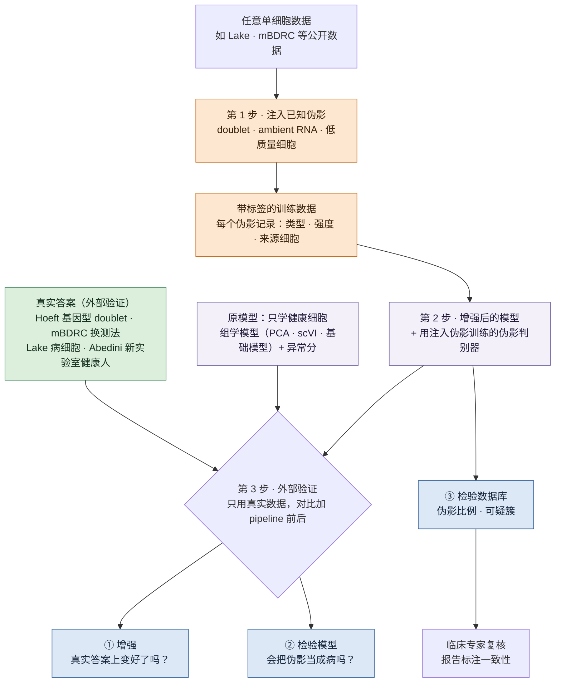
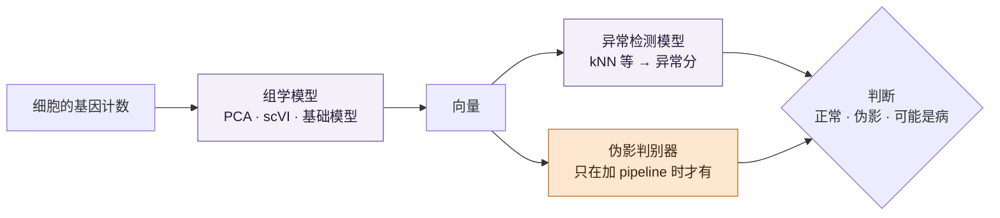

# 用伪影注入增强肾脏单细胞异常检测

## 一页看懂 {#glance}

!!! abstract "这个课题要做什么"
    **做一条 pipeline：往任意一份单细胞数据里注入已知的伪影，把它变成带答案的异常检测数据，再用它增强现有模型。**

    - **为什么：**一个看起来异常的细胞，可能是病了，也可能只是测量造成的；现有方法没有专门区分这两者。
    - **三步：**
        1. **注入**：按真实成因造 doublet、ambient RNA、低质量细胞，每个都记下答案；
        2. **增强**：用这些带答案的数据微调现有模型，让它分清健康、病、伪影；
        3. **外部验证**：只用真实数据里确定知道真相的细胞来检验（基因型 doublet、同一人换测法、专家标注的病细胞、新实验室的健康人），比较增强前后。
    - **三个用途：**① 增强模型（主线）；② 检验模型：会不会把伪影当成病；③ 检验数据：一份数据里混了多少伪影。
    - **约束：**没有湿实验，只用公开数据；临床专家（肾内科、肾脏病理）参与标注。

## 目录 {#contents}

| # | 部分 | 回答什么 |
|---|---|---|
| 1 | [问题](#question) | 为什么要做：一个异常细胞是病还是伪影，现在分不清 |
| 2 | [方法总览](#method) | 怎么做：三步，一张图 |
| 3 | [第 1 步 · 注入](#inject) | 三种伪影怎么造 |
| 4 | [第 2 步 · 增强](#boost) | 造出来的伪影怎么用来训练模型 |
| 5 | [第 3 步 · 外部验证](#validation) | 怎么证明真的有用 |
| 6 | [用到的数据](#data) | 每份公开数据在三步里各干什么 |
| 7 | [要做出什么](#deliverables) | 最后交付什么 |
| 8 | [和 agent 课题的关系](#connect) | 两个课题怎么共用代码 |
| 9 | [还没定的](#open) | 等讨论的决定 |
| 10 | [阅读路线](#reading) | 先读哪些论文 |

每节先讲要点；带 ▶ 的折叠块是细节和出处，点开看。

## 问题 {#question}

这一节回答：为什么要做这个课题。

**一个看起来异常的细胞，是病造成的，还是测量造成的？**

肾脏单细胞和单核数据里，有些细胞和健康组织对不上。它可能真的病了，也可能是测量过程造成的（doublet、ambient RNA、低质量细胞、取样或消化时的应激），而这两种情况看起来很像。我们的理解（截至 2026 年 10 月）：现有方法没有专门区分这两者，往往把两者都标成"异常"；我们也没找到一个带已知答案的数据集，能检验它们分不分得清、误报有多少。所以，建立在这些"异常细胞"之上的发现到底有多可信，现在说不清。

本课题进一步问：**能不能用造出来的伪影，教会模型分清这两种情况？**

### 为什么重要

- **测量问题造出过假的生物学结论。**在人脑单核数据里，以前被注释为"未成熟少突胶质细胞"的核，后来发现是被神经元 ambient RNA 污染的胶质细胞（[Caglayan et al., Neuron 2022](https://doi.org/10.1016/j.neuron.2022.09.010)）。
- **肾脏单核数据的背景污染可以很高。**小鼠肾的混合品系实验里，用冷冻组织做的单核样本，背景污染明显高于来自同一批样本的单细胞样本（[Janssen 2023](../papers/janssen-ambient-noise-genomebiol-2023/index.md)：35% 对 11%、17% 对 3%）。冷冻的肾活检只能做单核（[Hoeft 2024](../papers/hoeft-genotype-multiplexing-natcommun-2024/index.md)："snRNA, but not scRNA, can be performed from frozen tissue"）。
- **病和测量的信号本来就重叠。**Lake 2023 挑候选损伤状态时，部分依据是"基因少、线粒体转录多"，这也是低质量细胞的典型特征（我们的解读）；健康参考组织里也有 altered 状态，作者认为可能来自取样缺血或正常衰老（[Lake 2023](../papers/lake-kidney-atlas-nature-2023/index.md)）。我们自己从 GEO 标签表里也数到：单核数据里健康人有 26% 的核是 altered（88,460 个健康人核里的 22,774 个）。

### 为什么还没解决

- **伪影基准没有"病"这一维。**我们的理解（截至 2026 年 10 月）：doublet 和 ambient 各有自己的基准，我们找到的每个只管一种伪影，不含疾病状态。例如 [ambient 去除基准](../papers/ambient-rna-bench-biorxiv-2026/index.md) 用的是模拟数据、物种混合和基因型混合实验。
- **找疾病状态的方法不区分伪影。**用健康参考找"改变的细胞状态"的方法（如 [Dann 2023](../papers/healthy-ref-natgenet-2023/index.md)）目标是找疾病状态；我们的理解：方法本身不判断报出来的细胞是不是伪影。doublet 和低质量细胞只在预处理时去掉（去掉一个疑似 doublet 的簇、只保留至少 1,000 个分子的细胞），没有 ambient 的处理；作者提醒的技术性误报来源是残余批次效应（Extended Data Fig. 7b,c）。
- **没有误报控制。**现有注释流程里，带"拒判"选项的那些通常也只靠人为设定的条件，不给统计保证（[单细胞 conformal](../papers/conformal-scrna-bioinformatics-2025/index.md)："do not provide statistical guarantees"）；conformal 方法能界定误报率（[Bates 2023](../papers/conformal-outliers-annstat-2023/index.md)），但前提是参考和查询数据可交换：单细胞 conformal 那篇里，查询来自肺肿瘤病人时，误报率保证就不成立了。我们的理解（截至 2026 年 10 月）：还没有人在肾脏数据上系统检验过。
- **没有测试平台。**我们的理解（截至 2026 年 10 月）：我们看过的通用异常检测基准里没有单细胞表达数据，也没找到肾脏组学的异常检测基准。

??? note "细节：我们的方向有没有人做过，图像领域的证据和警告"

    
    检索截至 2026 年 10 月，不可能穷尽，所以论文里写"据我们所知"。

    - **零件都有，但每个只管一种伪影。**造 doublet 再训练检测器是标准做法（[Scrublet](https://doi.org/10.1016/j.cels.2018.11.005)、[DoubletFinder](https://doi.org/10.1016/j.cels.2019.03.003)、[scDblFinder](https://doi.org/10.12688/f1000research.73600.2)）；造"破损细胞"有一个 R 包（[DamageDetective](https://doi.org/10.32614/CRAN.package.DamageDetective)，没有配套论文）；ambient 有读段层面的模拟器 ambisim（[Li 2025](https://doi.org/10.1101/2025.02.06.636969)，用来评测多人混样的拆分方法）。
    - **问题有人提过，但没人用注入去解决。**mapQC 指出映射不好会"falsely reporting technical artifacts as disease"（[Sikkema 2025](https://doi.org/10.1101/2025.05.23.655749)），但它处理的是批次和映射质量。
    - **基础模型没被拿伪影测过。**零样本评测发现 scGPT、Geneformer 的嵌入常不如简单方法（[Kedzierska 2025](../papers/scfm-zeroshot-genomebiol-2025/index.md)），但测的是批次效应；我们没找到拿 doublet、ambient 或低质量细胞测基础模型的研究。
    - **没找到的：**一个工具往任意真实数据里同时注入多种伪影并记录答案，再用它训练模型区分"伪影还是病"。这就是本课题的新意。

    **图像领域的证据和警告：**DRAEM 用造出来的缺陷训练，在 MVTec AD 上把图像级 AUROC 从此前最好的 95.5 提到 98.0，作者说造的缺陷不需要逼真（[Zavrtanik 2021](https://arxiv.org/abs/2108.07610)）。但一项跨 420 个任务的研究发现，造法和真实异常的产生机制对不上时，自监督训练反而可能变差（[Yoo 2022](https://arxiv.org/abs/2208.07734)）；单细胞里，用模拟 doublet 训练的检测器在 16 份带真实标签的数据上，最好的平均 AUPRC 只有 0.537（[Xi & Li 2021](https://doi.org/10.1016/j.cels.2020.11.008)）。所以**按成因造伪影、只用真实数据做外部验证**是本课题的两条硬规则。

## 方法总览 {#method}

这一节回答：整体怎么做。一句话：**先造出带答案的伪影（注入），用它训练模型（增强），最后只用真实数据检验（外部验证）。**

**思路：**图像异常检测里，在正常图片上造假缺陷来训练模型，曾把 MVTec AD 上的成绩推到新高（DRAEM）；但造法和真实缺陷的成因对不上时，也可能反而变差（Yoo 2022）。我们把这个思路搬到单细胞上，按真实成因造伪影：doublet 有成熟做法（两个细胞的计数相加，部分缩小文库），ambient RNA 按比例混入背景谱，低质量细胞只能近似（单细胞是丢失胞质 RNA，单核则是混入胞质的东西）。所以造出来的伪影只用于训练。

| 步 | 做什么 | 用什么数据 | 产出 |
|---|---|---|---|
| 第 1 步 · 注入 | 往真实数据里造 doublet、ambient RNA、低质量细胞，每个都记下答案 | 健康细胞（Lake、mBDRC） | 带答案的训练数据 |
| 第 2 步 · 增强 | 用这些答案训练模型，让它分清健康、病和伪影 | 第 1 步的训练数据 | 增强后的模型 |
| 第 3 步 · 外部验证 | 只用真实数据里确定知道真相的细胞检验，比较增强前后 | Hoeft、mBDRC、Lake 的病细胞、Abedini | pipeline 有没有用的结论 |

### 全流程图

橙色是注入的伪影和带标签的数据，紫色是模型（每个跑两遍：原模型和增强后），绿色是只用于外部验证的真实答案，蓝色是三个用途。

## 第 1 步 · 注入：造出带答案的伪影 {#inject}

这一节回答：三种伪影各自怎么造，造的时候守哪些规则。

### 注入哪三种伪影

主线做三种，**先做 doublet**：它的依据最强，也有现成的真实答案，最适合先把"注入 → 增强 → 外部验证 → 出表"整条流程跑通；之后加 ambient 和低质量细胞只是换注入模块。三种都要做，因为每种伪影冒充的是不同的"病"（第二列是我们的推断）：

| 伪影 | 可能被当成 | 依据 | 计划 |
|---|---|---|---|
| 低质量细胞 | degenerative 状态：基因少、线粒体高 | Lake 判定可能的 altered 状态时，条件里就有"基因少、线粒体转录多"（Methods） | 主线第三个；和核心问题最相关 |
| doublet | 同时表达两类细胞基因的"中间状态" | Scrublet 原话：doublet 会让人以为存在"intermediate cell states" | 主线第一个 |
| ambient RNA | 细胞里出现不该有的标记基因，比如别的细胞里出现 PT 基因 | 只在 PT 表达的 Slc34a1 在很多别的细胞里也测到了（小鼠肾） | 主线第二个 |
| 解离应激 | 损伤：FOS、JUN 升高 | 小鼠 | 不注入：没有先例，主数据又是单核 |
| 批次、换测法 | — | 不是单个细胞的伪影，注入不了 | 改用真实数据测（T2b、T4） |

### 每种怎么造

三种伪影能模拟的程度差别很大：doublet 有成熟做法，ambient RNA 有现成的模型可以反过来用，低质量细胞只能近似。下面每种都写明具体做法和出处（2026-10-31 对原文和代码核实）。参数范围和"造出来的像不像真的"仍是假设，要用真实答案检验。

| 伪影 | 怎么造 | 成熟度 | 主要限制 |
|---|---|---|---|
| doublet | 两个不同类型细胞的原始计数相加，四分之一缩小文库，照 scDblFinder 的做法（[Germain 2022](https://doi.org/10.12688/f1000research.73600.2)） | 成熟 | 模拟的比真实的好找（[Xi & Li 2021](https://doi.org/10.1016/j.cels.2020.11.008)）；同类 doublet 看不出来 |
| ambient RNA | 按 Beta 分布的比例把背景谱混进每个细胞，把 SoupX、DecontX、CellBender 的模型反过来用；比例用 Janssen 校准 | 需要背景谱 | Lake 和 mBDRC 没有空液滴，背景谱只能近似 |
| 低质量细胞 | 单细胞：删胞质 RNA；单核：混入胞质成分 | 只能近似 | 没有验证过的模拟器；PT 本来线粒体就高 |

??? note "配方细节 · doublet：以相加为主，部分缩小文库"

    
    - **三个工具的做法不同：**
        - Scrublet 把随机两个细胞的**原始计数相加**："Doublets are simulated by adding the unnormalized counts"，造细胞数 2 倍的 doublet（[Wolock 2019](https://doi.org/10.1016/j.cels.2018.11.005)）。
        - DoubletFinder 把两个细胞的计数**取平均**，造到合并后数据的 25%；这样训练出的检测器找回了 demuxlet / Cell Hashing 标出的 73% / 64% 的 doublet（[McGinnis 2019](https://doi.org/10.1016/j.cels.2019.03.003)）。
        - scDblFinder 默认 75% **相加**，其余 25% 相加后除以 2 再做 Poisson 重采样；**只在不同簇之间配对**，按簇大小成比例；先只保留文库大小在 5–95 百分位的细胞（[Germain 2022](https://doi.org/10.12688/f1000research.73600.2)）。
    - **为什么要缩小一部分文库：**在用基因型标注的真实数据里，doublet 的中位文库大小"systematically smaller than the sum"（Germain 2022, Fig. 1A）。同一篇比较过：相加和按文库重加权都"clearly superior to averaging"。
    - **我们的配方：**按 scDblFinder 的做法：原始计数 → 去掉文库大小两端各 5% → 跨细胞类型配对、按预期频率成比例 → 75% 直接相加，25% 相加后减半再 Poisson 重采样 → 造细胞数 0.8–2 倍。
    - **局限：**同类细胞组成的 doublet "virtually unidentifiable"（Germain 2022），单独标一层，不进主要指标；方法在模拟 doublet 上的成绩高于真实 doublet，真实标签上最好的平均 AUPRC 只有 0.537（[Xi & Li 2021](https://doi.org/10.1016/j.cels.2020.11.008)）。检验用 Hoeft 的基因型 doublet。

??? note "配方细节 · ambient RNA：按比例混入背景谱"

    
    - **模型（去除工具反过来用）：**
        - SoupX：观测计数 = 细胞本身 + 污染比例 × 背景谱；背景谱从**空液滴**估计，默认假设"a constant contamination fraction within a channel"（[Young & Behjati 2020](https://doi.org/10.1093/gigascience/giaa151)）。
        - DecontX：每个细胞的污染比例来自"a global beta distribution"，污染谱默认是"a weighted combination of all other cell population distributions"，也可以换成空液滴（[Yang 2020](https://doi.org/10.1186/s13059-020-1950-6)）。它所在的 celda 包有模拟函数：总计数不变，按 Beta 抽比例，用二项分布决定多少计数被污染替换。这个函数造的是全合成矩阵，我们复用的是它的做法，不能直接用在真实数据上。
        - CellBender 把背景当作加在细胞上的噪声，背景谱从无细胞液滴学出来（[Fleming 2023](https://doi.org/10.1038/s41592-023-01943-7)）。
        - [ambient 去除基准](../papers/ambient-rna-bench-biorxiv-2026/index.md) 也是按细胞抽污染比例、从其他细胞类型抽 ambient 计数来造模拟数据。
    - **校准：**[Janssen 2023](../papers/janssen-ambient-noise-genomebiol-2023/index.md) 在小鼠肾里按基因型测出每个细胞平均 3–35% 的背景；冷冻组织的单核远高于单细胞（35% 对 11%、17% 对 3%）；单核的污染谱更像空液滴（Spearman ρ≈0.85），不像细胞本身（≈0.50）。
    - **我们的配方：**每个样本一个背景谱 → 每个细胞抽污染比例（Beta 分布，均值在 3–35% 之间扫，单核取高段）→ 两种注入都试：总计数不变地替换（DecontX / celda 做法），或在原计数上叠加背景（CellBender 做法）→ 原计数和注入计数分开存，作为答案。
    - **局限：**Lake 2023 和 mBDRC 都没有空液滴。没有空液滴时，背景谱可以用其他细胞群的谱（DecontX 默认）或全部细胞之和（SoupX 文档的做法），但 Janssen 显示单核的真实背景更像空液滴，所以这是近似；更好的背景谱来自 Janssen（小鼠，有空液滴）或从 FASTQ 重跑 Hoeft（人肾）。

??? note "配方细节 · 低质量细胞：只能近似，单细胞和单核做法不同"

    
    - **机制：**显微镜确认的破损细胞里，"cytoplasmic RNA will be lost, but RNAs enclosed in the mitochondria will be retained"；mtDNA 编码的基因只是"marginally upregulated"，而整个线粒体相关基因类别平均是下降的（[Ilicic 2016](https://doi.org/10.1186/s13059-016-0888-1)，小鼠 ES 细胞，Fluidigm C1，不是液滴也不是肾）。
    - **单细胞数据：删胞质 RNA。**唯一现成的模拟器是 R 包 [DamageDetective](https://doi.org/10.32614/CRAN.package.DamageDetective)：每个细胞按 Beta 分布抽损失比例（默认 0.1–0.8），按表达量加权、不放回地删掉胞质基因的计数，保留 MT- 基因和核内 lncRNA（如 MALAT1、NEAT1）。它没有论文、没有同行评审，也没用实验标注的破损细胞验证过。其他质控工具（ddqc、miQC、valiDrops、QClus 等）都只检测，不模拟。
    - **单核数据：不是"少了"，而是"多了"。**主线数据是单核，细胞核本来就没有胞质。肾单核数据里线粒体转录本"not expressed in nuclei"，测到的线粒体读段被认为来自附着在核膜上的线粒体（[Lake 2019](../papers/lake-snrna-pipeline-natcommun-2019/index.md)）；单核数据被污染时线粒体比例上升、unspliced 比例下降，"as mitochondria are only present in the cell cytoplasm"（[Schmauch 2024, QClus](https://doi.org/10.1093/nar/gkae1145)）。所以低质量的核按"混入胞质成分"来造：加线粒体计数和 spliced 读段。这和 ambient 注入很接近，两者的边界要在设计里定清楚。
    - **局限：**没有经过验证的模拟器，参数范围都是假设；肾近端小管本来线粒体就高，固定 10% 的阈值会删掉真实的肾实质细胞（[Subramanian 2022](https://doi.org/10.1186/s13059-022-02820-w)），所以 PT 要单独评估。论文要拿注入的细胞和 Lake 里真实的低 QC 细胞比分布。

### 设计规则

这几条来自上面的证据（我们的归纳）：

1. **按成因造，不追求逼真。**每种伪影对应它真实的产生过程：两个细胞进了一个液滴、背景 RNA 混入、胞质 RNA 流失（单细胞）或胞质成分混入（单核）。
2. **训练和验证分开。**造出来的伪影只用于训练；外部验证用真实数据，或者至少换一种注入配方。
3. **留一种伪影不训练。**比如用 doublet 和 ambient 训练，测低质量细胞，看模型学到的是"伪影的共性"，还是只记住了配方。
4. **按伪影类型分开报结果**，预期不同类型下方法的排名会变（ADBench 在表格数据上发现，没有哪个无监督方法在统计上整体更好，效果取决于方法的假设和异常类型对不对得上，[Han 2022](https://arxiv.org/abs/2206.09426)）。
5. **对比注入量和造法：**合成和正常的比例、一种造法还是几种混合。
6. **按测法和细胞类型定配方。**单细胞和单核的低质量配方不同；线粒体比例按细胞类型看，PT 单独评估。

??? note "第二阶段：ATAC（建议，待定）"

    
    先做 RNA；ATAC 等第一阶段跑通再加（建议，待定）。ATAC 上也有注入先例：ArchR 造"合成 doublet"再找近邻（[Granja 2021](https://doi.org/10.1038/s41588-021-00790-6)）；AMULET 把两个核的读段计数相加来模拟 doublet（[Thibodeau 2021](https://doi.org/10.1186/s13059-021-02469-x)）；ambisim 能在 snRNA + snATAC 里控制游离分子的比例（[Li 2025](https://doi.org/10.1101/2025.02.06.636969)）；低质量的核用 TSS 富集、fragment 数等指标判断，阈值要按数据调。scDblFinder 的文档也提醒，默认参数在 scATAC 上"performs very poorly"。

## 第 2 步 · 增强：用伪影训练模型 {#boost}

这一节回答：造出来的伪影怎么用来训练模型。一张图看懂：

### 两类模型

| | 组学模型 | 异常检测模型 |
|---|---|---|
| 做什么 | 把细胞描述成一个向量：学的是"细胞长什么样" | 给细胞打分：和正常差多远 |
| 输入 → 输出 | 一个细胞的基因计数 → 一个向量 | 一组向量 → 每个细胞一个异常分 |
| 候选 | 高变基因 + PCA（最简单）；scVI；基础模型 Geneformer V2、scGPT | kNN 距离、Isolation Forest、autoencoder 重建误差 |
| 自己能判异常吗 | 不能 | 能，但要先有向量 |

主线用 RNA 模型，因为主数据是单核 RNA；ATAC（测 DNA 哪些区域是打开的）是第二阶段。

### 加 pipeline 前后

| | 不加 pipeline | 加 pipeline |
|---|---|---|
| 训练数据 | 只有健康细胞 | 健康细胞 + 注入的伪影（带标签） |
| 学到什么 | 正常长什么样 | 正常和伪影各长什么样 |
| 每个细胞输出 | 异常分 | 异常分 + 像不像伪影 |
| 怎么判断 | 分高 = 异常 | 分低 → 正常；分高且像伪影 → 伪影；分高不像伪影 → 可能是病 |
| 分得清病和伪影吗 | 不能 | 能 |

- **没有"病"的标签：**训练只有健康和伪影两种标签，"病"是排除出来的；病细胞只在外部验证时出现。
- **公平比较：**两次运行用同一个向量、同一个异常分，只差伪影判别器。所有组学模型都变好 → pipeline 有用；只有部分变好 → 取决于组学模型；都没变好 → 回头改注入。
- **作用在哪：**先作用在异常检测这一环（便宜）；以后再用伪影微调组学模型本身（贵）。先例来自图像：outlier exposure（[Hendrycks 2019](https://arxiv.org/abs/1812.04606)）、DRAEM（[Zavrtanik 2021](https://arxiv.org/abs/2108.07610)）。
- **第一轮（建议，待定）：**kNN 打分 + 冻结的向量。最简单的组合 PCA + kNN + conformal 阈值 + 伪影判别器，就是我们的**参考方法**。

### 底线和参照

这些不参加"加 pipeline 前后"的比较，而是给结果定一个参照：成绩至少要比什么好，专门工具能做到多好。

| 是什么 | 怎么做 | 作用 |
|---|---|---|
| **QC 底线** | 只用两个质量指标给细胞打分：测到的基因越少、线粒体比例越高，就越"异常"；没有模型、不训练，只跑一遍 | **基座：每个模型都要和它比，明显赢过它才算有效。**Lake 判"病"的条件里本来就有"基因少、线粒体多"，赢不了这条线，就说明只学到了"质量差"，没学到"病"（见"已知的坑"） |
| **专门的 doublet 工具** | scDblFinder、scds：自己就用模拟 doublet 训练过 | T2（找真实 doublet）上的参照：专门工具能做到多好。它们等于已经"加了 pipeline"，所以不参与加前加后的比较 |
| **SoupX, DecontX** | 修正工具：SoupX 按样本估一个污染比例，DecontX 给每个细胞估一个，然后都去修正计数；它们不判断细胞是伪影还是病 | 在这里不当模型：借它们的模型来注入 ambient（第 1 步），DecontX 的每细胞估计在 ambient 任务上当参照 |
| **检验模型（用途 ②）** | 单独的实验，不增强：看注入的伪影在组学模型（尤其基础模型）的向量空间里，离真实病细胞近不近 | 离得近，说明这个模型容易把伪影当成病 |

### 更多细节

??? note "基础模型：先用冻结的向量，不从头预训练"

    
    不从头预训练（待定）：从头预训练一个肾脏模型要几千万个细胞。首选 Geneformer V2 和 scGPT，先用冻结的向量，微调放第二步；没找到同时在 RNA 和 ATAC 上预训练、又公开权重的模型。基础模型必须和简单方法一起比，因为零样本时它们常不如简单方法。

    
    建议只微调现有开源模型（待定）。从头预训练不现实：第一个肾脏专用多模态基础模型 [Nephrobase Cell+](../papers/nephrobase-biorxiv-2025/index.md) 用了约 3,950 万个细胞、四个物种、五种测法，参数到 10 亿；截至 2026-10-28，我们没找到它公开的代码和权重。核对过的候选（2026-10-28）：

    | 模型 | 权重和许可 | 模态 | 在这里怎么用 |
    |---|---|---|---|
    | [Geneformer V2](https://huggingface.co/ctheodoris/Geneformer) | Hugging Face，Apache-2.0；1.04 亿和 3.16 亿参数 | RNA | 微调，首选 |
    | [scGPT](https://github.com/bowang-lab/scGPT) | 代码 MIT，权重在 Google Drive（没写单独的权重许可）；有一个用 81.4 万个肾脏细胞预训练的版本 | RNA（多组学用法里非 RNA 部分要从头训练） | 微调，第二个 |
    | scFoundation | 权重只限非商业研究 | RNA | 可选 |
    | UCE, CellPLM, scMulan | 权重公开；UCE 没找到微调代码 | RNA | 只做冻结嵌入，用于检验模型 |
    | EpiAgent | MIT，有微调代码 | 只有 scATAC | 第二阶段候选 |

    
    我们没找到一个同时在 RNA 和 ATAC 上预训练、又公开了权重的模型，所以第二阶段可能要把 RNA 模型和 ATAC 模型配对使用。基础模型必须和简单方法一起比：零样本评测里 scGPT 和 Geneformer 常不如选高变基因、Harmony、scVI（[Kedzierska 2025](../papers/scfm-zeroshot-genomebiol-2025/index.md)）。

??? note "拿不准的细胞：按供体交叉验证、校准、conformal 定阈值、送专家复核"

    
    模型自己也能给出"拿不准"的细胞。所有模型统一四步（建议，待定）：

    1. 按**供体**做 K 折交叉验证，只用样本外分数；
    2. 先校准概率，再定阈值；
    3. 阈值用 conformal 定（换实验室时保证会失效，T4 测这个）；
    4. 拿不准的细胞送专家复核，但**不直接当标签**："拿不准"可能是伪影，也可能是过渡状态或早期病变。

    
    模型自己也能给出"拿不准"的细胞。所有模型统一按下面的做法打分（建议，待定；出处 2026-10-31 核实）：

    1. **按供体做 K 折交叉验证，只用样本外分数。**模型给自己训练过的细胞打分会过度自信，所以每个细胞的分数都来自没见过它的那一折模型。折要按**供体**切：训练和测试里出现同一个人，是一种公认的数据泄漏（[Kapoor & Narayanan 2023](https://doi.org/10.1016/j.patter.2023.100804)："train and test samples come from the same people or units"）。现有 doublet 工具里，scds 默认就用 5 折交叉验证给细胞打分，但按细胞随机切（[Bais & Kostka 2019](https://doi.org/10.1093/bioinformatics/btz698)，代码 `bcds.R`）；scDblFinder 只用交叉验证选训练轮数，最终分数是在训练过的细胞上打的（[Germain 2022](https://doi.org/10.12688/f1000research.73600.2)，代码）。
    2. **先校准，再定阈值。**神经网络的概率常常偏自信，单参数的 temperature scaling 就很有效（[Guo 2017](https://arxiv.org/abs/1706.04599)）；但基础模型反而可能偏不自信，而且分布偏移大时事后校准越来越不可靠（[Hekler 2025](https://arxiv.org/abs/2506.09593)，预印本）。单细胞注释模型同样"lack calibration"（[Engelmann 2022](https://arxiv.org/abs/2211.03793)）。
    3. **阈值用 conformal 定。**交叉验证和 conformal 可以直接接上：CV+ 把 jackknife+ 推广到 K 折，并给出覆盖率保证（[Barber 2021](https://doi.org/10.1214/20-AOS1965)；原文针对回归，用到分类分数上是我们的改编）。要按细胞类型分别保证时，在每一类里单独校准（[Angelopoulos & Bates](https://arxiv.org/abs/2107.07511) §4.2），但每类细胞少时效果差（[Ding 2023](https://arxiv.org/abs/2306.09335)）。同一个人的细胞彼此不可交换（[Dunn 2018](https://arxiv.org/abs/1809.07441)："multiple observations on each patient"），这也是要按供体切的原因。换实验室时可交换性不成立：单细胞 conformal 在疾病数据上就失去了覆盖保证（[López-De-Castro 2025](../papers/conformal-scrna-bioinformatics-2025/index.md)），加权 conformal 是一个可能的补救（[Tibshirani 2019](https://arxiv.org/abs/1904.06019)），T4 测的就是这件事。
    4. **拿不准的细胞送专家，但不直接当标签。**用交叉验证分数找可疑标签是 confident learning 的做法（[Northcutt 2021](https://doi.org/10.1613/jair.1.12125)），但它标出的候选经人工核对只有 51% 真是错标（[Northcutt 2021b](https://arxiv.org/abs/2103.14749)）。单细胞里，popV 用多个方法的一致程度作为不确定性，目的是减少人工检查（[Ergen 2024](https://doi.org/10.1038/s41588-024-01993-3)）。

    **为什么不能直接把"拿不准"当成伪影：**不确定性分两种，一种来自数据本身的噪声，一种来自模型没见过（[Kendall & Gal 2017](https://arxiv.org/abs/1703.04977)）；只看分数说不出细胞是伪影、真实的过渡状态还是早期病变。AnnQ 说得很直接：这些细胞"typically treated as technical artifacts and filtered out"，但在扰动实验里可能正是有意义的偏离（[Lee 2026](https://doi.org/10.1093/bib/bbag278)）。所以我们报告：送去复核的细胞里，专家判为伪影、病、说不清的各占多少，以及专家工作量和误差率的取舍。

    **没找到的（检索截至 2026 年 10 月）：**按供体切的样本外分数在单细胞注释或质控里的用法；用交叉验证或 conformal 的不确定性去区分伪影和病；在单细胞里衡量"送专家复核"的工作量和误差率。

??? note "以后：要不要开发新模型（未来计划）"

    
    第一轮只用现成的模型（未来计划，待定）。原因：本课题的主结论是"pipeline 有没有用"，同时换模型就分不清功劳；现成模型里已经有深度模型（autoencoder、scVI、基础模型）；而且新模型不一定赢：表格数据上没有哪个无监督方法整体更好（[Han 2022](https://arxiv.org/abs/2206.09426)），基础模型零样本时也常不如简单方法（[Kedzierska 2025](../papers/scfm-zeroshot-genomebiol-2025/index.md)）。

    第一轮结果出来后再决定：

    - 加了伪影判别器，所有组学模型都明显变好 → 不需要新模型；
    - 判别器认得出注入的伪影，到了真实答案上却不行 → "分开打分、分开判别"的拼接不够，值得做一个把两件事合在一起学的模型；
    - 只有微调过的基础模型变好 → 新贡献更可能是"怎么用伪影微调组学模型"。

    **候选方向：单细胞版的 DRAEM。**一个重建分支只学健康细胞（重建误差就是异常分），一个判别分支用注入的伪影训练并按类型输出，两个分支一起训练（DRAEM 的结构，[Zavrtanik 2021](https://arxiv.org/abs/2108.07610)）。检索截至 2026-10-31，我们没找到单细胞或空间组学里这样做的模型；最接近的是 [STANDS](../papers/spatial-natcommun-2024/index.md)：在空间转录组上只用正常参考训练一个重建 GAN，用重建差异当异常分，但不用造出来的异常训练。一个本课题特有的想法（还没查文献）：训练时惩罚模型对"基因少、线粒体高"的依赖，避免它只学到"质量差"；但这也可能压掉真实损伤的信号，要谨慎。

## 第 3 步 · 外部验证：只用真实数据检验 {#validation}

这一节回答：怎么证明 pipeline 真的有用。

模型是用我们造的伪影训练的，如果再用造的伪影来检验，只能说明它记住了造法。所以这一步只用**真实数据里确定知道真相的细胞**来检验，训练和调参时都不碰它们。这就是 **external validation（外部验证）**。每项检验都比较两个数：不加 pipeline 和加 pipeline；后者明显更好，才说明 pipeline 有用。

### 真相从哪来

没有湿实验，所以真相只能来自公开数据里**实验设计本身就带着答案**的部分，或者专家的判断：

| 数据 | 确定知道什么 | 为什么确定 | 可靠程度 |
|---|---|---|---|
| [Hoeft 2024](../datasets/hoeft-2024.md) | 哪些液滴是真的 doublet | 4 个人混在一起测，一个液滴里有两个人的 DNA，就一定装了两个细胞 | 实验设计决定（只是下限：同一个人的 doublet 看不出来） |
| [mBDRC 2026](../datasets/mbdrc-2026.md) | 哪些差别不是病 | 同一个健康人用几种方法测 | 实验设计决定 |
| [Lake 2023](../datasets/lake-2023.md) | 哪些细胞病了 | 图谱作者标出的 altered 状态 | 专家判断，最弱（见下面的坑） |
| [Abedini 2024](../datasets/abedini-2024.md) | 不该被报异常的细胞 | 另一个实验室的健康人 | 我们的设定（健康组织里也有少量 altered） |

### 检验什么

| 任务 | 问什么 | 真实答案 | 指标 |
|---|---|---|---|
| T1 | 找出病细胞 | Lake 的 altered 状态（专家判断） | AUROC、AUPRC；和 QC 底线比 |
| T2 | 找出真实的测量伪影 | Hoeft 基因型 doublet（实验设计决定，只是下限）；留出的注入类型做辅助检查 | AUROC, AUPRC |
| T2b | 换测法会不会被当成异常 | mBDRC 同一个人（实验设计决定） | 误报率 ≤ α |
| T3 | 分清病和伪影 | T1 和 T2 合起来 | 宏平均 F1、混淆矩阵 |
| T4 | 换实验室后误报控不控得住 | Abedini 健康人身上报出的都按误报算（这是我们的设定；健康组织里也有 altered 细胞） | 实际误报率 vs 设定的 α |

每项都报"不加 / 加 pipeline"两个数，以及"留一种伪影不训练"的结果（比如只用 doublet 和 ambient 训练，看能不能认出低质量细胞），用来区分模型学到的是伪影的共性，还是只记住了某一种造法。

!!! warning "已知的坑"
    我们的理解：直接拿 Lake 的 altered 标签当"病"的答案，有一部分是循环的（作者也用了损伤标记基因和 AKI / CKD 富集，不只看 QC 特征）：单核数据里，最大的 altered 组（degenerative）基因数不到正常细胞的一半、线粒体比例约是 5 倍，一个只看 QC 指标的打分器就可能拿到高分。所以基准里必须有"只用 QC 指标"的基线，并且按状态（degenerative / adaptive）分开报结果。[入门模块 9](../onboarding/09-hands-on.md) 的教学流程初步看到了这一点：在 degenerative 核上，kNN 的 AUROC 是 0.76–0.81，只数基因的基线是 0.76–0.85，5 次划分里 kNN 有 4 次更差（只是教学结果，不是基准结果）。

### 让"病"的答案更可靠：请临床专家

Lake 的"病"标签是专家判断的，是最弱的一环。临床专家（肾内科、肾脏病理）能从两条路补强：**A** 按簇重新标注 altered 簇（像真损伤 / 像质量差 / 说不准，几人独立标并报告一致性）；**B** 在公开 Visium 数据配套的 H&E 切片上圈出损伤区域，逐个 spot 检查异常分。

??? note "细节：A 和 B 怎么做、依据、可行性和局限"

    
    专家判断的答案是最弱的一环。Lake 判 altered 状态时，依据之一就是"测到的基因少、线粒体转录本多"（[Lake 2023](../papers/lake-kidney-atlas-nature-2023/index.md) Methods），这也是低质量细胞的特征，所以直接拿它当"病"的答案有循环（见上面"已知的坑"）。Lake 的标注来自一个包括病理、生物、肾内科专家的联盟，但没有报告标注者之间的一致性。临床专家能帮我们在两条路上补强：

    | | A · 按簇重新标注 | B · 在病理切片上标注 |
    |---|---|---|
    | 怎么做 | 专家看每个 altered 簇的标记基因（如 HAVCR1、LCN2）、QC 分布和来自哪些病人，判"像真损伤 / 像质量差 / 说不准"；2–3 人独立标，报告一致性 | 病理医生在和空间转录组配对的 H&E 切片上圈出损伤区域（如急性小管损伤、纤维化），再逐个 spot 检查异常分 |
    | 依据 | 人肺图谱请六位专家按簇重新标注，多数一致或只差粒度，没报 κ（[Sikkema 2023](https://doi.org/10.1038/s41591-023-02327-2)）；肾损伤状态有独立的参照，如用免疫荧光验证的 Havcr1（[Kirita 2020](https://doi.org/10.1073/pnas.2005477117)）、遗传标记的损伤 PT 细胞（[Gerhardt 2021](https://doi.org/10.1073/pnas.2026684118)），都是小鼠 | Lake 2023 的 Visium（[GSE183456](https://www.ncbi.nlm.nih.gov/geo/query/acc.cgi?acc=GSE183456)）：23 张切片（6 参考、11 DKD、6 AKI），每张都带全分辨率 H&E 图；Abedini 2024：13 张 H&E（DKD / 高血压和对照，没有 AKI） |
    | 可行吗 | 可以：几百个簇，不是几十万个细胞 | 图有；没找到公开的病理区域标注，需要自己标（这本身就是新资源） |
    | 局限 | 临床医生平时不看表达数据，可能要先给一小组校准样例；标注者里最好有一位单细胞分析的人 | Visium 一个 spot 直径 55 µm，含好几个细胞，标签只能到 spot；Visium 里只有 3 个人也在 Lake 的单核数据里（我们数的），所以这是一个单独的空间任务，不能直接验证 T1 |

    
    我们的理解：我们没找到报告"人类标注者之间 κ"的单细胞研究，所以 A 里测出的一致性本身就是结果。KPMP 有两位病理医生判读的活检级评分，但只到整块活检，不到区域；它对哪些人开放还没核实。

## 用到的数据 {#data}

这一节回答：每份公开数据在三步里各干什么。一份数据可以在几步里都用到，但同一个人的细胞不会同时出现在训练和验证里（见"划分"）。

只用公开的肾脏数据：人为主，小鼠只用来校准。每份数据的完整信息（测了什么、多少人、怎么下载）在 [数据集](../datasets/index.md) 标签页；这一节讲**它在本课题里干什么、用哪一部分、要注意什么**。

### 按步骤看

| 步 | 数据 | 干什么 | 状态 |
|---|---|---|---|
| 第 1 步 · 注入 | [Lake 2023](../datasets/lake-2023.md), [mBDRC 2026](../datasets/mbdrc-2026.md) | 健康细胞做注入的底板，也做健康参考 | 主线 |
| 第 1 步 · 注入 | [Janssen 2023](../datasets/janssen-2023.md)（小鼠） | 校准注入多少 ambient，检验合成背景和真实空液滴差多少 | 主线 |
| 第 3 步 · 外部验证 | [Hoeft 2024](../datasets/hoeft-2024.md) | 人肾真实的 doublet 和 ambient（T2） | 主线 |
| 第 3 步 · 外部验证 | [mBDRC 2026](../datasets/mbdrc-2026.md) | 同一个人换测法（T2b） | 主线 |
| 第 3 步 · 外部验证 | [Lake 2023](../datasets/lake-2023.md) | 病细胞（T1、T3） | 主线 |
| 第 3 步 · 外部验证 | [Abedini 2024](../datasets/abedini-2024.md) | 另一个实验室的健康人（T4） | 主线 |
| 第 3 步 · 外部验证 | [Lake 2019](../datasets/lake-2019.md) | 同一个人，不同保存和处理（类似 T2b） | 讨论中 |

下面这张表由 [数据集](../datasets/index.md) 的数据自动生成，用来对照前五份的基本情况：

| | [Lake 2023](../datasets/lake-2023.md) | [mBDRC 2026](../datasets/mbdrc-2026.md) | [Abedini 2024](../datasets/abedini-2024.md) | [Janssen 2023 (小鼠)](../datasets/janssen-2023.md) | [Hoeft 2024](../datasets/hoeft-2024.md) |
|---|---|---|---|---|---|
| **1 · 测了什么** | 单细胞 RNA、单核 RNA、同核 RNA+ATAC、空间 | 单细胞 RNA、同核 RNA+ATAC | 单细胞 RNA、单核 RNA、ATAC、空间 | 单细胞 RNA、单核 RNA、基因型 | 单核 RNA、基因型 |
| **2 · 多少人** | 三份单细胞数据合计 71 人（35 健康、19 CKD、17 AKI） | 19 名健康供体，33 份正常皮质 | 论文共 58 人（81 份样本：36 份对照，45 份 CKD，其中 20 糖尿病肾病、25 高血压肾病）；GEO 单细胞数据里有其中 44 人（21 名对照） | 3 个品系小鼠（CAST、BL6、SvImJ）混在一个通道 | 4 名病人（冷冻肾活检） |
| **3 · 组织来源** | 病人：大多是 KPMP 活检（单核数据里有 3 名 CKD 来自肾切除）；健康人：肾切除、死亡供体、活体供体活检；皮质、髓质、乳头 | 肾切除时取的正常皮质；只有皮质 | 剩余的（去标识）肾组织；皮质和外髓 | 健康小鼠肾，3 个品系混在一个通道 | 冷冻肾活检；没写诊断 |
| **4 · 标签** | 除 3,364 个单核外，每个细胞都有细胞类型和正常 / 改变标签 | 细胞类型；每个细胞的测法和供体 | 细胞类型；每个样本的疾病组 | 每个细胞的污染比例（含 95% 置信区间） | 按 SNP 分出的供体；250 个基因型 doublet（2.2%） |
| **5 · 处理到哪一步** | 过滤后的计数；原始 FASTQ 受控，拿不到空液滴 | 处理后的矩阵（cellxgene、Zenodo）；原始数据在 dbGaP，要申请 | 已去低质量细胞；用 SoupX 校正了 ambient RNA、用 DoubletFinder 去了 doublet（补充材料）；没有原始数据 | raw（含空液滴）+ filtered 矩阵 | GEO 上写“raw”的其实已过滤；FASTQ 公开，供体标签要重算 |
| **6 · 许可** | CC BY 4.0 (cellxgene); GEO: not stated | CC BY 4.0 (data); paper CC BY-NC-ND 4.0 | not stated | CC BY 4.0 | CC BY 4.0 (paper) |

### 每份数据的细节

??? note "Lake 2023 · 健康参考和"病"的答案"

    
    - **用哪部分：**主线先用单核数据（snCv3）。要从 GEO 下载计数矩阵和标签表，因为 `state.l1/l2`（正常 / 改变）和 `percent.mt` 只在 GEO 标签表里；cellxgene 的文件里两者都没有（线粒体基因已删）。单细胞数据（scCv3）怎么用还没定。
    - **提供什么：**
        - **健康参考**：健康供体身上 `reference` 状态的细胞，当"正常"的训练数据。
        - **"病"的答案（专家判断）**：病人身上 `altered` 状态的细胞，进 T1。
        - **注入的底板**：在健康细胞上造 doublet、ambient、低质量细胞，用于训练。
    - **要注意：**
        - degenerative 状态和低质量细胞长得像（见上面"已知的坑"），所以必须有"只用 QC 指标"的基线，并按状态分开报结果。
        - 健康人身上也有 altered 细胞（单核数据里 26%，我们数的），不能当"正常"的负样本，单独报告。
        - 原始测序受控，**拿不到空液滴**，所以注入 ambient 的背景谱要么从别处来（Janssen 或 Hoeft），要么用其他细胞群的谱近似（见"伪影注入 pipeline"）。
        - 它还有 23 张带 H&E 图的 Visium 切片，是专家"在病理切片上标注"的候选（见第 3 步"请临床专家"）。

??? note "mBDRC 2026 · 同一个人换测法"

    
    - **用哪部分：**cellxgene 上的整合 RNA 文件。18 名供体里有 11 人用两种或三种方法测过，这 11 人是 T2b 的核心。
    - **提供什么：**
        - **测量这一边的真实答案（实验设计决定）**：同一个人的组织，只因换了测法就被报成"异常"，按误报算（这是我们的设定）。
        - 补充健康参考，也可以做注入的底板。
    - **要注意：**
        - 同一名供体不能既在参考里、又在 T2b 的测试里，所以要按供体划分。
        - 测法和组织块、保存介质混在一起：换测法的同时也换了一块组织、换了保存方式，所以误报不全是"测法"造成的。
        - 只有健康人、只有皮质；原始测序在 dbGaP 要申请，所以也没有空液滴。

??? note "Abedini 2024 · 换一个实验室"

    
    - **用哪部分：**GEO 上的处理后数据，只用健康对照（GEO 单细胞数据里 21 人）。
    - **提供什么：**T4 的测试场：在一个实验室定好的阈值，拿到另一个实验室的健康人身上，误报率还守不守得住。健康人身上报出的"异常"都按误报算（这是我们的设定）。
    - **要注意：**
        - 发布前已经用 SoupX 去过 ambient、用 DoubletFinder 去过 doublet，所以**测不了测量这一侧**，只用来测误报。
        - 我们的理解：这份数据比 Lake "更干净"，这本身就是一种分布偏移，结果解读时要说明。
        - 单细胞部分是 37 °C 酶解，会带解离应激。
        - 数据许可没有写明，发布派生标签前要先确认。
        - 它的 13 张 H&E 图（DKD、高血压和对照，没有 AKI）也是专家"切片标注"的候选。

??? note "Janssen 2023 · 校准注入的 ambient"

    
    - **用哪部分：**小鼠肾，三个品系混在一个 10x 通道里测，单细胞和单核都有；公开文件**包含空液滴**。
    - **提供什么：**按基因型算出的每个细胞的真实外来 RNA 比例（3–35%）和背景谱。我们用它定"注入的 ambient 该有多强、长什么样"。
    - **要注意：**是小鼠，不是人，也没有病人，所以不当测试集；拿它校准人的数据是一个假设，要在论文里说明。

??? note "Hoeft 2024 · 人肾真实的 doublet 和 ambient"

    
    - **用哪部分：**4 名病人的冷冻肾活检混在一个单核通道里。GEO 上的矩阵已过滤，要用公开的 FASTQ 和基因型文件重跑 CellRanger 和 souporcell。
    - **提供什么：**人肾上**真实**的 doublet（按基因型）和 ambient 答案。新方向下它是主线：T2 外部验证的答案，也用来检验我们注入的伪影像不像真的。我们的理解：重跑后也能拿到空液滴，得到人肾自己的背景谱。
    - **要注意：**
        - 只有 4 人，只够验证，不能当主结果。
        - 基因型只能看出跨供体的 doublet，同一个人的两个核看不出来，所以 250 个基因型 doublet 只是下限。
        - 有用的发现：按表达聚出的"Mixed/Doublets"簇有 4,488 个核，按基因型确认是 doublet 的只有 123 个（我们从 Source Data 算的）。只看表达判断异常原因很不可靠，这正是本课题的出发点。

??? note "Lake 2019 · 同一个人，不同保存和处理（讨论中）"

    
    同一个人的组织用不同方式保存和处理后再测，能小规模地回答"保存 / 处理方式变了，会不会被当成异常"，性质类似 T2b。用的是 snDrop-seq，不是 10x，规模也小，所以还没定要不要进主线。

??? note "暂时不用的"

    
    - [Malone 2020](../datasets/malone-2020.md)：也有基因型，但原始数据很大；人肾伪影的真实答案先靠 Hoeft。
    - [Denisenko 2020](../datasets/denisenko-2020.md)：小鼠，证明解离应激会像损伤；解离应激暂不注入，以后再用。
    - [KPMP](../datasets/kpmp.md)、[cellxgene](../datasets/cellxgene.md)：数据来源和下载途径，不是单独的数据集。

### 划分

按供体划分，不按细胞，同一个人不会同时出现在训练和测试里。Lake 和 mBDRC 的健康供体分成**参考 / 校准 / 测试**三份（参考用来打分，校准用来定阈值，测试用来算误报）；Abedini 只做测试。固定随机种子，划分文件随数据集一起发布。

## 要做出什么 {#deliverables}

| # | 交付物 | 是什么 | 怎么证明有用 |
|---|---|---|---|
| 1 | 伪影注入 pipeline（开源） | 输入任意单细胞数据（AnnData），注入 doublet、ambient RNA、低质量细胞，每个细胞都记录伪影类型、强度和来源细胞 | 注入的伪影和真实伪影比：用 Janssen 校准，用 Hoeft 检验 |
| 2 | 增强方法 | 用注入的伪影微调模型，让它分出健康、病、伪影 | 微调前后在真实答案上对比 |
| 3 | 外部验证集 | Hoeft 基因型 doublet、mBDRC 换测法、Lake 病细胞、Abedini 健康人，加上固定的任务、指标和按供体的划分 | 公开发布，别人可以复用 |
| 4 | 成绩表 | 每种组学模型配上异常分，跑"不加 / 加 pipeline"两遍，按伪影类型分开报，加"留一种伪影不训练" | 论文的主结果 |
| 5 | 数据库体检报告 | 用训练好的检测器扫 Lake 和 Abedini：估计伪影比例，标出可疑的 altered 簇 | 可疑簇交给临床专家复核，报告专家之间的一致性 |
| 6 | 第二阶段：ATAC | pipeline 扩展到 RNA + ATAC | 视第一阶段进度 |

原始数据不再分发；发布的是代码、划分文件、注入记录和派生标签（Abedini 的派生标签要等许可确认）。

## 和 agent 课题的关系 {#connect}

- **[agent 课题](hypothesis-agents.md)**让 agent 在肾脏扰动数据上提出并检验假设。agent 最容易犯的错之一，是把不是处理造成的差异报成药效（[Systema](https://doi.org/10.1038/s41587-025-02777-8) 在扰动评测里指出了同样的陷阱）；技术伪影正是这种差异的来源之一。
- 本课题的注入代码可以只往一个处理组里注入已知伪影，出成"伪影题"：看 agent 会不会把伪影当成药效。这一项是可选的，取决于注入代码什么时候能用；agent 课题不依赖它，先用现成工具（scDblFinder、SoupX 等）顶上。

## 还没定的 {#open}

**方向（建议已写在上面，等确认）：**

- 基础模型只微调、不从头预训练？首选 Geneformer V2 和 scGPT？
- 先做 RNA，ATAC 放第二阶段？
- "增强"指用注入的伪影训练模型，还是也包括给每个实验室一个评估自己数据的工具（用途 ②③）？

**数据和答案：**

- 注入 ambient 的背景谱用 Janssen（小鼠，现成）、重跑 Hoeft（人肾，要从 FASTQ 重跑），还是用其他细胞群的谱近似？Lake 和 mBDRC 都没有空液滴。
- 单核的低质量注入（混入胞质成分）和 ambient 注入怎么划界？需要 spliced / unspliced 计数，要查 Lake 和 mBDRC 的公开文件里有没有。
- 第一轮结果出来后，要不要开发新模型（候选：单细胞版 DRAEM，见第 2 步）？
- 专家补强"病"的答案，先走 A（按簇标）还是 B（切片标），还是两个都做？B 要不要成为一个单独的空间任务？参与标注的是肾内科、病理，还是两者都有？
- Lake 的单细胞数据（scCv3）怎么用：当第二种测法，还是先不用？
- Lake 的 altered 细胞怎么分组：有独立证据的、只靠 QC 类特征判出来的、健康人身上的，各自怎么用。
- T2b 单独成一个任务，还是并进 T4？Lake 2019 要不要进主线？
- Abedini 2024 的数据许可（我们没找到写明的许可，决定能不能发布派生标签）。健康人数已核实：GEO 上 21 名对照。

**其他：**

- 要不要把 [NIH 肾脏 AI 挑战赛](../papers/nih-kidney-ai-challenge-2026/index.md) 当作相关机会：它要在 KPMP 肾活检全切片病理图像里找新的异常，提交窗口 2026-11-05 到 2027-04-29。它考的是图像，不是本课题的单细胞组学，所以只能算图像方向的扩展；现金奖只发给美国公民、永久居民或美国机构。

## 阅读路线 {#reading}

先读完 [入门](../onboarding/index.md)，然后按这个顺序：

1. [Lake 2023](../papers/lake-kidney-atlas-nature-2023/index.md)：肾脏图谱和 altered 状态
2. [Janssen 2023](../papers/janssen-ambient-noise-genomebiol-2023/index.md)：真实 ambient 污染有多大
3. [Dann 2023](../papers/healthy-ref-natgenet-2023/index.md)：用健康参考找改变的细胞状态
4. [Bates 2023](../papers/conformal-outliers-annstat-2023/index.md)：conformal p 值和误报控制
5. [PatchCore](../papers/patchcore-cvpr-2022/index.md)：图像异常检测里的最近邻思路
6. [Kedzierska 2025](../papers/scfm-zeroshot-genomebiol-2025/index.md)：基础模型零样本时常不如简单方法
7. [Nephrobase Cell+](../papers/nephrobase-biorxiv-2025/index.md)：第一个肾脏专用多模态基础模型
8. [DRAEM](https://arxiv.org/abs/2108.07610)：用造出来的缺陷训练异常检测（不在论文库）

再往后，看 [知识图谱](../knowledge-map.md) 里本课题视图的必读论文，以及 [方法 × 数据矩阵](../knowledge-map.md)：虚线格是本课题打算补上的地方（有的格子里已经有论文，格子里的说明写了还缺什么）。
