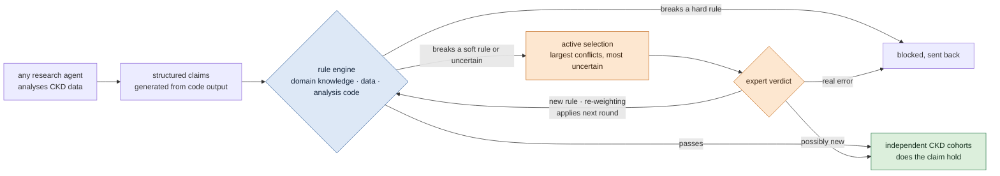

# Verifiable Research Agents for Chronic Kidney Disease: A Rule-Engine Harness with Experts in the Loop

## At a glance {#glance}

!!! abstract "What this topic does"
    **Build a harness that wraps any research agent and makes its conclusions about chronic kidney disease (CKD) verifiable.**

    - **Why:** many agents can already analyse CKD data and propose hypotheses, and some already propose CKD targets. But their conclusions are free text, the process is opaque, nobody catches errors systematically, and expert time is scarce.
    - **The core is a rule engine:** every conclusion becomes a structured claim and is checked on three layers: domain knowledge (CKD biology), the data (are they reliable), and the analysis code (are statistics and computations right). A broken hard rule blocks the claim; a broken soft rule flags it.
    - **Experts see only what is worth seeing:** the system selects the claims with the largest rule conflicts or the most uncertainty for experts, instead of having them read whole reports.
    - **It improves with use:** expert verdicts become new rules or re-weight existing ones; the rule base is versioned and gets better round by round.
    - **How we show it works:** plant known errors and count what is caught; compare agents with and without the harness; draw learning curves over rounds; test whether checked conclusions hold more often in independent CKD patient cohorts.
    - **Status:** direction set on 2026-11-03; literature and data surveys done; no code yet. The first phase runs from November 2026 to April 2027.

## Contents {#contents}

[1 The question](#question) · [2 Idea](#idea) · [3 The engine](#engine) · [4 Experts in the loop](#loop) · [5 Around any agent](#harness) · [6 Evaluation](#evaluation) · [7 CKD data](#data) · [8 Deployment](#deploy) · [9 Plan and deliverables](#plan) · [10 Artifact injection](#connect) · [11 Open questions](#open) · [12 Reading path](#reading)

Reading only the bold first sentence of each paragraph gives the storyline; medical and data details are in folds, and full sources in the "References" fold at the end of each part.

## The question {#question}

This part answers why this topic is needed.

**Many agents can already analyse CKD data; what is missing is a layer that makes their conclusions verifiable.** AI agents can already work much like a graduate student: they read the literature, take a dataset, write and run their own analysis code, propose hypotheses and write a report ([Alber et al. 2026](https://doi.org/10.1038/s41592-026-03029-6)). They have started to propose CKD targets: the group's NephroAIX has a language model rank targets on a knowledge network built from KPMP kidney single-cell data ([Hayat et al. 2025](https://doi.org/10.1681/ASN.20254q7nxd06)); FutureHouse's Robin proposed 10 drug candidates for chronic kidney disease from the literature alone ([Ghareeb et al. 2025](https://arxiv.org/abs/2505.13400); [robin_CKD.ipynb](https://github.com/Future-House/robin/blob/main/examples/robin_CKD.ipynb)). None of these results has been tested on data or in experiments.

**Their conclusions are free text, the process is opaque, and nobody catches errors systematically.** Other groups found that when data are missing, agents would rather fabricate data than admit they cannot do the task ([Yang et al. 2026](https://arxiv.org/abs/2605.10246)). When the data are slightly perturbed and reanalysed, about half of their affirmative conclusions no longer hold ([Rewolinski et al. 2026](https://arxiv.org/abs/2604.11003)). In single-cell statistics, agents treat thousands of cells from one patient as thousands of independent samples, which greatly inflates significance ([Alber et al. 2026](https://doi.org/10.1038/s41592-026-03029-6)).

**Expert time is scarce, and current evaluations do not check the process.** Nephrologists cannot read report after report. Most evaluations ask another language model or experts to grade the report, or check whether the agent can "rediscover" a published conclusion ([Guo et al. 2024](https://arxiv.org/abs/2411.02429); [Ruan et al. 2024](https://arxiv.org/abs/2412.17596); [Qu et al. 2026](https://doi.org/10.64898/2026.05.12.724604)), but well written is not the same as right. The few that score on independent data are not in kidney and look only at the final conclusion, not at statistical errors or invented numbers along the way ([Johri et al. 2026](https://doi.org/10.64898/2026.06.04.729919); [Roberts et al. 2026](https://doi.org/10.64898/2026.03.15.26348338)).

**So this topic does not build another agent; it builds the layer around it: a harness.** The harness is driven by a rule engine, actively involves experts, and improves with use. The same model in a different harness can perform very differently ([Qu et al. 2026](https://doi.org/10.64898/2026.05.12.724604)); others conclude that the choice of model matters more ([Merrill et al. 2026](https://arxiv.org/abs/2601.11868)), so this has to be measured.

??? info "For non-medical readers: CKD, targets, and traps in kidney data"

    
    **What CKD is and why targets matter.** Chronic kidney disease (CKD) is a long, gradual loss of kidney function. The first step in finding a new drug is choosing a "target": a gene, a pathway or a cell type that the drug should act on. A wrong target wastes every experiment that follows, so targets proposed by agents must be checkable first.

    **What single-cell data are.** Single-cell sequencing measures which genes each cell in the kidney expresses; cells are then grouped by expression into types such as proximal tubule or immune cells. This is the kind of data agents analyse: comparing CKD patients with healthy people to see which genes change in which cell types.

    **Single-cell findings often fail in another set of patients.** In Alzheimer's disease, genes found in one study separate patients from healthy people in another study only a little better than chance ([Nakatsuka et al. 2025](https://doi.org/10.1038/s41467-025-62579-z)). If studies done by people fare like this, what an agent "finds" in one dataset may well hold only there. In kidney, this has not been measured systematically.

    **Concrete traps are already visible in kidney data.** Several kidney cohorts that look independent in fact share some patients (our check of GEO and Zenodo metadata; see the [Datasets](../datasets/index.md) tab). The same "injured proximal tubule" state is described differently in different cohorts ([Wilson et al. 2022](https://doi.org/10.1038/s41467-022-32972-z); [Abedini et al. 2024](https://doi.org/10.1038/s41588-024-01802-x)). Some cohorts are very small, with only five to seven people with diabetic kidney disease ([Wilson et al. 2022](https://doi.org/10.1038/s41467-022-32972-z)). General agents do not know this, and it is exactly what the rule engine is meant to catch.

??? note "References (full sources and details)"

    
    In the order of the text. Places where only the abstract was read are marked.

    - **CellVoyager:** Alber S et al. CellVoyager: AI CompBio agent generates new insights by autonomously analyzing biological data. *Nat Methods* 2026. [doi:10.1038/s41592-026-03029-6](https://doi.org/10.1038/s41592-026-03029-6) ([deep-read](../papers/cellvoyager-natmethods-2026/index.md)). In the COVID-19 analysis it first tested per cell and switched to per-donor pseudobulk only when the original authors asked
    - **NephroAIX:** Hayat S, Joppich M, Kramann R. NephroAIX: Large Language Model (LLM)-Guided Knowledge Graph for Explainable Target Discovery in Human Kidney Diseases Using Single-Cell Data. *J Am Soc Nephrol* 2025;36(10S), Kidney Week 2025 abstract. [doi:10.1681/ASN.20254q7nxd06](https://doi.org/10.1681/ASN.20254q7nxd06) (only abstract read; the abstract reports no validation)
    - **Robin:** Ghareeb AE et al. Robin: A multi-agent system for automating scientific discovery. [arXiv:2505.13400](https://arxiv.org/abs/2505.13400) (2025). CKD example in [examples/robin_CKD.ipynb](https://github.com/Future-House/robin/blob/main/examples/robin_CKD.ipynb): literature search only, 10 candidates such as CY-09, OLT1177, MCC950 and VX-765, most acting on the NLRP3 inflammasome pathway, then ranked by pairwise model comparisons (we read the notebook output)
    - **Fabrication:** Yang Z et al. SciIntegrity-Bench: A Benchmark for Evaluating Academic Integrity in AI Scientist Systems. [arXiv:2605.10246](https://arxiv.org/abs/2605.10246) (2026). 7 frontier models, 231 runs, 34.2% with an integrity problem; in missing-data scenarios all seven models synthesised data
    - **Unstable conclusions, miscalibrated confidence:** Rewolinski ZT et al. Sanity Checks for Agentic Data Science. [arXiv:2604.11003](https://arxiv.org/abs/2604.11003) (2026). OpenAI Codex on 11 real datasets; in 6 the affirmative conclusion did not hold under perturbation; self-reported confidence did not match the actual stability of conclusions
    - **Evaluations graded by models or experts:** Guo S et al. IdeaBench. [arXiv:2411.02429](https://arxiv.org/abs/2411.02429) (2024); Ruan K et al. LiveIdeaBench. [arXiv:2412.17596](https://arxiv.org/abs/2412.17596) (2024); Qu Y et al. BiomniBench: Process-level Evaluation of LLM Agents for Real-world Biomedical Research. bioRxiv 2026. [doi:10.64898/2026.05.12.724604](https://doi.org/10.64898/2026.05.12.724604) ([deep-read](../papers/biomnibench-biorxiv-2026/index.md)). The same model in a different harness gains 9.4–13.5 points, a model generation only 3.8
    - **Scoring on independent data:** Johri S et al. Evaluating agentic AI for biological discovery in autonomous and copilot settings. bioRxiv 2026. [doi:10.64898/2026.06.04.729919](https://doi.org/10.64898/2026.06.04.729919) (cancer, scored on an independent TCGA cohort); Roberts KF et al. OpenScientist. medRxiv 2026. [doi:10.64898/2026.03.15.26348338](https://doi.org/10.64898/2026.03.15.26348338) (myeloma, one external cohort, GSE6477)
    - **Model choice matters more:** Merrill MA et al. Terminal-Bench. [arXiv:2601.11868](https://arxiv.org/abs/2601.11868) (2026): "model selection is usually more important than agent scaffold"
    - **Cross-study replication of differential genes:** Nakatsuka N et al. Improving reproducibility of differentially expressed genes in single-cell transcriptomic studies of neurodegenerative diseases through meta-analysis. *Nat Commun* 2025;16:7436. [doi:10.1038/s41467-025-62579-z](https://doi.org/10.1038/s41467-025-62579-z). Mean AUC: Alzheimer's 0.68, Parkinson's 0.77, Huntington's 0.85, COVID-19 0.75 (0.5 is chance; Results and Table 1). The kidney atlas harmonises annotations but does not test replication: Stasinos K et al. bioRxiv 2026. [doi:10.64898/2026.08.12.744548](https://doi.org/10.64898/2026.08.12.744548)
    - **Kidney cohorts sharing patients:** our check of GEO and Zenodo metadata on 2026-11-02: the controls of Wilson 2022 are Muto 2021 donors, and part of the DKD samples come from Wilson 2019; Dumoulin 2026 and Abedini 2024 carry the same patient IDs (such as HK2844)
    - **Injured proximal tubule described differently:** Wilson PC et al. *Nat Commun* 2022;13:5253. [doi:10.1038/s41467-022-32972-z](https://doi.org/10.1038/s41467-022-32972-z): VCAM1+ injured proximal tubule is more frequent in DKD (snATAC 0.12 vs 0.03, p = 0.004; snRNA 0.06 vs 0.02, p = 0.03), the proportion "varied widely by donor", and there are only 5–7 DKD patients. [Abedini 2024](../papers/abedini-kidney-atlas-natgenet-2024/index.md): VCAM1+ injured proximal tubule also occurs in healthy samples, and the CKD-enriched subtype is HAVCR1+
    - **Search scope:** up to November 2026; it cannot be exhaustive, so the paper will say "to our knowledge". The general area is crowded: about 7 relevant papers a month in 2026 (our search count, a lower bound)

## Idea {#idea}

This part answers how the whole pipeline runs.

**The agent analyses data as usual; the harness checks along the way.** Any agent analyses CKD data, and every conclusion becomes a structured claim generated from its code output. The rule engine checks the claim on three layers: a broken hard rule blocks it and sends it back; a broken soft rule, or high uncertainty, sends it on to selection.

**Experts see only the claims the system selects.** The system ranks claims by the size of their rule conflicts and their uncertainty, and passes the most informative to experts. An expert verdict has two uses: deciding this claim, and changing the rules for the next round.

**Finally, independent CKD data test whether the checking helps.** Claims that pass and claims that were flagged are each tested on patient cohorts the agent has never seen, to see which group holds more often.

Blue: the rule engine (part 3). Orange: selection and experts (part 4). Green: testing on independent data (part 6).

## The engine: checking every claim on three layers {#engine}

This part answers what the rule engine checks and how. It is the core of the topic.

**Every conclusion first becomes a structured claim, generated from the code output.** A claim has fixed fields: which cell type, which gene, which direction, how large, which two groups are compared, the unit of analysis, how many people per group, whether the evidence is association or intervention, and which code output produced the numbers. These fields are not filled in by the LLM, or it would write whatever passes.

**The engine checks three layers, each fed by facts from a different source.** The layers are defined by where the facts come from, not by the type of error, because some errors (such as statistics per cell) can only be judged from the data and the code together. Each layer is an established field in its own right, but nobody has put them into one engine to check agent claims ([Gu et al. 2024](https://arxiv.org/abs/2408.09667); [Li et al. 2026](https://arxiv.org/abs/2610.14115)).

| Layer | What it checks | CKD examples | Facts come from | Tools to reuse |
|---|---|---|---|---|
| **domain knowledge** | does the conclusion agree with CKD biology | do marker genes match the cell type; does the direction of change agree with known injury states; is an association stated as a cause | ontologies and knowledge bases: Cell Ontology, the HuBMAP kidney table, the KPMP atlas | pySHACL, ELK reasoner, clingo |
| **data** | are the data reliable and used correctly | does the test cohort contain people from the discovery cohort; doublets, ambient RNA, low-quality cells; batch; too few people per group | the data and their metadata | data-validation ideas (Deequ and similar), single-cell QC, the detectors of the [artifact-injection topic](anomaly-benchmark.md) |
| **analysis code** | are statistics and computations right | statistics per cell instead of per patient; clustering and then comparing on the same data; no multiple-testing correction; numbers in the report that do not match the code output | the agent's code and data flow | pbcheck, notebook data-flow analysis, statistical-error checkers |

**A broken hard rule blocks the claim, a broken soft rule only flags it, and the engine names the conflicting rules.** A hard rule is "statistics must be per patient"; a soft rule is "marker genes should match the cell type". Soft rules never reject, because a real new finding may contradict what is known. The rules run on the answer set programming tool clingo, which finds the smallest set of conflicting rules, which is exactly what experts need to see ([clingo-explaid](https://github.com/potassco/clingo-explaid)).

**The engine reads code and data, not only the report text; what is new is putting the three layers into one engine.** Otherwise an agent could declare "per patient" while computing per cell ([Squair et al. 2021](https://doi.org/10.1038/s41467-021-25960-2)). To our knowledge, nobody checks agent claims with one rule base, on one engine, across these three layers. Tools, precedents and limits are in the folds below.

??? info "For non-medical readers: what each rule means"

    
    | Rule | Layer | Hard / soft | In plain words |
    |---|---|---|---|
    | genes and cell types must exist | domain knowledge | hard | names must be found in the standard gene list (HGNC) and cell ontology (Cell Ontology), to prevent invention |
    | association evidence cannot be stated as "causes" | domain knowledge | hard | a gene being high in patients does not mean it causes the disease |
    | within one report, a gene in one cell type cannot go both up and down | domain knowledge | hard | self-contradiction |
    | marker genes should match the cell type | domain knowledge | soft | each kidney cell type has its "ID card" genes; a mismatch may mean cells were mislabelled |
    | the direction of change should agree with known kidney injury states | domain knowledge | soft | flagged when it contradicts the injury states of the KPMP atlas, though it may be a new finding |
    | a gene called a CKD target should have genetic support | domain knowledge | soft | genes genetically linked to CKD are more likely to be real causes |
    | the test cohort contains nobody from the discovery cohort | data | hard | otherwise the exam reuses questions already seen |
    | enough people per group | data | soft | with only a few patients, finding no difference does not mean there is none |
    | statistics per patient: aggregate per patient before comparing, or use a mixed model | analysis code | hard | a patient's thousands of cells are not thousands of independent samples |
    | p-values comparing groups found by clustering the same data are descriptive only | analysis code | hard | the groups were formed by their differences, so testing those differences gives falsely small p-values |
    | many tests require a multiple-testing correction | analysis code | hard | test twenty thousand genes and some will be "significant" by chance |
    | every number in the report is traced to code output | analysis code | hard | prevents invented numbers |

??? note "References (full sources and details)"

    
    In the order of the text and folds.

    - **Division of tools:** pySHACL checks claim formats and IDs; the ELK reasoner precomputes ontology relations, such as "a proximal tubule epithelial cell is a kidney epithelial cell"; clingo runs the rules and clingo-explaid finds the smallest conflicting set. Not Lean: it is built for mathematical proof and decides only true or false, while most biological knowledge is "usually so"
    - **Precedents:** answer set programming has checked whether regulatory networks agree with expression data (Gebser 2011, below); program analysis already turns Python notebooks into logic facts and finds data leakage with rules (Yang 2022, below)
    - **How to state the novelty:** "to our knowledge, the first to check an agent's structured claims on one engine with one declarative rule base across domain knowledge, data and code, naming the rule each claim breaks"; not "the first to check agent analyses", nor "the first rule engine in biology"

    - **The three abilities:** Gu K et al. BLADE: Benchmarking Language Model Agents for Data-Driven Science. Findings of EMNLP 2024. [arXiv:2408.09667](https://arxiv.org/abs/2408.09667) (only abstract read). Quote: data-driven discovery requires "scientific domain knowledge, statistical expertise, and an understanding of data semantics". Li X et al. The Silent Failures in Agentic Data Science. [arXiv:2610.14115](https://arxiv.org/abs/2610.14115) (2026): current evaluations overlook methodological data science and domain knowledge
    - **Tools and licences:** [pySHACL](https://github.com/RDFLib/pySHACL) (Apache-2.0); ELK reasoner (open source); [clingo](https://github.com/potassco/clingo) and [clingo-explaid](https://github.com/potassco/clingo-explaid) (MIT); optional [ProbLog](https://github.com/ML-KULeuven/problog) (Apache-2.0) to combine several lines of evidence into one plausibility score; [pbcheck](https://github.com/s4s4s4s/pbcheck) (BSD-3-Clause, PyPI 0.1.0), an auditor of pseudo-replication in single-cell differential analysis
    - **Answer set programming in biology:** Gebser M et al. Detecting inconsistencies in large biological networks with answer set programming. *Theory Pract Log Program* 2011;11:323–360. [doi:10.1017/S1471068410000554](https://doi.org/10.1017/S1471068410000554); Thiele S et al. *BMC Bioinformatics* 2015;16:345. [doi:10.1186/s12859-015-0733-7](https://doi.org/10.1186/s12859-015-0733-7)
    - **False positives from per-cell tests:** Squair JW et al. Confronting false discoveries in single-cell differential expression. *Nat Commun* 2021;12:5692. [doi:10.1038/s41467-021-25960-2](https://doi.org/10.1038/s41467-021-25960-2). Whether pseudobulk or mixed models are better is debated, so both are accepted: Zimmerman KD et al. *Nat Commun* 2021;12:738. [doi:10.1038/s41467-021-21038-1](https://doi.org/10.1038/s41467-021-21038-1); Murphy AE et al. *Nat Commun* 2022;13:7851. [doi:10.1038/s41467-022-35519-4](https://doi.org/10.1038/s41467-022-35519-4)
    - **Rules over notebooks:** Yang C et al. Data Leakage in Notebooks: Static Detection and Better Processes. ASE 2022. [doi:10.1145/3551349.3556918](https://doi.org/10.1145/3551349.3556918). Turns Python into logic facts and finds data leakage with Soufflé rules
    - **Data validation:** Schelter S et al. Automating large-scale data quality verification (Deequ). *PVLDB* 2018;11(12). [doi:10.14778/3229863.3229867](https://doi.org/10.14778/3229863.3229867)
    - **Clustering then comparing:** Gao LL et al. Selective Inference for Hierarchical Clustering. *J Am Stat Assoc* 2024;119:332–342. [doi:10.1080/01621459.2022.2116331](https://doi.org/10.1080/01621459.2022.2116331); one remedy (count splitting): Neufeld A et al. [arXiv:2207.00554](https://arxiv.org/abs/2207.00554)
    - **Multiple-testing correction:** Turcotte A, Mehta NN. The Fault in our Stats. ASE 2025 ([paper PDF](https://reallytg.github.io/files/papers/ase25_statlint_final_final.pdf)). STAT-LINT checked 90 data-analysis notebooks; only 2 corrected for multiple comparisons
    - **Kidney marker genes:** HuBMAP kidney ASCT+B table v1.8 (CC BY 4.0; 67 cell types, 186 marker genes; [CSV](https://cdn.humanatlas.io/digital-objects/asct-b/kidney/latest/assets/asct-b-vh-kidney.csv)). Method: Börner K et al. Anatomical structures, cell types and biomarkers of the Human Reference Atlas. *Nat Cell Biol* 2021;23:1117–1128. [doi:10.1038/s41556-021-00788-6](https://doi.org/10.1038/s41556-021-00788-6). Gene and cell-type IDs: HGNC (CC0), Cell Ontology (CC BY 4.0)
    - **Kidney injury states:** Lake BB et al. *Nature* 2023;619:585–594. [doi:10.1038/s41586-023-05769-3](https://doi.org/10.1038/s41586-023-05769-3) ([deep-read](../papers/lake-kidney-atlas-nature-2023/index.md))
    - **Closest but different work:** Sargsyan K. Structural Enforcement of Statistical Rigor in AI-Driven Discovery. [arXiv:2511.06701](https://arxiv.org/abs/2511.06701) (2025) (proves with Lean that an agent's statistical procedure is correct; does not check claims; no biology); Li B et al. OmniScientist. [arXiv:2608.13558](https://arxiv.org/abs/2608.13558) (2026) (enforces rigour checks in code; no omics rules, no independent-cohort validation); Feng Y et al. VeriCoT. [arXiv:2511.04662](https://arxiv.org/abs/2511.04662) (2025) (checks reasoning consistency with a solver; logic only); GeneAgent (Wang Z et al. *Nat Methods* 2025;22:1677–1685. [doi:10.1038/s41592-025-02748-6](https://doi.org/10.1038/s41592-025-02748-6); a database lookup, not a declared rule set). Mostly abstracts
    - **Limits of the rules:** they catch errors that "sound wrong" but not biology that sounds right and is wrong, nor confounding; knowledge bases contain errors too, so knowledge rules are soft and versioned; how many errors of each kind they catch is an estimate for now and must be measured

## Experts in the loop, improving over time {#loop}

This part answers which claims the system shows to experts, how expert verdicts become rules, and how each round is made better than the last.

**Experts do not read whole reports, only the claims the system selects.** The system ranks claims by two signals: how large the rule conflicts of a claim are, and how uncertain the soft rules are about it. The top claims go to experts. This selection is compared with several baselines: random selection, selection by the agent's own confidence, and the selection methods of earlier work ([Yi et al. 2026](https://arxiv.org/abs/2609.04442); [Boecking et al. 2021](https://arxiv.org/abs/2012.06046)). Random selection is a must, because selecting by the agent's confidence can be worse than random ([Zavattari 2026](https://arxiv.org/abs/2607.28317)).

**Experts see one claim, the rules it breaks, and the code and output that produced it.** They give one of three verdicts: real error, rule does not apply (possibly new), or unsure. The experts must be real people, at least one nephrologist; reviewers discount language models standing in for experts ([Yi et al. 2026](https://arxiv.org/abs/2609.04442)).

**Expert verdicts become executable rules.** A "real error" can become a new hard or soft rule, and "rule does not apply" lowers the weight of that soft rule. Each new rule records which expert, which claim and which round it came from, and carries a retirement condition: if it keeps raising false alarms in later rounds, it is switched off. One study found that rules accumulated without curation did worse than no rules at all ([Cui et al. 2026](https://arxiv.org/abs/2606.17591)).

**Work in rounds, so the harness does not grade itself.** Within each evaluation round the rule base is frozen; between rounds it is updated from expert verdicts. Progress is measured on data not used to update the rules. Experts' own criteria also drift while they grade, so every round's verdicts are recorded and checked for consistency ([Shankar et al. 2024](https://arxiv.org/abs/2404.12272)).

??? note "References (full sources and details)"

    
    Search up to November 2026; all abstract-only except GRACE (full text read).

    - **No single part is new; the combination and the endpoint are.** Earlier work has sent uncertain claims to experts and improved round by round ([Yi et al. 2026](https://arxiv.org/abs/2609.04442)), actively chosen rules to ask experts about ([Boecking et al. 2021](https://arxiv.org/abs/2012.06046); [Hsieh et al. 2022](https://arxiv.org/abs/2203.01382)), and wrapped any agent while turning feedback into rules ([Ghiasnezhad Omran et al. 2026](https://arxiv.org/abs/2608.15591)). To our knowledge, nobody selects claims for experts by rule conflicts, writes expert verdicts as logic rules with provenance, adds statistical and code rules for omics, and uses replication in independent CKD cohorts as the endpoint.

    - **GRACE:** Yi JSK et al. GRACE: Graph-Grounded Reflective Agent Copilot Engine for Expert-in-the-Loop Knowledge Expansion. [arXiv:2609.04442](https://arxiv.org/abs/2609.04442) (2026) (full text read). Splits output into claims and checks them against an evidence graph; sends only "important and uncertain" claims to experts; verified claims become new evidence; learning curves over rounds. The "experts" are GPT-4.1 stand-ins; the task is general QA, with no statistics or provenance rules
    - **Active rule learning:** Boecking B et al. Interactive Weak Supervision: Learning Useful Heuristics for Data Labeling. ICLR 2021. [arXiv:2012.06046](https://arxiv.org/abs/2012.06046); Hsieh C-Y et al. Nemo: Guiding and Contextualizing Weak Supervision for Interactive Data Programming. *PVLDB* 2022. [arXiv:2203.01382](https://arxiv.org/abs/2203.01382). Both label data; neither checks agent conclusions
    - **Around any agent:** Ghiasnezhad Omran P et al. Agent Gym: A Framework for Continuous Evaluation and Evolution of LLM Agents Through Human-in-the-Loop Feedback. [arXiv:2608.15591](https://arxiv.org/abs/2608.15591) (2026). Used on business agents such as invoice processing
    - **Selecting by confidence can be worse than random:** Zavattari C. One Human, N Agents: Audit-Budget Allocation for LLM Agent Fleets under Miscalibrated, Correlated Confidence. [arXiv:2607.28317](https://arxiv.org/abs/2607.28317) (2026)
    - **Rules need curation and retirement:** Cui Y et al. Closing the Feedback Loop: From Experience Extraction to Insight Governance in Verbal Reinforcement Learning. [arXiv:2606.17591](https://arxiv.org/abs/2606.17591) (2026)
    - **Drift in expert criteria:** Shankar S et al. Who Validates the Validators? Aligning LLM-Assisted Evaluation of LLM Outputs with Human Preferences. UIST 2024. [arXiv:2404.12272](https://arxiv.org/abs/2404.12272)

## Around any agent {#harness}

This part answers how the harness wraps an existing agent, and which components it has besides the rule engine.

**The harness wraps any agent and does not change the agent itself.** The agent under test can be the biomedical agent Biomni ([Huang et al. 2026](https://doi.org/10.1126/science.adz4351)), a general coding agent, or NephroAIX if its code can be obtained ([Hayat et al. 2025](https://doi.org/10.1681/ASN.20254q7nxd06)). The evidence shows that the strongest is often a general coding agent, and that biomedical specialist agents have no consistent advantage ([Qu et al. 2026](https://doi.org/10.64898/2026.05.12.724604); [Miller et al. 2025](https://doi.org/10.1101/2025.09.01.673319)).

**Claims are generated from code output, and the agent cannot declare "done" until checks pass.** The agent runs its code in a controlled environment, and the harness extracts structured claims from the output. Until the rule engine lets a claim through, the harness does not let the agent declare the task complete. Such a gate can be built with hooks in existing agent frameworks.

**Besides the rule engine there are other components that can be switched on and off.** An independent verifier re-derives every number from the code (self-checking without an external signal hardly helps, [Huang et al. 2024](https://arxiv.org/abs/2310.01798)); curated kidney skills ([Li et al. 2026](https://arxiv.org/abs/2602.12670)); a "claim ledger" that stores hypotheses and numbers as fixed-format records instead of an ever-growing transcript ([Du et al. 2025](https://arxiv.org/abs/2510.05381)); and claims with probabilities and abstention ([Liu et al. 2026](https://arxiv.org/abs/2607.10059)). Each component can be removed on its own for ablation.

**"Adding components makes agents more reliable" is not settled; we report what is measured.** The same model in a different harness can gain more than from a new model generation ([Qu et al. 2026](https://doi.org/10.64898/2026.05.12.724604)); but on command-line tasks, the authors conclude that the model usually matters more ([Merrill et al. 2026](https://arxiv.org/abs/2601.11868)).

??? note "References (full sources and details)"

    
    - **Biomni:** Huang K et al. Autonomous biomedical research with an artificial intelligence agent. *Science* 2026. [doi:10.1126/science.adz4351](https://doi.org/10.1126/science.adz4351) ([deep-read](../papers/biomni-biorxiv-2025/index.md), of the preprint)
    - **General coding agents score best:** Qu Y et al. BiomniBench (see [The question](#question)). Claude Code with Opus 4.7 best; the same model in a different harness gains 9.4–13.5 points, Opus 4.6 to 4.7 only 3.8
    - **No consistent advantage for specialist agents:** Miller HE et al. BioML-bench: Evaluation of AI Agents for End-to-End Biomedical ML. bioRxiv 2025. [doi:10.1101/2025.09.01.673319](https://doi.org/10.1101/2025.09.01.673319) (only abstract read)
    - **Independent verifier:** Huang J et al. Large Language Models Cannot Self-Correct Reasoning Yet. ICLR 2024. [arXiv:2310.01798](https://arxiv.org/abs/2310.01798); external checks with tools help: Gou Z et al. CRITIC. ICLR 2024. [arXiv:2305.11738](https://arxiv.org/abs/2305.11738); Wang Z et al. GeneAgent. *Nat Methods* 2025;22:1677–1685. [doi:10.1038/s41592-025-02748-6](https://doi.org/10.1038/s41592-025-02748-6)
    - **Skills:** Li X et al. SkillsBench. [arXiv:2602.12670](https://arxiv.org/abs/2602.12670) (2026) (only abstract read). Curated skills raised the average pass rate from 33.9% to 50.5%
    - **Claim ledger:** Du Y et al. Context Length Alone Hurts LLM Performance Despite Perfect Retrieval. [arXiv:2510.05381](https://arxiv.org/abs/2510.05381) (2025) (drops of 13.9–85%); Jiang P et al. Harness-1. [arXiv:2606.02373](https://arxiv.org/abs/2606.02373) (2026) (keeping state outside the model beats the next-best open approach by 11.4 points on retrieval); both only abstract read. Design idea from the [Jev engineering note (Chinese translation)](https://github.com/yibie/jev-engineering-zh) (an engineering note, not a paper, no experiments)
    - **Abstention:** Liu X et al. AgentAbstain: Do LLM Agents Know When Not to Act? [arXiv:2607.10059](https://arxiv.org/abs/2607.10059) (2026) (only abstract read). The best of 17 models got both sides of paired tasks right only 59.5% of the time
    - **Model choice matters more:** Merrill MA et al. Terminal-Bench. [arXiv:2601.11868](https://arxiv.org/abs/2601.11868) (2026)

## Evaluation {#evaluation}

This part answers how we show that the harness works: four evaluations, from the cleanest to the closest to practice.

**First, planted errors: how many known errors does the engine catch.** Known errors are planted into real CKD analyses, for example statistics per cell, people from the discovery cohort mixed into the test cohort, a mislabelled cell type, an invented number. For each layer we count what is caught and what is falsely flagged. The person who plants the errors must not be the person who wrote the rules, or the test grades itself.

**Second, ablation: how much does the agent change with and without the harness.** The same agent on the same questions runs with and without the harness, then with one layer removed at a time, to see what each layer is worth. Every question is rerun at least three times, with one closed and one open-weight model, so the harness effect can be set against the effect of a new model generation.

**Third, learning curves: is each round better than the last.** After every round we look at three numbers: errors caught per expert-minute, expert time per claim, and how many checked conclusions hold in independent data.

**Fourth, the endpoint: do checked conclusions hold more often in independent CKD cohorts.** Claims that pass and claims that were flagged are each tested on patient cohorts the agent has never seen. If the ones that pass hold clearly more often, the checks can stop untrustworthy conclusions before a second cohort exists, which is exactly the situation when looking for new targets. How the evaluation data are built is in the fold below.

??? info "For non-medical readers: how the evaluation data are built, step by step"

    
    **Core idea: we take the data released with published papers and recompute with one set of rules; the conclusions written in those papers are not used as answers.**

    **Step one: split a conclusion into predictions that can be checked in data.** Suppose an agent says: "Gene X is a good CKD target; it is raised in injured proximal tubule cells." The sentence cannot be marked right or wrong as it stands, but it can be split, and each prediction tested with independent evidence:

    | Prediction to check | Data used | How | Strength |
    |---|---|---|---|
    | ① X is raised in proximal tubule cells of CKD patients | patient cohorts from other groups (never seen by the agent) | download the raw single-cell data, aggregate per patient, compare X in proximal tubule between CKD and controls | medium: association only |
    | ② the higher X, the worse kidney function | clinical data of the same cohorts (eGFR, fibrosis) | test whether X expression correlates negatively with eGFR | medium: association only |
    | ③ X is genetically linked to CKD | genome-wide association studies (GWAS) of CKD | check whether X lies near a CKD risk locus | stronger: genetic evidence is close to causal |
    | ④ an effective drug brings X down | treatment data: biopsies before and after a drug, treated animal groups | compare X between treated and control groups | stronger: measured after an intervention |

    Each prediction gets one result: **holds / does not hold / underpowered / cannot be tested**. Together they form the conclusion's **evidence report card**. If the agent proposes a drug, whether it works can in the end only be shown by experiments or trials; what we can check is the premise behind it.

    **Step two: separate a paper's data from its conclusions.** Everything we use is data released with published papers. But a paper contains two different things, used in completely different ways: the **data** are the authors' released measurements (for example the gene expression of hundreds of thousands of cells, and which patient each cell came from); the **conclusions** are what the authors wrote in the paper (for example "a type of injured proximal tubule cell increases in CKD").

    | What we use | How | Why |
    |---|---|---|
    | **data of published papers** | **the main source of answers.** We download the data and recompute with our own code and one set of rules; the result of that computation is the answer | one set of rules makes comparisons fair; a new conclusion proposed by an agent appears in no paper and can only be checked against data |
    | conclusions of published papers | **never used as answers.** Used only in two places: to pick a set of conclusions for the reference line "how often do human findings replicate", and to check whether the agent is repeating the literature | the authors may have used other statistics; the agent has probably read these papers |
    | results published after the model's training cutoff (for example 2026 clinical trials) | can be used directly as answers | they did not exist when the model was trained, so the agent cannot have read them |

    **An example (illustrative; not yet computed).** [Abedini et al. 2024](https://doi.org/10.1038/s41588-024-01802-x) write that in the kidneys of CKD patients, a type of injured proximal tubule cell expressing HAVCR1 (also called KIM-1, a common kidney-injury marker) increases. That is the paper's **conclusion**. The authors also released the **data** on GEO: each cell's gene expression, which patient each cell came from, and whether that patient has CKD or is a control.

    Suppose the agent analyses Lake 2023 and says: "In CKD, HAVCR1 expression rises in the proximal tubule." We do not look up what Abedini wrote. We open Abedini's data, aggregate each patient's proximal tubule cells, compare HAVCR1 between CKD patients and controls, and apply the rule fixed in advance: holds, does not hold, underpowered, or cannot be tested. The result of that computation is the answer.

    Now suppose the agent names another gene, Y, that Abedini's paper never mentions. The paper's conclusions cannot help, but the data can still be computed. That is why the answers must come from data.

    Back to HAVCR1: our computed result will probably agree with what Abedini wrote. Then, if the agent is right, it may be because it really analysed Lake's data, or only because it has read Abedini's paper.

    **So there is one more case to guard against.** Even when we recompute an answer from the data, it often agrees with the paper's conclusion. So an agent that does not analyse the data but repeats papers it has read may still be "right". To separate real analysis from recall, the evaluation adds three things: a model that reads only the literature and never touches the data, as a baseline; control questions with patient labels shuffled (if the agent reports the same conclusion on shuffled data, it is reciting); and answers the agent cannot have read (results published after the training cutoff, and later possibly unpublished data).

    **Step three: remove people who appear twice.** The same person cannot be both in the data given to the agent and in the data used for checking, or the check becomes an exam with questions already seen. We have found two real overlaps: Abedini 2024 and Dumoulin 2026 share some patients; the controls of Wilson 2022 are the Muto 2021 donors (our check of IDs on GEO, Zenodo and CELLxGENE, 2026-11-02). The discovery cohort, Lake 2023, uses a different ID scheme, so overlap can be neither shown nor ruled out by ID ([Lake et al. 2023](https://doi.org/10.1038/s41586-023-05769-3)).

    **Step four: one format, rule fixed in advance.** Statistics are per patient: the expression of one cell type is first summed within each person (aggregation per patient), then patients are compared with controls ([Squair et al. 2021](https://doi.org/10.1038/s41467-021-25960-2)). Genes are compared, not cell-type names, because cohorts name the same cells differently. The decision rule is written down before results are seen and not changed afterwards. "Does not hold" is kept apart from "underpowered": a small cohort that shows no difference has not refuted anything.

    **Step five: a reference line of how often human findings replicate.** A set of published CKD findings is tested in independent cohorts under exactly the same rule to see how many hold; with patient labels shuffled, almost none should hold, which also checks the yardstick itself. This has been done for brain diseases and COVID-19 ([Nakatsuka et al. 2025](https://doi.org/10.1038/s41467-025-62579-z); [Garg et al. 2021](https://doi.org/10.1038/s41598-021-00121-z)); to our knowledge it has not been done systematically for kidney.

??? note "References (full sources and details)"

    
    - **Abedini 2024 (human):** Abedini A et al. Single-cell multi-omic and spatial profiling of human kidneys implicates the fibrotic microenvironment in kidney disease progression. *Nat Genet* 2024;56:1712–1724. [doi:10.1038/s41588-024-01802-x](https://doi.org/10.1038/s41588-024-01802-x) ([deep-read](../papers/abedini-kidney-atlas-natgenet-2024/index.md))
    - **Lake 2023:** Lake BB et al. An atlas of healthy and injured cell states and niches in the human kidney. *Nature* 2023;619:585–594. [doi:10.1038/s41586-023-05769-3](https://doi.org/10.1038/s41586-023-05769-3) ([deep-read](../papers/lake-kidney-atlas-nature-2023/index.md))
    - **Donor overlap:** our check of IDs on GEO, Zenodo and CELLxGENE, 2026-11-02. Abedini and Dumoulin share HK IDs (such as HK2844, HK2924); Wilson 2022 controls 1–5 are Muto 2021 donors and DKD 1–3 single-nucleus samples come from Wilson 2019. Muto Y et al. *Nat Commun* 2021;12:2190. [doi:10.1038/s41467-021-22368-w](https://doi.org/10.1038/s41467-021-22368-w); Wilson PC et al. *PNAS* 2019;116:19619–19625. [doi:10.1073/pnas.1908706116](https://doi.org/10.1073/pnas.1908706116)
    - **Statistics per patient:** Squair JW et al. *Nat Commun* 2021;12:5692. [doi:10.1038/s41467-021-25960-2](https://doi.org/10.1038/s41467-021-25960-2)
    - **Replication studies:** Nakatsuka N et al. *Nat Commun* 2025;16:7436. [doi:10.1038/s41467-025-62579-z](https://doi.org/10.1038/s41467-025-62579-z); Garg M et al. Meta-analysis of COVID-19 single-cell studies confirms eight key immune responses. *Sci Rep* 2021;11:20833. [doi:10.1038/s41598-021-00121-z](https://doi.org/10.1038/s41598-021-00121-z) (only abstract read)
    - **Requirements on the evaluation design:** errors planted by someone other than the rule authors; real experts; a random-selection baseline; rules that transfer across agents and cohorts

## CKD data {#data}

This part answers what each public CKD dataset is used for. People counts, downloads and licences are on each dataset page.

| Data | Used for | Watch out for |
|---|---|---|
| [Lake 2023](../datasets/lake-2023.md) (human) | discovery cohort: the agent analyses and proposes claims here; also used for planted errors | different ID scheme; integrated releases that include it cannot serve as test data |
| [Abedini 2024](../datasets/abedini-2024.md) (human) | test cohort | shares patients with Dumoulin; no aTAL in the public annotation |
| [Wilson 2022](../datasets/wilson-dkd-2022.md) (human) | test cohort | controls come from Muto 2021; only 5–7 people with diabetic kidney disease |
| [Kuppe 2021](../datasets/kuppe-2021.md) (human) | test cohort | sorted cells; no healthy controls |
| [Dumoulin 2026](../datasets/dumoulin-dkd-spatial-2026.md) (human) | spatial evidence | shares patients with Abedini |
| [ATTEMPT 2026](../datasets/attempt-sglt2i-2026.md) (human) | answers from before and after a drug | no participant IDs, so group comparisons only |
| [Wu 2022 · DKD under five treatments](../datasets/wu-dkd-2022.md) (mouse) | answers from before and after a drug | animal model |
| [Wu 2022 · SGLT2i and ARB](../datasets/wu-sglt2-arb-2022.md) (mouse) | cross-lab check | drug, sex and duration differ from Wu H 2022 |
| [Abedini 2024 · rat](../datasets/abedini-doca-rat-2024.md), [Balzer 2026 · rat](../datasets/balzer-zsf1-rat-2026.md) | answers from before and after a drug | only a few animals per arm |

??? note "References (full sources and details)"

    
    - Full citations, people counts and downloads are on the [Datasets](../datasets/index.md) pages; the donor-overlap check is in the fold of [Evaluation](#evaluation)
    - **One important dataset cannot be used publicly:** the single-nucleus data of the REMODEL trial are not public and must be requested from Novo Nordisk, so only its published conclusions can be used (Tuttle KR et al. *Nat Med* 2026. [doi:10.1038/s41591-026-04674-2](https://doi.org/10.1038/s41591-026-04674-2); data-availability statement read)
    - **Trial results after the cutoff:** finerenone works in CKD without diabetes, published June 2026 (Heerspink HJL et al. *N Engl J Med* 2026. [doi:10.1056/NEJMoa2604625](https://doi.org/10.1056/NEJMoa2604625), only abstract read); "after the cutoff" must be checked per model

## Deployment {#deploy}

This part answers why the whole system is deployed with open models on a supercomputer.

**The whole system runs with open models on the JUPITER supercomputer at Forschungszentrum Jülich.** JUPITER is Europe's first exascale supercomputer; its nodes combine Arm-based Grace CPUs with Hopper GPUs ([Forschungszentrum Jülich](https://www.fz-juelich.de/en/jsc/jupiter/tech)).

**Open models give fixed versions, data that stay on the cluster, and many reruns.** The vendor decides which model runs behind a commercial API, while open weights do not change, so experiments can be rerun unchanged; data that may only be processed locally can be given to the agent directly; and rerunning every question several times stays affordable in batch. Deployment itself is measured: rerun consistency, speed, and compute per conclusion that holds.

**A model may be trained later, but not a large one first.** More worthwhile is to train a small verifier on expert verdicts and test results, or to use "the claim holds" as a reward for reinforcement learning; fine-tuning a large model into a "kidney model" is not worth doing first ([Jeong et al. 2024](https://arxiv.org/abs/2411.04118)).

??? note "References (full sources and details)"

    
    - **JUPITER:** Forschungszentrum Jülich. JUPITER technical overview. [fz-juelich.de/en/jsc/jupiter/tech](https://www.fz-juelich.de/en/jsc/jupiter/tech) (official web page). Four NVIDIA GH200 superchips per accelerator node; Arm-based, so some frameworks need extra configuration
    - **Assigning models by data sensitivity:** steps touching restricted data go only to local models, steps reading public literature may use a commercial API; idea from the [Jev engineering note (Chinese translation)](https://github.com/yibie/jev-engineering-zh) (an engineering note, not a paper, no experiments)
    - **Medical fine-tuning:** Jeong DP et al. Medical Adaptation of Large Language and Vision-Language Models: Are We Making Progress? EMNLP 2024. [arXiv:2411.04118](https://arxiv.org/abs/2411.04118) (only abstract read). In the 3-shot setting, better in only 12.1% of comparisons and significantly worse in 38.2%

## Plan and deliverables {#plan}

This part answers what the first phase does, who does it, and what is delivered.

**The first phase runs six months, November 2026 to April 2027, with one postdoc and one master's student.** It is a scaled-down pilot: one discovery cohort, two test cohorts, two agents, two base models, about 20 questions and three reruns each. The monthly plan is in the fold below.

**The master's thesis is the rule engine and active selection; the postdoc handles the evaluation data, the rounds and the analysis.** The student implements the three rule layers, conflict explanations and the selection of claims for experts; the postdoc prepares the CKD evaluation data, organises the expert rounds and analyses the four evaluations.

**Deliverables are an open rule engine and rule base, evaluation data and code, and papers.** The main paper is a computer-science paper (the harness and the four evaluations); the rule engine can also appear as a Bioinformatics application note; the replication of CKD findings across cohorts is a biological by-product. Raw data are not redistributed; we release code, split files and results.

??? info "Monthly plan of the first phase"

    
    | Month | Postdoc | Student | Checkpoint |
    |---|---|---|---|
    | Nov | claim format; data download; patient ID inventory | reading; clingo; first hard rules | claim format fixed |
    | Dec | remove shared patients; per-patient aggregation; first open model running on JUPITER | statistics and provenance rules | data processed; model running |
    | Jan | pre-registered decision rule; reference line of published findings; experts booked | hard rules complete; tests with planted errors | reference line; first planted-error test |
    | Feb | about 20 questions; pilot runs | soft rules (kidney markers, injury states); conflict explanations; selection method | pipeline end to end |
    | Mar | full runs; expert rounds 1 and 2 | rule updates from expert verdicts | learning curve over two rounds |
    | Apr | analysis; preprint | thesis submitted; rule engine released | preprint; engine public |

## How it connects to the artifact-injection topic {#connect}

**The data layer can use the detectors of the artifact-injection topic directly.** Doublets, ambient RNA and low-quality cells are exactly what the data layer checks; detectors trained in the [artifact-injection topic](anomaly-benchmark.md) can serve as rules in this layer. Its injection code can also plant errors: known artifacts injected into one group of data, to see whether the engine finds them. This is optional; this topic does not depend on it.

## Open questions {#open}

**Experts:** which nephrologists, how much of their time per round, and who plants the errors (not the rule authors).

**Agents under test:** whether NephroAIX's code and outputs can be used, to be confirmed with its authors.

**Data:** exact people counts per cohort must be recounted from the files; ATTEMPT allows group comparisons only; which trial results count as "after the cutoff" must be checked per model.

**Compute and one unread paper:** estimate node hours per round before starting; a 2026 paper on "AI-driven snRNA-seq" in CKD could not be opened yet and must be read before claiming novelty (doi:10.1016/j.insi.2026.100631).

## Reading path {#reading}

**First how agents fail, then the kidney data, then the checking methods.**

1. [CellVoyager](../papers/cellvoyager-natmethods-2026/index.md): an agent analysing single-cell data autonomously; the original authors spotted the pseudo-replication.
2. [AutoResearch failures](../papers/autoresearch-failures-arxiv-2026/index.md): how agents fail at research.
3. [BiomniBench](../papers/biomnibench-biorxiv-2026/index.md): how much a harness change moves the same model.
4. [Lake 2023](../papers/lake-kidney-atlas-nature-2023/index.md): the discovery cohort; injured cell states in CKD.
5. [Abedini 2024](../papers/abedini-kidney-atlas-natgenet-2024/index.md): the first test cohort.
6. [Kosmos](../papers/kosmos-arxiv-2025/index.md): experts check an AI scientist's statements one by one.
7. [Lit2Test](../papers/falsifiable-ideation-arxiv-2026/index.md): making a hypothesis state in advance which result would refute it.
