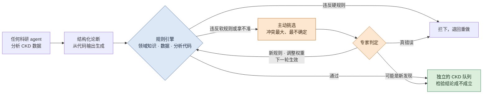

# 可检验的 CKD 科研 agent：规则引擎驱动、专家参与、不断进步的 harness

## 一页看懂 {#glance}

!!! abstract "这个课题要做什么"
    **做一套包在任何科研 agent 外面的 harness，让它对慢性肾病（CKD）给出的结论可以被检验。**

    - **为什么：**能分析 CKD 数据、提出假设的 agent 已经很多，有的已经在给 CKD 提靶点。但它们的结论是一段自由文本，过程看不见，出了错也没人系统地抓；专家的时间又很有限。
    - **核心是规则引擎：**每个结论先变成结构化的论断，再从三层检查：领域知识（CKD 生物学）、数据（数据本身可不可靠）、分析代码（统计和计算有没有做错）。违反硬规则就拦下，违反软规则就标出来。
    - **专家只看最值得看的：**系统主动挑出规则冲突最大、最拿不准的论断交给专家，不让专家读整份报告。
    - **越用越好：**专家的判断变成新规则，或者调整已有规则的权重；规则库有版本号，一轮比一轮准。
    - **怎么证明有用：**故意埋错，看能抓到多少；比较有和没有 harness 的 agent；画出一轮一轮的学习曲线；看通过检查的结论，在独立的 CKD 病人队列里是不是更容易成立。
    - **现状：**2026-11-03 定下方向；文献和数据调研做完，代码还没开始。第一阶段是 2026 年 11 月到 2027 年 4 月。

## 目录 {#contents}

[1 问题](#question) · [2 思路](#idea) · [3 引擎](#engine) · [4 专家参与和不断进步](#loop) · [5 怎么嵌进 agent](#harness) · [6 评测](#evaluation) · [7 CKD 数据](#data) · [8 部署](#deploy) · [9 计划和交付](#plan) · [10 和伪影注入课题的关系](#connect) · [11 还没定的](#open) · [12 阅读路线](#reading)

只读每段开头的粗体句，就能看懂主线；医学和数据的细节在折叠块里，完整出处在每节末尾的"参考文献"里。

## 问题 {#question}

这一节回答：为什么要做这个课题。

**能分析 CKD 数据的 agent 已经很多，缺的是让它们的结论可以被检验的那一层。**现在的 AI agent 已经能像一个研究生一样工作：读文献，拿到数据，自己写代码分析，提出假设，最后写一份报告（[Alber et al. 2026](https://doi.org/10.1038/s41592-026-03029-6)）。它们已经开始给 CKD 提靶点：组里的 NephroAIX 让大模型在 KPMP 肾脏单细胞数据构成的知识网络上给靶点排序（[Hayat et al. 2025](https://doi.org/10.1681/ASN.20254q7nxd06)）；FutureHouse 的 Robin 只读文献，就给慢性肾病提出了 10 个候选药物（[Ghareeb et al. 2025](https://arxiv.org/abs/2505.13400)；[robin_CKD.ipynb](https://github.com/Future-House/robin/blob/main/examples/robin_CKD.ipynb)）。这些结果都还没有用数据或实验检验过。

**它们的结论是一段自由文本，过程看不见，出了错也没人系统地抓。**别的研究团队发现，数据不够时，agent 宁可编造数据，也不承认做不了（[Yang et al. 2026](https://arxiv.org/abs/2605.10246)）。把数据稍微扰动一下再分析，大约一半的肯定结论就站不住了（[Rewolinski et al. 2026](https://arxiv.org/abs/2604.11003)）。做单细胞统计时，agent 会把同一个病人的几千个细胞当成几千个独立样本，显著性因此被严重夸大（[Alber et al. 2026](https://doi.org/10.1038/s41592-026-03029-6)）。

**专家的时间很少，现有的评测也不检查过程。**让肾内科医生逐份读报告，读不过来。多数评测请另一个大模型或者专家给报告打分，或者看 agent 能不能"重新发现"已发表的结论（[Guo et al. 2024](https://arxiv.org/abs/2411.02429)；[Ruan et al. 2024](https://arxiv.org/abs/2412.17596)；[Qu et al. 2026](https://doi.org/10.64898/2026.05.12.724604)），可写得好不等于对。少数用独立数据打分的工作不在肾脏，而且只看最后的结论，不查中间有没有统计错或者编数字（[Johri et al. 2026](https://doi.org/10.64898/2026.06.04.729919)；[Roberts et al. 2026](https://doi.org/10.64898/2026.03.15.26348338)）。

**所以本课题不再造一个 agent，而是做它外面的那一层：harness。**这一层由规则引擎驱动，主动请专家把关，并且越用越好。同一个模型换一套 harness，表现可以差很多（[Qu et al. 2026](https://doi.org/10.64898/2026.05.12.724604)）；但也有研究认为选模型更重要（[Merrill et al. 2026](https://arxiv.org/abs/2601.11868)），所以这一点要实测。

??? info "给非医学背景的读者：CKD、靶点，以及肾脏数据里的陷阱"

    
    **CKD 是什么，靶点为什么重要。**慢性肾病（CKD）指肾功能长期、逐渐地下降。找新药的第一步是选"靶点"：一个基因、一条通路或者一类细胞，药物要作用在它上面。靶点选错，后面所有的实验都白做，所以 agent 提出的靶点必须先能被检验。

    **单细胞数据是什么。**单细胞测序能测出肾脏里每一个细胞表达了哪些基因，再按表达把细胞分成近端小管、免疫细胞等类型。agent 分析的就是这种数据：比较 CKD 病人和健康人，看哪些基因在哪类细胞里变了。

    **单细胞的结论，换一批病人常常就不成立了。**在阿尔茨海默病的研究里，从一项研究找出的差异基因，拿到另一项研究里去区分病人和健康人，效果只比随机猜好一点（[Nakatsuka et al. 2025](https://doi.org/10.1038/s41467-025-62579-z)）。人做的研究尚且如此，agent 在一份数据上的"发现"，也很可能只在那份数据里成立。在肾脏上，这件事还没有人系统测过。

    **肾脏数据里已经能看到具体的陷阱。**几个看起来互相独立的肾脏队列，其实共用一部分病人（我们对 GEO 和 Zenodo 元数据的核查，见[数据集](../datasets/index.md)页）。同一个"受损的近端小管"状态，在不同队列里的说法不一样（[Wilson et al. 2022](https://doi.org/10.1038/s41467-022-32972-z)；[Abedini et al. 2024](https://doi.org/10.1038/s41588-024-01802-x)）。有的队列病人很少，糖尿病肾病只有五到七个人（[Wilson et al. 2022](https://doi.org/10.1038/s41467-022-32972-z)）。通用的 agent 不知道这些，这正是规则引擎要抓的东西。

??? note "参考文献（完整出处和细节）"

    
    按正文的顺序排列。"只读了摘要"的地方已经注明。

    - **CellVoyager：**Alber S et al. CellVoyager: AI CompBio agent generates new insights by autonomously analyzing biological data. *Nat Methods* 2026. [doi:10.1038/s41592-026-03029-6](https://doi.org/10.1038/s41592-026-03029-6)（[精读](../papers/cellvoyager-natmethods-2026/index.md)）。COVID-19 分析里先按细胞做检验，原作者要求后才改成按供者合并
    - **NephroAIX：**Hayat S, Joppich M, Kramann R. NephroAIX: Large Language Model (LLM)-Guided Knowledge Graph for Explainable Target Discovery in Human Kidney Diseases Using Single-Cell Data. *J Am Soc Nephrol* 2025;36(10S)，Kidney Week 2025 摘要。[doi:10.1681/ASN.20254q7nxd06](https://doi.org/10.1681/ASN.20254q7nxd06)（只读了摘要；摘要里没有报告验证）
    - **Robin：**Ghareeb AE et al. Robin: A multi-agent system for automating scientific discovery. [arXiv:2505.13400](https://arxiv.org/abs/2505.13400) (2025)。CKD 示例见 [examples/robin_CKD.ipynb](https://github.com/Future-House/robin/blob/main/examples/robin_CKD.ipynb)：只检索文献，提出 CY-09、OLT1177、MCC950、VX-765 等 10 个候选，多数作用于 NLRP3 炎症小体通路，再由模型两两比较排序（我们读了 notebook 的输出）
    - **编造数据：**Yang Z et al. SciIntegrity-Bench: A Benchmark for Evaluating Academic Integrity in AI Scientist Systems. [arXiv:2605.10246](https://arxiv.org/abs/2605.10246) (2026)。7 个前沿模型、231 次运行，34.2% 出现诚信问题；在缺数据的场景里，7 个模型全都合成了数据
    - **结论不稳、信心不准：**Rewolinski ZT et al. Sanity Checks for Agentic Data Science. [arXiv:2604.11003](https://arxiv.org/abs/2604.11003) (2026)。用 OpenAI Codex 分析 11 份真实数据，其中 6 份的肯定结论在扰动后站不住；agent 自报的信心和结论的实际稳定性对不上
    - **请模型或专家打分的评测：**Guo S et al. IdeaBench. [arXiv:2411.02429](https://arxiv.org/abs/2411.02429) (2024)；Ruan K et al. LiveIdeaBench. [arXiv:2412.17596](https://arxiv.org/abs/2412.17596) (2024)；Qu Y et al. BiomniBench: Process-level Evaluation of LLM Agents for Real-world Biomedical Research. bioRxiv 2026. [doi:10.64898/2026.05.12.724604](https://doi.org/10.64898/2026.05.12.724604)（[精读](../papers/biomnibench-biorxiv-2026/index.md)）。同一模型换 harness 提高 9.4–13.5 分，换一代模型只提高 3.8 分
    - **用独立数据打分：**Johri S et al. Evaluating agentic AI for biological discovery in autonomous and copilot settings. bioRxiv 2026. [doi:10.64898/2026.06.04.729919](https://doi.org/10.64898/2026.06.04.729919)（癌症，用独立的 TCGA 队列打分）；Roberts KF et al. OpenScientist. medRxiv 2026. [doi:10.64898/2026.03.15.26348338](https://doi.org/10.64898/2026.03.15.26348338)（骨髓瘤，一个外部队列 GSE6477）
    - **选模型更重要：**Merrill MA et al. Terminal-Bench. [arXiv:2601.11868](https://arxiv.org/abs/2601.11868) (2026)："model selection is usually more important than agent scaffold"
    - **差异基因跨研究复现：**Nakatsuka N et al. Improving reproducibility of differentially expressed genes in single-cell transcriptomic studies of neurodegenerative diseases through meta-analysis. *Nat Commun* 2025;16:7436. [doi:10.1038/s41467-025-62579-z](https://doi.org/10.1038/s41467-025-62579-z)。平均 AUC：阿尔茨海默病 0.68，帕金森病 0.77，亨廷顿病 0.85，COVID-19 0.75（0.5 等于随机；正文 Results 和 Table 1）。肾脏整合图谱统一了注释，但没有检验结论复现：Stasinos K et al. bioRxiv 2026. [doi:10.64898/2026.08.12.744548](https://doi.org/10.64898/2026.08.12.744548)
    - **肾脏队列共用病人：**我们 2026-11-02 对 GEO 和 Zenodo 元数据的核查：Wilson 2022 的对照组是 Muto 2021 的供者，部分 DKD 样本来自 Wilson 2019；Dumoulin 2026 和 Abedini 2024 有相同的病人编号（如 HK2844）
    - **受损近端小管的不同说法：**Wilson PC et al. *Nat Commun* 2022;13:5253. [doi:10.1038/s41467-022-32972-z](https://doi.org/10.1038/s41467-022-32972-z)：VCAM1+ 受损近端小管在 DKD 里更多（snATAC 0.12 对 0.03，p = 0.004；snRNA 0.06 对 0.02，p = 0.03），比例"人和人之间差别很大"，DKD 只有 5–7 人。[Abedini 2024](../papers/abedini-kidney-atlas-natgenet-2024/index.md)：VCAM1+ 的受损近端小管在健康样本里也有，CKD 里富集的是 HAVCR1+ 那一类
    - **检索范围：**截至 2026 年 11 月，不可能穷尽，所以论文里写"据我们所知"。通用领域已经很拥挤，2026 年平均每月约 7 篇相关论文（我们的检索计数，是下限）

## 思路 {#idea}

这一节回答：整条 pipeline 怎么走。

**agent 照常分析数据，harness 在外面一路检查。**任何 agent 在 CKD 数据上分析，它的每个结论都从代码输出里生成一条结构化的论断。规则引擎从三层检查这条论断：违反硬规则就拦下，退回重做；违反软规则或者拿不准的，进入挑选环节。

**专家只看系统挑出来的那几条。**系统按规则冲突的大小和不确定的程度排序，把最值得看的交给专家。专家的判断有两个去处：这一条论断怎么处理，以及下一轮的规则怎么改。

**最后用独立的 CKD 数据检验这套检查有没有用。**通过检查的结论，和被标出来的结论，分别拿到 agent 没见过的病人队列里去检验，看哪一组更容易成立。

蓝色：规则引擎（第 3 节）。橙色：挑选和专家（第 4 节）。绿色：用独立数据检验（第 6 节）。

## 引擎：从三层检查每个论断 {#engine}

这一节回答：规则引擎检查什么、怎么检查。这是整个课题的核心。

**每个结论先变成一条结构化的论断，而且从代码输出里生成。**论断有固定的几栏：哪类细胞、哪个基因、往哪个方向变、变多少、比较的是哪两组、统计以什么为单位、每组多少人、证据是关联还是干预，以及这些数字来自哪一段代码的输出。这些栏不让 LLM 自己填，否则它会写得刚好能通过检查。

**引擎从三层检查，每层的事实来自不同的地方。**三层按"事实从哪来"来分，而不是按错误的种类分，因为有的错误（比如按细胞做统计）要同时看数据和代码才能判断。这三层在各自的领域里都是成熟的方向，但还没有人把它们放进同一个引擎，去检查 agent 的论断（[Gu et al. 2024](https://arxiv.org/abs/2408.09667)；[Li et al. 2026](https://arxiv.org/abs/2610.14115)）。

| 层 | 检查什么 | CKD 里的例子 | 事实从哪来 | 可以复用的工具 |
|---|---|---|---|---|
| **领域知识** | 结论符不符合 CKD 生物学 | 标志基因和细胞类型对不对得上；变化方向和已知的损伤状态一不一致；把关联写成了因果 | 本体和知识库：Cell Ontology、HuBMAP 肾脏表、KPMP 图谱 | pySHACL、ELK 推理器、clingo |
| **数据** | 数据本身可不可靠、用得对不对 | 检验用的队列里有没有发现队列的人；双细胞、背景污染、低质量细胞；批次；每组人数太少 | 数据和它的元数据 | 数据验证的思路（Deequ 一类）、单细胞质控、[伪影注入课题](anomaly-benchmark.md)的检测器 |
| **分析代码** | 统计和计算有没有做错 | 按细胞而不是按病人做统计；先用同一份数据分群再比较；没有做多重检验校正；报告里的数字对不上代码输出 | agent 的代码和数据流 | pbcheck、notebook 数据流分析、统计错误检查 |

**硬规则违反了就拦下，软规则违反了只做标记，并指出是哪几条规则冲突。**硬规则如"统计必须以病人为单位"；软规则如"标志基因应该和细胞类型对得上"。软规则不判错，因为一个真正的新发现，可能恰恰和已有知识冲突。规则用答案集编程工具 clingo 执行，它能找出最少是哪几条规则冲突，这正是专家要看的东西（[clingo-explaid](https://github.com/potassco/clingo-explaid)）。

**引擎读代码和数据，不只读报告的文字；新意在于把三层放进同一个引擎。**否则 agent 可以声称"按病人统计"，实际却按细胞算（[Squair et al. 2021](https://doi.org/10.1038/s41467-021-25960-2)）。据我们所知，还没有人用同一套规则、在同一个引擎上，从这三层检查 agent 的论断。工具、先例和局限见下面的折叠块。

??? info "给非医学背景的读者：每条规则是什么意思"

    
    | 规则 | 层 | 硬 / 软 | 用大白话说 |
    |---|---|---|---|
    | 基因和细胞类型必须真实存在 | 领域知识 | 硬 | 名字要能在标准的基因表（HGNC）和细胞本体（Cell Ontology）里查到，防止编造 |
    | 证据是关联，结论不能写成"导致" | 领域知识 | 硬 | 病人身上某基因高，不等于这个基因导致了病 |
    | 同一份报告里，同一个基因在同一类细胞里不能既升高又降低 | 领域知识 | 硬 | 自相矛盾 |
    | 标志基因要和细胞类型对得上 | 领域知识 | 软 | 每类肾细胞有自己的"身份证"基因；对不上，可能是细胞分错了类 |
    | 变化方向要和已知的肾脏损伤状态一致 | 领域知识 | 软 | 和 KPMP 图谱描述的损伤状态相反时要标出来，但也可能是新发现 |
    | 说是 CKD 靶点的基因，最好有遗传证据支持 | 领域知识 | 软 | 遗传上和 CKD 有关的基因，更可能是真正的原因 |
    | 检验用的队列里不能有发现队列的人 | 数据 | 硬 | 否则就是拿做过的题来考 |
    | 每组人数要够 | 数据 | 软 | 只有几个病人时，测不出差别不等于没有差别 |
    | 统计以病人为单位：按病人合并后比较，或者用混合模型 | 分析代码 | 硬 | 一个病人的几千个细胞不是几千个独立样本 |
    | 先用同一份数据分群、再比较这些群，p 值只能当描述用 | 分析代码 | 硬 | 群本来就是按差异分出来的，再检验差异，p 值会假地很小 |
    | 做了很多次检验，必须做多重检验校正 | 分析代码 | 硬 | 检验两万个基因，总会有一些碰巧"显著" |
    | 报告里每个数字都要能对到代码输出 | 分析代码 | 硬 | 防止编数字 |

??? note "参考文献（完整出处和细节）"

    
    按正文和折叠块的顺序排列。

    - **工具的分工：**pySHACL 检查论断的格式和编号；ELK 推理器预先算好本体里的关系，比如"近端小管上皮细胞属于肾上皮细胞"；clingo 执行规则，clingo-explaid 找出最小冲突集合。不用 Lean：它为数学证明设计，只能判真或假，而生物知识大多是"通常如此"
    - **先例：**答案集编程曾被用来检查调控网络和表达数据是否一致（Gebser 2011，见下）；程序分析里已有把 Python notebook 转成逻辑事实、再用规则找数据泄漏的做法（Yang 2022，见下）
    - **新颖性的说法：**可以说"据我们所知，第一个在同一个引擎上，用同一套声明式规则，从领域知识、数据和代码三层检查 agent 的结构化论断，并指出违反了哪条规则"；不说"第一个检查 agent 分析的"，也不说"第一个用于生物的规则引擎"

    - **三种能力的说法：**Gu K et al. BLADE: Benchmarking Language Model Agents for Data-Driven Science. Findings of EMNLP 2024. [arXiv:2408.09667](https://arxiv.org/abs/2408.09667)（只读了摘要）。原话：数据驱动的科学发现需要整合"scientific domain knowledge, statistical expertise, and an understanding of data semantics"。Li X et al. The Silent Failures in Agentic Data Science. [arXiv:2610.14115](https://arxiv.org/abs/2610.14115) (2026)：现有评测忽略了数据科学的方法原则和领域知识
    - **工具和许可：**[pySHACL](https://github.com/RDFLib/pySHACL)（Apache-2.0）；ELK 推理器（开源）；[clingo](https://github.com/potassco/clingo) 和 [clingo-explaid](https://github.com/potassco/clingo-explaid)（MIT）；可选 [ProbLog](https://github.com/ML-KULeuven/problog)（Apache-2.0），把几种证据合成一个可信度分数；[pbcheck](https://github.com/s4s4s4s/pbcheck)（BSD-3-Clause，PyPI 0.1.0），检查单细胞差异分析里的伪重复
    - **答案集编程在生物学里的先例：**Gebser M et al. Detecting inconsistencies in large biological networks with answer set programming. *Theory Pract Log Program* 2011;11:323–360. [doi:10.1017/S1471068410000554](https://doi.org/10.1017/S1471068410000554)；Thiele S et al. *BMC Bioinformatics* 2015;16:345. [doi:10.1186/s12859-015-0733-7](https://doi.org/10.1186/s12859-015-0733-7)
    - **按细胞检验的假阳性：**Squair JW et al. Confronting false discoveries in single-cell differential expression. *Nat Commun* 2021;12:5692. [doi:10.1038/s41467-021-25960-2](https://doi.org/10.1038/s41467-021-25960-2)。按病人合并和混合模型哪个更好有争论，所以两种都接受：Zimmerman KD et al. *Nat Commun* 2021;12:738. [doi:10.1038/s41467-021-21038-1](https://doi.org/10.1038/s41467-021-21038-1)；Murphy AE et al. *Nat Commun* 2022;13:7851. [doi:10.1038/s41467-022-35519-4](https://doi.org/10.1038/s41467-022-35519-4)
    - **用规则分析 notebook：**Yang C et al. Data Leakage in Notebooks: Static Detection and Better Processes. ASE 2022. [doi:10.1145/3551349.3556918](https://doi.org/10.1145/3551349.3556918)。把 Python 转成逻辑事实，用 Soufflé 规则找出数据泄漏
    - **数据验证：**Schelter S et al. Automating large-scale data quality verification (Deequ). *PVLDB* 2018;11(12). [doi:10.14778/3229863.3229867](https://doi.org/10.14778/3229863.3229867)
    - **先分群再比较：**Gao LL et al. Selective Inference for Hierarchical Clustering. *J Am Stat Assoc* 2024;119:332–342. [doi:10.1080/01621459.2022.2116331](https://doi.org/10.1080/01621459.2022.2116331)；修正方法之一（计数拆分）：Neufeld A et al. [arXiv:2207.00554](https://arxiv.org/abs/2207.00554)
    - **多重检验校正：**Turcotte A, Mehta NN. The Fault in our Stats. ASE 2025（[论文 PDF](https://reallytg.github.io/files/papers/ase25_statlint_final_final.pdf)）。STAT-LINT 检查了 90 个数据分析 notebook，只有 2 个做了多重检验校正
    - **肾脏标志基因：**HuBMAP 肾脏 ASCT+B 表 v1.8（CC BY 4.0；67 种细胞类型、186 个标志基因；[CSV](https://cdn.humanatlas.io/digital-objects/asct-b/kidney/latest/assets/asct-b-vh-kidney.csv)）。方法：Börner K et al. Anatomical structures, cell types and biomarkers of the Human Reference Atlas. *Nat Cell Biol* 2021;23:1117–1128. [doi:10.1038/s41556-021-00788-6](https://doi.org/10.1038/s41556-021-00788-6)。基因和细胞类型的编号：HGNC（CC0）、Cell Ontology（CC BY 4.0）
    - **肾脏损伤状态：**Lake BB et al. *Nature* 2023;619:585–594. [doi:10.1038/s41586-023-05769-3](https://doi.org/10.1038/s41586-023-05769-3)（[精读](../papers/lake-kidney-atlas-nature-2023/index.md)）
    - **最接近、但不一样的工作：**Sargsyan K. Structural Enforcement of Statistical Rigor in AI-Driven Discovery. [arXiv:2511.06701](https://arxiv.org/abs/2511.06701) (2025)（用 Lean 证明 agent 的统计流程是对的，不检查结论，没有生物）；Li B et al. OmniScientist. [arXiv:2608.13558](https://arxiv.org/abs/2608.13558) (2026)（用代码强制做严谨性检查，没有组学规则，不做独立队列验证）；Feng Y et al. VeriCoT. [arXiv:2511.04662](https://arxiv.org/abs/2511.04662) (2025)（用求解器检查推理是否自洽，只查逻辑）；GeneAgent（Wang Z et al. *Nat Methods* 2025;22:1677–1685. [doi:10.1038/s41592-025-02748-6](https://doi.org/10.1038/s41592-025-02748-6)；用数据库核对论断，不是一套写明的规则）。多数只读了摘要
    - **规则的局限：**规则抓得到"听起来就不对"的错，抓不到"听起来合理但其实错"的生物学，也处理不了混杂因素；知识库本身也有错，所以知识规则只做软规则，有版本号；各类错误能抓到多少，现在只是估计，要实测

## 专家参与和不断进步 {#loop}

这一节回答：系统挑哪些论断给专家看，专家的判断怎么变成规则，以及怎么保证一轮比一轮好。

**专家不读整份报告，只看系统挑出来的论断。**系统按两种信号排序：一条论断违反的规则冲突有多大，以及软规则对它的判断有多不确定。排在前面的交给专家。这个挑选方式要和几种对照比：随机挑、按 agent 自己报的信心挑，以及已有工作里的挑法（[Yi et al. 2026](https://arxiv.org/abs/2609.04442)；[Boecking et al. 2021](https://arxiv.org/abs/2012.06046)）。随机挑这个对照必须有，因为按 agent 的信心挑，可能比随机还差（[Zavattari 2026](https://arxiv.org/abs/2607.28317)）。

**专家看到的是一条论断、它违反的那几条规则，以及产生它的代码和输出。**专家给出三种判断之一：真错误、规则不适用（可能是新发现）、拿不准。专家必须是真人，至少一位肾内科医生；用大模型模拟专家的做法，审稿人不会认（[Yi et al. 2026](https://arxiv.org/abs/2609.04442)）。

**专家的判断变成可执行的规则。**"真错误"可以变成一条新的硬规则或软规则，"规则不适用"会降低那条软规则的权重。每条新规则都记下它来自哪个专家、哪一条论断、哪一轮，并带一个"退役"条件：如果它在后面几轮里总是误报，就下线。有研究发现，规则只积累不整理，效果反而比没有规则还差（[Cui et al. 2026](https://arxiv.org/abs/2606.17591)）。

**按轮次走，避免自己出题自己考。**每一轮评测时，规则库是冻结的；两轮之间，才用专家的判断更新规则。进步要在没用来改规则的数据上衡量。专家的标准本身也会在打分的过程中漂移，所以每轮都要记录判断，并检查前后是否一致（[Shankar et al. 2024](https://arxiv.org/abs/2404.12272)）。

??? note "参考文献（完整出处和细节）"

    
    检索截至 2026 年 11 月；除 GRACE 读了全文外，都只读了摘要。

    - **每个零件单独看都不新，新的是组合和终点。**已有工作做过"把拿不准的论断交给专家，一轮一轮变好"（[Yi et al. 2026](https://arxiv.org/abs/2609.04442)），也做过"主动挑选规则去问专家"（[Boecking et al. 2021](https://arxiv.org/abs/2012.06046)；[Hsieh et al. 2022](https://arxiv.org/abs/2203.01382)），还做过"包在任何 agent 外面、把反馈变成规则"（[Ghiasnezhad Omran et al. 2026](https://arxiv.org/abs/2608.15591)）。据我们所知，还没有人用规则冲突来挑选给专家看的论断，把专家的判断写成带出处的逻辑规则，加入组学的统计和代码规则，并用独立 CKD 队列里的复现作为终点。

    - **GRACE：**Yi JSK et al. GRACE: Graph-Grounded Reflective Agent Copilot Engine for Expert-in-the-Loop Knowledge Expansion. [arXiv:2609.04442](https://arxiv.org/abs/2609.04442) (2026)（读了全文）。把输出拆成论断，用证据图核对；只把"重要又拿不准"的交给专家；通过的论断变成新证据；有一轮一轮的学习曲线。"专家"是用 GPT-4.1 模拟的；任务是通用问答，没有统计和数据来源的规则
    - **主动学习规则：**Boecking B et al. Interactive Weak Supervision: Learning Useful Heuristics for Data Labeling. ICLR 2021. [arXiv:2012.06046](https://arxiv.org/abs/2012.06046)；Hsieh C-Y et al. Nemo: Guiding and Contextualizing Weak Supervision for Interactive Data Programming. *PVLDB* 2022. [arXiv:2203.01382](https://arxiv.org/abs/2203.01382)。都用于给数据打标签，不是检查 agent 的结论
    - **包在任何 agent 外面：**Ghiasnezhad Omran P et al. Agent Gym: A Framework for Continuous Evaluation and Evolution of LLM Agents Through Human-in-the-Loop Feedback. [arXiv:2608.15591](https://arxiv.org/abs/2608.15591) (2026)。用在发票处理等业务 agent 上
    - **按信心挑选可能比随机还差：**Zavattari C. One Human, N Agents: Audit-Budget Allocation for LLM Agent Fleets under Miscalibrated, Correlated Confidence. [arXiv:2607.28317](https://arxiv.org/abs/2607.28317) (2026)
    - **规则要整理和退役：**Cui Y et al. Closing the Feedback Loop: From Experience Extraction to Insight Governance in Verbal Reinforcement Learning. [arXiv:2606.17591](https://arxiv.org/abs/2606.17591) (2026)
    - **专家标准的漂移：**Shankar S et al. Who Validates the Validators? Aligning LLM-Assisted Evaluation of LLM Outputs with Human Preferences. UIST 2024. [arXiv:2404.12272](https://arxiv.org/abs/2404.12272)

## 怎么嵌进 agent {#harness}

这一节回答：harness 怎么包在一个已有的 agent 外面，以及除了规则引擎还有哪些部件。

**harness 包在任何 agent 外面，不改 agent 本身。**被测的 agent 可以是生物医学 agent Biomni（[Huang et al. 2026](https://doi.org/10.1126/science.adz4351)），可以是通用的编程 agent，也可以是 NephroAIX，如果能拿到它的代码（[Hayat et al. 2025](https://doi.org/10.1681/ASN.20254q7nxd06)）。证据显示，最强的往往就是通用的编程 agent，生物医学专用的 agent 没有稳定的优势（[Qu et al. 2026](https://doi.org/10.64898/2026.05.12.724604)；[Miller et al. 2025](https://doi.org/10.1101/2025.09.01.673319)）。

**论断从代码输出里生成，检查不过就不能宣布"完成"。**agent 在受控的环境里跑代码，harness 从它的输出里提取结构化论断。规则引擎没有放行之前，harness 不让 agent 宣布任务完成。这样的"关卡"在现成的 agent 框架里可以用 hook 实现。

**规则引擎之外，还有几个可以开关的部件。**一个独立的验证 agent 从代码重新算出每个数字（没有外部信号的自我检查基本没用，[Huang et al. 2024](https://arxiv.org/abs/2310.01798)）；人工整理的肾脏技能包（[Li et al. 2026](https://arxiv.org/abs/2602.12670)）；把假设和数字存成固定格式的"结论账本"，而不是越来越长的对话记录（[Du et al. 2025](https://arxiv.org/abs/2510.05381)）；以及带概率的结论和弃答（[Liu et al. 2026](https://arxiv.org/abs/2607.10059)）。每个部件都能单独拿掉做消融。

**"加部件能提高可靠性"还不是定论，按实测写。**同一个模型换一套 harness，分数可以提高得比换一代模型还多（[Qu et al. 2026](https://doi.org/10.64898/2026.05.12.724604)）；但在命令行任务上，作者的结论是选模型通常更重要（[Merrill et al. 2026](https://arxiv.org/abs/2601.11868)）。

??? note "参考文献（完整出处和细节）"

    
    - **Biomni：**Huang K et al. Autonomous biomedical research with an artificial intelligence agent. *Science* 2026. [doi:10.1126/science.adz4351](https://doi.org/10.1126/science.adz4351)（[精读](../papers/biomni-biorxiv-2025/index.md)，读的是预印本）
    - **通用编程 agent 得分最高：**Qu Y et al. BiomniBench（见[问题](#question)）。Claude Code 加 Opus 4.7 最高；同一模型换 harness 提高 9.4–13.5 分，Opus 4.6 到 4.7 只差 3.8 分
    - **专用 agent 没有稳定优势：**Miller HE et al. BioML-bench: Evaluation of AI Agents for End-to-End Biomedical ML. bioRxiv 2025. [doi:10.1101/2025.09.01.673319](https://doi.org/10.1101/2025.09.01.673319)（只读了摘要）
    - **独立验证：**Huang J et al. Large Language Models Cannot Self-Correct Reasoning Yet. ICLR 2024. [arXiv:2310.01798](https://arxiv.org/abs/2310.01798)；用外部工具核对才有用：Gou Z et al. CRITIC. ICLR 2024. [arXiv:2305.11738](https://arxiv.org/abs/2305.11738)；Wang Z et al. GeneAgent. *Nat Methods* 2025;22:1677–1685. [doi:10.1038/s41592-025-02748-6](https://doi.org/10.1038/s41592-025-02748-6)
    - **技能：**Li X et al. SkillsBench. [arXiv:2602.12670](https://arxiv.org/abs/2602.12670) (2026)（只读了摘要）。人工整理的技能把平均通过率从 33.9% 提到 50.5%
    - **结论账本：**Du Y et al. Context Length Alone Hurts LLM Performance Despite Perfect Retrieval. [arXiv:2510.05381](https://arxiv.org/abs/2510.05381) (2025)（性能下降 13.9%–85%）；Jiang P et al. Harness-1. [arXiv:2606.02373](https://arxiv.org/abs/2606.02373) (2026)（把状态放到外部，在检索任务上比次强的开源方案高 11.4 分）；都只读了摘要。设计思路参考 [Jev 工程笔记（中文译本）](https://github.com/yibie/jev-engineering-zh)（工程笔记，不是论文，没有实验）
    - **弃答：**Liu X et al. AgentAbstain: Do LLM Agents Know When Not to Act? [arXiv:2607.10059](https://arxiv.org/abs/2607.10059) (2026)（只读了摘要）。17 个模型里最好的，在成对任务上也只有 59.5% 都做对
    - **选模型更重要：**Merrill MA et al. Terminal-Bench. [arXiv:2601.11868](https://arxiv.org/abs/2601.11868) (2026)

## 评测 {#evaluation}

这一节回答：怎么证明这套 harness 有用。四种评测，从最干净的到最接近真实的。

**第一，埋错测试：引擎能抓到多少已知的错。**在真实的 CKD 分析里故意埋入已知的错误，比如按细胞做统计、把发现队列的人混进检验队列、标错细胞类型、编一个数字。每一层分别算抓到了多少、误报了多少。埋错的人不能是写规则的人，否则就是自己考自己。

**第二，消融：有和没有 harness，agent 差多少。**同一个 agent、同一组题，分别在有和没有 harness 的情况下跑；再一层一层拿掉，看每一层值多少。每道题至少重跑三次，同时用一个闭源模型和一个开源模型，这样 harness 的作用可以和"换一代模型"的作用放在一起比。

**第三，学习曲线：一轮比一轮好吗。**每一轮之后，看三个数：每分钟专家时间抓到多少错，每条论断平均要多少专家时间，以及通过检查的结论有多少能在独立数据里成立。

**第四，终点：通过检查的结论，在独立的 CKD 队列里是不是更容易成立。**通过检查的和被标出来的结论，分别拿到 agent 没见过的病人队列里检验。如果通过检查的明显更容易成立，就说明这套检查能在没有第二个队列的时候，先挡掉不可信的结论；这正是找新靶点时的处境。评测数据怎么做，见下面的折叠块。

??? info "给非医学背景的读者：评测数据怎么一步步做出来"

    
    **核心思路：用已发表论文公开的数据，按统一的规则自己重新算一遍；论文里写的结论不当答案。**

    **第一步，把一句结论拆成几个能在数据里查的预测。**假设 agent 说："基因 X 是 CKD 的好靶点，它在受损的近端小管里升高。"这句话本身没法直接判对错，但可以拆开，每个预测用一种独立的证据去检验：

    | 要检验的预测 | 用什么数据检验 | 具体怎么做 | 证据强度 |
    |---|---|---|---|
    | ① X 在 CKD 病人的近端小管里升高 | 别的研究组的病人队列（agent 没见过） | 下载原始单细胞数据，按病人合并，比较 CKD 和对照里 X 在近端小管的表达 | 中：只说明相关 |
    | ② X 越高，肾功能越差 | 同一批队列的临床信息（eGFR、纤维化程度） | 看 X 的表达和 eGFR 是否负相关 | 中：只说明相关 |
    | ③ X 和 CKD 有遗传上的联系 | CKD 的全基因组关联研究（GWAS） | 查 X 是否靠近 CKD 风险位点 | 较强：遗传证据接近因果 |
    | ④ 有效的药会让 X 降下来 | 治疗数据：用药前后的活检、动物治疗组 | 比较治疗组和对照组里 X 的变化 | 较强：是干预后的结果 |

    每个预测得到一个结果：**成立 / 不成立 / 样本不够 / 测不了**。几个结果合起来，就是这个结论的**证据成绩单**。如果 agent 提的是一个药，药有没有效最终只能靠实验或临床试验；我们能检验的是它背后的前提。

    **第二步，分清论文的数据和论文的结论。**我们用的全部是已发表论文公开的数据。但一篇论文里有两样东西，用法完全不同：**数据**是作者公开的原始测量结果（例如几十万个细胞的基因表达，以及每个细胞来自哪个病人）；**结论**是作者写在文章里的话（例如"CKD 里某类受损近端小管增多"）。

    | 用到的东西 | 怎么用 | 为什么 |
    |---|---|---|
    | **已发表论文的数据** | **答案的主要来源。**我们下载数据，用自己的代码和统一的规则重新计算，算出来的结果才是答案 | 规则统一，比较才公平；agent 提出的新结论，任何论文里都没有，只能用数据检验 |
    | 已发表论文的结论 | **不当答案。**只用在两处：挑出一批结论，算"人做的结论能复现多少"这条参照线；检查 agent 是不是在复述文献 | 作者可能用了别的统计方法；agent 很可能读过这些论文 |
    | 模型训练截止以后才公布的结果（例如 2026 年的临床试验） | 可以直接当答案 | agent 训练时这些结果还不存在，不可能读过 |

    **举个例子（示意，结果还没算）。**[Abedini et al. 2024](https://doi.org/10.1038/s41588-024-01802-x) 在文章里写：CKD 病人的肾里，一类表达 HAVCR1（也叫 KIM-1，常用的肾损伤标志物）的受损近端小管细胞增多了。这是论文的**结论**。它同时在 GEO 上公开了**数据**：每个细胞的基因表达，以及每个细胞来自哪个病人、这个病人是 CKD 还是对照。

    假设 agent 在 Lake 2023 上分析以后说："CKD 里，近端小管的 HAVCR1 表达升高。"我们不去翻 Abedini 的文章看他们怎么写，而是打开 Abedini 的数据，把每个病人的近端小管细胞合在一起，比较 CKD 病人和对照的 HAVCR1 表达，再按事先定好的规则判定：成立、不成立、样本不够，还是测不了。这个计算结果才是答案。

    再假设 agent 说的是另一个基因 Y，Abedini 的文章里根本没提过。论文的结论帮不上忙，但数据照样能算。这就是答案必须来自数据的原因。

    回到 HAVCR1：我们算出来的结果，很可能和 Abedini 写的一致。那么 agent 答对了，可能是因为它真的分析了 Lake 的数据，也可能只是因为它读过 Abedini 的文章。

    **所以还有一个要防的情况。**即使答案是我们从数据重新算的，很多时候也会和论文的结论一致。所以 agent 不分析数据、只靠复述读过的论文，也可能"答对"。为了把"真的分析出来"和"背出来"分开，评测里加了三样东西：一个只读文献、不碰数据的模型作为基线；把病人标签打乱的对照题（数据被打乱后还报出同样的结论，就是在背）；以及 agent 不可能读过的答案（训练截止以后的结果，以后还可以加入未公开的数据）。

    **第三步，去掉重复出现的病人。**同一个人不能既在"给 agent 的"数据里，又在"用来检查的"数据里，否则检查就成了拿原题考试。我们已经找到两处真实的重叠：Abedini 2024 和 Dumoulin 2026 共用一部分病人；Wilson 2022 的对照组就是 Muto 2021 的供者（我们对 GEO、Zenodo 和 CELLxGENE 编号的核查，2026-11-02）。发现队列 Lake 2023 用的是另一套编号，没法用编号证明有没有重叠（[Lake et al. 2023](https://doi.org/10.1038/s41586-023-05769-3)）。

    **第四步，统一口径，规则先定。**统计以病人为单位：先把同一个人、同一类细胞的表达加在一起（按病人合并），再比较病人和对照（[Squair et al. 2021](https://doi.org/10.1038/s41467-021-25960-2)）。比较基因，不比较细胞类型的名字，因为不同队列给同一类细胞起的名字不一样。判定规则在看结果之前写下来，之后不改。"不成立"和"样本不够"要分开：小队列测不出差别，不等于结论被推翻。

    **第五步，画一条参照线：人做的结论能复现多少。**挑出一批已发表的 CKD 结论，用完全相同的规则在独立队列里检验，看有多少能成立；病人标签打乱以后，应该几乎都不成立，这也在检查尺子本身准不准。这件事在脑疾病和新冠上做过（[Nakatsuka et al. 2025](https://doi.org/10.1038/s41467-025-62579-z)；[Garg et al. 2021](https://doi.org/10.1038/s41598-021-00121-z)），在肾脏上据我们所知还没有人系统做过。

??? note "参考文献（完整出处和细节）"

    
    - **Abedini 2024（人）：**Abedini A et al. Single-cell multi-omic and spatial profiling of human kidneys implicates the fibrotic microenvironment in kidney disease progression. *Nat Genet* 2024;56:1712–1724. [doi:10.1038/s41588-024-01802-x](https://doi.org/10.1038/s41588-024-01802-x)（[精读](../papers/abedini-kidney-atlas-natgenet-2024/index.md)）
    - **Lake 2023：**Lake BB et al. An atlas of healthy and injured cell states and niches in the human kidney. *Nature* 2023;619:585–594. [doi:10.1038/s41586-023-05769-3](https://doi.org/10.1038/s41586-023-05769-3)（[精读](../papers/lake-kidney-atlas-nature-2023/index.md)）
    - **供者重叠：**我们 2026-11-02 对 GEO、Zenodo 和 CELLxGENE 编号的核查。Abedini 和 Dumoulin 共用 HK 编号（例如 HK2844、HK2924）；Wilson 2022 的对照 1–5 是 Muto 2021 的供者，DKD 1–3 的单核数据来自 Wilson 2019。Muto Y et al. *Nat Commun* 2021;12:2190. [doi:10.1038/s41467-021-22368-w](https://doi.org/10.1038/s41467-021-22368-w)；Wilson PC et al. *PNAS* 2019;116:19619–19625. [doi:10.1073/pnas.1908706116](https://doi.org/10.1073/pnas.1908706116)
    - **按病人统计：**Squair JW et al. *Nat Commun* 2021;12:5692. [doi:10.1038/s41467-021-25960-2](https://doi.org/10.1038/s41467-021-25960-2)
    - **复现研究：**Nakatsuka N et al. *Nat Commun* 2025;16:7436. [doi:10.1038/s41467-025-62579-z](https://doi.org/10.1038/s41467-025-62579-z)；Garg M et al. Meta-analysis of COVID-19 single-cell studies confirms eight key immune responses. *Sci Rep* 2021;11:20833. [doi:10.1038/s41598-021-00121-z](https://doi.org/10.1038/s41598-021-00121-z)（只读了摘要）
    - **评测设计的要求：**埋错的人和写规则的人分开；必须用真专家；要有随机挑选的对照；规则要能在不同 agent 和不同队列之间迁移

## CKD 数据 {#data}

这一节回答：每份公开的 CKD 数据用在哪。每份数据的人数、下载方式和许可见各自的数据集页。

| 数据 | 用在哪 | 要注意的 |
|---|---|---|
| [Lake 2023](../datasets/lake-2023.md)（人） | 发现队列：agent 在这里分析、提出结论；也用来埋错 | 编号体系和其他队列不同；合并了它的整合数据不能当检验数据 |
| [Abedini 2024](../datasets/abedini-2024.md)（人） | 检验队列 | 和 Dumoulin 共用病人；公开注释里没有 aTAL |
| [Wilson 2022](../datasets/wilson-dkd-2022.md)（人） | 检验队列 | 对照来自 Muto 2021；糖尿病肾病只有 5–7 人 |
| [Kuppe 2021](../datasets/kuppe-2021.md)（人） | 检验队列 | 细胞是分选过的；没有健康对照 |
| [Dumoulin 2026](../datasets/dumoulin-dkd-spatial-2026.md)（人） | 空间佐证 | 和 Abedini 共用病人 |
| [ATTEMPT 2026](../datasets/attempt-sglt2i-2026.md)（人） | 用药前后的答案 | 没有病人编号，只能按组比较 |
| [Wu 2022 · DKD 五种治疗](../datasets/wu-dkd-2022.md)（小鼠） | 用药前后的答案 | 动物模型 |
| [Wu 2022 · SGLT2i 和 ARB](../datasets/wu-sglt2-arb-2022.md)（小鼠） | 跨实验室检验 | 药物、性别和疗程都和 Wu H 2022 不同 |
| [Abedini 2024 · 大鼠](../datasets/abedini-doca-rat-2024.md)、[Balzer 2026 · 大鼠](../datasets/balzer-zsf1-rat-2026.md) | 用药前后的答案 | 每组只有几只 |

??? note "参考文献（完整出处和细节）"

    
    - 各数据集的完整引用、人数和下载方式见对应的[数据集](../datasets/index.md)页；供者重叠的核查见[评测](#evaluation)一节的折叠块
    - **一份重要的数据不能公开使用：**REMODEL 试验的单核数据不公开，要向 Novo Nordisk 申请，只能用它发表的结论（Tuttle KR et al. *Nat Med* 2026. [doi:10.1038/s41591-026-04674-2](https://doi.org/10.1038/s41591-026-04674-2)；读了数据可用性声明）
    - **截止以后的试验结果：**finerenone 在非糖尿病 CKD 里有效，2026 年 6 月发表（Heerspink HJL et al. *N Engl J Med* 2026. [doi:10.1056/NEJMoa2604625](https://doi.org/10.1056/NEJMoa2604625)，只读了摘要）；"截止以后"要按每个模型的训练截止日期核对

## 部署 {#deploy}

这一节回答：为什么用开源模型把整套系统部署在超算上。

**整套系统用开源模型部署在于利希研究中心的 JUPITER 超算上。**JUPITER 是欧洲第一台百亿亿次超算，节点用 Arm 架构的 Grace CPU 加 Hopper GPU（[Forschungszentrum Jülich](https://www.fz-juelich.de/en/jsc/jupiter/tech)）。

**开源模型的好处是版本固定、数据不出集群、能大量重跑。**商业 API 背后的模型版本由厂商决定，开源权重不会变，实验以后还能原样重跑；只能在本地处理的数据，可以直接交给 agent；每道题要重跑多次，在集群上批量跑成本可控。部署本身也要测：重跑的一致性、速度，以及每个成立的结论花多少算力。

**以后可以训练模型，但不先训练大模型。**更值得做的，是用专家判断和检验结果训练一个小的验证器，或者把"结论成立"当奖励做强化学习；把大模型微调成"肾脏模型"不值得先做（[Jeong et al. 2024](https://arxiv.org/abs/2411.04118)）。

??? note "参考文献（完整出处和细节）"

    
    - **JUPITER：**Forschungszentrum Jülich. JUPITER technical overview. [fz-juelich.de/en/jsc/jupiter/tech](https://www.fz-juelich.de/en/jsc/jupiter/tech)（官方网页）。每个加速节点有 4 个 NVIDIA GH200 超级芯片；Arm 架构，有些框架要额外配置
    - **按数据敏感度分配模型：**碰受限数据的步骤只交给本地模型，只读公开文献的步骤可以用商业 API；思路来自 [Jev 工程笔记（中文译本）](https://github.com/yibie/jev-engineering-zh)（工程笔记，不是论文，没有实验）
    - **医学微调模型：**Jeong DP et al. Medical Adaptation of Large Language and Vision-Language Models: Are We Making Progress? EMNLP 2024. [arXiv:2411.04118](https://arxiv.org/abs/2411.04118)（只读了摘要）。3-shot 设置下只在 12.1% 的比较里更好，38.2% 明显更差

## 计划和交付 {#plan}

这一节回答：第一阶段做什么、谁做、交付什么。

**第一阶段六个月，2026 年 11 月到 2027 年 4 月，一位博后加一位硕士生。**这是缩小规模的试点：一个发现队列、两个检验队列、两个 agent、两种底层模型、约 20 道题、每题重跑三次。月度安排见下面的折叠块。

**硕士生的 thesis 是规则引擎和主动挑选；博后负责评测数据、轮次和分析。**学生实现三层规则、冲突解释和挑选给专家看的论断；博后准备 CKD 评测数据、组织专家轮次、做四种评测的分析。

**交付物是一个公开的规则引擎和规则库、评测数据和代码，以及论文。**主文章是一篇计算机论文（harness 和四种评测）；规则引擎可以单独写成 Bioinformatics 的工具短文；CKD 结论跨队列复现的结果，可以作为生物学方面的副产品。原始数据不再分发，只发布代码、划分文件和结果。

??? info "第一阶段的月度安排"

    
    | 月 | 博后 | 学生 | 月底的检查点 |
    |---|---|---|---|
    | 11 月 | 定论断格式；下载数据；清点病人编号 | 读资料；学 clingo；写第一批硬规则 | 论断格式定稿 |
    | 12 月 | 去掉重复的病人；按病人合并；在 JUPITER 上跑通一个开源模型 | 统计和数据来源的规则 | 数据处理好；模型能跑 |
    | 1 月 | 预先登记判定规则；已发表结论的参照线；约好专家 | 硬规则完成；用埋错的例子测试 | 参照线；埋错测试第一版 |
    | 2 月 | 约 20 道题；试跑 | 软规则（肾脏标志基因、损伤状态）；冲突解释；挑选方法 | 全流程跑通 |
    | 3 月 | 正式运行；第一、二轮专家判定 | 用专家判断更新规则 | 两轮的学习曲线 |
    | 4 月 | 分析；预印本 | 交 thesis；规则引擎公开 | 预印本；引擎公开 |

## 和伪影注入课题的关系 {#connect}

**数据那一层可以直接用伪影注入课题的检测器。**双细胞、背景污染、低质量细胞，正是数据层要查的东西；[伪影注入课题](anomaly-benchmark.md)训练出的检测器可以作为这一层的一条规则。它的注入代码也可以用来埋错：往一组数据里注入已知的伪影，看引擎能不能发现。这一项是可选的，本课题不依赖它。

## 还没定的 {#open}

**专家：**请哪几位肾内科医生，每轮各要多少时间，以及谁来埋错（不能是写规则的人）。

**被测的 agent：**NephroAIX 的代码和输出能不能用，要和作者确认。

**数据：**各队列的确切人数要从文件里重新数；ATTEMPT 只能按组比较；哪些试验结果对哪个模型算"截止以后"，要逐个核对。

**算力和一篇没读到的论文：**每轮要多少节点时，开始前先估算；一篇 2026 年关于 CKD"AI 驱动单核测序"的论文还没打开，声称新意之前要先读（doi:10.1016/j.insi.2026.100631）。

## 阅读路线 {#reading}

**先读 agent 怎么出错，再读肾脏数据，最后读检查方法。**

1. [CellVoyager](../papers/cellvoyager-natmethods-2026/index.md)：agent 自动分析单细胞数据，伪重复是原作者发现的。
2. [AutoResearch 失败分析](../papers/autoresearch-failures-arxiv-2026/index.md)：agent 做研究时会怎么失败。
3. [BiomniBench](../papers/biomnibench-biorxiv-2026/index.md)：同一个模型换 harness 能差多少。
4. [Lake 2023](../papers/lake-kidney-atlas-nature-2023/index.md)：发现队列；CKD 里受损的细胞状态。
5. [Abedini 2024](../papers/abedini-kidney-atlas-natgenet-2024/index.md)：第一个检验队列。
6. [Kosmos](../papers/kosmos-arxiv-2025/index.md)：专家逐条核对一个 AI 科学家的结论。
7. [Lit2Test](../papers/falsifiable-ideation-arxiv-2026/index.md)：让假设预先写明什么结果能推翻它。
