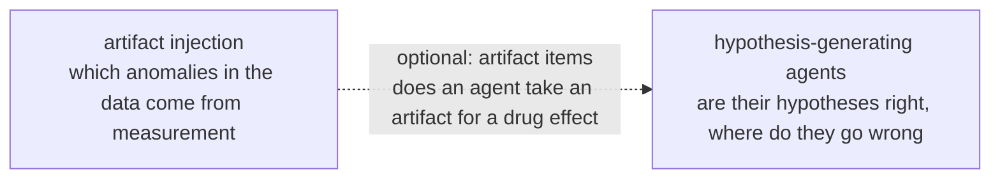

# Research topics

The group's research topics live here, one page each with the same template: what it asks, what it will produce, and where it stands. The current topics all use kidney single-cell omics data; the background is in **[Onboarding](../onboarding/index.md)** and the facts about each dataset in **[Datasets](../datasets/index.md)**. New topics get a page in the same format.

-   __Verifiable Research Agents for Chronic Kidney Disease: A Rule-Engine Harness with Experts in the Loop__

    ---

    Many agents can already analyse chronic kidney disease (CKD) data, but their conclusions cannot be checked systematically. We build a harness that wraps any agent: a rule engine checks every conclusion on three layers (domain knowledge, data and analysis code); the system selects the most informative claims for experts; and expert verdicts become new rules, so it improves with use. Independent CKD patient cohorts then test whether checked conclusions hold more often.

    **Status:** direction set on 2026-11-03; literature and data surveys done; no code yet.

    [:octicons-arrow-right-24: Topic page](hypothesis-agents.md)

-   __Artifact Injection to Boost Anomaly Detection in Kidney Single-Cell Omics__

    ---

    In kidney single-cell data, is an abnormal-looking cell diseased, or is its abnormality caused by measurement? We build a pipeline that injects known artifacts into any single-cell dataset, use it to boost current models (open foundation models included), and test on real answers from public data whether they can tell the two apart and keep false alarms under control.

    **Status:** on 2026-10-28 the direction changed to pipeline + models; design details under discussion, code not started.

    [:octicons-arrow-right-24: Topic page](anomaly-benchmark.md)

## How the topics connect

Both topics share one question: **in kidney tissue data, which of the "changes" reported by models and agents are real?**

- **Artifact injection** asks whether a cell's abnormality comes from measurement: the "detect" step of this site's overall direction, "detect → model → revert".
- **The agent topic** asks whether an agent's conclusions about CKD can be verified: a rule engine, experts and independent data check them in turn; the "model / revert" steps, leading towards drug discovery.
- They meet in the "artifact items": known artifacts injected into one treated group, to see whether an agent reports them as a drug effect.

The **[Bridge](../knowledge-map.md)** view of the knowledge map lists the papers both topics need.
