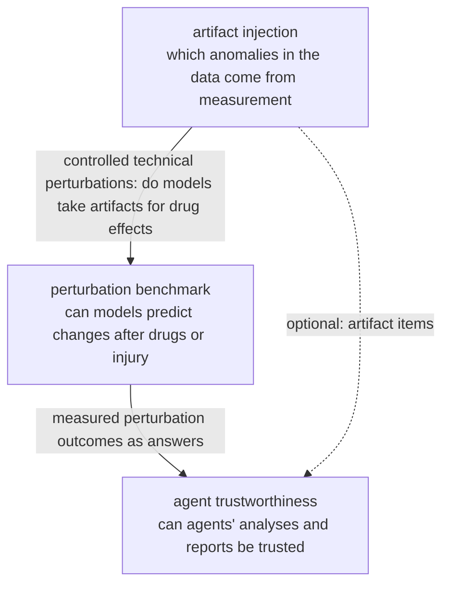

# Research topics

The group's research topics live here, one page each with the same template: what it asks, what it will produce, and where it stands. The current topics all use kidney single-cell omics data; the background is in **[Onboarding](../onboarding/index.md)** and the facts about each dataset in **[Datasets](../datasets/index.md)**. New topics get a page in the same format.

-   __An Honest Benchmark for Perturbation Prediction in Kidney__

    ---

    After a drug or an injury, can a model predict how kidney cells change, and do it better than simple methods? We use public kidney perturbation data (drug treatments and injury time courses, mostly mouse) to build the first kidney perturbation-prediction benchmark: strong simple baselines first, known evaluation pitfalls controlled, spatial data as orthogonal evidence.

    **Status:** direction set on 2026-10-31; data survey done; no code yet.

    [:octicons-arrow-right-24: Topic page](perturbation-benchmark.md)

-   __Artifact Injection to Boost Anomaly Detection in Kidney Single-Cell Omics__

    ---

    In kidney single-cell data, is an abnormal-looking cell diseased, or is its abnormality caused by measurement? We build a pipeline that injects known artifacts into any single-cell dataset, use it to boost current models (open foundation models included), and test on real answers from public data whether they can tell the two apart and keep false alarms under control.

    **Status:** on 2026-10-28 the direction changed to pipeline + models; design details under discussion, code not started.

    [:octicons-arrow-right-24: Topic page](anomaly-benchmark.md)

-   __Trustworthiness of Agent Analyses on Kidney Perturbation Data__

    ---

    Ask agents kidney perturbation questions whose answers were measured, and check whether their analyses are right and stable, whether the numbers in their reports were actually computed, and whether they say "cannot be tested" when the data cannot answer; then check these automatic checks against expert judgement.

    **Status:** direction reset on 2026-10-31; no code yet.

    [:octicons-arrow-right-24: Topic page](agent-claims.md)

## How the topics connect

The three topics share one question: **in kidney tissue, which of the "changes" reported by models and agents are real?**

- **The perturbation benchmark** is the centre: it supplies the data, splits and simple baselines.
- **Artifact injection** supplies technical controls: Systema shows that the biggest pitfall in perturbation evaluation is counting differences not caused by the perturbation as its effect, and technical artifacts are one source of them.
- **Agent trustworthiness** turns the benchmark's held-out measured outcomes into questions and checks the analysis and report steps of agents.

In this site's overall direction, "detect → model → revert", artifact injection sits in "detect", the perturbation benchmark in "model / revert", and agent trustworthiness checks the judgement of agents using these data and tools. The **[Bridge](../knowledge-map.md)** view of the knowledge map lists the papers more than one topic needs; the perturbation-benchmark topic does not yet have its own map view.
