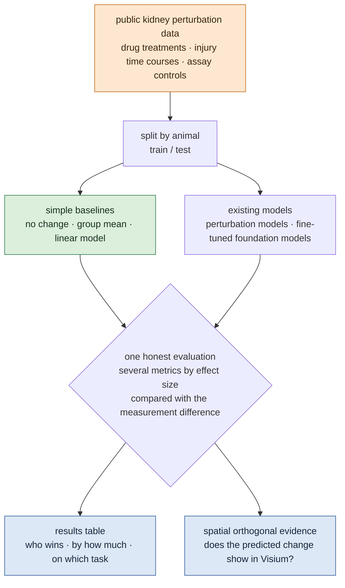

# An Honest Benchmark for Perturbation Prediction in Kidney

## At a glance

!!! abstract "What this topic does"
    **In kidney tissue, do perturbation-prediction models actually beat simple methods? We build the first kidney perturbation-prediction benchmark: strong baselines, control of known evaluation pitfalls, and spatial data as orthogonal evidence.**

    - **Question:** perturbation-prediction models ("virtual cells") try to answer "what happens to a cell if we give it a drug or knock out a gene". Recent large comparisons found that deep and foundation models often do not beat simple linear methods, and that common metrics count differences not caused by the perturbation as model skill. All of these comparisons use cell lines; **none includes kidney** (our search, 2026-10-31).
    - **Idea:** use public kidney perturbation data (drug treatments and injury time courses, mostly mouse), make the simple baselines strong first, then compare existing models under the same honest rules.
    - **Honest rules:** split training and test by animal, not by cell; report several metrics by effect size; use data where the same samples were measured two ways to size the measurement difference, as a control for any model effect; predicted changes must be visible in spatial data.
    - **Constraint:** public data only; no wet lab; conclusions limited to what the data can support.
    - **Status:** direction set on 2026-10-31; data survey done (below); no code yet.

## The question

1. On kidney data, do existing perturbation-prediction models beat simple baselines (predict "no change", the group mean, a linear model)?
2. Does the answer change once known evaluation pitfalls are controlled?
3. Do the cell-state changes a model predicts have matching evidence in spatial data?

## Why it matters and why it is unsolved

Perturbation prediction is the core of virtual cells and virtual tissue: a model that reliably predicts "what the tissue does under this drug" could screen targets and drugs before any experiment. In this site's overall direction (detect → model → revert), the "revert" step depends on it. The problem is that nobody knows how accurate these models are on patient tissue, and the existing evaluations have problems of their own:

| Finding | Source |
|---|---|
| five foundation models and two deep models did not beat deliberately simple linear baselines | [Ahlmann-Eltze et al. 2025](../papers/linear-baselines-natmethods-2025/index.md) |
| perturbed and control cells differ systematically, and common metrics count this as model skill | [Systema, Nat Biotechnol 2025](https://doi.org/10.1038/s41587-025-02777-8) |
| model rankings depend strongly on effect size and metric; no method generalises reliably across cell types | [Li et al., Sci Adv 2026](https://doi.org/10.1126/sciadv.aed3414) |
| pure end-to-end networks have not yet beaten hybrid models; biological priors need better integration | [Virtual Cell Challenge](../papers/virtual-cell-challenge/index.md) |
| the bottleneck is coverage of biological contexts, not model capacity | [Dibaeinia et al., bioRxiv 2026](https://doi.org/10.64898/2026.02.04.703804) (abstract only) |

**Why it is unsolved (our reading):** the comparisons above use cell lines (K562, RPE1, A549 and others), not patient tissue; kidney lacks real large-scale genetic-perturbation single-cell data, so nobody has run the same comparison in kidney.

## Data

Perturbation prediction needs measured post-perturbation outcomes as answers. Kidney has no large-scale Perturb-seq, so the benchmark stands on **drug treatments** and **injury time courses**, plus one measurement control. Details of each dataset are in the "perturbation experiments" group of the [Datasets](../datasets/index.md) tab.

| Task | Data | What is predicted |
|---|---|---|
| **A** drugs | [Wu 2022 · DKD under five treatments](../datasets/wu-dkd-2022.md) | a combination from its single drugs; 2 weeks from 2 days |
| A′ across labs | [Wu 2022 · SGLT2i and ARB](../datasets/wu-sglt2-arb-2022.md) | train on A, test on another lab |
| **B** time | [Kirita 2020 · injury to repair](../datasets/kirita-iri-2020.md) | later time points from earlier ones |
| B′ spatial | [Dixon 2022 · spatial time course](../datasets/dixon-iri-visium-2022.md) | whether predicted state changes appear in space |
| **C** measurement control | [Gaedcke 2022 · single cell vs single nucleus](../datasets/gaedcke-sc-sn-2022.md) | how large the assay difference is, as a floor for any effect |

**Human data:** we found only one randomised trial with paired before/after single-cell biopsies: [Bjornstad et al., Sci Transl Med 2026](https://doi.org/10.1126/scitranslmed.aee1005) (adolescents with type 1 diabetes, SGLT2 inhibitor vs placebo; only 11 have a follow-up biopsy). Access to the data is not yet confirmed. Human atlases such as KPMP are observational: usable as context, not as perturbation answers.

**Gap:** there is no public data with tens to thousands of genetic perturbations and single-cell readout in tubules, podocytes or organoids, and spatial perturbation methods (such as Perturb-DBiT and spatial Perturb-seq) have not been used in kidney. So for now the benchmark has no genetic perturbations and can only claim "drugs and injury", not "any perturbation".

## How the benchmark is built

**1. Make the baselines strong first.** "No change" (predict the post-perturbation state equals the pre-perturbation one), the group mean, and a linear model (as written by Ahlmann-Eltze et al.). Every model is compared with them first.

**2. Then add existing models.** Perturbation models (such as CPA, GEARS and the [conditional Monge gap](../papers/scrna-natmachintell-2026/index.md)) and fine-tuned foundation models. The exact list is set once the baselines run.

**3. Honest evaluation rules:**

- Split training and test by animal, not by cell; cells of one animal never appear on both sides.
- Set the reference point as Systema does, so systematic differences are not counted as model skill.
- Report several metrics (expression level, change, differential genes) separately by effect size.
- Use task C to measure how large the assay difference is; a model effect smaller than that does not count.

**4. Spatial orthogonal evidence.** Whether a predicted state change (for example the share of injured proximal tubule states after injury) appears in the matching regions of the Visium sections. There are few sections (one per time point), so this is supporting evidence, not a statistical test.

## How it connects to the other topics

- **[The artifact-injection topic](anomaly-benchmark.md):** the biggest pitfall Systema points out is counting systematic differences not caused by the perturbation as its effect, and technical artifacts (doublets, ambient RNA, low-quality cells, assay changes) are one source of such differences. The artifact-injection topic supplies controlled technical perturbations; this topic uses them to check whether models predict artifacts as perturbation effects, and whether rankings change after cleaning.
- **[The agent-trustworthiness topic](agent-claims.md):** this topic's held-out data are measured answers. The agent-trustworthiness topic turns them into questions and checks whether an agent's conclusions and reports can be trusted when it analyses these data with these tools.

## What we will produce

| # | Deliverable | What it is |
|---|---|---|
| 1 | kidney perturbation benchmark | fixed splits, metrics and evaluation code for tasks A–C, open |
| 2 | baseline model repository | no change, group mean and linear models, plus trained existing models |
| 3 | results table | every model on every task, split by effect size and metric |
| 4 | spatial evidence | predicted state changes set against the Visium sections |

Raw data are not redistributed; we release code, split files and results.

## Risks and open questions

- **Mostly mouse.** Humans have one small trial, and data access is not yet confirmed. The paper must say "mouse benchmark plus a small human test".
- **Few perturbations.** Drugs give about five treatments, so the tasks are ones that work with small numbers: "single drugs → combination" and "extrapolate in time".
- **What if the linear baseline wins?** Then that is the result: it holds in kidney too, which is exactly what an honest benchmark should answer.
- **No genetic perturbation data.** Stated as a gap; in the long run someone needs to run Perturb-seq on kidney organoids or tubuloids.
- **Still to check:** data access for Bjornstad 2026; the time points of the reversible UUO data (GEO GSE140023), possibly a rare "remove the perturbation → watch recovery" dataset; whether A498, the only kidney cancer line in Tahoe-100M, actually has perturbed cells.

## Reading path

1. **[Ahlmann-Eltze et al. 2025](../papers/linear-baselines-natmethods-2025/index.md)**: why linear baselines win; the starting point of this topic.
2. **[Systema](https://doi.org/10.1038/s41587-025-02777-8)** (not in the library): the systematic-variation pitfall and how to change the reference point.
3. **[Li et al. 2026](https://doi.org/10.1126/sciadv.aed3414)** (not in the library): how metric and effect size change rankings.
4. **[Virtual Cell Challenge](../papers/virtual-cell-challenge/index.md)**: what a public competition concluded.
5. **[Conditional Monge gap](../papers/scrna-natmachintell-2026/index.md)**: one existing model to compare in the benchmark.
6. **[Wu 2022 · DKD under five treatments](../datasets/wu-dkd-2022.md)**: the data of task A; read its dataset page.
