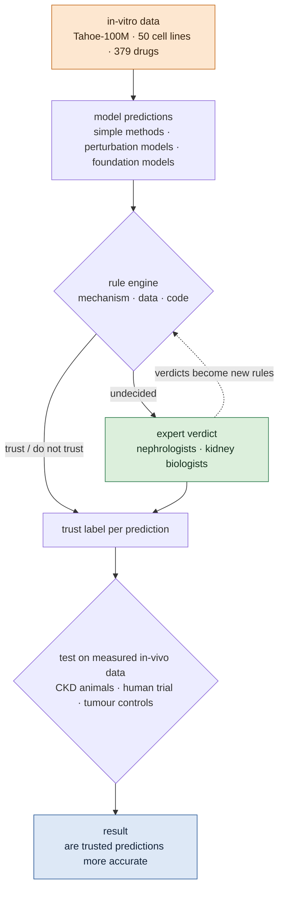

# Verifiable Virtual Cells: When Can In-Vitro Drug Predictions Be Trusted in Kidney Tissue?

## At a glance {#glance}

!!! abstract "What this topic does"
    **Judge, before any in-vivo experiment, whether a virtual-cell model's drug prediction for kidney tissue can be trusted.**

    - **Why:** virtual-cell models are trained mainly on cell lines in vitro; the largest public dataset has about a hundred million cells. But drugs act in patients' tissue. We checked that the targets of the main chronic kidney disease (CKD) drug classes are essentially not expressed in those cell lines, so a "drug effect" the model learned in vitro may simply not hold in the kidney.
    - **We do not compete with large teams on whose model is better.** We ask: when can an in-vitro-to-in-vivo prediction be trusted, and can that be judged before the experiment?
    - **How we judge:** a rule engine checks every prediction on three layers: mechanism (is the target expressed in the source cells, is the needed tissue context there), data, and evaluation code. Cases the rules cannot settle go to nephrologists and kidney biologists, and their verdicts become new rules.
    - **How we test:** public in-vivo drug data (CKD animal models, one human trial, plus tumour positive controls) give each prediction's real error, and we check whether predictions judged "trustworthy" are actually more accurate.
    - **It shares one harness with the agent topic:** there it checks an agent's conclusions, here a virtual cell's predictions.
    - **Status:** restored as its own topic on 2026-11-04 at Sikander's request, reframed from "a kidney perturbation benchmark" to "verifiable in-vitro-to-in-vivo transfer", **for discussion**. Data checks done; no code yet.

## Contents {#contents}

[1 The question](#question) · [2 Idea](#idea) · [3 Three layers of checks](#rules) · [4 Experts](#experts) · [5 How we test](#test) · [6 Models](#models) · [7 Data](#data) · [8 Deliverables](#deliver) · [9 Other topics](#connect) · [10 Open questions](#open) · [11 Reading path](#reading)

Reading only the bold first sentence of each paragraph gives the storyline; medical and data details are in folds, and full sources in the "References" fold at the end of each part.

## The question {#question}

This part answers why this topic is needed.

**Virtual cells aim to predict drug effects before an experiment, but almost all are trained on cell lines in vitro.** The largest public drug dataset, Tahoe-100M, measured 379 drugs at three doses each in 50 cancer cell lines, about a hundred million single cells, under a CC0 licence ([Zhang et al. 2025](https://doi.org/10.1101/2025.02.20.639398)). A foundation model built on it is public too ([Gandhi et al. 2025](https://doi.org/10.1101/2025.10.23.683759)). What drug discovery actually cares about, though, is what a drug does in a patient's tissue.

**Even in vitro, complex models often do not beat simple methods, and common scores overrate them.** Five foundation models and two deep models did not beat deliberately simple linear methods ([Ahlmann-Eltze et al. 2025](../papers/linear-baselines-natmethods-2025/index.md)). Treated and control cells differ systematically to begin with, and common metrics count "guessing this difference" as model skill ([Viñas Torné et al. 2025](https://doi.org/10.1038/s41587-025-02777-8)). The organisers of the 2025 Virtual Cell Challenge also concluded that models do not yet consistently beat naive baselines across all metrics ([Arc Institute 2025](https://arcinstitute.org/news/virtual-cell-challenge-2025-wrap-up)).

**From in vitro to in vivo, results can flip.** The same gene knockouts had opposite-sign effects in some cases between in-vivo and ex-vivo haematopoiesis, and AI prediction of these differences was hard ([Geetha et al. 2025](https://doi.org/10.1101/2025.09.02.673692)). Predicting human responses from mouse largely failed in a general benchmark ([Radig et al. 2026](https://doi.org/10.1186/s13059-026-04104-z)).

**For the kidney the problem is more basic: the drug targets do not exist in the cell lines.** We checked the CKD drugs in Tahoe: two SGLT2 inhibitors, two ACE inhibitors, one mineralocorticoid-receptor antagonist and sacubitril/valsartan. Tahoe's only kidney line is a renal-cancer line (A498), which essentially does not express SLC5A2 (SGLT2), ACE, AGTR1 or NR3C2; SLC5A2 is at trace levels at most in all 48 lines with data (DepMap 24Q4, see the fold below). So the "drug effects" a model sees in vitro are not how these drugs act in the kidney.

**Existing work makes transfer better; nobody answers "when can it be trusted".** GENEVA places pools of tumour lines in mice to measure drug responses ([Yu et al. 2026](https://doi.org/10.1038/s43018-026-01130-5)); PerturbRx uses drug transitions learned in vitro to predict whether patients respond ([Inoue et al. 2026](https://arxiv.org/abs/2608.21349)); IRIS transfers an in-vitro signalling-perturbation atlas to mouse embryos ([IRIS 2026](https://doi.org/10.1038/s41592-026-03213-8)). To our search (up to November 2026), no work judges, before predicting, whether an in-vitro-to-in-vivo single-cell drug prediction can be trusted, and tests that judgement against measured in-vivo data. This is where our group is strong: kidney experts, and rules that can be checked.

??? info "For non-medical readers: the main CKD drugs, and why cell lines lack their targets"

    
    **The main CKD drugs.** ACE inhibitors and ARBs block the renin–angiotensin system (RAS blockade); SGLT2 inhibitors were first developed for diabetes and later shown to protect the kidney; mineralocorticoid-receptor antagonists (such as finerenone) also slow CKD ([KDIGO 2024](https://doi.org/10.1016/j.kint.2023.10.018)).

    **Why cell lines lack the targets.** SGLT2 is the glucose transporter of proximal-tubule epithelial cells; ACE and the angiotensin receptor belong to a hormone system that spans organs and needs blood-borne hormones and vessels; the mineralocorticoid receptor acts mainly in the distal nephron. Cancer cell lines in culture have none of this tissue context and often no longer express these genes. So the same drug on a cell line shows off-target effects or almost nothing, not what it does in the kidney.

    **"Target present" does not mean it transfers.** The receptors of dexamethasone (NR3C1) and rosiglitazone (PPARG) are expressed in most cell lines, but much of these drugs' action in the body depends on immune cells or fat tissue. Such cases sit between "trust" and "do not trust", and that is exactly where experts are needed.

??? info "What we checked: CKD drugs in Tahoe and target expression"

    
    Checked on 2026-11-04. Tahoe's drug and cell-line information comes from its metadata on Hugging Face; expression from DepMap 24Q4, in log2(TPM+1), with "expressed" meaning above 1 (a lenient threshold).

    | Drug class | Drugs in Tahoe | Target | A498 (kidney) | Lines expressing it (of 48) |
    |---|---|---|---|---|
    | SGLT2 inhibitors | dapagliflozin, canagliflozin | SLC5A2 | 0.86 | 6, at most 1.86, all trace |
    | ACE inhibitors | captopril, perindopril | ACE | 0.15 | 21 (colorectal, pancreatic, lung), not A498 or the liver lines |
    | ARB | only the sacubitril/valsartan combination | AGTR1 | 0.53 | 5 |
    | Mineralocorticoid-receptor antagonists | eplerenone | NR3C2 | 0.36 | 8, not A498 or the liver lines |
    | PPARγ agonists | rosiglitazone, pioglitazone | PPARG | 4.43 | 35 |
    | Glucocorticoids | dexamethasone and others | NR3C1 | 5.05 | 36 (most colorectal lines lack it) |

    Tahoe lacks empagliflozin, enalapril, lisinopril, ramipril, losartan, irbesartan, finerenone, spironolactone and amiloride. Every drug has only three doses: 0.05, 0.5 and 5 µM. A498 has about 2.79 million cells covering all drugs.

??? note "References (full sources and details)"

    
    In the order of the text.

    - **Tahoe-100M:** Zhang J et al. bioRxiv 2025. [doi:10.1101/2025.02.20.639398](https://doi.org/10.1101/2025.02.20.639398); data on Hugging Face `tahoebio/Tahoe-100M` (CC0-1.0). We read only the metadata, not the full text
    - **Tahoe-x1:** Gandhi S et al. bioRxiv 2025. [doi:10.1101/2025.10.23.683759](https://doi.org/10.1101/2025.10.23.683759)
    - **Linear methods win:** Ahlmann-Eltze C, Huber W, Anders S. *Nat Methods* 2025;22:1657–1661. [doi:10.1038/s41592-025-02772-6](https://doi.org/10.1038/s41592-025-02772-6) ([deep-read](../papers/linear-baselines-natmethods-2025/index.md)). Genetic perturbations only
    - **Systematic variation (Systema):** Viñas Torné R et al. *Nat Biotechnol* 2025. [doi:10.1038/s41587-025-02777-8](https://doi.org/10.1038/s41587-025-02777-8)
    - **Virtual Cell Challenge:** Roohani YH et al. *Cell* 2025;188:3370–3374. [doi:10.1016/j.cell.2025.06.008](https://doi.org/10.1016/j.cell.2025.06.008) ([deep-read](../papers/virtual-cell-challenge/index.md)); the 2025 conclusion is from Arc's [Wrap-Up](https://arcinstitute.org/news/virtual-cell-challenge-2025-wrap-up) (2025-12-06)
    - **In vivo vs ex vivo:** Geetha et al. Differences between in vivo and ex vivo hematopoietic model systems modulate the outcomes of genetic perturbations. bioRxiv 2025. [doi:10.1101/2025.09.02.673692](https://doi.org/10.1101/2025.09.02.673692) (abstract and search snippets only). Gene knockouts, not drugs
    - **From mouse to human:** Radig J et al. scArchon. *Genome Biol* 2026. [doi:10.1186/s13059-026-04104-z](https://doi.org/10.1186/s13059-026-04104-z) (only abstract read; "largely fails" comes from a search snippet of the full text, not yet checked word for word)
    - **DepMap:** DepMap Public 24Q4 (figshare 27993248), `OmicsExpressionProteinCodingGenesTPMLogp1` and `OmicsSomaticMutations`. 48 of Tahoe's 50 lines have RNA data
    - **GENEVA:** Yu JX et al. *Nat Cancer* 2026. [doi:10.1038/s43018-026-01130-5](https://doi.org/10.1038/s43018-026-01130-5) (design sections of the full text read). The paper states that some authors are co-founders of Tahoe Therapeutics
    - **PerturbRx:** Inoue et al. [arXiv:2608.21349](https://arxiv.org/abs/2608.21349) (2026); ICLR 2027 submission (only abstract read). Predicts whether patients respond, not post-treatment single-cell expression
    - **IRIS:** Reconstructing signaling histories of single cells via perturbation screens and transfer learning. *Nat Methods* 2026. [doi:10.1038/s41592-026-03213-8](https://doi.org/10.1038/s41592-026-03213-8) (only abstract read). Infers which signals acted; does not predict drug responses
    - **CKD treatment guideline:** KDIGO 2024. *Kidney Int* 2024;105(4S):S117–S314. [doi:10.1016/j.kint.2023.10.018](https://doi.org/10.1016/j.kint.2023.10.018)
    - **Search scope:** up to November 2026; it cannot be exhaustive, so the paper will say "to our knowledge"

## Idea {#idea}

This part answers how the topic runs.

**Predict from in-vitro data, judge whether each prediction can be trusted, then test the judgement on measured in-vivo data.** Models (simple methods included) learn on Tahoe and predict for every "drug × in-vivo tissue" pair. The rule engine labels each prediction "trust / undecided / do not trust", and undecided ones go to experts. Only then are the in-vivo data opened to measure each prediction's real error.

**The result we want is not "whose model is best" but "are the trust labels right".** If predictions labelled trustworthy have clearly smaller errors and untrusted ones clearly larger, the checks work, and they were made before the in-vivo data were seen. We also compare with "the model's own uncertainty only": can statistics alone separate the three groups?

**The design has three tiers, to test the rules themselves.** From the mechanism, we know in advance how each tier should behave:

- **Positive control: target and driver mutation match.** For example a KRAS G12C inhibitor on tumours carrying G12C. Transfer should work; if even this tier fails, the problem is in the model or the data.
- **Partial transfer: target present, tissue context missing.** For example rosiglitazone (PPARG) and dexamethasone (NR3C1). This tier goes to experts.
- **Mechanism missing: target not expressed in the source cells.** The kidney SGLT2 inhibitors, ACE inhibitors and mineralocorticoid-receptor antagonists. In-vitro predictions should not transfer; if a model scores well on this tier, the scoring is most likely overrating it.

## Three layers of checks {#rules}

This part answers what exactly the rule engine checks. The three layers map one to one onto the rule engine of the [agent topic](hypothesis-agents.md).

**Mechanism layer: does the drug have anything to act on in the source cells.** The first rule is the one we just checked: if the target is not expressed in the source cell line, the prediction is not trusted. Other rules: is the tissue context the drug needs (a hormone system, immune cells, vessels) present in vitro; how far apart are the in-vitro dose and the in-vivo exposure; are the source and target cells the same kind (for example a renal-cancer cell and a proximal-tubule cell). We draft these rules from the literature and databases, and experts revise them.

**Data layer: can the in-vivo data answer the question.** Split by animal, with the animal, not the cell, as the statistical unit ([Squair et al. 2021](https://doi.org/10.1038/s41467-021-25960-2)). Scoring removes the part where "treated cells all change like this" ([Viñas Torné et al. 2025](https://doi.org/10.1038/s41587-025-02777-8)). Effects must exceed the difference caused by the assay itself: the same injured kidneys were measured by single cell and by single nucleus ([Gaedcke et al. 2022](../datasets/gaedcke-sc-sn-2022.md)), and the difference between the two sets a floor below which a drug effect cannot be told apart from the assay.

**Code layer: is the evaluation code itself right.** Two simple methods, predicting "no change" and predicting the training mean, also check the evaluation code: when it has a bug, such as feeding the test cells in as input, "no change" gets a perfect score ([Gallone et al. 2026](https://doi.org/10.64898/2026.10.12.758706)). Errors are weighted by differential genes, or a prediction that "all cells look about the same" scores well ([Mejia et al. 2025](https://arxiv.org/abs/2506.22641)); scores are also computed with Cell-Eval so that our numbers can be compared with others' ([Adduri et al. 2025](https://doi.org/10.1101/2025.06.26.661135)).

??? note "References (full sources and details)"

    
    - **False positives from per-cell tests:** Squair JW et al. *Nat Commun* 2021;12:5692. [doi:10.1038/s41467-021-25960-2](https://doi.org/10.1038/s41467-021-25960-2)
    - **Paired single-cell and single-nucleus data:** Gaedcke S et al. *Am J Physiol Renal Physiol* 2022;323:F171–F181. [doi:10.1152/ajprenal.00453.2021](https://doi.org/10.1152/ajprenal.00453.2021). One sample per condition and assay: enough for a size comparison, not for statistics
    - **Common bugs in evaluation code:** Gallone M et al. Auditing Confidence-Calibrated Benchmarking of Single-Cell Perturbation Models. bioRxiv 2026. [doi:10.64898/2026.10.12.758706](https://doi.org/10.64898/2026.10.12.758706) (only abstract read)
    - **Metrics weighted by differential genes:** Mejia GM et al. [arXiv:2506.22641](https://arxiv.org/abs/2506.22641) (2025) (only abstract read)
    - **Cell-Eval:** Adduri AK et al. bioRxiv 2025. [doi:10.1101/2025.06.26.661135](https://doi.org/10.1101/2025.06.26.661135) (only abstract read); [cell-eval](https://github.com/ArcInstitute/cell-eval) (MIT)
    - **Dose:** whether Tahoe's top dose of 5 µM is far above these drugs' free plasma levels in patients is not yet checked; it must be before the rule is written

## Experts {#experts}

This part answers what experts do, and why we are the ones who can do it.

**Experts see only predictions the rules cannot settle, and the system picks the most informative ones.** The "partial transfer" tier needs experts most: the target is present, but which tissue context the drug depends on in the body, and which kidney cell types that matters for, cannot all be written as rules. The system ranks first the predictions where rules conflict or the model itself is very uncertain, and nephrologists and kidney biologists judge "trust / do not trust" with a one-line reason.

**Expert verdicts become new rules, so the same question is not asked twice.** If an expert says "rosiglitazone acts on the kidney mainly indirectly; do not trust the in-vitro prediction", that reason becomes a mechanism-layer rule for the same drug class. The system improves with use, and every rule can be traced to who wrote it and why.

**Experts can be wrong too, so their verdicts are tested on in-vivo data as well.** What we report is not "the experts were right" but how trust labels from rules, from experts, and from both relate to the real error.

**Why us:** the large modelling teams have data and compute but no kidney clinicians or biologists; our group and collaborators do, and the agent topic is already building the expert-in-the-loop process.

## How we test {#test}

This part answers how we know the checks are useful.

**Test 1: do trust labels predict the real error.** Every "drug × in-vivo tissue" prediction has a trust label and a measured in-vivo error. If the labels are useful, the "trust" group should have smaller errors than the "do not trust" group. We compare with three approaches without checks: trust everything; use only the model's own uncertainty; use only the statistical distance between source and target cells.

**Test 2: do the three tiers behave as the mechanism says.** The positive control should transfer, and the mechanism-missing tier should not. If a model scores well on the mechanism-missing tier, the scoring overrates it, which is itself a finding.

**Test 3: in the kidney, against animals and patients.** The mechanism-missing and partial tiers both land on CKD in-vivo data: mouse and rat drug experiments, and the human SGLT2-inhibitor trial (ATTEMPT). ATTEMPT used dapagliflozin, exactly the drug in Tahoe; the human data have only 11 follow-up biopsies, and the two biopsies of one person cannot be paired, so only the direction and size of group-level changes can be compared.

**What if simple methods win?** It does not matter for this topic: we test the trust labels, not which model is best. Simple methods are among the models being checked.

## Models {#models}

This part answers whose predictions are checked.

**Simple methods first, then existing models.** Three simple methods: predict "no change", predict the training-set group mean, and a linear model ([Ahlmann-Eltze et al. 2025](../papers/linear-baselines-natmethods-2025/index.md)). Existing models are chosen by whether they handle drug data; GEARS predicts only genetic perturbations and is not used. The exact list is set once the simple methods run.

| Model | Why it is chosen | Code licence |
|---|---|---|
| scGen | one of the first perturbation-prediction methods; its paper already tested across species | GPL-3.0 |
| CPA | models drug, dose, time and species separately | BSD-3 |
| chemCPA | CPA plus the drug's molecular structure; extends to unseen drugs | MIT |
| CellOT | predicts by optimal transport; tested on unseen patients and across species | BSD-3 |
| STATE | a large model trained on over a hundred million perturbed cells; can be fine-tuned | code CC BY-NC-SA 4.0, weights non-commercial |
| Tahoe-x1 | a foundation model trained directly on Tahoe-100M | Apache-2.0, weights public |

??? note "References (full sources and details)"

    
    Licences were checked on the GitHub and Hugging Face pages on 2026-11-04.

    - **scGen:** Lotfollahi M, Wolf FA, Theis FJ. *Nat Methods* 2019. [doi:10.1038/s41592-019-0494-8](https://doi.org/10.1038/s41592-019-0494-8)
    - **CPA:** Lotfollahi M et al. *Mol Syst Biol* 2023. [doi:10.15252/msb.202211517](https://doi.org/10.15252/msb.202211517)
    - **chemCPA:** Hetzel L et al. NeurIPS 2022. [arXiv:2204.13545](https://arxiv.org/abs/2204.13545)
    - **CellOT:** Bunne C et al. *Nat Methods* 2023. [doi:10.1038/s41592-023-01969-x](https://doi.org/10.1038/s41592-023-01969-x)
    - **STATE:** Adduri AK et al. bioRxiv 2025. [doi:10.1101/2025.06.26.661135](https://doi.org/10.1101/2025.06.26.661135)
    - **Tahoe-x1:** Gandhi S et al. bioRxiv 2025. [doi:10.1101/2025.10.23.683759](https://doi.org/10.1101/2025.10.23.683759)

## Data {#data}

This part answers what each dataset is used for. Animal counts, downloads and licences of the kidney data are on each dataset page; the tumour-control data are not on dataset pages yet.

| Data | Used for | Watch out for |
|---|---|---|
| Tahoe-100M (in vitro, CC0) | source data: all models learn here | only one kidney line (A498, renal cancer); three doses per drug |
| [Wu 2022 · DKD under five treatments](../datasets/wu-dkd-2022.md) (mouse) | mechanism missing (SGLT2i, ACEi) and partial (rosiglitazone) in the same kidney data | 4–6 per group |
| [Wu 2022 · SGLT2i and ARB](../datasets/wu-sglt2-arb-2022.md) (mouse) | mechanism missing: another lab | drug, sex, duration and assay all differ from the previous one |
| [Abedini 2024 · rat](../datasets/abedini-doca-rat-2024.md) | mechanism missing: mineralocorticoid-receptor antagonists | uses finerenone and spironolactone; Tahoe has only eplerenone of this class |
| [Balzer 2026 · rat](../datasets/balzer-zsf1-rat-2026.md) | mechanism missing: ACE inhibitor | uses enalapril; Tahoe has only captopril and perindopril of this class; only 3 treated rats |
| [ATTEMPT 2026](../datasets/attempt-sglt2i-2026.md) (human) | mechanism missing: against patients | the same drug as in Tahoe (dapagliflozin); only 11 follow-up biopsies, group comparisons only |
| [Gaedcke 2022](../datasets/gaedcke-sc-sn-2022.md) (mouse) | data layer: floor set by the assay difference | one sample per condition |
| GENEVA in-vivo xenograft (GEO GSE311813) | positive control: KRAS G12C | NCI-H2122 is the only G12C line shared with Tahoe, about 1,000 treated cells; its drug ARS-1620 is not in Tahoe, which has adagrasib of the same class |
| GSE319598 (mouse lung tumours) | positive control: KRAS G12C | sotorasib vs vehicle, 3–4 tumours per arm; mouse genes must be mapped to human orthologs |
| GSE116237 (melanoma PDX) | positive control: BRAF V600E | dabrafenib + trametinib, both in Tahoe; only about 865 cells, and the control is pre-treatment, not a concurrent vehicle |

**The biggest gap is a thin positive control.** All three tumour datasets are small, and two are mouse. GENEVA's in-vitro 3D pooled cultures can serve as an intermediate tier between 2D in vitro and in vivo.

## Deliverables {#deliver}

| # | Deliverable | What it is |
|---|---|---|
| 1 | in-vitro-to-in-vivo test set | splits, three-tier labels and evaluation code for every "drug × in-vivo tissue" pair, open |
| 2 | rule library | rules on the mechanism, data and code layers, each with its source and the expert verdict it came from |
| 3 | results | how trust labels relate to real error, for rules, experts and both, against approaches without checks |
| 4 | a harness module shared with the agent topic | the same rule engine and expert process, applied to virtual-cell predictions |

Raw data are not redistributed; we release code, split files, rules and results.

## How it connects to the other topics {#connect}

**It shares one harness with the agent topic; what is checked differs.** The [agent topic](hypothesis-agents.md) checks an agent's conclusions about CKD; this topic checks virtual-cell predictions of CKD drug effects. Both use the same rule engine (domain knowledge, data, code), the same expert-in-the-loop process, and the same CKD drug data for independent testing. Mechanism rules from here, such as "target not expressed → do not trust" and "statistics per animal", apply directly to the agent's conclusions.

**It meets the artifact-injection topic in "differences caused by measurement".** Technical artifacts (doublets, ambient RNA, low-quality cells, a change of assay) are one source of differences that are not drug effects. The [artifact-injection topic](anomaly-benchmark.md) creates known technical perturbations, which test whether the data-layer rules catch them.

## Open questions {#open}

- **The positive control is thin.** There are only three in-vivo tumour datasets, all small; either find more or use GENEVA's in-vitro 3D cultures as an intermediate tier.
- **Can the group run wet-lab experiments?** Single-cell data from kidney organoids or tubuloids treated with an SGLT2 inhibitor would fill the "kidney drug data in vitro" gap and test the rules directly. To ask Sikander and the Kramann group.
- **Who the experts are, and how much time they need.** We need a few nephrologists and kidney biologists; how many predictions each judges is not yet estimated.
- **Competition.** Some GENEVA authors are Tahoe co-founders, and several ICLR 2027 submissions work on cross-context transfer. Our angle (when to trust, experts in the loop) differs, but we need to move fast.
- **Where to submit.** The NeurIPS Evaluations & Datasets track fits best; the timeline is not set.
- **Still to check:** Tahoe's treatment duration and how far its doses are from in-vivo exposure; how many mice per time point in GSE116237; whether the ATTEMPT data can actually be downloaded and used.
- **Who does it.** This page is for discussion with Sikander; which student works on it is not decided.

## Reading path {#reading}

1. **[Ahlmann-Eltze et al. 2025](../papers/linear-baselines-natmethods-2025/index.md)**: why linear methods win; why simple methods must come first.
2. **[Systema](https://doi.org/10.1038/s41587-025-02777-8)** (not in the library): the systematic-variation trap.
3. **[Geetha et al. 2025](https://doi.org/10.1101/2025.09.02.673692)** (not in the library): in-vivo and in-vitro results can be opposite.
4. **[GENEVA](https://doi.org/10.1038/s43018-026-01130-5)** (not in the library): the closest in-vivo single-cell drug data, and a competitor.
5. **[The agent topic](hypothesis-agents.md)**: where the rule engine and the expert process are designed.
