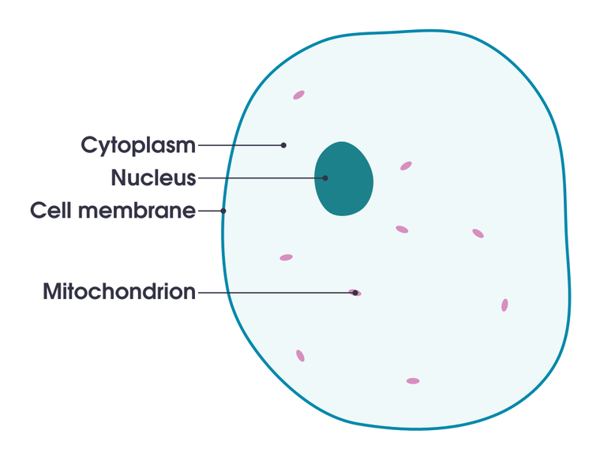

# 2 · 细胞和 RNA / 2 · Cells and RNA

<!-- ZH -->
!!! abstract "读完能回答"
    - 细胞核、胞质、RNA 分别在哪里？
    - 为什么数 RNA 就能知道细胞在干什么？
    - 细胞类型和细胞状态有什么区别？它们在 obs 里是哪两列？
<!-- EN -->
!!! abstract "After this module you can answer"
    - Where are the nucleus, the cytoplasm and the RNA?
    - Why does counting RNA tell you what a cell is doing?
    - How do a cell type and a cell state differ, and which two obs columns hold them?

<!-- ZH -->
这一模块只讲后面用得到的最少生物知识。
<!-- EN -->
This module covers only the minimum biology the rest of onboarding needs.

## 第 1 步 · 一个细胞长什么样 / Step 1 · What a cell looks like

<!-- ZH/EN --> 

<!-- ZH/EN --> 

<!-- ZH -->
- **细胞膜**（cell membrane）：外面一层膜，把细胞和外界隔开。
- **细胞核**（nucleus）像机房，存着 **DNA**，也就是全部源代码。同一个人身上每个细胞的 DNA 几乎完全一样。
- **胞质**（cytoplasm）像车间，是真正干活的地方。
- **线粒体**（mitochondrion）在胞质里，是细胞的"电源"。它有自己的一小段 DNA，编码 2 种 rRNA、22 种 tRNA 和 13 种蛋白 [3]；这些基因名以 `MT-` 开头，比如模块 1 里的 `MT-CO1`（"mitochondrially encoded cytochrome c oxidase I"）[4]。
<!-- EN -->
- The **cell membrane** is the outer layer that separates the cell from its surroundings.
- The **nucleus** is the server room. It holds the **DNA**, the full source code. Almost every cell in one person carries the same DNA.
- The **cytoplasm** is the workshop where the actual work happens.
- **Mitochondria** sit in the cytoplasm and are the cell's power supply. They carry a small DNA of their own, encoding 2 rRNAs, 22 tRNAs and 13 proteins [3]; its genes are named with an `MT-` prefix, such as `MT-CO1` in module 1 ("mitochondrially encoded cytochrome c oxidase I") [4].

<!-- ZH/EN --> 

<!-- ZH -->
图：Wikimedia「[Simple diagram of animal cell (en).svg](https://commons.wikimedia.org/wiki/File:Simple_diagram_of_animal_cell_(en).svg)」，domdomegg，CC BY 4.0。
<!-- EN -->
Figure: Wikimedia "[Simple diagram of animal cell (en).svg](https://commons.wikimedia.org/wiki/File:Simple_diagram_of_animal_cell_(en).svg)" by domdomegg, CC BY 4.0.

## 第 2 步 · RNA 是什么、在哪里 / Step 2 · What RNA is and where it sits

<!-- ZH -->
细胞要用某个基因时，先在核里把这段 DNA **抄写成 RNA**（这一步叫转录，transcription），相当于打印一张"工单"。工单刚打印出来时还在核里，之后被送到胞质，车间照着它生产蛋白质 [1]。

所以一个细胞里的 RNA 分两部分：**核里是刚打印、大多还没剪接完的，胞质里是已经送出去的。**核里那部分有多大因细胞而异：一项小鼠神经元的研究估计占全部 mRNA 的 20% 到 50% 以上 [2]。模块 5.1 会用到这一点：只测细胞核，就只拿到前一部分。

线粒体基因是例外：它们在线粒体里面转录，不在核里 [3]。所以一个干净的细胞核里几乎没有 `MT-` 开头的 RNA（模块 6）。
<!-- EN -->
When a cell uses a gene, it first **copies that stretch of DNA into RNA** inside the nucleus (transcription), like printing a work order. A freshly printed order is still in the nucleus; it is then shipped to the cytoplasm, where the workshop uses it to build protein [1].

So a cell's RNA sits in two places: **a freshly made, mostly not-yet-spliced part in the nucleus, and a shipped part in the cytoplasm.** How big the nuclear part is depends on the cell: one study of mouse neurons put it at 20% to over 50% of all mRNA [2]. Module 5.1 uses this: measuring only the nucleus gets only the first part.

Mitochondrial genes are the exception: they are transcribed inside the mitochondria, not in the nucleus [3]. So a clean nucleus holds almost no `MT-` RNA (module 6).

<!-- ZH/EN --> 

<!-- ZH -->
图的下半部分是细胞核：黑色的双螺旋是 **DNA**，橙色的线是刚抄出来的 **mRNA**（工单）。中间那层带蓝色小孔的是核膜，**核孔**（pore）就是工单出门的通道。上半部分是胞质：绿色的**核糖体**（ribosome）照着 mRNA 生产蛋白质（黑色的链）；棕色的折叠膜是和核膜相连的内质网。其余标注（tRNA、chaperone、vesicle 等）这里用不到。

图：Wikimedia「[ProteinTranscription+Synthesis.svg](https://commons.wikimedia.org/wiki/File:ProteinTranscription%2BSynthesis.svg)」，Adjustit，CC BY-SA 4.0。
<!-- EN -->
The lower part of the figure is the nucleus: the black double helix is **DNA**, the orange strands are freshly copied **mRNA** (the work orders). The layer with blue gaps is the nuclear envelope, and the **pores** are where orders leave. The upper part is the cytoplasm: green **ribosomes** read the mRNA and build protein (black chains); the brown folded membranes are the endoplasmic reticulum, continuous with the nuclear envelope. The other labels (tRNA, chaperone, vesicle…) are not needed here.

Figure: Wikimedia "[ProteinTranscription+Synthesis.svg](https://commons.wikimedia.org/wiki/File:ProteinTranscription%2BSynthesis.svg)" by Adjustit, CC BY-SA 4.0.

## 第 3 步 · 为什么数 RNA 就知道细胞在干什么 / Step 3 · Why counting RNA tells you what a cell does

<!-- ZH -->
细胞经常用的基因，工单就多。所以数一个细胞里每种 RNA 各有几条，就知道它在干什么。这就是模块 1 里 X 的一行。

不同细胞会大量使用各自的"招牌"基因，叫**标记基因**（marker gene）。肾脏里几个常用的：
<!-- EN -->
Genes a cell uses a lot have many work orders. Counting each kind of RNA in a cell therefore tells you what the cell is doing; that count vector is one row of X from module 1.

Each kind of cell uses its own signature genes heavily; these are **marker genes**. A few common ones in the kidney:

| Marker gene / 标记基因 | Cell type / 细胞类型 | Why / 为什么 |
|---|---|---|
| `NPHS1`, `NPHS2` | Podocyte (POD) / 足细胞 | nephrin and podocin, parts of the filtration barrier [5] / nephrin 和 podocin，过滤屏障的组成部分 [5] |
| `LRP2` | Proximal tubule (PT) / 近端小管 | megalin, takes proteins back from the fluid [6] / megalin，从滤液里回收蛋白 [6] |
| `UMOD` | Thick ascending limb (TAL) / 髓袢升支粗段 | uromodulin, made mainly here [7] / uromodulin，主要在这里产生 [7] |
| `AQP2` | Collecting duct principal cell (PC) / 集合管主细胞 | water channel [8] / 水通道 [8] |

<!-- ZH -->
!!! tip "计算机类比"
    同一个程序（DNA）装在每台机器上，但每台机器运行的进程不同。数 RNA 就像对每台机器跑一次 `ps`，看各个进程有多少个实例。标记基因就是某类机器专有的那个进程名。
<!-- EN -->
!!! tip "Computer analogy"
    The same program (DNA) is installed on every machine, but each machine runs different processes. Counting RNA is like running `ps` on each machine and counting instances of each process. A marker gene is the process name that only one kind of machine runs.

## 第 4 步 · 细胞类型和细胞状态 / Step 4 · Cell type and cell state

<!-- ZH -->
- **细胞类型**（cell type）是**长期身份**：这个细胞是干哪份工作的，比如近端小管细胞。它通常不变，但受伤的细胞可能暂时关掉自己的特征基因：Lake 2023 的修复态细胞就明显下调了维持正常功能的转运蛋白 [9]。在 obs 里是 `subclass.l1`（16 个大类）和更细的 `subclass.l2`（74 个亚类）[10]。
- **细胞状态**（cell state）是**当前状况**：同一类细胞，健康时、受伤时、修复时、分裂时，表达谱都不一样。在 obs 里是 `state.l1`（reference / altered）和 `state.l2`（具体哪种改变）[9][10]。
<!-- EN -->
- A **cell type** is a **lasting identity**: which job the cell does, for example a proximal tubule cell. It usually stays fixed, but injured cells can temporarily switch off their identity genes: Lake 2023's adaptive cells show "a marked downregulation of transporters critical to their normal function" [9]. In obs it is `subclass.l1` (16 broad classes) and the finer `subclass.l2` (74 subclasses) [10].
- A **cell state** is the **current condition**: the same cell type looks different when healthy, injured, repairing or dividing. In obs it is `state.l1` (reference / altered) and `state.l2` (which kind of change) [9][10].

<!-- ZH -->
Lake 2023 单核数据里 `state.l2` 的分布（我们从 GEO 标签表数的）[10]，含义按 Lake 2023 的定义 [9]：
<!-- EN -->
The distribution of `state.l2` in Lake 2023's single-nucleus data (counted by us from the GEO label table) [10], with meanings as Lake 2023 defines them [9]:

| state.l2 | Meaning / 意思 | Nuclei / 核数 |
|---|---|---|
| reference | healthy reference state / 正常的参考态 | 128,090 |
| degenerative | damaged or stressed / 受损或应激 | 42,316 |
| adaptive – epi | epithelial repair (aPT, aTAL) / 上皮在修复 | 25,150 |
| adaptive – str | stromal wound-healing / fibrosis states (myofibroblasts, adaptive fibroblasts) / 间质的伤口愈合、纤维化状态（肌成纤维细胞、适应性成纤维细胞） | 3,513 |
| cycling | dividing (cell-cycle genes on) / 正在分裂（细胞周期基因打开） | 839 |
| transitioning | between two cell types (here principal and intercalated cells) / 介于两种细胞类型之间（这里是主细胞和闰细胞） | 430 |
| NA | not assigned / 没有标 | 3,364 |

<!-- ZH -->
`subclass.l2` 的名字把两者拼在了一起：**dPT** = degenerative（退化的）PT，**aTAL1 / aTAL2** = adaptive（修复中的）TAL。74 个亚类里有 28 个是 altered [10]，对应 Lake 2023 定义的 28 种改变态 [9]。

!!! tip "计算机类比"
    细胞类型像服务器的**角色**（数据库、网关、缓存），细胞状态像它此刻的**运行状态**（正常、过载、重启中、扩容中）。异常检测要找的是"状态不对"，而不是"这台是数据库"。
<!-- EN -->
`subclass.l2` names combine the two: **dPT** = degenerative PT, **aTAL1 / aTAL2** = adaptive (repairing) TAL. 28 of the 74 subclasses are altered [10], matching the 28 altered states Lake 2023 defines [9].

!!! tip "Computer analogy"
    A cell type is a server's **role** (database, gateway, cache); a cell state is its current **runtime status** (healthy, overloaded, restarting, scaling up). Anomaly detection looks for a wrong status, not for "this one is a database".

## 第 5 步 · 这些标签是怎么来的 / Step 5 · Where these labels come from

<!-- ZH -->
没有人在显微镜下逐个给 20 万个细胞贴标签。实际流程是：

1. 用表达谱把细胞**聚类**；
2. 看每个簇里哪些**标记基因**高，人工判断它是哪种细胞、处于什么状态；
3. 把这个判断赋给簇里的所有细胞 [9][10]。

所以 `subclass` 和 `state` 是**专家对聚类结果的解读**，不是直接测出来的。而且判断 altered 的依据里本身就有质量指标：Lake 2023 先把"测到的基因少、线粒体转录本多、内质网相关转录本多、损伤标记基因升高、或者主要来自 AKI / CKD 样本"的簇标为可能的改变态 [9]。大部分时候这些标签很可靠，但边界上的细胞、以及"看起来受损但其实是测量问题"的细胞，可能被标错。我们的工作恰恰关心这些边界（模块 6 和 8）。
<!-- EN -->
Nobody labels 200,000 cells one by one under a microscope. In practice:

1. cells are **clustered** by their expression profiles;
2. experts look at which **marker genes** are high in each cluster and decide its cell type and state;
3. that decision is given to every cell in the cluster [9][10].

So `subclass` and `state` are **expert interpretations of clusters**, not measurements. And the altered call itself uses quality metrics: Lake 2023 first flagged as possible altered states the clusters with "low genes detected, a high number of mitochondrial transcripts, a high number of endoplasmic-reticulum-associated transcripts, upregulation of injury markers… or enrichment in AKI or CKD samples" [9]. The labels are usually reliable, but cells on boundaries, and cells that look injured because of measurement problems, can be mislabelled. Our work is about exactly those boundaries (modules 6 and 8).

## 自测 / Self-check

<!-- ZH -->
??? question "1. 只测细胞核，会丢掉哪部分 RNA？"
    丢掉已经送到胞质里的那部分，只剩核里刚转录出来、大多还没剪接的那部分（占多少因细胞而异）。线粒体 RNA 本来就不在核里，也基本测不到。

??? question "2. 一个细胞的 `subclass.l1` 是 PT、`state.l2` 是 degenerative，它的 `subclass.l2` 最可能是什么？"
    dPT（degenerative PT，退化的近端小管细胞）。

??? question "3. 为什么说 `state` 标签不是真值？"
    它是专家看聚类和标记基因后判读出来的，不是实验直接测的；判断依据里还包括基因少、线粒体多这类质量指标。边界上的细胞和测量问题造成的"假受损"细胞可能被标错。
<!-- EN -->
??? question "1. If you measure only the nucleus, which RNA do you lose?"
    The part already shipped to the cytoplasm; only the freshly made, mostly unspliced part in the nucleus remains (its share varies by cell). Mitochondrial RNA is not in the nucleus, so it is mostly missed too.

??? question "2. A cell has `subclass.l1` = PT and `state.l2` = degenerative. What is its `subclass.l2` most likely?"
    dPT (degenerative proximal tubule).

??? question "3. Why is the `state` label not ground truth?"
    Experts assigned it by reading clusters and marker genes; it was not measured, and the criteria include quality metrics such as few genes and many mitochondrial reads. Boundary cells and cells that look injured because of measurement problems can be mislabelled.

## 参考文献 / References

1. OpenStax. *Biology 2e*, section 15.3 "Eukaryotic Transcription" (CC BY 4.0). [link](https://openstax.org/books/biology-2e/pages/15-3-eukaryotic-transcription) — "RNA polymerase II is located in the nucleus and synthesizes all protein-coding nuclear pre-mRNAs"; "the eukaryotic cell must be able to transport its mRNA to the cytoplasm".
2. Bakken TE, Hodge RD, Miller JA, et al. Single-nucleus and single-cell transcriptomes compared in matched cortical cell types. *PLoS One* 2018;13:e0209648. [doi:10.1371/journal.pone.0209648](https://doi.org/10.1371/journal.pone.0209648) — mouse neurons; abstract ("nuclear proportion of total cellular mRNA varies from 20% to over 50%"); Results (more than 50% intronic reads in nuclei).
3. D'Souza AR, Minczuk M. Mitochondrial transcription and translation: overview. *Essays Biochem* 2018;62:309–320. [doi:10.1042/EBC20170102](https://doi.org/10.1042/EBC20170102) — Introduction ("encodes 2 rRNAs, 22 tRNAs and mRNAs for 13 polypeptides"); "Transcription initiation" ("Transcription in human mitochondria is driven by… POLRMT").
4. HGNC. MT-CO1 (HGNC:7419). [link](https://www.genenames.org/data/gene-symbol-report/#!/hgnc_id/HGNC:7419) — name "mitochondrially encoded cytochrome c oxidase I", location "mitochondria".
5. NCBI Gene 4868 (NPHS1) and 7827 (NPHS2). [NPHS1](https://www.ncbi.nlm.nih.gov/gene/4868), [NPHS2](https://www.ncbi.nlm.nih.gov/gene/7827) — RefSeq summaries (nephrin "found at the slit diaphragm of glomerular podocytes… functions in the glomerular filtration barrier"; podocin "regulation of glomerular permeability").
6. De S, Kuwahara S, Saito A. The endocytic receptor megalin and its associated proteins in proximal tubule epithelial cells. *Membranes* 2014;4:333–355. [doi:10.3390/membranes4030333](https://doi.org/10.3390/membranes4030333) — abstract.
7. Mount DB. Thick ascending limb of the loop of Henle. *Clin J Am Soc Nephrol* 2014;9:1974–1986. [doi:10.2215/CJN.04480413](https://doi.org/10.2215/CJN.04480413) — section "Uromodulin". A second review puts 10–15% of uromodulin in the early distal convoluted tubule: Karagiannidis AG, et al. *Nephrol Dial Transplant* 2024;39:1073–1087, [doi:10.1093/ndt/gfae008](https://doi.org/10.1093/ndt/gfae008), Introduction.
8. Pearce D, Soundararajan R, Trimpert C, et al. Collecting duct principal cell transport processes and their regulation. *Clin J Am Soc Nephrol* 2015;10:135–146. [doi:10.2215/CJN.05760513](https://doi.org/10.2215/CJN.05760513) — Introduction ("the aquaporin 2 (AQP2) water channel").
9. Lake BB, Menon R, Winfree S, et al. An atlas of healthy and injured cell states and niches in the human kidney. *Nature* 2023;619:585–594. [doi:10.1038/s41586-023-05769-3](https://doi.org/10.1038/s41586-023-05769-3) — abstract (28 altered states); Results ("cycling, transitioning, adaptive… and degenerative (damaged or stressed)"; aStr = "myofibroblasts (MyoF), cycling MyoF… and… adaptive fibroblasts"; aEpi "downregulation of transporters"); Methods "Clustering snCv3" (altered-state criteria). Deep-read: [Lake 2023](../papers/lake-kidney-atlas-nature-2023/index.md).
10. GEO GSE183277: `GSE183277_Kidney_Healthy-Injury_Cell_Atlas_snCv3_Metadata_03282022.txt.gz` and the field-description file ([GEO files](https://ftp.ncbi.nlm.nih.gov/geo/series/GSE183nnn/GSE183277/suppl/)) — `subclass.l1` (16 values + 3,364 NA), `subclass.l2` (74 + NA), `state.l2` counts; labels described as "for clusters". Counted by us.
