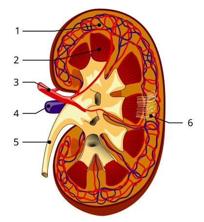
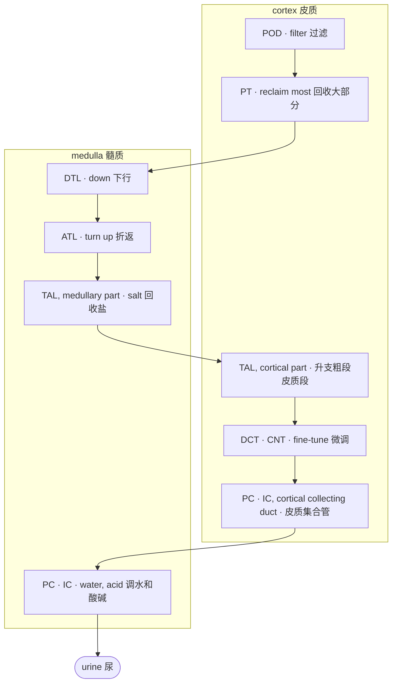

# 3 · 肾脏 / 3 · The kidney

<!-- ZH -->
!!! abstract "读完能回答"
    - 肾单位是什么，液体在里面怎么流？
    - PT、TAL、POD、PC 这些简称分别是哪一段？
    - 为什么 altered 细胞大多出在 PT 和 TAL？
<!-- EN -->
!!! abstract "After this module you can answer"
    - What is a nephron, and how does fluid flow through it?
    - Which segment is PT, TAL, POD, PC?
    - Why are most altered cells PT or TAL?

<!-- ZH -->
肾脏可以看成一条**过滤加回收的流水线**：血液先被过滤，滤出来的液体流过一串"工位"，有用的东西被收回去，剩下的变成尿。我们分三层放大来看：整个肾 → 一个肾单位 → 每个工位上的细胞。
<!-- EN -->
Think of the kidney as a **filter-and-reclaim pipeline**: blood is filtered, the filtered fluid flows past a series of stations that take back what is useful, and what is left becomes urine. We zoom in three times: the whole kidney → one nephron → the cells at each station.

## 第 1 层 · 整个肾剖开 / Zoom 1 · The whole kidney, cut open

<!-- ZH/EN --> 

<!-- ZH/EN --> 

<!-- ZH -->
1. **皮质**（renal cortex）：外层。过滤器（肾小球）、近端和远端小管，以及集合管的起始段在这里 [1]。
2. **髓质**（medulla）：内层，一块块红色的"锥体"。髓袢和集合管伸到这里 [1]。
3. **肾动脉**（renal artery）：血从这里进来。
4. **肾静脉**（renal vein）：过滤后的血从这里出去。
5. **输尿管**（ureter）：尿从这里流到膀胱。锥体的尖端叫**乳头**（papilla），尿从乳头流出。
6. **肾单位**（nephrons）：横跨皮质和髓质的细管。数量因人而异，人和人之间可以差到 10 倍 [2]；一项日本活体供肾者的研究估计平均每个肾约 65 万条 [3]。
<!-- EN -->
1. **Renal cortex**: the outer layer. Filters (glomeruli), the proximal and distal tubules, and the first part of the collecting ducts sit here [1].
2. **Medulla**: the inner layer, the red "pyramids". The loops and collecting ducts reach into it [1].
3. **Renal artery**: blood comes in.
4. **Renal vein**: filtered blood leaves.
5. **Ureter**: urine flows to the bladder. The tip of each pyramid is a **papilla**, where urine leaves.
6. **Nephrons**: thin tubes spanning cortex and medulla. The number differs up to 10-fold between people [2]; one study of Japanese living kidney donors estimated about 650,000 per kidney on average [3].

<!-- ZH/EN --> 

<!-- ZH -->
图：Wikimedia「[KidneyAndNephron-v4 Antares42.svg](https://commons.wikimedia.org/wiki/File:KidneyAndNephron-v4_Antares42.svg)」左半部分（作者 Madhero88、Piotr Michał Jaworski、Daniel Sachse），CC BY-SA 3.0，我们做了截取，截取后的图按同样许可共享。
<!-- EN -->
Figure: left half of Wikimedia "[KidneyAndNephron-v4 Antares42.svg](https://commons.wikimedia.org/wiki/File:KidneyAndNephron-v4_Antares42.svg)" (by Madhero88, Piotr Michał Jaworski, Daniel Sachse), CC BY-SA 3.0; cropped by us and shared under the same licence.

## 第 2 层 · 一个肾单位 / Zoom 2 · One nephron

<!-- ZH -->
放大一条肾单位。青色标签是我们加的，和 Lake 数据 `subclass.l1` 里的简称一一对应。按液体流动的顺序：
<!-- EN -->
Zoom in on one nephron. The teal labels were added by us and match the abbreviations in Lake's `subclass.l1`. In the order fluid flows:

<!-- ZH/EN --> 

<!-- ZH/EN --> 

<!-- ZH -->
- **POD 足细胞**（podocyte）：包在图里 Bowman's capsule 里那团毛细血管球外面。血在这里被滤出液体；过滤屏障有三层：毛细血管内皮、基底膜和足细胞 [4]。
- **PT 近端小管**（proximal tubule）：图里紫色的 Proximal convoluted tubule。回收约 60–70% 的水和盐，以及几乎全部的糖等营养物质 [5]。
- **DTL 降支细段**（descending thin limb）：往髓质深处走。
- **ATL 升支细段**（ascending thin limb）：折返向上的细的那段。
- **TAL 升支粗段**（thick ascending limb）：升支上面变粗的红色段，从髓质一直延伸到皮质。回收约 30% 的盐，自己不透水，由此建立髓质的浓度梯度 [6]。
- **DCT 远曲小管**（distal convoluted tubule）：回到皮质、贴着肾小球，紧接在致密斑（macula densa）之后；回收 5–10% 的钠，也调节钾、钙和镁 [7]；后面接 **CNT 连接小管**（connecting tubule）。
- **PC · IC 集合管**（collecting duct）：多条肾单位汇进同一根，从皮质一直通到乳头。主细胞（PC）用 AQP2 水通道调水 [8]，闰细胞（IC）调酸碱 [9]。
<!-- EN -->
- **POD, podocyte**: wrapped around the ball of capillaries inside Bowman's capsule. Fluid is filtered out of the blood here; the filtration barrier has three layers: capillary endothelium, basement membrane and podocytes [4].
- **PT, proximal tubule**: the purple proximal convoluted tubule. Takes back about 60–70% of the water and salt, and nearly all of the sugar and other nutrients [5].
- **DTL, descending thin limb**: runs deep into the medulla.
- **ATL, ascending thin limb**: the thin part that turns back up.
- **TAL, thick ascending limb**: the thicker red part higher up, running from the medulla into the cortex. Takes back about 30% of the salt while staying water-tight, which builds the medulla's concentration gradient [6].
- **DCT, distal convoluted tubule**: back in the cortex next to the glomerulus, right after the macula densa; takes back 5–10% of the sodium and also handles potassium, calcium and magnesium [7]; then joins the **CNT, connecting tubule**.
- **PC · IC, collecting duct**: many nephrons drain into one, running from the cortex down to the papilla. Principal cells (PC) set water with the AQP2 water channel [8], intercalated cells (IC) set acid–base [9].

<!-- ZH/EN --> 

<!-- ZH -->
图：Wikimedia「[Kidney Nephron.png](https://commons.wikimedia.org/wiki/File:Kidney_Nephron.png)」，Holly Fischer，CC BY 3.0；青色标签和中文部位名是我们加的。
<!-- EN -->
Figure: Wikimedia "[Kidney Nephron.png](https://commons.wikimedia.org/wiki/File:Kidney_Nephron.png)" by Holly Fischer, CC BY 3.0; teal labels and Chinese region names added by us.

## 第 3 层 · 简化成流水线 / Zoom 3 · As a pipeline

<!-- ZH -->
管道周围还有支撑细胞：**EC** 血管内皮、**FIB** 成纤维细胞、**VSM/P** 血管平滑肌和周细胞、**IMM** 免疫细胞。它们不在液体流经的路线上，但都在 `subclass.l1` 里。
<!-- EN -->
Support cells surround the tubes: **EC** endothelial cells, **FIB** fibroblasts, **VSM/P** vascular smooth muscle and pericytes, **IMM** immune cells. They are not on the fluid's path, but they are all in `subclass.l1`.

<!-- ZH -->
!!! tip "计算机类比"
    一条肾单位就是一条**流水线**：每个工位是一个服务，处理完把"数据"（滤液）交给下一个。每种细胞类型是一个服务的实例群。一个服务过载或宕机（某类细胞受损），会在它的实例上留下特征性的日志（表达谱变化），这就是 altered state。
<!-- EN -->
!!! tip "Computer analogy"
    A nephron is a **pipeline**: each station is a service that processes the "data" (filtered fluid) and hands it on. Each cell type is the pool of instances of one service. When a service is overloaded or down (a cell type is injured), its instances leave characteristic logs (expression changes); that is an altered state.

## 在数据里 / In the data

<!-- ZH -->
`subclass.l1` 的 16 个大类就是上面这些工位和支撑细胞。Lake 2023 单核数据里每类的核数（我们从 GEO 标签表数的）[10]：
<!-- EN -->
The 16 classes of `subclass.l1` are these stations and support cells. Nuclei per class in Lake 2023's single-nucleus data (counted by us from the GEO label table) [10]:

| subclass.l1 | Name / 名称 | Nuclei / 核数 |
|---|---|---|
| PT | proximal tubule / 近端小管 | 51,672 |
| TAL | thick ascending limb / 髓袢升支粗段 | 43,539 |
| EC | endothelial cell / 内皮 | 17,495 |
| FIB | fibroblast / 成纤维细胞 | 16,181 |
| PC | principal cell / 集合管主细胞 | 15,988 |
| IMM | immune cell / 免疫细胞 | 11,273 |
| IC | intercalated cell / 闰细胞 | 9,912 |
| DCT | distal convoluted tubule / 远曲小管 | 8,160 |
| DTL | descending thin limb / 降支细段 | 7,968 |
| CNT | connecting tubule / 连接小管 | 6,964 |
| VSM/P | vascular smooth muscle, pericyte / 血管平滑肌、周细胞 | 3,848 |
| ATL | ascending thin limb / 升支细段 | 2,957 |
| POD | podocyte / 足细胞 | 2,555 |
| PEC | parietal epithelial cell / 壁层上皮 | 1,425 |
| PapE | papillary epithelium / 乳头上皮 | 329 |
| NEU | neural cell / 神经细胞 | 72 |
| NA | not assigned / 没有标 | 3,364 |

<!-- ZH -->
部位记在 `region.l1`：皮质 125,521 个核，髓质 57,790，乳头 20,391 [10]。不同部位的工位不同，所以一块组织取在哪里，细胞组成就不同：比如皮质样本里 PT 约占 35%，髓质样本里 TAL 约占 40% [10]。
<!-- EN -->
The region is in `region.l1`: cortex 125,521 nuclei, medulla 57,790, papilla 20,391 [10]. Different regions hold different stations, so where a piece of tissue comes from changes its cell mix: PT makes up about 35% of cortex nuclei, while TAL makes up about 40% of medulla nuclei [10].

## 为什么 PT 和 TAL 最容易出问题 / Why PT and TAL get into trouble first

<!-- ZH -->
PT 和 TAL 承担了最多的回收工作 [5][6]，代谢非常活跃。在多数动物模型里，近端小管是对缺血、缺氧最敏感的细胞；TAL 代谢也很活跃，在某些模型里同样受损严重 [11]。数据也是这样：Lake 单核数据里最大的四个 altered 亚类都属于这两类 [10]：
<!-- EN -->
PT and TAL do most of the reclaiming [5][6] and are highly metabolically active. In most animal models the proximal tubule is the cell most sensitive to ischaemic or hypoxic damage; the TAL is also highly metabolically active and is badly affected in some models [11]. The data agree: the four largest altered subclasses in Lake's single-nucleus data all belong to these two [10]:

| subclass.l2 | Meaning / 意思 | Nuclei / 核数 |
|---|---|---|
| aPT | adaptive (repairing) PT / 修复中的近端小管 | 15,712 |
| dPT | degenerative PT / 退化的近端小管 | 14,431 |
| dM-TAL | degenerative medullary TAL / 退化的髓质升支粗段 | 10,781 |
| aTAL1 | adaptive TAL / 修复中的升支粗段 | 6,989 |

<!-- ZH -->
这也是为什么模块 6 里讲的伪影特别值得担心：取材时的缺血也会伤到这两类细胞。Lake 2019 在肾脏单核数据（肾切除和死亡供体肾）里看到，一个 TAL 亚群（TAL-1）和 PT 的 S3 段线粒体转录本偏高，作者认为这和肾切除手术中的热缺血一致 [13]。实验室里的解离应激则不一定：在小鼠肾的冷热消化对照里，37 °C 消化后变少的细胞群包括足细胞、系膜细胞和内皮细胞，这些变少的细胞群应激基因也明显偏高 [12]。
<!-- EN -->
This is also why the artifacts in module 6 matter so much: ischaemia during tissue collection affects these same two cell types. In single-nucleus kidney data (from nephrectomies and deceased-donor kidneys), Lake 2019 found more mitochondrial transcripts in a TAL subpopulation (TAL-1) and in S3 proximal tubule, which the authors read as "consistent with the nephrectomy procedure-related warm ischemia" [13]. Dissociation stress in the lab is a different story: in a mouse-kidney comparison of cold and warm digestion, the populations depleted after 37 °C digestion included podocytes, mesangial and endothelial cells, and these depleted populations also showed high stress-gene expression [12].

## 自测 / Self-check

<!-- ZH -->
??? question "1. 按液体流动顺序排列：TAL、POD、PC、PT、DTL。"
    POD → PT → DTL →（ATL →）TAL →（DCT → CNT →）PC。

??? question "2. 一份只取了皮质的活检，最可能缺哪些细胞类型？"
    髓质和乳头里的段：降支和升支细段（DTL、ATL）、髓质部分的 TAL、髓质和乳头部分的集合管（比如 IMCD），以及乳头上皮（PapE）。集合管本身不会全缺：皮质里也有集合管（Lake 的皮质样本里有 4,400 个 PC 核、7,257 个 IC 核 [10]）。

??? question "3. 为什么 altered 细胞大多是 PT 和 TAL？"
    这两类做最多的回收工作、代谢非常活跃：PT 在多数动物模型里对缺血最敏感，TAL 在某些模型里也受损严重 [11]；它们也是数量最多的两类，而且各自有一半以上的核是 altered（PT 66%，TAL 53%）[10]。
<!-- EN -->
??? question "1. Put in flow order: TAL, POD, PC, PT, DTL."
    POD → PT → DTL → (ATL →) TAL → (DCT → CNT →) PC.

??? question "2. A biopsy that sampled only cortex is most likely missing which cell types?"
    The medullary and papillary segments: the thin limbs (DTL, ATL), the medullary part of TAL, the medullary and papillary collecting duct (e.g. IMCD), and papillary epithelium (PapE). The collecting duct is not missing altogether: the cortex has collecting ducts too (Lake's cortex samples hold 4,400 PC and 7,257 IC nuclei [10]).

??? question "3. Why are most altered cells PT or TAL?"
    They do the most reclaiming and are highly metabolically active: in most animal models the PT is the cell most sensitive to ischaemia, and the TAL is badly affected in some models [11]; they are also the two most numerous types, and more than half of each type's nuclei are altered (PT 66%, TAL 53%) [10].

## 参考文献 / References

1. Lake BB, Menon R, Winfree S, et al. An atlas of healthy and injured cell states and niches in the human kidney. *Nature* 2023;619:585–594. [doi:10.1038/s41586-023-05769-3](https://doi.org/10.1038/s41586-023-05769-3) — Methods, "Tissue cytometry and in situ cell classification" ("Cortical distal nephron cells (distal tubules (CD), connecting tubules (CNT) and collecting ducts (C-CD)…"); Results ("the transition from… M-TAL in the medulla to the cortical thick ascending limb (C-TAL) in the cortex"). Deep-read: [Lake 2023](../papers/lake-kidney-atlas-nature-2023/index.md).
2. Luyckx V, Shukha K, Brenner BM. Inborn nephron diversity and its clinical consequences. *Rambam Maimonides Med J* 2011;2:e0061. [doi:10.5041/RMMJ.10061](https://doi.org/10.5041/RMMJ.10061) — Introduction ("variability of up to 10-fold within select populations").
3. Sasaki T, Tsuboi N, Okabayashi Y, et al. Estimation of nephron number in living humans by combining unenhanced computed tomography with biopsy-based stereology. *Sci Rep* 2019;9:14400. [doi:10.1038/s41598-019-50529-x](https://doi.org/10.1038/s41598-019-50529-x) — Table 5 (mean 636–655 × 10³ nephrons per kidney, 44 Japanese living donors).
4. Scott RP, Quaggin SE. The cell biology of renal filtration. *J Cell Biol* 2015;209:199–210. [doi:10.1083/jcb.201410017](https://doi.org/10.1083/jcb.201410017) — "The GECs, the podocytes, and the GBM in between constitute the three distinctive layers of the glomerular filtration barrier".
5. Curthoys NP, Moe OW. Proximal tubule function and response to acidosis. *Clin J Am Soc Nephrol* 2014;9:1627–1638. [doi:10.2215/CJN.10391012](https://doi.org/10.2215/CJN.10391012) — Summary ("reabsorbing approximately 60%–70% of the water and NaCl… and nearly all of the nutrients").
6. Mount DB. Thick ascending limb of the loop of Henle. *Clin J Am Soc Nephrol* 2014;9:1974–1986. [doi:10.2215/CJN.04480413](https://doi.org/10.2215/CJN.04480413) — "Apical Transport of Na+, K+, and Cl−" ("reabsorbs approximately 30% of filtered Na+-Cl−"; "water-impermeable TAL… drives the countercurrent multiplication").
7. Subramanya AR, Ellison DH. Distal convoluted tubule. *Clin J Am Soc Nephrol* 2014;9:2147–2163. [doi:10.2215/CJN.05920613](https://doi.org/10.2215/CJN.05920613) — abstract ("immediately downstream of the macula densa"); Introduction; "reabsorbs roughly 5%–10% of the filtered sodium load".
8. Pearce D, Soundararajan R, Trimpert C, et al. Collecting duct principal cell transport processes and their regulation. *Clin J Am Soc Nephrol* 2015;10:135–146. [doi:10.2215/CJN.05760513](https://doi.org/10.2215/CJN.05760513) — Introduction (ENaC, ROMK and AQP2 in principal cells; AQP2 regulated by vasopressin).
9. Roy A, Al-bataineh MM, Pastor-Soler NM. Collecting duct intercalated cell function and regulation. *Clin J Am Soc Nephrol* 2015;10:305–324. [doi:10.2215/CJN.08880914](https://doi.org/10.2215/CJN.08880914) — abstract ("important roles in the regulation of acid-base homeostasis").
10. GEO GSE183277: `GSE183277_Kidney_Healthy-Injury_Cell_Atlas_snCv3_Metadata_03282022.txt.gz` ([GEO files](https://ftp.ncbi.nlm.nih.gov/geo/series/GSE183nnn/GSE183277/suppl/)) — counted by us by `subclass.l1`, `subclass.l2`, `region.l1` and `state.l1`.
11. Basile DP, Anderson MD, Sutton TA. Pathophysiology of acute kidney injury. *Compr Physiol* 2012, pp. 1303–1353. [doi:10.1002/cphy.c110041](https://doi.org/10.1002/cphy.c110041) — III.1.1 "Energetics and sensitivity to injury" ("the proximal tubule is considered the most sensitive cellular entity to ischemic, hypoxic or nephrotoxic damage… the thick ascending limb of Henle is also highly metabolically active").
12. Denisenko E, Guo BB, Jones M, et al. Systematic assessment of tissue dissociation and storage biases in single-cell and single-nucleus RNA-seq workflows. *Genome Biol* 2020;21:130. [doi:10.1186/s13059-020-02048-6](https://doi.org/10.1186/s13059-020-02048-6) — mouse kidney; Results ("less abundant in warm-dissociated samples… including podocytes, mesangial cells, and endothelial cells… also showed significantly high expression of the stress-response-related gene set"). Deep-read: [Denisenko 2020](../papers/denisenko-dissociation-bias-genomebiol-2020/index.md).
13. Lake BB, Chen S, Hoshi M, et al. A single-nucleus RNA-sequencing pipeline to decipher the molecular anatomy and pathophysiology of human kidneys. *Nat Commun* 2019;10:2832. [doi:10.1038/s41467-019-10861-2](https://doi.org/10.1038/s41467-019-10861-2) — Results (MT enrichment in TAL-1 and S3 PT "consistent with the nephrectomy procedure-related warm ischemia"). Deep-read: [Lake 2019](../papers/lake-snrna-pipeline-natcommun-2019/index.md).
