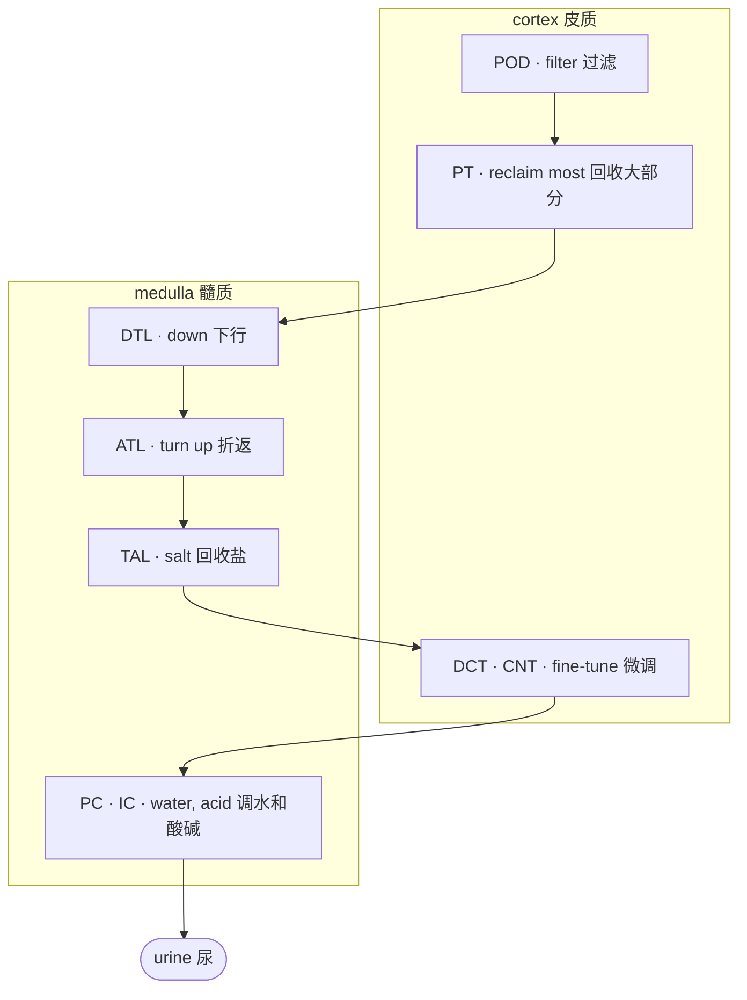

# 3 · 肾脏 / 3 · The kidney

<!-- ZH -->
!!! abstract "读完能回答"
    - 肾单位是什么，液体在里面怎么流？
    - PT、TAL、POD、PC 这些简称分别是哪一段？
    - 为什么 altered 细胞大多出在 PT 和 TAL？
<!-- EN -->
!!! abstract "After this module you can answer"
    - What is a nephron, and how does fluid flow through it?
    - Which segment is PT, TAL, POD, PC?
    - Why are most altered cells PT or TAL?

<!-- ZH -->
肾脏可以看成一条**过滤加回收的流水线**：血液先被过滤，滤出来的液体流过一串"工位"，有用的东西被收回去，剩下的变成尿。我们分三层放大来看：整个肾 → 一个肾单位 → 每个工位上的细胞。
<!-- EN -->
Think of the kidney as a **filter-and-reclaim pipeline**: blood is filtered, the filtered fluid flows past a series of stations that take back what is useful, and what is left becomes urine. We zoom in three times: the whole kidney → one nephron → the cells at each station.

## 第 1 层 · 整个肾剖开 / Zoom 1 · The whole kidney, cut open

<!-- ZH/EN --> 

<!-- ZH/EN --> 

<!-- ZH -->
1. **皮质**（renal cortex）：外层。过滤器（肾小球）和近端、远端小管在这里。
2. **髓质**（medulla）：内层，一块块红色的"锥体"。髓袢和集合管伸到这里。
3. **肾动脉**（renal artery）：血从这里进来。
4. **肾静脉**（renal vein）：过滤后的血从这里出去。
5. **输尿管**（ureter）：尿从这里流到膀胱。锥体的尖端叫**乳头**（papilla），尿从乳头流出。
6. **肾单位**（nephrons）：横跨皮质和髓质的细管，一个肾约 100 万条。
<!-- EN -->
1. **Renal cortex**: the outer layer. Filters (glomeruli) and the proximal and distal tubules sit here.
2. **Medulla**: the inner layer, the red "pyramids". The loops and collecting ducts reach into it.
3. **Renal artery**: blood comes in.
4. **Renal vein**: filtered blood leaves.
5. **Ureter**: urine flows to the bladder. The tip of each pyramid is a **papilla**, where urine leaves.
6. **Nephrons**: thin tubes spanning cortex and medulla, about a million per kidney.

<!-- ZH/EN --> 

<!-- ZH -->
图：Wikimedia「KidneyAndNephron-v4」左半部分（作者 Madhero88、Piotr Michał Jaworski、Daniel Sachse），CC BY-SA 3.0，我们做了截取，截取后的图按同样许可共享。
<!-- EN -->
Figure: left half of Wikimedia "KidneyAndNephron-v4" (by Madhero88, Piotr Michał Jaworski, Daniel Sachse), CC BY-SA 3.0; cropped by us and shared under the same licence.

## 第 2 层 · 一个肾单位 / Zoom 2 · One nephron

<!-- ZH -->
放大一条肾单位。青色标签是我们加的，和 Lake 数据 `subclass.l1` 里的简称一一对应。按液体流动的顺序：
<!-- EN -->
Zoom in on one nephron. The teal labels were added by us and match the abbreviations in Lake's `subclass.l1`. In the order fluid flows:

<!-- ZH/EN --> 

<!-- ZH/EN --> 

<!-- ZH -->
- **POD 足细胞**（podocyte）：在图里 Bowman's capsule 里那团血管球上。过滤器，血在这里被滤出液体。
- **PT 近端小管**（proximal tubule）：图里紫色的 Proximal convoluted tubule。回收大部分水、糖、盐。
- **DTL 降支细段**（descending thin limb）：往髓质深处走。
- **ATL 升支细段**（ascending thin limb）：折返向上的细的那段。
- **TAL 升支粗段**（thick ascending limb）：升支上面变粗的红色段，回收盐、建立浓度梯度。
- **DCT 远曲小管**（distal convoluted tubule）：回到皮质、贴着肾小球，微调盐和钙；后面接 **CNT 连接小管**（connecting tubule）。
- **PC · IC 集合管**（collecting duct）：多条肾单位汇进同一根。主细胞（PC）调水，闰细胞（IC）调酸碱。
<!-- EN -->
- **POD, podocyte**: on the ball of capillaries inside Bowman's capsule. The filter: fluid is squeezed out of the blood here.
- **PT, proximal tubule**: the purple proximal convoluted tubule. Takes back most water, sugar and salt.
- **DTL, descending thin limb**: runs deep into the medulla.
- **ATL, ascending thin limb**: the thin part that turns back up.
- **TAL, thick ascending limb**: the thicker red part higher up; takes back salt and builds the concentration gradient.
- **DCT, distal convoluted tubule**: back in the cortex next to the glomerulus; fine-tunes salt and calcium, then joins the **CNT, connecting tubule**.
- **PC · IC, collecting duct**: many nephrons drain into one. Principal cells (PC) set water, intercalated cells (IC) set acid–base.

<!-- ZH/EN --> 

<!-- ZH -->
图：Wikimedia「Kidney Nephron」，Holly Fischer，CC BY 3.0；青色标签和中文部位名是我们加的。
<!-- EN -->
Figure: Wikimedia "Kidney Nephron" by Holly Fischer, CC BY 3.0; teal labels and Chinese region names added by us.

## 第 3 层 · 简化成流水线 / Zoom 3 · As a pipeline

<!-- ZH -->
管道周围还有支撑细胞：**EC** 血管内皮、**FIB** 成纤维细胞、**VSM/P** 血管平滑肌和周细胞、**IMM** 免疫细胞。它们不在液体流经的路线上，但都在 `subclass.l1` 里。
<!-- EN -->
Support cells surround the tubes: **EC** endothelial cells, **FIB** fibroblasts, **VSM/P** vascular smooth muscle and pericytes, **IMM** immune cells. They are not on the fluid's path, but they are all in `subclass.l1`.

<!-- ZH -->
!!! tip "计算机类比"
    一条肾单位就是一条**流水线**：每个工位是一个服务，处理完把"数据"（滤液）交给下一个。每种细胞类型是一个服务的实例群。一个服务过载或宕机（某类细胞受损），会在它的实例上留下特征性的日志（表达谱变化），这就是 altered state。
<!-- EN -->
!!! tip "Computer analogy"
    A nephron is a **pipeline**: each station is a service that processes the "data" (filtered fluid) and hands it on. Each cell type is the pool of instances of one service. When a service is overloaded or down (a cell type is injured), its instances leave characteristic logs (expression changes); that is an altered state.

## 在数据里 / In the data

<!-- ZH -->
`subclass.l1` 的 17 个大类就是上面这些工位和支撑细胞。Lake 2023 单核数据里每类的核数（我们从 GEO 标签表数的）：
<!-- EN -->
The 17 classes of `subclass.l1` are these stations and support cells. Nuclei per class in Lake 2023's single-nucleus data (counted by us from the GEO label table):

| subclass.l1 | Name / 名称 | Nuclei / 核数 |
|---|---|---|
| PT | proximal tubule / 近端小管 | 51,672 |
| TAL | thick ascending limb / 髓袢升支粗段 | 43,539 |
| EC | endothelial cell / 内皮 | 17,495 |
| FIB | fibroblast / 成纤维细胞 | 16,181 |
| PC | principal cell / 集合管主细胞 | 15,988 |
| IMM | immune cell / 免疫细胞 | 11,273 |
| IC | intercalated cell / 闰细胞 | 9,912 |
| DCT | distal convoluted tubule / 远曲小管 | 8,160 |
| DTL | descending thin limb / 降支细段 | 7,968 |
| CNT | connecting tubule / 连接小管 | 6,964 |
| VSM/P | vascular smooth muscle, pericyte / 血管平滑肌、周细胞 | 3,848 |
| ATL | ascending thin limb / 升支细段 | 2,957 |
| POD | podocyte / 足细胞 | 2,555 |
| PEC | parietal epithelial cell / 壁层上皮 | 1,425 |
| PapE | papillary epithelium / 乳头上皮 | 329 |
| NEU | neural cell / 神经细胞 | 72 |
| NA | not assigned / 没有标 | 3,364 |

<!-- ZH -->
部位记在 `region.l1`：皮质 125,521 个核，髓质 57,790，乳头 20,391。不同部位的工位不同，所以一块组织取在哪里，细胞组成就不同。
<!-- EN -->
The region is in `region.l1`: cortex 125,521 nuclei, medulla 57,790, papilla 20,391. Different regions hold different stations, so where a piece of tissue comes from changes its cell mix.

## 为什么 PT 和 TAL 最容易出问题 / Why PT and TAL get into trouble first

<!-- ZH -->
PT 和 TAL 承担了最多的回收工作，需要大量能量和氧气。血流一减少（缺血），它们最先撑不住。数据也是这样：Lake 单核数据里最大的几个 altered 亚类都属于这两类：
<!-- EN -->
PT and TAL do most of the reclaiming and need a lot of energy and oxygen. When blood flow drops (ischaemia), they fail first. The data agree: the largest altered subclasses in Lake's single-nucleus data all belong to these two:

| subclass.l2 | Meaning / 意思 | Nuclei / 核数 |
|---|---|---|
| aPT | adaptive (repairing) PT / 修复中的近端小管 | 15,712 |
| dPT | degenerative PT / 退化的近端小管 | 14,431 |
| dM-TAL | degenerative medullary TAL / 退化的髓质升支粗段 | 10,781 |
| aTAL1 | adaptive TAL / 修复中的升支粗段 | 6,989 |

<!-- ZH -->
这也是为什么模块 6 里讲的伪影特别值得担心：缺血和取样应激最先打到的，也是这两类细胞。
<!-- EN -->
This is also why the artifacts in module 6 matter so much: ischaemia and procurement stress hit the same two cell types first.

## 自测 / Self-check

<!-- ZH -->
??? question "1. 按液体流动顺序排列：TAL、POD、PC、PT、DTL。"
    POD → PT → DTL →（ATL →）TAL →（DCT → CNT →）PC。

??? question "2. 一份只取了皮质的活检，最可能缺哪些细胞类型？"
    髓质和乳头里的段：降支和升支细段（DTL、ATL）、髓质部分的 TAL 和集合管，以及乳头上皮（PapE）。

??? question "3. 为什么 altered 细胞大多是 PT 和 TAL？"
    这两类做最多的回收工作，耗能耗氧最多，缺血时最先受伤；它们也是数量最多的两类。
<!-- EN -->
??? question "1. Put in flow order: TAL, POD, PC, PT, DTL."
    POD → PT → DTL → (ATL →) TAL → (DCT → CNT →) PC.

??? question "2. A biopsy that sampled only cortex is most likely missing which cell types?"
    The medullary and papillary segments: the thin limbs (DTL, ATL), the medullary part of TAL and the collecting duct, and papillary epithelium (PapE).

??? question "3. Why are most altered cells PT or TAL?"
    They do the most reclaiming and use the most energy and oxygen, so they are injured first by ischaemia; they are also the two most numerous types.
