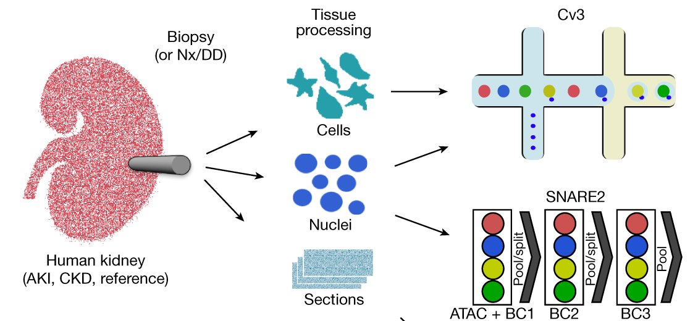

# 4 · 病人和取材 / 4 · Patients and tissue

<!-- ZH -->
!!! abstract "读完能回答"
    - AKI 和 CKD 有什么不同？
    - 活检、肾切除、死亡供体三种取法各有什么问题？
    - 为什么健康人身上也有 altered 细胞？
<!-- EN -->
!!! abstract "After this module you can answer"
    - How do AKI and CKD differ?
    - What is wrong with each of biopsy, nephrectomy and deceased-donor tissue?
    - Why do healthy donors also have altered cells?

<!-- ZH -->
模块 1 的 obs 里有三列描述"这个细胞从哪来"：`condition`（这个人有什么病）、`tissue_type`（组织是怎么取到的）、`region`（取的是肾的哪一层）。这一模块讲这三列背后的事，以及它们为什么会**骗**模型。

本页的数字有两种来源：文献原文（标 [n]），或者我们自己从 GEO 下载的 Lake 2023 单核标签表里数出来的（标"我们数的"）。
<!-- EN -->
Module 1's obs has three columns that describe where a cell came from: `condition` (what disease the person has), `tissue_type` (how the tissue was obtained) and `region` (which layer of the kidney was sampled). This module explains what lies behind them, and why they can **mislead** a model.

Numbers on this page come from two places: the literature (marked [n]) or our own counts from the Lake 2023 single-nucleus label table downloaded from GEO (marked "our count").

## 第 1 步 · 两种肾病：AKI 和 CKD / Step 1 · Two kidney diseases: AKI and CKD

<!-- ZH -->
肾病按**时间**分成两大类。国际肾脏病指南组织 KDIGO 给了操作性的定义：

- **AKI（急性肾损伤，acute kidney injury）**：肾功能在**几天之内**明显下降。满足下面任意一条就算 [1]：
    - 血肌酐 48 小时内上升 ≥ 0.3 mg/dl（26.5 µmol/l）；
    - 血肌酐在 7 天内升到基线的 1.5 倍以上；
    - 尿量连续 6 小时少于 0.5 ml/kg/h。
- **CKD（慢性肾病，chronic kidney disease）**：肾脏结构或功能异常，**至少持续 3 个月**，并且影响健康 [2]。

**血肌酐**（serum creatinine）是血液里的一种代谢产物，由肾脏滤出；肾脏滤得慢了，它就会在血里积累。KDIGO 建议初步评估肾功能时，就用血肌酐加一个估算公式（第 2 步的 eGFR，估算肾小球滤过率）。肌酐的产生量和肌肉量有关，所以肌肉特别多或特别少的人，用它估算会有偏差 [2]。

两者不是互斥的：一个已经有 CKD 的人，也可以再发生一次 AKI [1]。
<!-- EN -->
Kidney disease is split by **time** into two groups. KDIGO, the international kidney guideline body, gives operational definitions:

- **AKI (acute kidney injury)**: kidney function drops markedly **within days**. Any one of the following is enough [1]:
    - serum creatinine rises by ≥ 0.3 mg/dl (26.5 µmol/l) within 48 hours;
    - serum creatinine rises to ≥ 1.5 times baseline within 7 days;
    - urine output is below 0.5 ml/kg/h for 6 hours.
- **CKD (chronic kidney disease)**: abnormalities of kidney structure or function **present for at least 3 months**, with implications for health [2].

**Serum creatinine** is a metabolite in the blood that the kidneys filter out; when filtration slows, it builds up. KDIGO advises using serum creatinine with an estimating equation (the eGFR of step 2) for the initial assessment of kidney function. How much creatinine is made depends on muscle mass, so the estimate is biased in people with unusually high or low muscle mass [2].

The two are not exclusive: a person who already has CKD can also have an episode of AKI [1].

<!-- ZH -->
!!! tip "计算机类比"
    AKI 像一次**线上事故**：几小时到几天内突然变差，看的是短时间窗口里的指标跳变。CKD 像**长期退化**：问题持续好几个月，看的是长期状态。一个长期退化的系统，也可能再出一次事故。
<!-- EN -->
!!! tip "Computer analogy"
    AKI is an **incident**: things get worse within hours to days, and you detect it from a jump in a short time window. CKD is **long-term degradation**: the problem persists for months, and you judge it from the long-run state. A degraded system can still have an incident on top.

### 在数据里 / In the data

<!-- ZH -->
KPMP（Lake 2023 病人样本的来源）重点收集的是最常见的几类：**糖尿病或高血压引起的 CKD**，以及**缺血或毒性损伤引起的 AKI** [3]。这正好对应 Lake 单核标签表里的 `condition.l2`（我们数的，单位是人）：
<!-- EN -->
KPMP, the source of Lake 2023's patient samples, focuses on the most common kinds: **CKD attributed to diabetes or hypertension**, and **AKI attributed to ischaemic or toxic injury** [3]. That is exactly what `condition.l2` holds in Lake's single-nucleus label table (our count, in people):

| `condition.l1` | `condition.l2` | Meaning / 含义 | People / 人数 |
|---|---|---|---|
| AKI | AKI | acute kidney injury / 急性肾损伤 | 6 |
| AKI | COV-AKI | AKI with COVID-19 / 新冠相关的 AKI | 4 |
| CKD | DKD | diabetic kidney disease / 糖尿病肾病 | 7 |
| CKD | H-CKD | hypertensive CKD / 高血压引起的 CKD | 6 |
| Ref | Ref | healthy reference / 健康参考 | 13 |

## 第 2 步 · 病有多重：eGFR / Step 2 · How severe: eGFR

<!-- ZH -->
**GFR**（肾小球滤过率）是肾脏每分钟滤出多少血浆，是衡量肾功能的核心指标。直接测很麻烦，临床上通常用血肌酐和 / 或胱抑素 C（cystatin C）加上年龄、性别，用公式**估算**，叫 **eGFR**（estimated GFR，估算肾小球滤过率）[4]。KDIGO 按 GFR 把 CKD 分成 6 级 [2]：
<!-- EN -->
**GFR** (glomerular filtration rate) is how much plasma the kidneys filter per minute, the core measure of kidney function. Measuring it directly is laborious, so in practice it is **estimated** from serum creatinine and/or cystatin C together with age and sex, giving **eGFR** (estimated GFR) [4]. KDIGO groups CKD into six GFR categories [2]:

| Category / 分级 | GFR (ml/min/1.73 m²) | Term / 含义 |
|---|---|---|
| G1 | ≥ 90 | normal or high / 正常或偏高 |
| G2 | 60–89 | mildly decreased / 轻度下降 |
| G3a | 45–59 | mildly to moderately decreased / 轻到中度下降 |
| G3b | 30–44 | moderately to severely decreased / 中到重度下降 |
| G4 | 15–29 | severely decreased / 重度下降 |
| G5 | < 15 | kidney failure / 肾衰竭 |

<!-- ZH -->
G1、G2 本身不算 CKD，要同时有肾损伤的证据才算 [2]。

**在数据里：Lake 2023 公开的单核标签表里没有 eGFR 列，也没有年龄列**（我们查过）。所以我们只知道一个人"有没有病、哪种病"，不知道"病得多重"。
<!-- EN -->
G1 and G2 alone do not count as CKD; there must also be evidence of kidney damage [2].

**In the data: Lake 2023's public single-nucleus label table has no eGFR column and no age column** (we checked). We know whether and which disease a person has, but not how severe it is.

## 第 3 步 · 组织从哪来：三种取材 / Step 3 · Where the tissue comes from

<!-- ZH/EN --> 

<!-- ZH/EN --> 

<!-- ZH/EN --> 

<!-- ZH -->
Lake 2023 的组织有三种来源 [5]：

- **穿刺活检**（biopsy）：用细针从肾里取一条组织。病人的活检来自 KPMP，是专门为研究做的 [3]；健康参考里也有一部分是**活体捐肾者**的活检 [5]。
- **肾切除**（nephrectomy，图中 Nx）：因病接受部分或全部肾切除的病人，研究用的是切下来的组织 [5]。
- **死亡供体**（deceased donor，图中 DD）：来自已故捐献者、最后没有用于移植的肾 [5]。
<!-- EN -->
Lake 2023's tissue has three sources [5]:

- **Needle biopsy**: a thin core of tissue taken with a needle. Patient biopsies come from KPMP and are taken for research [3]; some healthy reference tissue is also **living-donor** biopsies [5].
- **Nephrectomy** (Nx in the figure): tissue from people who had part or all of a kidney removed [5].
- **Deceased donor** (DD in the figure): kidneys from deceased donors that were not used for transplant [5].

<!-- ZH/EN --> 

<!-- ZH/EN --> 

<!-- ZH -->
图：Lake et al. 2023 Fig. 1a（截取），Nature，CC BY 4.0。

**取法决定了你看到肾的哪一部分。**下面是 Lake 单核数据里每种取法的细胞核落在哪一层（我们数的）：
<!-- EN -->
Figure: Lake et al. 2023, Fig. 1a (cropped), Nature, CC BY 4.0.

**How the tissue was taken decides which part of the kidney you see.** Here is where the nuclei of each tissue type sit in Lake's single-nucleus data (our count):

| `tissue_type` | Cortex / 皮质 | Medulla / 髓质 | Papilla / 乳头 |
|---|---|---|---|
| Biopsy / 活检 | 81,716 | 42,832 | 8,064 |
| Nephrectomy / 肾切除 | 43,805 | 7,945 | 0 |
| Deceased donor / 死亡供体 | 0 | 7,013 | 12,327 |

<!-- ZH -->
在这份数据里，死亡供体的样本**全部**来自髓质和乳头，一个皮质核都没有；肾切除则大部分是皮质。回忆模块 3：皮质和髓质里的细胞类型不一样，所以不同取法的样本，细胞类型的比例本身就不同。
<!-- EN -->
In this dataset the deceased-donor samples come **entirely** from medulla and papilla, with no cortex at all, while nephrectomies are mostly cortex. Recall module 3: cortex and medulla hold different cell types, so samples from different sources start out with different cell-type mixes.

## 第 4 步 · 为什么健康人也有 altered 细胞 / Step 4 · Why healthy donors have altered cells too

<!-- ZH -->
按直觉，健康参考（`condition.l1 = Ref`）的细胞应该都是 reference 状态。实际上（我们数的）：

- 健康参考里 **25.7%** 的细胞核被标为 altered（AKI 是 43.2%，CKD 是 42.5%）；
- 按人看，13 个健康人里，altered 占比从 **12% 到 50%** 不等。

Lake 2023 的作者认为，健康参考组织里的 altered 状态**可能来自取样时的缺血应激，或者正常衰老** [5]。这里的"缺血"（ischaemia）指组织离开血液供应、得不到氧气的那段时间。
<!-- EN -->
You would expect every cell of a healthy reference (`condition.l1 = Ref`) to be in the reference state. In fact (our count):

- **25.7%** of healthy reference nuclei are labelled altered (43.2% in AKI, 42.5% in CKD);
- per person, the altered share among the 13 healthy donors ranges from **12% to 50%**.

Lake 2023's authors suggest that altered states in reference tissue **might arise from ischaemic stress during sample acquisition or from normal ageing** [5]. Ischaemia here means the time tissue spends cut off from blood supply, without oxygen.

<!-- ZH -->
!!! warning "对我们的工作意味着什么"
    `Ref` 是**按人**打的标签，不是按细胞。如果把"健康人的所有细胞"当作正常样本来训练异常检测模型，训练集里约四分之一的细胞本身就被作者标成了 altered。训练前要想清楚：正常样本是"健康人的细胞"，还是"`state.l1 = reference` 的细胞"？两种选法回答的是不同的问题（模块 8）。
<!-- EN -->
!!! warning "What this means for our work"
    `Ref` is a label **per person**, not per cell. If you train an anomaly detector on "all cells from healthy people", about a quarter of the training cells are ones the authors labelled altered. Decide first whether "normal" means "cells from healthy people" or "cells with `state.l1 = reference`": the two answer different questions (module 8).

## 第 5 步 · 最大的坑：混杂 / Step 5 · The biggest trap: confounding

<!-- ZH -->
把 `condition` 和 `tissue_type` 交叉起来看（我们数的，单位是人 / 细胞核）：
<!-- EN -->
Cross-tabulate `condition` against `tissue_type` (our count, people / nuclei):

| `condition.l1` | Biopsy / 活检 | Nephrectomy / 肾切除 | Deceased donor / 死亡供体 |
|---|---|---|---|
| AKI | 10 / 51,868 | — | — |
| CKD | 10 / 55,274 | 3 / 8,100 | — |
| Ref | 5 / 25,470 | 5 / 43,650 | 3 / 19,340 |

<!-- ZH -->
三件事要注意：

1. **AKI 全部来自活检**，健康参考有一半以上来自肾切除和死亡供体。所以"AKI vs 健康"的差别里，混着"活检 vs 其他取法"的差别。
2. 健康参考里，altered 占比按取法分别是：活检 26.5%、肾切除 29.8%、死亡供体 15.6%（我们数的）。死亡供体反而最低，但它只取了髓质和乳头（第 3 步），而且只有 3 个人。**仅凭这份数据，分不清这个差别来自取法、取材部位，还是这几个人本身。**
3. 每种组合只有 3 到 10 个人。一个人贡献几千个细胞，细胞数看起来很大，但能独立比较的其实只有这几个人（模块 7 的问题 2）。

以上是我们根据计数得出的推论，不是文献结论。
<!-- EN -->
Three things to notice:

1. **All AKI tissue is biopsy**, while more than half of the healthy reference is nephrectomy or deceased donor. Any "AKI vs healthy" difference is mixed with a "biopsy vs other sources" difference.
2. Within healthy reference, the altered share by tissue type is 26.5% for biopsy, 29.8% for nephrectomy and 15.6% for deceased donor (our count). Deceased donors are lowest, but they were sampled only from medulla and papilla (step 3) and are only 3 people. **From this data alone you cannot tell whether the difference comes from the tissue source, the region, or those particular people.**
3. Each combination has only 3 to 10 people. Each person contributes thousands of cells, so cell counts look large, but the number of independent units you can compare is just these few people (module 7, question 2).

These are our own inferences from the counts, not findings from the literature.

<!-- ZH -->
!!! tip "计算机类比"
    像一次 A/B 测试：实验组全部跑在新机房，对照组大多跑在旧机房。看到两组指标不同，你没法知道是新功能的作用，还是机房的作用。训练分类器之前，先把 `condition` × `tissue_type` × `region` 交叉表打出来看一眼。
<!-- EN -->
!!! tip "Computer analogy"
    It is like an A/B test where the treatment group all ran in a new data centre and the control group mostly in the old one. When the metrics differ, you cannot tell whether the feature or the data centre caused it. Before training a classifier, print the `condition` × `tissue_type` × `region` cross-table and look at it.

## 自测 / Self-check

<!-- ZH -->
??? question "1. AKI 和 CKD 的根本区别是什么？"
    时间。AKI 是几天之内的急性下降（例如血肌酐 48 小时内上升 ≥ 0.3 mg/dl），CKD 是至少持续 3 个月的异常。两者可以同时存在。

??? question "2. 为什么健康人身上也有 altered 细胞？"
    作者认为可能来自取样时的缺血应激，或者正常衰老。Lake 单核数据里健康参考有 25.7% 的核是 altered，按人从 12% 到 50% 不等。

??? question "3. 一个区分 AKI 和健康人的分类器准确率很高，为什么不能直接相信？"
    AKI 的样本全部来自活检，健康样本大多来自肾切除和死亡供体，取材部位也不一样。模型可能学到的是取法或部位，而不是疾病。要先看交叉表，并按人切分（模块 1）。
<!-- EN -->
??? question "1. What is the basic difference between AKI and CKD?"
    Time. AKI is an acute drop within days (for example serum creatinine rising ≥ 0.3 mg/dl within 48 hours); CKD is an abnormality lasting at least 3 months. A person can have both.

??? question "2. Why do healthy donors have altered cells?"
    The authors suggest ischaemic stress during sample acquisition, or normal ageing. In Lake's single-nucleus data 25.7% of healthy reference nuclei are altered, ranging from 12% to 50% per person.

??? question "3. A classifier separates AKI from healthy with high accuracy. Why not trust it straight away?"
    All AKI samples are biopsies, while healthy samples are mostly nephrectomies and deceased donors, sampled from different regions. The model may have learned the tissue source or region rather than the disease. Look at the cross-table first, and split by person (module 1).

## 参考文献 / References

1. Kidney Disease: Improving Global Outcomes (KDIGO) Acute Kidney Injury Work Group. Section 2: AKI definition. *Kidney Int Suppl* 2012;2(1):19–36. [doi:10.1038/kisup.2011.32](https://doi.org/10.1038/kisup.2011.32) — Recommendation 2.1.1; Figure 2.
2. KDIGO CKD Work Group (Stevens PE, Ahmed SB, et al.). KDIGO 2024 clinical practice guideline for the evaluation and management of chronic kidney disease. *Kidney Int* 2024;105(4S):S117–S314. [doi:10.1016/j.kint.2023.10.018](https://doi.org/10.1016/j.kint.2023.10.018) — CKD definition; Table 2; Practice Point 1.2.2.1.
3. de Boer IH, Alpers CE, Azeloglu EU, et al. Rationale and design of the Kidney Precision Medicine Project. *Kidney Int* 2021;99(3):498–510. [doi:10.1016/j.kint.2020.08.039](https://doi.org/10.1016/j.kint.2020.08.039) — abstract.
4. Inker LA, Eneanya ND, Coresh J, et al. New creatinine- and cystatin C–based equations to estimate GFR without race. *N Engl J Med* 2021;385:1737–1749. [doi:10.1056/NEJMoa2102953](https://doi.org/10.1056/NEJMoa2102953)
5. Lake BB, Menon R, Winfree S, et al. An atlas of healthy and injured cell states and niches in the human kidney. *Nature* 2023;619:585–594. [doi:10.1038/s41586-023-05769-3](https://doi.org/10.1038/s41586-023-05769-3) — Fig. 1a; Methods (ethical compliance); Results on altered states. Deep-read: [Lake 2023](../papers/lake-kidney-atlas-nature-2023/index.md).

<!-- ZH -->
"我们数的"数字：GEO GSE183277，`GSE183277_Kidney_Healthy-Injury_Cell_Atlas_snCv3_Metadata_03282022.txt.gz`，按 `condition.l1`、`condition.l2`、`tissue_type`、`region.l1`、`state.l1`、`patient` 计数。
<!-- EN -->
"Our count" numbers: GEO GSE183277, `GSE183277_Kidney_Healthy-Injury_Cell_Atlas_snCv3_Metadata_03282022.txt.gz`, counted by `condition.l1`, `condition.l2`, `tissue_type`, `region.l1`, `state.l1` and `patient`.
