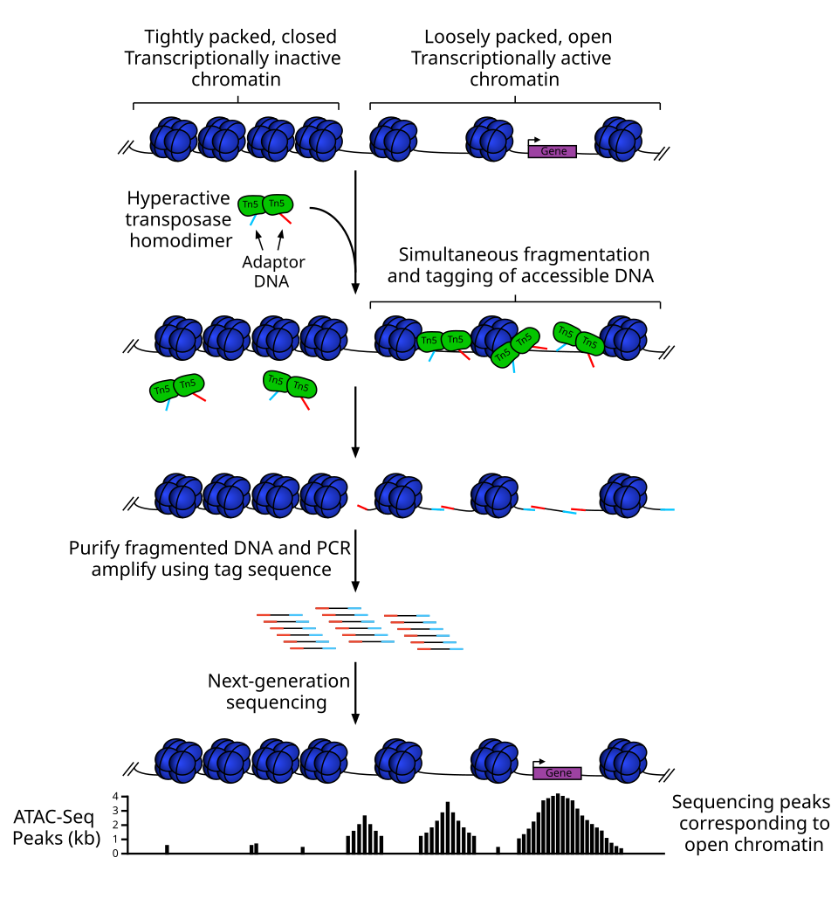

# 5.2 · 测法：ATAC、多模态、空间、混样 / 5.2 · Assays: ATAC, multiome, spatial, pooling

<!-- ZH -->
!!! abstract "读完能回答"
    - ATAC 测的是什么，得到什么矩阵？
    - 为什么“同一个核测两样”（multiome / SNARE2）重要？
    - 空间测序（spatial sequencing）多给了什么信息？
    - 几个人的样本混在一次上机里，怎么把细胞分回各自的人？
<!-- EN -->
!!! abstract "After this module you can answer"
    - What does ATAC measure, and what matrix does it give?
    - Why does measuring two things in the same nucleus (multiome / SNARE2) matter?
    - What extra information does spatial sequencing give?
    - When several people are pooled in one run, how are cells assigned back to each person?

<!-- ZH -->
5.1 讲的 RNA 测法回答"细胞**此刻**在用哪些基因"。这一页讲另外几种测法（assay）：它们测的不是 RNA，或者在 RNA 之外多记了一样东西。每一种最后也都是一张矩阵。本页标 [n] 的来自文献。
<!-- EN -->
The RNA assays of 5.1 answer "which genes is the cell using **right now**". This page covers other assays: they measure something other than RNA, or record something extra alongside it. Each still ends up as a matrix. Items marked [n] come from the literature.

## 第 1 步 · DNA 有开和关 / Step 1 · DNA is open or closed

<!-- ZH -->
模块 2 说过，细胞核里存着 DNA。把 DNA 想成一根很长的线，上面写满"说明书"，也就是基因。细胞把这根线一段一段缠在小线轴上；一个线轴加上缠在它上面的 DNA，叫**核小体**（nucleosome）。DNA 连同这些线轴，合称染色质（chromatin）。

- 缠得紧的地方，线被裹住，谁也碰不到。这部分暂时不用，叫**关闭**（closed）。
- 缠得松、线露在外面的地方，细胞随时可以读，叫**开放**（open）。正在用的基因，开头那一小段（启动子，promoter）通常就露在外面，上面没有线轴 [1]。

**哪里开着，说明细胞在用、或者准备用那部分说明书。**开着的地方不只是基因的开头，还有基因附近那些控制它的调控区域（regulatory region）。一段 DNA 开不开，叫染色质开放性（chromatin accessibility），ATAC 测的就是它。

下图最上面一行就是这两种状态：左边挤在一起的蓝色小球是关闭区，右边稀疏、旁边标着 Gene 的是开放区。
<!-- EN -->
Module 2 said the nucleus stores DNA. Think of DNA as a very long thread with "instructions" written all over it: the genes. The cell winds this thread, stretch by stretch, around small spools; one spool with its DNA is called a **nucleosome**. DNA together with its spools is called chromatin.

- Where the winding is tight, the thread is wrapped up and nothing can touch it. That part is not in use for now: it is **closed**.
- Where the winding is loose and the thread is exposed, the cell can read it at any time: it is **open**. The start of a gene in use (its promoter) is usually exposed, with no spool on it [1].

**Open means the cell is using, or getting ready to use, that part of the instructions.** Open places are not only gene starts but also the regulatory regions near genes that control them. Whether a stretch of DNA is open is called chromatin accessibility, and that is what ATAC measures.

The top row of the figure below shows both states: the tightly packed blue balls on the left are closed, the sparse region labelled Gene on the right is open.

<!-- ZH/EN --> 

<!-- ZH -->
图：Wikimedia「Figure.1 ATAC-Seq illustration」，Deema108，CC BY-SA 4.0。
<!-- EN -->
Figure: Wikimedia "Figure.1 ATAC-Seq illustration" by Deema108, CC BY-SA 4.0.

<!-- ZH -->
!!! tip "计算机类比"
    把 DNA 想成一个很大的代码仓库。大部分文件被压缩归档了（关闭），程序想用也读不到；少数文件已经解压在工作目录里（开放），随时可以运行。这只是帮助理解的类比，真实情况比这复杂。
<!-- EN -->
!!! tip "Computer analogy"
    Think of DNA as a huge code repository. Most files are compressed into archives (closed), so programs cannot read them; a few are unpacked in the working directory (open) and ready to run. This is only an aid to intuition; the real picture is more complicated.

## 第 2 步 · Tn5：只剪露在外面的线 / Step 2 · Tn5 only cuts exposed DNA

<!-- ZH -->
ATAC 的全称是 Assay for Transposase-Accessible Chromatin，意思是"用转座酶（transposase）看哪些染色质够得着"。它的工具是一种改造过的酶，叫 **Tn5**，就是上图第二行的绿色小块。

把 Tn5 想成一把**只能剪露在外面的线**的剪刀：

- 它剪断 DNA 的同时，在断口贴上一个标签：测序用的**接头**（adapter），图中红色和蓝色的小尾巴。边剪边贴这一步叫 tagmentation [1]。
- 缠在线轴里的线被核小体挡着，它够不着；露在外面的线才剪得到 [1]。

所以剪下来的碎片（fragment）几乎都来自开放区。**哪里碎片多，哪里就开着。**

单细胞 ATAC 还要知道每个碎片来自哪个核：和 5.1 一样，每个核的碎片都带上这个核自己的 barcode，测完再按 barcode 分回各个核。
<!-- EN -->
ATAC stands for Assay for Transposase-Accessible Chromatin: "use a transposase to see which chromatin can be reached". Its tool is an engineered enzyme called **Tn5**, the green blocks in the second row of the figure.

Think of Tn5 as a pair of scissors that **can only cut exposed thread**:

- As it cuts the DNA, it sticks a label on the cut end: a sequencing **adapter**, the small red and blue tails in the figure. Cutting and labelling in one move is called tagmentation [1].
- Thread wound inside a spool is shielded by the nucleosome, so Tn5 cannot reach it; only exposed thread gets cut [1].

So nearly all the cut pieces (fragments) come from open regions. **Where there are many fragments, the DNA is open.**

Single-cell ATAC also needs to know which nucleus each fragment came from: as in 5.1, each nucleus's fragments carry that nucleus's own barcode and are sorted back by barcode after sequencing.

## 第 3 步 · 从碎片到 peak，再到矩阵 / Step 3 · From fragments to peaks to a matrix

<!-- ZH -->
**碎片从哪来：比对回基因组。**测序后，每个碎片就是一小串字母（A、C、G、T）。人类的参考基因组（reference genome）像一本约 30 亿个字母的书。比对（align）就是拿这串字母去书里搜索它是从哪一页、哪一行抄来的，像全文搜索一样。搜到了，就知道这个碎片在基因组上的位置。

**位置怎么写：一个地址。**例如 `chr2:169,200,000-169,200,500` 的意思是：2 号染色体（chromosome，可以想成"第 2 册"），从第 169,200,000 个字母到第 169,200,500 个字母这一段。

**从碎片到矩阵，用 3 个核举例：**

1. 先把 3 个核的碎片全部放在一起，比对回基因组。碎片不是均匀撒开的，而是挤在几段地方（开放区），堆成小山，叫 **peak**（峰；上图最下面一行）。假设它们挤在 A、B、C 三段。
2. 这三段就是矩阵的 3 列。每列的名字就是上面那种地址。
3. 再给每个核分别数：它有几个碎片落在 A、B、C 里。每个核是一行。
<!-- EN -->
**Where a fragment came from: aligning to the genome.** After sequencing, each fragment is a short string of letters (A, C, G, T). The human reference genome is like a book of about 3 billion letters. Aligning means searching the book for the place that string was copied from, like a full-text search. Once found, you know the fragment's position in the genome.

**How a position is written: an address.** `chr2:169,200,000-169,200,500` means chromosome 2 (think "volume 2"), the stretch from letter 169,200,000 to letter 169,200,500.

**From fragments to a matrix, with 3 nuclei as an example:**

1. Pool the fragments of all 3 nuclei and align them to the genome. They are not spread evenly; they crowd into a few stretches (the open regions) and pile up into hills called **peaks** (bottom row of the figure). Say they crowd into stretches A, B and C.
2. These three stretches are the 3 columns of the matrix. Each column's name is an address like the one above.
3. Then count, for each nucleus, how many of its fragments fall in A, B and C. Each nucleus is one row.

<!-- ZH/EN -->
| nucleus / 核 | segment A / A 段 | segment B / B 段 | segment C / C 段 |
|---|---|---|---|
| nucleus 1 / 核 1 | 1 | 0 | 1 |
| nucleus 2 / 核 2 | 0 | 1 | 0 |
| nucleus 3 / 核 3 | 1 | 0 | 0 |

<!-- ZH -->
（示意数据。）所以 ATAC 矩阵的**列不是基因，而是基因组上的一段地址**。

**为什么几乎只有 0 和 1？**RNA 是"复印件"：一个基因在一个细胞里可以有几十份。DNA 是"原件"：每一段在一个细胞里只有**两份**，父母各一份（二倍体，diploid）。两份都可能没被剪到，所以一个核在一个位置上最多也只有很少几个碎片 [2]。

后果是：单个核里的 0，分不清是"关着"还是"开着但没剪到"。单细胞 ATAC 因此**极其稀疏**；但把几百个同类的核加在一起，结果就和用几千万个细胞做出来的很像 [2]。

!!! warning "初学者最容易误会的一点"
    单个核里某个 peak 是 0，**不等于**那里关着，很可能只是没剪到。判断开不开，要看一群同类的核加起来的结果。

**一句话：**RNA 看"细胞正在读哪几页说明书"，ATAC 看"哪几页是摊开的、随时能读"。两个一起看，才能推断谁在控制谁；第 4 步会看到 Lake 2023 就是这样用的。
<!-- EN -->
(Illustrative numbers.) So the **columns of an ATAC matrix are not genes but addresses of stretches of the genome**.

**Why almost only 0 and 1?** RNA is a "photocopy": a gene can have dozens of copies in one cell. DNA is the "original": each stretch exists in only **two copies** per cell, one from each parent (the genome is diploid). Either copy may well not get cut, so one nucleus yields very few fragments at any one position [2].

The consequence: a 0 in one nucleus cannot tell "closed" from "open but not cut". Single-cell ATAC is therefore **extremely sparse**; but a few hundred nuclei of the same type added together closely resemble a profile from tens of millions of cells [2].

!!! warning "The most common beginner mistake"
    A 0 for a peak in one nucleus does **not** mean that region is closed; most likely it simply was not cut. Judge openness from many nuclei of the same type added together.

**In one sentence:** RNA shows "which pages of the instructions the cell is reading now"; ATAC shows "which pages lie open, ready to be read". Only with both can you infer what controls what; step 4 shows Lake 2023 using them this way.

## 第 4 步 · 同一个核测两样：SNARE2 / Step 4 · Two measurements from one nucleus: SNARE2

<!-- ZH -->
如果 RNA 和 ATAC 来自**两批不同的核**，就像两场不同派对的两份宾客名单：名单上根本不是同一批人，没法一行对一行，只能按"长得像"去猜谁和谁是同一类。

**SNARE-seq2**（single-nucleus chromatin accessibility and mRNA expression sequencing 2；Lake 2023 里简称 SNARE2）在**同一个核**里两样都测：先用 Tn5 剪出 ATAC 碎片，再抓 RNA [3]。难点是怎么让这两种分子都记住"我来自哪个核"。办法是几轮"分组—加一段标签—再合并"（split-pool）：

1. 把核分成很多组，每组加上不同的一段 barcode；
2. 把所有核倒回一起混匀，再重新分组，加第二段；
3. 再来一轮，加第三段。

三轮下来，同一个核里的 RNA 和 ATAC 碎片带的是**同一个 barcode 组合** [3]，而不同的核几乎不会拿到同样的组合。所以两张表的行是同一批核，可以直接一行对一行。模块 4 那张 Lake Fig. 1a 截图里，SNARE2 下面的 BC1、BC2、BC3 就是这三轮加上去的三段标签。

下图把两张表画在一起，和模块 1 的 X / obs 图是同一种画法：
<!-- EN -->
If RNA and ATAC come from **two different batches of nuclei**, it is like two guest lists from two different parties: they are not even the same people, so you cannot match the rows one to one, only guess by similarity who resembles whom.

**SNARE-seq2** (SNARE2 in Lake 2023) measures both **in the same nucleus**: Tn5 first cuts the ATAC fragments, then the RNA is captured [3]. The hard part is making both kinds of molecules remember "which nucleus I came from". The trick is a few rounds of "split into groups, add one piece of label, pool again" (split-pool):

1. split the nuclei into many groups and add a different piece of barcode to each group;
2. pour all nuclei back together, mix, split again and add a second piece;
3. one more round adds a third piece.

After three rounds, the RNA and ATAC fragments of one nucleus carry **the same barcode combination** [3], and two different nuclei almost never end up with the same combination. The two tables therefore have the same rows and line up one to one. In the Lake Fig. 1a crop shown in module 4, BC1, BC2 and BC3 under SNARE2 are the three pieces added in those three rounds.

The figure below draws the two tables side by side, in the same style as module 1's X / obs figure:

<!-- ZH -->
<figure class="xobs" markdown="0">
<table aria-label="同一个核的 RNA 和 ATAC 两个矩阵按行对齐">
<thead><tr class="xo-cap"><th></th><th colspan="3">RNARNA 计数 · 核 × 基因</th><th></th><th colspan="3">ATACATAC 计数 · 核 × peak</th><th></th><th></th></tr>
<tr class="xo-genes"><th></th><th>LRP2<i style="background:var(--xo-pt)"></i></th><th>UMOD<i style="background:var(--xo-tal)"></i></th><th>NPHS2<i style="background:var(--xo-pod)"></i></th><th></th><th>chr2:169.2M<i style="background:var(--xo-pt)"></i></th><th>chr16:20.3M<i style="background:var(--xo-tal)"></i></th><th>chr1:179.6M<i style="background:var(--xo-pod)"></i></th><th></th><th class="xo-o">细胞类型</th></tr></thead><tbody>
<tr tabindex="0"><td class="xo-bc">AAACAGCC…</td><td class="xo-x"><b style="--c:var(--xo-pt);--a:65%">11</b></td><td class="xo-x xo-z"><b>·</b></td><td class="xo-x xo-z"><b>·</b></td><td class="xo-seam">

</td><td class="xo-x"><b style="--c:var(--xo-pt);--a:65%">1</b></td><td class="xo-x xo-z"><b>·</b></td><td class="xo-x xo-z"><b>·</b></td><td class="xo-seam">

</td><td class="xo-o">PT</td></tr>
<tr tabindex="0"><td class="xo-bc">AAACATGC…</td><td class="xo-x xo-z"><b>·</b></td><td class="xo-x"><b style="--c:var(--xo-tal);--a:80%">19</b></td><td class="xo-x xo-z"><b>·</b></td><td class="xo-seam">

</td><td class="xo-x xo-z"><b>·</b></td><td class="xo-x"><b style="--c:var(--xo-tal);--a:85%">2</b></td><td class="xo-x xo-z"><b>·</b></td><td class="xo-seam">

</td><td class="xo-o">TAL</td></tr>
<tr tabindex="0"><td class="xo-bc">AAACCAAC…</td><td class="xo-x xo-z"><b>·</b></td><td class="xo-x xo-z"><b>·</b></td><td class="xo-x"><b style="--c:var(--xo-pod);--a:50%">5</b></td><td class="xo-seam">

</td><td class="xo-x xo-z"><b>·</b></td><td class="xo-x xo-z"><b>·</b></td><td class="xo-x"><b style="--c:var(--xo-pod);--a:65%">1</b></td><td class="xo-seam">

</td><td class="xo-o">POD</td></tr>
<tr tabindex="0"><td class="xo-bc">AAACCGAA…</td><td class="xo-x"><b style="--c:var(--xo-pt);--a:56%">7</b></td><td class="xo-x xo-z"><b>·</b></td><td class="xo-x xo-z"><b>·</b></td><td class="xo-seam">

</td><td class="xo-x xo-z"><b>·</b></td><td class="xo-x xo-z"><b>·</b></td><td class="xo-x xo-z"><b>·</b></td><td class="xo-seam">

</td><td class="xo-o">PT</td></tr>
</tbody></table>

点击图片放大，再点一次或按 Esc 关闭

<figcaption>示意数据。左右两张表来自同一批细胞核，所以行是同一套 barcode。ATAC 的列不是基因，而是基因组上的一段区间（这里用染色体（chromosome）和大致位置表示，例如 chr2:169.2M 指 2 号染色体约 1.692 亿碱基（base）处；这三段分别落在 LRP2、UMOD、NPHS2 基因上，位置取自 Ensembl 的 GRCh38，即人类参考基因组（reference genome）第 38 版），数字大多是 0、1、2。第 4 行的 PT 核有 LRP2 的 RNA，但这一段区间上没测到 ATAC 片段：ATAC 数据非常稀疏，单个核里没测到不代表那里是关着的。</figcaption></figure>
<!-- EN -->
<figure class="xobs" markdown="0">
<table aria-label="RNA and ATAC matrices of the same nuclei, aligned by row">
<thead><tr class="xo-cap"><th></th><th colspan="3">RNARNA counts · nuclei × genes</th><th></th><th colspan="3">ATACATAC counts · nuclei × peaks</th><th></th><th></th></tr>
<tr class="xo-genes"><th></th><th>LRP2<i style="background:var(--xo-pt)"></i></th><th>UMOD<i style="background:var(--xo-tal)"></i></th><th>NPHS2<i style="background:var(--xo-pod)"></i></th><th></th><th>chr2:169.2M<i style="background:var(--xo-pt)"></i></th><th>chr16:20.3M<i style="background:var(--xo-tal)"></i></th><th>chr1:179.6M<i style="background:var(--xo-pod)"></i></th><th></th><th class="xo-o">cell type</th></tr></thead><tbody>
<tr tabindex="0"><td class="xo-bc">AAACAGCC…</td><td class="xo-x"><b style="--c:var(--xo-pt);--a:65%">11</b></td><td class="xo-x xo-z"><b>·</b></td><td class="xo-x xo-z"><b>·</b></td><td class="xo-seam">

</td><td class="xo-x"><b style="--c:var(--xo-pt);--a:65%">1</b></td><td class="xo-x xo-z"><b>·</b></td><td class="xo-x xo-z"><b>·</b></td><td class="xo-seam">

</td><td class="xo-o">PT</td></tr>
<tr tabindex="0"><td class="xo-bc">AAACATGC…</td><td class="xo-x xo-z"><b>·</b></td><td class="xo-x"><b style="--c:var(--xo-tal);--a:80%">19</b></td><td class="xo-x xo-z"><b>·</b></td><td class="xo-seam">

</td><td class="xo-x xo-z"><b>·</b></td><td class="xo-x"><b style="--c:var(--xo-tal);--a:85%">2</b></td><td class="xo-x xo-z"><b>·</b></td><td class="xo-seam">

</td><td class="xo-o">TAL</td></tr>
<tr tabindex="0"><td class="xo-bc">AAACCAAC…</td><td class="xo-x xo-z"><b>·</b></td><td class="xo-x xo-z"><b>·</b></td><td class="xo-x"><b style="--c:var(--xo-pod);--a:50%">5</b></td><td class="xo-seam">

</td><td class="xo-x xo-z"><b>·</b></td><td class="xo-x xo-z"><b>·</b></td><td class="xo-x"><b style="--c:var(--xo-pod);--a:65%">1</b></td><td class="xo-seam">

</td><td class="xo-o">POD</td></tr>
<tr tabindex="0"><td class="xo-bc">AAACCGAA…</td><td class="xo-x"><b style="--c:var(--xo-pt);--a:56%">7</b></td><td class="xo-x xo-z"><b>·</b></td><td class="xo-x xo-z"><b>·</b></td><td class="xo-seam">

</td><td class="xo-x xo-z"><b>·</b></td><td class="xo-x xo-z"><b>·</b></td><td class="xo-x xo-z"><b>·</b></td><td class="xo-seam">

</td><td class="xo-o">PT</td></tr>
</tbody></table>

Click the figure to enlarge; click again or press Esc to close

<figcaption>Illustrative data. Both tables come from the same nuclei, so their rows are the same barcodes. ATAC columns are not genes but stretches of the genome (shown as chromosome and approximate position; chr2:169.2M means about 169.2 million bases into chromosome 2; the three stretches lie in the LRP2, UMOD and NPHS2 genes, positions from Ensembl GRCh38), and the numbers are mostly 0, 1 or 2. The PT nucleus in row 4 has LRP2 RNA but no ATAC fragment in that stretch: ATAC data is very sparse, and missing in one nucleus does not mean closed.</figcaption></figure>

<!-- ZH -->
**在数据里**：Lake 2023 的 SNARE2 有 104,809 个核，但只来自 7 名健康人（见 [Lake 2023 数据集页](../datasets/lake-2023.md)）。也就是说，想同时看 RNA 和 ATAC，手里只有健康人的数据。Lake 2023 用 SNARE2 的 ATAC 部分找调控区域，并推断了 TAL 的基因调控网络（gene regulatory network, GRN）[4]。单细胞和 SNARE2 的细胞类型标签，是把它们对齐（anchoring）到单核数据上得到的 [4]。
<!-- EN -->
**In the data**: Lake 2023's SNARE2 has 104,809 nuclei, but from only 7 healthy people (see the [Lake 2023 dataset page](../datasets/lake-2023.md)). So if you want RNA and ATAC together, you only have healthy tissue. Lake 2023 used SNARE2's ATAC part to find regulatory regions and to infer gene regulatory networks for TAL [4]. Cell-type labels for the single-cell and SNARE2 data were obtained by aligning them to the single-nucleus data [4].

## 第 5 步 · 空间：保留位置 / Step 5 · Spatial: keeping the position

<!-- ZH -->
前面所有方法都要先把组织拆散，**细胞原来在哪里**就丢了。空间转录组学（spatial transcriptomics）的思路是：把一张组织切片（tissue section）直接铺在一块芯片（slide）上，芯片上排满了带**位置 barcode**（positional barcode）的引物（primer），切片里的 RNA 被抓住时就记下了自己在哪个位置 [5]。

- **Visium**：芯片上是一个个圆点（spot），Lake 2023 写的点（原文叫 bead）直径是 55 µm [4]。一个点通常盖住好几个细胞，所以一个点的表达是几个细胞的混合，需要用单细胞数据去"拆"（deconvolution）出点里有哪些细胞类型 [6]。
- **Xenium**：直接在切片上成像（imaging），分辨率可以到细胞内部（subcellular resolution），但只测**事先选好的一组基因**（gene panel），比如 Janesick 2023 用的是 313 个基因 [6]。

空间数据多了一张**坐标表**（coordinate table）：每个点（或细胞）一行，记录它在切片上的 x、y。Lake 2023 有 Visium 数据，我们目前的工作不用。
<!-- EN -->
Every method so far starts by breaking the tissue apart, which loses **where each cell was**. Spatial transcriptomics instead lays a tissue section directly on a slide covered with primers carrying **positional barcodes**, so each RNA records where it was captured [5].

- **Visium**: the slide has an array of round spots; Lake 2023 gives the spot ("bead" in the paper) diameter as 55 µm [4]. A spot usually covers several cells, so its expression is a mixture, and single-cell data is used to work out which cell types are in each spot [6].
- **Xenium**: images the section directly, down to subcellular resolution, but measures only a **pre-selected panel of genes**; Janesick 2023 used 313 [6].

Spatial data adds a **coordinate table**: one row per spot (or cell) with its x and y on the section. Lake 2023 includes Visium data; our current work does not use it.

## 第 6 步 · 多人混样：用 SNP 把细胞分回每个人 / Step 6 · Pooling people: assigning cells back with SNPs

<!-- ZH -->
有时为了省钱、减少批次差异（batch effect），会把**几个人的细胞混在一起**（pooling）上一次机 [8]。测完以后怎么知道每个细胞是谁的？

靠每个人 DNA 上天然的小差别，叫 **SNP**（single-nucleotide polymorphism，单核苷酸多态性）：同一个位置，有的人是 A，有的人是 G。测序读段（reads）里带着这些位置，就能像比对指纹一样，判断一个油滴（droplet）里的细胞来自哪个人 [7, 8]：

- **demuxlet** 需要事先知道每个人的基因型（genotype）。模拟实验（simulation）里，每个细胞有 50 个 SNP 就能把 97% 的单个细胞分对，在多达 64 人的混样里也是如此 [7]。
- **souporcell** 不需要事先的基因型，直接按读段里的变异（variant）把细胞聚成几群（clustering） [8]。

顺带的好处：如果一个油滴里同时出现**两个人**的 SNP，那它一定是 doublet（双细胞假象）[7, 8]，而这种 doublet 光看表达谱（expression profile）可能发现不了 [8]。

**在数据里**：混样上机的数据，obs 里的 `patient` 这一列就是这样算出来的，而不是实验时直接记下的。一份数据是不是混样，要看它的方法部分（Methods）。
<!-- EN -->
To save cost or reduce batch differences, cells from **several people are sometimes pooled** into one run [8]. How do you then know whose each cell is?

Through small natural differences in each person's DNA, called **SNPs** (single-nucleotide polymorphisms): at a given position, some people have A and others G. Reads that cover these positions let you match a droplet to a person like a fingerprint [7, 8]:

- **demuxlet** needs each person's genotype in advance. In simulations, 50 SNPs per cell assign 97% of single cells correctly, in pools of up to 64 people [7].
- **souporcell** needs no prior genotypes and clusters cells by the variants in their reads [8].

A bonus: a droplet that carries SNPs from **two people** must be a doublet [7, 8], and such doublets may be invisible from expression alone [8].

**In the data**: for pooled runs, the `patient` column in obs is computed this way rather than recorded at the bench. Whether a dataset was pooled is stated in its methods.

## 总表：5.1 和 5.2 的所有测法 / Summary: all assays in 5.1 and 5.2

| Assay / 测法 | One row / 一行 | One column / 一列 | Main bias / 主要偏差 | In Lake 2023 |
|---|---|---|---|---|
| scRNA-seq (scCv3) | cell / 细胞 | gene / 基因 | dissociation stress, high `percent.mt`, cell-type loss / 消化应激、线粒体比例高、丢细胞类型 | 109,741 cells |
| snRNA-seq (snCv3) | nucleus / 细胞核 | gene / 基因 | no cytoplasmic RNA, fewer lymphocytes / 没有胞质 RNA、淋巴细胞偏少 | 203,702 nuclei |
| snATAC-seq | nucleus / 细胞核 | peak (genome interval) / peak（基因组区间） | extremely sparse, near 0/1 / 极其稀疏、近乎 0/1 | in SNARE2 |
| SNARE2 (RNA + ATAC) | nucleus / 细胞核 | gene + peak / 基因 + peak | healthy donors only in Lake / Lake 里只有健康人 | 104,809 nuclei |
| Visium | spot / 点 | gene / 基因 | a spot mixes several cells / 一个点混了几个细胞 | yes, not used by us |
| Xenium | cell / 细胞 | pre-selected genes / 预选基因 | panel only / 只测选定的基因 | — |
| SNP demultiplexing | — | — | assigns `patient`, finds cross-person doublets / 给出 `patient`，找跨人 doublet | — |

<!-- ZH -->
表中数字见 5.1 和 [Lake 2023 数据集页](../datasets/lake-2023.md)；偏差的出处见 5.1 和本页各步。
<!-- EN -->
Numbers are from 5.1 and the [Lake 2023 dataset page](../datasets/lake-2023.md); sources for the biases are in 5.1 and the steps above.

## 自测 / Self-check

<!-- ZH -->
??? question "1. ATAC 矩阵的一列是什么？和 RNA 矩阵有什么不同？"
    一列是一个 peak，也就是基因组上的一段区间（坐标），不是基因。数字是落在这段区间里的片段数，单个核里几乎只有 0 或 1。

??? question "2. 一个核在某个 peak 上是 0，能说明那里是关闭的吗？"
    不能。单细胞 ATAC 极其稀疏，0 很可能只是没测到。要把一群同类的核加起来看。

??? question "3. SNARE2 比\"RNA 和 ATAC 分开测\"好在哪里？"
    两者来自同一个核、带同一个 barcode，所以两张表的行可以直接一一对应；分开测时只能靠算法猜哪些核对得上。

??? question "4. 混样上机时，怎么知道一个细胞属于谁？顺便还能发现什么？"
    用读段里的 SNP 像指纹一样比对（demuxlet、souporcell）。同一个油滴里出现两个人的 SNP，就说明它是 doublet。
<!-- EN -->
??? question "1. What is one column of an ATAC matrix, and how does it differ from the RNA matrix?"
    A column is a peak, a stretch of the genome given by coordinates, not a gene. Each number is how many fragments fell in that stretch, nearly always 0 or 1 in a single nucleus.

??? question "2. A nucleus has 0 at some peak. Does that mean the region is closed?"
    No. Single-cell ATAC is extremely sparse, so 0 most likely means not captured. Look at many nuclei of the same type together.

??? question "3. What does SNARE2 gain over measuring RNA and ATAC separately?"
    Both come from the same nucleus with the same barcode, so the rows of the two tables match one to one; measured separately, you can only guess with algorithms which nuclei correspond.

??? question "4. In a pooled run, how do you know whose a cell is, and what else do you find?"
    Match the SNPs in its reads like a fingerprint (demuxlet, souporcell). A droplet with SNPs from two people is a doublet.

## 参考文献 / References

1. Buenrostro JD, Giresi PG, Zaba LC, et al. Transposition of native chromatin for fast and sensitive epigenomic profiling of open chromatin, DNA-binding proteins and nucleosome position. *Nat Methods* 2013;10:1213–1218. [doi:10.1038/nmeth.2688](https://doi.org/10.1038/nmeth.2688) — Results (Tn5 tagmentation; steric hindrance in less accessible chromatin; nucleosome-free promoter at active TSSs).
2. Buenrostro JD, Wu B, Litzenburger UM, et al. Single-cell chromatin accessibility reveals principles of regulatory variation. *Nature* 2015;523:486–490. [doi:10.1038/nature14590](https://doi.org/10.1038/nature14590) — abstract; Results (two copies in a diploid genome, near-digital 0/1; sparse data).
3. Plongthongkum N, Diep D, Chen S, et al. Scalable dual-omics profiling with single-nucleus chromatin accessibility and mRNA expression sequencing 2 (SNARE-seq2). *Nat Protoc* 2021;16:4992–5029. [doi:10.1038/s41596-021-00507-3](https://doi.org/10.1038/s41596-021-00507-3) — abstract.
4. Lake BB, Menon R, Winfree S, et al. An atlas of healthy and injured cell states and niches in the human kidney. *Nature* 2023;619:585–594. [doi:10.1038/s41586-023-05769-3](https://doi.org/10.1038/s41586-023-05769-3) — Results (SNARE2 regulatory elements and TAL GRNs; anchoring scCv3 and SNARE2 to snCv3; 55 µm Visium beads). Deep-read: [Lake 2023](../papers/lake-kidney-atlas-nature-2023/index.md).
5. Ståhl PL, Salmén F, Vickovic S, et al. Visualization and analysis of gene expression in tissue sections by spatial transcriptomics. *Science* 2016;353:78–82. [doi:10.1126/science.aaf2403](https://doi.org/10.1126/science.aaf2403) — abstract.
6. Janesick A, Shelansky R, Gottscho AD, et al. High resolution mapping of the tumor microenvironment using integrated single-cell, spatial and in situ analysis. *Nat Commun* 2023;14:8353. [doi:10.1038/s41467-023-43458-x](https://doi.org/10.1038/s41467-023-43458-x) — Results (313-gene Xenium panel; subcellular resolution; deconvolving cell types in Visium spots).
7. Kang HM, Subramaniam M, Targ S, et al. Multiplexed droplet single-cell RNA-sequencing using natural genetic variation. *Nat Biotechnol* 2018;36:89–94. [doi:10.1038/nbt.4042](https://doi.org/10.1038/nbt.4042) — abstract.
8. Heaton H, Talman AM, Knights A, et al. Souporcell: robust clustering of single-cell RNA-seq data by genotype without reference genotypes. *Nat Methods* 2020;17:615–620. [doi:10.1038/s41592-020-0820-1](https://doi.org/10.1038/s41592-020-0820-1) — abstract (why donors are pooled; cross-genotype doublets).
