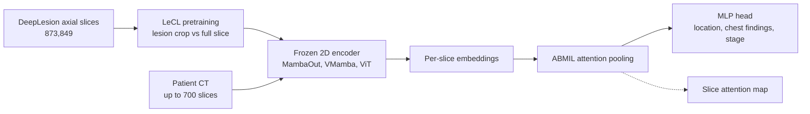

# Abnormality-Driven Representation Learning for Radiology Imaging

> **Bibkey** `Ligero2024_241116803` · **Venue** arXiv preprint (2024) · **Category** imaging · **Relevance** medium · **Access** open
> **Link** <https://arxiv.org/abs/2411.16803>
> `status: complete` — 基于 arXiv:2411.16803v1 PDF 全文(含补充材料)。/ Based on the full arXiv:2411.16803v1 PDF including the supplement.

---

## 一句话 / One-liner
<!-- ZH --> CLEAR 框架把 CT 当作一叠 2D 轴位切片:用自监督对比学习训练的编码器(冻结)给每张切片提特征,再用注意力多示例学习(ABMIL)聚合成病人级预测;其中提出的 LeCL 在对比学习中让一路编码器看到以病灶为中心的裁剪,使表征更关注异常。用约 2–4 千万参数的模型,在三项任务上与 BiomedCLIP 相当或略好。
<!-- EN --> CLEAR treats a CT scan as a stack of 2D axial slices: a frozen encoder trained by self-supervised contrastive learning embeds each slice, and attention-based multiple-instance learning (ABMIL) aggregates them into a patient-level prediction; the proposed LeCL feeds lesion-centred crops to one encoder branch so that representations focus on abnormalities. With 22–36M-parameter models it matches or slightly beats BiomedCLIP on three tasks.

## 要点 / Takeaways
- <!-- ZH --> 这是**表征学习**论文,不是异常检测方法:"abnormality-driven" 指预训练时用病灶框把注意力引向异常区域,下游仍是有监督分类(§3.2–3.3)。 <!-- EN --> This is a **representation-learning** paper, not an anomaly-detection method: "abnormality-driven" means lesion boxes steer pretraining toward abnormal regions; downstream tasks are still supervised classification (§3.2–3.3).
- <!-- ZH --> 把病理学里成熟的"冻结基础模型特征 + ABMIL 聚合"流程搬到 CT 上,不需要针对任务微调编码器,也不需要逐切片标注(Fig. 1, §1)。 <!-- EN --> It ports the pathology recipe "frozen foundation-model features + ABMIL aggregation" to CT, with no task-specific encoder fine-tuning and no per-slice labels (Fig. 1, §1).
- <!-- ZH --> 最佳组合 MambaOut + LeCL-0 的平均 AUC:病灶部位 78.4%、胸部异常 66.9%、肺癌分期 68.3%,对应 BiomedCLIP 为 77.6%、65.0%、65.2%(Tables 1–3)。我们的理解:多数差距小于标准差。 <!-- EN --> Best combo MambaOut + LeCL-0 averages AUC 78.4% (lesion location), 66.9% (chest abnormalities), 68.3% (lung-cancer staging) vs BiomedCLIP 77.6%, 65.0%, 65.2% (Tables 1–3). Our reading: most gaps are within one standard deviation.
- <!-- ZH --> 对比学习的骨干选择影响大:门控 CNN(MambaOut)和状态空间模型(VMamba)都好于 ViT(§4.6)。 <!-- EN --> Backbone choice matters: the gated CNN (MambaOut) and state-space model (VMamba) beat ViT (§4.6).
- <!-- ZH --> 加大病灶切片权重 λ 反而变差:λ = 0(只用病灶裁剪)最好,λ = 5 最差(§4.7, Supp. Table 6)。 <!-- EN --> Up-weighting lesion slices hurts: λ = 0 (lesion crops only) is best and λ = 5 worst (§4.7, Supp. Table 6).

## 研究问题 / Problem
<!-- ZH --> 放射学的深度学习大多是"端到端 3D 网络 + 针对每个任务微调",并依赖扫描序列挑选和病灶标注(Abstract, §1)。病理学已经普遍用"任务无关的自监督基础模型 + 弱监督聚合",而放射学缺少这样的任务无关表征模型,原因是 3D 影像的算力和数据需求高、解剖结构复杂(Abstract)。现有 CT 基础模型要么只针对特定部位(如胸部的 CT-CLIP、腹部的 Merlin),要么横跨所有模态过于泛化(§1–2)。作者想要一个只用 CT、覆盖全身、算力友好的表征模型,并让它对病灶更敏感。
<!-- EN --> Radiology deep learning mostly uses end-to-end 3D networks fine-tuned per task, with scan selection and lesion annotation (Abstract, §1). Pathology has adopted task-agnostic self-supervised foundation models plus weakly supervised aggregation, but radiology lacks task-agnostic representation models because 3D imaging is compute- and data-hungry and anatomically complex (Abstract). Existing CT foundation models are either region-specific (CT-CLIP for chest, Merlin for abdomen) or over-general across modalities (§1–2). The authors want a CT-only, whole-body, compute-friendly representation model that is more sensitive to lesions.

## 方法 / Method
<!-- ZH --> 1. **输入表示**:每个 CT 视为最多 700 张、通常 512×512 的轴位切片集合;按 DeepLesion 规范把 Hounsfield 值(CT 的密度单位)裁到对应窗口,如腹部窗 -175 到 275 HU、肺窗 -1500 到 500 HU;任务 1 两种窗都用,任务 2、3 只用肺窗(§4.2)。
<!-- ZH --> 2. **对比预训练(MoCo-v3 基线)**:InfoNCE 损失,查询编码器 + 动量(指数滑动平均)键编码器;基于官方 MoCo-v3 代码(§3.1)。
<!-- ZH --> 3. **LeCL(病灶增强对比学习)**:对 DeepLesion 中有病灶框标注的切片,让一路编码器接收以病灶为中心的裁剪,另一路接收同一切片的整图,从而把"病灶 ↔ 整片"拉近;可选地在 InfoNCE 分母中加入 λ·ξ,ξ 为查询与所有关键切片(key slices,即含病灶的标注切片)的相似度之和,λ ∈ {0, 1, 3, 5};LeCL-0 即 λ = 0(§3.2 式 4, §4.3)。作者称之为 semi-supervised,因为用到了病灶框。
<!-- ZH --> 4. **骨干**:ViT-B(带卷积 stem)、VMamba(视觉状态空间模型)、MambaOut(门控 CNN),参数量分别约 82M、36M、22M;在 DeepLesion 的 873,849 张轴位切片上训练 100 epoch,4 张 A100,不到 2 天(ViT-B 与 VMamba 33 小时,MambaOut 25 小时)(§4.3, Supp. Table 5)。
<!-- ZH --> 5. **下游(CLEAR)**:冻结编码器给每张切片提特征 → 线性层投影到 256 维 + ReLU → ABMIL 注意力池化(每张切片一个注意力权重,加权求和)→ LayerNorm + 一层隐藏层 MLP 分类头。任务 1、2 为多标签分类(BCE 损失),任务 3 为二分类(交叉熵);lr 1e-4,batch 128,32 epoch,8 epoch 无改善早停(§3.3, §4.3, Supp. A)。
<!-- ZH --> 6. **对比的基础模型**:2D 的 BiomedCLIP、SAM2(同样接 ABMIL),3D 的 CT-CLIP、Merlin(只接 MLP 头)(§4.3, Fig. 2B)。
<!-- ZH --> 7. **可解释性**:画出 ABMIL 在各切片上的注意力分布,检查峰值是否落在 DeepLesion 标注的关键切片附近(§4.5, Fig. 4, Supp. B)。
<!-- EN --> 1. **Input**: each CT is a set of up to 700 axial slices, typically 512×512; Hounsfield units (CT density) are clipped to DeepLesion windows, e.g. abdominal −175 to 275 HU and lung −1500 to 500 HU; Task 1 uses both windows, Tasks 2–3 the lung window only (§4.2).
<!-- EN --> 2. **Contrastive pretraining (MoCo-v3 baseline)**: InfoNCE loss with a query encoder and a momentum (EMA) key encoder, built on the official MoCo-v3 code (§3.1).
<!-- EN --> 3. **LeCL (lesion-enhanced contrastive learning)**: for DeepLesion slices with lesion boxes, one encoder branch receives a lesion-centred crop and the other the full image of the same slice, pulling "lesion ↔ whole slice" together; optionally a term λ·ξ is added to the InfoNCE denominator, where ξ sums the query's similarity to all key slices (annotated lesion slices), λ ∈ {0, 1, 3, 5}; LeCL-0 means λ = 0 (§3.2 Eq. 4, §4.3). The authors call it semi-supervised because it uses lesion boxes.
<!-- EN --> 4. **Backbones**: ViT-B with a convolutional stem, VMamba (vision state-space model), MambaOut (gated CNN); trained 100 epochs on 873,849 DeepLesion axial slices on 4 A100s in under 2 days (ViT-B and VMamba 33 h, MambaOut 25 h) (§4.3, Supp. Table 5).
<!-- EN --> 5. **Downstream (CLEAR)**: frozen encoder per slice → linear projection to 256-d + ReLU → ABMIL attention pooling (one weight per slice, weighted sum) → LayerNorm + one-hidden-layer MLP head. Tasks 1–2 multi-label (BCE), Task 3 binary (cross-entropy); lr 1e-4, batch 128, 32 epochs, early stop after 8 (§3.3, §4.3, Supp. A).
<!-- EN --> 6. **Compared foundation models**: 2D BiomedCLIP and SAM2 (with ABMIL), 3D CT-CLIP and Merlin (MLP head only) (§4.3, Fig. 2B).
<!-- EN --> 7. **Interpretability**: ABMIL attention over slices is plotted to check whether peaks fall near DeepLesion's annotated key slices (§4.5, Fig. 4, Supp. B).

## 方法图 / Method diagram


## 数据 / Data
<!-- ZH --> **DeepLesion**(预训练 + 任务 1):14,601 个增强 CT,来自 4,427 名实体瘤患者,病灶分布于骨、肺、纵隔、肝、肾、腹部、软组织、盆腔;所有 CT 有病灶框,4,177 个 CT(1,368 名患者)有病灶部位标签。839 名患者(20%)留作测试;预训练用 10,224 个无标签 CT + 3,538 个有标签 CT(80%),共 873,849 张轴位切片(§4.1, §4.3)。任务 1 = 按部位的多标签病灶分类。**RadChest**(任务 2,外部):3,630 个平扫胸部 CT,多种肺部异常(肺气肿、支气管扩张、胸腔积液、肺不张、纤维化、磨玻璃影、钙化、肺结节等)(§4.1)。**NSCLC-Radiomics**(任务 3,外部):422 名非小细胞肺癌患者的 447 个平扫 CT,预测低分期(I–II)vs 高分期(III–IV)(§4.1)。任务 1、2 先留出测试集再 5 折交叉验证;任务 3 用嵌套 5 折交叉验证(§4.3)。
<!-- EN --> **DeepLesion** (pretraining + Task 1): 14,601 contrast-enhanced CT scans from 4,427 patients with solid tumours in bone, lung, mediastinum, liver, kidney, abdomen, soft tissue and pelvis; all scans have lesion boxes, 4,177 scans (1,368 patients) have lesion-location labels. 839 patients (20%) are held out for testing; pretraining uses 10,224 unlabeled + 3,538 labeled scans (80%), 873,849 axial slices in total (§4.1, §4.3). Task 1 = multi-label lesion location. **RadChest** (Task 2, external): 3,630 non-contrast chest CTs with lung abnormalities (emphysema, bronchiectasis, pleural effusion, atelectasis, fibrosis, opacity, calcification, nodules, etc.) (§4.1). **NSCLC-Radiomics** (Task 3, external): 447 non-contrast CTs of 422 non-small-cell lung cancer patients; predict low (I–II) vs high (III–IV) stage (§4.1). Tasks 1–2: held-out test set plus 5-fold CV; Task 3: nested 5-fold CV (§4.3).

## 主要结果 / Key results
- <!-- ZH --> **任务 1 病灶部位(DeepLesion,平均 AUC)**:MambaOut-LeCL-0 78.4 ± 2.1,VMamba-LeCL-0 78.2,MambaOut-MoCo 77.7,BiomedCLIP 77.6,SAM2 74.7,CT-CLIP 58.7,Merlin 52.8(Table 1)。 <!-- EN --> **Task 1 lesion location (DeepLesion, mean AUC)**: MambaOut-LeCL-0 78.4 ± 2.1, VMamba-LeCL-0 78.2, MambaOut-MoCo 77.7, BiomedCLIP 77.6, SAM2 74.7, CT-CLIP 58.7, Merlin 52.8 (Table 1).
- <!-- ZH --> **分部位**:骨病灶所有模型都在 50–55.4(接近随机);软组织上 VMamba-LeCL-0 71.9 vs BiomedCLIP 66.0(+5.9);肾脏上 BiomedCLIP 65.9 高于所有自训模型(最高 64.0)(Table 1, §4.4)。 <!-- EN --> **Per region**: bone lesions are 50–55.4 for every model (near chance); soft tissue VMamba-LeCL-0 71.9 vs BiomedCLIP 66.0 (+5.9); on kidney, BiomedCLIP's 65.9 beats every in-house model (best 64.0) (Table 1, §4.4).
- <!-- ZH --> **任务 2 胸部异常(RadChest,平均 AUC)**:MambaOut-LeCL-0 66.9 ± 1.6,MambaOut-MoCo 66.6,BiomedCLIP 65.0,Merlin 59.8,SAM2 56.4,CT-CLIP 51.1;肺气肿上 LeCL 比 BiomedCLIP 高 5.8(75.6 vs 69.8)(Table 2, §4.4)。 <!-- EN --> **Task 2 chest abnormalities (RadChest, mean AUC)**: MambaOut-LeCL-0 66.9 ± 1.6, MambaOut-MoCo 66.6, BiomedCLIP 65.0, Merlin 59.8, SAM2 56.4, CT-CLIP 51.1; emphysema +5.8 over BiomedCLIP (75.6 vs 69.8) (Table 2, §4.4).
- <!-- ZH --> **任务 3 分期(NSCLC-Radiomics)**:MambaOut-LeCL-0 AUC 68.3 ± 5.0,ViT-ConvB 67.5,MambaOut-MoCo 66.7,BiomedCLIP 65.2 ± 4.2,SAM2 61.4,Merlin 60.9,CT-CLIP 51.6(Table 3)。 <!-- EN --> **Task 3 staging (NSCLC-Radiomics)**: MambaOut-LeCL-0 AUC 68.3 ± 5.0, ViT-ConvB 67.5, MambaOut-MoCo 66.7, BiomedCLIP 65.2 ± 4.2, SAM2 61.4, Merlin 60.9, CT-CLIP 51.6 (Table 3).
- <!-- ZH --> **骨干消融**:MambaOut 比 ViT 在任务 1–3 上分别高 2.4、2.6、6.8 AUC;VMamba 比 ViT 高 2.2、1.1、3.8(§4.6)。 <!-- EN --> **Backbone ablation**: MambaOut beats ViT by 2.4, 2.6 and 6.8 AUC on Tasks 1–3; VMamba by 2.2, 1.1 and 3.8 (§4.6).
- <!-- ZH --> **λ 消融**:LeCL 相对 MoCo 的提升很小(MambaOut 上 +0.5 / +0.35 / +0.35);λ 越大越差,λ = 5 时 MambaOut 在任务 1、2 上最多下降 1.19 和 4 个 AUC 点(§4.7, Fig. 5, Supp. Table 6)。 <!-- EN --> **λ ablation**: LeCL's gain over MoCo is small (MambaOut +0.5 / +0.35 / +0.35); larger λ hurts, with λ = 5 dropping MambaOut by up to 1.19 and 4 AUC points on Tasks 1–2 (§4.7, Fig. 5, Supp. Table 6).
- <!-- ZH --> **效率**:自训模型 MambaOut 22M、VMamba 36M、ViT-B 82M 参数,对比 BiomedCLIP 86M、Merlin 122M、SAM2 213M、CT-CLIP 1110M(Supp. Table 5)。 <!-- EN --> **Efficiency**: in-house models have 22M (MambaOut), 36M (VMamba), 82M (ViT-B) parameters vs BiomedCLIP 86M, Merlin 122M, SAM2 213M, CT-CLIP 1110M (Supp. Table 5).

## 创新点 / Contributions
- <!-- ZH --> 提出 CLEAR:2D 切片冻结特征 + ABMIL 的 CT 分析框架,作者称是首个无需任务特定微调即可支持多种临床任务的放射学 DL 框架(§1)。 <!-- EN --> CLEAR: frozen 2D slice features + ABMIL for CT, which the authors call the first radiology DL framework supporting diverse clinical tasks without task-specific fine-tuning (§1).
- <!-- ZH --> 提出 LeCL:用病灶框生成以病灶为中心的正样本对,使对比表征更关注异常(§3.2)。 <!-- EN --> LeCL: lesion boxes generate lesion-centred positive pairs so the contrastive representation attends to abnormalities (§3.2).
- <!-- ZH --> 系统比较 ViT、VMamba、MambaOut 三类骨干在 CT 自监督上的表现(§4.6)。 <!-- EN --> A systematic comparison of ViT, VMamba and MambaOut backbones for CT self-supervision (§4.6).
- <!-- ZH --> 用切片注意力分布做事后可解释性检查(Fig. 4)。 <!-- EN --> Post-hoc interpretability via slice-attention plots (Fig. 4).

## 局限 / Limitations
- <!-- ZH --> (作者)当前放射学表征模型整体仍有明显不足,所有任务的绝对 AUC 都不高,需要更多领域专用的表征学习研究(§4.4, Conclusion)。 <!-- EN --> (Authors) current radiology representation models remain clearly limited; absolute AUCs are modest on every task and more domain-specific representation learning is needed (§4.4, Conclusion).
- <!-- ZH --> 我们的理解:LeCL 相对 MoCo 和 BiomedCLIP 的提升多在 0.3–3 个 AUC 点,而标准差为 1.6–5.0,结论"全面优于"偏强;没有显著性检验。 <!-- EN --> Our reading: LeCL's gains over MoCo and BiomedCLIP are mostly 0.3–3 AUC points with standard deviations of 1.6–5.0, so "outperforms" is a strong claim; no significance tests are given.
- <!-- ZH --> 我们的理解:预训练和任务 1 都用 DeepLesion(测试患者已从预训练中排除),外部任务只有胸部;2D 切片忽略了层间 3D 上下文。 <!-- EN --> Our reading: pretraining and Task 1 both use DeepLesion (test patients excluded from pretraining), and the external tasks are chest-only; 2D slices ignore inter-slice 3D context.
- <!-- ZH --> 我们的理解:文中称是"开源"基础模型之一(§2.2),但 v1 预印本中没有给出代码或权重链接。 <!-- EN --> Our reading: the paper calls it one of the first open-source CT SSL foundation models (§2.2), but the v1 preprint gives no code or weight link.

## 与本研究方向的关系 / Relation to our direction
<!-- ZH --> 这篇不做异常检测,而是"让表征对异常更敏感"的预训练技巧,位于 detect 之前的表征层。我们的理解:(1) 对课题 1 有用的是 CLEAR 的结构——"冻结的单元级(切片 / 图块 / 细胞)嵌入 + ABMIL 聚合 + 注意力图",这与肾脏活检中"细胞 / spot 嵌入 → 样本级标签 → 注意力定位异常区域"的弱监督思路一致,可作为 detect 环节的有监督对照;(2) LeCL 的"病灶裁剪 vs 整体"正样本对,可以类比为在空间组学中把"病变邻域"和"整张切片"配对,但它需要病灶标注,和只用正常数据的异常检测设定不同;(3) 它显示数据量小得多的单域模型可以接近通用多模态模型,这对数据有限的肾脏组学是个积极信号。不涉及 virtual tissue 与 revert。
<!-- EN --> Not an anomaly detector; a pretraining trick that makes representations more sensitive to abnormalities, sitting at the representation layer before "detect". Our reading: (1) for Topic 1 the useful part is CLEAR's structure — frozen unit-level embeddings (slice / tile / cell) + ABMIL aggregation + attention maps — the same weakly supervised pattern as "cell / spot embeddings → sample label → attention highlights abnormal regions" in kidney biopsies, usable as a supervised comparator for the detect stage; (2) LeCL's "lesion crop vs whole" positive pairs could map to pairing a lesion neighbourhood with the whole section in spatial omics, but it needs lesion labels, unlike normal-only anomaly detection; (3) it shows a small single-domain model can approach a large general multimodal one, encouraging for data-limited kidney omics. Virtual tissue and revert are not addressed.

## 可复用资产 / Reusable assets
- <!-- ZH --> **代码:** v1 预印本中未给出链接;作者说明 MoCo-v3 部分改自官方仓库(§3.1)。 <!-- EN --> **Code:** no link in the v1 preprint; the MoCo-v3 part is adapted from the official repository (§3.1).
- <!-- ZH --> **数据:** 均为公开数据集——DeepLesion、RadChest、NSCLC-Radiomics(§4.1)。 <!-- EN --> **Data:** all public — DeepLesion, RadChest, NSCLC-Radiomics (§4.1).
- <!-- ZH --> **模型:** 文中未给出权重下载。 <!-- EN --> **Checkpoints:** no weight download is given.
- <!-- ZH --> **方法配方:** ABMIL 下游头(256 维投影 + 注意力池化 + LayerNorm + MLP,Supp. A);多窗口输入与注意力可视化(§4.2, Fig. 4)。 <!-- EN --> **Recipe:** the ABMIL head (256-d projection + attention pooling + LayerNorm + MLP, Supp. A); multi-window input and attention plots (§4.2, Fig. 4).

## 待读 / Follow-ups
- <!-- ZH --> Ilse et al. 2018, Attention-based deep multiple instance learning(ref [15])——ABMIL 原文。 <!-- EN --> Ilse et al. 2018, Attention-based deep multiple instance learning (ref [15]) — the ABMIL paper.
- <!-- ZH --> El Nahhas et al. 2024, Nature Protocols(ref [11])——同组的病理弱监督流程,CLEAR 的模板。 <!-- EN --> El Nahhas et al. 2024, Nature Protocols (ref [11]) — the same group's pathology weak-supervision pipeline that CLEAR mirrors.
- <!-- ZH --> Chen, Xie, He 2021, MoCo-v3(ref [8])。 <!-- EN --> Chen, Xie, He 2021, MoCo-v3 (ref [8]).
- <!-- ZH --> 查看是否有后续版本或代码发布。 <!-- EN --> Check for later versions or a code release.

## 引用 / Cite
```bibtex
@misc{Ligero2024_241116803,
  title = {Abnormality-Driven Representation Learning for Radiology Imaging},
  author = {Marta Ligero and Tim Lenz and Georg Wölflein and Omar S. M. El Nahhas and Daniel Truhn and Jakob Nikolas Kather},
  year = {2024},
  eprint = {2411.16803},
  archivePrefix = {arXiv},
  url = {https://arxiv.org/abs/2411.16803}
}
```
