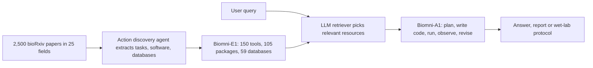

# Biomni: A General-Purpose Biomedical AI Agent

> **Bibkey** `Huang2025_Biomni` · **Venue** bioRxiv (2025) · **Category** agents · **Relevance** high · **Access** open
> **Link** <https://doi.org/10.1101/2025.05.30.656746>
> `status: complete` — 全文精读基于 bioRxiv 公开全文(PDF 标注 "this version posted June 2, 2025",CC-BY 4.0);补充材料(Supplementary Tables/Notes/Figures)未读。
> Bilingual convention (drives the site's EN⇄中文 switcher): put `<!-- ZH -->` 中文 and `<!-- EN -->` English on their own lines (or inline `- <!-- ZH --> 中文 <!-- EN --> English`). Use `<!-- ZH/EN -->` ONLY for a purely language-neutral line (a bare URL or code token) — never for bilingual prose or labels.

---

## 一句话 / One-liner
<!-- ZH --> Biomni 是斯坦福 Leskovec 组的通用生物医学 agent:先让一个 action discovery agent 读 bioRxiv 25 个学科各 100 篇最新论文(共 2,500 篇),抽取任务、软件和数据库,经人工实现与测试后建成统一环境 **Biomni-E1**(150 个专用工具 + 105 个软件包 + 59 个数据库);再用基于 CodeAct 的 agent **Biomni-A1**(检索相关工具 → 写计划 → 写代码执行 → 根据结果修改计划)零样本完成跨领域任务,并有一个按其 protocol 原样执行的 CRISPR 克隆湿实验(Results §"Overview of Biomni";Fig. 1;Fig. 4)。
<!-- EN --> Biomni is the Leskovec-lab general-purpose biomedical agent: an action discovery agent reads the 100 most recent papers in each of bioRxiv's 25 subject categories (2,500 papers) and extracts tasks, software and databases, which are implemented and tested by humans into the unified environment **Biomni-E1** (150 specialised tools + 105 software packages + 59 databases); a CodeAct-based agent **Biomni-A1** (retrieve relevant tools → write a plan → write and run code → revise the plan from results) then solves cross-domain tasks zero-shot, plus one CRISPR-cloning wet-lab run that followed its protocol verbatim (Results §"Overview of Biomni"; Fig. 1; Fig. 4).

## 要点 / Takeaways
- <!-- ZH --> **"代码即动作"是主要卖点**:在 8 个新任务上,Biomni 比把代码规划换成 ReAct 链式调用的自身消融版 Biomni-ReAct 平均相对提升 20.4%,比通用 coding agent(ReAct+Code)高 43.0%,比无工具的 Claude Sonnet 3.7 高 402.3%(Results §"Biomni generalizes…")。 <!-- EN --> **Code-as-action is the main selling point**: on 8 new tasks Biomni's average relative gain is 20.4% over its own ablation Biomni-ReAct (code planning replaced by ReAct chaining), 43.0% over a generic coding agent (ReAct+Code) and 402.3% over tool-less Claude Sonnet 3.7 (Results §"Biomni generalizes…").
- <!-- ZH --> **LAB-Bench 上接近人类专家**:DbQA 74.4%(人类 74.7%),SeqQA 81.9%(人类 78.8%);但只用了全基准 12.5% 的子集(315 道测试题)(Results §"Biomni excels…")。 <!-- EN --> **Near human experts on LAB-Bench**: DbQA 74.4% (humans 74.7%), SeqQA 81.9% (humans 78.8%) — but on a 12.5% subset (315 test questions) (Results §"Biomni excels…").
- <!-- ZH --> **"新发现"只由作者人工读 trace 和代码核对**:例如 multiome 案例中提出 AUTS2、ZFHX3、PBX1 为新调控因子,但正文自己承认 PBX1 是已确立的骨骼调控因子,而 Fig. 3h 图注却写"此前与骨骼发育无关联"(Results;Fig. 3h;Methods §"Manual verification")。 <!-- EN --> **"Discoveries" are checked only by the authors reading traces and code**: e.g. the multiome case proposes AUTS2, ZFHX3 and PBX1 as novel regulators, yet the text itself says PBX1 is a well-established skeletal regulator while the Fig. 3h caption says "no previous association with skeletal development" (Results; Fig. 3h; Methods §"Manual verification").
- <!-- ZH --> **报告的结论没有置信度,也没有重跑一致性分析**;文中多处数字前后不一(克隆基准 10 题 vs 20 题;可穿戴文件 458 vs 485)。我们的理解:这正是 Agent 可信度课题要核查的那类 agent 输出。 <!-- EN --> **Reported conclusions carry no confidence and no rerun-consistency analysis**; several numbers are inconsistent (cloning benchmark 10 vs 20 tasks; wearable files 458 vs 485). Our reading: exactly the kind of agent output the agent-trustworthiness topic wants to verify.
- <!-- ZH --> **后续独立评测里表现有限**:HeurekaBench 开放题正确性 Biomni 2.31/5(Lite 版,Claude-4-Sonnet),SpatialAgent 的心脏 MERFISH 细胞注释中 Biomni 总体准确率 0.394、偏向内皮细胞(见两篇论文正文;本仓库 `heurekabench-arxiv-2026`、`spatialagent-biorxiv-2025`)。 <!-- EN --> **Limited in later independent evaluations**: HeurekaBench open-ended correctness 2.31/5 for Biomni (Lite, Claude-4-Sonnet); in SpatialAgent's heart MERFISH cell annotation Biomni reaches 0.394 overall accuracy, skewed toward endothelial labels (from those papers' text; `heurekabench-arxiv-2026`, `spatialagent-biorxiv-2025` in this repo).

## 研究问题 / Problem
<!-- ZH --> 已有的生物医学 agent 大多是针对窄任务定制的专用 workflow,难以在不同子领域之间泛化(Introduction)。要做通用 agent,LLM 需要一个**显式定义生物医学动作空间**的环境(工具、数据库、软件、实验 protocol),还需要一个能在其中自主选择和组合动作、不依赖预设流程的 agent 架构(Introduction)。作者的问题是:能否构建一个"虚拟 AI 生物医学科学家",零样本处理遗传学、基因组学、微生物学、药理学、临床医学等多个领域的任务。
<!-- EN --> Existing biomedical agents are mostly specialist workflows for narrow tasks and generalise poorly across subfields (Introduction). A generalist needs an environment that **explicitly defines the biomedical action space** (tools, databases, software, wet-lab protocols) and an architecture that selects and composes actions in it without predefined workflows (Introduction). The question: can one build a "virtual AI biomedical scientist" that handles genetics, genomics, microbiology, pharmacology and clinical tasks zero-shot?

## 方法 / Method
<!-- ZH --> **第 1 步 从文献挖动作空间**:取 bioRxiv 定义的 25 个学科,每个学科最新 100 篇论文;LLM 分块读 PDF,按 prompt 抽取三类要素:任务、软件、数据库,重点标出"需要专门实现、反复出现"的任务(Results;Methods §"Action Discovery from Literature")。
<!-- ZH --> **第 2 步 筛选任务**:先按与药物发现和临床生物医学的相关性保留学科,再收敛到约 1,900 个常见任务;人工去重,剔除"几行代码就能实现"的琐碎任务,优先保留需要领域知识的(湿实验 protocol、AI 预测模型等)(Methods §"Implementing the Biomni Environment")。
<!-- ZH --> **第 3 步 实现 Biomni-E1**:人类科学家与带网页搜索的软件工程 agent 合作实现每个工具;每个工具必须满足五项检查:清晰的名字、详细文档、输出为适合 LLM 阅读的研究日志、有通过的测试用例、确属专门任务。共 150 个工具,另加 PubMed、Google Scholar 等文献检索工具。大型关系数据库(PDB、OpenTargets、ClinVar 等,有 Web API)每个只封装**一个**自然语言查询函数,内部由 LLM 解析 schema 生成查询;没有 Web API 的库下载到本地 data lake 并预处理成 pandas DataFrame;共 59 个数据库。105 个软件包装在统一容器里,支持 Python、R 和 Bash(Results;Methods)。
<!-- ZH --> **第 4 步 Biomni-A1 检索**:动作空间很大,单个问题只用到一小部分;为避免上下文过长,由另一个 LLM 做基于 prompt 的检索,挑出相关的函数、数据集和软件(Methods §"Biomni-A1")。
<!-- ZH --> **第 5 步 计划与执行**:基于 CodeAct 框架,先让 LLM 写出编号的计划清单,再逐步生成代码在 Python/R/Bash 环境中执行,把观察结果返回给 LLM,据此修改计划,直到收敛到答案(Methods;Fig. 1c)。作者强调代码作为统一动作接口,可表达循环、并行、条件逻辑和不符合预设函数签名的调用,这是与传统 function calling 的区别(Results)。
<!-- ZH --> **第 6 步 评测**:LAB-Bench 与 HLE 问答;8 个新的真实任务(与无工具 base LLM、ReAct+Code、Biomni-ReAct 比较);3 个案例研究(可穿戴数据、单细胞 multiome、克隆 protocol 与湿实验)(Results)。
<!-- EN --> **Step 1 Mine the action space from literature**: for each of bioRxiv's 25 subject categories, the 100 most recent papers; an LLM reads each PDF in chunks and extracts tasks, software and databases, highlighting recurrent tasks that need specialised implementation (Results; Methods §"Action Discovery from Literature").
<!-- EN --> **Step 2 Filter tasks**: keep fields relevant to drug discovery and clinical biomedicine, narrow to ~1,900 recurring tasks, then manually de-duplicate and drop trivial "few lines of code" tasks, favouring expertise-heavy ones (wet-lab protocols, AI predictors) (Methods §"Implementing the Biomni Environment").
<!-- EN --> **Step 3 Build Biomni-E1**: human scientists plus web-search-enabled software-engineering agents implement each tool, each meeting a five-point checklist: clear name, detailed docs, output as an LLM-readable research log, a passing test case, and genuine specialisation. 150 tools, plus literature tools such as PubMed and Google Scholar. Large relational databases with web APIs (PDB, OpenTargets, ClinVar, …) each get **one** natural-language query function, with an LLM parsing the schema and writing the query; API-less databases are downloaded into a local data lake as pandas DataFrames; 59 databases in total. 105 software packages live in one container supporting Python, R and Bash (Results; Methods).
<!-- EN --> **Step 4 Biomni-A1 retrieval**: the action space is large and one query needs only a small part; a separate LLM does prompt-based retrieval of relevant functions, datasets and software to keep the context short (Methods §"Biomni-A1").
<!-- EN --> **Step 5 Plan and execute**: built on CodeAct — the LLM first writes a numbered plan, then generates code step by step, runs it in Python/R/Bash, feeds observations back and revises the plan until it converges (Methods; Fig. 1c). Code as the universal action interface can express loops, parallelism, conditionals and calls without predefined signatures, which the authors contrast with classic function calling (Results).
<!-- EN --> **Step 6 Evaluation**: LAB-Bench and HLE QA; 8 new real-world tasks (vs tool-less base LLM, ReAct+Code, Biomni-ReAct); 3 case studies (wearables, single-cell multiome, cloning protocol + wet lab) (Results).

## 方法图 / Method diagram


## 数据 / Data
<!-- ZH --> **问答基准**:LAB-Bench 的 DbQA(数据库问答)和 SeqQA(DNA/蛋白序列推理):45 题开发集用于调工具和数据库接口,315 题留出测试集,三次独立运行取平均;因 API 成本只取全基准 12.5%,按子任务比例抽样,允许"信息不足"弃答(Results;Methods §"Q&A Benchmarks")。HLE:生物/医学子学科每科最多 5 题,共 52 题,无开发集(Results 与 Methods 都写 14 个子学科,但 Methods 只列出 13 个名字)(Results;Methods)。问答基准与 6 个通用基线比较,细节在 Supplementary Notes A(Results)。
<!-- ZH --> **8 个新任务**(Methods §"Curating real-world benchmarks"):变异优先级(Open Targets Genetics 真值集,准确率);GWAS 因果基因(Shringarpure et al. 数据,准确率);CRISPR 扰动筛选设计(Schmidt et al.,18,939 个候选基因中选若干个使扰动效应最大,只用 IL-2 一个 screen,指标为平均扰动后效应);scRNA-seq 细胞注释(CellxGene 等,通常约 10 个作者标注的细胞类型,按比例抽 20k–50k 细胞,LLM 语义匹配评分并由人工复核);微生物组差异丰度(5 个数据集,与人类专家结果比较);药物重定位(Huang et al. 数据,以 EHR 中临床医生的 off-label 处方模式作对齐分数);罕见病诊断(MyGene2,Alsentzer et al. 整理,专家诊断为真值);患者致病基因排序(Alsentzer et al.)。
<!-- ZH --> **案例数据**:可穿戴 —— 30 名参与者的 CGM(连续血糖监测,传感器同时记录皮肤温度)数据,Results 写 458 个 Excel 文件,Methods 写 485 个温度文件(每个以推定的进餐时间为中心,前 2 小时后 4 小时);10 人 227 晚睡眠;血液组学:脂质组 652 特征 / 147 样本,代谢组 731 特征 / 147 样本,蛋白组 1,470 特征 / 20 样本(Results;Methods)。Multiome —— To et al. 2024 人胚胎骨骼发育数据,约 336,000 个细胞核的 snRNA-seq + snATAC-seq(单细胞核转录组 + 染色质可及性),5–11 周,5 个解剖部位,原样下载使用(Results;Methods)。
<!-- EN --> **QA benchmarks**: LAB-Bench DbQA (database QA) and SeqQA (DNA/protein sequence reasoning): a 45-question dev set used to refine tool and database interfaces, 315 held-out test questions, averaged over three runs; a 12.5% subset because of API cost, sampled proportionally across subtasks, with an "insufficient information" abstain option (Results; Methods §"Q&A Benchmarks"). HLE: up to 5 questions per bio/med subdiscipline, 52 questions, no dev set (Results and Methods both say 14 subdisciplines, but Methods names only 13) (Results; Methods). QA results compare against 6 general-purpose baselines described in Supplementary Notes A (Results).
<!-- EN --> **8 new tasks** (Methods §"Curating real-world benchmarks"): variant prioritisation (Open Targets Genetics truth set, accuracy); GWAS causal gene (Shringarpure et al., accuracy); CRISPR screen design (Schmidt et al., choose genes out of 18,939 to maximise perturbation effect; only the IL-2 screen; metric = mean post-perturbation effect); scRNA-seq annotation (CellxGene etc., typically ~10 author cell types, 20k–50k cells subsampled proportionally; LLM semantic-match scoring later checked by humans); microbiome differential abundance (5 datasets, compared with human experts); drug repurposing (Huang et al., scored by alignment with clinicians' off-label prescribing in an EHR); rare-disease diagnosis (MyGene2 curated by Alsentzer et al., expert diagnosis as truth); patient causal-gene prioritisation (Alsentzer et al.).
<!-- EN --> **Case data**: wearables — 30 participants' CGM (continuous glucose monitor; its sensor also logs skin temperature) data; Results says 458 Excel files, Methods says 485 temperature files (each centred on a presumed meal, 2 h before to 4 h after); 227 nights of sleep from 10 people; blood omics: 652 lipid features / 147 samples, 731 metabolite features / 147 samples, 1,470 protein features / 20 samples (Results; Methods). Multiome — To et al. 2024 human embryonic skeleton, ~336,000 nuclei of snRNA-seq + snATAC-seq (single-nucleus transcriptome + chromatin accessibility), 5–11 weeks post-conception, 5 anatomical regions, used unmodified (Results; Methods).

## 主要结果 / Key results
- <!-- ZH --> **LAB-Bench**:DbQA 74.4%(人类专家 74.7%;coding agent ReAct+Code 40.8%);SeqQA 81.9%(人类 78.8%)(Results §"Biomni excels…";Fig. 2a)。 <!-- EN --> **LAB-Bench**: DbQA 74.4% (human experts 74.7%; coding agent ReAct+Code 40.8%); SeqQA 81.9% (humans 78.8%) (Results §"Biomni excels…"; Fig. 2a).
- <!-- ZH --> **HLE 子集(52 题)**:17.3%,base LLM 6.0%,coding agent 12.8%,literature agent 12.2%(Results)。 <!-- EN --> **HLE subset (52 questions)**: 17.3% vs base LLM 6.0%, coding agent 12.8%, literature agent 12.2% (Results).
- <!-- ZH --> **8 个新任务**:相对 base LLM(Claude Sonnet 3.7,无工具)平均相对提升 402.3%,相对 ReAct+Code 43.0%,相对 Biomni-ReAct 20.4%;逐任务的提升标在 Fig. 2b,详细数字在 Supplementary Notes B(Results;Fig. 2b)。每个任务平均 6–24 步,用到 0–4 个专用工具、1–8 个软件包、0–3 个 data lake 条目;信息综合类任务(CRISPR 筛选、GWAS)主要查数据库(KEGG、Reactome)和文献,生物信息分析类(微生物组、单细胞注释)主要写代码调用 scanpy 等库(Results)。 <!-- EN --> **8 new tasks**: average relative gain 402.3% over the base LLM (Claude Sonnet 3.7, no tools), 43.0% over ReAct+Code, 20.4% over Biomni-ReAct; per-task gains are marked in Fig. 2b and full numbers are in Supplementary Notes B (Results; Fig. 2b). Tasks take 6–24 steps on average, using 0–4 specialised tools, 1–8 packages and 0–3 data-lake items; synthesis tasks (CRISPR screen, GWAS) lean on database queries (KEGG, Reactome) and literature, analysis tasks (microbiome, scRNA annotation) on code with libraries such as scanpy (Results).
- <!-- ZH --> **可穿戴案例**:自主跑完 10 步流程(由血糖峰推断进餐、取餐前/后温度窗口、个体间归一化、汇总),报告餐后体温平均升高 2.19 °C,中位 1.10 °C,个体间范围 −0.11 到 15.56 °C(Results;Fig. 3b–d);睡眠数据中报告睡眠效率周三最高、周日下降,作息规律性比总时长与睡眠质量相关性更强(Results)。 <!-- EN --> **Wearables**: an autonomous 10-step pipeline (infer meals from glucose spikes, extract pre/post-meal temperature windows, normalise across people, summarise) reports a mean post-meal temperature rise of 2.19 °C, median 1.10 °C, range −0.11 to 15.56 °C (Results; Fig. 3b–d); for sleep it reports efficiency peaking on Wednesdays and dropping on Sundays, and timing regularity correlating more with sleep quality than total duration (Results).
- <!-- ZH --> **Multiome 案例**:10 步 GRN 流程(pySCENIC 配置、GRNBoost2 推断基因调控网络、cisTarget 修剪、AUCell 计算 regulon 活性、用 ATAC 可及性过滤靶基因等),约 5 小时完成,得到 566–589 个 regulon;复现了 RUNX2、HHIP 受 TWIST1、LMX1B、ALX4 等调控的已知关系,并提出 AUTS2、ZFHX3、PBX1 在多个骨骼谱系中活性很高;limb mesenchyme 细胞平均 regulon 活性最高(Results;Fig. 3f–h)。 <!-- EN --> **Multiome**: a 10-step GRN pipeline (pySCENIC setup, GRNBoost2 network inference, cisTarget pruning, AUCell regulon activity, ATAC-accessibility filtering of targets, …) finished in just over 5 hours with 566–589 regulons; it recovers known regulation of RUNX2 and HHIP by TWIST1, LMX1B and ALX4, and flags AUTS2, ZFHX3 and PBX1 as highly active across skeletal lineages; limb mesenchyme has the highest mean regulon activity (Results; Fig. 3f–h).
- <!-- ZH --> **克隆基准**:盲评认为 Biomni 的 protocol 在准确性和完整性上与资深人类专家相当,且用时少得多;正文说受训者的提交"常不完整或欠佳",Fig. 4a 图注写 Biomni"显著高于"受训者(Results;Fig. 4a);正文没有给出具体分数。Results 写 10 个任务、4 个对象(Claude 3.7、Biomni、受训者、资深专家)、"盲评专家评审者"(复数),Methods 写 20 道开放题、3 位人类专家、1 位独立盲评者、准确性与完整性各 1–5 分(Methods §"Wetlab Benchmark…")。 <!-- EN --> **Cloning benchmark**: blinded review rated Biomni's protocols on par with a senior human expert in accuracy and completeness, in much less time; the text says the trainee's submissions were "frequently incomplete or suboptimal", and the Fig. 4a caption says Biomni had "significantly higher accuracy than trainee level" (Results; Fig. 4a); the main text gives no scores. Results says 10 tasks, 4 entrants (Claude 3.7, Biomni, trainee, senior expert) and "blinded expert reviewers" (plural); Methods says 20 open-ended questions, 3 human experts, one independent blinded evaluator, accuracy and completeness each on 1–5 (Methods §"Wetlab Benchmark…").
- <!-- ZH --> **湿实验**:把靶向人 B2M 基因的 sgRNA 克隆进 lentiCRISPR v2 Blast 质粒;Biomni 设计 3 条 sgRNA、带 BsmBI 突出端的寡核苷酸、Golden Gate 组装与转化 protocol 及 U6 测序引物;科学家原样执行,次日长出菌落,挑 2 个测序,均完全比对(Results;Fig. 4b–e)。 <!-- EN --> **Wet lab**: cloning an sgRNA against human B2M into lentiCRISPR v2 Blast; Biomni designed three sgRNAs, BsmBI-overhang oligos, Golden Gate assembly and transformation protocols and a U6 sequencing primer; a scientist followed it exactly, colonies grew next day, and two sequenced colonies both aligned perfectly (Results; Fig. 4b–e).

## 创新点 / Contributions
- <!-- ZH --> **从文献自动挖掘动作空间**,再由人工实现与测试成可执行环境 —— 把"建环境"变成可扩展的流程(Fig. 1a)。 <!-- EN --> **Mines the action space from literature**, then human-implements and tests it into an executable environment — environment building as a scalable process (Fig. 1a).
- <!-- ZH --> 大数据库"一库一个自然语言查询函数"的封装,控制工具数量(Results)。 <!-- EN --> "One natural-language query function per large database", keeping the tool count manageable (Results).
- <!-- ZH --> 检索式工具选择 + 代码即动作(CodeAct)+ 自适应计划;对自身 ReAct 版本的消融给出了代码规划的增益(Results)。 <!-- EN --> Retrieval-based tool selection + code-as-action (CodeAct) + adaptive planning, with an ablation against its own ReAct variant isolating the gain from code planning (Results).
- <!-- ZH --> 一个按 agent protocol 原样执行并测序确认的湿实验(Fig. 4e)。 <!-- EN --> A wet-lab run executed verbatim from the agent's protocol and sequence-confirmed (Fig. 4e).
- <!-- ZH --> 开源代码、Harvard Dataverse 数据和 Web 界面(Data / Code availability)。 <!-- EN --> Open code, Harvard Dataverse data and a web UI (Data / Code availability).

## 局限 / Limitations
- <!-- ZH --> 作者自述:评测任务只覆盖领域的一部分;动作发现只取最新文献,可能漏掉仍有用的经典方法;在需要细致临床判断、新的实验推理、分析创新或深度生物学综合的任务上仍有困难,并非所有任务都达到专家水平(Discussion)。 <!-- EN --> Authors: evaluated tasks cover only part of the field; action discovery uses only recent literature and may miss still-useful classic methods; it struggles with nuanced clinical judgement, novel experimental reasoning, analytical invention and deep biological synthesis, and is not expert-level on all tasks (Discussion).
- <!-- ZH --> 我们的理解:**评测粒度粗** —— LAB-Bench 只用 12.5% 子集;8 个任务在正文只给平均"相对提升",而 base LLM 接近 0 的任务(Fig. 2b 中有 "+inf")会把平均相对提升拉得很大;问答基准中 Biomni 用哪个底座 LLM 正文未写明。 <!-- EN --> Our reading: **coarse evaluation** — only a 12.5% LAB-Bench subset; the 8 tasks are summarised in the main text as average "relative gains", which near-zero baselines (Fig. 2b shows "+inf") inflate; the main text does not state which LLM Biomni uses on the QA benchmarks.
- <!-- ZH --> 我们的理解:**结论只有人工读 trace 核对**(Methods §"Manual verification"),没有独立验证、没有置信度、没有重跑稳定性;PBX1 被同时称为"新"和"已确立"。可穿戴案例中个体餐后升温最高 15.56 °C,作为生理变化不太可能,更像数据伪影,但文中未讨论;测量的是 CGM 传感器的皮肤温度(Methods),Fig. 3d 却写成"core body temperature"。 <!-- EN --> Our reading: **conclusions are checked only by humans reading traces** (Methods §"Manual verification") — no independent validation, no confidence, no rerun stability; PBX1 is called both "novel" and "well-established". In the wearables case a 15.56 °C individual post-meal rise is implausible as physiology and looks more like a data artefact, which the paper does not discuss; the sensor measures skin temperature (Methods) while Fig. 3d says "core body temperature".
- <!-- ZH --> 文中数字前后不一:论文数(Abstract "tens of thousands" vs Results 2,500);克隆基准(10 vs 20 题;盲评者复数 vs 1 位);可穿戴文件(458 vs 485);HLE 子学科(写 14 个,Methods 只列出 13 个)。 <!-- EN --> Inconsistent numbers: number of papers (Abstract "tens of thousands" vs Results 2,500); cloning benchmark (10 vs 20 tasks; plural reviewers vs one evaluator); wearable files (458 vs 485); HLE subdisciplines (14 stated, only 13 named in Methods).
- <!-- ZH --> 后续独立评测:HeurekaBench(单细胞开放研究问题)中 Biomni 开放题正确性 2.31/5(Lite 版,三 agent 均用 Claude-4-Sonnet),换不同 planner 的全集消融最高 2.58;SpatialAgent 的心脏 MERFISH 细胞注释中,Biomni(Claude Sonnet 4.5,3 次运行)总体准确率 0.394,标签偏向内皮细胞(label collapse)(来源:`heurekabench-arxiv-2026` Table 1–2、`spatialagent-biorxiv-2025` 细胞注释段落)。 <!-- EN --> Later independent evaluations: in HeurekaBench (open single-cell research questions) Biomni scores 2.31/5 open-ended correctness (Lite, all three agents on Claude-4-Sonnet), at most 2.58 across planners on the full set; in SpatialAgent's heart MERFISH cell annotation, Biomni (Claude Sonnet 4.5, 3 runs) reaches 0.394 overall accuracy with labels skewed toward endothelial cells (label collapse) (sources: `heurekabench-arxiv-2026` Tables 1–2, `spatialagent-biorxiv-2025` cell-annotation section).

## 与本研究方向的关系 / Relation to our direction
<!-- ZH --> Biomni 处在 detect → model → revert 链条的**分析执行层**:它不做异常检测,也不建 virtual tissue,但它是"让 agent 自己写代码跑完组学分析、给出生物学结论"的代表系统。我们的理解:它已是后续 agent 论文的常用基线 —— DeepEvidence、HeurekaBench、SpatialAgent 都拿它作对照。
<!-- ZH --> 对 **Agent 可信度课题** 最直接。我们的理解:(1) 它是典型的**被核查对象**:自主分析 snRNA/snATAC 这类数据,输出"新调控因子 / 新规律"式结论,而论文对这些结论只做了人工读 trace,没有置信度和重跑一致性。(2) 它自己的文本已经提供了现成的"可疑结论"样例:PBX1 被同时说成"新"和"已知";15.56 °C 的餐后升温;皮肤温度被写成核心体温 —— 这些正是一个 claim-to-evidence 核查器应当标出来的(结论与数据、与引用文献、与自身其他段落不一致)。(3) multiome GRN 案例几乎就是 Agent 可信度课题的任务模板:让 Biomni 在肾脏 snRNA/snATAC 数据上跑 GRN 或差异分析,再逐条检查结论是否被它自己的代码输出支持、多次重跑是否一致;伪影注入课题的已知答案(哪些细胞是疾病、哪些是 doublet / 低质量细胞)可用来判断它是否把伪影说成了生物学。(4) SpatialAgent 中观察到的 label collapse 提示:在异常检测场景下,这种系统性偏置会把少见的病变细胞态归入常见类别。
<!-- ZH --> 对 revert 一环,我们的理解:它的 CRISPR 筛选设计任务(从 18,939 个基因中选扰动集)和克隆湿实验,说明"agent 提名扰动 → 湿实验验证"在工程上可行,但提名本身仍需要证据与置信度。
<!-- EN --> Biomni sits at the **analysis-execution layer** of detect → model → revert: it neither detects anomalies nor builds a virtual tissue, but it is the representative "agent writes its own code, runs an omics analysis and reports a biological conclusion" system. Our reading: it is now a common baseline — DeepEvidence, HeurekaBench and SpatialAgent all compare against it.
<!-- EN --> It matters most for **the agent-trustworthiness topic**. Our reading: (1) it is the archetypal **system to verify**: it autonomously analyses snRNA/snATAC-type data and emits "novel regulator / novel pattern" claims, which the paper checks only by humans reading traces, with no confidence or rerun consistency. (2) Its own text already supplies ready-made "suspicious claim" examples: PBX1 called both novel and known; a 15.56 °C post-meal rise; skin temperature reported as core temperature — exactly what a claim-to-evidence verifier should flag (claims inconsistent with the data, with cited papers, or with other parts of the report). (3) The multiome GRN case is nearly an agent-trustworthiness-topic task template: run Biomni on kidney snRNA/snATAC for GRN or differential analysis, then check each claim against its own code outputs and across reruns; the artifact-injection topic's known answers (diseased cells vs doublets / low-quality cells) can show whether it reports artefacts as biology. (4) The label collapse seen in SpatialAgent warns that in anomaly detection such systematic bias would fold rare lesion cell states into common classes.
<!-- EN --> For the revert step, our reading: its CRISPR screen-design task (choose perturbations from 18,939 genes) and the cloning wet-lab run show that "agent nominates perturbation → bench validates" is feasible as engineering, but the nomination itself still needs evidence and confidence.

## 可复用资产 / Reusable assets
- <!-- ZH --> **代码:** Biomni 开源实现(环境 + agent)(Code availability)。 <!-- EN --> **Code:** open-source Biomni (environment + agent) (Code availability).
<!-- ZH/EN --> <https://github.com/snap-stanford/biomni>
- <!-- ZH --> **数据:** Biomni 使用的全部数据(Harvard Dataverse,Data availability)。 <!-- EN --> **Data:** all data used by Biomni (Harvard Dataverse, Data availability).
<!-- ZH/EN --> <https://doi.org/10.7910/DVN/CE4ZYG>
- <!-- ZH --> **Web 界面:** 在线使用(不可用于受保护健康信息)。 <!-- EN --> **Web UI:** hosted version (not for protected health information).
<!-- ZH/EN --> <https://biomni.stanford.edu>
- <!-- ZH --> **评测任务:** 8 个真实任务的 prompt 与指标(Methods §"Curating real-world benchmarks"),可作为 Agent 可信度课题基线任务模板。 <!-- EN --> **Eval tasks:** prompts and metrics for the 8 real-world tasks (Methods §"Curating real-world benchmarks"), usable as the agent-trustworthiness topic baseline task templates.

## 待读 / Follow-ups
- <!-- ZH --> 补充材料:工具清单(Supp. Tables 1–18)、数据库(19–22)、软件(23–30)和 trace 分析(Supp. Figs 6–16),看哪些单细胞/空间工具已内置;8 个任务的逐项数字(Supplementary Notes B)。 <!-- EN --> Supplement: tool list (Supp. Tables 1–18), databases (19–22), software (23–30) and trace analyses (Supp. Figs 6–16) — which single-cell/spatial tools are built in; per-task numbers (Supplementary Notes B).
- <!-- ZH --> BiomniBench(本仓库 `biomnibench-biorxiv-2026`)与 HeurekaBench(`heurekabench-arxiv-2026`)对 Biomni 的独立评测。 <!-- EN --> Independent evaluations of Biomni in BiomniBench (`biomnibench-biorxiv-2026`) and HeurekaBench (`heurekabench-arxiv-2026`).
- <!-- ZH --> CodeAct 原文(Wang et al., ICML 2024,本文 ref. 31)。 <!-- EN --> The CodeAct paper (Wang et al., ICML 2024; ref. 31 here).

## 引用 / Cite
```bibtex
@article{Huang2025_Biomni, title={Biomni: A General-Purpose Biomedical AI Agent}, url={http://dx.doi.org/10.1101/2025.05.30.656746}, DOI={10.1101/2025.05.30.656746}, journal={bioRxiv}, publisher={openRxiv}, author={Huang, Kexin and Zhang, Serena and Wang, Hanchen and Qu, Yuanhao and Lu, Yingzhou and Roohani, Yusuf and Li, Ryan and Qiu, Lin and Li, Gavin and Zhang, Junze and Yin, Di and Marwaha, Shruti and Carter, Jennefer N. and Zhou, Xin and Wheeler, Matthew and Bernstein, Jonathan A. and Wang, Mengdi and He, Peng and Zhou, Jingtian and Snyder, Michael and Cong, Le and Regev, Aviv and Leskovec, Jure}, year={2025}, month=jun }
```
