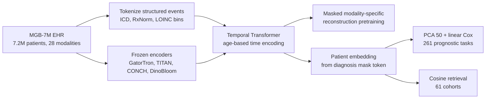

# A multimodal and temporal foundation model for virtual patient representations at healthcare system scale

> **Bibkey** `Zhang2026_260418570` · **Venue** arXiv preprint (2026) · **Category** ehr · **Relevance** medium · **Access** open
> **Link** <https://arxiv.org/abs/2604.18570>
> `status: complete` — 基于 arXiv 全文 PDF(2604.18570v2,pdftotext)精读:正文 + Online Methods 全读,Extended Data 表 1–2、5–17 中引用到的行逐条核对;预印本,未经同行评审。PI 2026-09-19 转发(Sinai EHR 项目)。
> Bilingual convention (drives the site's EN⇄中文 switcher): put `<!-- ZH -->` 中文 and `<!-- EN -->` English on their own lines (or inline `- <!-- ZH --> 中文 <!-- EN --> English`). Use `<!-- ZH/EN -->` ONLY for a purely language-neutral line (a bare URL or code token) — never for bilingual prose or labels.

---

## 一句话 / One-liner
<!-- ZH --> APOLLO(Mahmood 组,Mass General Brigham):在 17 家医院 1992–2025 年 **7,155,044 名病人、约 253 亿条医疗事件、28 种模态**(诊断码、用药、化验、生命体征、flowsheet、临床文本、病理/血涂片图像)上用「模态特定 mask 的掩码重建」预训练一个时间 Transformer,把整个就医史压成一个「虚拟病人」向量;冻结向量 → PCA → 线性 Cox,在 143 万人留出测试集的 261 个预后任务上多数显著超过年龄-性别基线,并支持 61 个队列的病人检索(Abstract;Results)。
<!-- EN --> APOLLO (Mahmood lab, Mass General Brigham): a temporal Transformer pretrained by modality-specific masked reconstruction on **7,155,044 patients, ~25.3B medical events and 28 modalities** (codes, medications, labs, vitals, flowsheets, clinical text, pathology/blood-smear images) from 17 hospitals, 1992–2025, compressing a whole care history into one "virtual patient" vector. Frozen vector → PCA → linear Cox beats an age–sex baseline on most of 261 prognostic tasks in a 1.43M-patient held-out test set, and supports patient retrieval on 61 cohorts (Abstract; Results).

## 要点 / Takeaways
- <!-- ZH --> **对 Sinai EHR 项目**:规模(720 万人、单一学术医疗系统、Epic、未精修数据)与 Sinai 的「数百万病人」同量级,是「如果用上全部模态」的最直接参照;工程细节(化验分 bin token、LLM 规范化本地 flowsheet 命名与分类答案、冻结文本/病理编码器)几乎可以逐条对照(Online Methods)。 <!-- EN --> **For the Sinai EHR project**: the scale (7.2M patients, one academic health system on Epic, uncurated data) matches Sinai's millions, so this is the most direct reference for "what if we use every modality"; the engineering details (binned lab tokens, LLM normalization of local flowsheet names and categorical answers, frozen text/pathology encoders) map almost one-to-one (Online Methods).
- <!-- ZH --> **评测口径值得照搬**:每个任务一个 snapshot–endpoint 对、按 τ 设 blackout 期、case-cohort 采样 4:1、测试集保留自然删失率、报 time-dependent AUC + 校准(ICI/MCE)(Online Methods「Evaluation framework」「Metrics」)。 <!-- EN --> **The evaluation protocol is worth copying**: one snapshot–endpoint pair per patient per task, a τ-dependent blackout period, 4:1 case-cohort sampling for training, natural censoring kept in test, time-dependent AUC plus calibration (ICI/MCE) (Online Methods, "Evaluation framework", "Metrics").
- <!-- ZH --> **肾/心代谢终点多且强**:3 年新发 CKD AUC 0.749→0.863;CKD 3 期→4 期以上 0.587→0.777;高血压→CKD 0.686→0.820;NSAID 后 AKI 0.796→0.906(Extended Data Tables 7、9、13)—— 可直接作为 Sinai 上的任务清单和目标数值。 <!-- EN --> **Many strong kidney/cardiometabolic endpoints**: 3-year new-onset CKD AUC 0.749→0.863; CKD stage 3→4+ 0.587→0.777; hypertension→CKD 0.686→0.820; AKI after NSAIDs 0.796→0.906 (Extended Data Tables 7, 9, 13) — a ready task list with target numbers for Sinai.
- <!-- ZH --> **基线偏弱要注意**:正文主要对比年龄-性别;Extended Data 表里还有「最近一份病程记录嵌入」基线,它在部分任务上已很强(如住院透析依赖 balanced accuracy 0.882 vs APOLLO 0.974,年龄-性别 0.655;Extended Data Table 15)。没有与临床评分或其他 EHR 基础模型正面比较(Discussion)。 <!-- EN --> **Mind the weak baseline**: the main text compares mostly with age–sex; the Extended Data tables also report a "latest progress-note embedding" baseline, which is already strong on some tasks (e.g. in-hospital dialysis dependence balanced accuracy 0.882 vs APOLLO 0.974 and age–sex 0.655; Extended Data Table 15). No head-to-head with clinical scores or other EHR foundation models (Discussion).
- <!-- ZH --> **消融**:在肿瘤进展任务集上,多模态比纯结构化只多 +0.025 平均 AUROC(0.735 vs 0.71),而去掉预训练(同架构逐任务监督)差 0.109(Results「Ablation studies」)。 <!-- EN --> **Ablation**: on the neoplasm-progression set, multimodality adds only +0.025 mean AUROC over structured-only (0.735 vs 0.71), while dropping pretraining (same architecture, supervised per task) costs 0.109 (Results, "Ablation studies").
- <!-- ZH --> 我们的理解:对 detect → model → revert,APOLLO 是病人尺度的「model」(作者自己类比 virtual cell),但作者明确说疗效任务只是同一用药队列内的预后分层,不能回答「哪种药对该病人最好」—— revert 所需的反事实接口仍缺(Discussion)。 <!-- EN --> Our reading: for detect → model → revert, APOLLO is a patient-scale "model" (the authors themselves invoke the virtual cell), but they state that treatment-response tasks are prognostic stratification within a treated cohort and cannot say which drug is best for a patient — the counterfactual interface that "revert" needs is still missing (Discussion).

## 研究问题 / Problem
<!-- ZH --> EHR 是医疗的记录系统,但数据分散在各模态孤岛中,且维度高、稀疏、采样不规则(Introduction)。已有纵向 EHR 基础模型(refs 25–35)大多只用结构化数据(诊断码、化验),因为有现成本体(ICD-10、SNOMED、LOINC)和离散 token 建模;而病程细节、医学推理和新型生物标志物常常只在自由文本和图像里。许多已有工作还依赖精修过的公开数据(如只含 ICU 的 MIMIC-IV)。问题:能否在一个**真实、未精修、覆盖全部科室**的医疗系统数据上,把结构化 + 文本 + 图像的完整纵向病历统一成一个时间感知的病人表示,并证明它在发病、进展、疗效、不良事件、医院运营、检索等大量任务上通用?作者把这一设想类比为整合多模态数据的「virtual cell」(Introduction)。
<!-- EN --> The EHR is medicine's system of record, but its data sit in modality silos and are high-dimensional, sparse and irregularly sampled (Introduction). Existing longitudinal EHR foundation models (refs 25–35) mostly use structured data only (codes, labs), thanks to ontologies (ICD-10, SNOMED, LOINC) and discrete-token modelling, whereas progression detail, clinical reasoning and novel biomarkers often live only in free text and images. Much prior work also relies on curated public data (e.g. ICU-only MIMIC-IV). The question: on **real, uncurated, all-department** health-system data, can the full longitudinal record — structured + text + images — be unified into one time-aware patient representation that generalizes across onset, progression, treatment response, adverse events, hospital operations and retrieval? The authors liken this to multimodal "virtual cell" models (Introduction).

## 方法 / Method
<!-- ZH --> 1. **数据抽取与清洗**:从 Snowflake 分析库用 SQL 抽取 Epic 数据,去标识化,去重、清理异常时间戳(Online Methods「Data acquisition」)。
<!-- EN --> 1. **Extraction and cleaning**: SQL extraction of Epic data from a Snowflake warehouse, de-identification, removal of duplicates and implausible timestamps (Online Methods, "Data acquisition").
<!-- ZH --> 2. **结构化 token 化**:诊断 → ICD-10,用药 → RxNorm 成分,化验/生命体征 → LOINC。数值先统一单位,做 sign(x)·log(|x|+1),再分成 10 个等宽 bin(中间 8 个覆盖 2.5–97.5 百分位,两端各一个极值 bin);分类型结果用「两个 LLM 的 agentic 流程」规范到每个检验的标准答案集(如 "pos"/"+" → positive)。最终 token = (代码, bin) 或 (代码, 类别),共 **235,768** 个可学习嵌入(Online Methods「Preprocessing」)。
<!-- EN --> 2. **Structured tokenization**: diagnoses → ICD-10, medications → RxNorm ingredients, labs/vitals → LOINC. Numeric values are unit-reconciled, transformed by sign(x)·log(|x|+1) and cut into 10 equal-width bins (the middle 8 span the 2.5th–97.5th percentiles, plus one extreme bin at each end); categorical answers are canonicalized by a two-LLM "agentic workflow" (e.g. "pos"/"+" → positive). Tokens are (code, bin) or (code, category): **235,768** learnable embeddings (Online Methods, "Preprocessing").
<!-- ZH --> 3. **非结构化用冻结编码器**:所有临床文本用 GatorTron-base(超长分块后取平均);全切片病理图(WSI)用 TITAN;血涂片用 DinoBloom;电镜与大体图像用 CONCHv1.5;放射等其他影像只用其报告文本。人口学:性别为类别 token,种族用 bert-base-uncased 嵌入后取均值,年龄用 MLP(Online Methods)。
<!-- EN --> 3. **Frozen encoders for unstructured data**: all clinical text with GatorTron-base (long notes chunked and averaged); whole-slide images (WSI) with TITAN; blood smears with DinoBloom; electron-microscopy and gross images with CONCHv1.5; radiology and other imaging via report text only. Demographics: sex as a category token, ethnicity via bert-base-uncased embeddings (averaged if several), age via an MLP (Online Methods).
<!-- ZH --> 4. **模型**:每个事件 = 内容嵌入(结构化查表,或非结构化经模态投影层)+ 时间 MLP(事件时刻年龄,替代位置编码);前置 3 个人口学 token 和 CLS;主体是 base 尺寸 Transformer encoder(12 层、768 维、12 头),Fig. 1g 将其与各模态重建头合称 encoder–decoder(Online Methods「Architecture」)。
<!-- EN --> 4. **Model**: each event = content embedding (lookup for structured, modality projector for unstructured) + a time MLP on the patient's age at the event (replacing positional encodings); 3 demographic tokens and a CLS token are prepended; the core is a base-size Transformer encoder (12 layers, 768-d, 12 heads), drawn in Fig. 1g together with modality heads as an encoder–decoder (Online Methods, "Architecture").
<!-- ZH --> 5. **预训练目标**:以概率 0.3 随机 mask 事件,mask 向量按模态区分(告诉模型要重建哪种模态)。结构化 token:在同模态词表内做分类(化验/flowsheet 再按 LOINC CLASS 限定子词表;生命体征/flowsheet 的类别由 Qwen-32B 指派),交叉熵;非结构化:回归原编码器嵌入,MSE + 余弦距离。窗口 1,536 个连续事件,AdamW,最多 30,000 步,8×A100-80GB(Online Methods「Masking」「Implementation details」)。
<!-- EN --> 5. **Pretraining objective**: events are masked with probability 0.3 using modality-specific mask vectors (telling the model which modality to reconstruct). Structured tokens: classification within the modality vocabulary (labs/flowsheets further restricted by LOINC CLASS; classes for vitals/flowsheets assigned by Qwen-32B), cross-entropy. Unstructured: regression to the original encoder embedding, MSE + cosine distance. 1,536-event contiguous windows, AdamW, up to 30,000 iterations, 8×A100-80GB (Online Methods, "Masking", "Implementation details").
<!-- ZH --> 6. **病人嵌入**:推理时在序列末尾追加一个带最后时刻时间编码的「诊断 mask」token,取其隐状态作为病人向量(最多取最近 10 万个事件);检索时可换成文本或图像 mask(Online Methods「Patient representation」;Results)。
<!-- EN --> 6. **Patient embedding**: at inference a "diagnosis mask" token with the last visit's time encoding is appended and its hidden state is the patient vector (history capped at the latest 100,000 events); for retrieval a text or image mask can be used instead (Online Methods, "Patient representation"; Results).
<!-- ZH --> 7. **下游评估**:冻结嵌入 → PCA 取前 50 维(只在训练集拟合)→ lifelines Cox 比例风险模型(time-to-event,右删失);训练集 case-cohort 采样(删失:事件 ≤ 4:1),基线风险在验证集用 Breslow 重估;主指标是固定 τ 的 time-dependent cumulative/dynamic AUC,运营任务用 balanced accuracy;100 次 bootstrap 给 95% CI。对照:年龄+性别 Cox、最近病程记录嵌入、仅结构化 APOLLO、同架构无预训练的逐任务监督模型(Online Methods「Evaluation framework」「Baselines」)。
<!-- EN --> 7. **Downstream evaluation**: frozen embedding → PCA to the top 50 components (fit on training only) → lifelines Cox proportional hazards (time-to-event, right-censored); training uses case-cohort sampling (censored:events ≤ 4:1) and the baseline hazard is re-estimated on validation with Breslow; the main metric is time-dependent cumulative/dynamic AUC at a fixed τ, balanced accuracy for operations tasks; 95% CIs from 100 bootstraps. Comparators: age+sex Cox, latest progress-note embedding, structured-only APOLLO, and a same-architecture supervised model without pretraining (Online Methods, "Evaluation framework", "Baselines").
<!-- ZH --> 8. **可解释性**:个体层面 leave-one-token-out(LOTO,逐个删事件看风险变化);人群层面在 Transformer 之前的输入上算 Integrated Gradients,只看风险前 25% 的病人(Results;Online Methods「Interpretability」)。
<!-- EN --> 8. **Interpretability**: patient-level leave-one-token-out (LOTO: remove one event at a time and recompute risk); population-level Integrated Gradients on pre-Transformer inputs, restricted to the top hazard quartile (Results; Online Methods, "Interpretability").

## 方法图 / Method diagram


## 数据 / Data
<!-- ZH --> **MGB-7M**:Mass General Brigham 17 家医院及附属诊所,1992–2025 年;7,155,044 名病人(男 3,915,625 / 女 3,236,747),25,296,943,893 条事件(Results;Extended Data Table 1)。Extended Data Table 2:flowsheet 22,936,351,260;化验 1,442,631,333;生命体征 505,193,723;用药 112,189,178;诊断 39,144,980;临床文本 182,296,303 份(其中病程记录 158,683,290);诊断报告 77,978,881 份(放射 46,643,405、病理 12,935,526 等);图像 1,158,235 张(血涂片 522,190、WSI 311,769、大体 165,837、电镜 158,439)。按 75:5:20 划分训练/验证/测试;下游任务全部来自 1,431,009 人的测试集(Results)。任务:新发疾病 95(每个 ≥6 万人,事件数 157–27,503)、进展 78、疗效 59、不良事件 17、医院运营 12、检索队列 61(Results;Extended Data Tables 6–17)。数据仅按个案审批 + MTA 共享(Data availability)。
<!-- EN --> **MGB-7M**: 17 Mass General Brigham hospitals and affiliated clinics, 1992–2025; 7,155,044 patients (3,915,625 male / 3,236,747 female), 25,296,943,893 events (Results; Extended Data Table 1). Extended Data Table 2: flowsheets 22,936,351,260; labs 1,442,631,333; vitals 505,193,723; medications 112,189,178; diagnoses 39,144,980; clinical notes 182,296,303 (158,683,290 progress notes); diagnostic reports 77,978,881 (radiology 46,643,405, pathology 12,935,526, …); images 1,158,235 (blood smears 522,190, WSIs 311,769, gross 165,837, EM 158,439). Split 75:5:20 train/val/test; every downstream task comes from the 1,431,009-patient test set (Results). Tasks: 95 new-onset (≥60k patients each, 157–27,503 events), 78 progression, 59 treatment response, 17 adverse events, 12 hospital operations, 61 retrieval cohorts (Results; Extended Data Tables 6–17). Data shared only case by case with an MTA (Data availability).

## 主要结果 / Key results
- <!-- ZH --> **新发疾病(95 任务)**:74/95 显著优于年龄-性别(p<0.05);1 年全因死亡 AUROC **0.92**(年龄-性别 0.72,Fig. 3d);3 年心衰 0.77→0.88;1 年急性心梗 0.68→0.82(Fig. 3d 标为 0.67,Extended Data Table 7 为 0.675→0.817);1 年精神分裂症 0.65→0.92;3 年 2 型糖尿病 0.61→0.85;1 年痛风 0.74→0.83(Results「new disease onset」;Fig. 3d)。 <!-- EN --> **New onset (95 tasks)**: significantly better than age–sex on 74/95 (p<0.05); 1-year all-cause mortality AUROC **0.92** (age–sex 0.72, Fig. 3d); 3-year heart failure 0.77→0.88; 1-year acute MI 0.68→0.82 (Fig. 3d shows 0.67; Extended Data Table 7 0.675→0.817); 1-year schizophrenia 0.65→0.92; 3-year type 2 diabetes 0.61→0.85; 1-year gout 0.74→0.83 (Results, "new disease onset"; Fig. 3d).
- <!-- ZH --> **疾病进展(78 任务)**:53/78 显著;心血管类平均 0.65→0.75;高血压→心衰 5 年 0.75→0.86;卒中后 3 年生存 0.72→0.84;主动脉瓣狭窄后 3 年生存 0.72→0.83;哮喘急性加重 0.57→0.83;黑色素瘤 3 年生存 0.71→0.87;CML 0.75→0.83 但不显著(Results;Fig. 3e)。 <!-- EN --> **Progression (78 tasks)**: 53/78 significant; cardiovascular average 0.65→0.75; hypertension→heart failure at 5 years 0.75→0.86; 3-year survival after stroke 0.72→0.84, after aortic stenosis 0.72→0.83; asthma exacerbation 0.57→0.83; melanoma 3-year survival 0.71→0.87; CML 0.75→0.83 but not significant (Results; Fig. 3e).
- <!-- ZH --> **疗效(59 任务)与不良事件(17 任务)**:疗效 30/59 显著;房颤用阿哌沙班无卒中生存 0.69→0.81;曲妥珠单抗 0.66→0.93。不良事件 12/17 显著;NSAID 后 AKI 0.80→0.91、消化道出血 0.80→0.91;糖皮质激素后 2 型糖尿病 0.70→0.87(Results;Fig. 3f–g)。 <!-- EN --> **Treatment response (59) and adverse events (17)**: 30/59 significant; stroke-free survival on apixaban for AF 0.69→0.81; trastuzumab 0.66→0.93. Adverse events 12/17 significant; AKI after NSAIDs 0.80→0.91, GI bleeding 0.80→0.91; T2D after corticosteroids 0.70→0.87 (Results; Fig. 3f–g).
- <!-- ZH --> **医院运营(12 任务,balanced accuracy,输入为急诊入院后 24 小时内数据,τ=6 天)**:9/12 显著;住院透析依赖 0.65→0.97(该任务发生率仅 0.02%;最近病程记录基线已达 0.882);急性肾衰 0.64→0.80;脓毒症 0.66→0.79;30 天再入院 0.54→0.62(Results;Fig. 3h;Extended Data Tables 14–15)。 <!-- EN --> **Hospital operations (12 tasks, balanced accuracy, input up to 24 h after ED admission, τ = 6 days)**: 9/12 significant; in-hospital dialysis dependence 0.65→0.97 (incidence only 0.02%; the latest-progress-note baseline already reaches 0.882); acute kidney failure 0.64→0.80; sepsis 0.66→0.79; 30-day readmission 0.54→0.62 (Results; Fig. 3h; Extended Data Tables 14–15).
- <!-- ZH --> **肾相关任务(Extended Data 表,AUC;年龄-性别 → APOLLO)**:3 年新发 CKD 0.749→0.863(Table 7);高血压→CKD 5 年 0.686→0.820;CKD 2→3 期 5 年 0.622→0.705;CKD 3→4 期以上 3 年 0.587→0.777;心衰→急性肾衰 1 年 0.525→0.724(Table 9);CKD 用赖诺普利的无 ESRD 生存 3 年 0.618→0.742(Table 11)。 <!-- EN --> **Kidney tasks (Extended Data tables, AUC; age–sex → APOLLO)**: 3-year new-onset CKD 0.749→0.863 (Table 7); hypertension→CKD at 5 years 0.686→0.820; CKD stage 2→3 at 5 years 0.622→0.705; CKD stage 3→4+ at 3 years 0.587→0.777; heart failure→acute kidney failure at 1 year 0.525→0.724 (Table 9); ESRD-free survival on lisinopril for CKD at 3 years 0.618→0.742 (Table 11).
- <!-- ZH --> **消融(肿瘤进展 28 任务;摘要写作 30 任务)**:APOLLO 平均 AUROC 0.735;仅结构化 0.71;无预训练的监督模型 0.626;最近病程记录 0.615;年龄-性别 0.619;CML 死亡上比病程记录基线 +0.31、比监督模型 +0.23(Results「Ablation studies」;Fig. 3i;Extended Data Fig. 17)。 <!-- EN --> **Ablation (28 neoplasm-progression tasks; the abstract says 30)**: APOLLO mean AUROC 0.735; structured-only 0.71; supervised without pretraining 0.626; latest progress note 0.615; age–sex 0.619; on CML mortality +0.31 over the progress-note baseline and +0.23 over supervised (Results, "Ablation studies"; Fig. 3i; Extended Data Fig. 17).
- <!-- ZH --> **检索**:索引为 140 万测试病人(统一截至 2025-01-01),61 个「诊断 THEN 一线用药」SQL 队列,Acc@5 在全部队列上高于最近病程记录基线;能找回缺少 Z94.0(肾移植状态)码但有移植并发症 T86.19、透析 Z99.2 和他克莫司的病人;支持自然语言入组标准和外部 TCGA 切片查询(Results;Fig. 4;Extended Data Fig. 18)。 <!-- EN --> **Retrieval**: index of 1.4M test patients (all embedded as of 2025-01-01), 61 SQL cohorts of the form "diagnosis THEN first-line drug"; Acc@5 beats the latest-progress-note baseline on every cohort; retrieves a patient lacking the Z94.0 kidney-transplant code but with transplant complications (T86.19), dialysis (Z99.2) and tacrolimus; supports natural-language inclusion criteria and an external TCGA slide as queries (Results; Fig. 4; Extended Data Fig. 18).
- <!-- ZH --> **校准与解释**:较大样本的任务校准更好(Extended Data Figs. 9–16)。LOTO 示例:一名病人 3 年 CKD 风险在高血压、血脂异常、2 型糖尿病记录后上升,eGFR 降到 50 出头时再跳升(Fig. 5a);IG 对心衰→急性肾衰突出肥胖、术后状态和衰老代理特征(Fig. 5e)。作者把归因视为关联,而非因果(Results)。 <!-- EN --> **Calibration and explanations**: tasks with larger samples are better calibrated (Extended Data Figs. 9–16). LOTO example: one patient's 3-year CKD risk rises after hypertension, dyslipidaemia and T2D are recorded and jumps when eGFR falls to the low 50s (Fig. 5a); IG for heart failure→acute kidney failure highlights obesity, post-procedural states and ageing proxies (Fig. 5e). The authors treat attributions as associative, not causal (Results).

## 创新点 / Contributions
- <!-- ZH --> 作者称其为首个把完整纵向病历(结构化 + 文本 + 图像,28 种模态)统一成时间感知病人表示的多模态基础模型(Discussion)。 <!-- EN --> Claimed by the authors as the first multimodal foundation model unifying the full longitudinal record (structured + text + images, 28 modalities) into a time-aware patient representation (Discussion).
- <!-- ZH --> 冻结现成单模态编码器 + 只训练时间 Transformer:原始数据不进入最终模型,作者认为降低 PHI 泄漏风险,同时计算上可行(Results)。 <!-- EN --> Frozen off-the-shelf unimodal encoders + a trained temporal Transformer only: raw data never enter the final model, which the authors argue lowers PHI-leakage risk and keeps compute feasible (Results).
- <!-- ZH --> 模态特定 mask 同时用作预训练目标和推理时的「提示」,同一模型可给出偏向诊断、文本或图像的病人嵌入,支持跨模态检索(Results;Fig. 1h)。 <!-- EN --> Modality-specific masks serve both as the pretraining target and as an inference-time "prompt", so one model yields diagnosis-, text- or image-tuned patient embeddings and cross-modal retrieval (Results; Fig. 1h).
- <!-- ZH --> 322 个任务(261 预后 + 61 检索)的评测框架,全部为 time-to-event,附 Kaplan–Meier 分层与校准曲线(Extended Data Figs. 1–16)。 <!-- EN --> A 322-task evaluation framework (261 prognostic + 61 retrieval), all time-to-event, with Kaplan–Meier stratification and calibration curves (Extended Data Figs. 1–16).

## 局限 / Limitations
- <!-- ZH --> **作者自述**:观察性数据,预测是关联而非因果;疗效任务只是同一用药队列内的预后分层,不能回答哪种药对该病人最好(Discussion)。 <!-- EN --> **Stated by the authors**: observational data, associational predictions; treatment-response tasks stratify within a treated cohort and cannot say which drug is best for a patient (Discussion).
- <!-- ZH --> **作者自述**:只有一个医疗系统(MGB,共享 Epic,主要代表美国东北部),只是系统内泛化,没有外部验证(Discussion)。 <!-- EN --> **Stated by the authors**: one health system only (MGB, shared Epic instance, mostly northeastern US) — within-system generalization, no external validation (Discussion).
- <!-- ZH --> **作者自述**:对照只有年龄-性别,未与 ASCVD、CHA₂DS₂-VASc、HEART、Framingham 等临床评分正面比较;冻结编码器、长文本简单平均;无可穿戴、生活方式、医患对话数据(Discussion)。 <!-- EN --> **Stated by the authors**: the common comparator is age–sex; no head-to-head with ASCVD, CHA₂DS₂-VASc, HEART or Framingham; frozen encoders and simple averaging of long notes; no wearables, lifestyle or patient–provider conversations (Discussion).
- <!-- ZH --> 我们的理解:正文的 0.65→0.97 透析依赖等「大跳升」是相对年龄-性别而言;最近病程记录基线已到 0.882,而该任务发生率仅 0.02%,极少数正例下 balanced accuracy 的方差会很大。另外未与其他 EHR 基础模型对比,也没有 Sinai 这样的第二家系统验证。 <!-- EN --> Our reading: headline jumps such as dialysis dependence 0.65→0.97 are relative to age–sex; the latest-progress-note baseline already gets 0.882, and with 0.02% incidence balanced accuracy rests on very few positives. There is also no comparison with other EHR foundation models and no second health system such as Sinai.
- <!-- ZH --> 预印本;代码「发表后」才开放,数据不公开(Code / Data availability)。 <!-- EN --> Preprint; code only "upon publication", data not public (Code / Data availability).

## 与本研究方向的关系 / Relation to our direction
<!-- ZH --> **先说 Sinai EHR 项目。** APOLLO 是同量级(数百万病人、单一美国学术医疗系统、Epic、未精修)数据上「全模态」做法的最直接参照,可逐条对照的工程选择有:化验数值的 log + 分 bin token、用 LLM 规范本地 flowsheet 命名与分类答案、冻结的文本/病理编码器、模态 mask 作为提示、全部用 Cox time-to-event + 校准评估、case-cohort 采样(Online Methods)。我们的理解:它的消融显示多模态比纯结构化只多 +0.025,而预训练 vs 无预训练差 0.109 —— 对 Sinai 而言,先把结构化数据的自监督预训练做好,可能比一开始就接入所有模态更划算;Extended Data 中的肾任务行(CKD 新发、CKD 分期进展、高血压→CKD、心衰→急性肾衰、NSAID 后 AKI、透析依赖)可以直接作为 Sinai 上的心-代谢-肾任务清单与参考数值;另外,评估时应同时报告「最近病程记录」这类强基线,而不只是年龄-性别。
<!-- EN --> **First, the Sinai EHR project.** APOLLO is the most direct reference for an "all-modality" approach on data of the same order (millions of patients, one US academic health system on Epic, uncurated). Engineering choices that map one-to-one: log + binned tokens for lab values, LLM normalization of local flowsheet names and categorical answers, frozen text/pathology encoders, modality masks as prompts, Cox time-to-event evaluation with calibration throughout, case-cohort sampling (Online Methods). Our reading: its ablation shows multimodality adds only +0.025 over structured-only while pretraining vs no pretraining differs by 0.109 — for Sinai, getting self-supervised pretraining on structured data right may pay off more than wiring in every modality at once; the kidney rows of the Extended Data tables (new-onset CKD, CKD stage progression, hypertension→CKD, heart failure→acute kidney failure, AKI after NSAIDs, dialysis dependence) can serve directly as a cardiometabolic-kidney task list with reference numbers; and evaluations should also report strong baselines like the latest progress note, not only age–sex.
<!-- ZH --> **再说 detect → model → revert(我们的理解)。** APOLLO 是病人尺度的「model」:作者自己用 virtual cell 作类比并称其为 virtual patient;它也用 TITAN/CONCH 嵌入病理切片,与 Topic 1(肾组学异常检测)H&E 侧可用的编码器同属 Mahmood 组。它没有做 revert:作者明确说反事实任务(同一病人换不同疗法的结局差异)尚待解决。对 Topic 2(agent 结论校验):作者把 IG 归因区分为「已知危险因素 / 护理过程代理 / 多病共存与共享风险环境 / 少量可检验的假设信号」,并强调不能把归因当作干预靶点,这可以直接借作 agent 基于 EHR 下结论时的证据分级。
<!-- EN --> **Then detect → model → revert (our reading).** APOLLO is a patient-scale "model": the authors invoke the virtual cell and call it a virtual patient; it embeds slides with TITAN/CONCH, the same Mahmood-lab encoder family available for the H&E side of Topic 1 (kidney omics anomaly detection). It does not do "revert": the authors state the counterfactual task (differential outcomes across therapies for the same patient) remains open. For Topic 2 (verifying agent claims): the authors separate IG attributions into "established risk factors / care-process proxies / multimorbidity and shared-risk markers / a few testable hypothesis-generating signals" and warn against reading attributions as intervention targets — directly reusable as an evidence-grading scheme for agents drawing conclusions from EHR.

## 可复用资产 / Reusable assets
- <!-- ZH --> **代码:** 预训练与评估流水线(风险预测、检索)将在「发表后」面向学术开放;目前未公开(Code availability)。 <!-- EN --> **Code:** pretraining and evaluation pipeline (risk prediction, retrieval) to be released for academic use "upon publication"; not yet public (Code availability).
- <!-- ZH --> **数据:** MGB-7M 不公开,按个案审批 + MTA(Data availability)。 <!-- EN --> **Data:** MGB-7M not public; case by case with an MTA (Data availability).
- <!-- ZH --> **文中使用的公开编码器:** GatorTron-base(临床文本)、TITAN(WSI)、CONCHv1.5(电镜/大体图)、DinoBloom(血涂片)、bert-base-uncased(种族文本)。 <!-- EN --> **Public encoders used:** GatorTron-base (clinical text), TITAN (WSI), CONCHv1.5 (EM/gross images), DinoBloom (blood smears), bert-base-uncased (ethnicity strings).
- <!-- ZH --> **任务定义:** Extended Data Tables 6、8、10、12、14、16 给出全部任务的终点 ICD/用药码、τ、样本量和发生率;7、9、11、13、15、17 给出各基线的完整指标 —— 可作为 Sinai 任务清单模板。 <!-- EN --> **Task definitions:** Extended Data Tables 6, 8, 10, 12, 14, 16 list endpoint ICD/drug codes, τ, sample size and incidence for every task; Tables 7, 9, 11, 13, 15, 17 give full metrics for each baseline — a template task list for Sinai.
<!-- ZH/EN --> <https://arxiv.org/abs/2604.18570>

## 待读 / Follow-ups
- <!-- ZH --> Extended Data Tables 7–15 中其余肾/心代谢行(肾病综合征、肾盂肾炎、肾癌、透析相关)的完整数值与 CI。 <!-- EN --> The remaining kidney/cardiometabolic rows of Extended Data Tables 7–15 (nephrotic syndrome, pyelonephritis, kidney cancer, dialysis-related) with CIs.
- <!-- ZH --> 引用的其他纵向 EHR 基础模型(refs 25–35),找有外部验证或与临床评分正面比较的工作。 <!-- EN --> The other longitudinal EHR foundation models cited (refs 25–35) — look for external validation or head-to-head clinical-score comparisons.
- <!-- ZH --> TITAN 原文(ref 43),与本仓库病理基础模型条目对照。 <!-- EN --> The TITAN paper (ref. 43), compared with this repo's pathology foundation-model entries.
- <!-- ZH --> 跟踪正式发表版本是否补充外部验证与代码。 <!-- EN --> Track whether the published version adds external validation and code.

## 引用 / Cite
```bibtex
@misc{Zhang2026_260418570,
  title = {A multimodal and temporal foundation model for virtual patient representations at healthcare system scale},
  author = {Andrew Zhang and Tong Ding and Sophia J. Wagner and Caiwei Tian and Ming Y. Lu and Rowland Pettit and Joshua E. Lewis and Alexandre Misrahi and Dandan Mo and Long Phi Le and Faisal Mahmood},
  year = {2026},
  eprint = {2604.18570},
  archivePrefix = {arXiv},
  url = {https://arxiv.org/abs/2604.18570}
}
```
