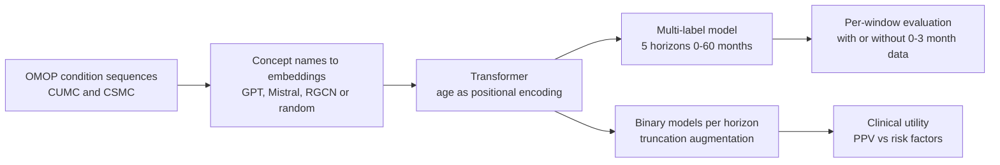

# Enhancing EHR-based pancreatic cancer prediction with LLM-derived embeddings

> **Bibkey** `Park_2025` · **Venue** npj Digital Medicine (2025) · **Category** ehr · **Relevance** medium · **Access** open
> **Link** <https://doi.org/10.1038/s41746-025-01869-8>
> `status: complete` — 基于出版社 PDF 全文(pdftotext;npj Digit. Med. 8:465,CC BY-NC-ND 4.0)精读,含正文表 1–3 的数值;补充材料未读。
> Bilingual convention (drives the site's EN⇄中文 switcher): put `<!-- ZH -->` 中文 and `<!-- EN -->` English on their own lines (or inline `- <!-- ZH --> 中文 <!-- EN --> English`). Use `<!-- ZH/EN -->` ONLY for a purely language-neutral line (a bare URL or code token) — never for bilingual prose or labels.

---

## 一句话 / One-liner
<!-- ZH --> 在 CancerRiskNet 式的胰腺癌(PC)轨迹 Transformer 中,把随机初始化的诊断码嵌入换成 **LLM 对 OMOP 概念名称的文本嵌入**(OpenAI text-embedding-3-small);在 Columbia(CUMC)与 Cedars-Sinai(CSMC)两家美国医院的 EHR 上,确诊前 6–12 个月预测 AUROC 由 0.60/0.82 升到 0.67/0.86,再排除确诊前 0–3 个月数据后为 0.82/0.89(Abstract;Table 2)。
<!-- EN --> In a CancerRiskNet-style pancreatic cancer (PC) trajectory Transformer, randomly initialized code embeddings are replaced with **LLM text embeddings of OMOP concept names** (OpenAI text-embedding-3-small). On EHRs from two US hospitals, Columbia (CUMC) and Cedars-Sinai (CSMC), 6–12-month-ahead AUROC rises from 0.60/0.82 to 0.67/0.86, and reaches 0.82/0.89 after excluding data from the 0–3 months before diagnosis (Abstract; Table 2).

## 要点 / Takeaways
- <!-- ZH --> **对 Sinai EHR 项目**:我们的理解:这是最接近单家医院 EHR 场景的一篇 —— 本文数据来自单家美国学术医院、OMOP 格式、每家几十万到近百万人,而不是丹麦国家登记;同一任务在院内数据上明显低于 CancerRiskNet(36 个月内 0.694/0.744 vs 0.88;Discussion)。 <!-- EN --> **For the Sinai EHR project**: Our reading: this is the closest to a single-hospital EHR setting — the data come from individual US academic hospitals in OMOP format, each with hundreds of thousands to ~1M patients, not a Danish national registry; on institutional data the same task scores clearly below CancerRiskNet (within 36 months 0.694/0.744 vs 0.88; Discussion).
- <!-- ZH --> **嵌入维度结论前后不一**:Results 写「增大嵌入维度对所有嵌入类型(baseline、RGCN、GPT)都有显著提升」;Discussion 却写 32 维 GPT 在某些窗口(0–3、12–36 个月)与 1536 维相当甚至更好,1536 维并不稳定优于 32 维;4096 维 Mistral 不稳定占优(Results「Multi-label classification model」;Discussion)。我们的理解:概念名称不含 PHI,可以直接从医院的 OMOP 词表生成嵌入并作为初始化,成本很低。 <!-- EN --> **The paper is inconsistent on embedding size**: Results says increasing embedding size significantly improved performance for all embedding types (baseline, RGCN, GPT); the Discussion says 32-d GPT was comparable or better in some windows (0–3, 12–36 months) and 1536-d did not consistently beat 32-d; 4096-d Mistral is not consistently better (Results, "Multi-label classification model"; Discussion). Our reading: concept names carry no PHI, so embeddings can be generated straight from a hospital's OMOP vocabulary and used as initialization at low cost.
- <!-- ZH --> **泄漏是核心问题**:多时间窗模型中,临近确诊的强信号(如「disorder of pancreas」)会渗到远端窗口;作者用三步处理:按窗口限定评估病例、排除 0–3 个月数据、截断式数据增强(Results;Discussion)。我们的理解:这三步可以照搬。 <!-- EN --> **Leakage is the central issue**: in multi-horizon models, strong near-diagnosis signals (e.g. "disorder of pancreas") bleed into distal windows; the authors handle it with per-window case restriction, 0–3-month exclusion and truncation-based augmentation (Results; Discussion). Our reading: all three can be copied directly.
- <!-- ZH --> **摘要的 PPV 只对应 CUMC**:CUMC 上 max-F1 点 PPV 0.141 vs 传统危险因素 0.004;但 CSMC 上 GPT 模型 PPV 只有 0.012(baseline 0.084)(Table 3)。 <!-- EN --> **The abstract's PPV is CUMC only**: at max-F1, CUMC PPV 0.141 vs 0.004 for traditional risk factors; at CSMC the GPT model's PPV is only 0.012 (baseline 0.084) (Table 3).
- <!-- ZH --> **肾相关特征**:二分类模型在 6–12 和 12–36 个月窗口都把肾脏相关疾病排为前列特征,作者解读为可能的多器官早期信号(Discussion,ref 13)。 <!-- EN --> **Kidney features**: the binary models rank kidney-related conditions among top features in both the 6–12- and 12–36-month windows, which the authors read as a possible multi-organ early signal (Discussion, ref. 13).
- <!-- ZH --> 我们的理解:对 detect → model → revert,这是 EHR 层的「detect」(早期风险识别),改进点在表示(把医学语言知识注入码嵌入),不涉及因果或干预。 <!-- EN --> Our reading: for detect → model → revert, this is EHR-level "detect" (early risk flagging); the gain is in representation (injecting medical-language knowledge into code embeddings), with no causal or interventional component.

## 研究问题 / Problem
<!-- ZH --> 胰腺癌 5 年生存率 13%,早期确诊可达 44%;但筛查只覆盖有家族或遗传风险的人(仅占病例 5–10%),MRI/CT 虽敏感(93%)特异(89%),却无法在一般人群中普查(Introduction)。EHR 的纵向病史可能含有早期信号。受 GenePT(用 GPT 嵌入 NCBI 基因描述)启发,作者假设 **LLM 对医学概念名称的嵌入**能比从头学的嵌入更好地表示诊断码,从而改善早期预测。第二个问题是**临近确诊数据造成的泄漏**:在同时预测多个时间窗的模型中,近端强信号会抬高远端窗口的分数(Results)。
<!-- EN --> Pancreatic cancer five-year survival is 13%, 44% if caught early; but screening covers only people with familial or genetic risk (5–10% of cases), and MRI/CT, though sensitive (93%) and specific (89%), cannot be used population-wide (Introduction). Longitudinal EHR histories may contain early signals. Inspired by GenePT (GPT embeddings of NCBI gene descriptions), the authors hypothesize that **LLM embeddings of medical concept names** represent diagnosis codes better than embeddings learned from scratch, improving early prediction. A second issue is **leakage from near-diagnosis data**: in a model predicting several horizons at once, strong proximal signals inflate distal-window scores (Results).

## 方法 / Method
<!-- ZH --> 1. **输入**:每个病人的 OMOP condition(诊断)序列,以记录时的年龄作为 positional encoding;病例的「距确诊时间」= 最后一条诊断记录到 PC 确诊的间隔(Methods)。
<!-- EN --> 1. **Input**: each patient's OMOP condition (diagnosis) sequence, with age at recording as the positional encoding; a case's "time to diagnosis" is the gap between the last recorded condition and the PC diagnosis (Methods).
<!-- ZH --> 2. **码嵌入的四种来源**:(a) baseline:PyTorch nn.Embedding 随机初始化;(b) RGCN:在 OMOP 祖先-后代层级知识图上训练的关系图卷积网络(优化 MRR);(c) GPT:OpenAI text-embedding-3-small 对概念名称编码,32 维和 1536 维;(d) Mistral:Salesforce/SFR-Embedding-Mistral,4096 维。每种再分冻结 / 微调,共 12 个模型(Methods;Supplementary Table 2)。
<!-- EN --> 2. **Four sources of code embeddings**: (a) baseline: randomly initialized PyTorch nn.Embedding; (b) RGCN: a relational graph convolutional network trained on the OMOP ancestor–descendant knowledge graph (optimizing MRR); (c) GPT: OpenAI text-embedding-3-small on concept names, 32-d and 1536-d; (d) Mistral: Salesforce/SFR-Embedding-Mistral, 4096-d. Each frozen or fine-tuned — 12 models (Methods; Supplementary Table 2).
<!-- ZH --> 3. **多标签模型**(仿 CancerRiskNet):一个 Transformer 同时输出 0–3、3–6、6–12、12–36、36–60 个月 5 个二元标签;评估某窗口时只用确诊恰落在该窗口的病例(如 12–36 个月只用标签 [0,0,0,1,1] 的病人),避免近端病例抬分(Results;Fig. 1B)。
<!-- EN --> 3. **Multi-label model** (CancerRiskNet-style): one Transformer outputs 5 binary labels for 0–3, 3–6, 6–12, 12–36 and 36–60 months; each window is evaluated only on cases diagnosed in that window (e.g. 12–36 months uses only patients labelled [0,0,0,1,1]) so proximal cases do not inflate scores (Results; Fig. 1B).
<!-- ZH --> 4. **反泄漏变体**:另训一个**排除 0–3 个月数据**的多标签模型,这部分数据改用于扩充 3–6 个月窗口(Methods)。
<!-- EN --> 4. **Anti-leakage variant**: a second multi-label model **excludes 0–3-month data**, which is instead used to augment the 3–6-month window (Methods).
<!-- ZH --> 5. **二分类模型 + 截断式增强**:每个窗口(3–6、6–12、12–36 个月)单独一个模型;把更近端的病例逐条删除最近的记录,直到最后一条记录落入目标窗口,以扩充远端病例(CUMC 增强后 1,700 / 1,691 / 1,719 例,对照 785,332;CSMC 1,082 / 1,078 / 1,058 例,对照 460,417)(Results;Methods;Fig. 1C)。
<!-- EN --> 5. **Binary models + truncation augmentation**: one model per window (3–6, 6–12, 12–36 months); more proximal cases have their latest records removed until the last remaining record falls in the target window, enlarging distal case counts (CUMC after augmentation 1,700 / 1,691 / 1,719 cases, 785,332 controls; CSMC 1,082 / 1,078 / 1,058 cases, 460,417 controls) (Results; Methods; Fig. 1C).
<!-- ZH --> 6. **训练与评估**:60/20/20 划分;同一组对照用于所有窗口(模拟真实低患病率);bootstrap 求 95% CI 和 p 值(AUROC、AUPRC、max-F1);LIME 解释特征;临床效用用 PPV 及「检出 x% 病例需筛查多少人」,与传统危险因素(CA19-9、2 型糖尿病、胰腺炎)和已知胚系变异比较(Methods;Table 3)。
<!-- EN --> 6. **Training and evaluation**: 60/20/20 split; one shared control group across windows (mimicking low real-world prevalence); bootstrap 95% CIs and p-values (AUROC, AUPRC, max-F1); LIME for feature explanations; clinical utility via PPV and "how many must be screened to detect x% of cases", compared with traditional risk factors (CA19-9, type 2 diabetes, pancreatitis) and known germline variants (Methods; Table 3).

## 方法图 / Method diagram


## 数据 / Data
<!-- ZH --> 两家医院的 OMOP 格式 EHR:**CUMC**(Columbia University Irving Medical Center,纽约)3,300 例 / 785,335 对照;**CSMC**(Cedars-Sinai Medical Center,洛杉矶 —— 注意不是 Mount Sinai)1,781 例 / 484,515 对照(Methods「Patient data」)。病例:胰腺恶性肿瘤诊断码且无其他癌症史;对照:排除任何癌症相关词、诊断记录少于 5 条的人,并去掉每个对照最后记录之前 2 年内的诊断(降低混入未确诊癌症的可能);此外所有患者中 <18 岁或 >100 岁者都被排除(Methods「Patient data」「Case-control sampling」)。留出测试集(20%)中远端窗口病例很少:多标签模型 CUMC 6–12 个月 23 例、36–60 个月 14 例;CSMC 18 例、7 例;测试集对照 CUMC 157,067、CSMC 92,073(Table 2)。CSMC 有遗传数据:1,500 名胰腺癌相关变异携带者,其中 130 人患 PC,数据集中保留 50 人(Results)。HIPAA 禁止共享 EHR,两家通过共享代码分别运行(Data availability)。
<!-- EN --> OMOP-format EHR from two hospitals: **CUMC** (Columbia University Irving Medical Center, New York) 3,300 cases / 785,335 controls; **CSMC** (Cedars-Sinai Medical Center, Los Angeles — note: not Mount Sinai) 1,781 cases / 484,515 controls (Methods, "Patient data"). Cases: a pancreatic malignancy code and no other cancer history; controls: no cancer-related terms and at least 5 condition records, with diagnoses from the 2 years before each control's last record removed (to reduce undiagnosed cancers); in addition, patients under 18 or over 100 were excluded (Methods, "Patient data" and "Case-control sampling"). The 20% held-out test set has few distal cases: in the multi-label model CUMC 23 cases at 6–12 months and 14 at 36–60 months; CSMC 18 and 7; test controls CUMC 157,067, CSMC 92,073 (Table 2). CSMC has genetic data: 1,500 carriers of PC-associated variants, 130 with PC, 50 of them retained in the dataset (Results). HIPAA forbids sharing EHR; both sites ran shared code independently (Data availability).

## 主要结果 / Key results
- <!-- ZH --> **6–12 个月(多标签,含 0–3 个月数据,CUMC)**:baseline AUROC 0.592 [0.466, 0.720] → GPT **0.673** [0.559, 0.776]（p=0.018）;RGCN 0.647;Mistral 0.598,但 Mistral 的 max-F1 最高(0.083,p=0.035)(Table 1)。CSMC 上 0.819 → **0.858**(Table 2)。 <!-- EN --> **6–12 months (multi-label, with 0–3-month data, CUMC)**: baseline AUROC 0.592 [0.466, 0.720] → GPT **0.673** [0.559, 0.776] (p = 0.018); RGCN 0.647; Mistral 0.598, though Mistral has the best max-F1 (0.083, p = 0.035) (Table 1). CSMC 0.819 → **0.858** (Table 2).
- <!-- ZH --> **排除 0–3 个月后(GPT-1536)**:6–12 个月 CUMC **0.819**(baseline 0.756)、CSMC **0.893**(baseline 0.880);但 3–6 个月下降(CUMC 0.856→0.763,CSMC 0.884→0.870)—— 作者解读为确诊前症状可前推到约 6 个月,但不会更早(Table 2;Discussion)。 <!-- EN --> **After excluding 0–3 months (GPT-1536)**: 6–12 months CUMC **0.819** (baseline 0.756), CSMC **0.893** (baseline 0.880); but 3–6 months drops (CUMC 0.856→0.763, CSMC 0.884→0.870) — the authors read this as late symptoms extending back to ~6 months but not further (Table 2; Discussion).
- <!-- ZH --> **嵌入维度与微调**:Results 称增大维度对 baseline、RGCN、GPT 都有显著提升;Discussion 则称 32 维 GPT 在 0–3、12–36 个月等设置下与 1536 维相当甚至更好(p<0.05),1536 维并不稳定优于 32 维 —— 两处说法不一致;4096 维 Mistral 不稳定占优;微调对 32 维帮助大、对 1536 维帮助小(Results;Discussion;Supplementary Table 2)。GPT 嵌入在 CSMC 稳定提升,在 CUMC 效果不一(Results)。 <!-- EN --> **Dimension and fine-tuning**: Results says larger embeddings significantly improved baseline, RGCN and GPT; the Discussion says 32-d GPT was comparable or better in settings such as 0–3 and 12–36 months (p < 0.05) and 1536-d did not consistently beat 32-d — the two statements disagree; 4096-d Mistral is not consistently better; fine-tuning helps 32-d much more than 1536-d (Results; Discussion; Supplementary Table 2). GPT embeddings help consistently at CSMC but variably at CUMC (Results).
- <!-- ZH --> **二分类模型**:GPT 嵌入在 CUMC 3–6 个月(p=0.001)和 CSMC 6–12 个月(p=0.032)显著提升;12–36 个月略降但不显著;样本更多的二分类模型并未超过排除 0–3 个月的多标签模型(Results;Fig. 3)。 <!-- EN --> **Binary models**: GPT embeddings significantly help at CUMC 3–6 months (p = 0.001) and CSMC 6–12 months (p = 0.032); slightly worse but not significant at 12–36 months; despite more samples, the binary models do not beat the multi-label model without 0–3-month data (Results; Fig. 3).
- <!-- ZH --> **与 CancerRiskNet(丹麦国家登记)比较,36 个月内**:baseline 0.694(CUMC)/ 0.744(CSMC)vs 0.88;排除 0–3 个月后 0.737/0.771 vs 0.83;加 LLM 嵌入 0.761/0.811(Discussion;对应 Table 2 的 12–36 个月列)。 <!-- EN --> **Versus CancerRiskNet (Danish national registry), within 36 months**: baseline 0.694 (CUMC) / 0.744 (CSMC) vs 0.88; with 0–3-month exclusion 0.737/0.771 vs 0.83; with LLM embeddings 0.761/0.811 (Discussion; the 12–36-month columns of Table 2).
- <!-- ZH --> **临床效用(6–12 个月二分类)**:CUMC(338 例 / 157,067 对照,GPT 模型 AUROC 0.755)max-F1 点 PPV **0.141**(22 TP / 134 FP),「任一传统危险因素」PPV 0.004(96 TP / 24,950 FP);检出 50% 病例需筛查 17% 人群。CSMC(216 例,GPT AUROC 0.830)max-F1 点 PPV 只有 **0.012**(34 TP / 2,852 FP),baseline 0.084;检出 50% 需筛查 12%(Table 3;Results)。 <!-- EN --> **Clinical utility (6–12-month binary model)**: CUMC (338 cases / 157,067 controls, GPT AUROC 0.755) PPV at max-F1 **0.141** (22 TP / 134 FP) vs 0.004 for "any traditional risk factor" (96 TP / 24,950 FP); detecting 50% of cases requires screening 17% of the population. CSMC (216 cases, GPT AUROC 0.830) PPV at max-F1 only **0.012** (34 TP / 2,852 FP), baseline 0.084; 50% detection requires screening 12% (Table 3; Results).
- <!-- ZH --> **补充传统危险因素**:在 50% 检出点被模型找到的病例中(CUMC 169 例、CSMC 108 例),超过 50%(CUMC)和超过 85%(CSMC)既无传统危险因素也无已知胚系变异(Results)。 <!-- EN --> **Complementing risk factors**: among cases caught at the 50%-detection point (169 at CUMC, 108 at CSMC), over 50% (CUMC) and over 85% (CSMC) had neither traditional risk factors nor known germline variants (Results).
- <!-- ZH --> **特征(LIME)**:前列特征多与胰腺直接相关或为已知危险因素;另有肾/输尿管疾病、尿潴留、单纯高胆固醇血症、肝病等不常见特征;baseline 更常给出骨折等无关特征(Results;Supplementary Figs. 4–5)。 <!-- EN --> **Features (LIME)**: top features are mostly pancreas-related or known risk factors, plus less-established ones such as kidney/ureter disorders, urinary retention, pure hypercholesterolaemia and liver disease; the baseline more often surfaces unrelated features such as closed fractures (Results; Supplementary Figs. 4–5).

## 创新点 / Contributions
- <!-- ZH --> 用 LLM 对概念名称的文本嵌入初始化 EHR 码嵌入;作者称该方法可广泛用于各类临床预测任务,并可整合进不同的 EHR 建模框架(Discussion)。嵌入在 Transformer 训练中或冻结、或微调(Methods「Model training」);正文 Table 2 列出的是微调配置。 <!-- EN --> Initializes EHR code embeddings with LLM text embeddings of concept names; the authors say the approach applies to a wide range of clinical prediction tasks and can be integrated into diverse EHR modelling frameworks (Discussion). The embeddings are frozen or fine-tuned inside the trained Transformer (Methods, "Model training"); main-text Table 2 shows the fine-tuned configurations.
- <!-- ZH --> 系统比较嵌入来源(随机 / 知识图 RGCN / GPT / Mistral)、维度和冻结 vs 微调(Supplementary Table 2)。 <!-- EN --> A systematic comparison of embedding source (random / KG-RGCN / GPT / Mistral), dimension and frozen vs fine-tuned (Supplementary Table 2).
- <!-- ZH --> 明确指出并处理多标签多时间窗模型中的泄漏:按窗口限定病例、排除 0–3 个月、二分类 + 截断式增强(Results;Discussion)。 <!-- EN --> Identifies and handles leakage in multi-label multi-horizon models: per-window case restriction, 0–3-month exclusion, binary models with truncation augmentation (Results; Discussion).
- <!-- ZH --> 两家医院只共享代码、不共享数据的验证方式;报告 PPV 和「需筛查人数」这样的临床口径(Table 3)。 <!-- EN --> Two-site validation sharing code, not data; reports clinical quantities such as PPV and number needed to screen (Table 3).

## 局限 / Limitations
- <!-- ZH --> **作者自述**:家族史等关键危险因素多在非结构化记录里,结构化字段「缺失」不等于真无,因此与单个危险因素的直接比较有难度;只用诊断序列,没有化验、用药(Discussion)。 <!-- EN --> **Stated by the authors**: key risk factors like family history sit in unstructured notes, so absence in structured fields is not true absence and direct comparison with single risk factors is hard; conditions only, no labs or medications (Discussion).
- <!-- ZH --> **作者自述**:评估队列患病率(215/10 万)远高于美国实际(约 32/10 万,SEER 2022),真实 PPV 会更低(Discussion)。 <!-- EN --> **Stated by the authors**: evaluation-cohort prevalence (215 per 100k) is far above the US figure (~32 per 100k, SEER 2022), so real-world PPV would be lower (Discussion).
- <!-- ZH --> 我们的理解:远端窗口病例极少(测试集 6–12 个月仅 18–23 例),CI 很宽(如 CUMC 0.673 [0.559, 0.776]);两家医院结论不一致,CSMC 上 GPT 模型的 PPV 反而低于 baseline,而摘要只报 CUMC 的 0.141。 <!-- EN --> Our reading: very few distal cases (18–23 test cases at 6–12 months) and wide CIs (e.g. CUMC 0.673 [0.559, 0.776]); results disagree across sites, and at CSMC the GPT model's PPV is lower than baseline while the abstract reports only CUMC's 0.141.
- <!-- ZH --> 我们的理解:正文对二分类模型窗口的描述前后不一(有处写 3–6、6–12、36–60 个月,另处写 12–36 个月),测试集对照数在不同表中也略有出入(92,073 / 92,084 / 92,300);依赖闭源 OpenAI 嵌入 API,版本稳定性和可复现性受限。 <!-- EN --> Our reading: the text is inconsistent about the binary-model windows (3–6, 6–12, 36–60 months in some places, 12–36 in others), and CSMC test-control counts differ slightly between tables (92,073 / 92,084 / 92,300); reliance on a closed OpenAI embedding API limits version stability and reproducibility.

## 与本研究方向的关系 / Relation to our direction
<!-- ZH --> **先说 Sinai EHR 项目。** 我们的理解:这篇最接近单家医院 EHR 的场景:单个美国学术医疗中心的 OMOP 数据、规模在几十万到百万级,而不是丹麦那样完整的国家登记。可直接借用的三件事:(1) 用 LLM 对 OMOP 概念名称的嵌入做初始化,成本几乎为零(概念名称不含 PHI);应同时测试开源嵌入模型以避免闭源依赖。(2) 反泄漏评估:按窗口限定病例 + 排除 0–3 个月 + 截断式增强,比只报一个 AUROC 严格得多。(3) 报告口径:PPV 和「检出 50% 需筛查多少人」。我们的理解:这套「LLM 嵌入 + 多时间窗 + 反泄漏」流程可以原样用于 Sinai 上的 CKD/DKD 进展预测;作者在二分类模型中把肾脏疾病列为胰腺癌前 6–36 个月的前列特征,提示在心-代谢-肾轨迹模型中肾相关码可能是跨病种的强信号(这一点作者只引用了文献 ref 13,未做验证)。
<!-- EN --> **First, the Sinai EHR project.** Our reading: this is the closest to a single-hospital EHR setting: OMOP data from one US academic centre, hundreds of thousands to a million patients — not a complete national registry like Denmark's. Three directly reusable pieces: (1) LLM embeddings of OMOP concept names as initialization, at near-zero cost (concept names carry no PHI); open embedding models should be tested too, to avoid a closed dependency. (2) Anti-leakage evaluation: per-window cases + 0–3-month exclusion + truncation augmentation, far stricter than a single AUROC. (3) Reporting: PPV and "how many must be screened to catch 50%". Our reading: the "LLM embeddings + multi-horizon + anti-leakage" pipeline transfers unchanged to CKD/DKD progression at Sinai; the binary models rank kidney disease among top features 6–36 months before PC, hinting that kidney codes may be strong cross-disease signals in cardiometabolic-kidney trajectory models (the authors only cite ref. 13 for this; it is not tested).
<!-- ZH --> **再说 detect → model → revert(我们的理解)。** 这是 EHR 层的「detect」:改进在表示,不涉及病人状态建模或干预。对课题 2(agent 结论校验)它是一个具体样例:摘要报告的 PPV 0.141 只来自 CUMC,而 CSMC 上同一模型 PPV 为 0.012 —— 正是「claim 与证据不完全一致」的类型,可以放进 agent 失败分类的测试用例。
<!-- EN --> **Then detect → model → revert (our reading).** This is EHR-level "detect": the improvement is in representation, with no patient-state modelling or intervention. For Topic 2 (verifying agent claims) it is a concrete example: the abstract's PPV of 0.141 comes from CUMC only, while the same model's CSMC PPV is 0.012 — exactly the "claim not fully matching the evidence" type, usable as a test case in an agent failure taxonomy.

## 可复用资产 / Reusable assets
- <!-- ZH --> **代码:** 两家医院共用的胰腺癌 Transformer 代码(Data availability)。 <!-- EN --> **Code:** the pancreatic cancer Transformer shared by both sites (Data availability).
<!-- ZH/EN --> <https://github.com/jp4147/pdac_tf>
- <!-- ZH --> **数据:** HIPAA 限制,不共享(Data availability)。 <!-- EN --> **Data:** not shared (HIPAA) (Data availability).
- <!-- ZH --> **嵌入模型:** OpenAI text-embedding-3-small(32/1536 维)、Salesforce/SFR-Embedding-Mistral(4096 维);OMOP 层级 RGCN 的细节在 Supplementary Note 2(Methods)。 <!-- EN --> **Embedding models:** OpenAI text-embedding-3-small (32/1536-d), Salesforce/SFR-Embedding-Mistral (4096-d); details of the OMOP-hierarchy RGCN in Supplementary Note 2 (Methods).

## 待读 / Follow-ups
- <!-- ZH --> GenePT(ref 10,启发本文的基因文本嵌入工作)。 <!-- EN --> GenePT (ref. 10, the gene text-embedding work that inspired this paper).
- <!-- ZH --> ref 13(Malyszko et al., Lancet 2020,肾病与癌症的关系),核对「肾脏异常作为早期信号」的依据。 <!-- EN --> Ref. 13 (Malyszko et al., Lancet 2020, kidney disease and cancer), to check the basis for "kidney abnormalities as an early signal".
- <!-- ZH --> Supplementary Notes 4–5:跨模型一致高风险人群(多模型共识作为筛查人群定义);Supplementary Table 2 全部 12 个模型。 <!-- EN --> Supplementary Notes 4–5: individuals consistently high-risk across models (multi-model consensus as a screening definition); Supplementary Table 2 for all 12 models.
- <!-- ZH --> 与 `ehr-pancreatic-trajectory-natmed-2023`(CancerRiskNet)逐项对照阅读。 <!-- EN --> Read side by side with `ehr-pancreatic-trajectory-natmed-2023` (CancerRiskNet).

## 引用 / Cite
```bibtex
@article{Park_2025, title={Enhancing EHR-based pancreatic cancer prediction with LLM-derived embeddings}, volume={8}, ISSN={2398-6352}, url={http://dx.doi.org/10.1038/s41746-025-01869-8}, DOI={10.1038/s41746-025-01869-8}, number={1}, journal={npj Digital Medicine}, publisher={Springer Science and Business Media LLC}, author={Park, Jiheum and Patterson, Jason and Acitores Cortina, Jose M. and Gu, Tian and Hur, Chin and Tatonetti, Nicholas}, year={2025}, month=jul, pages={465} }
```
