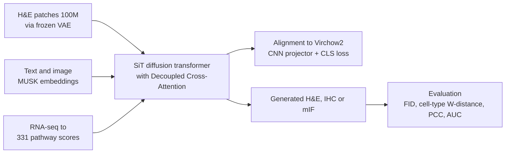

# A Generative Foundation Model for Multimodal Histopathology

> **Bibkey** `Xiang2026_260403635` · **Venue** arXiv preprint (2026) · **Category** foundation · **Relevance** medium · **Access** open
> **Link** <https://arxiv.org/abs/2604.03635>
> `status: complete` — 全文精读,依据 arXiv v1 PDF(`source.pdf`,2026-04-04)。

---

## 一句话 / One-liner
<!-- ZH --> MuPAD(Multimodal Pathology Diffusion;PDF 中写作 MUPAD,arXiv 摘要页写作 MuPD)是一个生成式病理基础模型:用一个带"解耦跨模态注意力"(Decoupled Cross-Attention, DCA)的扩散 Transformer,把 H&E 图像、RNA 通路分数和临床文本放进同一个条件生成框架,一个模型同时做文本/图像/RNA→H&E 生成、冰冻→石蜡切片转换和 H&E→IHC/mIF 虚拟染色(Abstract)。
<!-- EN --> MuPAD (Multimodal Pathology Diffusion; spelled MUPAD in the PDF and MuPD on the arXiv abstract page) is a generative pathology foundation model: one diffusion transformer with Decoupled Cross-Attention (DCA) conditions H&E generation on images, RNA pathway scores and clinical text, and a single model covers text/image/RNA→H&E generation, frozen→FFPE translation and H&E→IHC/mIF virtual staining (Abstract).

## 要点 / Takeaways
- <!-- ZH --> 规模:预训练用 1 亿张 H&E patch、160 万文本–图像对、1,080 万 RNA–图像对,覆盖 34 个器官(Abstract;Methods §"Pretraining Datasets")。 <!-- EN --> Scale: pretrained on 100M H&E patches, 1.6M text–image pairs and 10.8M RNA–image pairs across 34 organs (Abstract; Methods §"Pretraining Datasets").
- <!-- ZH --> RNA 条件不是基因级,而是 TPM 归一化后压成 331 个通路富集分数;bulk RNA 与空间转录组用同一套签名,所以能零样本迁移到 Visium spot(Methods)。 <!-- EN --> RNA conditioning is not gene-level: TPM profiles are compressed to 331 pathway enrichment scores; bulk RNA and spatial transcriptomics share the same signatures, which allows transfer to Visium spots (Methods).
- <!-- ZH --> 空间转录组→H&E:5 种癌、54,033 个 Visium spot,膀胱癌 FID 724.6 vs GeneFlow 1012.5(-28.4%),且合成图的细胞类型组成更接近真实图(Fig. 4)。 <!-- EN --> Spatial transcriptomics→H&E: 5 cancers, 54,033 Visium spots; bladder FID 724.6 vs GeneFlow 1012.5 (−28.4%), with cell-type composition closer to real tissue (Fig. 4).
- <!-- ZH --> 虚拟染色:H&E→mIF 平均 patch PCC 0.238 vs GigaTIME 0.198,slide 级 0.464 vs 0.339(Fig. 6);H&E→IHC 临床 AUC Ki67 0.9772、HER2 0.9556(Fig. 5c)。 <!-- EN --> Virtual staining: H&E→mIF mean patch PCC 0.238 vs GigaTIME 0.198, slide-level 0.464 vs 0.339 (Fig. 6); H&E→IHC clinical AUC Ki67 0.9772, HER2 0.9556 (Fig. 5c).
- <!-- ZH --> 消融:把 DCA 换成共享 cross-attention,FID 变差 7.9–13.6%;CNN 对齐 + CLS 去噪损失在 100K 步时相似度 0.424,REPA 仅 0.243(Fig. 7)。 <!-- EN --> Ablations: replacing DCA with shared cross-attention worsens FID by 7.9–13.6%; CNN alignment + CLS denoising reaches similarity 0.424 at 100K steps vs 0.243 for REPA (Fig. 7).
- <!-- ZH --> 我们的理解:这是"正向"生成模型(条件→组织图),没有异常分数,也不做逆向"要改哪些基因";对我们的价值在于 cross-modal 一致性检查和"通路条件→形态"的模拟器。 <!-- EN --> Our reading: this is a forward generator (condition → tissue image) with no anomaly score and no inverse "which genes to change"; its value for us is cross-modal consistency checks and a "pathway condition → morphology" simulator.

## 研究问题 / Problem
<!-- ZH --> 复杂疾病的诊疗需要组织学、分子和临床数据共同支持,但现实中常因组织量不足、检测昂贵、流程限制而缺模态(Introduction)。已有方法用 H&E 预测 IHC、mIF 或空间转录组,但每个模型只在一对 source→target 的配对数据上训练,模型之间不能共享表征,每换一种染色、标志物组合或组织都要重新训练(Introduction)。作者的问题是:能否用一个在异质病理模态上大规模预训练的统一生成模型,在多个任务上都超过专用模型?
<!-- EN --> Diagnosis of complex disease needs histological, molecular and clinical data together, but modalities are often missing because of tissue scarcity, assay cost and workflow limits (Introduction). Existing models predict IHC, mIF or spatial transcriptomics from H&E, but each is trained on one paired source→target dataset, cannot share representations, and must be retrained for every new stain, marker panel or tissue (Introduction). The question: can one generative model, pretrained at scale across heterogeneous pathology modalities, beat the specialist models across tasks?

## 方法 / Method
<!-- ZH --> 1) **主干**:Scalable Interpolant Transformer(SiT,一种 flow-matching / 扩散 Transformer),在冻结 VAE(8× 下采样)的潜空间里去噪;目标是在条件 C = {RNA, 文本, 参考图} 下生成干净的 H&E 图像(Methods §"Model Architecture")。
<!-- ZH --> 2) **条件编码**:图像和文本用病理视觉–语言模型 MUSK 编码;RNA-seq 先归一化为 TPM(transcripts per million,基因表达的标准化单位),去掉管家基因和线粒体基因,再用已有的泛癌基因签名压缩成 331 个通路级富集分数(Methods)。
<!-- ZH --> 3) **解耦跨模态注意力 DCA**:每个模态有自己独立的 K/V 投影和注意力流,都用中间图像特征 h 作 query,结果按"该模态是否存在"的指示 I(m) 相加(Eq. 1)。这样缺任何模态都能推理,也避免不同模态挤在同一个 KV 空间里互相干扰。
<!-- ZH --> 4) **对齐损失**:用轻量 CNN projector 把 SiT 的中间特征对齐到冻结的病理编码器 Virchow2(teacher)的特征(Eq. 2);再加一个 CLS token 去噪辅助损失,让带噪中间表征保持全局语义(Eq. 3)。
<!-- ZH --> 5) **训练**:AdamW,lr 1e-4,bf16,8 张 H100,最多 500K 步;classifier-free guidance 用 10% 条件 dropout;EMA 0.9999;推理 250 步 SDE,guidance 从 2.5 退火到 0(Methods §"Implementation")。
<!-- ZH --> 6) **下游适配**:空间转录组任务在 MOSAIC 上微调 50K 步(spot 55 µm,对应 256×256 px);冰冻→石蜡(FF→FFPE)用文本条件 + DDIM inversion + 注意力注入保结构;H&E→IHC 先用 6 层 MLP 在 MUSK 潜空间做 flow matching(H&E 嵌入→IHC 嵌入)再生成;H&E→mIF 在 ORION 上微调,H&E 的 VAE 潜变量与噪声 mIF 潜变量拼接(Methods §"Application")。
<!-- EN --> 1) **Backbone**: a Scalable Interpolant Transformer (SiT, a flow-matching / diffusion transformer) denoising in the latent space of a frozen VAE (8× downsampling); it generates a clean H&E image given C = {RNA, text, reference image} (Methods §"Model Architecture").
<!-- EN --> 2) **Condition encoders**: images and text are embedded with the pathology vision–language model MUSK; RNA-seq is TPM-normalised (transcripts per million), housekeeping and mitochondrial genes are removed, and profiles are compressed to 331 pathway-level enrichment scores using published pan-cancer gene signatures (Methods).
<!-- EN --> 3) **Decoupled Cross-Attention (DCA)**: each modality gets its own K/V projections and attention stream, all queried by the intermediate image features h, summed with an indicator I(m) of whether that modality is present (Eq. 1). Any subset of modalities works at inference, and modalities do not compete in one shared KV space.
<!-- EN --> 4) **Alignment losses**: a light CNN projector aligns SiT's internal features to a frozen pathology encoder, Virchow2, used as teacher (Eq. 2); an auxiliary CLS-token denoising loss keeps global semantics of noisy intermediate states (Eq. 3).
<!-- EN --> 5) **Training**: AdamW, lr 1e-4, bf16, 8× H100, up to 500K steps; classifier-free guidance with 10% condition dropout; EMA 0.9999; inference with 250 SDE steps and guidance annealed from 2.5 to 0 (Methods §"Implementation").
<!-- EN --> 6) **Task adaptation**: spatial transcriptomics is fine-tuned on MOSAIC for 50K steps (55 µm spots = 256×256 px); frozen→FFPE uses text domain prompts + DDIM inversion + attention injection to keep structure; H&E→IHC first learns a 6-layer-MLP flow from H&E to IHC embeddings in MUSK space, then generates; H&E→mIF is fine-tuned on ORION with the H&E VAE latent concatenated to the noisy mIF latent (Methods §"Application").

## 方法图 / Method diagram


## 数据 / Data
<!-- ZH --> **预训练**:约 1 亿张 512×512、20× 的 H&E patch(TCGA、GTEx、PAIP、PLCO);160 万文本–图像对(PathGen-1.6M);1,080 万个 RNA–图像对(摘要、引言与正文都写作 "10.8 million RNA–histology/RNA–image pairs",只有 Methods 写成 "10.8 million bulk RNA-seq profiles from TCGA linked to their matched WSIs";我们的理解:TCGA 的 bulk RNA-seq 样本只有万级,所以这个数是 patch–表达谱的配对数,Methods 那句措辞不准);覆盖 34 个器官(Methods §"Pretraining Datasets";Fig. 1b)。**评测**:图像→图像用 HISTAI 的 10 万参考图;文本→图像用 PathGen-1.6M 的 10 万条留出 caption;few-shot 分类用 SkinCancer、PanNuke、UniToPatho、LC25000、SICAPv2;检索在 Book / Twitter / WebPathology 上报告(Methods 写为 PathMMU);空间转录组用 MOSAIC 的 5 种癌(膀胱癌、GBM、DLBCL、间皮瘤、卵巢癌),共 54,033 个 Visium spot;FF→FFPE 用 TCGA 肺和脑;IHC 用 IHC4BC 与 HER2Match;mIF 用 ORION-CRC(Methods:41 张 WSI、16 个蛋白标志物;Results 的比较按 15 个标志物报告,论文未说明差一个的原因)。
<!-- EN --> **Pretraining**: ~100M H&E patches (512×512, 20×; TCGA, GTEx, PAIP, PLCO); 1.6M text–image pairs (PathGen-1.6M); 10.8M RNA–image pairs (the abstract, introduction and Results all say "10.8 million RNA–histology / RNA–image pairs"; only the Methods say "10.8 million bulk RNA-seq profiles from TCGA linked to their matched WSIs". Our reading: TCGA has bulk RNA-seq profiles only in the tens of thousands, so the figure counts patch–profile pairs and the Methods sentence is the loose one); 34 organs (Methods §"Pretraining Datasets"; Fig. 1b). **Evaluation**: 100K HISTAI references for image→image; 100K held-out PathGen-1.6M captions for text→image; SkinCancer, PanNuke, UniToPatho, LC25000, SICAPv2 for few-shot classification; retrieval reported on Book / Twitter / WebPathology (Methods says PathMMU); MOSAIC spatial transcriptomics, 5 cancers (bladder, GBM, DLBCL, mesothelioma, ovarian), 54,033 Visium spots; TCGA lung and brain for FF→FFPE; IHC4BC and HER2Match for IHC; ORION-CRC for mIF (Methods: 41 WSIs, 16 protein markers; the Results compare 15 markers, and the paper does not explain the difference).

## 主要结果 / Key results
- <!-- ZH --> **图像→图像**:FID 305.12,PixCell 602.45(-49.4%)、FLUX.2 750.30、SD v3.5 1350.80;图像相似度 0.63 vs PixCell 0.46(Results §"Image-to-image";Fig. 2a)。 <!-- EN --> **Image→image**: FID 305.12 vs PixCell 602.45 (−49.4%), FLUX.2 750.30, SD v3.5 1350.80; image similarity 0.63 vs PixCell 0.46 (Results §"Image-to-image"; Fig. 2a).
- <!-- ZH --> **文本→图像**:FID 576.30 vs PathLDM 1029.62(-44.0%);文本–图像对齐 0.53 vs 0.41(Fig. 2b)。 <!-- EN --> **Text→image**: FID 576.30 vs PathLDM 1029.62 (−44.0%); text–image alignment 0.53 vs 0.41 (Fig. 2b).
- <!-- ZH --> **合成数据增强**:10-shot 下 PanNuke 0.492→0.724(+47.2%)、SkinCancer 0.790→0.850、UniToPatho 0.423→0.500、SICAPv2 0.635→0.720、LC25000 0.892→0.900;用 10 万对合成图文微调 CLIP,Book 数据集 T2I R@10 4.77%→16.76%(Fig. 3)。 <!-- EN --> **Augmentation**: 10-shot PanNuke 0.492→0.724 (+47.2%), SkinCancer 0.790→0.850, UniToPatho 0.423→0.500, SICAPv2 0.635→0.720, LC25000 0.892→0.900; CLIP fine-tuned on 100K synthetic pairs: Book T2I R@10 4.77%→16.76% (Fig. 3).
- <!-- ZH --> **空间转录组→H&E**:FID 膀胱癌 724.6 vs GeneFlow 1012.5、间皮瘤 577.2 vs 801.4、卵巢癌 553.1 vs 695.4、GBM 674.2 vs 874.2、DLBCL 1063.0 vs 1293.5;用 Histoplus 分 14 类细胞后,合成图与真实图的细胞类型分布 Wasserstein 距离在几乎所有细胞类型上更低(Fig. 4a–c;Extended Data Fig. 2)。摘要汇总为 FID 下降 23%(Extended Data Table 1 的相对 FID 1.30)。 <!-- EN --> **Spatial transcriptomics→H&E**: FID bladder 724.6 vs GeneFlow 1012.5, mesothelioma 577.2 vs 801.4, ovarian 553.1 vs 695.4, GBM 674.2 vs 874.2, DLBCL 1063.0 vs 1293.5; with 14 cell classes from Histoplus, Wasserstein distances between synthetic and real cell-type distributions are lower for nearly all types (Fig. 4a–c; Extended Data Fig. 2). The abstract summarises this as 23% lower FID (relative FID 1.30 in Extended Data Table 1).
- <!-- ZH --> **冰冻→石蜡**:肺 FID 323.7 vs AI-FFPE 435.3(-25.6%);脑 589.3 vs 731.0(Results §"Fresh frozen to FFPE")。 <!-- EN --> **Frozen→FFPE**: lung FID 323.7 vs AI-FFPE 435.3 (−25.6%); brain 589.3 vs 731.0 (Results §"Fresh frozen to FFPE").
- <!-- ZH --> **H&E→IHC**:IHC4BC-ER FID 124.18 vs CycleGAN 256.76、CUT 420.48;临床 AUC PR 0.8842、HER2 0.9556、Ki67 0.9772,而 CUT 的 PR 只有 0.3216、CycleGAN 的 HER2 为 0.1745(低于 0.5,作者解释为染色语义错位)(Fig. 5b–c)。 <!-- EN --> **H&E→IHC**: IHC4BC-ER FID 124.18 vs CycleGAN 256.76 and CUT 420.48; clinical AUC PR 0.8842, HER2 0.9556, Ki67 0.9772, while CUT reaches 0.3216 on PR and CycleGAN 0.1745 on HER2 (below 0.5, which the authors attribute to semantic misalignment of the stain) (Fig. 5b–c).
- <!-- ZH --> **H&E→mIF**:平均 patch PCC 0.238(GigaTIME 0.198、HistoPlexer 0.071),15 个标志物中 12 个显著更好;slide 级平均 PCC 0.464 vs 0.339 / 0.192,11/15 第一;PD-L1 patch PCC 0.218 vs 0.150(Fig. 6)。 <!-- EN --> **H&E→mIF**: mean patch PCC 0.238 (GigaTIME 0.198, HistoPlexer 0.071), significantly better on 12 of 15 markers; mean slide-level PCC 0.464 vs 0.339 / 0.192, first on 11/15; PD-L1 patch PCC 0.218 vs 0.150 (Fig. 6).
- <!-- ZH --> **消融**(SiT-B/2 小模型):共享 cross-attention 的 FID 为 641.72 / 480.12 / 439.01,DCA 为 554.43 / 442.31 / 384.54(图像/文本/RNA→图像,-13.6% / -7.9% / -12.4%);对齐损失在 100K 步 FID 156.39 vs REPA 187.39、SiT 183.22(Fig. 7)。 <!-- EN --> **Ablations** (small SiT-B/2): shared cross-attention FID 641.72 / 480.12 / 439.01 vs DCA 554.43 / 442.31 / 384.54 (image/text/RNA→image; −13.6% / −7.9% / −12.4%); alignment loss reaches FID 156.39 at 100K steps vs REPA 187.39 and SiT 183.22 (Fig. 7).

## 创新点 / Contributions
- <!-- ZH --> 一个预训练模型覆盖图像/文本/RNA 条件生成、FF→FFPE、H&E→IHC、H&E→mIF 和合成数据增强,作者称这些任务是"同一个跨模态生物分布的不同投影"(Discussion)。 <!-- EN --> One pretrained model covers image/text/RNA-conditioned generation, FF→FFPE, H&E→IHC, H&E→mIF and synthetic augmentation; the authors frame these as projections of one shared cross-modal distribution (Discussion).
- <!-- ZH --> Decoupled Cross-Attention:每个模态独立注意力流,支持任意模态子集作为条件(Eq. 1;Fig. 7a 消融)。 <!-- EN --> Decoupled Cross-Attention: one attention stream per modality, any subset of conditions at inference (Eq. 1; ablation Fig. 7a).
- <!-- ZH --> 面向病理的对齐目标:CNN 空间对齐到 Virchow2 + CLS 去噪,优于 MLP 式 REPA(Fig. 7b)。 <!-- EN --> A pathology-specific alignment objective (CNN spatial alignment to Virchow2 + CLS denoising) that beats MLP-based REPA (Fig. 7b).
- <!-- ZH --> 用通路分数作为 bulk 与空间转录组共用的条件格式,使 bulk 预训练能迁移到 Visium(Methods)。 <!-- EN --> Pathway scores as a shared conditioning format for bulk and spatial transcriptomics, letting bulk pretraining transfer to Visium (Methods).

## 局限 / Limitations
- <!-- ZH --> 作者:扩散生成本质随机,在分布漂移下可能生成解剖上不合理的图像;需要不确定性量化(Discussion)。 <!-- EN --> Authors: diffusion is stochastic and may produce anatomically implausible outputs under distribution shift; uncertainty quantification is needed (Discussion).
- <!-- ZH --> 作者:虚拟染色要先与实验室测量做前瞻性一致性验证,在此之前只能当"产生假设"用,不能用于诊断(Discussion)。 <!-- EN --> Authors: virtual staining needs prospective concordance validation against lab assays; until then outputs are hypothesis-generating, not diagnostic (Discussion).
- <!-- ZH --> 我们的理解:RNA 条件是 bulk 预训练 + 331 个通路分数,基因级信息和单细胞分辨率都丢了;Visium spot(55 µm)也只是多细胞混合。 <!-- EN --> Our reading: RNA conditioning is bulk-pretrained and reduced to 331 pathway scores, so gene-level and single-cell detail is lost; Visium spots (55 µm) are multi-cell mixtures.
- <!-- ZH --> 我们的理解:全部评测都是肿瘤或正常/肿瘤数据,没有肾脏或非肿瘤疾病;FID 绝对值很高(数百到上千),不同任务间不可直接比。正文与 Methods 有几处不一致(图像→图像 baseline 在 Results 是 FLUX.2、在 Methods 是 CytoSyn;IHC 数据集在 Results 是 IHC4BC + HER2Match、在 Data Availability 是 HER2Match + MIST)。 <!-- EN --> Our reading: all evaluations are cancer (or tumour/normal) data, no kidney or non-tumour disease; absolute FIDs are large (hundreds to >1,000) and not comparable across tasks. Results and Methods disagree in places (image→image baseline FLUX.2 in Results vs CytoSyn in Methods; IHC datasets IHC4BC + HER2Match in Results vs HER2Match + MIST in Data Availability).
- <!-- ZH --> 我们的理解:代码只说"发表后公开";HF 上已有 256 / 512 两个模型仓库(见下),但未说明对应论文中的哪个模型和哪些下游微调。 <!-- EN --> Our reading: code is only "available upon publication"; two HF model repos (256 / 512) exist (below), but it is not stated which paper model or which task fine-tunes they correspond to.

## 与本研究方向的关系 / Relation to our direction
<!-- ZH --> 我们的理解:MuPAD 主要对应 **model** 这一环,并与 **detect** 的跨模态一致性范式相关。(1) **跨模态一致性检测**:它能从 H&E 预测 mIF 标志物图、从空间转录组通路分数生成 H&E。把"预测的另一模态"与"实测的另一模态"相比,差异大的区域可作为异常候选——这正是课题 1 中"模态作为正交证据"的思路;但论文本身没有做任何异常评分。(2) **虚拟组织模拟器**:条件是通路分数,原则上可以改动某些通路分数,看生成的形态怎么变,用于 revert 假设的"what-if";但论文没有验证这种干预式用法,通路分数是相关性压缩,不代表因果。(3) **肾脏**:预训练覆盖 34 个器官(含 TCGA/GTEx),但评测无肾脏;H&E→mIF 的思路可迁移到肾脏 Xenium + H&E 配对数据,需自己验证。
<!-- EN --> Our reading: MuPAD maps mainly to the **model** stage and to the cross-modal-consistency paradigm of **detect**. (1) **Cross-modal consistency**: it predicts mIF marker maps from H&E and H&E from spatial-transcriptomics pathway scores. Comparing a predicted modality against the measured one gives candidate anomalies where they disagree — the "modalities as orthogonal evidence" idea of Topic 1 — but the paper itself computes no anomaly score. (2) **Virtual-tissue simulator**: conditions are pathway scores, so one could in principle edit pathway scores and watch morphology change as a revert "what-if"; the paper does not test such interventions, and pathway scores are correlational summaries, not causal handles. (3) **Kidney**: pretraining spans 34 organs (TCGA/GTEx), but no evaluation is on kidney; the H&E→mIF recipe could transfer to paired kidney Xenium + H&E data, which we would need to validate ourselves.

## 可复用资产 / Reusable assets
- <!-- ZH --> 项目页(论文中给出): <!-- EN --> Project page (given in the paper):
<!-- ZH/EN --> <https://mupad-demo.vercel.app/>
- <!-- ZH --> 模型:论文给出的 HF collection 链接被换行截断、无法直接打开;经 HF API 查到作者 xiangjx 的 "MUPAD" collection,内含模型仓库 `xiangjx/MuPaD-256` 和 `xiangjx/MuPaD-512`(diffusers SiTPipeline,license 标为 other;我们未下载或测试)。 <!-- EN --> Model: the HF collection link in the paper is broken by a line wrap; the HF API lists author xiangjx's "MUPAD" collection with model repos `xiangjx/MuPaD-256` and `xiangjx/MuPaD-512` (diffusers SiTPipeline, license "other"; we did not download or test them).
<!-- ZH/EN --> <https://huggingface.co/collections/xiangjx/mupad-696334b4a732662b4d3f9b35>
- <!-- ZH --> 代码:论文称作为审稿补充材料提供,发表后公开(Code Availability)。 <!-- EN --> Code: provided as supplementary software for review, to be released on publication (Code Availability).
- <!-- ZH --> 数据(均为公开或受控访问):TCGA、GTEx、PAIP、PLCO、PathGen-1.6M、HISTAI、MOSAIC(EGA EGAC50000000398)、IHC4BC、HER2Match、ORION-CRC(Data Availability)。 <!-- EN --> Data (public or controlled access): TCGA, GTEx, PAIP, PLCO, PathGen-1.6M, HISTAI, MOSAIC (EGA EGAC50000000398), IHC4BC, HER2Match, ORION-CRC (Data Availability).
- <!-- ZH --> 可复用的评测思路:细胞类型组成 Wasserstein 距离(Histoplus 14 类)、标志物 patch/slide 级 PCC、虚拟 IHC 的临床 AUC。 <!-- EN --> Reusable evaluation ideas: cell-type composition Wasserstein distance (Histoplus, 14 classes), marker patch/slide-level PCC, clinical AUC of virtual IHC.

## 待读 / Follow-ups
- <!-- ZH --> 查 HF collection 和正式发表版是否放出权重与代码。 <!-- EN --> Check whether the HF collection and the published version release weights and code.
- <!-- ZH --> 331 个通路签名来自 Jaume et al. CVPR 2024(ref. 61),看签名是否覆盖肾脏相关通路。 <!-- EN --> The 331 pathway signatures come from Jaume et al., CVPR 2024 (ref. 61); check whether they cover kidney-relevant pathways.
- <!-- ZH --> baseline 原文:GeneFlow(NeurIPS 2025)、GigaTIME(Cell 2025)、HistoPlexer、PixCell、PathLDM。 <!-- EN --> Baselines: GeneFlow (NeurIPS 2025), GigaTIME (Cell 2025), HistoPlexer, PixCell, PathLDM.
- <!-- ZH --> 试验:H&E→marker 预测残差能否作为肾脏组织的跨模态异常分数。 <!-- EN --> Experiment: can H&E→marker prediction residuals serve as a cross-modal anomaly score on kidney tissue?

## 图表 / Figures & tables


<!-- ZH --> **图1(论文 Fig. 1).** 研究总览:(a) MuPAD 框架,以 H&E 组织学作为桥接模态,整合分子转录组/蛋白质组、组织结构与临床文本;(b) 覆盖 34 器官的预训练数据(1 亿 H&E patch、160 万文本–图像对、1080 万 RNA–图像对);(c) 带解耦跨模态注意力(DCA)的 DiT,图像/文本/RNA 条件走并行注意力流,MUSK 提供文本/图像引导,Virchow2 用于特征蒸馏;(d) 与其它方法的基准对比。
<!-- EN --> **Fig 1 (paper Fig. 1).** Study overview: (a) the MuPAD framework with H&E as the bridging modality integrating transcriptomics/proteomics, tissue architecture, and clinical text; (b) 34-organ pretraining corpus (100M H&E patches, 1.6M text–image, 10.8M RNA–image pairs); (c) DiT with decoupled cross-modal attention (DCA) processing image/text/RNA conditioning in parallel streams, with MUSK for text/image guidance and Virchow2 for feature distillation; (d) benchmarking against other methods.
<!-- ZH/EN --> _Source: https://arxiv.org/html/2604.03635v1/figs/fig1-overview.png  ·  License: arXiv (author-posted preprint)_


<!-- ZH --> **图2(论文 Fig. 2).** 图像/文本条件生成:(a) 图像到图像生成,MuPAD 比各基线更忠实地保留真实生物结构;(b) 文本到图像生成,从文本 prompt 重建细粒度组织学特征。指标为中位数 + 95% bootstrap 置信区间。
<!-- EN --> **Fig 2 (paper Fig. 2).** Image- and text-conditioned generation: (a) image-to-image generation where MuPAD preserves biological structures with higher fidelity than baselines; (b) text-to-image generation reconstructing fine-grained histological features from text prompts. Metrics are medians with 95% bootstrap CIs.
<!-- ZH/EN --> _Source: https://arxiv.org/html/2604.03635v1/figs/fig2-text2image-image2image.png  ·  License: arXiv (author-posted preprint)_


<!-- ZH --> **图3(论文 Fig. 4;arXiv HTML 中的文件名是 fig5-st2image,与印刷图号差一)。** 由空间转录组生成 H&E:(a) 五种癌症的 FID;(b) 合成与真实图像的细胞类型组成对比(膀胱癌,14 类细胞,Wasserstein 距离);(c) MuPAD 与 GeneFlow 的 Wasserstein 距离对比;(d) 匹配空间转录组条件下真实/合成 H&E 图像对示例。
<!-- EN --> **Fig 3 (paper Fig. 4; the arXiv HTML file is named fig5-st2image, one off from the printed figure number).** H&E generation from spatial transcriptomics: (a) FID across five cancer types; (b) cell-type composition in synthetic vs. real images (bladder, 14 cell types, Wasserstein distance); (c) Wasserstein-distance comparison between MuPAD and GeneFlow; (d) representative real/synthetic H&E pairs conditioned on matched spatial transcriptomics.
<!-- ZH/EN --> _Source: https://arxiv.org/html/2604.03635v1/figs/fig5-st2image.png  ·  License: arXiv (author-posted preprint)_


<!-- ZH --> **图4(论文 Fig. 5;arXiv HTML 中的文件名是 fig6-he2ihc)。** 虚拟 H&E→IHC 染色与临床验证:(a) 多标志物虚拟 IHC 生成示例;(b) FID/KID 体现分布保真度与感知质量;(c) IHC4BC 上用虚拟 IHC 预测真实临床生物标志物的 AUC。
<!-- EN --> **Fig 4 (paper Fig. 5; the arXiv HTML file is named fig6-he2ihc).** Virtual H&E-to-IHC translation and clinical validation: (a) multi-stain virtual IHC examples; (b) FID and KID for distributional fidelity and perceptual quality; (c) clinical utility on IHC4BC predicting ground-truth biomarkers by AUC.
<!-- ZH/EN --> _Source: https://arxiv.org/html/2604.03635v1/figs/fig6-he2ihc.png  ·  License: arXiv (author-posted preprint)_

### 结果表 / Results

<!-- ZH --> **表1.** 跨模态生成主结果:MuPAD 对比各任务次优基线(FID 越低越好;相似度/对齐/PCC 越高越好)。相对变化为我们按文中数字计算。
<!-- EN --> **Table 1.** Headline cross-modal generation results: MuPAD vs. the next-best baseline per task (lower FID is better; higher similarity/alignment/PCC is better). Relative changes computed by us from the reported numbers.

| Task | Metric | MuPAD | Best baseline | Rel. change | Where |
|---|---|---|---|---|---|
| Image → image | FID ↓ | 305.12 | 602.45 (PixCell) | −49.4% | Fig. 2a |
| Image → image | Similarity ↑ | 0.63 | 0.46 (PixCell) | — | Fig. 2a |
| Text → image | FID ↓ | 576.30 | 1029.62 (PathLDM) | −44.0% | Fig. 2b |
| Text → image | Text–image alignment ↑ | 0.53 | 0.41 (PathLDM) | — | Fig. 2b |
| Spatial transcriptomics → H&E (bladder) | FID ↓ | 724.6 | 1012.5 (GeneFlow) | −28.4% | Fig. 4a |
| Frozen → FFPE (lung) | FID ↓ | 323.7 | 435.3 (AI-FFPE) | −25.6% | Results text |
| H&E → IHC (IHC4BC-ER) | FID ↓ | 124.18 | 256.76 (CycleGAN) | ≈ −50% | Fig. 5b |
| H&E → mIF | Patch PCC ↑ | 0.238 | 0.198 (GigaTIME) | +20% | Fig. 6a |
| H&E → mIF | Slide-level PCC ↑ | 0.464 | 0.339 (GigaTIME) | +37% | Fig. 6b |

<!-- ZH --> **表2.** 下游价值:合成数据增强的少样本分类(10-shot 准确率)与虚拟 IHC 的临床效用(AUC)。
<!-- EN --> **Table 2.** Downstream value: synthetic-data augmentation for few-shot classification (10-shot accuracy) and virtual-IHC clinical utility (AUC).

| Evaluation | Metric | Baseline → with MuPAD / value | Where |
|---|---|---|---|
| PanNuke, 10-shot | Accuracy ↑ | 0.492 → 0.724 (+47.2%) | Fig. 3a |
| SkinCancer, 10-shot | Accuracy ↑ | 0.790 → 0.850 | Fig. 3a |
| H&E → IHC, Ki67 | Clinical AUC ↑ | 0.9772 | Fig. 5c |
| H&E → IHC, PR | Clinical AUC ↑ | 0.8842 | Fig. 5c |
| H&E → IHC, HER2 | Clinical AUC ↑ | 0.9556 | Fig. 5c |

<!-- ZH --> _Source: arXiv 2604.03635v1 PDF  ·  License: arXiv (author-posted preprint). 数值转录自论文正文。_
<!-- EN --> _Source: arXiv 2604.03635v1 PDF  ·  License: arXiv (author-posted preprint). Numbers transcribed from the paper text._

## 引用 / Cite
```bibtex
@misc{Xiang2026_260403635,
  title = {A Generative Foundation Model for Multimodal Histopathology},
  author = {Jinxi Xiang and Mingjie Li and Siyu Hou and Yijiang Chen and Xiangde Luo and Yuanfeng Ji and Xiang Zhou and Ehsan Adeli and Akshay Chaudhari and Curtis P. Langlotz and Kilian M. Pohl and Ruijiang Li},
  year = {2026},
  eprint = {2604.03635},
  archivePrefix = {arXiv},
  url = {https://arxiv.org/abs/2604.03635}
}
```
