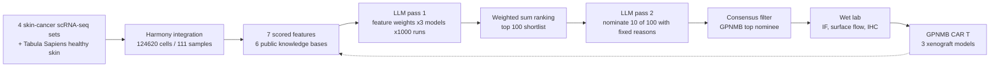

# AI-driven discovery of GPNMB CAR T cells as a multi-cancer therapy

> **Bibkey** `Baker_2026` · **Venue** Cell (2026) · **Category** agents · **Relevance** medium · **Access** paywall
> **Link** <https://doi.org/10.1016/j.cell.2026.06.002>
> `status: complete` — 精读基于 PMC 作者稿全文(PMC13428302),含 Results / Discussion / STAR Methods / 图注。
> Bilingual convention (drives the site's EN⇄中文 switcher): put `<!-- ZH -->` 中文 and `<!-- EN -->` English on their own lines (or inline `- <!-- ZH --> 中文 <!-- EN --> English`). Use `<!-- ZH/EN -->` ONLY for a purely language-neutral line (a bare URL or code token) — never for bilingual prose or labels.

---

## 一句话 / One-liner
<!-- ZH --> 把单细胞转录组图谱 + 六个公共知识库的"打分特征" + 三个 LLM 的加权与提名组合成一条可复现的靶点发现流水线,流水线选出的头号靶点 GPNMB 被做成 CAR T 细胞(一种把 T 细胞改造成"认准某个表面蛋白就杀"的活细胞药),并在白血病、黑色素瘤、结直肠癌三种小鼠移植瘤模型里显示强效抗肿瘤活性。
<!-- EN --> A reproducible target-discovery pipeline that combines a single-cell skin-cancer atlas, scored features from six public knowledge bases, and three LLMs (for feature weighting and for target nomination); its top-ranked target GPNMB was built into a CAR T cell (T cells engineered to kill whatever carries a chosen surface protein) that cleared tumours in mouse xenograft models of leukaemia, melanoma and colorectal cancer.

## 要点 / Takeaways
- <!-- ZH --> LLM 在这里**不**直接"想出"靶点:它只做两件窄任务——给 7 个人工定义的特征打权重(每模型 1000 次采样),以及从确定的 100 基因短名单里选 10 个并给出受限词表里的理由(每模型 1000 次)。 <!-- EN --> The LLMs do not invent targets: they do two narrow jobs — assign weights to 7 hand-defined features (1,000 samples per model) and pick 10 genes out of a fixed 100-gene shortlist with reasons drawn from a closed vocabulary (1,000 runs per model).
- <!-- ZH --> 三个模型(GPT-4o、Claude-3.7-Sonnet、Gemini-2.5-Pro)在"哪些特征重要"上收敛(cancer composition、细胞表面定位、重要器官低表达),在"为什么提名某个基因"上分歧明显(Supp Fig 2E)。 <!-- EN --> The three models (GPT-4o, Claude-3.7-Sonnet, Gemini-2.5-Pro) converge on which features matter (cancer composition, surface localisation, low vital-tissue expression) but diverge on the stated reason for nominating a gene (Supp Fig 2E).
- <!-- ZH --> 去掉专家先验权重后结果几乎不变(top-100 重叠 94/100,top-15 提名重叠 12/15),说明流水线对"有没有领域专家"不敏感。 <!-- EN --> Removing the expert prior weights barely changes the output (94/100 of the top 100 and 12/15 of the final nominees are shared), so the pipeline is robust to the absence of domain expertise.
- <!-- ZH --> 换成 bulk RNA-seq 输入则结果大变(top-100 只重叠 21/100,top-15 只重叠 2/15):TIGIT/CTLA4/CD83 在 bulk 里"富集",单细胞一看其实来自 T 细胞和髓系细胞——**分辨率就是正确性**。 <!-- EN --> Swapping in bulk RNA-seq changes the output drastically (only 21/100 and 2/15 shared): TIGIT, CTLA4 and CD83 look enriched in bulk but at single-cell resolution sit in T cells and myeloid cells — resolution is correctness here.
- <!-- ZH --> 计算结论做了正交湿实验验证:TCGA bulk、免疫荧光、非透膜流式(确认蛋白真的在细胞**表面**)、多器官 IHC,然后才做 CAR。 <!-- EN --> The computational call is validated orthogonally — TCGA bulk, immunofluorescence, non-permeabilised flow cytometry (proving the protein is really on the surface) and multi-organ IHC — before any CAR is built.
- <!-- ZH --> 这是 Sikander Hayat 组参与的工作(RWTH Aachen,通讯作者之一;Leon Frommer 为并列第二作者),代码在 `hayatlab/cart_llms`,是理解该组"LLM + 组学 → 靶点"方法论的最佳样本。 <!-- EN --> This is work co-authored (and co-corresponded) by Sikander Hayat's group at RWTH Aachen, with Leon Frommer as joint second author; the code lives at `hayatlab/cart_llms`, making it the best sample of the group's "LLM + omics → target" methodology.

## 研究问题 / Problem
<!-- ZH --> CAR T 已经在血液肿瘤里有治愈级疗效,并开始进入实体瘤和自身免疫病,但**靶点太少**是主要瓶颈(Introduction)。一个理想靶点要同时满足:在肿瘤细胞上高表达、在健康(尤其心/肺/脑等要害)组织上几乎不表达、位于细胞**表面**(CAR 只能识别表面蛋白)、并且最好已有临床级抗体可借用。传统做法是人工翻数据库逐条筛,慢、碎片化、带偏见(Discussion)。作者的问题是:能否把这个多目标权衡自动化、可复现、并且在没有资深专家时也能用?
<!-- EN --> CAR T therapy is curative in some blood cancers and is moving into solid tumours and autoimmune disease, but the scarcity of safe target antigens is the main bottleneck (Introduction). A good target must be high on tumour cells, near-absent in healthy — especially vital (lung, heart, brain) — tissue, located on the cell surface (a CAR can only see surface protein), and ideally already have a clinical-grade antibody to borrow. The classical workflow is manual database mining: slow, fragmented and bias-prone (Discussion). The question is whether this multi-objective trade-off can be automated, made reproducible, and made usable without deep domain expertise.

## 方法 / Method
<!-- ZH --> 作者称之为"三管齐下"(data integration / knowledge augmentation / LLM reasoning),再接湿实验验证(Fig 1A)。对 CS 读者逐步拆解:
<!-- EN --> The authors call it a three-pronged strategy — data integration, knowledge augmentation, LLM-based reasoning — followed by wet-lab validation (Fig 1A). Step by step, for a CS reader:

<!-- ZH --> **1. 建图谱(特征来源之一)。** 取 4 个公开皮肤癌 scRNA-seq 数据集(Biermann 2022、Ji 2020、Li 2019、Yost 2019;含基底细胞癌、鳞癌、不同阶段黑色素瘤及转移),基本质控后用 Harmony(以 sample ID 为 batch 变量做批次校正,相当于把不同实验的 embedding 对齐)整合,得到 285,557 cells / 91 samples。抽出标注为 malignant 的 106,834 个细胞,与 Tabula Sapiens 的健康皮肤细胞(17,786)再做一次 Harmony,得到最终 124,620 cells / 111 samples 的"恶性 + 健康"图谱(STAR Methods: Single-cell atlas construction)。
<!-- EN --> **1. Build the atlas.** Four public skin-cancer scRNA-seq datasets (Biermann 2022, Ji 2020, Li 2019, Yost 2019; basal-cell and squamous carcinoma plus melanoma at several stages, including metastases) are filtered and integrated with Harmony using sample ID as the batch variable (an embedding-alignment step across experiments), giving 285,557 cells from 91 samples. The 106,834 cells labelled malignant are pulled out and re-Harmonised together with 17,786 healthy skin cells from Tabula Sapiens, giving the final 124,620-cell / 111-sample malignant-plus-healthy atlas (STAR Methods, "Single-cell atlas construction").

<!-- ZH --> **2. 造 7 个确定性特征(没有 LLM 参与)。** 对每个基因程序化抓取 6 个公共资源:ClinicalTrials.gov API v2(2.15.0)、OpenTargets 25.03、GTEx v8 中位数、ProteomicsDB 1.1(OData)、Human Protein Atlas 24.0、UniProt 2025_02。得到:① clinical tractability(临床试验相位 6/5/4/3/2 分 + 状态 3/2/1/0 分 + 癌症相关 +10 + modality:抗体 10/小分子 5/PROTAC 等 1;每基因只留证据最强的一项试验,防止用大量弱试验刷分);② subcellular localization(HPA 与 UniProt 双证据一致=10、UniProt 确认 + HPA 预测=8、单一来源=7、仅 HPA 预测=5、其余=0);③ cancer composition:scanpy 归一化到每细胞 1e6 counts,算每个基因在 malignant / non-malignant 细胞中"表达 >0 的细胞百分比",各自跨基因取 Z-score,特征 = Z_malignant − Z_non-malignant;④⑤ GTEx 要害(lung/heart/brain)与非要害组织均值;⑥⑦ ProteomicsDB 蛋白在要害/非要害组织的 iBAQ 归一化强度均值。
<!-- EN --> **2. Compute 7 deterministic features (no LLM involved).** Six resources are scraped per gene: ClinicalTrials.gov API v2 (2.15.0), OpenTargets 25.03, GTEx v8 medians, ProteomicsDB 1.1 (OData), Human Protein Atlas 24.0, UniProt 2025_02. They yield: (i) clinical tractability (phase 6/5/4/3/2 points + status 3/2/1/0 + 10 for a cancer indication + modality 10 antibody / 5 small molecule / 1 PROTAC-other, keeping only the single strongest trial per gene so many weak trials cannot inflate the score); (ii) subcellular localisation (both HPA and UniProt call plasma membrane = 10, UniProt curated + HPA predicted = 8, one source only = 7, HPA prediction only = 5, else 0); (iii) cancer composition: scanpy-normalised to 1e6 counts per cell, the percentage of malignant and of non-malignant cells with expression > 0 per gene, each Z-scored across genes, feature = Z_malignant − Z_non-malignant; (iv–v) GTEx means over vital (lung, heart, brain) and non-vital tissues; (vi–vii) ProteomicsDB iBAQ-normalised protein intensity means over vital and non-vital tissues.

<!-- ZH --> **3. 归一化与聚合。** 每个特征跨基因 min–max 到 [0,1];"越低越好"的特征(GTEx bulk、ProteomicsDB 正常组织丰度)取反;重复基因取最大值;取所有基因集合的并集,缺失值补 0;最终分数 = 归一化特征的**加权和**(STAR Methods: Normalization and aggregation)。
<!-- EN --> **3. Normalise and aggregate.** Each feature is min–max scaled to [0,1] across genes; features where lower is better (GTEx bulk, ProteomicsDB normal-tissue abundance) are inverted; duplicates collapse by maximum; gene sets are unioned with missing values imputed as 0; the final score is the weighted sum of the normalised features (STAR Methods, "Normalization and aggregation").

<!-- ZH --> **4. 用 LLM 选权重(第一次用 LLM)。** 专家先从第一性原理给出 base weights:Clinical trials 1.0、HPA 2.0、Heatmap(单细胞 Z 差) 5.0、Vital 2.0、Non-vital 1.0、Protein vital 2.0、Protein non-vital 1.0。把 7 个特征定义 + 7 套候选权重方案(base、clinical-trials emphasis、HPA emphasis、heatmap emphasis、expression emphasis、balanced、equal)和各自产出的 top-100 基因列表一起放进一个固定 prompt,**强制以机器可读表头开头**("RECOMMENDED WEIGHTS: Clinical trials (X.X), …")。对 GPT-4o / Claude-3.7-Sonnet / Gemini-2.5-Pro 各跑 1000 次独立查询,temperature 在 0.70–0.85 之间循环;用分层 regex parser 解析权重(严格表头 → 加粗表头 → 逐标签宽松匹配,对 "Vital" 用负向回顾避免误抓 "Protein vital";恢复不足 4/7 个字段的运行不进统计)。为避免引导,**没有告诉模型哪一套是专家方案**,只叫它 base weight。聚合后做 per-feature ANOVA 比较模型间差异,并用 OLS + Benjamini–Hochberg FDR 检查 temperature 效应。
<!-- EN --> **4. LLM pass 1 — pick the weights.** Experts first set base weights from first principles: clinical trials 1.0, HPA 2.0, heatmap (single-cell Z difference) 5.0, vital 2.0, non-vital 1.0, protein vital 2.0, protein non-vital 1.0. A fixed prompt presents the 7 feature definitions plus 7 candidate weighting schemes (base, clinical-trials, HPA, heatmap, expression emphasis, balanced, equal) and the top-100 list each produces, and forces a machine-readable first line ("RECOMMENDED WEIGHTS: Clinical trials (X.X), …"). Each of GPT-4o, Claude-3.7-Sonnet and Gemini-2.5-Pro is queried 1,000 times with temperature cycling over 0.70–0.85; a tiered regex parser extracts the weights (strict header → bold header → per-label flexible match with a negative lookbehind on "Vital" so it cannot collide with "Protein vital"; runs recovering fewer than 4 of 7 fields are excluded from summaries). To avoid anchoring, the models are never told that one scheme came from experts — it is merely called the base weight. Aggregates are compared across models by per-feature ANOVA, and temperature effects checked by OLS with Benjamini–Hochberg FDR.

<!-- ZH --> **5. 用 LLM 提名(第二次用 LLM)。** 用共识权重排序,取 top-100 候选;再让每个模型跑 1000 次,从这 100 个基因里排序选出 10 个,输出必须是 `Rank, Gene, Description, Reason1..Reason5` 的 CSV,理由只能逐字取自 5 个预设短语(高肿瘤特异性表达 / 多癌种潜力 / 已有临床开发基础 / 要害组织低表达 / 覆盖显著患者亚群)。解析器优先吃代码块 CSV,其次宽松 CSV regex,最后在基因名前后约 300/700 字符窗口内匹配受限理由词;每个 run 内同一基因–理由只计一次,只取前 10 个唯一基因。最后**过滤**:只保留三个模型都至少提名过一次的基因,再按三模型总提名次数排序(STAR Methods: Target filtering and ranking)。
<!-- EN --> **5. LLM pass 2 — nominate the targets.** The consensus weights rank genes; the top 100 go forward. Each model is then run 1,000 times to rank-select 10 of those 100, output constrained to a `Rank, Gene, Description, Reason1..Reason5` CSV whose reasons must be verbatim from five preset phrases (high tumour-specific expression / multi-cancer utility / strong clinical development profile / minimal vital-tissue expression / significant patient subpopulations). The parser prefers a fenced CSV block, then a permissive CSV regex, then phrase matching in a ~300-upstream/700-downstream character window around each gene mention; a gene–reason pair counts once per run and only the first 10 unique genes are kept. Finally a filter keeps only genes nominated at least once by all three models, ranked by total nominations across models (STAR Methods, "Target filtering and ranking").

<!-- ZH --> **6. 鲁棒性与消融。** ① 再跑两轮,每模型累计 3,000 次独立模拟(Supp Fig 3N);② 去掉专家 base weights 重跑 1,000 次;③ 把单细胞 cancer-composition 特征换成 bulk:TCGA-SKCM 原发瘤 STAR counts 与 GTEx 日晒皮肤(小腿)counts 取交集(去 Ensembl 版本号,保留"≥10 reads 出现在 ≥10% 样本"的基因),DESeq2 1.46.0 做 Tumor vs Normal,把 log2FC 跨基因标准化成 Z-score 顶替原特征。
<!-- EN --> **6. Robustness and ablations.** (a) Two further iterations, 3,000 independent simulations per model in total (Supp Fig 3N); (b) the expert base weights removed and 1,000 runs repeated; (c) the single-cell cancer-composition feature replaced by bulk: TCGA-SKCM primary tumour STAR counts intersected with GTEx sun-exposed skin (lower leg) counts (Ensembl version suffixes stripped, genes kept at ≥10 reads in ≥10% of samples), DESeq2 1.46.0 for tumour vs normal, and the log2 fold-change Z-scored across genes in place of the original feature.

<!-- ZH --> **7. 湿实验验证链。** TCGA bulk 差异表达(GEPIA,one-way ANOVA)→ 4 个黑色素瘤细胞系免疫荧光 → **非透膜**流式(不打孔,只有真正在表面的蛋白才被抗体染到)→ 多器官组织微阵列 IHC(盲评 1–5 分强度)。
<!-- EN --> **7. Wet-lab validation chain.** TCGA bulk differential expression (GEPIA, one-way ANOVA) → immunofluorescence in four melanoma cell lines → non-permeabilised flow cytometry (no membrane holes, so only genuinely surface protein is stained) → multi-organ tissue-microarray IHC scored blind 1–5 for intensity.

<!-- ZH --> **8. 造 CAR 并做动物实验。** 取 CR011(全人源抗 GPNMB 抗体,专利 WO2010135547A1;即已进入临床的抗体偶联药物 glembatumumab vedotin 的结合域)的 VL/VH,用 (G4S)3 linker 连成 scFv,装进第二代 CAR 框架:Kozak + CD8α leader + CD8α hinge/跨膜 + 4-1BB 共刺激 + CD3ζ 信号域,克隆进 pTRPE 第三代自失活慢病毒载体。健康供者 CD4+/CD8+ T 细胞 1:1,CD3/CD28 磁珠激活,MOI 3–5 转导。体外测"激活—效应—杀伤"三件套(CTV 稀释测增殖、CBA 测细胞因子、流式/xCELLigence 实时阻抗测杀伤)。体内用 NSG 免疫缺陷小鼠:单核细胞白血病 1×10^5 U937 静脉注射,D-2 建模、D0 给 5×10^6 CAR T;实体瘤 5×10^5 SK-MEL-3(黑色素瘤)或 SNU-503(结直肠癌)皮下 + matrigel,长到约 100 mm³(= day 22)随机化,尾静脉给 4×10^6 CAR T;卡尺 V=(长×宽²)/2 测瘤,TruCount 流式数外周血人 CD45+ 细胞,Kaplan–Meier + log-rank 比生存。
<!-- EN --> **8. Build the CAR and test it in mice.** The VL/VH of CR011 — a fully human anti-GPNMB antibody (patent WO2010135547A1), the binding domain of the clinically tested antibody–drug conjugate glembatumumab vedotin — is joined by a (G4S)3 linker into an scFv and placed in a second-generation CAR: Kozak, CD8α leader, CD8α hinge and transmembrane, 4-1BB costimulation, CD3ζ signalling, cloned into pTRPE, a third-generation self-inactivating lentiviral vector. Healthy-donor CD4+/CD8+ T cells at 1:1 are activated with CD3/CD28 beads and transduced at MOI 3–5. In vitro the triad of activation, effector function and killing is measured (CTV dilution for proliferation, cytometric bead array for cytokines, flow and xCELLigence real-time impedance for lysis). In vivo, NSG immunodeficient mice: monoblastic leukaemia from 1×10^5 U937 cells i.v. on day −2 with 5×10^6 CAR T on day 0; solid tumours from 5×10^5 SK-MEL-3 (melanoma) or SNU-503 (colorectal) cells subcutaneously in matrigel, randomised when tumours reach ~100 mm³ (= day 22) and given 4×10^6 CAR T by tail vein; tumours by caliper as V = length × width² / 2, human CD45+ cells in blood by TruCount flow, survival by Kaplan–Meier with log-rank.

## 方法图 / Method diagram


## 数据 / Data
<!-- ZH --> **单细胞:** 4 个公开皮肤癌 scRNA-seq 数据集(GEO: GSE185386、GSE144240、GSE123139、GSE123814)+ Tabula Sapiens 正常皮肤(GEO: GSE201333);整合后 285,557 cells / 91 samples,最终工作图谱 124,620 cells / 111 samples(106,834 恶性 + 17,786 正常)(STAR Methods;Key Resource Table)。患者治疗史不一,有未治疗者,也有先接受过免疫治疗或靶向治疗者(Results §"Constructing a single-cell skin cancer…")。
<!-- EN --> **Single cell:** four public skin-cancer scRNA-seq datasets (GEO GSE185386, GSE144240, GSE123139, GSE123814) plus Tabula Sapiens normal skin (GEO GSE201333); 285,557 cells from 91 samples after integration, and a final working atlas of 124,620 cells from 111 samples (106,834 malignant + 17,786 normal) (STAR Methods; Key Resource Table). Treatment histories vary — some patients untreated, others previously given immunotherapy or targeted therapy (Results, "Constructing a single-cell skin cancer…").

<!-- ZH --> **知识库:** ClinicalTrials.gov API v2 (2.15.0)、OpenTargets release 25.03、GTEx v8 中位数(bulk vs sc 对比用 GTEx V10 日晒皮肤)、ProteomicsDB 1.1、HPA v24.0、UniProt release 2025_02。**bulk:** TCGA-SKCM(GDC)、GEPIA。**实验材料:** 11 条人源细胞系(SK-MEL-5/3/28、HT-144、A-375、U-937、NALM-6、THP-1、SW-156、SNU-503、KLM-1)、两张组织微阵列(MC5004b 多器官肿瘤 + 正常、BN1021a 9 系统 20 种正常组织)、2 位健康供者 T 细胞(ND607、ND657)、NSG 小鼠。
<!-- EN --> **Knowledge bases:** ClinicalTrials.gov API v2 (2.15.0), OpenTargets release 25.03, GTEx v8 medians (GTEx V10 sun-exposed skin for the bulk-vs-single-cell comparison), ProteomicsDB 1.1, HPA v24.0, UniProt release 2025_02. **Bulk:** TCGA-SKCM via GDC, and GEPIA. **Experimental material:** 11 human cell lines (SK-MEL-5/3/28, HT-144, A-375, U-937, NALM-6, THP-1, SW-156, SNU-503, KLM-1), two tissue microarrays (MC5004b multi-organ tumour plus normal, BN1021a 20 normal tissue types from 9 systems), T cells from two healthy donors (ND607, ND657) and NSG mice.

## 主要结果 / Key results
- <!-- ZH --> 三个 LLM 在特征重要性上收敛到 cancer composition、亚细胞定位、要害组织表达三项为主(Supp Fig 1E–H),由此定出复合打分系统(Fig 1E)。 <!-- EN --> The three LLMs converge on cancer composition, subcellular localisation and vital-tissue expression as the dominant features (Supp Fig 1E–H), fixing the composite scoring system (Fig 1E).
- <!-- ZH --> GPNMB 是**被提名次数最多**的靶点;它一贯因"肿瘤特异性"被选,同时在"多癌种潜力"上也有强信号。对照:PMEL 几乎总以肿瘤特异性为由被提名、极少以多癌种潜力;IGF1R 相反(Results §"Large language models reason-driven nomination";Fig 1F–G)。 <!-- EN --> GPNMB is the most frequently nominated target, consistently chosen for tumour specificity and also showing a strong multi-cancer-utility signal; by contrast PMEL is almost always nominated for tumour specificity and rarely for multi-cancer potential, while IGF1R is the reverse (Results, "Large language models reason-driven nomination"; Fig 1F–G).
- <!-- ZH --> 稳定性:再跑两轮,每模型累计 **3,000** 次独立模拟,结论不变(Supp Fig 3N)。 <!-- EN --> Stability: two further iterations, 3,000 independent simulations per model in total, leave the conclusion unchanged (Supp Fig 3N).
- <!-- ZH --> 去专家权重消融:top-100 中 **94/100** 重叠(Supp Fig 3B–C),最终 top-15 提名中 **12/15** 相同(Supp Fig 3D–F)。 <!-- EN --> Expert-weight ablation: 94 of the top 100 genes overlap (Supp Fig 3B–C) and 12 of the top 15 final nominees are shared (Supp Fig 3D–F).
- <!-- ZH --> bulk 替换 sc:top-100 只有 **21/100** 共享(Supp Fig 3H–I),top-15 只有 **2/15** 共享(Supp Fig 3J–L);bulk RNA-seq 中仅 **48.2%** 的转录本在整合 sc 图谱里有代表;bulk 的 top-15 里 TIGIT、CTLA4(实为 T 细胞)与 CD83(髓系细胞)在单细胞下暴露为假阳性(Supp Fig 3M)。 <!-- EN --> Bulk instead of single cell: only 21 of the top 100 are shared (Supp Fig 3H–I) and only 2 of the top 15 (Supp Fig 3J–L); only 48.2% of transcripts present in bulk RNA-seq are represented in the integrated single-cell atlas; and among the bulk top 15, TIGIT and CTLA4 (actually T cells) and CD83 (myeloid cells) are exposed as false positives at single-cell resolution (Supp Fig 3M).
- <!-- ZH --> 正交验证:GPNMB、ERBB3、IGF1R 在 TCGA 黑色素瘤中相对正常组织转录上调(Fig 1I,one-way ANOVA,*P<0.01);4 个黑色素瘤细胞系免疫荧光见膜与胞内信号(Fig 1J);非透膜流式确认三者在表面(Fig 1K)。 <!-- EN --> Orthogonal validation: GPNMB, ERBB3 and IGF1R are transcriptionally up in TCGA melanoma versus normal tissue (Fig 1I, one-way ANOVA, *P<0.01); immunofluorescence in four melanoma lines shows membrane and intracellular signal (Fig 1J); non-permeabilised flow confirms all three at the surface (Fig 1K).
- <!-- ZH --> GPNMB 跨癌种:TCGA bulk 中不只黑色素瘤(SKCM),胆管癌、DLBCL、GBM、头颈鳞癌、**肾嫌色细胞癌 KICH、肾乳状细胞癌 KIRP**、肝癌、肺鳞癌、胰腺癌、胃癌、睾丸生殖细胞瘤、胸腺瘤均显著富集(Fig 2A);患者活检 IHC 蛋白层面一致,多数黑色素瘤样本强染,其他癌种强度不一,健康组织普遍低或无表达(Fig 2B,Supp Fig 5A)。 <!-- EN --> GPNMB across cancers: in TCGA bulk it is significantly enriched not only in melanoma (SKCM) but in cholangiocarcinoma, DLBCL, glioblastoma, head-and-neck squamous carcinoma, kidney chromophobe (KICH), kidney renal papillary carcinoma (KIRP), liver, lung squamous, pancreatic, stomach, testicular germ-cell tumours and thymoma (Fig 2A); patient-biopsy IHC agrees at protein level, with most melanoma samples staining strongly, a range of intensities in other cancers, and low or absent expression across healthy tissues (Fig 2B, Supp Fig 5A).
- <!-- ZH --> CAR 功能特异性:GPNMB CAR T 只在与 GPNMB+ 肿瘤细胞共培养时增殖并显著分泌 IFN-γ,对抗原阴性的 B-ALL 无反应(Fig 2F–H);杀伤同样抗原依赖(Fig 2I,****P<0.0001)。 <!-- EN --> CAR specificity: GPNMB CAR T cells proliferate and secrete IFN-γ only against GPNMB+ tumour cells and ignore antigen-negative B-ALL (Fig 2F–H); killing is likewise antigen-dependent (Fig 2I, ****P<0.0001).
- <!-- ZH --> 白血病模型:输注后第 13 天外周血人 CD45+ 细胞显著扩增(Fig 2K,n=14–15/组,Mann–Whitney,****P<0.0001);对照 T 细胞组数周内达人道终点,CAR T 组存活数月且无疾病征象(Fig 2L,n=15 CAR vs 14 对照,log-rank,****P<0.0001),体重稳定(Supp Fig 5E)。 <!-- EN --> Leukaemia model: human CD45+ cells expand significantly in blood by day 13 (Fig 2K, n=14–15 per cohort, Mann–Whitney, ****P<0.0001); control-T mice reach humane endpoints within weeks while CAR T mice survive for months without signs of disease (Fig 2L, n=15 CAR T vs 14 control, log-rank, ****P<0.0001), with stable body weight (Supp Fig 5E).
- <!-- ZH --> 黑色素瘤模型(SK-MEL-3):day 21 人 T 细胞显著扩增(Fig 3C,n=10/组,****P<0.0001)、血清细胞因子升高(Fig 3D);瘤体显著缩小且**多数**小鼠完全缓解(Fig 3E,n=16 CAR vs 14 对照,two-way ANOVA,****P<0.0001),生存显著改善(Fig 3F,log-rank,****P<0.0001)。 <!-- EN --> Melanoma model (SK-MEL-3): significant human T-cell expansion at day 21 (Fig 3C, n=10 per cohort, ****P<0.0001) and raised serum cytokines (Fig 3D); tumour volume drops sharply with complete remission in the majority of mice (Fig 3E, n=16 CAR T vs 14 control, two-way ANOVA, ****P<0.0001) and survival improves significantly (Fig 3F, log-rank, ****P<0.0001).
- <!-- ZH --> 结直肠癌模型(SNU-503):**全部**小鼠完全缓解(Fig 3K,n=16 vs 14,****P<0.0001),生存显著改善(Fig 3L);体外对结直肠、胰腺、**肾癌**来源细胞均见抗原依赖杀伤(Fig 3G)。 <!-- EN --> Colorectal model (SNU-503): all mice achieve complete remission (Fig 3K, n=16 vs 14, ****P<0.0001) with significantly better survival (Fig 3L); in vitro, antigen-dependent lysis is seen against colorectal, pancreatic and renal cancer-derived cells (Fig 3G).
- <!-- ZH --> 模型间差异:黑色素瘤队列有少数小鼠复发,结直肠队列无复发;剂量相同,但结直肠模型 day 21 的 T 细胞扩增明显更强且外周血 CD8+ 偏移明显(Fig 3C,I;Supp Fig 6F),作者推测是肿瘤内在因素塑造了 CAR T 扩增(Results 末段)。 <!-- EN --> Between-model difference: a small minority of melanoma mice relapse while no colorectal mice do; at identical dosing the colorectal model shows markedly greater day-21 T-cell expansion with a pronounced CD8+ skew (Fig 3C, I; Supp Fig 6F), which the authors read as tumour-intrinsic factors shaping CAR T expansion (end of Results).

## 创新点 / Contributions
- <!-- ZH --> 把 LLM 放在**受约束的位置**上(给人工定义特征配权重、从固定短名单里选并给受限理由),而不是让它自由生成靶点——作者明说"把模型接到真实数据和公共知识上可能是降低幻觉风险的途径"(Discussion)。 <!-- EN --> It puts the LLM in constrained slots — weighting hand-defined features and selecting from a fixed shortlist with a closed reason vocabulary — instead of letting it free-generate targets; the authors state that grounding models in real data and public knowledge may be a way to reduce hallucination risk (Discussion).
- <!-- ZH --> 用**采样分布**而不是单次回答:每模型 1000(累计 3000)次独立运行,把提名频次和理由分布当作统计量,配 ANOVA / 温度回归 / FDR 校正做审计。 <!-- EN --> It treats the LLM as a sampling distribution rather than a single answer: 1,000 (cumulatively 3,000) independent runs per model, with nomination frequency and reason distributions as statistics, audited by ANOVA, temperature regressions and FDR correction.
- <!-- ZH --> 跨模型共识过滤(只留三模型都提名过的基因)+ 理由分歧分析,把"模型间一致性"变成可报告指标。 <!-- EN --> Cross-model consensus filtering (only genes nominated by all three models) plus analysis of reason divergence turns inter-model agreement into a reportable metric.
- <!-- ZH --> 两个有价值的消融:领域专家先验几乎不影响结果;**输入分辨率**(sc vs bulk)严重影响结果,并给出了假阳性的机制性解释。 <!-- EN --> Two valuable ablations: the expert prior barely matters, while input resolution (single-cell vs bulk) matters a lot, with a mechanistic explanation of the false positives.
- <!-- ZH --> 从计算提名一路做到湿实验与体内疗效的**闭环**,并借用已有临床级抗体结合域降低转化风险。 <!-- EN --> It closes the loop from computational nomination through wet-lab validation to in vivo efficacy, de-risking translation by reusing an already clinically tested antibody binding domain.
- <!-- ZH --> 作者自述这是 LLM 首次用于 CAR T 领域的工作之一(Discussion),代码与整合数据公开。 <!-- EN --> The authors describe it as one of the first uses of LLMs in the CAR T field (Discussion), with code and the integrated data released.

## 局限 / Limitations
- <!-- ZH --> 作者自述:实验全在免疫缺陷 xenograft 小鼠中完成,无法评估 T 细胞外在机制、肿瘤微环境影响和 on-target/off-tumor 毒性(Limitations of the study)。 <!-- EN --> Authors' own: everything is done in immunodeficient xenograft mice, which cannot assess T-cell-extrinsic mechanisms, microenvironmental influences or on-target/off-tumour toxicity (Limitations of the study).
- <!-- ZH --> 作者自述:该 CAR 只认人 GPNMB、不认小鼠 GPNMB,因此无法在小鼠组织里直接做安全性测试(只能靠人健康器官 IHC 显示要害组织低表达)。 <!-- EN --> Authors' own: the CAR recognises human but not murine GPNMB, so safety cannot be tested directly in mouse tissue (only human healthy-organ IHC showing low vital-tissue expression).
- <!-- ZH --> 作者自述:复发的黑色素瘤肿瘤未能取到做机制分析;白血病监测只看外周血,而血中并未检出循环肿瘤细胞。 <!-- EN --> Authors' own: recurrent melanoma tumours were unavailable for mechanistic analysis, and leukaemia monitoring was confined to peripheral blood, where no circulating tumour cells were detected.
- <!-- ZH --> 作者自述:发现阶段的打分受限于当前单细胞分辨率研究的数量,样本更多会更好。 <!-- EN --> Authors' own: discovery-stage scoring is limited by the number of studies currently available at single-cell resolution and would benefit from more samples.
- <!-- ZH --> 作者自述:为跨模型可比,prompt 用了通用结构,可能低估了针对单个模型优化 prompt 能带来的提升。 <!-- EN --> Authors' own: a generalised prompt structure was used for cross-model applicability, which may underrepresent gains from model-specific prompt optimisation.
- <!-- ZH --> 我们的理解:LLM 的"自由度"其实很窄——特征集、7 套候选权重、100 基因短名单、5 条理由都是人定的,因此"LLM 发现了靶点"更准确地说是"LLM 做了一次有先验的多目标加权投票";真正决定 GPNMB 胜出的是特征工程(尤其 cancer-composition Z 差)。 <!-- EN --> Our reading: the LLM's degrees of freedom are narrow — the feature set, the 7 candidate weightings, the 100-gene shortlist and the 5 reasons are all human-set, so "the LLM discovered the target" is more precisely "the LLM cast a prior-informed multi-objective weighted vote"; what really decides GPNMB is the feature engineering, especially the cancer-composition Z difference.
- <!-- ZH --> 我们的理解:缺少与简单基线的对比(例如直接用专家 base weights 排序、或不用 LLM 的随机/均匀权重 ensemble),所以无法量化 LLM 这一步本身的增益;消融其实暗示增益有限(去专家权重后 94/100 不变)。 <!-- EN --> Our reading: there is no comparison with a simple baseline (ranking by the expert base weights alone, or an LLM-free random/uniform weight ensemble), so the gain attributable to the LLM step is unquantified; the ablation hints it is small (94/100 unchanged without expert weights).
- <!-- ZH --> 我们的理解:三个模型的"共识"不是独立证据——它们的训练语料高度重叠,GPNMB 与 glembatumumab vedotin 的文献早已公开,所以共识可能部分来自共享的文献先验而非独立推理。 <!-- EN --> Our reading: consensus across three models is not independent evidence — their training corpora overlap heavily and the GPNMB / glembatumumab vedotin literature was already public, so agreement may partly reflect a shared literature prior rather than independent reasoning.
- <!-- ZH --> 我们的理解:GPNMB 在 Fig 2A 中于 KICH/KIRP 两种肾癌显著富集,而 GPNMB 也是肾脏/巨噬细胞损伤反应中常被提到的基因;"健康组织低表达"的结论来自 GTEx / ProteomicsDB / 多器官 IHC 的**正常**组织,**未**涵盖病变(如纤维化/损伤)肾脏,这对我们的肾脏方向是需要自己核查的空白。 <!-- EN --> Our reading: GPNMB is significantly enriched in both kidney cancers (KICH, KIRP) in Fig 2A, and the "low in healthy tissue" conclusion rests on normal tissue in GTEx, ProteomicsDB and multi-organ IHC — it does not cover diseased (for example fibrotic or injured) kidney, a gap we would have to check ourselves for our kidney direction.

## 与本研究方向的关系 / Relation to our direction
<!-- ZH --> 这篇是 detect → model → **revert** 三段里最靠 revert 的一端:它要回答的正是"选哪个分子去干预"。它跳过了 virtual tissue 的建模环节,用的是"富集打分 + 可干预性约束 + LLM 加权投票"这种更轻量的替代。
<!-- EN --> This sits at the revert end of our detect → model → revert pipeline: it answers exactly the question of which molecule to intervene on. It skips the virtual-tissue modelling stage, substituting a lighter route — enrichment scoring plus tractability constraints plus an LLM-weighted vote.

<!-- ZH --> 我们的理解:三点最可借用。① **cancer composition Z 差**与我们做的异常检测在形式上同构:Z_malignant − Z_non-malignant 本质是"在一个细胞群里异常高表达、在参考群里不高"的对比统计量——换成 Z_disease − Z_reference 就直接变成肾脏 snRNA/Xenium 的候选 driver 排序器,可作为 Topic 1 里 reference-based 异常评分的朴素基线。② **可干预性约束层**(表面定位、要害组织低表达、已有临床抗体)正是我们的 revert 端缺的那一层:异常检测给出"哪里/哪些基因变了",这篇给出"其中哪些能真被做成药";把它换成肾脏版(肾小管/足细胞特异、肾外低表达、已有药物)就是一个可直接落地的筛选器。③ **把 LLM 当分布来审计**的做法(1000 次采样、受限输出词表、分层 parser、ANOVA/FDR、跨模型共识过滤)是 Topic 2 "验证生物医学 agent 声明"的现成评测骨架,尤其"理由分布分歧大而结论一致"这一观察,正好是 agent 可信度研究要刻画的现象。
<!-- EN --> Our reading: three things are directly reusable. (1) The cancer-composition Z difference is formally the same object as our anomaly scores: Z_malignant − Z_non-malignant is a contrast statistic for "unusually high in one population, not high in the reference", so Z_disease − Z_reference gives a candidate-driver ranker for kidney snRNA or Xenium and can serve as a naive reference-based anomaly baseline in Topic 1. (2) The tractability constraint layer (surface localisation, low vital-tissue expression, existing clinical antibody) is exactly the layer our revert end lacks: anomaly detection says which genes or regions changed, this paper says which of them can actually be made into a drug; a kidney version (tubule- or podocyte-specific, low outside kidney, existing agent) would be an immediately usable filter. (3) Auditing an LLM as a distribution (1,000 samples, a closed output vocabulary, a tiered parser, ANOVA/FDR, cross-model consensus filtering) is a ready-made evaluation skeleton for Topic 2's verification of biomedical-agent claims — and the observation that the stated reasons diverge while the conclusion agrees is precisely the phenomenon agent-trustworthiness work needs to characterise.

<!-- ZH --> 我们的理解:对实验室关系也有现实意义——这是 Sikander 自己团队参与的工作(他为通讯作者之一,组内 Leon Frommer 为并列第二作者,计算部分代码在 `hayatlab/cart_llms`),所以它既是"他期待的工作方式"的样本,也是 Topic 2 能直接接上去的内部项目。
<!-- EN --> Our reading: it also matters practically — this is work from Sikander's own team (he is a co-corresponding author, his lab member Leon Frommer is joint second author, and the computational code sits in `hayatlab/cart_llms`), so it is both a sample of the working style he expects and an internal project Topic 2 could plug straight into.

## 可复用资产 / Reusable assets
- <!-- ZH --> **代码:** <https://github.com/hayatlab/cart_llms> (STAR Methods "Data and code availability" 与 Key Resource Table 均列出) <!-- EN --> **Code:** <https://github.com/hayatlab/cart_llms> (listed in STAR Methods "Data and code availability" and the Key Resource Table)
- <!-- ZH --> **数据:** 整合后的皮肤癌数据集见 Zenodo <https://zenodo.org/records/19071268>;原始数据 GEO GSE185386 / GSE144240 / GSE123139 / GSE123814,正常皮肤 GSE201333;bulk 来自 TCGA (GDC) 与 GTEx。 <!-- EN --> **Data:** the integrated skin-cancer dataset at Zenodo <https://zenodo.org/records/19071268>; raw data at GEO GSE185386 / GSE144240 / GSE123139 / GSE123814 and normal skin GSE201333; bulk from TCGA (GDC) and GTEx.
- <!-- ZH --> **模型 / 提示:** 无模型 checkpoint(用的是商用 API:gpt-4o、claude-3-7-sonnet-20250219、gemini-2.5-pro-preview-03-25);但 STAR Methods 逐字给出了四个完整 prompt(含专家权重版、去专家权重版、zero-shot 版、bulk 版)与 5 条受限理由词表,可直接复用。 <!-- EN --> **Checkpoints / prompts:** no model checkpoints (commercial APIs: gpt-4o, claude-3-7-sonnet-20250219, gemini-2.5-pro-preview-03-25); but the STAR Methods print all four prompts verbatim (expert-weight, no-expert-weight, zero-shot and bulk versions) plus the five-phrase reason vocabulary, which can be reused directly.

## 待读 / Follow-ups
- <!-- ZH --> 读 `hayatlab/cart_llms` 源码,确认特征归一化、缺失值补 0 的影响,以及"共识过滤"的具体实现。 <!-- EN --> Read the `hayatlab/cart_llms` source to check feature normalisation, the effect of imputing missing values as 0, and how consensus filtering is actually implemented.
- <!-- ZH --> 参考文献 43:Zemp 等,"Development and first-in-human CAR T therapy against the pathognomonic MiT-fusion driven protein GPNMB", medRxiv 2025, doi 10.1101/2025.02.26.24319604 —— 腺泡状软组织肉瘤患者的首次人体 GPNMB CAR T 病例报告,作者称见到活性且无严重毒性。 <!-- EN --> Reference 43: Zemp et al., "Development and first-in-human CAR T therapy against the pathognomonic MiT-fusion driven protein GPNMB", medRxiv 2025, doi 10.1101/2025.02.26.24319604 — a first-in-human GPNMB CAR T case report in alveolar soft part sarcoma, reported as showing activity without severe toxicity.
- <!-- ZH --> Discussion 提到的 MiT/TFE 转录因子家族与 CLEAR 网络(溶酶体生物合成与自噬)可能解释 GPNMB 的广谱表达 —— 值得顺着查,因为这也牵连肾脏损伤反应。 <!-- EN --> The MiT/TFE transcription-factor family and the CLEAR network (lysosomal biogenesis and autophagy) raised in the Discussion as a possible explanation for GPNMB's broad expression — worth following, as it also touches kidney injury responses.
- <!-- ZH --> 自查:GPNMB 在**病变**肾脏(纤维化、AKI、CKD)单细胞数据中的表达,以及它在巨噬细胞中的分布,以判断"要害组织低表达"结论能否迁移到肾脏场景。 <!-- EN --> Check ourselves: GPNMB expression in diseased kidney single-cell data (fibrosis, AKI, CKD) and its distribution in macrophages, to judge whether the "low in vital tissue" conclusion transfers to the kidney setting.
- <!-- ZH --> 与 `biomni-biorxiv-2025`、`virtual-biotech-biorxiv-2026` 对照:三者都在"LLM 选靶点",但自由度从本文(最受约束)到 Virtual Biotech(多 agent 自主)递增,正好是 Topic 2 的一条谱。 <!-- EN --> Compare with `biomni-biorxiv-2025` and `virtual-biotech-biorxiv-2026`: all three have an LLM choosing targets, but autonomy increases from this paper (most constrained) to the Virtual Biotech (autonomous multi-agent) — a useful spectrum for Topic 2.

## 引用 / Cite
```bibtex
@article{Baker_2026, title={AI-driven discovery of GPNMB CAR T cells as a multi-cancer therapy}, volume={189}, ISSN={0092-8674}, url={http://dx.doi.org/10.1016/j.cell.2026.06.002}, DOI={10.1016/j.cell.2026.06.002}, number={13}, journal={Cell}, publisher={Elsevier BV}, author={Baker, Daniel J. and Frommer, Leon M. and Uslu, Ugur and Patel, Kisha K. and Zhu, Daniel and Engel, Nils W. and George, James M. and Zhao, Wencao and Kim, Samuel I. and Sun, Lisa and Roselle, Christopher and Rommel, Philipp C. and Young, Regina M. and Epstein, Jonathan A. and Hayat, Sikander and Arany, Zoltan and June, Carl H.}, year={2026}, month=June, pages={3871–3882.e12} }
```
