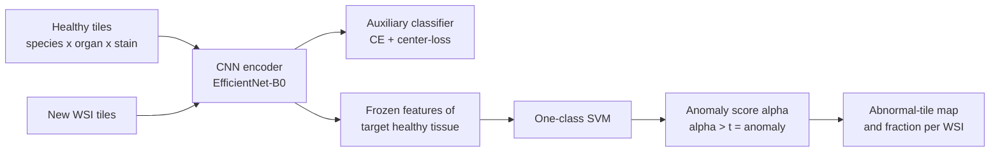

# Boehringer-Ingelheim/anomaly-detection-in-histology

> **Bibkey** `histo-anomaly-bi-repo` · **Venue** GitHub (2022) · **Category** histopath · **Relevance** medium · **Access** open
> **Link** <https://github.com/Boehringer-Ingelheim/anomaly-detection-in-histology>
> `status: complete` — 本页只基于仓库 README 及其中两张图(`docs/Scheme_extended.png`、`docs/tox_pattern.png`),未精读配套论文。/ Based only on the repository README and its two figures; the companion paper was not read here.

---

## 一句话 / One-liner
<!-- ZH --> Boehringer Ingelheim 的 PyTorch 代码库:先在多物种、多器官、两种染色的**健康**组织上训练 CNN(辅助分类任务 + center-loss),再在目标组织的健康特征上训练 one-class SVM,用来在全切片中找出药物引起的组织病理改变;配套论文为 Zingman et al., *Medical Image Analysis* 2024。
<!-- EN --> A PyTorch repository from Boehringer Ingelheim: a CNN is trained on **healthy** tissue from several species, organs and two stains (auxiliary classification + center-loss), then a one-class SVM is fit on healthy features of the target tissue to find drug-induced histological alterations in whole-slide images; companion paper: Zingman et al., *Medical Image Analysis* 2024.

## 要点 / Takeaways
- <!-- ZH --> 两步法:第 1 步学表征(区分"物种-器官-染色"类别,交叉熵 + center-loss),第 2 步冻结编码器、只用目标组织的健康图块训练 one-class SVM(README 图 Scheme_extended)。 <!-- EN --> Two steps: (1) learn representations by classifying species-organ-stain categories with cross-entropy + center-loss; (2) freeze the encoder and fit a one-class SVM on healthy tiles of the target tissue only (README figure Scheme_extended).
- <!-- ZH --> 评测任务:正常小鼠肝 vs 非酒精性脂肪肝(NAFLD)小鼠肝;README 给出 H&E AU-ROC 97.33%、Masson 三色染色 AU-ROC 99.03%(README 表)。 <!-- EN --> Evaluation: normal mouse liver vs mouse liver with non-alcoholic fatty liver disease (NAFLD); the README reports AU-ROC 97.33% (H&E) and 99.03% (Masson's Trichrome) (README table).
- <!-- ZH --> 应用示例:小鼠服用一种已知有毒的实验化合物后,"异常图块比例"随剂量升高(README 图 tox_pattern)。 <!-- EN --> Application example: after mice receive an experimental compound known to be toxic, the fraction of abnormal tiles rises with dose (README figure tox_pattern).
- <!-- ZH --> 训练数据、评测数据和预训练模型(CNN `.pt` + one-class SVM `.pkl`)都在 OSF 公开(<https://osf.io/gqutd/>),代码 MIT 许可。 <!-- EN --> Training data, evaluation data and pretrained models (CNN `.pt` + one-class SVM `.pkl`) are public on OSF (<https://osf.io/gqutd/>); code is MIT-licensed.
- <!-- ZH --> 我们的理解:训练集里就有小鼠肾脏(H&E 与 Masson 两种),所以这个预训练 CNN 可以直接拿来给肾脏切片提特征做 one-class 基线。 <!-- EN --> Our reading: the training set already includes mouse kidney (H&E and Masson), so the pretrained CNN can be tried directly as a feature extractor for a one-class kidney baseline.

## 研究问题 / Problem
<!-- ZH --> README 的说法:论文提出一种在染色组织全切片(WSI)中做异常检测的方法,用来**常规筛查**组织病理数据中的异常改变(README 开头)。应用场景是药物开发中的毒性评估:动物服药后,病理学家要找出组织里由药物引起的改变(README 图注)。我们的理解:这类改变种类多、事先不知道会是什么,难以为每一种收集标注,所以只学"正常"是自然的选择。
<!-- EN --> In the README's words, the paper develops anomaly detection for whole-slide images (WSIs) of stained tissue in order to **routinely screen** histopathology data for abnormal alterations (README intro). The setting is toxicity assessment in drug development: after dosing, pathologists must find compound-induced tissue changes (README figure caption). Our reading: such changes are diverse and not known in advance, so labelling each kind is impractical, which is why learning only "normal" is attractive.

## 方法 / Method
<!-- ZH --> 1. **输入**:健康组织图块,来自小鼠(脑、心、肾、肝、肺、胰、脾)和大鼠(肝),每种都有 H&E 和 Masson 三色(Masson's Trichrome,一种把胶原纤维染成蓝/绿色的染色)两个版本(README 数据目录结构)。
<!-- ZH --> 2. **第 1 步 表征学习**:CNN 编码器做辅助分类,类别是"物种 + 器官 + 染色"组合(如 Mouse, liver, H&E);训练时用 class mix-up 颜色增强;损失 = 交叉熵 + λ·center-loss,使每类特征聚成紧致的簇(README 图 Scheme_extended A)。按染色分别训练(`configs/cfg_training_cnn.py` 中 `data_staining` = `HE` 或 `Masson`)(README Training)。
<!-- ZH --> 3. **骨干**:预训练模型文件名为 `EfficientNet_B0_320_...`,即 EfficientNet-B0(我们的理解:320 应是输入尺寸,README 未明说)(README)。
<!-- ZH --> 4. **第 2 步 one-class 分类器**:冻结编码器,用目标类别(如小鼠肝)健康图块的特征训练 one-class SVM,在特征空间围出"正常"区域(README 图 B;`anomaly_detector.py`)。
<!-- ZH --> 5. **推理**:WSI 切成图块 → 冻结 CNN 提特征 → 冻结 one-class SVM 给出异常分 α → α > t 判为异常,在整张切片上标出异常图块(README 图 C)。
<!-- ZH --> 6. **评估**:在 NAFLD 测试集上报告平衡准确率、AU-ROC、F1;README 还说明了如何在同一数据上跑 Anomalib 中的方法和 DPA 作对比(README Evaluation)。
<!-- EN --> 1. **Input**: healthy tissue tiles from mouse (brain, heart, kidney, liver, lung, pancreas, spleen) and rat (liver), each in H&E and Masson's Trichrome (a stain that colours collagen fibres blue/green) (README data folder tree).
<!-- EN --> 2. **Step 1, representation learning**: a CNN encoder solves an auxiliary classification over species + organ + stain categories (e.g. Mouse, liver, H&E), with class mix-up colour augmentation and loss = cross-entropy + λ·center-loss, which yields compact per-class feature clusters (README figure Scheme_extended A). One model per stain (`data_staining` = `HE` or `Masson` in `configs/cfg_training_cnn.py`) (README Training).
<!-- EN --> 3. **Backbone**: pretrained files are named `EfficientNet_B0_320_...`, i.e. EfficientNet-B0 (our reading: 320 is likely the input size; the README does not say) (README).
<!-- EN --> 4. **Step 2, one-class classifier**: with the encoder frozen, a one-class SVM is fit on features of healthy tiles of the target category (e.g. mouse liver), enclosing the "normal" region of feature space (README figure B; `anomaly_detector.py`).
<!-- EN --> 5. **Inference**: WSI → tiles → frozen CNN features → frozen one-class SVM score α → anomaly if α > t, giving a map of abnormal tiles over the slide (README figure C).
<!-- EN --> 6. **Evaluation**: balanced accuracy, AU-ROC and F1 on the NAFLD test set; the README also explains how to run Anomalib methods and DPA on the same data for comparison (README Evaluation).

## 方法图 / Method diagram


## 数据 / Data
<!-- ZH --> 全部在 OSF(<https://osf.io/gqutd/>)。**训练集**(`data/train/`):16 个文件夹 = 小鼠 7 个器官 × 2 种染色 + 大鼠肝 × 2 种染色,只含正常组织。**评测集**(`data/test/`):正常小鼠肝 vs NAFLD 小鼠肝,H&E 与 Masson 各一套。另有 `trained models/` 文件夹放预训练 CNN 和 one-class SVM(README "Setting up dataset")。README 没有给出图块数量或切片数量。
<!-- EN --> Everything is on OSF (<https://osf.io/gqutd/>). **Training** (`data/train/`): 16 folders = 7 mouse organs × 2 stains + rat liver × 2 stains, normal tissue only. **Evaluation** (`data/test/`): normal vs NAFLD mouse liver, one set each for H&E and Masson. A `trained models/` folder holds the pretrained CNNs and one-class SVMs (README "Setting up dataset"). The README gives no tile or slide counts.

## 主要结果 / Key results
<!-- ZH --> README 只给出一个结果表("Expected performance of anomaly detection with BIHN models")和一个应用示例图;论文中的基线对比和消融未在此核对。
<!-- EN --> The README gives one results table ("Expected performance of anomaly detection with BIHN models") and one application figure; baseline comparisons and ablations in the paper were not checked here.
- <!-- ZH --> **H&E**:平衡准确率 94.20%、AU-ROC 97.33%、F1 94.09%(README 表)。 <!-- EN --> **H&E**: balanced accuracy 94.20%, AU-ROC 97.33%, F1 94.09% (README table).
- <!-- ZH --> **Masson 三色**:平衡准确率 97.51%、AU-ROC 99.03%、F1 97.51%(README 表)。 <!-- EN --> **Masson's Trichrome**: balanced accuracy 97.51%, AU-ROC 99.03%, F1 97.51% (README table).
- <!-- ZH --> **毒性筛查示例**:小鼠肝中"异常图块比例"随实验化合物剂量(对照 / 低 / 中 / 高)升高,星号表示与对照组均值相比有统计显著差异;对照组中血液等非病理结构造成少量假阳性;处理组中的检出经病理学家确认为病理改变(README 图 tox_pattern A–B)。 <!-- EN --> **Toxicity example**: in mouse liver the fraction of abnormal tiles rises with compound dose (control / low / mid / high), stars mark significance vs the control mean; in controls, blood and a few other non-pathological structures cause some false positives; detections in treated groups were confirmed as pathological by a pathologist (README figure tox_pattern A–B).
- <!-- ZH --> 预训练 CNN 文件名中带有 `acc0.9762`(H&E)和 `acc0.9755`(Masson)。我们的理解:这应是辅助分类任务的准确率,不是异常检测指标;README 未解释。 <!-- EN --> The pretrained CNN filenames contain `acc0.9762` (H&E) and `acc0.9755` (Masson). Our reading: this is likely auxiliary-classification accuracy, not an anomaly-detection metric; the README does not explain it.

## 创新点 / Contributions
- <!-- ZH --> 用"物种-器官-染色"这样的现成类别做辅助任务来学适合异常检测的表征,而不是用病变标注(README 图 A)。 <!-- EN --> Uses readily available species-organ-stain categories as an auxiliary task to learn anomaly-friendly representations, instead of lesion labels (README figure A).
- <!-- ZH --> center-loss 让同类特征更紧致,再接 one-class SVM(README 图 A–B)。 <!-- EN --> Center-loss makes same-class features compact, followed by a one-class SVM (README figures A–B).
- <!-- ZH --> 公开了带 NAFLD 病变的评测数据集、训练数据和预训练模型,并给出与 Anomalib、DPA 对比的说明(README)。 <!-- EN --> Releases an evaluation dataset with NAFLD pathology, the training data and pretrained models, plus instructions for comparing against Anomalib and DPA (README).
- <!-- ZH --> 第三方评价:Dippel et al. 2024(本库 `histo-nejmai-2024`,App. A.3)指出该工作同样用到其他组织类型(肝、脑、肾、心、肺、胰、脾),但用它们来优化表征后再接 one-class 分类器,与 Outlier Exposure 不同。 <!-- EN --> Third-party view: Dippel et al. 2024 (this library's `histo-nejmai-2024`, App. A.3) notes that this work also uses other tissue types (liver, brain, kidney, heart, lung, pancreas, spleen), but to optimise representations followed by a one-class classifier, which differs from Outlier Exposure.

## 局限 / Limitations
- <!-- ZH --> README 只报告了一个评测任务(小鼠肝 NAFLD)和一个毒性示例(小鼠肝);其他器官、其他病变未展示。 <!-- EN --> The README reports one benchmark (mouse liver NAFLD) and one toxicity example (mouse liver); other organs and lesions are not shown.
- <!-- ZH --> 只有啮齿类动物、两种染色;没有人类组织。 <!-- EN --> Rodents and two stains only; no human tissue.
- <!-- ZH --> 我们的理解:输出是图块级的"是否异常",没有类型、严重程度或分子层面的解释。 <!-- EN --> Our reading: the output is a tile-level abnormal / normal call, with no type, severity or molecular explanation.
- <!-- ZH --> 我们的理解:对照组中血液等结构会被判为异常(README 图注),说明"正常"训练集如果没覆盖某些正常结构就会产生假阳性。 <!-- EN --> Our reading: blood and similar structures are flagged in controls (README caption), i.e. any normal structure missing from the healthy training set becomes a false positive.
- <!-- ZH --> 本页未读配套论文,论文中的基线对比、消融、数据规模均未核实。 <!-- EN --> The companion paper was not read here; its baselines, ablations and data sizes are unverified.

## 与本研究方向的关系 / Relation to our direction
<!-- ZH --> 这是 pipeline 第一环(detect)在**药物扰动**场景下的直接例子:只学健康组织,找出药物造成的改变,并能看到剂量-反应关系——正好是"检测因疾病或药物扰动而改变的区域"。我们的理解:对课题 1 有三点用处。(1) 训练集含小鼠肾(H&E 与 Masson),公开的 CNN 可直接作为肾脏切片的特征提取器,搭一个"冻结特征 + one-class SVM"的弱基线;(2) "用元数据类别(物种 / 器官 / 染色)做辅助任务"可以类比到组学:用供体、组织部位、测序批次等现成标签学表征,再在健康参考上做 one-class;(3) "异常图块比例随剂量上升"是一种不需要逐区域标注的验证方式,可用于有剂量或疾病分期梯度的肾脏数据。第二、三环(virtual tissue、revert)不涉及。
<!-- EN --> A direct example of stage 1 (detect) under **drug perturbation**: learn healthy tissue only, find compound-induced change, and see a dose-response — exactly "detect regions changed by disease or drug". Our reading: three uses for Topic 1. (1) The training set contains mouse kidney (H&E and Masson), so the public CNN can serve as a feature extractor for a weak "frozen features + one-class SVM" kidney baseline. (2) "Auxiliary task over metadata categories (species / organ / stain)" maps onto omics: learn representations from available labels such as donor, tissue site or batch, then fit a one-class model on the healthy reference. (3) "Abnormal-tile fraction rises with dose" is a validation that needs no region labels, usable for kidney data with a dose or disease-stage gradient. Stages 2–3 (virtual tissue, revert) are not addressed.

## 可复用资产 / Reusable assets
- <!-- ZH --> **代码(MIT)**:<https://github.com/Boehringer-Ingelheim/anomaly-detection-in-histology>;`train_cnn.py`(训练表征)、`anomaly_detector.py`(训练 / 评估 one-class SVM)、`model_use_example.py`(用预训练模型提特征),配置 `configs/cfg_training_cnn.py`、`configs/cfg_anomaly_detector.py`。 <!-- EN --> **Code (MIT)**: <https://github.com/Boehringer-Ingelheim/anomaly-detection-in-histology>; `train_cnn.py` (representation training), `anomaly_detector.py` (fit / evaluate the one-class SVM), `model_use_example.py` (feature extraction with pretrained models); configs `configs/cfg_training_cnn.py`, `configs/cfg_anomaly_detector.py`.
- <!-- ZH --> **预训练模型**(OSF `trained models/`):`EfficientNet_B0_320_HE_Liver_Mouse_acc0.9762.pt/.pkl`、`EfficientNet_B0_320_Masson_Liver_Mouse_acc0.9755.pt/.pkl` 及训练配置。 <!-- EN --> **Pretrained models** (OSF `trained models/`): `EfficientNet_B0_320_HE_Liver_Mouse_acc0.9762.pt/.pkl`, `EfficientNet_B0_320_Masson_Liver_Mouse_acc0.9755.pt/.pkl`, plus training configs.
- <!-- ZH --> **数据**(OSF):<https://osf.io/gqutd/> —— 多器官健康训练集 + NAFLD 评测集。 <!-- EN --> **Data** (OSF): <https://osf.io/gqutd/> — multi-organ healthy training set + NAFLD evaluation set.
- <!-- ZH --> **对比基线说明**:README 给出在 NAFLD 数据上运行 Anomalib(<https://github.com/openvinotoolkit/anomalib>)和 DPA(<https://github.com/ninatu/anomaly_detection>)的配置方法。 <!-- EN --> **Baseline instructions**: the README explains how to run Anomalib (<https://github.com/openvinotoolkit/anomalib>) and DPA (<https://github.com/ninatu/anomaly_detection>) on the NAFLD data.

## 待读 / Follow-ups
- <!-- ZH --> 精读配套论文:Zingman I, Stierstorfer B, Lempp C, Heinemann F. *Medical Image Analysis* 92:103067 (2024),DOI 10.1016/j.media.2023.103067,arXiv:2210.07675——核对基线、消融和数据规模。 <!-- EN --> Read the companion paper: Zingman I, Stierstorfer B, Lempp C, Heinemann F. *Medical Image Analysis* 92:103067 (2024), DOI 10.1016/j.media.2023.103067, arXiv:2210.07675 — check baselines, ablations and data sizes.
- <!-- ZH --> 在小鼠肾或人肾 H&E 上试用公开的 BIHN CNN 作为特征提取器,与病理基础模型(如 CTransPath)对比。 <!-- EN --> Try the public BIHN CNN as a feature extractor on mouse or human kidney H&E and compare with a pathology foundation model such as CTransPath.

## 图表 / Figures & tables


<!-- ZH --> **图1.** 方法总览。**A(训练第 1 步)**:在健康组织(多种物种 / 器官 / 染色类别)上用辅助分类任务训练 CNN 编码器,配合 class mix-up 颜色增强,损失为交叉熵 + center-loss(𝓛=𝓛_CE+λ𝓛_CL),使各类特征形成紧致簇。**B(训练第 2 步)**:冻结编码器,在目标类别健康组织的特征上训练 one-class SVM,在特征空间划出"正常"边界。**C(推理)**:全切片切成图块 → 冻结 CNN 提特征 → 冻结 one-class SVM 输出异常分 α → 阈值判定(α>t 为异常),在整张 WSI 上标出检出的异常区域。
<!-- EN --> **Fig 1.** Method overview. **A (Training step 1):** a CNN encoder is trained on healthy tissue (many species/organ/stain categories) via an auxiliary classification task with class mix-up colour augmentation; the loss is cross-entropy + center-loss (𝓛=𝓛_CE+λ𝓛_CL), producing compact feature clusters per category. **B (Training step 2):** with the encoder frozen, a one-class SVM is fit on features of the target-category healthy tissue, drawing a "normal" boundary in feature space. **C (Inference):** a whole-slide scan is tiled → frozen CNN features → frozen one-class SVM emits anomaly score α → threshold decision (α>t ⇒ anomaly), yielding a WSI map of detected anomalies.
<!-- ZH/EN --> _Source: https://github.com/Boehringer-Ingelheim/anomaly-detection-in-histology/blob/master/docs/Scheme_extended.png  ·  License: MIT (repo) / arXiv:2210.07675_


<!-- ZH --> **图2.** 检出异常示例。**A:** BIHN 异常检测器输出的"异常图块占比(%)"随毒性化合物剂量(对照 / 低 / 中 / 高剂量)升高而增大,每个点是一张 WSI;顶部星号表示与对照组均值相比的统计显著性。**B:** 异常在 WSI 上的可视化——对照组(左)仅有血液等非病理结构造成的少量假阳性,低剂量与中剂量处理组(中、右)检出的异常(黄框图块)对应病理改变,并经病理学家确认。
<!-- EN --> **Fig 2.** Examples of detected anomalies. **A:** the BIHN anomaly detector's "abnormal tiles (%)" rises with toxic-compound dose (control / low / mid / high); each dot is one WSI; stars mark statistical significance vs the control-group mean. **B:** anomaly visualisation on WSIs — the control (left) shows a few false positives from blood and other non-pathological structures, while low- and mid-dose groups (middle, right) show detected anomalies (yellow tiles) that correspond to pathological alterations confirmed by a pathologist.
<!-- ZH/EN --> _Source: https://github.com/Boehringer-Ingelheim/anomaly-detection-in-histology/blob/master/docs/tox_pattern.png  ·  License: MIT (repo) / arXiv:2210.07675_

### 结果表 / Results

<!-- ZH --> **表1.** BIHN 模型在 NAFLD 肝脏异常检测数据集上的预期性能(正常小鼠肝 vs. NAFLD 病变),按染色划分。
<!-- EN --> **Table 1.** Expected anomaly-detection performance of the BIHN models on the NAFLD liver dataset (normal mouse liver vs. NAFLD pathology), by staining.

| Staining | Balanced accuracy | AU-ROC | F1 score |
|---|:---:|:---:|:---:|
| H&E | 94.20% | 97.33% | 94.09% |
| Masson's Trichrome | 97.51% | 99.03% | 97.51% |

<!-- ZH/EN --> _Source: repo README (https://github.com/Boehringer-Ingelheim/anomaly-detection-in-histology)  ·  License: MIT_

## 引用 / Cite
```bibtex
@article{Zingman2024_anomaly_histology,
  title = {Learning image representations for anomaly detection: application to discovery of histological alterations in drug development},
  author = {Zingman, Igor and Stierstorfer, Birgit and Lempp, Charlotte and Heinemann, Fabian},
  journal = {Medical Image Analysis},
  volume = {92},
  pages = {103067},
  year = {2024},
  doi = {10.1016/j.media.2023.103067}
}
```
