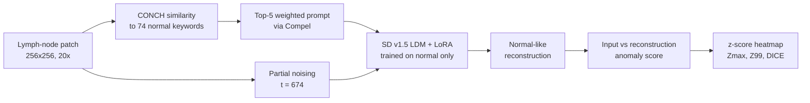

# Pathology-Informed Latent Diffusion Model for Anomaly Detection in Lymph Node Metastasis

> **Bibkey** `histo-miccai-2025` · **Venue** MICCAI 2025 (2025) · **Category** histopath · **Relevance** medium · **Access** open
> **Link** <https://papers.miccai.org/miccai-2025/0675-Paper2270.html>
> `status: complete` — 基于 MICCAI 2025 论文 PDF 全文 + 代码仓库 README。/ Based on the full MICCAI 2025 PDF plus the code README.

---

## 一句话 / One-liner
<!-- ZH --> AnoPILaD:只用正常淋巴结图块微调一个文本条件的潜空间扩散模型(Stable Diffusion v1.5 + LoRA),推理时用病理视觉-语言模型 CONCH 从 74 个"正常组织关键词"里挑出最贴切的 5 个作为提示,把输入"重建成正常样子",输入与重建的差异就是异常分;在胃淋巴结上 patch-AUC 0.9587,跨器官到乳腺淋巴结(Camelyon16)仍有 0.8884。
<!-- EN --> AnoPILaD fine-tunes a text-conditioned latent diffusion model (Stable Diffusion v1.5 + LoRA) on normal lymph-node patches only; at inference the pathology vision-language model CONCH picks the 5 best-matching of 74 "normal tissue" keywords as a prompt, the input is reconstructed toward normal, and the input–reconstruction difference is the anomaly score — patch AUC 0.9587 on gastric lymph nodes and 0.8884 cross-organ on breast lymph nodes (Camelyon16).

## 要点 / Takeaways
- <!-- ZH --> 属于"重建式"异常检测:正常样本重建得好、转移灶重建得差;创新在于用**描述正常组织的文字**引导重建方向(§2.1–2.2)。 <!-- EN --> Reconstruction-based anomaly detection: normal patches reconstruct well, metastases poorly; the novelty is steering the reconstruction with **text that describes normal tissue** (§2.1–2.2).
- <!-- ZH --> 在本地胃淋巴结数据(LH)上 patch-AUC 0.9587,比最强基线 MemAE(0.9290)略高;跨到乳腺淋巴结(C16)时差距拉大到约 0.22 AUC(0.8884 vs 0.66)(Table 2)。 <!-- EN --> On the in-house gastric lymph-node data (LH) patch AUC is 0.9587, a little above the best baseline MemAE (0.9290); on breast lymph nodes (C16) the gap widens to ~0.22 AUC (0.8884 vs ~0.66) (Table 2).
- <!-- ZH --> 切片级分类在跨器官时仍大幅下降:LH 最高 AUC 0.9943,C16 只有 0.6745(Table 3)。 <!-- EN --> Slide-level classification still drops sharply across organs: best AUC 0.9943 on LH but only 0.6745 on C16 (Table 3).
- <!-- ZH --> 作者强调要评估**分割(定位)**而不仅是分类:AE / MemAE 分类不差,但热图几乎对全片打同样的分(Table 3, Fig. 3)。 <!-- EN --> The authors stress evaluating **segmentation (localisation)**, not only classification: AE / MemAE classify reasonably but give near-uniform scores over a slide (Table 3, Fig. 3).
- <!-- ZH --> 我们的理解:论文没有"去掉文本提示"或"关键词数量"的消融,所以无法区分收益来自文本引导、LDM 本身还是 SD 预训练。 <!-- EN --> Our reading: there is no ablation removing the text prompt or varying the keyword count, so the gain cannot be split between text guidance, the LDM itself, and SD pretraining.

## 研究问题 / Problem
<!-- ZH --> 淋巴结转移是重要的预后因素。有监督的转移检测需要大量专家标注,代价高(Introduction)。无监督异常检测只用正常(in-distribution)样本训练,把偏离正常的样本视作 OOD。基于 DDPM 的重建方法已被用于乳腺淋巴结转移检测(文中称 AnoDDPM,ref [17] Linmans et al. 2024),但会产生大量假阳性,说明正常与 OOD 分得不够开(§2.1, Fig. 1)。本文想通过加入病理先验来拉大正常与转移之间的重建差异,并检验跨器官的鲁棒性。
<!-- EN --> Lymph-node metastasis is a key prognostic factor. Supervised detection needs extensive expert annotation (Introduction). Unsupervised anomaly detection trains only on normal (in-distribution) samples and treats deviations as OOD. A DDPM reconstruction method has been used for breast lymph-node metastasis (called AnoDDPM in the paper, ref [17] Linmans et al. 2024) but produces many false positives, i.e. normal and OOD are not separated well (§2.1, Fig. 1). The paper adds pathology priors to widen the reconstruction gap between normal tissue and metastasis, and tests robustness across organs.

## 方法 / Method
<!-- ZH --> 1. **输入**:WSI 在 20× 下切成 256×256 像素图块(§3.1)。
<!-- ZH --> 2. **关键词池**:从文献中收集 74 个描述正常淋巴结细胞和微环境的病理关键词,由一位资深病理医生审核(§2.2)。
<!-- ZH --> 3. **加权提示**:用 CONCH(在 117 万对病理图像-说明文字上预训练的视觉-语言模型)分别编码图块和每个关键词,算余弦相似度,取前 5 个关键词;各自的相似度除以中位数作为权重,按 Compel 库的做法生成加权文本嵌入 c(§2.2, Fig. 2)。
<!-- ZH --> 4. **训练**:Stable Diffusion v1.5 潜空间扩散模型,只在正常训练图块上用 LoRA(秩 4)微调,Adam,学习率 1e-5,batch 64;目标是条件去噪损失 L = E‖ε − ε_θ(z_t, t, c)‖²;以 FID 最低的 400k 步 checkpoint 用于测试(§2.1 式 4, §3.2)。
<!-- ZH --> 5. **重建与打分**:沿用 AnoDDPM 流程:把输入加噪到时间步 t = 674(8 个候选中按 LH 测试集上的 WSI 分类效果选出),再在文本条件下反向去噪得到重建 ẑ₀;输入与重建的差异 = 异常分。推理用 PLMS 采样器、100 步(§2.1, §3.2)。
<!-- ZH --> 6. **评估**:对每个测试集内所有图块的异常分做 z-score;patch 级算 AUC / AUPR;WSI 级先生成 z-score 热图并做 2×2 形态学腐蚀,分类用最大 z(Zmax)或论文所说的 "average of 99th percentile z-scores"(Z99),分割在转移切片上算 DICE / IoU、在正常切片上算真阴性率 TNR,阈值为 0(§3.2)。
<!-- ZH --> 7. **基线**:基于密度的 VAE 负似然(NLL)及其变体 Regret、LLR、complexity;基于重建的 f-AnoGAN、AE、MemAE、AnoDDPM(§3.2)。
<!-- EN --> 1. **Input**: WSIs tiled into 256×256-pixel patches at 20× (§3.1).
<!-- EN --> 2. **Keyword pool**: 74 pathology keywords from the literature describing cells and microenvironments of normal lymph nodes, reviewed by an experienced pathologist (§2.2).
<!-- EN --> 3. **Weighted prompt**: CONCH (a vision-language model pretrained on 1.17M pathology image–caption pairs) embeds the patch and every keyword; cosine similarity selects the top 5; each similarity divided by the median becomes its weight; a weighted text embedding c is built following the Compel library (§2.2, Fig. 2).
<!-- EN --> 4. **Training**: a Stable Diffusion v1.5 latent diffusion model fine-tuned with LoRA (rank 4) on normal training patches only; Adam, lr 1e-5, batch 64; conditional denoising loss L = E‖ε − ε_θ(z_t, t, c)‖²; the 400k-step checkpoint with lowest FID is used (§2.1 Eq. 4, §3.2).
<!-- EN --> 5. **Reconstruct and score**: following AnoDDPM, the input is noised to timestep t = 674 (chosen from 8 candidates by slide-classification performance on the LH test set) and denoised under the text condition to ẑ₀; input–reconstruction discrepancy = anomaly score; PLMS sampler, 100 steps (§2.1, §3.2).
<!-- EN --> 6. **Evaluation**: anomaly scores are z-scored over all patches of a test set; patch level: AUC / AUPR; slide level: z-score heatmap with 2×2 morphological erosion, classification by max z (Zmax) or the paper's "average of 99th percentile z-scores" (Z99), segmentation by DICE / IoU on metastasis slides and true-negative rate (TNR) on normal slides, threshold 0 (§3.2).
<!-- EN --> 7. **Baselines**: density-based VAE negative likelihood (NLL) and variants Regret, LLR, complexity; reconstruction-based f-AnoGAN, AE, MemAE, AnoDDPM (§3.2).

## 方法图 / Method diagram


## 数据 / Data
<!-- ZH --> **LH(两家本地医院的胃淋巴结,非公开)**:808 张 WSI,751 张正常、57 张转移(部分标注)。正常切片分为训练 643 / 验证 50 / 正常测试 58;57 张转移切片作 OOD 测试。图块数:训练 1,373,475,验证 102,240,正常测试 174,703,OOD 测试 115,330(全部为转移标注区)。LH 中所有肿瘤区直径都 >2 mm(§3.1, Table 1)。**C16(Camelyon16 乳腺淋巴结,公开)**:只用于独立测试——32 张正常验证、80 张正常测试、49 张转移;其中 22 张含直径 >2 mm 的肿瘤簇,记为 C16 Macro;OOD 图块 55,659 个。图块级异常比例:LH 0.3976、C16 0.1882(§3.1)。
<!-- EN --> **LH (gastric lymph nodes from two local hospital sites, private)**: 808 WSIs, 751 normal and 57 metastatic (partially annotated). Normal slides split 643 train / 50 val / 58 in-distribution test; the 57 metastatic slides are the OOD test set. Patches: train 1,373,475; val 102,240; in-dist test 174,703; OOD test 115,330 (fully metastasis-annotated). All LH tumour regions are >2 mm (§3.1, Table 1). **C16 (Camelyon16 breast lymph nodes, public)**: independent testing only — 32 normal val, 80 normal test, 49 metastatic, of which 22 contain tumour clusters >2 mm ("C16 Macro"); 55,659 OOD patches. Patch-level base prevalence: LH 0.3976, C16 0.1882 (§3.1).

## 主要结果 / Key results
- <!-- ZH --> **Patch 级(Table 2)**:AnoPILaD 在 LH 上 AUC 0.9587 / AUPR 0.9499,在 C16 上 0.8884 / 0.6987,均为最佳。LH 上 AE 0.9254、MemAE 0.9290、AnoDDPM 0.8555;C16 上 AE 0.6584、MemAE 0.6611、AnoDDPM 0.6857。 <!-- EN --> **Patch level (Table 2)**: AnoPILaD AUC 0.9587 / AUPR 0.9499 on LH and 0.8884 / 0.6987 on C16, best in both. On LH: AE 0.9254, MemAE 0.9290, AnoDDPM 0.8555; on C16: AE 0.6584, MemAE 0.6611, AnoDDPM 0.6857.
- <!-- ZH --> **密度类方法较弱**:VAE 的 NLL 在 LH 上 AUC 0.4982(接近随机),最好的变体 complexity 为 0.7931;f-AnoGAN 最差(LH 0.2289)(Table 2, §4)。 <!-- EN --> **Density methods are weak**: VAE NLL gives AUC 0.4982 on LH (near chance), the best variant (complexity) 0.7931; f-AnoGAN is worst (LH 0.2289) (Table 2, §4).
- <!-- ZH --> **WSI 分类(Table 3)**:AnoPILaD 在 LH 上 Zmax AUC 0.9837、Z99 AUC 0.9943;C16 上 0.6745 / 0.6367;C16 Macro 上 0.8062 / 0.8023,其他方法在 C16 Macro 上为 0.49–0.64。 <!-- EN --> **Slide classification (Table 3)**: AnoPILaD AUC 0.9837 (Zmax) and 0.9943 (Z99) on LH; 0.6745 / 0.6367 on C16; 0.8062 / 0.8023 on C16 Macro, where other methods reach 0.49–0.64.
- <!-- ZH --> **分割(Table 3)**:AnoPILaD 在所有设置中 TNR / DICE / IoU 最高;C16 Macro DICE 0.5420(AnoDDPM 0.3131、AE 0.3249);LH 上 DICE 0.4322,与 AnoDDPM 0.4319 几乎相同。 <!-- EN --> **Segmentation (Table 3)**: AnoPILaD has the highest TNR / DICE / IoU in every setting; C16 Macro DICE 0.5420 (AnoDDPM 0.3131, AE 0.3249); on LH DICE 0.4322, almost equal to AnoDDPM's 0.4319.
- <!-- ZH --> **定性**:对含转移的图块,AnoDDPM 会部分重建出转移结构,未能抑制多形性细胞核和纤维化;AnoPILaD 重建出更均匀的淋巴细胞排列(Fig. 1, §4)。 <!-- EN --> **Qualitative**: for metastatic patches AnoDDPM partly reconstructs the tumour and fails to suppress pleomorphic nuclei and fibrosis; AnoPILaD reconstructs more uniform lymphocyte arrangements (Fig. 1, §4).

## 创新点 / Contributions
- <!-- ZH --> 把病理视觉-语言模型(CONCH)与潜空间扩散重建结合,用描述正常组织的关键词作为重建条件(§1, §2)。 <!-- EN --> Combines a pathology vision-language model (CONCH) with latent-diffusion reconstruction, using normal-tissue keywords as the reconstruction condition (§1, §2).
- <!-- ZH --> 加权提示生成:74 个病理医生审核的关键词 → CONCH 相似度前 5 → 中位数归一化权重 → Compel 加权嵌入(§2.2)。 <!-- EN --> Weighted prompt generation: 74 pathologist-reviewed keywords → top-5 by CONCH similarity → median-normalised weights → Compel weighted embedding (§2.2).
- <!-- ZH --> 在胃 → 乳腺的跨器官设置下同时评估分类与分割,指出只看分类会高估 AE 类方法(§4)。 <!-- EN --> Evaluates both classification and segmentation under a gastric → breast cross-organ shift, showing that classification alone overrates AE-type methods (§4).

## 局限 / Limitations
- <!-- ZH --> (作者)跨器官性能仍需提高,作为后续工作(Conclusion);C16 上 WSI 分类 AUC 只有 0.64–0.67(Table 3)。 <!-- EN --> (Authors) cross-organ performance still needs work, left for future study (Conclusion); slide-level AUC on C16 is only 0.64–0.67 (Table 3).
- <!-- ZH --> 我们的理解:扩散时间步 t = 674 是在 LH **测试集**上选的(§3.2),LH 上的结果因此略偏乐观。 <!-- EN --> Our reading: the diffusion timestep t = 674 was chosen on the LH **test set** (§3.2), so LH results are somewhat optimistic.
- <!-- ZH --> 我们的理解:没有消融(去掉提示、随机关键词、不同关键词数),也没有报告标准差或多次运行。 <!-- EN --> Our reading: no ablations (no prompt, random keywords, different keyword counts) and no standard deviations or repeated runs.
- <!-- ZH --> 我们的理解:关键词池专门针对淋巴结,换器官需要重新整理词表;LH 数据不公开;100 步扩散采样使推理成本远高于 AE。 <!-- EN --> Our reading: the keyword pool is lymph-node-specific and must be rebuilt for other organs; LH data are private; 100-step diffusion sampling makes inference far costlier than an AE.

## 与本研究方向的关系 / Relation to our direction
<!-- ZH --> 位于 pipeline 第一环(detect),并带有"revert"的影子。我们的理解:(1) "把异常样本重建成正常样子,差异即异常"在图像域里做的正是"反事实的正常组织",和我们第三环"把异常 revert 回正常"在形式上相似,只是这里没有基因层面的解释;(2) 用先验知识(这里是文字关键词)给生成式正常模型加条件的做法,可以类比到组学——例如用细胞类型或区域标签作为条件,让模型只需要解释"在给定类型下是否正常";(3) 对课题 1 的肾脏基准,本文的评估设计值得照搬:除了切片 / 样本级分类,还要有区域级分割指标(DICE、正常切片上的 TNR),并做跨队列 / 跨器官测试。它也提醒我们:AE 类基线在分类上可能看起来不错,但定位很差。
<!-- EN --> Sits at stage 1 (detect) with a hint of "revert". Our reading: (1) "reconstruct the abnormal sample as normal; the difference is the anomaly" is an image-space counterfactual normal tissue, formally similar to our stage 3 "revert the anomaly", but without any gene-level explanation; (2) conditioning a generative normal model on prior knowledge (here text keywords) transfers to omics — e.g. condition on cell type or region labels so the model only has to judge "normal for this type"; (3) for the Topic 1 kidney benchmark, the evaluation design is worth copying: beyond slide/sample classification, include region-level segmentation metrics (DICE, TNR on normal slides) and cross-cohort / cross-organ tests. It also warns that AE-type baselines can look fine on classification yet localise poorly.

## 可复用资产 / Reusable assets
- <!-- ZH --> **代码(MIT)**:<https://github.com/QuIIL/AnoPILaD> —— `image_caption.py`(CONCH 选词生成 metadata.csv)、`train_text_to_image_lora.py`(LoRA 微调,改自 diffusers 示例)、`rec_generate.py`(重建)、`ldm_solvers.py`(改自 CFG++);环境 python 3.11,需单独安装 CONCH(README)。README 中没有预训练权重下载。 <!-- EN --> **Code (MIT)**: <https://github.com/QuIIL/AnoPILaD> — `image_caption.py` (CONCH keyword selection → metadata.csv), `train_text_to_image_lora.py` (LoRA fine-tuning, adapted from the diffusers example), `rec_generate.py` (reconstruction), `ldm_solvers.py` (adapted from CFG++); python 3.11, CONCH installed separately (README). The README offers no pretrained weights.
- <!-- ZH --> **数据**:Camelyon16 公开,可复现跨器官测试;LH 不公开。 <!-- EN --> **Data**: Camelyon16 is public for the cross-organ test; LH is private.
- <!-- ZH --> **评估协议**:测试集内 z-score → patch AUC / AUPR;WSI 级 Zmax / Z99 + 2×2 腐蚀;分割 DICE / IoU(转移切片)+ TNR(正常切片),阈值 0(§3.2)。 <!-- EN --> **Evaluation protocol**: within-test-set z-scores → patch AUC / AUPR; slide-level Zmax / Z99 with 2×2 erosion; segmentation DICE / IoU on metastatic slides + TNR on normal slides, threshold 0 (§3.2).

## 待读 / Follow-ups
- <!-- ZH --> Linmans et al. 2024, "Diffusion models for out-of-distribution detection in digital pathology", *Medical Image Analysis* 93:103088 —— 本文 AnoDDPM 基线的来源(ref [17])。 <!-- EN --> Linmans et al. 2024, "Diffusion models for out-of-distribution detection in digital pathology", *Medical Image Analysis* 93:103088 — source of the AnoDDPM baseline here (ref [17]).
- <!-- ZH --> Wyatt et al. 2022, AnoDDPM(simplex noise,CVPR 2022 论文集,ref [15])—— 名称来源。 <!-- EN --> Wyatt et al. 2022, AnoDDPM with simplex noise (ref [15]) — origin of the name.
- <!-- ZH --> CONCH(Lu et al., arXiv:2307.12914,ref [20])。 <!-- EN --> CONCH (Lu et al., arXiv:2307.12914, ref [20]).
- <!-- ZH --> MemAE(Gong et al., ICCV 2019,ref [10])—— 最强的非扩散基线。 <!-- EN --> MemAE (Gong et al., ICCV 2019, ref [10]) — the strongest non-diffusion baseline.

## 图表 / Figures & tables


<!-- ZH --> **图2.**(上)加权文本提示生成流程:CONCH 的文本/图像编码器对 74 个正常关键词与输入图像算余弦相似度,取 top-5,除以中位数归一化为权重,经 Compel 组成加权提示(如 "small dormant lymphocytes: 1.06 … littoral cells: 0.83")送入 LDM;(下)LH 训练 / 测试集中 top-10 高频病理关键词分布。
<!-- EN --> **Fig 2.** (Top) Weighted-prompt generation: CONCH text/image encoders score 74 normal keywords against the input by cosine similarity, take the top-5, median-normalise into weights, and Compel builds a weighted prompt (e.g. "small dormant lymphocytes: 1.06 … littoral cells: 0.83") fed to the LDM. (Bottom) Distribution of the top-10 frequent keywords in the LH training and test sets.
<!-- ZH/EN --> _Source: https://papers.miccai.org/miccai-2025/paper/2270_paper.pdf (Fig. 2)  ·  License: MICCAI 2025 Open Access_


<!-- ZH --> **图1.** 扩散重建对比。对 in-distribution(第一行)与 OOD(后两行)样本,AnoDDPM 与 AnoPILaD 均试图重建"正常样"结构;文本提示引导下,AnoPILaD 生成更均匀的淋巴细胞排列、抑制多形核与纤维化,右列为所选关键词提示。
<!-- EN --> **Fig 1.** Diffusion reconstructions. For in-distribution (row 1) and OOD (rows 2-3) inputs, AnoDDPM and AnoPILaD both reconstruct "normal-like" tissue; with text prompts AnoPILaD yields more uniform lymphocytic arrangements and suppresses pleomorphic/fibrotic structure. Right column lists the selected keyword prompts.
<!-- ZH/EN --> _Source: https://github.com/QuIIL/AnoPILaD (main.png; MIT) = paper Fig. 1_


<!-- ZH --> **图3.** 四张转移切片(LH 与 C16 各两例)的 z-score 异常热图。黑色轮廓为转移标注,绿色轮廓为正常标注;括号内为每片 (Z99, DICE)。
<!-- EN --> **Fig 3.** Z-score anomaly heatmaps for four metastasis slides (two each from LH and C16). Black contours = metastasis annotation, green = normal annotation; parentheses give per-slide (Z99, DICE).
<!-- ZH/EN --> _Source: https://papers.miccai.org/miccai-2025/paper/2270_paper.pdf (Fig. 3)  ·  License: MICCAI 2025 Open Access_

### 结果表 / Results

<!-- ZH --> **表2.** Patch 级异常检测,AUC / AUPR(LH = 胃淋巴结,C16 = Camelyon16 乳腺,跨器官域偏移)。加粗为最优。
<!-- EN --> **Table 2.** Patch-level anomaly detection, AUC / AUPR (LH = gastric nodes; C16 = Camelyon16 breast, cross-organ domain shift). Bold = best.

| Method | LH AUC | LH AUPR | C16 AUC | C16 AUPR |
|---|---|---|---|---|
| NLL | 0.4982 | 0.5552 | 0.3250 | 0.1600 |
| Regret | 0.6720 | 0.6718 | 0.6480 | 0.3441 |
| LLR | 0.6078 | 0.6260 | 0.7065 | 0.4765 |
| complexity | 0.7931 | 0.7139 | 0.7752 | 0.5140 |
| f-AnoGAN | 0.2289 | 0.3377 | 0.1735 | 0.1104 |
| AE | 0.9254 | 0.8906 | 0.6584 | 0.4759 |
| MemAE | 0.9290 | 0.8886 | 0.6611 | 0.4880 |
| AnoDDPM | 0.8555 | 0.7841 | 0.6857 | 0.5741 |
| **AnoPILaD** | **0.9587** | **0.9499** | **0.8884** | **0.6987** |

<!-- ZH --> **表3.** WSI 级分类,每格 AUC / AUPR;两种打分:Zmax(最大 z-score)与 Z99(论文原文:average of 99th percentile z-scores)。C16 Macro = 肿瘤簇 >2mm 子集。加粗为最优。
<!-- EN --> **Table 3.** WSI-level classification, each cell AUC / AUPR; two scores: Zmax (max z-score) and Z99 (paper: "average of 99th percentile z-scores"). C16 Macro = subset with tumour clusters >2mm. Bold = best.

| Method | LH Zmax | LH Z99 | C16 Zmax | C16 Z99 | C16-Macro Zmax | C16-Macro Z99 |
|---|---|---|---|---|---|---|
| AE | 0.9622 / 0.9612 | 0.9395 / 0.9381 | 0.6612 / 0.5961 | 0.5798 / 0.5217 | 0.6398 / 0.3677 | 0.5523 / 0.2918 |
| MemAE | 0.9504 / 0.9440 | 0.9365 / 0.9382 | 0.6505 / 0.5689 | 0.5686 / 0.5313 | 0.6381 / 0.3657 | 0.5597 / 0.3141 |
| AnoDDPM | 0.7840 / 0.6616 | 0.9383 / 0.8995 | 0.4992 / 0.3885 | 0.4551 / 0.3905 | 0.4926 / 0.2146 | 0.5119 / 0.2347 |
| **AnoPILaD** | **0.9837 / 0.9740** | **0.9943 / 0.9948** | **0.6745 / 0.6140** | **0.6367 / 0.5902** | **0.8062 / 0.5965** | **0.8023 / 0.5886** |

<!-- ZH/EN --> _Tables 2-3 source: https://papers.miccai.org/miccai-2025/paper/2270_paper.pdf (Tables 2-3)  ·  MICCAI 2025 Open Access_

## 引用 / Cite
```bibtex
@inproceedings{Wang2025_AnoPILaD,
  title = {Pathology-Informed Latent Diffusion Model for Anomaly Detection in Lymph Node Metastasis},
  author = {Wang, Jiamu and Byeon, Keunho and Song, Jinsol and Nguyen, Anh and Ahn, Sangjeong and Lee, Sung Hak and Kwak, Jin Tae},
  booktitle = {Medical Image Computing and Computer Assisted Intervention (MICCAI)},
  year = {2025}
}
```
