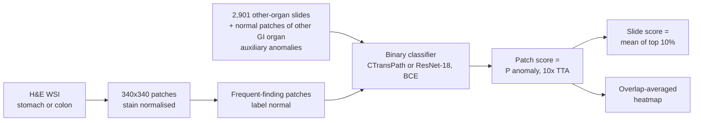
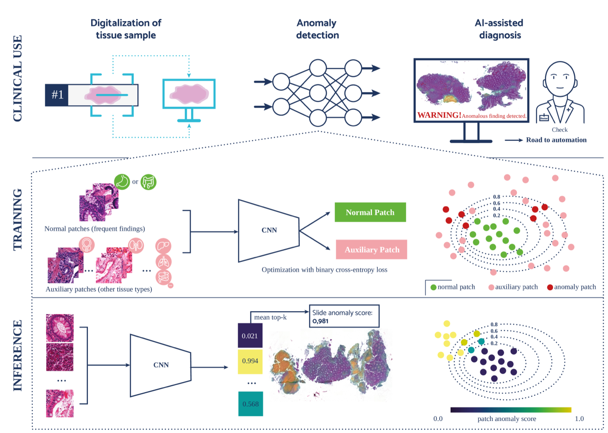
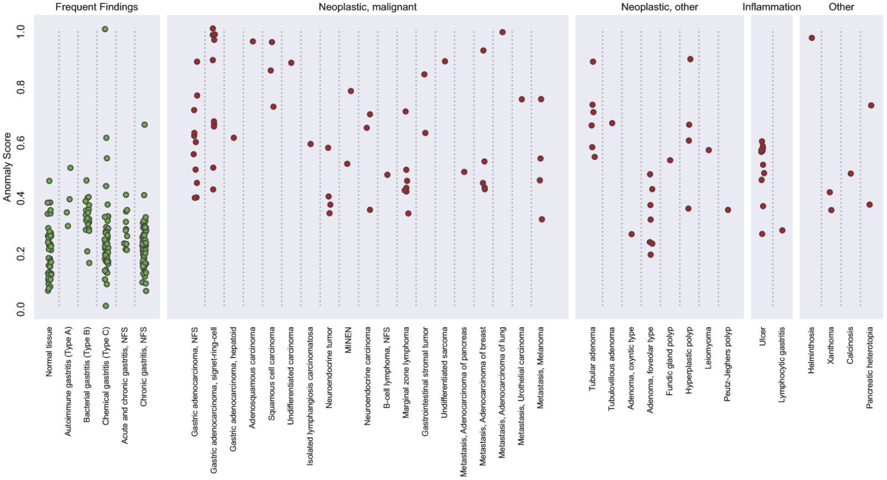

# AI-Based Anomaly Detection for Clinical-Grade Histopathological Diagnostics

> **Bibkey** `Dippel_2024` · **Venue** NEJM AI (2024) · **Category** histopath · **Relevance** high · **Access** paywall
> **Link** <https://doi.org/10.1056/aioa2400468>
> `status: complete` — 全文精读基于作者公开的 arXiv 预印本 (arXiv:2406.14866v1, 2024-06-21);NEJM AI 正式版付费。
> 注:以下所有数字与细节均取自 arXiv 预印本,与 NEJM AI 正式版可能略有差异。/ Note: every number below comes from the arXiv preprint; the NEJM AI version of record may differ slightly.

---

## 一句话 / One-liner
<!-- ZH --> 只用"常见诊断"(正常组织 + 常见病)的胃、结肠活检切片训练深度异常检测模型(最佳为 Outlier Exposure),不需要见过任何罕见病,就能检出长尾中的 56 种少见病变:slide-AUROC 胃 95.0%、结肠 91.0%,并可泛化到另一家医院和另一种扫描仪。
<!-- EN --> A deep anomaly-detection model trained only on "frequent findings" (normal tissue plus common diseases) of stomach and colon biopsies — best variant: Outlier Exposure — detects the long tail of 56 rarer entities it never saw, with slide-AUROC 95.0% (stomach) and 91.0% (colon), and transfers to a second hospital and scanner without retraining.

## 要点 / Takeaways
- <!-- ZH --> "正常"在这里指**常见诊断**(含慢性胃炎、低级别腺瘤等常见病),"异常"指长尾里的少见诊断;常见诊断共 10 种(胃 6 种、结肠 4 种),分别占胃 90%、结肠 91% 的病例(Fig. 1, App. Table 2)。 <!-- EN --> "Normal" here means **frequent findings** (including common diseases such as chronic gastritis), and "anomaly" means the rare long tail; the frequent findings — 10 diagnoses in all (6 stomach, 4 colon) — make up 90% of stomach and 91% of colon cases (Fig. 1, App. Table 2).
- <!-- ZH --> 最好的方法是 Outlier Exposure:把其他器官的切片当"辅助异常",训练二分类器;异常分 = 模型给出的"异常类"概率(Methods §2.3)。 <!-- EN --> The best method is Outlier Exposure: slides from other organs serve as "auxiliary anomalies" for a binary classifier; the anomaly score is the predicted anomaly-class probability (Methods §2.3).
- <!-- ZH --> OE 数据的选择比网络结构或损失函数更重要:用 ImageNet 当 OE 几乎无效(结肠 slide-AUROC 52.17%),TCGA 82.73%,同院多器官集(Charité OE mixed)88.48%,再加上小肠和另一胃肠器官的完整 OE 集 91.49%;作者称完整 OE 集整体最强(单一划分,非 5 折;App. Table 11, D.2)。 <!-- EN --> The choice of OE data matters more than architecture or loss: ImageNet as OE barely works (colon slide-AUROC 52.17%), TCGA gives 82.73%, the same-hospital multi-organ set (Charité OE mixed) 88.48%, and the full OE set (adding small intestine and the other GI organ) 91.49%, which the authors call the strongest overall (single split, not 5-fold; App. Table 11, D.2).
- <!-- ZH --> 在 100% 灵敏度阈值下,36.2% 的胃切片可被判为"非异常"而免于重点复核;结肠只有 4.21%(§3.1)。 <!-- EN --> At a 100%-sensitivity threshold, 36.2% of stomach cases could be called "not abnormal"; for colon only 4.21% (§3.1).
- <!-- ZH --> 失败案例是非常细微的改变(假黑变病、肠螺旋体病,slide-AUROC 约 20–24%),作者认为需要多尺度上下文或半监督方法(App. Table 6, Discussion)。 <!-- EN --> Failures are very subtle changes (pseudomelanosis coli, intestinal spirochaetosis; slide-AUROC ~20–24%); the authors point to multi-scale context or semi-supervised methods (App. Table 6, Discussion).

## 研究问题 / Problem
<!-- ZH --> 病理 AI 大多是有监督分类器,只能识别训练集里有足够样本的常见诊断。真实临床中诊断呈长尾分布:少数常见诊断占约 90% 的胃肠活检,剩下约 10% 分散在 56 种少见实体(含多种癌)中(Abstract, Fig. 1)。有监督模型会漏掉或错分这些少见病,所以目前每张切片仍需病理医生确认(Introduction)。作者问:能否只学常见诊断的样子,把任何偏离都当作"异常"标出来?
<!-- EN --> Most pathology AI is supervised and only recognises common diagnoses with enough training examples. Real diagnoses follow a long tail: a few common findings make up ~90% of GI biopsies, and the remaining ~10% are spread over 56 rarer entities including many cancers (Abstract, Fig. 1). Supervised models miss or misclassify these, so every slide still needs pathologist confirmation (Introduction). The question: can we learn only what frequent findings look like and flag any deviation as an anomaly?

## 方法 / Method
<!-- ZH --> 1. **预处理**:每张 H&E 全切片(WSI,whole-slide image)找出组织区域,在 20× 放大(约 0.5 μm/像素)下切成 340×340 像素的 patch,丢弃背景超过 80% 的 patch,并用 Reinhard 方法做染色归一化(App. B.4)。
<!-- ZH --> 2. **训练数据**:胃、结肠各自单独建模;"正常" = 该器官的常见诊断 patch。为了让高级别病变能被检出,低级别腺瘤从训练集中去掉(§2.2, App. C.7)。异常样本**从不**参与训练。
<!-- ZH --> 3. **范式 A:自监督特征 + kNN**。用病理基础模型 CTransPath(在 TCGA 和 PAIP 的 32,220 张 H&E 切片上预训练的 Swin Transformer)提 patch 特征,用改进的 kNN 距离打分;变体是用 PANDA 式的 one-class(OCC)损失在正常 patch 上微调 CTransPath(§2.3, App. B.2)。
<!-- ZH --> 4. **范式 B:Outlier Exposure (OE,最佳)**。辅助异常 = 2,901 张其他器官切片(前列腺 599、肾 459、肝 402、肺 401、小肠 283、乳腺 204、其他 553)+ 另一个胃肠器官的正常 patch。用二元交叉熵训练分类器区分"正常 vs 辅助异常",每个 batch 两类各半;OE patch 中 50% 取"近组织"(胃、结肠、小肠)、50% 取"远组织";与正常 patch 余弦相似度 >0.9 的 OE patch 被删掉,以去除两边都有的结缔组织、肌肉等(§2.3, App. B.2, Table 2c)。我们的理解:Table 1 中 OE 的数字与 App. Table 15 的 CTransPath 一行完全相同,所以主结果看来用的是在 OE 任务上微调的 CTransPath(正文没有明说,Fig. 2 只画了一个通用 CNN);从头训练的 ResNet-18 表现相近(§2.3, App. D.4, Table 15)。
<!-- ZH --> 5. **打分与聚合**:patch 异常分 = 模型给出的异常类概率,用 10 个测试时增强视图取平均;切片分 = 分数最高的 10% patch 的均值(§2.2, App. B.3)。
<!-- ZH --> 6. **热图**:以 75 像素重叠切 patch,把重叠 patch 的分数平均,得到平滑的异常热图(App. B.3)。
<!-- ZH --> 7. **评估**:5 折交叉验证;slide-AUROC(按诊断标签)和 patch-AUROC(按病理医生的逐区域标注);外部 LMU 队列只评 slide-AUROC,不重新训练(§2.2, App. B.5)。
<!-- EN --> 1. **Pre-processing**: tissue is detected on each H&E whole-slide image (WSI) and tiled into 340×340-pixel patches at 20× (~0.5 µm/pixel); patches with >80% background are dropped; Reinhard stain normalisation is applied (App. B.4).
<!-- EN --> 2. **Training data**: separate models for stomach and colon; "normal" = frequent-finding patches of that organ. Low-grade adenomas are removed from training so that high-grade lesions stay detectable (§2.2, App. C.7). Anomalies are **never** used in training.
<!-- EN --> 3. **Paradigm A — self-supervised features + kNN**: CTransPath (a Swin Transformer pretrained on 32,220 H&E slides from TCGA and PAIP) embeds patches and a modified kNN distance scores them; a variant fine-tunes CTransPath with a PANDA-style one-class (OCC) loss (§2.3, App. B.2).
<!-- EN --> 4. **Paradigm B — Outlier Exposure (best)**: auxiliary anomalies = 2,901 slides of other organs (prostate 599, kidney 459, liver 402, lung 401, small intestine 283, breast 204, other 553) plus normal patches of the other GI organ. A binary cross-entropy classifier separates normal from auxiliary patches with class-balanced batches; OE patches are 50% "near" tissue (stomach, colon, small intestine) and 50% "far" tissue; OE patches with cosine similarity >0.9 to normal patches are removed to drop shared tissue such as connective tissue and muscle (§2.3, App. B.2, Table 2c). Our reading: Table 1's OE numbers equal the CTransPath row of App. Table 15, so the main results appear to use CTransPath fine-tuned on the OE task (the text does not say so; Fig. 2 shows a generic CNN); a ResNet-18 trained from scratch performs about the same (§2.3, App. D.4, Table 15).
<!-- EN --> 5. **Scoring and aggregation**: patch score = anomaly-class probability, averaged over 10 test-time-augmented views; slide score = mean of the top-10% patch scores (§2.2, App. B.3).
<!-- EN --> 6. **Heatmaps**: patches are extracted with 75-pixel overlap and overlapping scores are averaged into a smooth heatmap (App. B.3).
<!-- EN --> 7. **Evaluation**: 5-fold cross-validation; slide-AUROC (from diagnosis labels) and patch-AUROC (from pathologist region annotations); the external LMU cohort gets slide-AUROC only, without retraining (§2.2, App. B.5).

## 方法图 / Method diagram


## 数据 / Data
<!-- ZH --> 共 5,423 张切片、约 1,700 万个图像 patch,来自两家医院(§3;摘要写作 5,423 cases)。**Charité(柏林)主队列**:2020/2021 年常规诊断切片,常见诊断 1,973 张(胃 961、结肠 1,012),异常诊断 200 张(126 张来自 2020/2021,74 张来自 2000–2021 年档案),共 65 种诊断,扫描仪 3DHistech P1000;所有异常切片都有逐区域标注(诊断相关区、非诊断相关的异常区如肿瘤旁炎症、伪影)(§2.1)。另有 2,901 张其他器官切片作 OE 辅助数据(App. Table 2c)。**LMU(慕尼黑)外部队列**:胃 192 张、结肠 157 张(常见:结肠 63 / 胃 164;异常:结肠 94 / 胃 28),2020–2023 年,扫描仪 Leica Aperio GT 450,超过 50 万个 patch,无像素级标注(§3.3, App. B.5)。预印本中没有提到数据发布。
<!-- EN --> 5,423 slides and ~17 million image patches from two hospitals (§3; the abstract says 5,423 cases). **Charité (Berlin) primary cohort**: routine 2020/2021 slides, 1,973 frequent-finding slides (stomach 961, colon 1,012) and 200 anomalous slides (126 from 2020/2021, 74 from 2000–2021 archives), 65 diagnoses, 3DHistech P1000 scanner; all anomalous slides have region annotations (diagnosis-defining regions, other anomalous regions such as tumour-adjacent inflammation, artifacts) (§2.1). Plus 2,901 other-organ slides as OE auxiliary data (App. Table 2c). **LMU (Munich) external cohort**: 192 gastric and 157 colon slides (frequent: 63 colon / 164 stomach; anomalous: 94 colon / 28 stomach), 2020–2023, Leica Aperio GT 450 scanner, >500k patches, no pixel annotations (§3.3, App. B.5). The preprint mentions no data release.

## 主要结果 / Key results
- <!-- ZH --> **Charité 主结果(OE)**:slide-AUROC 胃 95.04 ± 0.54%、结肠 91.01 ± 0.69%;patch-AUROC 胃 91.37 ± 0.34%、结肠 90.47 ± 0.33%。最佳自监督方法 slide-AUROC 胃 94.95%(kNN)、结肠 89.76%(kNN)(Table 1)。 <!-- EN --> **Charité main result (OE)**: slide-AUROC 95.04 ± 0.54% (stomach) and 91.01 ± 0.69% (colon); patch-AUROC 91.37 ± 0.34% and 90.47 ± 0.33%. Best self-supervised slide-AUROC: 94.95% stomach, 89.76% colon (kNN) (Table 1).
- <!-- ZH --> **恶性肿瘤检出最好**:OE 对恶性肿瘤组 slide-AUROC 胃 97.72%、结肠 96.97%;结肠炎症 94.42%(Table 1, §3.1)。 <!-- EN --> **Malignancies are detected best**: OE slide-AUROC for the malignant group 97.72% (stomach), 96.97% (colon); colon inflammation 94.42% (Table 1, §3.1).
- <!-- ZH --> **"Other" 组在结肠上失败**:slide-AUROC 40.41%;逐诊断看,假黑变病 20.28%、肠螺旋体病 23.56%、淋巴细胞性结肠炎 79.39%;胃中泌酸型腺瘤 64.42%、淋巴细胞性胃炎 72.93%(Table 1, App. Tables 5–6)。 <!-- EN --> **The colon "Other" group fails**: slide-AUROC 40.41%; per diagnosis, pseudomelanosis coli 20.28%, intestinal spirochaetosis 23.56%, lymphocytic colitis 79.39%; in stomach, oxyntic-type adenoma 64.42%, lymphocytic gastritis 72.93% (Table 1, App. Tables 5–6).
- <!-- ZH --> **可免复核比例**:把阈值设到 100%(99%、95%)异常灵敏度时,胃 36.2%(51.91%、72.93%)、结肠 4.21%(4.99%、38.2%)的病例可判为非异常;去掉假黑变病和螺旋体病后结肠升到 22.29%(49.46%、85.22%)(§3.1)。 <!-- EN --> **Cases that could skip review**: at 100% (99%, 95%) anomaly sensitivity, 36.2% (51.91%, 72.93%) of stomach and 4.21% (4.99%, 38.2%) of colon cases are called not abnormal; excluding pseudomelanosis and spirochaetosis, colon rises to 22.29% (49.46%, 85.22%) (§3.1).
- <!-- ZH --> **外部验证(LMU,不重训)**:OE slide-AUROC 胃 94.5 ± 0.93%、结肠 85.88 ± 0.94%;恶性肿瘤组 94.77% / 95.02%(§3.3, App. Table 4)。 <!-- EN --> **External validation (LMU, no retraining)**: OE slide-AUROC 94.5 ± 0.93% (stomach), 85.88 ± 0.94% (colon); malignant group 94.77% / 95.02% (§3.3, App. Table 4).
- <!-- ZH --> **伪影不是主要驱动**:伪影区 patch-AUROC 结肠 80.89%、胃 75.64%,低于真异常区的 90.47% / 91.37%(App. C.3)。 <!-- EN --> **Artifacts are not the main driver**: artifact regions get patch-AUROC 80.89% (colon) / 75.64% (stomach), below the 90.47% / 91.37% of true anomaly regions (App. C.3).
- <!-- ZH --> **基线与消融**:简单自编码器 slide-AUROC 仅 65.58%(结肠)/ 63.73%(胃)(App. Table 10);OE 数据用 ImageNet 时结肠 slide-AUROC 52.17%,TCGA 82.73%,完整 OE 集 91.49%(App. Table 11);约 100 张常见诊断切片后性能趋于饱和(App. D.1, Fig. 12);BCE 与 HSC、DeepSAD 损失差别不大(App. Table 16)。 <!-- EN --> **Baselines and ablations**: a plain autoencoder reaches only 65.58% (colon) / 63.73% (stomach) slide-AUROC (App. Table 10); with ImageNet as OE data colon slide-AUROC is 52.17%, with TCGA 82.73%, with the full OE set 91.49% (App. Table 11); performance saturates around 100 frequent-finding slides (App. D.1, Fig. 12); BCE, HSC and DeepSAD losses perform similarly (App. Table 16).

## 创新点 / Contributions
- <!-- ZH --> 把长尾罕见病诊断重新表述为"只用常见诊断训练"的异常检测问题,并在 65 种诊断的真实常规数据上评估(而不是只检测单一病种,如淋巴结转移)(Discussion, App. A.3)。 <!-- EN --> Recasts long-tail diagnosis as anomaly detection trained on frequent findings only, evaluated on routine data with 65 diagnoses rather than a single anomaly type such as lymph-node metastasis (Discussion, App. A.3).
- <!-- ZH --> 作者称这是 Outlier Exposure 首次用于组织病理,并给出 OE 数据选择的系统消融(相似度与多样性的权衡)(App. A.1, D.2)。 <!-- EN --> The authors state this is the first use of Outlier Exposure in histopathology, with a systematic ablation of OE data choice (similarity vs diversity trade-off) (App. A.1, D.2).
- <!-- ZH --> 跨医院、跨扫描仪外部验证,并显示颜色增强和测试时增强主要在外部队列上起作用(App. D.3, Tables 13–14)。 <!-- EN --> External validation across hospital and scanner, showing colour and test-time augmentations matter mainly on the external cohort (App. D.3, Tables 13–14).
- <!-- ZH --> 给出临床用法设想:切片异常分 + 热图,用于检出异常病例并标出异常区域,作者称将来可能支持自动化流程(Fig. 2)。 <!-- EN --> A proposed clinical use: slide anomaly score plus heatmap to detect abnormal cases and highlight abnormal regions, which the authors say may enable automated workflows in the future (Fig. 2).

## 局限 / Limitations
- <!-- ZH --> (作者)非常细微的结肠改变检不出(假黑变病、胶原性/淋巴细胞性结肠炎、螺旋体病),其中一些连病理医生也需要特殊染色(Discussion)。 <!-- EN --> (Authors) very subtle colon changes are missed (pseudomelanosis coli, collagenous/lymphocytic colitis, spirochaetosis), some of which need special stains even for pathologists (Discussion).
- <!-- ZH --> (作者)单个 340 像素 patch 看不到结构性改变(如结肠黏膜的架构改变),需要多尺度方法(Discussion, App. C.7)。 <!-- EN --> (Authors) single 340-pixel patches miss architectural changes such as colon mucosal architecture; multi-scale methods are needed (Discussion, App. C.7).
- <!-- ZH --> 低级别腺瘤被作者有意排除在训练外,以便把非肿瘤结肠组织与高级别病变区分开(§2.2, App. C.7)。我们的理解:这说明"正常"的边界需要人工设定。 <!-- EN --> Low-grade adenomas were deliberately removed from training to separate non-neoplastic colon tissue from high-grade lesions (§2.2, App. C.7). Our reading: this shows the "normal" boundary has to be set by hand.
- <!-- ZH --> 我们的理解:结肠外部验证(85.88%)和结肠可免复核比例(4.21%)明显弱于胃;LMU 队列还排除了有明显实验室特有撕裂伪影的切片(App. B.5),真实部署可能更难。 <!-- EN --> Our reading: colon external AUROC (85.88%) and colon auto-clear rate (4.21%) are much weaker than stomach; the LMU cohort also excluded slides with lab-specific tearing artifacts (App. B.5), so real deployment may be harder.
- <!-- ZH --> 我们的理解:只输出"是否异常 / 在哪里",不给诊断类别,也不解释异常的生物学原因;数据与代码在预印本中都没有公开链接。 <!-- EN --> Our reading: it outputs only "anomalous or not, and where", not a diagnosis or a biological explanation; the preprint gives no public data or code link.

## 与本研究方向的关系 / Relation to our direction
<!-- ZH --> 这篇是 pipeline 第一环(detect)在 H&E 模态上最接近"临床级"的参考。我们的理解:对伪影注入课题有三点直接启发。(1) **"正常"的定义**:这里的正常是"常见诊断",不是"健康";肾脏基准也需要先明确参考集(健康供体?常见 CKD 状态?),并像本文排除低级别腺瘤一样写清楚边界。(2) **OE 的迁移**:本文 OE 集中就有 459 张肾脏切片;反过来,在肾脏 H&E 或组学上做 OE 时,可以用其他器官 / 其他数据集作为辅助异常,并按"近 / 远"各半采样、去掉与正常过于相似的样本。(3) **评估设计**:slide 级 + patch 级 AUROC、按诊断分组的 AUROC、"100% 灵敏度下可放行比例"、外部队列不重训,这些都可以照搬到活检级 / 区域级的肾脏基准中。它不涉及第二、三环(virtual tissue、revert),但它输出的异常热图可作为后续建模的 ROI。
<!-- EN --> The closest to "clinical-grade" reference for stage 1 (detect) on H&E. Our reading: three direct lessons for the artifact-injection topic. (1) **Defining normal**: here normal means "frequent findings", not "healthy"; a kidney benchmark must likewise fix its reference set (healthy donors? common CKD states?) and document the boundary, as this paper did by excluding low-grade adenomas. (2) **Transferring OE**: the paper's OE set already contains 459 kidney slides; conversely, kidney H&E or omics OE could use other organs / other datasets as auxiliary anomalies, sampled half near and half far, with too-similar samples removed. (3) **Evaluation design**: slide- and patch-level AUROC, per-diagnosis AUROC, "fraction cleared at 100% sensitivity" and an external cohort without retraining all carry over to biopsy- and region-level kidney evaluation. It does not address stages 2–3 (virtual tissue, revert), but its heatmaps can supply ROIs for them.

## 可复用资产 / Reusable assets
- <!-- ZH --> **方法配方**:OE 二分类(BCE、类平衡 batch、近 / 远组织各半、余弦相似度 >0.9 去重)、top-10% patch 均值聚合、10 视图测试时增强、75 像素重叠热图(App. B.2–B.3)。 <!-- EN --> **Method recipe**: OE binary classifier (BCE, class-balanced batches, half near / half far tissue, cosine >0.9 de-duplication), top-10% patch mean, 10-view TTA, 75-pixel-overlap heatmaps (App. B.2–B.3).
- <!-- ZH --> **评估协议**:slide-AUROC + patch-AUROC、按诊断组 / 逐诊断 AUROC、固定灵敏度下的放行比例、外部队列不重训(Tables 1, 4–6)。 <!-- EN --> **Evaluation protocol**: slide- and patch-AUROC, per-group and per-diagnosis AUROC, clearance rate at fixed sensitivity, external cohort without retraining (Tables 1, 4–6).
- <!-- ZH --> **CTransPath**(第三方病理基础模型;本文用作特征提取器和 OE 骨干)。 <!-- EN --> **CTransPath** (third-party pathology foundation model; used here as feature extractor and OE backbone).
- <!-- ZH --> 预印本:<https://arxiv.org/abs/2406.14866>。预印本中**没有**代码或数据下载链接(Charité / LMU 临床数据)。 <!-- EN --> Preprint: <https://arxiv.org/abs/2406.14866>. The preprint gives **no** code or data link (Charité / LMU clinical data).

## 待读 / Follow-ups
- <!-- ZH --> 对照 NEJM AI 正式版,确认数字是否有变化、是否新增代码 / 数据可用性声明。 <!-- EN --> Check the NEJM AI version of record for changed numbers and any code / data availability statement.
- <!-- ZH --> Hendrycks et al. 2019 (Outlier Exposure) 与 Liznerski et al. 2022 (Exposing Outlier Exposure, TMLR)——本文 OE 的直接来源(refs 25–26)。 <!-- EN --> Hendrycks et al. 2019 (Outlier Exposure) and Liznerski et al. 2022 (Exposing Outlier Exposure, TMLR), the direct OE sources (refs 25–26).
- <!-- ZH --> Zingman et al. 2024, Medical Image Analysis 92:103067(本库 `histo-anomaly-bi-repo`)——本文 App. A.3 专门对比过,同样用多器官数据但走 one-class 路线。 <!-- EN --> Zingman et al. 2024, Medical Image Analysis 92:103067 (this library's `histo-anomaly-bi-repo`), contrasted in App. A.3: also uses multi-organ data but with a one-class classifier.
- <!-- ZH --> Ruff et al. 2021 "A unifying review of deep and shallow anomaly detection"(ref 21)。 <!-- EN --> Ruff et al. 2021, "A unifying review of deep and shallow anomaly detection" (ref 21).

## 图表 / Figures & tables

> <!-- ZH --> _NEJM AI 正文付费,以下图表全部取自公开预印本 arXiv:2406.14866,不含任何付费墙页面内容。数值/图注与正式版可能略有差异。_
> <!-- EN --> _All figures/tables below come from the OPEN preprint arXiv:2406.14866 — nothing is taken from the paywalled NEJM AI page._


<!-- ZH --> **图1.** 方法与临床流程总览:训练阶段用 Outlier Exposure 让模型区分"常见胃肠组织"与"其他器官的辅助组织";推理阶段对每个 patch 打异常分,聚合为切片级分数并生成异常热图;临床用例中据此提示可疑病例,将来可能支持自动化流程。
<!-- EN --> **Fig 1.** Method + clinical-workflow overview: training uses Outlier Exposure to separate frequent GI tissue from auxiliary tissue of other organs; at inference each patch gets an anomaly score, aggregated to a slide-level score and rendered as an anomaly heatmap; clinically this flags suspicious cases and may enable automated workflows in future.
<!-- ZH/EN --> _Source: https://arxiv.org/html/2406.14866 (Fig 2)  ·  License: arXiv preprint (arXiv:2406.14866)_


<!-- ZH --> **图2.** 胃、结肠组织的异常热图示例(腺癌、边缘区淋巴瘤、未分化肉瘤、胃小凹型腺瘤、溃疡、高级别不典型增生、神经内分泌肿瘤、炎症):模型标出病变区域,组织褶皱等伪影对热图影响不大。
<!-- EN --> **Fig 2.** Anomaly-heatmap examples on stomach and colon tissue (adenocarcinoma, marginal-zone lymphoma, undifferentiated sarcoma, foveolar adenoma, ulcer, high-grade dysplasia, neuroendocrine tumour, inflammation): lesions are highlighted, and artifacts such as tissue folds barely affect the heatmap.
<!-- ZH/EN --> _Source: https://arxiv.org/html/2406.14866 (Fig 4)  ·  License: arXiv preprint (arXiv:2406.14866)_


<!-- ZH --> **图3.** OE 模型在 Charité 验证集(5 折中的一折)上按诊断分组的切片异常分分布(本图只含胃的部分;论文原图上方为胃、下方为结肠):常见诊断与大多数异常诊断明显分开。
<!-- EN --> **Fig 3.** Slide anomaly scores by diagnosis for the OE model on one Charité validation split (stomach panel only; the paper's figure shows stomach on top and colon below): frequent findings separate clearly from most anomalous diagnoses.
<!-- ZH/EN --> _Source: https://arxiv.org/html/2406.14866 (Fig 3)  ·  License: arXiv preprint (arXiv:2406.14866)_


<!-- ZH --> **图4.** 胃肠活检诊断的长尾分布:常见诊断(绿)占 90%(胃)/ 91%(结肠)病例,其余为长尾中的少见诊断(红)——这正是本文要解决的问题设定。
<!-- EN --> **Fig 4.** Long-tail distribution of GI-biopsy diagnoses: frequent findings (green) are 90% (stomach) / 91% (colon) of cases; the rest is a long tail of rarer diagnoses (red) — the problem setting the paper targets.
<!-- ZH/EN --> _Source: https://arxiv.org/html/2406.14866 (Fig 1)  ·  License: arXiv preprint (arXiv:2406.14866)_

### 结果表 / Results

<!-- ZH --> **表1.** Charité 主队列上三种异常检测方案的 slide-AUROC / patch-AUROC(%,5 折均值±标准差);Outlier Exposure 为最佳方案。
<!-- EN --> **Table 1.** Slide-AUROC / patch-AUROC (%, 5-fold mean±SD) of three anomaly-detection approaches on the primary Charité cohort; Outlier Exposure is the best method.

| Method | Tissue | Slide-AUROC | Patch-AUROC |
|---|---|---|---|
| Self-supervision + kNN | Stomach | 94.95 ± 1.16 | 87.21 ± 0.36 |
| Self-supervision + kNN | Colon | 89.76 ± 0.77 | 85.09 ± 0.63 |
| Self-supervision + OCC | Stomach | 93.76 ± 1.39 | 89.73 ± 0.47 |
| Self-supervision + OCC | Colon | 88.51 ± 0.69 | 87.03 ± 0.49 |
| **Outlier Exposure** | **Stomach** | **95.04 ± 0.54** | **91.37 ± 0.34** |
| **Outlier Exposure** | **Colon** | **91.01 ± 0.69** | **90.47 ± 0.33** |
| Outlier Exposure (neoplastic malignant) | Stomach | 97.72 ± 0.44 | 95.02 ± 0.28 |
| Outlier Exposure (neoplastic malignant) | Colon | 96.97 ± 0.61 | 96.23 ± 0.27 |

<!-- ZH --> **表2.** LMU 慕尼黑外部验证队列(换扫描仪、不重新训练)的 slide-AUROC(%,5 个交叉验证模型的均值±标准差)。
<!-- EN --> **Table 2.** External validation on the LMU Munich cohort (different scanner, no retraining), slide-AUROC (%, mean±SD over the five cross-validation models).

| Method | Tissue | Slide-AUROC |
|---|---|---|
| Self-supervision + kNN | Stomach | 88.6 ± 0.1 |
| Self-supervision + kNN | Colon | 84.44 ± 0.61 |
| Self-supervision + OCC | Stomach | 89.92 ± 0.85 |
| Self-supervision + OCC | Colon | 87.43 ± 0.61 |
| **Outlier Exposure** | **Stomach** | **94.5 ± 0.93** |
| **Outlier Exposure** | **Colon** | **85.88 ± 0.94** |
| Outlier Exposure (malignancy) | Stomach | 94.77 ± 0.88 |
| Outlier Exposure (malignancy) | Colon | 95.02 ± 0.37 |

<!-- ZH/EN --> _Source: https://arxiv.org/html/2406.14866 (Tables 1 & 4)  ·  License: arXiv preprint (arXiv:2406.14866)_

## 引用 / Cite
```bibtex
@article{Dippel_2024, title={AI-Based Anomaly Detection for Clinical-Grade Histopathological Diagnostics}, volume={1}, ISSN={2836-9386}, url={http://dx.doi.org/10.1056/AIoa2400468}, DOI={10.1056/aioa2400468}, number={11}, journal={NEJM AI}, publisher={Massachusetts Medical Society}, author={Dippel, Jonas and Prenißl, Niklas and Hense, Julius and Liznerski, Philipp and Winterhoff, Tobias and Schallenberg, Simon and Kloft, Marius and Buchstab, Oliver and Horst, David and Alber, Maximilian and Ruff, Lukas and Müller, Klaus-Robert and Klauschen, Frederick}, year={2024}, month=Oct, note={Preprint: arXiv:2406.14866} }
```
