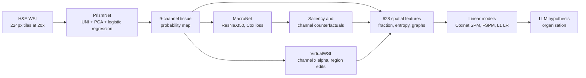

# Spatial biomarker discovery via interpretable semantic learning in histopathology

> **Bibkey** `Liang_2026` · **Venue** Cancer Cell (2026) · **Category** histopath · **Relevance** high · **Access** open
> **Link** <https://www.sciencedirect.com/science/article/pii/S153561082600259X>
> `status: complete` — 基于 CC BY 4.0 开放 PDF 全文(White Rose eprint 242066,in-press 版,页码 1–18.e1–e7;正式版为 Cancer Cell 44(8):1605–1622.e7)精读;补充图表(Figures S1–S11、Tables S1–S5)未读。/ Read from the CC BY 4.0 open full-text PDF (White Rose eprint 242066, in-press version paginated 1–18.e1–e7; final version Cancer Cell 44(8):1605–1622.e7); supplementary figures and tables not read.

---

> <!-- ZH --> **注:** 本文以 **CC BY 4.0 开放获取**发表(Cancer Cell 44(8):1605–1622.e7,in-press 版日期 2026-08-10, DOI 10.1016/j.ccell.2026.05.014),全文经开放 PDF(White Rose eprint 242066)获取,以下内容基于全文。
> <!-- EN --> **Note:** This paper is published **open access under CC BY 4.0** (Cancer Cell 44(8):1605–1622.e7; in-press date 2026-08-10; DOI 10.1016/j.ccell.2026.05.014); the full text was obtained via the open PDF (White Rose eprint 242066).

## 一句话 / One-liner
<!-- ZH --> PathPrism 先把结直肠癌 H&E 全切片(WSI)分割成 8 类组织的语义图,再把语义图拆成 628 个有数学定义的空间特征(组织占比、空间熵、组织图特征),用线性模型预测预后、突变和化疗获益;VirtualWSI 在这张语义图上做"放大/缩小某类组织"的虚拟扰动,观察风险分和特征如何变化。
<!-- EN --> PathPrism segments colorectal-cancer H&E whole-slide images (WSIs) into 8-class tissue maps, turns each map into 628 mathematically defined spatial features (tissue fractions, spatial entropy, tissue-graph features), and fits linear models for prognosis, mutations and chemotherapy benefit; VirtualWSI then perturbs the tissue map ("grow / shrink one tissue class") and tracks how risk and features move.

## 要点 / Takeaways
- <!-- ZH --> 表示方式是关键:不用黑箱 embedding,而是"语义分割图 → 628 个可命名的空间特征";在 DACHS 5 折交叉验证中,线性 Cox 模型(SPM / 只用 10 个特征的 FSPM)C-index 都超过 0.7,与 MacroNet 和病理基础模型相当(Fig. 4G)。 <!-- EN --> The representation is the point: instead of black-box embeddings, "semantic map → 628 nameable spatial features"; linear Cox models (SPM, and FSPM with only 10 features) both exceed C-index 0.7 in DACHS 5-fold CV, on par with MacroNet and pathology foundation models (Fig. 4G).
- <!-- ZH --> 宏观组织结构也带分子信息:仅用空间特征的 L1 逻辑回归预测 MSI,DACHS 中位 AUC 0.85、7 个外部队列 0.78;TCGA 上 BMPR2/BRAF/TP53 AUC 0.78/0.75/0.66(Fig. 5B–E)。 <!-- EN --> Macro tissue architecture carries molecular signal: an L1 logistic regression on spatial features predicts MSI with median AUC 0.85 (DACHS) and 0.78 (7 external cohorts); on TCGA, BMPR2/BRAF/TP53 AUCs are 0.78/0.75/0.66 (Fig. 5B–E).
- <!-- ZH --> 化疗分层是最醒目的发现:III 期 CRC 中,LYM–MUC–CC(黏液周围淋巴细胞连通的碎片化程度)> 5 的患者接受辅助化疗反而更差(HR 9.08),≤ 5 的患者明显获益(HR 0.29),交互 HR 32.45(Fig. 5J);作者明确说这是假设生成。 <!-- EN --> The headline clinical finding: in stage III CRC, patients with LYM–MUC–CC (fragmentation of lymphocyte connectivity around mucin) > 5 did worse with adjuvant chemotherapy (HR 9.08), those ≤ 5 benefited (HR 0.29), interaction HR 32.45 (Fig. 5J); the authors call this hypothesis-generating.
- <!-- ZH --> VirtualWSI 的扰动很简单:把某个组织类别的概率通道乘以 α 再取 argmax,边界处不确定的像素先变;无需再训练模型。作者强调这是"模型审讯",不是生物因果(Methods, Limitations)。 <!-- EN --> VirtualWSI's perturbation is simple: multiply one tissue-class probability channel by α and re-take the argmax, so uncertain boundary pixels flip first; no retraining. The authors stress this is model interrogation, not biological causality (Methods, Limitations).
- <!-- ZH --> LLM(GPT-4o)只用来把已发现的标志物整理成机制假设,另一个 GPT-4o 当审稿人;5 位专家评分,不构成实验验证(Fig. 6, Figs. S7–S9)。 <!-- EN --> The LLM (GPT-4o) only organizes discovered biomarkers into mechanistic hypotheses, with a second GPT-4o as reviewer; 5 experts rated them, which is not experimental validation (Fig. 6, Figs. S7–S9).

## 研究问题 / Problem
<!-- ZH --> 空间生物标志物(肿瘤微环境中多尺度的组织排布模式)对精准肿瘤学很重要,但 WSI 太大、组织异质性强,人工发现慢,临床验证过的空间标志物很少(Introduction)。深度学习和病理基础模型虽然准,但是黑箱;基于像素或隐向量的事后解释(热图)弥散、含糊,很难被定义、量化、验证成病理学上可解释的标志物。这也妨碍了用 LLM 生成假设,以及"从预测走向主动扰动"(Introduction)。作者想要一个**不牺牲性能**的可解释框架。
<!-- EN --> Spatial biomarkers (multiscale arrangement patterns in the tumour microenvironment) matter for precision oncology, but WSIs are huge and heterogeneous, manual discovery is slow, and few spatial biomarkers are clinically validated (Introduction). Deep-learning and foundation models are accurate but black boxes; post-hoc pixel/latent explanations (heatmaps) are diffuse and hard to define, quantify and validate as pathologically interpretable biomarkers. This also blocks LLM-assisted hypothesis generation and the move from prediction to active perturbation (Introduction). The authors want an interpretable framework that does **not** sacrifice performance.

## 方法 / Method
<!-- ZH --> 1. **PrismNet(组织语义分割)**:WSI 在 20×(0.5 μm/像素)下切成 224×224 tile;冻结的 UNI 编码器提 1024 维特征 → PCA 压到 32 维 → 逻辑回归分类为 8 类 CRC 组织:ADI 脂肪、DEB 碎屑、LYM 淋巴细胞、MUC 黏液、MUS 平滑肌、NORM 正常黏膜、STR 癌相关间质、TUM 腺癌上皮,另加 BACK 背景。训练集 NCT-CRC-HE-100K-NONORM,测试集 CRC-VAL-HE-7K;作者比较了 CTransPath / PLIP / CONCH / MUSK / UNI 与 PCA / VAE,UNI+PCA 总体最好,但 CONCH、MUSK、UNI 表现非常接近,作者认为编码器选择影响有限(Methods "PrismNet"; Figs. S1B–C);PrismNet 与 KNN、SVM、MLP、LR、ViT-B/16、ResNet、VGG19 等分类器的比较见 Fig. 2A。把每个 tile 的类别概率按坐标拼回去,得到 9 通道的组织概率图和分割图(Methods "WSI semantic segmentation",用 STAMP 实现)。
<!-- ZH --> 2. **MacroNet(从语义图学预后)**:输入 9 通道概率图,ResNeXt50 骨干(输入通道改为 9)→ 2048 维 → 全连接到 32 维 → 风险分;损失为负 Cox 部分对数似然,训练 100 epoch(Methods "MacroNet")。对照:attMIL-UNI、GigaPath、CHIEF、COBRA、PRISM(后四者的 slide embedding 接 elastic-net Cox)。
<!-- ZH --> 3. **多角度解释 MacroNet**:按风险高/低分组比较组织比例与 Captum saliency 归因;"结构保持的反事实":把某组织通道整体乘以 α(α<1 抑制、α>1 增强)、其他通道不变,重新打风险分(Methods "Structure-preserving counterfactual explanation"; Fig. 3D–G)。
<!-- ZH --> 4. **628 个空间特征**:空间占比(每类像素比例)、空间熵(滑窗局部 Shannon 熵)、单组织图(每类 mask 腐蚀 → 连通域;大于 2,000 像素的区域切成 30×30 块;节点距离 < 20 像素连边;算节点数、度统计、聚类系数、中心性、模块度等)和多组织图(每对组织之间只连异类边;算孤立节点比例、平均异类邻居数等)(Methods "Spatial biomarker construction"; Tables S2–S3)。
<!-- ZH --> 5. **透明模型**:预后用 elastic-net Cox(l1_ratio 0.5)在 628 特征上训练 = SPM,取系数绝对值最大的 10 个特征重训 = FSPM;突变用 L1 逻辑回归(C = 0.1);化疗获益用 Cox 交互模型(ACT × 标志物,Wald 检验,p < 0.1 再按中位数二分复核)(Methods "Transparent prognostic model" 等)。
<!-- ZH --> 6. **LLM 假设整理**:GPT-4o 根据标志物定义、组织表型和临床背景提出机制与后续实验,第二个 GPT-4o 充当"审稿人";无微调、无检索增强;5 位专家打分(Methods "LLM co-reasoning")。
<!-- ZH --> 7. **VirtualWSI**:(a) 全局通道扰动:某类组织概率 × α 后重新 argmax,得到扰动后的分割图,再重算空间特征和 FSPM 风险;(b) 交互式区域扰动:用户在界面里选区域、改写组织类别(如 LYM→MUS)。用 628 特征做 UMAP 得到"空间标志物图谱",观察扰动样本的轨迹(Methods "VirtualWSI"; Fig. 7)。
<!-- EN --> 1. **PrismNet (tissue segmentation)**: WSIs are tiled at 20× (0.5 µm/pixel) into 224×224 tiles; a frozen UNI encoder gives 1024-d features → PCA to 32-d → logistic regression into 8 CRC tissue classes (ADI adipose, DEB debris, LYM lymphocytes, MUC mucus, MUS smooth muscle, NORM normal mucosa, STR cancer stroma, TUM adenocarcinoma epithelium) plus BACK. Trained on NCT-CRC-HE-100K-NONORM, tested on CRC-VAL-HE-7K; the authors compared CTransPath / PLIP / CONCH / MUSK / UNI with PCA / VAE; UNI+PCA was best overall, but CONCH, MUSK and UNI performed very similarly, so encoder choice had limited impact (Methods "PrismNet"; Figs. S1B–C). PrismNet vs KNN, SVM, MLP, LR, ViT-B/16, ResNet and VGG19 classifiers is in Fig. 2A. Tile probabilities are placed back at their coordinates to form a 9-channel probability map and segmentation map (via STAMP).
<!-- EN --> 2. **MacroNet (prognosis from maps)**: a ResNeXt50 with 9 input channels → 2048-d → FC to 32-d → risk score, trained with the negative Cox partial log-likelihood for 100 epochs (Methods "MacroNet"). Baselines: attMIL-UNI, GigaPath, CHIEF, COBRA, PRISM (slide embeddings + elastic-net Cox).
<!-- EN --> 3. **Interpreting MacroNet**: tissue fractions and Captum saliency by risk group; a structure-preserving counterfactual scales one tissue channel by α (<1 suppress, >1 enhance) and re-scores (Fig. 3D–G).
<!-- EN --> 4. **628 spatial features**: fractions, sliding-window entropy, single-tissue graphs (eroded masks → connected components; regions > 2,000 px split into 30×30 blocks; edges for node distance < 20 px; degree, clustering, centrality, modularity…) and pairwise multi-tissue graphs (only cross-class edges; isolated-node ratio, mean cross-class neighbours…) (Methods; Tables S2–S3).
<!-- EN --> 5. **Transparent models**: elastic-net Cox (l1_ratio 0.5) on all 628 features = SPM; top-10 |coef| features refit = FSPM; L1 logistic regression (C = 0.1) per mutation; Cox interaction models (ACT × biomarker, Wald test) for chemotherapy benefit.
<!-- EN --> 6. **LLM hypotheses**: GPT-4o proposes mechanisms and follow-up experiments from biomarker definitions, morphology and clinical context; a second GPT-4o audits; no fine-tuning or retrieval; 5 experts rate the outputs.
<!-- EN --> 7. **VirtualWSI**: (a) global channel perturbation (probability × α, re-argmax, recompute features and FSPM risk); (b) interactive region edits in a GUI (e.g. LYM→MUS). A UMAP of the spatial features forms a "spatial biomarker atlas" in which perturbation trajectories are plotted (Fig. 7).

## 方法图 / Method diagram


## 数据 / Data
<!-- ZH --> 11 个 CRC 队列、约 7,000 例患者(Abstract;质控后人数见 Fig. 1G / Methods "Patient cohorts")。预后:DACHS(n = 2,281,主队列,5 折 CV)、MCO(1,395)、CR07(579,仅直肠癌、常有术前放疗、MSI 比例低)、TCGA(232)。突变:DACHS、MCO、TCGA 加 GECCO 联盟 5 个队列(EPIC 124、CORSA 50、IWHS 267、CRA 208、WHI 225)。辅助化疗(ACT):MCO、IDEA(669,III 期,法国 GERCOR 子队列)、HeCOG(970)。分割训练用公开 patch 数据 NCT-CRC-HE-100K-NONORM(10 万 patch,86 张切片)和 CRC-VAL-HE-7K(7,180 patch,50 例),与下游队列无重叠。乳腺癌迁移:TCGA-BRCA(642)和 HeCOG-BRCA(38,接受抗体偶联药物 ADC 治疗);BRCA 分割数据 TCGA-BRCA-6K(训练 4,700 patch / 100 WSI,测试 1,149 patch / 20 WSI)。WSI 组织面积 < 1.25 cm²(< 10,000 个组织 patch)的被排除。
<!-- EN --> 11 CRC cohorts, ~7,000 patients (Abstract; post-QC counts in Fig. 1G / Methods "Patient cohorts"). Prognosis: DACHS (n = 2,281; primary, 5-fold CV), MCO (1,395), CR07 (579; rectal only, frequent pre-op radiotherapy, low MSI), TCGA (232). Mutations: DACHS, MCO, TCGA plus five GECCO cohorts (EPIC 124, CORSA 50, IWHS 267, CRA 208, WHI 225). Adjuvant chemotherapy (ACT): MCO, IDEA (669; stage III, French GERCOR sub-cohort), HeCOG (970). Segmentation used public patches (NCT-CRC-HE-100K-NONORM, 100k patches from 86 slides; CRC-VAL-HE-7K, 7,180 patches from 50 patients) with no overlap with downstream cohorts. Breast transfer: TCGA-BRCA (642) and HeCOG-BRCA (38, ADC-treated); BRCA segmentation set TCGA-BRCA-6K (4,700 train patches / 100 WSIs, 1,149 test / 20 WSIs). Slides with < 1.25 cm² tissue (< 10,000 tissue patches) were excluded.

## 主要结果 / Key results
- <!-- ZH --> **分割**:PrismNet 在 CRC-VAL-HE-7K 上 macro-F1 0.948(95% CI 0.942–0.954)、MCC 0.958、macro-AUROC 0.988(Fig. 2A)。 <!-- EN --> **Segmentation**: PrismNet on CRC-VAL-HE-7K reaches macro-F1 0.948 (95% CI 0.942–0.954), MCC 0.958, macro-AUROC 0.988 (Fig. 2A).
- <!-- ZH --> **MacroNet 预后**(终点为疾病特异生存 DSS):DACHS 5 折 C-index 0.716 ± 0.020,与 attMIL-UNI、GigaPath、CHIEF、COBRA、PRISM 相当(Fig. 2B);外部 MCO 和 CR07 排名前二(Fig. 2C);用 DACHS 阈值做 KM 分层,HR 3.68(MCO)、2.48(CR07)、3.27(TCGA)(Fig. 2D)。 <!-- EN --> **MacroNet prognosis** (endpoint: disease-specific survival, DSS): DACHS 5-fold C-index 0.716 ± 0.020, comparable to the five foundation-model baselines (Fig. 2B); top-two in MCO and CR07 (Fig. 2C); KM with DACHS thresholds gives HR 3.68 (MCO), 2.48 (CR07), 3.27 (TCGA) (Fig. 2D).
- <!-- ZH --> **解释**:高风险组 TUM、DEB、STR 更多,低风险组 ADI、LYM、MUS、NORM 更多;反事实中放大 LYM 一致降低风险分(Fig. 3B, 3F–G);高风险样本空间熵显著更高(Fig. 3I)。 <!-- EN --> **Interpretation**: high-risk slides have more TUM, DEB, STR; low-risk more ADI, LYM, MUS, NORM; amplifying LYM consistently lowers risk (Fig. 3B, 3F–G); high-risk slides have significantly higher spatial entropy (Fig. 3I).
- <!-- ZH --> **单个标志物**:TUM 图熵 C-index 0.62、HR 1.97;MUS 空间占比 C-index 0.60、HR 0.57(Fig. 4D);多组织图特征 ADI-TUM-E 在 CR07 达 0.69,STR-TUM-EN1 与 MUS-TUM-EN2 在 TCGA 各 0.73(Fig. 4E)。 <!-- EN --> **Single biomarkers**: TUM graph entropy C-index 0.62, HR 1.97; MUS fraction C-index 0.60, HR 0.57 (Fig. 4D); ADI-TUM-E reaches 0.69 in CR07, STR-TUM-EN1 and MUS-TUM-EN2 0.73 each in TCGA (Fig. 4E).
- <!-- ZH --> **透明预后模型**:SPM 和 FSPM 在 DACHS 5 折 C-index 均 > 0.7(Fig. 4G),并推广到 MCO/CR07/TCGA(Fig. 4H);两者都优于只用组织占比的模型(Figs. S4B–C);FSPM 10 个特征与基础模型 slide embedding 合并后性能提升,空间特征约占总系数贡献的 25%(Fig. 4K)。 <!-- EN --> **Transparent prognosis**: SPM and FSPM both exceed C-index 0.7 (DACHS 5-fold; Fig. 4G) and generalize to MCO/CR07/TCGA (Fig. 4H); both beat fraction-only models (Figs. S4B–C); adding the 10 FSPM features to foundation-model embeddings improves performance, with spatial features ~25% of total coefficient weight (Fig. 4K).
- <!-- ZH --> **突变**:MSI 中位 AUC 0.85(DACHS 5 折)和 0.78(7 个外部队列),关键特征 MUC-TUM-IR2、DEB-ENT(Fig. 5B–D);GECCO 训练、TCGA 测试:BMPR2 0.78、BRAF 0.75、TP53 0.66(Fig. 5E)。 <!-- EN --> **Mutations**: MSI median AUC 0.85 (DACHS 5-fold) and 0.78 (7 external cohorts), key features MUC-TUM-IR2 and DEB-ENT (Fig. 5B–D); trained on GECCO cohorts, tested on TCGA: BMPR2 0.78, BRAF 0.75, TP53 0.66 (Fig. 5E).
- <!-- ZH --> **化疗**:II 期 ACT 患者中 LYM-TUM-AD2 在 MCO 分层 HR 5.19(p = 0.0005),HeCOG HR 2.00(p = 0.007)(Fig. S6B);MCO II 期 LYM-NORM-ED ≤ 0.038 者 ACT 无不良关联(HR 0.79),> 0.038 者 HR 4.49(Fig. 5I);III 期 LYM–MUC–CC > 5:HR 9.08(p = 0.008),≤ 5:HR 0.29(p < 0.0001),交互 HR 32.45(p = 0.001)(Fig. 5J)。 <!-- EN --> **Chemotherapy**: stage II ACT patients — LYM-TUM-AD2 HR 5.19 in MCO (p = 0.0005), HR 2.00 in HeCOG (p = 0.007) (Fig. S6B); MCO stage II, LYM-NORM-ED ≤ 0.038 shows no adverse ACT association (HR 0.79) vs HR 4.49 when > 0.038 (Fig. 5I); stage III LYM–MUC–CC > 5 HR 9.08 (p = 0.008), ≤ 5 HR 0.29 (p < 0.0001), interaction HR 32.45 (p = 0.001) (Fig. 5J).
- <!-- ZH --> **VirtualWSI**:扰动 MUC/LYM 通道使 LYM–MUC–CC 连续变化,患者响应分为正向/平坦/负向三类;对原本无 LYM–MUC 结构的患者,扰动诱导的状态转变又分出一个 ACT 显著获益亚组(HR 0.27,p = 0.010)(Fig. 7G–M;该 KM 结果在图例中属 panel M,正文引用为 Fig. 7L)。 <!-- EN --> **VirtualWSI**: perturbing MUC/LYM channels moves LYM–MUC–CC continuously, with positive / flat / negative response archetypes; among patients without LYM–MUC structure, perturbation-induced state transitions identify a subgroup with significant ACT benefit (HR 0.27, p = 0.010) (Fig. 7G–M; the figure legend puts this KM result in panel M, while the body text cites Fig. 7L).
- <!-- ZH --> **乳腺癌迁移**:MacroNet/SPM/FSPM 与基础模型相当(Figs. S11D–F);HeCOG-BRCA(n = 38)中 T-DXd 治疗者 STR-ACL HR 6.11(p = 0.018),SG 治疗者 ADI-NEC-BT2 HR 0.06(p = 0.002);与 ERBB2/TOP1/TACSTD2 表达的相关"显著但较弱"(Figs. S11J–O)。 <!-- EN --> **Breast transfer**: MacroNet/SPM/FSPM comparable to foundation models (Figs. S11D–F); in HeCOG-BRCA (n = 38), STR-ACL HR 6.11 (p = 0.018) under T-DXd and ADI-NEC-BT2 HR 0.06 (p = 0.002) under SG; correlations with ERBB2/TOP1/TACSTD2 are significant but modest (Figs. S11J–O).

## 创新点 / Contributions
- <!-- ZH --> 把"语义分割 → 可量化空间特征谱 → 透明线性模型"做成完整流水线,预测可直接追溯到具体空间标志物,性能与基础模型相当。 <!-- EN --> A full "semantic segmentation → quantified spatial-feature spectrum → transparent linear model" pipeline whose predictions trace back to named spatial biomarkers while matching foundation models.
- <!-- ZH --> 闭环发现:先训 MacroNet、解释它,再把解释变成可量化的候选标志物,在多队列验证(Fig. 4A)。 <!-- EN --> Closed-loop discovery: train and interpret MacroNet, turn the explanations into quantified candidate biomarkers, validate across cohorts (Fig. 4A).
- <!-- ZH --> VirtualWSI:在概率图上做结构保持的语义扰动 + 空间标志物 UMAP 图谱,无需再训练。 <!-- EN --> VirtualWSI: structure-preserving semantic perturbation on probability maps plus a spatial-biomarker UMAP atlas, with no retraining.
- <!-- ZH --> 作者结论:由可解释空间标志物刻画的宏观组织结构携带了"传统上认为需要细胞级分析"的遗传信息(MSI/BRAF/TP53/BMPR2;Results p.7);DEB 熵、MUC-TUM 交互等在多个突变任务中都是主要贡献特征,MSI 的特征按平均 |SHAP| 排序(Fig. 5D、5F–H)。 <!-- EN --> Authors' conclusion: macro-scale organization captured by interpretable spatial biomarkers "encodes genetic information traditionally assumed to require cellular-level analysis" (MSI/BRAF/TP53/BMPR2; Results p.7); DEB entropy and MUC-TUM interactions are top contributors across several mutation tasks, with MSI features ranked by mean absolute SHAP value (Fig. 5D, 5F–H).
- <!-- ZH --> 在 ~7,000 例、11 个队列上覆盖预后、MSI/BRAF/TP53/BMPR2 突变和 II/III 期辅助化疗分层,并迁移到乳腺癌。 <!-- EN --> Covers prognosis, MSI/BRAF/TP53/BMPR2 and stage II/III adjuvant-chemotherapy stratification on ~7,000 patients in 11 cohorts, plus transfer to breast cancer.

## 局限 / Limitations
- <!-- ZH --> (作者)依赖预先定义的组织类别,只能捕捉这些类别能表达的空间模式;换瘤种需要重新标注、训练、验证 PrismNet(如 BRCA)。 <!-- EN --> (Authors) Depends on predefined tissue classes and only captures patterns they can express; a new tumour type needs new annotations, PrismNet training and validation (as for BRCA).
- <!-- ZH --> (作者)VirtualWSI 是探索性的模型审讯,不代表生物因果,也不代表物理上可实现的组织状态。 <!-- EN --> (Authors) VirtualWSI is exploratory model interrogation, not evidence of biological causality or physically realizable tissue states.
- <!-- ZH --> (作者)预后性能在"中等"范围,ACT 等下游生物学解读都只是假设生成;LLM 只整理假设,不产生经验证的结论。 <!-- EN --> (Authors) Prognostic performance is moderate, so downstream interpretations (incl. ACT) are hypothesis-generating; the LLM only organizes hypotheses.
- <!-- ZH --> 我们的理解:许多化疗与 ADC 结论来自小亚组(如 HeCOG-BRCA 仅 38 例),HR 9.08、交互 HR 32.45 这类极端效应量在小样本中不稳定,需要前瞻验证。 <!-- EN --> Our reading: several chemotherapy and ADC findings rest on small subgroups (HeCOG-BRCA has 38 patients); extreme effect sizes such as HR 9.08 or interaction HR 32.45 are unstable in small samples and need prospective validation.
- <!-- ZH --> 我们的理解:tile 是 224 像素(约 112 μm),再加上 20 像素的连边阈值,所以特征描述的是"组织块"尺度的排布,不涉及单细胞层面。 <!-- EN --> Our reading: tiles are 224 px (~112 µm) and graphs use a 20-pixel edge threshold, so features describe tissue-patch-scale arrangement, not single cells.

## 与本研究方向的关系 / Relation to our direction
<!-- ZH --> 我们的理解:这篇可以看作 detect → model → revert 在 H&E 上的一个"可解释版"原型,建议逐环对照:
- **检测环**:PathPrism 的输出不是热图,而是一组可命名、可量化的空间特征(如 TUM 图熵、STR–TUM 交互)。我们的理解:把这 628 维谱当作组织的"可解释特征空间",就可以在上面做无监督异常检测(例如相对健康参照分布的距离),比在黑箱 embedding 上打分更容易让病理医生核对。
- **模型环**:VirtualWSI 在语义概率图上做受控编辑,再看样本在空间标志物图谱中怎样移动——我们的理解:这可看作"可操纵的虚拟组织"的最简形式。作者明确说它不代表因果,也不保证组织状态物理可实现。
- **回复环**:文中的"回复"停在组织层面(如放大 LYM 一致降低风险分),没有落到基因或药物靶点;BRCA 部分只给出空间特征与 ERBB2/TOP1/TACSTD2 表达的弱相关。我们的理解:要连到基因层面,需要与 H&E 配对的空间转录组或单细胞数据。
- **对肾脏伪影注入课题**:我们的理解:PrismNet 的"冻结基础模型 + PCA + 逻辑回归"组织分割很便宜,适合先在肾脏 H&E 上建组织本体(肾小球、肾小管、间质、血管等),再用同样的单/多组织图特征描述结构异常;但肾脏需要自己的类别与标注,不能直接用 CRC 的 8 类。
<!-- EN --> Our reading: this is an interpretable prototype of detect → model → revert on H&E; compare stage by stage:
- **Detect**: PathPrism outputs nameable, quantified spatial features (e.g. TUM graph entropy, STR–TUM interaction) rather than heatmaps. Our reading: treating the 628-feature spectrum as an interpretable feature space lets us run unsupervised anomaly detection on it (e.g. distance to a healthy reference distribution), which pathologists can check more easily than scores on black-box embeddings.
- **Model**: VirtualWSI makes controlled edits on semantic probability maps and tracks samples in the spatial-biomarker atlas — our reading: this can be seen as the simplest form of a manipulable virtual tissue. The authors state it is not causal and not guaranteed physically realizable.
- **Revert**: "reverting" stays at tissue level (e.g. amplifying LYM lowers risk) with no gene or drug-target mapping; the BRCA part only shows modest correlations with ERBB2/TOP1/TACSTD2 expression. Our reading: linking to genes needs spatial transcriptomics or single-cell data paired with the H&E.
- **Kidney the artifact-injection topic**: Our reading: PrismNet's "frozen foundation model + PCA + logistic regression" segmentation is cheap enough to build a kidney tissue ontology (glomeruli, tubules, interstitium, vessels, …) and reuse the single-/multi-tissue graph features to describe structural anomalies; kidney needs its own classes and annotations rather than the CRC 8.

## 可复用资产 / Reusable assets
- <!-- ZH --> **代码**:PathPrism 代码与说明(论文 Data and code availability)。注意 README 里的总览图 `assets/figure1_new2.png` 只是 1 字节的 git-lfs 占位文件。 <!-- EN --> **Code**: PathPrism codebase and instructions (paper's Data and code availability). Note the README overview image `assets/figure1_new2.png` is a 1-byte git-lfs placeholder.
<!-- ZH/EN --> <https://github.com/KatherLab/PathPrism>
- <!-- ZH --> **相关流水线**:STAMP(WSI 特征提取,PrismNet 分割用它实现)。 <!-- EN --> **Related pipeline**: STAMP (WSI feature extraction, used to run PrismNet segmentation).
<!-- ZH/EN --> <https://github.com/KatherLab/STAMP>
- <!-- ZH --> **公开数据**:NCT-CRC-HE-100K / CRC-VAL-HE-7K(Zenodo 1214456);TCGA/CPTAC WSI 与分子数据(GDC、cBioPortal)。DACHS、MCO、CR07、IDEA、HeCOG、GECCO 为受限数据,需向各机构申请。 <!-- EN --> **Public data**: NCT-CRC-HE-100K / CRC-VAL-HE-7K (Zenodo 1214456); TCGA/CPTAC WSIs and molecular data (GDC, cBioPortal). DACHS, MCO, CR07, IDEA, HeCOG, GECCO are restricted (apply to each institution / consortium).
<!-- ZH/EN --> <https://zenodo.org/records/1214456> · <https://portal.gdc.cancer.gov/> · <https://www.cbioportal.org/>
- <!-- ZH --> **可复用组件**:UNI+PCA+LR 的组织分割配置;单/多组织图特征定义(Tables S2/S3);Cox 交互框架;概率通道 × α 的扰动算子。 <!-- EN --> **Reusable components**: the UNI+PCA+LR segmentation recipe; single-/multi-tissue graph-feature definitions (Tables S2/S3); the Cox interaction framework; the probability-channel × α perturbation operator.

## 待读 / Follow-ups
- <!-- ZH --> 读 Tables S2/S3,拿到 628 个特征的精确定义,判断哪些能直接搬到肾脏组织图上。 <!-- EN --> Read Tables S2/S3 for exact definitions of the 628 features and judge which transfer to kidney tissue graphs.
- <!-- ZH --> 跑通 PathPrism 代码中的 CRC100K 分割与 TCGA 预后,作为 H&E 侧的可解释基线。 <!-- EN --> Run the PathPrism code on CRC100K segmentation and TCGA prognosis as an interpretable H&E baseline.
- <!-- ZH --> 同组相关工作:MoPaDi(扩散反事实,Cancer Research 2026,本库 `counterfactual-diffusion-cancerres-2026`),与 VirtualWSI 的"语义图扰动"对比"像素级反事实"。 <!-- EN --> Related work from the same group: MoPaDi (diffusion counterfactuals, Cancer Research 2026; `counterfactual-diffusion-cancerres-2026` in this library) — compare pixel-level counterfactuals with VirtualWSI's semantic-map perturbation.

## 图表 / Figures & tables

<!-- ZH --> **说明:** GitHub README 的总览图(`assets/figure1_new2.png`)为 git-lfs 占位文件(1 字节),无法下载;因此本节以**链接**指向 CC BY 4.0 开放获取全文中的图,并据全文数字复现关键结果表。
<!-- EN --> **Note:** The GitHub README overview image (`assets/figure1_new2.png`) is a 1-byte git-lfs placeholder and is not downloadable; this section therefore **links** to the figures in the CC BY 4.0 open-access full text and reproduces the key result tables from numbers already in the paper.

<!-- ZH --> **图1(总览,开放获取).** PathPrism 三级"棱镜"流水线(PrismNet 语义分割 → MacroNet 宏观架构—生存 → 628 维空间生物标志物谱 + VirtualWSI):见开放获取全文 DOI <https://doi.org/10.1016/j.ccell.2026.05.014>(Cancer Cell 44, 2026,CC BY 4.0);代码总览图见 <https://github.com/KatherLab/PathPrism>。
<!-- EN --> **Fig 1 (overview, open access).** PathPrism three-stage "prism" pipeline (PrismNet semantic segmentation → MacroNet macro-architecture-to-survival → 628-dim spatial-biomarker spectrum + VirtualWSI): see the open-access full text, DOI <https://doi.org/10.1016/j.ccell.2026.05.014> (Cancer Cell 44, 2026, CC BY 4.0); repo overview at <https://github.com/KatherLab/PathPrism>.

<!-- ZH/EN --> _Source: https://doi.org/10.1016/j.ccell.2026.05.014 · https://github.com/KatherLab/PathPrism · License: CC BY 4.0_

### 结果表 / Results

<!-- ZH --> **表1.** 主要性能指标(数字取自本文"主要结果"节;分割用 CRC-VAL-HE-7K,预后/突变用 DACHS 5 折)。
<!-- EN --> **Table 1.** Headline performance (numbers taken from the Key-results section above; segmentation on CRC-VAL-HE-7K, prognosis/mutation on DACHS 5-fold).

| Task / 任务 | Model | Cohort | Metric | Value |
|---|---|---|---|---|
| Tissue segmentation / 组织分割 | PrismNet | CRC-VAL-HE-7K | macro-F1 | 0.948 |
| Tissue segmentation / 组织分割 | PrismNet | CRC-VAL-HE-7K | MCC | 0.958 |
| Tissue segmentation / 组织分割 | PrismNet | CRC-VAL-HE-7K | macro-AUROC | 0.988 |
| Prognosis (DSS) / 预后 | MacroNet | DACHS (5-fold) | C-index | 0.716 ± 0.020 |
| MSI prediction / MSI 预测 | PathPrism | DACHS (5-fold) | median AUC / 中位 AUC | 0.85 |
| MSI prediction / MSI 预测 | PathPrism | 7 external cohorts | median AUC / 中位 AUC | 0.78 |

<!-- ZH --> **表2.** MacroNet 风险分层的 Kaplan–Meier 危险比(HR)。
<!-- EN --> **Table 2.** Kaplan–Meier hazard ratios (HR) for MacroNet risk stratification.

| Cohort / 队列 | HR |
|---|---|
| MCO | 3.68 |
| CR07 | 2.48 |
| TCGA | 3.27 |

## 引用 / Cite
```bibtex
@article{Liang_2026, title={Spatial biomarker discovery via interpretable semantic learning in histopathology}, ISSN={1535-6108}, url={http://dx.doi.org/10.1016/j.ccell.2026.05.014}, DOI={10.1016/j.ccell.2026.05.014}, journal={Cancer Cell}, volume={44}, number={8}, pages={1605--1622.e7}, publisher={Elsevier BV}, author={Liang, Junhao and Jiang, Xiaofeng and Reitsam, Nic Gabriel and Lenz, Tim and Zhang, Li and Gustav, Marco and Carrero, Zunamys Itzell and Muti, Hannah Sophie and Neidlinger, Peter and Clusmann, Jan and Žigutytė, Laura and Sainath, Vidhya and Wolf, Fabian and Boardman, Lisa A. and French, Amy J. and Goode, Ellen L. and Gsur, Andrea and Brezina, Stefanie and Gunter, Marc J. and Steinfelder, Robert and Harrison, Tabitha and Peters, Ulrike and Phipps, Amanda I. and Quirke, Philip and West, Nicholas P. and Hoffmeister, Michael and Brenner, Hermann and Wankhede, Durgesh and Jonnagaddala, Jitendra and Hawkins, Nicholas and Ward, Robyn L. and Fountzilas, Elena and Papadopoulou, Kyriaki and Fountzilas, George and André, Thierry and Taieb, Julien and Emile, Jean-François and Svrcek, Magali and Kong, Lingjie and Kather, Jakob Nikolas}, year={2026}, month=jun }
```
