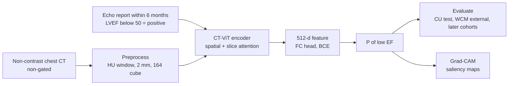

# An artificial intelligence model to detect abnormal ejection fraction from non-contrast chest computed tomography: the CT–LVEF study

> **Bibkey** `Raikhelkar_2026` · **Venue** European Heart Journal - Digital Health (2026) · **Category** imaging · **Relevance** medium · **Access** open
> **Link** <https://doi.org/10.1093/ehjdh/ztag088>
> `status: complete` — 全文精读基于 PMC 全文(PMC13322390,CC BY,开放获取)。旧版笔记写的是"付费墙、仅摘要",已据全文改正。/ Close reading of the PMC full text (PMC13322390, CC BY, open access). The earlier note said "paywalled, abstract only"; corrected from the full text.

---

## 一句话 / One-liner
<!-- ZH --> 用 GenerateCT 的 CT-ViT 编码器(3D vision transformer)从为其他原因拍的常规、非门控、非增强胸部 CT 判断左室射血分数(LVEF)是否 <50%;在开发医院(Columbia)AUROC 0.786、外部医院(Weill Cornell)0.762,作为心衰的机会性筛查(Abstract)。
<!-- EN --> A CT-ViT encoder (3D vision transformer from GenerateCT) classifies left-ventricular ejection fraction (LVEF) <50% vs ≥50% from routine non-gated, non-contrast chest CTs acquired for other reasons; AUROC 0.786 at the development site (Columbia) and 0.762 at an external site (Weill Cornell), as opportunistic heart-failure screening (Abstract).

## 要点 / Takeaways
- <!-- ZH --> 标签来自 CT 前后 6 个月内的超声心动图报告里的 EF 值,按 50% 二值化;不需要额外检查(Methods §Data curation, §LVEF-based classification)。 <!-- EN --> Labels are the EF value from an echocardiogram report within 6 months of the CT, binarised at 50%; no extra test is needed (Methods §Data curation, §LVEF-based classification).
- <!-- ZH --> 只用人口学 + CT 报告里 260 个 ICD-9 诊断码的 XGBoost 基线 AUROC 只有 0.607 / 0.592,说明信号主要来自图像本身(Table 6)。 <!-- EN --> An XGBoost baseline on demographics + 260 ICD-9 codes from the CT report reaches only AUROC 0.607 / 0.592, so the signal comes from the images (Table 6).
- <!-- ZH --> CT 与超声间隔越近,AUROC 越高:Columbia ≤1 天子集 0.800 vs 全体 0.786(Holm 校正 P=0.004)(Table 5, Results)。 <!-- EN --> Closer CT–echo timing gives higher AUROC: Columbia ≤1-day subset 0.800 vs 0.786 overall (Holm-adjusted P=0.004) (Table 5, Results).
- <!-- ZH --> 在 90 / 100 张抽样 CT 上,模型加权 F1 0.808 / 0.797,两位胸部放射科医生 0.646、0.802 / 0.623(Table 7)。 <!-- EN --> On 90 / 100 sampled CTs, the model's weighted F1 is 0.808 / 0.797 vs thoracic radiologists' 0.646 and 0.802 / 0.623 (Table 7).
- <!-- ZH --> 在时间上更晚的"独立连续测试集"上 AUROC 降到 0.742(Columbia)/ 0.735(Weill Cornell),balanced accuracy 只有约 0.57(Results)。 <!-- EN --> On temporally later "independent consecutive" test sets AUROC drops to 0.742 (Columbia) / 0.735 (Weill Cornell), with balanced accuracy only ~0.57 (Results).

## 研究问题 / Problem
<!-- ZH --> 心衰全球超过 6,400 万患者;很多早期收缩功能障碍(HFrEF / HFmrEF)患者没有症状、未被诊断,错过了能减缓进展的指南导向药物治疗(GDMT)(Introduction)。EF 通常要靠超声心动图、心脏 MRI 等专门检查测量(Discussion);美国每年做超过 8,000 万次 CT,胸部 CT 很常见(Introduction)。已有 AI 研究用 CT 预测心血管不良事件风险(如量化冠脉钙化、左房容积、左室质量指数;Introduction, Discussion),但作者称从非门控、非增强胸部 CT 计算 EF 此前没有人做过(Discussion)。问题:能否从这些"顺带"拍的非门控(不与心跳同步)、非增强胸部 CT 中直接筛出 EF 降低的患者?
<!-- EN --> Heart failure affects over 64 million people worldwide; many with early systolic dysfunction (HFrEF / HFmrEF) are asymptomatic and undiagnosed and miss guideline-directed medical therapy (GDMT) that slows progression (Introduction). EF normally needs dedicated tests such as echocardiography or cardiac MRI (Discussion); more than 80 million CTs are performed yearly in the USA and chest CT is common (Introduction). AI on CT has already been used to predict cardiovascular risk (e.g. quantifying coronary calcium, left atrial volume and left ventricular mass index; Introduction, Discussion), but the authors say computing EF from non-gated, non-contrast chest CT has not been explored before (Discussion). The question: can reduced EF be screened directly from incidental non-gated (not synchronised to the heartbeat), non-contrast chest CTs?

## 方法 / Method
<!-- ZH --> 1. **配对数据**:找出 2005-07 至 2023-08 在 Columbia(CU)或 Weill Cornell(WCM)做过非增强胸部 CT、且 CT 前后 6 个月内有超声心动图的成人;经筛选和链接得到 19,410 名患者的 34,058 对 CT–超声(Methods §Data curation)。
<!-- ZH --> 2. **标签**:超声报告里的 LVEF(2D 超声,按瀑布逻辑取值),<50% 为阳性(EF 降低),≥50% 为正常(Methods §LVEF-based classification)。
<!-- ZH --> 3. **划分**:CU 用于开发,按病人随机分训练/验证/保留测试集(测试集 n=5,174,20%);WCM 全部用作外部验证;另外各建一个时间上更晚的独立连续测试集(CU 2023-08 至 12,WCM 2023-08 至 2024-07)(Methods, Results)。
<!-- ZH --> 4. **CT 预处理**:DICOM 换算成 Hounsfield 单位,窗宽 [−1000, 1000] HU 去掉空气和骨;OTSU 阈值聚焦人体区域;样条插值重采样到 2×2×2 mm³;裁剪/补零到 164×164×164(Methods §3D preprocessing)。
<!-- ZH --> 5. **模型**:GenerateCT 的 CT-ViT 编码器作骨干(先 4 个在轴位平面上做空间注意力的 block,再 4 个沿 z 轴切片做注意力的 block),输出 512 维向量,接全连接分类头输出"低 EF"概率;训练时随机裁到 164×144×144 并水平翻转,测试时中心裁剪(Methods §AI model, §Grad-CAM)。
<!-- ZH --> 6. **训练**:二元交叉熵,AdamW,学习率 1×10⁻⁵,权重衰减 1×10⁻⁴,batch 8,20 个 epoch,第 15 个 epoch 学习率减半;用 5 个随机种子重复训练,报告均值 ± 标准差;单张 A100(Methods §AI model)。
<!-- ZH --> 7. **评估**:AUROC、F1、balanced accuracy;Brier 分数与校准曲线;按性别、年龄、种族和 CT–超声间隔分组;决策曲线分析;与两位胸部放射科医生在抽样 CT 上比较,并用 McNemar 检验;Grad-CAM 显著性图做可解释性(Methods §Evaluation, §Comparison with radiologist)。
<!-- ZH --> 8. **机会性筛查演示**:对 633 个没有配对超声的常规胸部 CT 运行模型,再查阅被标记患者的病历(Results §Opportunistic screening)。
<!-- EN --> 1. **Paired data**: adults with a non-contrast chest CT at Columbia (CU) or Weill Cornell (WCM) between Jul 2005 and Aug 2023 and an echocardiogram within 6 months; after filtering and linkage, 34,058 CT–echo pairs from 19,410 patients (Methods §Data curation).
<!-- EN --> 2. **Label**: LVEF from the echo report (2D echo, waterfall logic); <50% = positive (reduced EF), ≥50% = normal (Methods §LVEF-based classification).
<!-- EN --> 3. **Splits**: CU for development, randomly split by patient into train/validation/hold-out test (test n=5,174, 20%); all of WCM for external validation; plus temporally later independent consecutive test sets at both sites (CU Aug–Dec 2023; WCM Aug 2023–Jul 2024) (Methods, Results).
<!-- EN --> 4. **CT preprocessing**: DICOM to Hounsfield units, window [−1000, 1000] HU to drop air and bone, OTSU thresholding to focus on the body, spline resampling to 2×2×2 mm³, crop/zero-pad to 164×164×164 (Methods §3D preprocessing).
<!-- EN --> 5. **Model**: the CT-ViT encoder from GenerateCT as backbone (4 self-attention blocks over the axial plane, then 4 over slices along z), giving a 512-d vector and a fully connected head that outputs P(low EF); random crops to 164×144×144 and horizontal flips in training, centre crop at test (Methods §AI model, §Grad-CAM).
<!-- EN --> 6. **Training**: binary cross-entropy, AdamW, lr 1×10⁻⁵, weight decay 1×10⁻⁴, batch 8, 20 epochs, lr halved at epoch 15; five random seeds, reported as mean ± SD; one A100 (Methods §AI model).
<!-- EN --> 7. **Evaluation**: AUROC, F1, balanced accuracy; Brier score and calibration curves; subgroups by sex, age, race and CT–echo interval; decision-curve analysis; comparison with two thoracic radiologists on sampled CTs with McNemar tests; Grad-CAM saliency for interpretability (Methods §Evaluation, §Comparison with radiologist).
<!-- EN --> 8. **Opportunistic-screening demo**: the model is run on 633 routine chest CTs without paired echo, and charts of flagged patients are reviewed (Results §Opportunistic screening).

## 方法图 / Method diagram


## 数据 / Data
<!-- ZH --> 共 34,058 对 CT–超声、19,410 名患者:CU 14,083 名患者 / 25,948 对(正常 21,787,EF 降低 4,161,即 16.04%),WCM 5,327 名患者 / 8,110 对(正常 6,695,EF 降低 1,415,17.29%)(Methods, Table 1)。CT–超声间隔中位数 12.7–24.2 天(回顾队列),≤1 天的占 11.8–20.7%(Table 4)。独立连续测试集:CU 1,251 名患者 / 1,411 对,WCM 755 名患者 / 817 对(Results)。机会性筛查:633 个 CT / 627 名患者(Results)。数据因机构政策与伦理审批不公开,可向通讯作者合理申请(Data availability)。
<!-- EN --> 34,058 CT–echo pairs from 19,410 patients: CU 14,083 patients / 25,948 pairs (21,787 normal, 4,161 reduced EF = 16.04%), WCM 5,327 patients / 8,110 pairs (6,695 normal, 1,415 reduced = 17.29%) (Methods, Table 1). Median CT–echo interval 12.7–24.2 days in retrospective cohorts; 11.8–20.7% within 1 day (Table 4). Independent consecutive test sets: CU 1,251 patients / 1,411 pairs, WCM 755 patients / 817 pairs (Results). Opportunistic screening: 633 CTs / 627 patients (Results). Data are not public under institutional policy and ethics approval; available from the corresponding author on reasonable request (Data availability).

## 主要结果 / Key results
<!-- ZH -->
- **CU 保留测试集**:AUROC 0.786 ± 0.005(95% CI 0.780–0.792),F1 0.822 ± 0.005(n=5,174)(Results §AI model evaluation, Fig. 4)。
- **WCM 外部验证**:AUROC 0.762 ± 0.007(0.753–0.771),F1 0.812 ± 0.005(Results §External validation)。
- **校准**:Brier 分数 CU 0.1120 ± 0.0025(5 个种子),WCM 0.1199 ± 0.0022(Results, Fig. 7)。
- **基线**:人口学 + 260 个 ICD-9 码的随机森林 AUROC 0.538 / 0.550,XGBoost 0.607 / 0.592(CU / WCM)(Table 6)。
- **CT–超声间隔**:CU ≤1 天 0.800 vs 全体 0.786(Holm P=0.004);WCM ≤1 月 0.788 vs 0.762(Holm P=0.002)(Table 5, Results)。
- **亚组**:18–39 岁最差(CU 0.696),性别和年龄间差异显著(CU 置换 ANOVA P=0.0018、0.0008),种族间不显著(P=0.4463)(Table 5, Results)。
- **与放射科医生**:CU 90 张 CT 加权 F1:模型 0.808,RAD1 0.646,RAD2 0.802;WCM 100 张:模型 0.797,RAD2 0.623(Table 7)。错误数 CU:模型 13、RAD1 37、RAD2 18;WCM:模型 15、RAD2 43(Results)。速度:模型约 1 分钟处理完全部 90(或 100)张,放射科医生约 2–2.2 分钟/张(Results)。作者注明这一比较用的是单个选定模型,可能略偏乐观(Results)。
- **时间上更晚的测试集**:CU AUROC 0.742(0.729–0.755)、balanced accuracy 0.571;WCM AUROC 0.735(0.701–0.770)、balanced accuracy 0.563(Results)。
- **Grad-CAM**:在 51 例 EF 降低患者上由医学物理师检查,高亮区域包括心脏增大、升主动脉(尤其钙化时)、上腔静脉扩张、起搏器及导线、肺水肿浸润,以及背部皮下组织密度增高、胸骨钢丝、颈部中心静脉置管瘢痕(Results §Model interpretability)。
- **机会性筛查**:633 个 CT 中模型标记 23 名(3.7%),病历核查 18/23(78%)确为 EF 降低并有心衰诊断(Results §Opportunistic screening)。
<!-- EN -->
- **CU hold-out**: AUROC 0.786 ± 0.005 (95% CI 0.780–0.792), F1 0.822 ± 0.005 (n=5,174) (Results §AI model evaluation, Fig. 4).
- **WCM external**: AUROC 0.762 ± 0.007 (0.753–0.771), F1 0.812 ± 0.005 (Results §External validation).
- **Calibration**: Brier score CU 0.1120 ± 0.0025 (5 seeds), WCM 0.1199 ± 0.0022 (Results, Fig. 7).
- **Baselines**: demographics + 260 ICD-9 codes — random forest AUROC 0.538 / 0.550, XGBoost 0.607 / 0.592 (CU / WCM) (Table 6).
- **CT–echo interval**: CU ≤1 day 0.800 vs 0.786 overall (Holm P=0.004); WCM ≤1 month 0.788 vs 0.762 (Holm P=0.002) (Table 5, Results).
- **Subgroups**: ages 18–39 are worst (CU 0.696); differences across sex and age are significant (CU permutation ANOVA P=0.0018, 0.0008), across race not (P=0.4463) (Table 5, Results).
- **Versus radiologists**: weighted F1 on 90 CU CTs — model 0.808, RAD1 0.646, RAD2 0.802; on 100 WCM CTs — model 0.797, RAD2 0.623 (Table 7). Errors CU: model 13, RAD1 37, RAD2 18; WCM: model 15, RAD2 43 (Results). Speed: ~1 minute for the model on all 90 (or 100) scans vs ~2–2.2 minutes per scan for a radiologist (Results). The authors note this uses a single selected model and may be slightly optimistic (Results).
- **Later test sets**: CU AUROC 0.742 (0.729–0.755), balanced accuracy 0.571; WCM AUROC 0.735 (0.701–0.770), balanced accuracy 0.563 (Results).
- **Grad-CAM**: reviewed by a medical physicist on 51 reduced-EF patients; highlighted regions include an enlarged heart, the ascending aorta (especially when calcified), a dilated superior vena cava, pacemakers and leads, pulmonary oedema infiltrates, and also denser subcutaneous back tissue, sternal wires and neck scars from central lines (Results §Model interpretability).
- **Opportunistic screening**: of 633 CTs the model flagged 23 patients (3.7%); chart review confirmed 18/23 (78%) with reduced EF and a heart-failure diagnosis (Results §Opportunistic screening).

## 创新点 / Contributions
- <!-- ZH --> 作者称是首个从常规非门控、非增强胸部 CT 识别 EF 降低的研究(Discussion)。 <!-- EN --> The authors report it as the first study to identify reduced LVEF from routine non-gated, non-contrast chest CT (Discussion).
- <!-- ZH --> 双中心、大规模配对数据,外加时间上更晚的独立测试集、校准与决策曲线分析(Results)。 <!-- EN --> A large two-centre paired dataset plus temporally later test sets, calibration and decision-curve analysis (Results).
- <!-- ZH --> 与放射科医生的盲法对照和误差重叠分析(Table 7, Fig. 6)。 <!-- EN --> A blinded comparison with radiologists and error-overlap analysis (Table 7, Fig. 6).

## 局限 / Limitations
- <!-- ZH --> 作者:回顾性研究,计划做前瞻性研究(Discussion)。 <!-- EN --> Authors: retrospective; a prospective study is planned (Discussion).
- <!-- ZH --> 作者:2D 超声测 EF 的观察者内/间差异分别为 8–21% 和 6–13%;报告中未统一记录测量方法(Simpson 双平面、单平面或目测);CT 与超声之间 EF 可能因治疗而变化,标签有噪声(Discussion)。 <!-- EN --> Authors: 2D-echo EF has 8–21% intra- and 6–13% inter-observer variation; measurement methods (Simpson biplane, single plane, visual) were not consistently recorded; EF may change between CT and echo, so labels are noisy (Discussion).
- <!-- ZH --> 作者:只用了非增强 CT;Grad-CAM 只能做个例的定性解释,缺少群体层面的可解释性(因为不同 CT 之间没有体素级配准);没有系统研究伪影/低质量扫描的影响(Discussion)。 <!-- EN --> Authors: non-contrast CT only; Grad-CAM gives qualitative case-level explanations without population-level interpretability (no voxel-level registration across scans); the effect of artifacts or low-quality scans was not studied (Discussion).
- <!-- ZH --> 我们的理解:Grad-CAM 高亮的起搏器、胸骨钢丝、颈部置管瘢痕都是"既往治疗的痕迹",模型可能部分在识别"已经被诊断和治疗过的病人",这对筛查"未诊断"人群的价值打了折扣。 <!-- EN --> Our reading: pacemakers, sternal wires and central-line scars highlighted by Grad-CAM are traces of prior treatment, so the model may partly recognise already-diagnosed, treated patients, which weakens its value for screening the undiagnosed.
- <!-- ZH --> 我们的理解:时间上更晚的两个独立连续测试集上 balanced accuracy 只有 0.571 / 0.563(F1 却为 0.809 / 0.825),说明在默认阈值下对阳性类的召回偏低,F1 很可能主要由占多数(约 83%)的正常类撑起(与放射科医生比较时文中明确用的是加权 F1;主结果的 F1 类型未写明);保留测试集的 balanced accuracy 只在 Fig. 4C 中给出。作者在 Discussion 中另选了一个优先特异度的阈值:CU 特异度 80% 时灵敏度 64%。 <!-- EN --> Our reading: on the two later independent consecutive test sets balanced accuracy is only 0.571 / 0.563 (while F1 is 0.809 / 0.825), which points to low positive-class recall at the default threshold, with F1 probably carried mostly by the majority normal class (~83%) (the radiologist comparison explicitly uses weighted F1; the F1 type for the main results is not stated); the hold-out balanced accuracy is given only in Fig. 4C. In the Discussion the authors pick a specificity-first threshold instead: at 80% specificity, CU sensitivity is 64%.

## 与本研究方向的关系 / Relation to our direction
<!-- ZH --> 我们的理解:这是有监督分类,不是无监督异常检测;它在 detect → model → revert 里只和 **detect** 有间接关系。对课题 1 的启发有三点。(1) **机会性利用已有数据**:用为其他目的采集的影像去发现未标注的疾病信号,和我们想从常规 H&E / 空间组学中检出疾病区域的思路相近。(2) **"捷径特征"的警示**:Grad-CAM 显示模型会用起搏器、手术钢丝、置管瘢痕等治疗痕迹做判断——在肾脏数据里,类似的捷径可能是活检针道、制片伪影或特定医院的染色风格,这正是课题 1 想用跨模态一致性排除的东西。(3) **评估设计可借鉴**:按时间先后的独立测试集、按采集条件(此处是 CT–超声间隔)分层、与朴素临床特征基线(ICD 码)比较、与专家做盲法对照,这些都适合写进 KidneyAnomalyBench 的评测协议。不涉及 virtual tissue 或 revert。
<!-- EN --> Our reading: this is supervised classification, not unsupervised anomaly detection, and relates only indirectly to **detect** in detect → model → revert. Three lessons for Topic 1. (1) **Opportunistic reuse of existing data**: mining images taken for other reasons for unlabelled disease signal resembles our aim of finding diseased regions in routine H&E / spatial omics. (2) **Shortcut features**: Grad-CAM shows the model uses pacemakers, surgical wires and line scars — traces of treatment; in kidney data the analogues could be biopsy-needle tracks, preparation artifacts or site-specific staining, exactly what Topic 1 wants cross-modal agreement to rule out. (3) **Evaluation design to copy**: temporally later test sets, stratification by acquisition conditions (here the CT–echo interval), a naive clinical-feature baseline (ICD codes) and a blinded expert comparison all fit KidneyAnomalyBench's protocol. Nothing on virtual tissue or reversion.

## 可复用资产 / Reusable assets
- <!-- ZH --> **代码与权重**:文中称上线发表后在 GitHub 公开预处理、训练、评估代码和训练好的权重(Code and model weight availability);仓库已存在;截至 2026-10-27,仓库中只有代码(main.py、archs.py、transformer.py、预处理脚本与 notebook、README.txt),没有训练好的权重文件。 <!-- EN --> **Code and weights**: the paper says preprocessing, training and evaluation code plus trained weights will be released on GitHub on publication (Code and model weight availability); the repository exists; as of 2026-10-27 it holds code only (main.py, archs.py, transformer.py, preprocessing scripts and notebooks, README.txt) and no trained weight files.
<!-- ZH/EN --> <https://github.com/ZB-WCM/AI_CT_LVEF>
- <!-- ZH --> **骨干**:GenerateCT 的 CT-ViT 编码器(3D CT 的空间 + 切片注意力结构)(Methods)。 <!-- EN --> **Backbone**: the CT-ViT encoder from GenerateCT (spatial + slice attention for 3D CT) (Methods).
- <!-- ZH --> **预处理规范**:HU 窗 [−1000, 1000]、2 mm 各向同性、164³ 体积(Methods)。 <!-- EN --> **Preprocessing recipe**: HU window [−1000, 1000], 2 mm isotropic, 164³ volume (Methods).
- <!-- ZH --> **数据**:不公开,可向通讯作者申请(Data availability)。 <!-- EN --> **Data**: not public; on request from the corresponding author (Data availability).

## 待读 / Follow-ups
- <!-- ZH --> GenerateCT / CT-ViT 原论文:编码器的预训练数据与方式。 <!-- EN --> The GenerateCT / CT-ViT paper: how the encoder was pretrained and on what.
- <!-- ZH --> 补充材料 Table S5–S6:3/4 分类和 40%、35% 阈值下的表现。 <!-- EN --> Supplementary Tables S5–S6: 3-/4-class and 40% / 35% threshold results.
- <!-- ZH --> 同类工作(ECG 或胸片预测 EF),比较机会性筛查的不同模态。 <!-- EN --> Related work predicting EF from ECG or chest X-ray, to compare screening modalities.

## 图表 / Figures & tables

<!-- ZH --> 本文为开放获取(CC BY),全文与图表见 PMC 与 OUP 文章页;本卡未下载图片,只按原文编号列出。 <!-- EN --> The article is open access (CC BY); full text and figures are on PMC and the OUP article page. No images are downloaded here; figures are listed by their original numbers.
<!-- ZH/EN --> <https://pmc.ncbi.nlm.nih.gov/articles/PMC13322390/> · <https://academic.oup.com/ehjdh/article/7/6/ztag088/8705677>

<!-- ZH --> **图1**:数据整理与预处理流程——Columbia 与 Weill Cornell 的超声报告与胸部 CT 的筛选、排除与预处理。见 <https://academic.oup.com/ehjdh/article/7/6/ztag088/8705677#F1>
<!-- EN --> **Fig 1**: Data curation and preprocessing flowchart — selection, exclusion and preprocessing of echo reports and chest CTs from Columbia and Weill Cornell. See <https://academic.oup.com/ehjdh/article/7/6/ztag088/8705677#F1>

<!-- ZH --> **图2**(方法总览):分析 3D 胸部 CT 并预测左室收缩功能障碍的 vision transformer 结构示意。见 <https://academic.oup.com/ehjdh/article/7/6/ztag088/8705677#F2>
<!-- EN --> **Fig 2** (method overview): the vision-transformer architecture that analyses 3D chest CT to predict left-ventricular systolic dysfunction. See <https://academic.oup.com/ehjdh/article/7/6/ztag088/8705677#F2>

<!-- ZH --> **图4**(主结果):两个中心的 ROC 曲线与 AUROC、按人口学亚组的指标、混淆矩阵。见 <https://academic.oup.com/ehjdh/article/7/6/ztag088/8705677#F4>
<!-- EN --> **Fig 4** (main results): ROC curves and AUROC for both sites, metrics by demographic subgroup, and confusion matrices. See <https://academic.oup.com/ehjdh/article/7/6/ztag088/8705677#F4>

<!-- ZH --> **图5**(可解释性):叠加在轴位 CT 上的 Grad-CAM 显著性图,4 例 EF 降低患者。见 <https://academic.oup.com/ehjdh/article/7/6/ztag088/8705677#F5>
<!-- EN --> **Fig 5** (interpretability): Grad-CAM saliency maps on axial CT for four reduced-EF patients. See <https://academic.oup.com/ehjdh/article/7/6/ztag088/8705677#F5>

<!-- ZH --> _其余:图3 研究设计 · 图6 模型与放射科医生的误差 Venn 图 · 图7 校准曲线 · 图8 决策曲线;表1 人群 · 表2 采集参数 · 表3 诊断码 · 表4 CT–超声间隔 · 表5 亚组 AUROC · 表6 RF/XGBoost 基线 · 表7 与放射科医生的 F1 · 表8 超声操作者与数据来源。(注:正文的图号与图注不一致:Grad-CAM 示例被引作"Figure 6A–D"(图注为图5),校准曲线被引作"Figure 5"(图注为图7),Venn 图被引作"Figure 7"(图注为图6);本卡按图注编号。)_
<!-- EN --> _Others: Fig 3 study design · Fig 6 error Venn diagrams (model vs radiologists) · Fig 7 calibration curves · Fig 8 decision curves; Table 1 population · Table 2 acquisition parameters · Table 3 diagnosis codes · Table 4 CT–echo intervals · Table 5 subgroup AUROC · Table 6 RF/XGBoost baselines · Table 7 F1 vs radiologists · Table 8 echo operator and source. (Note: the in-text figure numbers do not match the captions: the Grad-CAM examples are cited as "Figure 6A–D" (caption: Fig 5), the calibration curves as "Figure 5" (caption: Fig 7) and the Venn diagrams as "Figure 7" (caption: Fig 6); this note follows the caption numbering.)_

### 结果表 / Results

<!-- ZH --> **表1.** 主要数字(PMC 全文;均值 ± 标准差为 5 个随机种子)。 <!-- EN --> **Table 1.** Headline numbers (PMC full text; mean ± SD over 5 random seeds).

| Cohort | n pairs | AUROC | F1 | Source |
|---|---|---|---|---|
| CU hold-out test | 5,174 | 0.786 ± 0.005 | 0.822 ± 0.005 | AUROC Table 5; F1 Results |
| WCM external validation | 8,110 | 0.762 ± 0.007 | 0.812 ± 0.005 | AUROC Table 5; F1 Results |
| CU independent consecutive | 1,411 | 0.742 | 0.809 | Results |
| WCM independent consecutive | 817 | 0.735 | 0.825 | Results |
| XGBoost baseline (CU / WCM) | — | 0.607 / 0.592 | 0.309 / 0.312 | Table 6 |

## 引用 / Cite
```bibtex
@article{Raikhelkar_2026, title={An artificial intelligence model to detect abnormal ejection fraction from non-contrast chest computed tomography: the CT–LVEF study}, volume={7}, ISSN={2634-3916}, url={http://dx.doi.org/10.1093/ehjdh/ztag088}, DOI={10.1093/ehjdh/ztag088}, number={6}, journal={European Heart Journal - Digital Health}, publisher={Oxford University Press (OUP)}, author={Raikhelkar, Jayant and Bai, Zilong and Beecy, Ashley N and Richter, Ilan and Liu, Fengbei and Nizam, Nusrat Binta and Kishore, Varsha and Kelsey, Chris and vanMaanen, David and Ruhl, Jeffrey and Tesfuzigta, Naomi and Lancet, Erica and Leb, Jay and Legasto, Alan and Elias, Pierre and Poterucha, Timothy and Kumaraiah, Deepa and Prince, Martin and Wang, Fei and Sayer, Gabriel and Estrin, Deborah and Sabuncu, Mert and Uriel, Nir}, year={2026}, month=jun }
```
