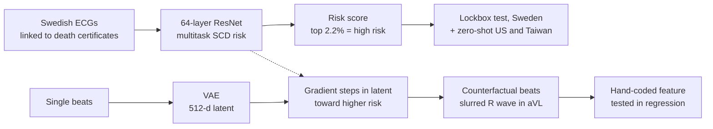

# An ECG biomarker for sudden cardiac death discovered with deep learning

> **Bibkey** `Obermeyer_2026` · **Venue** Nature (2026) · **Category** imaging · **Relevance** high · **Access** open
> **Link** <https://doi.org/10.1038/s41586-026-10674-6>
> `status: complete` — 全文精读基于本文件夹的 `source.pdf`(Nature 655:210–218, 2026,开放获取 CC BY 4.0;正文 + Methods + Reporting Summary)。补充材料(Supplementary Information)未读。旧版笔记写的是"付费墙、仅摘要",已据全文改正。/ Close reading of `source.pdf` (Nature 655:210–218, 2026, open access CC BY 4.0; main text + Methods + Reporting Summary). The Supplementary Information was not read. The earlier note said "paywalled, abstract only"; corrected from the full text.

---

## 一句话 / One-liner
<!-- ZH --> 在瑞典一个地区全部 ECG 与死亡证明链接的数据上训练深度网络预测一年内心脏性猝死(SCD),再用一个"预测模型引导的生成模型"把低风险心跳逐步变成高风险心跳,从而看出模型学到的波形特征——aVL 导联 QRS 末端的 R 波"拖尾",作者称此前未被描述(Abstract, Fig. 4–5)。
<!-- EN --> A deep network trained on all ECGs of a Swedish region linked to death certificates predicts one-year sudden cardiac death (SCD); a generative model guided by the predictor then morphs low-risk beats into high-risk ones to reveal what the model learned — a slurred terminal R wave in lead aVL that the authors say has not been described before (Abstract, Figs. 4–5).

## 要点 / Takeaways
- <!-- ZH --> 在事先封存的 40% "lockbox" 测试集上 AUC 0.872;模型划出的高风险组占 2.2%、年猝死率 7.0%,高于 LVEF 降低组(1.9%、4.6%)(Abstract, Results)。 <!-- EN --> On a 40% "lockbox" held out before any analysis, AUC is 0.872; the model's high-risk group (2.2% of the sample) has a 7.0% annual SCD rate, above the reduced-LVEF group (1.9%, 4.6%) (Abstract, Results).
- <!-- ZH --> 高风险组中只有 13.9% 已知 LVEF 降低,也就是 86.1% 是现有标准漏掉的"新"高风险患者(Fig. 3)。 <!-- EN --> Only 13.9% of the high-risk group had known reduced LVEF — 86.1% are new high-risk patients that the current standard misses (Fig. 3).
- <!-- ZH --> 不微调直接用到美国和台湾数据:美国预测室性心律失常 AUC 0.822,台湾区分心律失常性心脏骤停与对照 AUC 0.767,而对非心律失常性骤停的"安慰剂" AUC 只有 0.582(Results)。 <!-- EN --> Applied zero-shot to US and Taiwanese data: US AUC 0.822 for ventricular arrhythmias; Taiwan AUC 0.767 for arrhythmic arrests vs controls, but only 0.582 for non-arrhythmic arrests (a "placebo" test of specificity) (Results).
- <!-- ZH --> 可解释性不靠显著图:先训练一个 VAE,再沿"预测风险"的梯度在潜空间移动并解码,得到同一病人的反事实高风险心跳;显著图只能显示"看哪里",看不出"看到了什么"(Results §ECG biomarker, Methods §Generative model)。 <!-- EN --> Interpretability without saliency maps: a VAE is trained, a beat's latent is moved along the gradient of predicted risk and decoded, giving counterfactual higher-risk beats of the same patient; saliency maps only show where the model looks, not what it sees (Results §ECG biomarker, Methods §Generative model).
- <!-- ZH --> 植入除颤器的高风险患者死亡比预期低 54.4%(观察性回归,非随机);作者用 LVEF 组"重新发现"已知试验效果(67.5%,试验为 50–88%)来检验这套回归是否可信(Table 2, Results)。 <!-- EN --> High-risk patients with defibrillators died 54.4% less than expected (observational regression, not randomised); the authors sanity-check the regression by "rediscovering" the known trial effect in the LVEF group (67.5% vs 50–88% in trials) (Table 2, Results).

## 研究问题 / Problem
<!-- ZH --> 心脏性猝死原则上可以用植入式除颤器(ICD)预防,但需要先预测谁有风险。目前唯一广泛使用的指标是超声测的左室射血分数(LVEF):大多数猝死者生前没测过 LVEF,测过的人中只有少数降低(假阴性多);而因 LVEF 降低植入的除颤器约三分之二从未放电(假阳性多)(Abstract, Introduction)。ECG 便宜、标准化,但此前没有 ECG 指标能和 LVEF 竞争,也缺少链接了可靠死因的大规模 ECG 数据(Introduction)。
<!-- EN --> Sudden cardiac death is preventable in principle with implanted defibrillators (ICDs), but only if risk is predicted. The only widely used predictor is ultrasound-measured LVEF: most people who die suddenly never had LVEF measured, and of those who did only a minority had it reduced (many false negatives); two-thirds of defibrillators implanted for low LVEF never fire (many false positives) (Abstract, Introduction). ECGs are cheap and standardised, but no ECG marker has rivalled LVEF, and large ECG datasets linked to reliable causes of death were lacking (Introduction).

## 方法 / Method
<!-- ZH --> 1. **数据与划分**:取瑞典 Halland 地区 2010–2016 年全部 441,614 份 ECG(500 Hz,Philips 系统),链接死亡证明与电子病历。分析前先随机抽 40% 病人作 lockbox,论文临时接收后才打开;其余 60% 先对半分训练/验证,临时接收后在全部 60%(75,157 名患者的 262,554 份 ECG)上重训一次再在 lockbox 上出结果(Methods §Sweden, Results)。
<!-- ZH --> 2. **标签**:主结局为 ECG 后一年内的心脏性猝死,按死亡证明定义:死因为心脏或不明原因,且死于院外或入院 24 小时内(Methods)。主分析限 80 岁以下(除颤器获益随年龄下降)(Methods)。
<!-- ZH --> 3. **预测模型**:在比较了 CNN、ResNet、transformer、LSTM 后选定 64 层 ResNet(32 个残差块,每块 2 个卷积层、128 个滤波器、卷积核 16),输入 10 秒 12 导联 ECG(Methods §Predictive model)。
<!-- ZH --> 4. **多任务训练**:(i) 全队列预测多个时间窗的猝死及其他结局;(ii) 一年内死亡者中区分猝死与其他死因;(iii) 有 LVEF 的病人中预测 LVEF ≤35%;最后用 80 岁以下训练样本做 logit 校准,得到一年猝死概率(Methods)。外部数据上不做任何微调("zero-shot")(Methods)。
<!-- ZH --> 5. **高风险阈值**:取"95% CI 下界超过除颤器随机试验对照组中位猝死率(4.9%/年)"的最大高风险组,结果为最高风险的 2.2%(Results, Fig. 1)。
<!-- ZH --> 6. **外部验证**:美国 Sharp HealthCare(经 Dandelion Health 提供)2021–2022 年 251,858 份 ECG、139,613 名患者,结局为一年内 VF/VT(室颤/室速)诊断;台湾台大医院心脏骤停登记,257 例骤停(96 例为心律失常性)+ 4,011 名对照,取骤停前最近的 ECG(Results, Methods)。
<!-- ZH --> 7. **除颤器分析**:在瑞典数据上做 OLS 回归:猝死 ~ 年龄 + 性别 + 高风险指示 + 有无除颤器 + 二者交互;交互项系数即"高风险且有除颤器者比预期少死多少"(Results, Table 2)。
<!-- ZH --> 8. **生成模型与形变**:把 10 秒 ECG 切成单个心跳,训练一个 512 维潜空间的 VAE(变分自编码器),并在心跳上重训同结构的预测模型;随机取 56 个心跳编码,计算预测风险对潜向量的梯度,沿梯度移动后解码,重复最多 2,000 次或直到风险达到第 90 百分位,得到同一病人的反事实高风险心跳(Methods §Generative model)。这一部分用的是最初 30%/30% 的数据,而不是 lockbox(Methods)。
<!-- ZH --> 9. **把特征量化回去**:在 aVL 导联上从 R 峰到 QRS 结束,计算电压一阶差分和二阶差分绝对值的均值,作为新特征放进回归,控制心率、间期、电轴、QRS 时长等常规 ECG 指标(Results, Fig. 5)。
<!-- EN --> 1. **Data and splits**: all 441,614 ECGs from Region Halland, Sweden, 2010–2016 (500 Hz, Philips), linked to death certificates and health records. Before any analysis, 40% of patients were sealed as a lockbox, opened only after provisional acceptance; the other 60% were split in half for training/validation, and after provisional acceptance the model was retrained on the full 60% (262,554 ECGs from 75,157 patients) and run once on the lockbox (Methods §Sweden, Results).
<!-- EN --> 2. **Label**: SCD within one year of the ECG from death certificates: cardiac or ill-defined cause, death outside hospital or within 24 h of admission (Methods). Main analyses are restricted to under-80s, as defibrillator benefit falls with age (Methods).
<!-- EN --> 3. **Predictor**: after trying CNNs, ResNets, transformers and LSTMs, a 64-layer ResNet (32 residual blocks, each 2 conv layers with 128 filters and kernel size 16) on 10-s 12-lead ECGs (Methods §Predictive model).
<!-- EN --> 4. **Multitask training**: (i) SCD over several horizons and other outcomes in the whole cohort; (ii) SCD vs other causes among those who died within a year; (iii) LVEF ≤35% where LVEF was measured; then logit calibration on under-80 training patients for one-year SCD (Methods). No fine-tuning on external data ("zero-shot") (Methods).
<!-- EN --> 5. **High-risk threshold**: the largest group whose lower 95% CI exceeds the median control-arm SCD rate in defibrillator trials (4.9%/yr) — the riskiest 2.2% (Results, Fig. 1).
<!-- EN --> 6. **External validation**: US — Sharp HealthCare via Dandelion Health, 251,858 ECGs from 139,613 patients in 2021–2022, outcome = VF/VT (ventricular fibrillation/tachycardia) diagnosis within a year; Taiwan — National Taiwan University Hospital arrest registry, 257 arrests (96 arrhythmic) + 4,011 controls, using the most recent prior ECG (Results, Methods).
<!-- EN --> 7. **Defibrillator analysis**: OLS regression in Sweden of SCD on age, sex, high-risk indicator, defibrillator indicator and their interaction; the interaction coefficient measures how much less than expected high-risk patients with defibrillators die (Results, Table 2).
<!-- EN --> 8. **Generative morphing**: 10-s ECGs are segmented into single beats; a VAE with a 512-d latent space is trained and the predictor is retrained on beats; 56 beats are encoded, the latent is moved along the gradient of predicted risk and decoded, repeated up to 2,000 times or until risk reaches the 90th percentile, giving counterfactual higher-risk beats of the same patient (Methods §Generative model). This part uses the initial 30%/30% data, not the lockbox (Methods).
<!-- EN --> 9. **Quantify the feature**: in lead aVL, from R peak to QRS end, the mean absolute first and second voltage differences become new features in regressions that control for rate, intervals, axes, QRS duration and other standard ECG measures (Results, Fig. 5).

## 方法图 / Method diagram


## 数据 / Data
<!-- ZH --> **瑞典**:Halland 地区 2010–2016 年 441,614 份 ECG、187,677 名患者(Reporting Summary)。lockbox 共 179,060 份 ECG / 51,481 名患者;主分析(80 岁以下、有一年随访)119,541 份 ECG / 35,885 名患者,其中无除颤器者 113,072 份 / 35,417 名(Results, Methods, Table 1)。lockbox 中一年猝死率 0.6%;猝死者中 43.9% 生前测过 LVEF,其中 36.4% 为 LVEF ≤35%;41.2% 的猝死者在 ECG 时没有明显危险因素(Methods)。**美国**:Sharp HealthCare(Dandelion Health),251,858 份 ECG、139,613 名 80 岁以下患者,500 Hz(83.3%)或 250 Hz(16.7%,插值到 500 Hz),GE MUSE 系统——与瑞典 Philips 系统不同厂家(Methods)。**台湾**:台大医院急诊心脏骤停登记(Nightingale Open Science),2011–2019 年,257 例骤停 + 4,011 名对照(Methods)。**论文内部不一致**:美国患者数在正文和 Methods 中为 139,613,在 Reporting Summary 中为「251,858 ECGs from 151,015 unique patients」。另外,台湾在 Reporting Summary 中只计入 96 例心律失常性骤停(「4,107 ECGs (including 96 future arrest cases plus 4,011 controls)」),Methods 的 257 例是全部骤停(其中 96 例为心律失常性),两者口径不同、并不矛盾。本笔记采用正文数值。
<!-- EN --> **Sweden**: 441,614 ECGs from 187,677 patients, Region Halland, 2010–2016 (Reporting Summary). The lockbox holds 179,060 ECGs / 51,481 patients; main analyses (under 80 with one-year follow-up) use 119,541 ECGs / 35,885 patients, of which 113,072 / 35,417 without defibrillators (Results, Methods, Table 1). One-year SCD rate in the lockbox 0.6%; 43.9% of SCDs had LVEF measured premortem and 36.4% of those were ≤35%; 41.2% of SCDs had no obvious risk factor at the time of the ECG (Methods). **USA**: Sharp HealthCare via Dandelion Health, 251,858 ECGs from 139,613 patients under 80, 500 Hz (83.3%) or 250 Hz (16.7%, interpolated to 500 Hz), GE MUSE — a different manufacturer from Sweden's Philips (Methods). **Taiwan**: NTUH emergency-department arrest registry (Nightingale Open Science), 2011–2019, 257 arrests + 4,011 controls (Methods). **Internal inconsistency in the paper**: US patients are 139,613 in the main text and Methods but "251,858 ECGs from 151,015 unique patients" in the Reporting Summary. Separately, for Taiwan the Reporting Summary counts only the 96 arrhythmic arrests ("4,107 ECGs (including 96 future arrest cases plus 4,011 controls)"), while Methods' 257 is all arrests (96 of them arrhythmic) — different subsets, not a contradiction. This note uses the main-text values.

## 主要结果 / Key results
<!-- ZH -->
- **区分度**:lockbox AUC 0.872(95% CI 0.843–0.899);对比 AHA/ACC 10 年风险评分 0.697、ECG 深度学习心脏病模型 SEER 0.655(Results)。论文初稿(30% 训练)时 AUC 为 0.837,重训到 60% 后升至 0.872(Methods)。
- **阳性预测值**:最高风险 0.2% 年猝死率 11.0%(4.4–17.0%);最高 1.0% 为 7.9%;选定的 2.2% 为 7.0%(4.9–9.5%);LVEF 降低组 4.6%(Results, Fig. 1)。
- **心律失常**:在 2.2% 组的 7.0% 猝死之外,另有每年 3.8% 出现 VF/VT(Results, Fig. 2a)。
- **美国**:VF/VT 的 zero-shot AUC 0.822(0.812–0.831),瑞典为 0.717;最高风险 2.2% 的 VF/VT 发生率 29.1%,基线 3.8%(Results, Fig. 2b)。
- **台湾**:心律失常性骤停 vs 对照 AUC 0.767(0.706–0.823);非心律失常性骤停 vs 对照 0.582(0.529–0.636),显著更低(P<0.001)(Results)。
- **与 LVEF 的重叠**:高风险 ECG 组只有 13.9% 已知 LVEF 降低;两组同样取 1.9% 大小时猝死率 7.3% vs 4.6%(P=0.03);两者都判高风险时 10.7%;LVEF 正常或未知但 ECG 高风险者 6.4%(Fig. 3, Results)。
- **除颤器(观察性)**:高风险 ECG 且有除颤器者比预测的 6.65 个百分点少死 3.62 个百分点,即 54.4%(P<0.001);LVEF ≤35% 组为 67.5%,落在试验的 50–88% 范围内;全因死亡在 ECG 高风险组下降 39.0%,在 LVEF 组下降 4.6% 且不显著(Table 2, Results)。
- **新波形特征**:高风险形变显示左电轴偏移(符合左前分支阻滞)和 R 波递增不良——已知的缺血性心脏病相关特征;另外在 aVL 导联 QRS 末端 R 波下降支变"拖尾",取代低风险心跳中尖锐的负向 S 波,作者称未见文献描述(Fig. 4, Results)。用一阶/二阶差分量化后,回归系数在瑞典和美国都大且显著为负,在台湾方向相同但不显著;其信号量级与左电轴偏移相当且独立(Results, Fig. 5)。
- **单导联**:只用任一单导联训练的模型 AUC 与 12 导联模型接近(PPV 较低),作者解读为信号弥散于整个心肌(Results)。
- **机制假设**:设想心肌中随机分布的传导障碍会使去极化波前反复分裂;在少量有心脏 MRI 的患者中,盲法阅片显示风险最高 10% 的患者弥漫、细微的晚期钆增强(LGE,常提示心肌纤维化)更常见(Results)。
<!-- EN -->
- **Discrimination**: lockbox AUC 0.872 (95% CI 0.843–0.899) vs 0.697 for the AHA/ACC 10-year risk score and 0.655 for SEER, a published ECG deep-learning heart-disease model (Results). The originally submitted model (30% training data) had AUC 0.837; retraining on 60% raised it to 0.872 (Methods).
- **Positive predictive value**: riskiest 0.2% annual SCD 11.0% (4.4–17.0%); riskiest 1.0% 7.9%; chosen 2.2% group 7.0% (4.9–9.5%); reduced LVEF 4.6% (Results, Fig. 1).
- **Arrhythmias**: on top of the 7.0% SCD in the 2.2% group, a further 3.8% per year have VF/VT (Results, Fig. 2a).
- **USA**: zero-shot VF/VT AUC 0.822 (0.812–0.831) vs 0.717 in Sweden; VF/VT incidence in the riskiest 2.2% is 29.1% vs a 3.8% base rate (Results, Fig. 2b).
- **Taiwan**: arrhythmic arrests vs controls AUC 0.767 (0.706–0.823); non-arrhythmic arrests vs controls 0.582 (0.529–0.636), significantly lower (P<0.001) (Results).
- **Overlap with LVEF**: only 13.9% of the high-risk ECG group had known reduced LVEF; at equal group size (1.9%) SCD rates are 7.3% vs 4.6% (P=0.03); 10.7% when both flag a patient; 6.4% for high-risk ECG with normal or unknown LVEF (Fig. 3, Results).
- **Defibrillators (observational)**: high-risk-ECG patients with defibrillators died 3.62 percentage points less than the predicted 6.65 points, a 54.4% reduction (P<0.001); the LVEF ≤35% group shows 67.5%, within the 50–88% trial range; all-cause mortality falls 39.0% in the ECG high-risk group and a non-significant 4.6% in the LVEF group (Table 2, Results).
- **New waveform feature**: high-risk morphs show left axis deviation (consistent with left anterior fascicular block) and poor R-wave progression — known ischaemic correlates — plus a slurred terminal R wave in lead aVL replacing the sharp negative S wave of the low-risk beat, which the authors say is undescribed (Fig. 4, Results). Quantified by first/second differences, its regression coefficients are large, negative and significant in Sweden and the USA, same direction but not significant in Taiwan, and add independent signal of similar size to left axis deviation (Results, Fig. 5).
- **Single leads**: models trained on any single lead reach AUCs close to the 12-lead model (with lower PPV), which the authors read as a diffuse process throughout the myocardium (Results).
- **Mechanistic hypothesis**: randomly distributed conduction obstacles could make the depolarisation wavefront split repeatedly; among the few patients with cardiac MRI, blinded review found subtle diffuse late gadolinium enhancement (LGE, usually a sign of fibrosis) more often in the riskiest 10% (Results).

## 创新点 / Contributions
- <!-- ZH --> 用"预测模型引导的生成模型"做发现:沿风险梯度在潜空间形变同一病人的心跳,隔离出模型看到的风险信号,再把它写成人能测量的特征并独立检验(Results, Methods)。 <!-- EN --> Discovery via a predictor-guided generative model: morph a patient's beat along the risk gradient in latent space to isolate what the model sees, then turn it into a human-measurable feature and test it independently (Results, Methods).
- <!-- ZH --> 严格的 lockbox 设计:测试集在任何分析前封存、直到临时接收才打开(Methods)。 <!-- EN --> A strict lockbox: the test set was sealed before any analysis and opened only after provisional acceptance (Methods).
- <!-- ZH --> 用三种不同标签(死亡证明、VF/VT 诊断、逐例核查的骤停原因)和"安慰剂" AUC 检验模型对心律失常死亡的特异性(Results)。 <!-- EN --> Specificity for arrhythmic death checked with three different labels (death certificates, VF/VT diagnoses, case-reviewed arrest causes) and a "placebo" AUC (Results).

## 局限 / Limitations
- <!-- ZH --> 作者:除颤器分析是观察性的,未测混杂可能造成偏倚;结果来自现行实践下被选中植入的患者,不一定能推广;需要随机试验(Results, Clinical implications)。 <!-- EN --> Authors: the defibrillator analysis is observational and may be biased by unmeasured confounding; it concerns patients selected for devices under current practice and may not generalise; a randomised trial is needed (Results, Clinical implications).
- <!-- ZH --> 作者:死亡证明可能把非心律失常死亡误标为心律失常;三个数据集的设计和结局定义不同,影响指标解读;台湾为病例对照设计,无法计算 PPV(Results)。 <!-- EN --> Authors: death certificates may mislabel non-arrhythmic deaths; the three datasets differ in design and outcome definitions, which affects interpretation; Taiwan is case–control, so PPV cannot be computed (Results).
- <!-- ZH --> 作者:生成模型与形变结果来自最初 30%/30% 数据而非 lockbox,用于产生假设而非评估性能;纤维化机制是推测性的(Methods, Results)。 <!-- EN --> Authors: the generative and morphing results use the initial 30%/30% data, not the lockbox, and serve hypothesis generation rather than performance claims; the fibrosis mechanism is speculative (Methods, Results).
- <!-- ZH --> 作者利益:Z.O. 与 S.M. 是美国验证数据来源 Dandelion Health 的联合创始人并持股(数据免费提供,公司未参与分析)(Competing interests)。 <!-- EN --> Authors' interests: Z.O. and S.M. co-founded and hold equity in Dandelion Health, the US data source (data provided free; the company had no role in analysis) (Competing interests).
- <!-- ZH --> 我们的理解:形变只从 56 个心跳出发(Methods)。作者称这些变化在低/高风险形变的中位心跳以及低/高风险真实心跳中都普遍存在(Supplementary Information V.E,我们未读);量化后的新特征在瑞典、美国显著,在台湾方向相同但不显著。 <!-- EN --> Our reading: morphing starts from 56 beats (Methods). The authors report the changes are general across median low- vs high-risk morphs and actual beats (Supplementary Information V.E, not read by us); the coded feature is significant in Sweden and the USA, same direction but not significant in Taiwan.

## 与本研究方向的关系 / Relation to our direction
<!-- ZH --> 我们的理解:严格说这是**有监督风险预测 + 生成式解释**,不是无监督异常检测;但它示范了 detect 之后最难的一步——**把"模型觉得异常"变成"人能说清楚、能独立检验的新特征"**。对伪影注入课题有三点可借鉴。(1) **反事实形变代替显著图**:在 VAE 潜空间沿分数梯度移动、解码,看同一样本"变得更异常"时改变了什么。在肾脏上可以把异常分换成预测器,在 H&E patch 或单细胞表达的生成模型潜空间里做同样的事,得到"同一个小管/细胞更异常时长什么样",交给病理专家判断是真病变还是伪影。(2) **把发现量化回去并在外部数据检验**:作者把形变中看到的 aVL 拖尾写成一阶/二阶差分特征,控制已知指标后在独立数据中回归——对应 KidneyAnomalyBench 中"专家确认后再做独立验证"的环节。(3) **lockbox 与"安慰剂"对照**:事先封存测试集、用不该被预测的结局(非心律失常骤停)检验特异性,这两种做法可以直接用于我们的异常检测评估,例如检验异常分是否也会被已知技术伪影推高。与 model / revert 的关系:纤维化假设是"从发现到机制"的一步,但没有分子或扰动层面的内容。
<!-- EN --> Our reading: strictly this is **supervised risk prediction plus generative explanation**, not unsupervised anomaly detection, but it demonstrates the hardest step after detection — **turning "the model finds this abnormal" into a new feature humans can state and test independently**. Three lessons for the artifact-injection topic. (1) **Counterfactual morphing instead of saliency**: move along the score gradient in a VAE latent and decode to see what changes as the same sample becomes more abnormal. In kidney, replace the risk predictor with an anomaly score and do this in the latent space of a generative model of H&E patches or single-cell expression, yielding "what this tubule/cell looks like when more abnormal" for pathologists to judge as lesion or artifact. (2) **Quantify the finding and test it externally**: the aVL slurring is coded as first/second-difference features and regressed in independent data with known measures controlled — the analogue of "expert confirmation, then independent validation" in KidneyAnomalyBench. (3) **Lockbox and placebo outcomes**: a sealed test set and an outcome the model should not predict (non-arrhythmic arrest) test specificity; both carry over to our evaluation, e.g. checking whether anomaly scores are also raised by known technical artifacts. For model / revert: the fibrosis hypothesis is a step from discovery to mechanism, but there is no molecular or perturbation content.

## 可复用资产 / Reusable assets
- <!-- ZH --> **代码**:形变流程等代码公开;瑞典数据训练的深度模型因 GDPR 只能通过与 Region Halland 合作获取(Code availability)。 <!-- EN --> **Code**: the morphing pipeline and other code are public; deep models trained on Swedish data are available only via a collaboration agreement with Region Halland under GDPR (Code availability).
<!-- ZH/EN --> <https://github.com/alexmschubert/ECG-SCD>
- <!-- ZH --> **数据**:台湾心脏骤停 ECG 数据在 Nightingale Open Science 免费开放;瑞典需合作协议;美国数据经 Dandelion Health 申请(Data availability)。 <!-- EN --> **Data**: the Taiwanese arrest ECG dataset is freely available on Nightingale Open Science; Sweden needs a collaboration agreement; US data via Dandelion Health (Data availability).
<!-- ZH/EN --> <https://docs.ngsci.org/datasets/arrest-ntuh-ecg/>
- <!-- ZH --> **可抄的设计**:lockbox 封存、按试验对照组风险设阈值、"安慰剂" AUC、用已知效应检验观察性回归(Results, Methods)。 <!-- EN --> **Designs to copy**: sealed lockbox, threshold set from trial control-arm risk, placebo AUC, validating an observational regression by rediscovering a known effect (Results, Methods).

## 待读 / Follow-ups
- <!-- ZH --> Supplementary Information V.A–B:VAE 与形变的细节(损失、步长、是否约束在数据流形上)。 <!-- EN --> Supplementary Information V.A–B: VAE and morphing details (loss, step size, whether moves stay on the data manifold).
- <!-- ZH --> 同组更早的工作:Nightingale Open Science(Mullainathan & Obermeyer, Nat. Med. 2022,本文 ref 55)。 <!-- EN --> The group's earlier work: Nightingale Open Science (Mullainathan & Obermeyer, Nat. Med. 2022; ref. 55 here).
- <!-- ZH --> 在 H&E 或单细胞数据上做"分数引导的潜空间反事实"的已有方法(如扩散模型反事实),对照本文思路。 <!-- EN --> Existing score-guided latent counterfactual methods for H&E or single-cell data (e.g. diffusion counterfactuals), compared with this approach.

## 图表 / Figures & tables

<!-- ZH --> _开放获取(CC BY 4.0)。以下链接到 nature.com 上的原图,本卡未下载图片;数字来自正文。_
<!-- EN --> _Open access (CC BY 4.0). The entries below link to the figures on nature.com; no images are downloaded here; numbers come from the main text._

<!-- ZH --> **图1**:猝死的阳性预测值——高风险组年猝死率随定义阈值(风险百分位)的变化;深红点为选定的 2.2% 高风险组。见 <https://www.nature.com/articles/s41586-026-10674-6/figures/1>
<!-- EN --> **Fig 1**: Positive predictive value for SCD — annual SCD rate in the high-risk group vs the percentile threshold; the dark-red point is the chosen 2.2% group. See <https://www.nature.com/articles/s41586-026-10674-6/figures/1>

<!-- ZH --> **图2**:高风险组室性心律失常发生率随阈值的变化:a 瑞典,b 美国。见 <https://www.nature.com/articles/s41586-026-10674-6/figures/2>
<!-- EN --> **Fig 2**: Ventricular-arrhythmia incidence in the high-risk group vs threshold: a Sweden, b USA. See <https://www.nature.com/articles/s41586-026-10674-6/figures/2>

<!-- ZH --> **图3**:瑞典数据中高风险 ECG 组与 LVEF 降低组的重叠及各自猝死率。见 <https://www.nature.com/articles/s41586-026-10674-6/figures/3>
<!-- EN --> **Fig 3**: Overlap of the high-risk ECG group and the reduced-LVEF group in Sweden, with SCD rates. See <https://www.nature.com/articles/s41586-026-10674-6/figures/3>

<!-- ZH --> **图4**:同一病人低风险心跳(深紫)与其高风险形变(浅橙)的 12 导联对比;橙色箭头指 aVL 的新特征。见 <https://www.nature.com/articles/s41586-026-10674-6/figures/4>
<!-- EN --> **Fig 4**: One patient's low-risk beat (dark purple) vs its high-risk morph (light orange) on 12 leads; the orange arrowhead marks the new aVL feature. See <https://www.nature.com/articles/s41586-026-10674-6/figures/4>

<!-- ZH --> **图5**:aVL 新特征的量化——从 R 峰到 QRS 结束的一阶、二阶差分累计。见 <https://www.nature.com/articles/s41586-026-10674-6/figures/5>
<!-- EN --> **Fig 5**: Quantifying the aVL feature — cumulative first and second differences from R peak to QRS end. See <https://www.nature.com/articles/s41586-026-10674-6/figures/5>

### 结果表 / Results

<!-- ZH --> **表1.** 瑞典 lockbox 中各组的样本占比与年猝死率(Results, Fig. 3;n = 113,072 份无除颤器 ECG)。 <!-- EN --> **Table 1.** Share of sample and annual SCD rate by group in the Swedish lockbox (Results, Fig. 3; n = 113,072 ECGs without defibrillators).

| Group / 组 | Share of sample / 样本占比 | Annual SCD rate / 年猝死率 |
|---|---|---|
| Model high-risk ECG / 模型高风险 ECG | 2.2% | 7.0% |
| Reduced LVEF ≤35% / LVEF 降低 | 1.9% | 4.6% |
| Both / 两者都是 | 0.3% | 10.7% |
| High-risk ECG, normal LVEF / ECG 高风险、LVEF 正常 | 0.7% | 6.4% |
| High-risk ECG, LVEF missing / ECG 高风险、LVEF 未测 | 1.2% | 6.4% |
| Reduced LVEF, not ECG high-risk / LVEF 降低但 ECG 非高风险 | 1.6% | 3.4% |

<!-- ZH --> 外部验证(zero-shot):美国 VF/VT AUC 0.822;台湾心律失常性骤停 AUC 0.767,非心律失常性 0.582(Results)。 <!-- EN --> External validation (zero-shot): US VF/VT AUC 0.822; Taiwan arrhythmic arrest AUC 0.767, non-arrhythmic 0.582 (Results).

<!-- ZH/EN --> _Source: https://www.nature.com/articles/s41586-026-10674-6  ·  Nature 655 (2026) 210–218 · CC BY 4.0_

## 引用 / Cite
```bibtex
@article{Obermeyer_2026, title={An ECG biomarker for sudden cardiac death discovered with deep learning}, volume={655}, ISSN={1476-4687}, url={http://dx.doi.org/10.1038/s41586-026-10674-6}, DOI={10.1038/s41586-026-10674-6}, number={8121}, journal={Nature}, publisher={Springer Science and Business Media LLC}, author={Obermeyer, Ziad and Schubert, Alexander and Ross, James and Mullainathan, Sendhil and Lingman, Markus}, year={2026}, month=jun, pages={210–218} }
```
